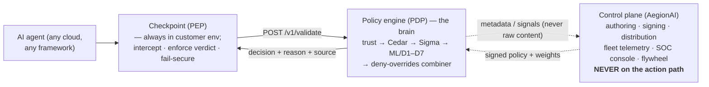

# CLAUDE.md

This file provides guidance to Claude Code (claude.ai/code) when working with code in this repository.

## Working Style & Token Discipline

- **Chat replies are terse.** Lead with the answer; drop filler and preamble. This applies to conversation only — documents, LLDs, and deliverables keep their normal depth and polish.
- **Never reproduce file/doc contents back into chat.** Reference `file:line` (clickable) instead of pasting sections.
- **Revise docs with Edit, not full rewrites** — saves output tokens and avoids re-reading the whole file each turn.
- **Don't front-load docs into the main thread.** To gather context across many/large docs, dispatch a subagent (see the `/brief` skill) and pull back only a digest; keep big bodies out of the main conversation, which re-bills them as cache-read every turn.
- **Batch independent tool calls** into one turn; keep dependent calls sequential.
- Reserve extended thinking ("think hard") for genuinely hard review/architecture judgment, not routine turns.

## Project Overview

**AegionAI Guard** (customer-facing brand; parent company **AegionAI**) — a **neutral, cross-vendor runtime control plane that governs the *actions* AI agents take** across AWS, Azure, GCP, and on-prem from one place. "**Sentra**" is the **internal control-plane codename** (and the repo/codebase name); never customer-facing. *(Branding: [pitch/share/STRATEGY.md](pitch/share/STRATEGY.md):1,138; [lld/ARCHITECTURE.md](lld/ARCHITECTURE.md):1; LLD 25 header.)*

> **Source of truth.** This file is a working orientation. The authoritative docs are
> [vision.md](vision.md) (vision), [PRD.md](PRD.md) (requirements), [lld/ARCHITECTURE.md](lld/ARCHITECTURE.md) (architecture + ADRs),
> [pitch/share/STRATEGY.md](pitch/share/STRATEGY.md) (market/GTM/moat). When this file and those disagree, **they win** — and fix this file.

### Vision
Enterprises run autonomous AI agents across every cloud with **one neutral layer governing what those agents are allowed to *do*** — the cross-vendor control plane no single cloud can be (the Wiz/Datadog-on-top-of-the-clouds pattern). Canonical: [vision.md](vision.md) (three pillars — stop harm before it happens / make autonomy safe / trusted on every cloud).

### Mission
Govern AI-agent **actions** — evaluating *what an action does* (parameters, identity, sequence, session/trust state), not just whether a prompt looks bad — and stop the harmful action the instant it happens, **neutrally across every vendor**, with a deployment model regulated buyers accept (in-VPC, air-gapped).

### Core Value Proposition
Inline blocking is **no longer the differentiator** — point tools block too now. The edge is governing the **action with session state** and **neutrality across every vendor**:
- **Action-level governance** — parameters, sequence integrity, identity/authorization, injection signals, accumulated trust — not just "is this tool allowed?"
- **Neutral, cross-vendor** — one plane across AWS/Azure/GCP/on-prem; a position the clouds structurally cannot hold.
- **Block-before-execute + quarantine + fail-secure** (built today); **bounded, opt-in rollback** only where an action is *reversible* (compensating op + returned handle) — never a promise to undo the irreversible (roadmap; network sidecar is **preventive-only, no rollback**).
- **Cross-vendor threat-data flywheel** — de-identified signals up, protection down (the CrowdStrike pattern).
- **Tamper-evident audit / system-of-record** for SOC 2 / HIPAA / EU AI Act.

## Repository Structure

This is **not a docs-only repo** — there is working implementation (Python + AWS CDK + React).

```
/Sentra/
├── src/                          # Application code (Python)
│   ├── security-controller/      # The PDP "brain": app/validators/{cedar,sigma_engine,
│   │                             #   ml_classifier,trust_checker,abuse_detector,cross_agent_validator},
│   │                             #   combiners/signal.py (deny-overrides), api/, services/, utils/
│   ├── connectors/               # bedrock/ + azure_foundry/ interceptors (GCP roadmap)
│   ├── dashboard/                # dashboard backend service
│   ├── payment-agent/            # demo agent (financial-action)
│   ├── customer-query-agent/     # demo agent
│   ├── demo-orchestrator/        # multi-agent demo orchestration
│   └── common/                   # shared utilities
├── cdk/                          # AWS CDK infra (Python): stacks/{network,storage,compute,
│   │                             #   api,monitoring,cognito,bedrock_agent}_stack.py
│   └── app.py
├── frontend/                     # React 19 + TypeScript + Tailwind 4 + Vite
├── docker/                       # 7 Dockerfiles (controller, dashboard, agents, console)
├── tests/  ·  lambda/  ·  scripts/  ·  config/
│
├── lld/                          # 27 docs — ARCHITECTURE.md (the index) + NN-*.md (01–26)
├── pitch/                        # share/ (STRATEGY, architecture-brief, one-pager-v2),
│                                 #   internal/, customer/, technical/, archive/, legal/
│
├── PRD.md  ·  vision.md          # canonical requirements + vision
├── design-hld.md · adr.md · flow.md · demo.md   # HLD / decisions / flows / demo (cross-doc sync targets)
└── Kuberneters-Control-Plane-For-AI-Agents.md · Prototype-Plan.md · Sentra.md ·
    The-Missing-Security-Governance-Layer.md      # ⚠️ HISTORICAL (Nov-2025); superseded — do not rely on
```

## Common Commands

There is **no Makefile and no monorepo task runner** — each language/area has its own toolchain. Two Python virtualenvs are expected: a **repo-root `venv/`** (used by CDK — see `cdk/cdk.json` `app: ../../venv/bin/python3 app.py`) and **`src/security-controller/venv/`** (the PDP service). Activate the matching one before running a command.

### PDP / Security Controller — [src/security-controller/](src/security-controller/)
```bash
cd src/security-controller
python -m venv venv && source venv/bin/activate          # first time
pip install -r requirements.txt -r requirements-test.txt # runtime + test deps

# Run the service locally (FastAPI/uvicorn on :8080) — or just: ./start_server.sh from repo root
python -m uvicorn app.main:app --host 0.0.0.0 --port 8080 --reload

# Tests (pytest lives in tests/ AND as loose test_*.py in the package root)
pytest tests/ -v                                  # the main suite
pytest tests/ test_e2e.py test_validate_endpoint.py test_alarms.py test_milestone3.py  # include root-level tests
pytest tests/test_cedar_evaluator.py -v           # a single file
pytest tests/test_combiner.py -k deny_overrides   # a single test by name
pytest tests/ --cov=app --cov-report=html         # with coverage
```

### Frontend console — [frontend/](frontend/) (React 19 + Vite)
```bash
cd frontend
npm install
npm run dev        # Vite dev server
npm run build      # tsc -b && vite build
npm run lint       # eslint
```

### CDK infrastructure — [cdk/](cdk/) (Python; deploys to AWS account 531109575379, profile `sentra`)
```bash
./scripts/setup_cdk.sh                 # installs root-venv deps + verifies CDK CLI (run from repo root)
export AWS_PROFILE=sentra AWS_REGION=us-east-1
cd cdk
cdk bootstrap aws://531109575379/us-east-1   # first time only
cdk synth                              # generate CloudFormation
cdk diff
cdk deploy --all                       # respects stack dependency order
```
**Heed the production-safety rules** (global CLAUDE.md): prefer read/describe/list, never `cdk destroy` or delete resources without explicit confirmation.

### Top-level tests — [tests/](tests/) (CDK + policy + cross-cloud integration, run from repo root)
```bash
pytest tests/unit/ -v                  # CDK stack + policy/scenario unit tests
pytest tests/integration/ -v           # e2e agent / policy-CRUD / cross-cloud scenarios
```

### Drop-in SDK (PEP) — [demo-agents/sdk/aegion-guard-python/](demo-agents/sdk/aegion-guard-python/)
Runtime is **stdlib-only by design** (vendors unchanged into a Lambda zip / Azure Function — LLD 23 §2); the `identity` extra adds `PyJWT[crypto]` for ES256. Tests use `asyncio_mode = auto`, `testpaths = tests`.
```bash
cd demo-agents/sdk/aegion-guard-python
pip install -e ".[dev]"
pytest                                 # config in pyproject.toml ([tool.pytest.ini_options])
```

### Demo agents & seeding
```bash
AEGION_DEMO_BACKEND=memory python demo-agents/run_local_demo.py   # offline multi-agent demo
pytest demo-agents/tests/ -v                                      # offline demo tests (shared FakeController)
python scripts/seed_all.py                                        # seed agents/policies/tools/sigma into DynamoDB (needs AWS)
./scripts/build_and_push_images.sh                                # build + push the 7 Docker images to ECR (needs sentra profile)
```

> ⚠️ [src/security-controller/README.md](src/security-controller/README.md) is **stale** — it marks shipped validators (Cedar/Sigma/trust/abuse) as "TODO" and predates the Cedar cutover. Trust this file + [lld/ARCHITECTURE.md](lld/ARCHITECTURE.md) for current status, not that README.

## Architecture (PEP/PDP split — NOT a Kubernetes/CRD model)

The operative model is [lld/ARCHITECTURE.md](lld/ARCHITECTURE.md) §2. **The Kubernetes/CRD analogy is retired** — it survives only as (a) a loose switching-cost/champion-familiarity metaphor in pitch docs and (b) P2-roadmap (Y3) CRD vocabulary. Brain-and-wires framing: [lld/25-network-sidecar-data-plane.md](lld/25-network-sidecar-data-plane.md) §1.3.



1. **PEP / PDP split** (tenet 1: *enforcement is local; the control plane is never on the action path*):
   - **Checkpoint (PEP)** — in the customer's env; intercepts the action, calls the engine, enforces the verdict fail-secure.
   - **Policy engine (PDP)** — the "brain"; full validator pipeline → decision + reason + deciding source + action (block / rollback / quarantine). Implemented in [src/security-controller/](src/security-controller/).
   - **Control plane** — authoring, signing, distribution, fleet telemetry, SOC console, threat-data flywheel. **Never on the action path.**

2. **Three "wires" (PEP forms — same brain behind all)**: **SDK decorator** (today) · **connector** interceptor (Bedrock action-group Lambda / Azure Function — [src/connectors/](src/connectors/), live) · **network sidecar** (roadmap; zero-code, non-bypassable, **preventive-only/no rollback**).

3. **Three deployment editions = where the PDP runs** (AD-6): **Serverless** (multi-tenant, AegionAI cloud — today; content leaves boundary) · **Dedicated** (single-tenant, customer VPC, managed by us — roadmap; only metadata leaves) · **Self-Managed** (air-gapped — roadmap; nothing leaves).

4. **Decision flow**: one endpoint `POST /v1/validate`, branches on `phase` (request live; content/output/memory roadmap). Cheap deterministic frontier (trust → **Cedar** policy → **Sigma** signature → taint/abuse) short-circuits before any model; expensive models (ML classifier, D1–D7) run after; **deny-overrides combiner** ([src/security-controller/app/combiners/signal.py](src/security-controller/app/combiners/signal.py)) names the deciding source.

5. **Core components** (validators live under [src/security-controller/app/validators/](src/security-controller/app/validators/)): Checkpoint/SDK · **Cedar** policy engine (**not OPA/Rego — AD-2**) · Detectors (Sigma live + ML shadow + D1–D7 defense-in-depth + multimodal) · Trust & containment (quarantine, cross-agent filtering) · Rollback coordinator (effect-handle compensation, roadmap) · Audit store (DynamoDB + CloudWatch today, pluggable) · Connectors/Import · Management plane · Control plane/console.

**Abandoned vocabulary (do not use):** `Pod`-analog Agent CRD, `ToolBinding`, `AgentTopology`, `AgentRBAC`. `AgentPolicy`/`AgentTrust` exist only as **P2-roadmap (Y3) CNCF CRDs** (PRD FR-2.6); today's policy authority is **Cedar**.

## Core Security Features (with today-vs-roadmap status)

Runtime security enforcement, staged honestly (deterministic floors ship first; ML behind shadow→enforce):

1. **Tool/API call guardrails** — Cedar allow/deny + parameter bounds + sequence integrity. **Live.**
2. **Prompt-injection detection** — Sigma signatures (live, blocking) + ML classifier (**shadow today**, not yet enforcing).
3. **Privilege-escalation prevention / cross-agent filtering** — `cross_agent_validator`. **Live**; mesh-wide *blast-radius containment* is roadmap.
4. **Agent quarantine** — trust-score-driven isolation. **Live.**
5. **Data redaction / DLP** — input-side PII/credential masking. **Roadmap** (Serverless content is unredacted-for-the-engine today; FR-3.13).
6. **Bounded rollback** — SDK-only compensation for *reversible*, handle-returning actions, dependency-ordered. **Roadmap.** Block-before-execute is primary; **network sidecar is preventive-only (no rollback)**.
7. **Tamper-evident audit / chain-of-thought forensics** — append-only audit is live; full forensic chain-of-thought is **roadmap**.

## Development Approach

**The roadmap is NOT maintained here** (a dated month-by-month plan is exactly what rotted this file before). The authoritative roadmap is:
- **Phases** — PRD P0 / P1 / P2 (see [PRD.md](PRD.md)).
- **5-year ARR plan + GTM ladder** — [pitch/share/STRATEGY.md](pitch/share/STRATEGY.md) §4 (roughly Y1≈P0, Y2≈P1, Y3+≈P2; CRDs/CNCF are a Y3 item, not near-term).
- **Editions ladder** (how the product climbs): **Serverless (today) → Dedicated/in-VPC → Self-Managed/air-gapped** — [pitch/share/architecture-brief.md](pitch/share/architecture-brief.md).

**Direction in one line:** land on Serverless (SDK/connector, shadow→enforce), climb to in-VPC then air-gapped as residency needs demand; the two-moat thesis (below) drives which segment funds which capability.

## Key Design Principles

1. **Separation of Concerns** - Control plane separate from runtime execution
2. **Defense in Depth** - Multiple layers of security validation
3. **Zero Trust** - Every action validated, no implicit trust
4. **Fail Secure** - Deny by default, explicit allow policies
5. **Observable by Design** - All state changes logged and traceable
6. **Declarative Configuration** - Policies as code, version controlled
7. **Horizontal Scalability** - Support single agent to fleet management

## Competitive Differentiation

Full landscape: [pitch/share/STRATEGY.md](pitch/share/STRATEGY.md) §2. **Inline blocking is no longer the differentiator** (point tools block too now) — the edge is *stateful action governance + neutrality across vendors*.

- **vs cloud giants (AWS Bedrock AgentCore, Azure AI Foundry, Google):** they ship strong *single-cloud* controls but each governs only its own cloud and won't guard a rival's — **neutral cross-vendor is ours**. AgentCore (NL→Cedar, deny-at-Gateway, GA) only governs agents *built on Bedrock*; we intercept agents on the customer's own infra, any cloud. AgentCore is *validation*, not a head-to-head.
- **vs point tools (Lakera→Check Point, CalypsoAI→F5, HiddenLayer, CrowdStrike):** stateless, prompt/content-level, single-stack; we govern the **action + parameters with session state**, neutral across vendors.
- **vs Zenity:** closest, but Microsoft-Foundry-only.
- **vs AI gateways (Portkey, LiteLLM) / observability (LangSmith, Arize):** govern LLM *calls* or sit off the action path — structurally can't block the action.
- **Identity vendors (Okta, CyberArk, Entra Agent ID):** complementary partners (*who* the agent is), not competitors (*what* the action may do).

### Moat — two moats, by segment (STRATEGY §2)
Deliberately **two**, each strongest where the other is weakest:
- **Moat 1 — data flywheel** (compounds with scale; strongest in **Serverless/mid-market**). Two tracks: **content** (injection/DLP, fed by Serverless *redacted* content) + **behavioral** (egress reputation/anomaly/trust/outcome labels, fed by de-identified metadata from *every* edition). Regulated/in-VPC leaks no content → feeds behavioral + opt-in signatures, doesn't feed content. *Load-bearing open question: content-fed vs. metadata/signature-fed share of detection lift — unmeasured.*
- **Moat 2 — structural** (needs no data; strongest in **regulated/in-VPC**): neutrality + switching cost (egress re-routing, audit system-of-record) + compliance certification + on-prem permanence + signature-intel.
- **Patent pending** — defensibility at the margin, **not** a moat; don't lead with it.

*One-line read: Serverless is where the data moat compounds; regulated is where the structural moat holds.*

## Technology Stack (actual — verified against the code)

- **Backend / PDP**: **Python** ([src/security-controller/](src/security-controller/)) — not Go/Rust.
- **Policy engine**: **Cedar** ([src/security-controller/app/validators/cedar/](src/security-controller/app/validators/cedar/)), with YAML/JSON authoring compiled to Cedar — **AD-2; not OPA/Rego.**
- **Detectors**: Sigma engine + ML classifier + trust/abuse/cross-agent validators (all under `app/validators/`); deny-overrides combiner in `app/combiners/signal.py`.
- **API**: REST/HTTP via **AWS API Gateway + ALB** (CDK) — not gRPC. Single `POST /v1/validate` contract.
- **Infra (IaC)**: **AWS CDK (Python)** — [cdk/stacks/](cdk/stacks/) (network, storage, compute, api, monitoring, cognito, bedrock_agent).
- **Storage / audit**: **DynamoDB + S3 + CloudWatch** (pluggable per cloud/on-prem) — not PostgreSQL/CockroachDB; no SBOM ledger.
- **Connectors**: **Bedrock + Azure Foundry** ([src/connectors/](src/connectors/)); GCP roadmap.
- **Frontend**: **React 19 + TypeScript + Tailwind 4 + Vite** ([frontend/](frontend/)).
- **Containers**: **Docker** — 7 images ([docker/](docker/)).
- **AuthN/Z**: **Cognito** (CDK `cognito_stack.py`); OIDC + RBAC.
- **IP protection (in-VPC editions, roadmap)**: self-hostable distilled CPU model + confidential-computing enclaves (Nitro / Azure CVM / GCP CVM) — not Firecracker/Wasmtime.
- **Not yet implemented**: CI/CD (GitOps Flux/ArgoCD planned), input-side redaction/DLP, rollback coordinator.

## Key Documentation References

When working on specific features, refer to (the four legacy root .md files are **superseded** — do not use):

- **Architecture + ADRs**: [lld/ARCHITECTURE.md](lld/ARCHITECTURE.md) (the LLD index) + the numbered [lld/](lld/) NN-*.md
- **Requirements**: [PRD.md](PRD.md)  ·  **Vision**: [vision.md](vision.md)
- **Market / GTM / moat**: [pitch/share/STRATEGY.md](pitch/share/STRATEGY.md)
- **Investor-facing architecture**: [pitch/share/architecture-brief.md](pitch/share/architecture-brief.md)
- **HLD / decisions / flows / demo** (keep in sync per LLD rules): [design-hld.md](design-hld.md) · [adr.md](adr.md) · [flow.md](flow.md) · [demo.md](demo.md)

## Critical Constraints

1. **Low Latency**: deterministic-floor target **≤500 ms p99**; ML-hot ≤900 ms (LLD 24). Honest today: ~0.6–1.2 s on Serverless (every call is a network round-trip to us) — the in-VPC local-floor path is what closes this. A *currently-unmet target*, not a vague aspiration.
2. **Security First**: never compromise security for convenience; **fail-secure / deny-by-default**.
3. **Multi-Cloud**: AWS + Azure today, **GCP roadmap**; on-prem via Self-Managed edition.
4. **Compliance Ready**: design for SOC 2 (Type II in progress), HIPAA, GDPR, EU AI Act; tamper-evident audit is the evidence substrate.
5. **The data boundary is the customer's to set** (edition choice) — Serverless content leaves (redacted, roadmap); Dedicated metadata-only; Self-Managed nothing leaves.
6. **Honest staging**: ship deterministic floors first; ML stays in shadow until shadow→enforce graduation.

*(CRDs/CNCF standardization are a Y3 roadmap item — not a current "standards-based" constraint.)*

---

## Best Practices for Low-Level Design (LLD)

### 1. Keep LLD Focused on Specific Component Context

Each LLD document should focus on **one specific component or layer**:
- ✅ Good: `01-cdk-infrastructure.md`, `02-api-gateway.md`, `03-security-controller.md`
- ❌ Bad: Single monolithic LLD file covering everything

**Rationale**:
- Easier to review and maintain
- Clear ownership and scope
- Parallel development possible

### 2. Maintain Cross-Document Consistency

**Critical**: When making changes to any LLD, update ALL related documents:

| Document | Purpose | What to Sync |
|----------|---------|--------------|
| `lld/*.md` | Component-specific design | Implementation details, APIs, schemas |
| `design-hld.md` | High-level architecture | Component interactions, data flows |
| `adr.md` | Architecture decisions | Rationale for design choices |
| `flow.md` | Operational flows | End-to-end request flows |
| `demo.md` | Demo scenarios | User-facing behaviors |

**Example**: If you add a new API endpoint to `02-api-gateway.md`:
1. Update `design-hld.md` - Add endpoint to API Gateway section
2. Update `flow.md` - Add flow diagram showing endpoint usage
3. Update `adr.md` - Document decision if it's a significant change
4. Update `demo.md` - Add demo scenario if user-facing

**Verification Checklist**:
- [ ] Are agent names consistent across all docs?
- [ ] Are API endpoints consistent (paths, methods, parameters)?
- [ ] Are rate limits documented consistently?
- [ ] Are architecture diagrams up-to-date?

### 3. Use Pseudo-Code, Not Concrete Implementation

LLD should describe **WHAT** and **HOW** at a conceptual level, not provide production code.

**✅ Good - Pseudo-code/Conceptual CDK**:
```python
# Create VPC with 2 availability zones
vpc = ec2.Vpc(
    self, "SentraVpc",
    max_azs=2,
    nat_gateways=1
)

# Create security group for agents
agent_sg = ec2.SecurityGroup(
    self, "AgentSecurityGroup",
    vpc=vpc,
    description="Security group for AI agents"
)
```

**❌ Bad - Full concrete implementation**:
```python
# Don't include complete error handling, logging, retry logic
vpc = ec2.Vpc(
    self, "SentraVpc",
    max_azs=2,
    cidr="10.0.0.0/16",
    subnet_configuration=[
        ec2.SubnetConfiguration(
            subnet_type=ec2.SubnetType.PUBLIC,
            name="Public",
            cidr_mask=24
        ),
        ec2.SubnetConfiguration(
            subnet_type=ec2.SubnetType.PRIVATE_WITH_EGRESS,
            name="Private",
            cidr_mask=24
        )
    ],
    nat_gateways=1,
    enable_dns_hostnames=True,
    enable_dns_support=True
)
try:
    agent_sg = ec2.SecurityGroup(...)
    # 50 more lines of detailed configuration
except Exception as e:
    logger.error(f"Failed to create security group: {e}")
    raise
```

**Rationale**:
- Focus on design decisions, not implementation details
- Keep document readable and maintainable
- Actual implementation goes in `/cdk` and `/src` directories

### 4. Keep LLD Documents Concise

**Target Length**:
- **Minimum**: No hard minimum, but should be comprehensive
- **Ideal**: 500-1000 lines per LLD document
- **Maximum**: 2000 lines (hard limit)

**If an LLD exceeds 2000 lines**:
1. Split into multiple LLD documents (e.g., `02a-api-gateway-endpoints.md`, `02b-api-gateway-monitoring.md`)
2. Move detailed examples to separate appendix
3. Move concrete code to implementation files
4. Reference external documents instead of duplicating content

**Example Structure** (actual filenames; [lld/ARCHITECTURE.md](lld/ARCHITECTURE.md) is the index, docs run 01–26):
```
lld/
├── ARCHITECTURE.md               # the index / canonical architecture
├── 01-cdk-infrastructure.md
├── 02-api-gateway.md
├── 03-security-controller.md
├── 04-dashboard-v2.md
├── 05-ai-agents.md  /  05-agent-management-apis.md
└── … through 26-multi-tenancy.md
```

**Rationale**:
- Easier to review (< 30 min per document)
- Faster to find information
- Better for version control diffs
- Less cognitive load

### 5. Document Structure Template

Each LLD should follow this structure:

```markdown
# LLD XX: Component Name

**Version**: 1.0
**Last Updated**: YYYY-MM-DD
**Status**: Draft | Ready for Review | Approved
**Prerequisites**: [Link to prerequisite LLDs]

## Table of Contents
1. Overview
2. Component Architecture
3. APIs / Interfaces
4. Data Models
5. Configuration
6. Error Handling
7. Monitoring & Observability
8. Cross-References

## 1. Overview
### 1.1 Purpose
### 1.2 Scope
### 1.3 Dependencies

## 2. Component Architecture
[Diagrams and high-level design]

## 3. APIs / Interfaces
[Endpoints, schemas, pseudo-code]

## 4. Data Models
[Schemas, relationships]

## 5. Configuration
[Environment variables, config files]

## 6. Error Handling
[Error scenarios, fallback strategies]

## 7. Monitoring & Observability
[Metrics, logs, alarms]

## 8. Cross-References
[Links to HLD, ADRs, other LLDs]
```

### Summary: LLD Best Practices Checklist

Before finalizing any LLD document:

- [ ] **Focused**: Single component/layer scope
- [ ] **Consistent**: All related docs updated (HLD, ADR, flow, demo)
- [ ] **Conceptual**: Pseudo-code, not production code
- [ ] **Concise**: < 2000 lines (ideally 500-1000)
- [ ] **Structured**: Follows template structure
- [ ] **Linked**: Cross-references to HLD, ADRs, other LLDs
- [ ] **Reviewable**: Can be reviewed in < 30 minutes
- [ ] **Maintainable**: Easy to update when requirements change

---

**Remember**: LLD is a **living document** that evolves with the project. Keep it up-to-date, concise, and consistent with other documentation.
