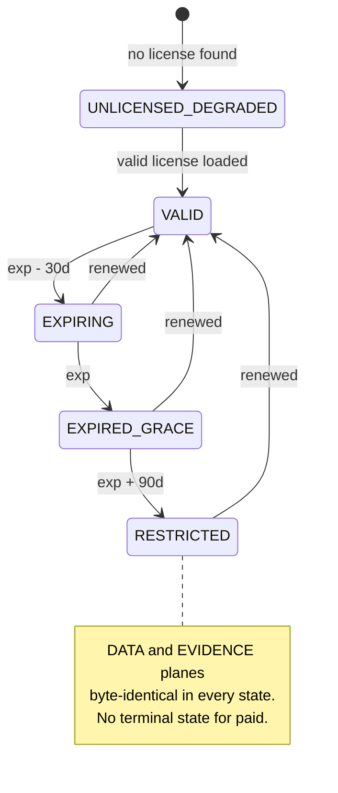

# Air-gapped deployment + offline licensing — approach review

**Status:** decision input, internal only · **Date:** 2026-09-21
**Inputs:** code audit of `src/`, `cdk/`, `demo-agents/` (22 agents, adversarially verified); vendor-precedent research (Vault, Consul, Nomad, Kong, Grafana, Elastic, Confluent, Replicated, GitLab, NGINX, Palo Alto, Fortinet, Keygen, Cryptlex, LicenseSpring, Zarf)
**Purpose:** answer the two founder questions — (4) can we make today's infra run locally via config, and (5) is signed-license-file-with-fail-open-on-expiry the right licensing model

---

## Verdicts in one line each

**Q4 — "make the existing infra run locally with a bunch of configs."** Right architecture, wrong estimate, wrong order. One codebase with three deployment profiles is correct — do not fork. But config is the *last 10–20%* of this work, not the mechanism. Sell the middle rung (single-tenant in the customer's own cloud account) first; it satisfies most of what this prospect asked for, in a fraction of the time, and keeps the model-based detection tier working.

**Q5 — "signed license file; if expired, fail open."** The artifact is exactly right and industry standard. **Fail open is wrong, and in our own code it is not even implementable the way it is imagined.** License state must never be an input to an allow/deny verdict. Put the commercial teeth in the supply chain we already control.

---

## Q4 — what "runs locally" actually costs

### The seam that is nearly free

`botocore` honours `AWS_ENDPOINT_URL_<SERVICE>` with **zero code change** — verified by execution in our own venv (`AWS_ENDPOINT_URL_DYNAMODB=http://localhost:4566` redirects the DynamoDB client while an unset S3 client resolves normally). So **DynamoDB → DynamoDB-Local and S3 → MinIO are config**, not a port. That is the single highest-leverage change available and it is days of plumbing, not months.

Caveat that sets the real cost: the repo has **zero `endpoint_url` sites today**, **150 inline AWS data-API call sites across 30 files**, **45 direct `boto3.client/resource` constructions**, and **~18 of those files build their own clients outside `app/utils/clients.py`**. The seam exists (`clients.py` documents itself as "a single seam") but it hands back raw boto3 clients, so call sites speak AWS semantics. Threading the seam through every file is **3–5 weeks**, not days.

### The four things config cannot solve

| Coupling | Reality | Local substitute | Cost |
|---|---|---|---|
| **Hosted model inference** | `ml_classifier.py:82` builds `bedrock-runtime` and `converse()`s to Haiku/Sonnet. **No self-hosted Claude exists at any config value.** Today 100% of ML-tier evaluations egress via NAT — there is not even a Bedrock VPC endpoint. | The distilled CPU classifier we already trained (465MB, in-repo, serving app written) — but its CDK construct is instantiated by no stack, `DISTILLED_SERVICE_URL` is set nowhere, and `Dockerfile.distilled-classifier:48` copies a `model_bundle/` directory that does not exist, so **the image cannot build**. | 1–2 weeks of code + **a written product decision**: air-gap means either distilled-only detection or deterministic-floor-only, and we must state which in writing. |
| **Caller auth + rate limiting** | This is the one that should alarm us. `grep x-api-key src/security-controller/app/` = **zero non-test hits**. The API key and the usage plan live **entirely in API Gateway** (`api_stack.py:167-193`). A self-hosted controller with no gateway in front ships an **unauthenticated, unthrottled enforcement endpoint** — while the SDK still sends an `api_key` nothing validates. `quota_enforcement_enabled` defaults False and is explicitly fail-open, so it is no substitute. | App-layer caller identity (mTLS or a signed caller token) + per-caller rate limiting. | **2–4 weeks. Top of the list, alongside inference.** First thing a customer security reviewer asks about a self-hosted PDP. |
| **Operator identity** | `deps.py:286-293` builds `https://public-keys.auth.elb.{region}.amazonaws.com/{kid}` as an f-string and `urlopen`s it with **no env override**, so every authenticated console request needs the public internet. The console has **no in-app login at all** ("There is NO REST login"). Three HTML entry points also pull Google Fonts. | Pluggable OIDC (Entra ID / Keycloak): issuer + JWKS URL or a static local JWKS file + claim mapping, plus building the console login flow. | **6–10 weeks.** Also satisfies the customer's Entra ID requirement. |
| **Audit + metrics sinks** | ~12 CloudWatch Logs sites, 20 `put_metric_data` sites, 3 read services backing the console dashboards. | File/syslog JSON sink + Prometheus exporter. Emission is already fire-and-forget off the response path, so a no-op adapter is behaviourally safe on day one. | 1–2 weeks. |

Plus: **no `docker-compose`, no `Chart.yaml`, no Terraform anywhere**; `cdk/` is ~9.6k lines of AWS-only CDK across 10 stacks that becomes a Helm chart, not a config file.

### Two boot blockers that must be fixed first

The current image **cannot start on an isolated network at all**, for two independent reasons:

1. `audit_logger.py:110-112` constructs a boto3 logs client and calls `_ensure_log_group_exists()` **inside `__init__`**, and `:156-163` catches only `ClientError` — so a `NoCredentialsError`/`EndpointConnectionError` escapes through `ValidationService()` and kills the FastAPI lifespan. uvicorn starts, `/v1/health` never answers, and the container HEALTHCHECK can never pass. Reproduced independently twice.
2. `main.py:59` asserts the ALB-OIDC pin readiness gate before that.

Both are days of work, and neither can be skipped.

### One more finding that is a live bug, not just an air-gap gap

**Every enforcement control defaults to OFF in `config.py`** — `ml_classifier_enabled`, `cedar_enabled`, `d2_enforce_enabled`, `tenancy_v2_enabled` — and the `true` values live only in the CDK-generated task-definition env block (22 of 57 env entries are hardcoded literals in `compute_stack.py`, including every enforcement flag; the `ml_classifier_enabled` YAML key has **no reader at all**). A customer-premises install that ships without that block **boots with Cedar authorization off, D2 off and the classifier off — signature regex only.** Air-gap packaging needs inverted defaults or a startup assertion, not just a config file. Relatedly, detection **degrades silently rather than closed** without AWS: Sigma ABSTAINs when rules can't load, the classifier ABSTAINs on any Bedrock error.

### Recommended sequencing

Each item unblocks the next. **Ship the middle rung before any of it.**

0. **Customer-controlled cloud, single-tenant** — our stack in *their* AWS account or Azure subscription, private endpoints, their KMS, their CloudTrail. Buys "our environment / our account / nothing on the public internet" for probably 80% of regulated buyers with none of the work below. State precisely, in writing, that inference still runs in a provider-operated model-deployment account — do not write "data never leaves" for a tier where that is not literally true.
1. `aws_endpoint_url` + credential-mode seam through `clients.py`, then the ~18 files that bypass it — **3–5 weeks**
2. App-layer caller authN + rate limiting on `/v1/validate` — **2–4 weeks**
3. Fix the two boot blockers; file/no-op audit sink + Prometheus metrics; local on-disk source for policies and Sigma rules (the 13 rule YAMLs are on disk already but **no code path reads them from the filesystem**) — **1–2 weeks**
4. Deploy the distilled classifier; make the detection-posture decision in writing — **1–2 weeks + a decision**
5. **One signing primitive serving both the license file and the offline content bundle** — **3–4 weeks** (see Q5)
6. Pluggable OIDC + console login, fonts vendored — **6–10 weeks**
7. Compose topology → Helm chart → offline image bundle with a signature manifest — **2–4 weeks to a demo stack, months to something supportable.** Evaluate **Zarf** (OSS, single binary: bundles images/charts, `zarf package sign`/`verify` via cosign, SBOM generation, in-cluster registry, delta packages) rather than hand-rolling this — it deletes a whole workstream a small team should not own, and defence/regulated platform teams already recognise it.

**Explicitly out of an air-gapped build, listed as such rather than silently degraded:** Azure Foundry discovery, cross-account AWS discovery, the Bedrock-agent connector, and every CloudWatch-backed console dashboard.

**The anti-rot mechanism — do this early and cheaply: a CI job that runs the full suite with outbound network blocked.** It is the only thing that keeps the air-gap claim true after the next feature adds an HTTP client. (Replicated's `--airgap` flag literally means "disable outbound network requests.") An accidental egress should fail in our pipeline, not in the prospect's egress proxy during the POC.

### One thing to fix before any customer deployment, unrelated to air-gap

The shipped Azure connector templates **default `SENTRA_API_ENDPOINT` to our own API Gateway** (`function_app.bicep:26`, compiled `main.json:129`), plus four other files hardcode it with no override. A customer deploying the connector as shipped, without overriding the parameter, **sends every tool call to our AWS account.** This is the most dangerous single item for a customer security review.

---

## Q5 — licensing

### What the proposal gets right

A signed license file read from local disk with no phone-home is **exactly** industry practice, and it is review-friendly. Verified precedents: Kong — "Network connectivity isn't required for license validation"; Grafana — `license.jwt` via `license_path` / `GF_ENTERPRISE_LICENSE_PATH` / `license_text`; also Vault (`VAULT_LICENSE` > `VAULT_LICENSE_PATH` > `license_path`), Consul, Elastic, ECK, Sonatype, Replicated. No license server, no activation call, no dongle. Build it.

"So tampering does not impact it" is also the right threat framing — naming the customer's own operator as the adversary is correct, even though the right conclusion is to spend almost nothing beyond signature + key-in-code + SIEM visibility.

### Why fail-open-on-expiry has to go

**1. It is unimplementable as imagined, in our own code.** `src/connectors/azure_foundry/.../function_app.py:190-210` converts every non-2xx, every transport error, *and* a 200 with a non-JSON body into `{"decision": "DENY"}` — the comment at `:192` reads verbatim *"Treat all of these as DENY-by-controller."* So there are exactly two channels:

- signal expiry with an error status → the PEP **denies** → the customer's entire agent fleet stops at midnight on a calendar date. That is a vendor-scheduled outage, not fail-open.
- return `200 {"decision":"ALLOW"}` → every injection, exfiltration attempt and unauthorized tool call executes, **indistinguishable from a real ALLOW in our own audit trail.**

There is no third option on that path, and "say the license is over" has no audience: the interceptor reads only `decision` and `reason`. No human is looking.

**2. It is an attacker- and insider-reachable kill switch.** Delete the license file, or roll the container clock forward, and the security product self-disables. The closest real-world shape is the Equifax breach — GAO-18-559 found an **expired certificate** stopped traffic inspection for ~10 months while data was exfiltrated undetected. (Certificate, not license — use it as an analogue, never as a licensing incident.)

**3. It inverts our own headline claim and creates a finding in the customer's audit, not ours.** "No fail-open mode anywhere" is on our deck. And if Guard is a control in the customer's SOC 2 / HIPAA scope, a fail-open window is a period in which a described control was not operating — a **control-operating-effectiveness exception in *their* report, traced to us.** Their internal audit, their external auditor, their third-party-risk team and their regulator's examiners all ask about it.

**The reframe that makes this easy:** "fail open vs fail secure" answers *what do we do when the engine is unreachable.* Expiry is not that question — at expiry the engine is perfectly reachable, we just stopped getting paid. Keep deciding on the last-known-good policy bundle; freeze **change**; put the teeth in the supply chain.

**No vendor in the surveyed set disables a security or evidence-capture control as a billing action.** Grafana is the precedent that ends the argument because it exempts exactly the security surface: *"SAML authentication is not affected by an expired license"*, *"LDAP synchronization is not affected"*, *"Auditing is not affected"* — while blocking *new* entitlements and keeping existing ones. Kong keeps proxying "with existing, unchanged configuration" and makes entity config read-only. Replicated, whose entire business is customer-hosted delivery: *"By default, instances with expired licenses continue to run"* while they cannot pull images or receive updates.

**The one legitimate fail-open:** a shadow/monitor deployment that already returns ALLOW and only records may treat lapse as continue-recording-or-stop. Make it a per-deployment, **customer-set**, contract-named setting that **defaults to enforcing**. Never a vendor-chosen global.

### Recommended model: four planes, license state never touches the verdict

**Governing invariant — the sentence a reviewer absorbs in ten seconds:**

> AegionAI Guard may refuse to **start** only in response to a deliberate operator action that introduces something new — deploying a build newer than the entitlement. It may **never** refuse to start, and **never** change a verdict, because of an event outside the operator's control: time passing, a pod restart, a deleted secret, a wiped volume, or a wrong clock.

Planes: **DATA** = the `/v1/validate` verdict + client-side masking · **EVIDENCE** = audit write, signal store, SIEM export · **CONTROL** = publish policy, onboard agent/tenant, add connector, import content · **SUPPLY** = image pulls, upgrades, CVE patches, Sigma/ML content packs, support.

| State | Window | DATA | EVIDENCE | CONTROL | SUPPLY | Start / restart |
|---|---|---|---|---|---|---|
| VALID | → exp−30d | full | full | full | full | OK |
| EXPIRING | exp−30d → exp | identical | identical | full | full | OK |
| EXPIRED_GRACE | exp → exp+90d | identical | identical | **read-only (423)** | frozen | OK, comes up **enforcing** |
| RESTRICTED | ≥ exp+90d, no upper bound | identical | identical | read-only | frozen | OK, comes up **enforcing** |
| UNLICENSED_DEGRADED | missing / invalid / state lost | identical (baseline entitlements) | identical | read-only | frozen | OK, comes up **enforcing** |



"Identical" is literal and **machine-checked**: same policies, same detectors, same verdicts, same reason codes, byte for byte, in every state.

**No terminal state for paid licenses.** `terminates_at` is not emitted at all — absence, not a far-future sentinel (Replicated's pattern: "If a license does not expire, this field is missing"). This removes a code path, removes the "they ship a kill switch" slide from a competitor's deck, and removes a class of one-character issuer mistakes that would cause the exact outage this design exists to prevent. Trials only: grace = exp, terminal = exp+7d, and a terminal trial genuinely refuses to start.

**Exactly one refuse-to-start branch:** `BUILD_DATE > max_build_date` — the operator deployed a build newer than the entitlement. This is Vault's rule and the **only clock-independent control** in the survey: rolling the clock back cannot buy you newer binaries, therefore cannot buy you CVE fixes. Safe as a hard stop precisely because it can only fire on an image the operator chose to deploy, never on a restart of the running one.

**Where the money pressure lives** — all real, none capable of causing an incident: no CVE patches or releases · no Sigma/ML content packs (in a detection product the feed decays in weeks, and `content_pack_age_h` is stamped into *their* audit records) · no growth (no new policy, agent, tenant or connector) · their compliance evidence carries `license_state=RESTRICTED` so their next audit surfaces it without us saying a word · no support · contractual cease-use. This is how incumbents actually enforce — HashiCorp states terms bind *"regardless of any automated license key enforcement behaviors."*

**Safety valve** (a reviewer's first objection is "so we cannot respond to an incident?"): v1 ships `AEGION_LICENSE_EMERGENCY_WRITE_WINDOW=24h` — one-shot, self-expiring, non-renewing, every write stamped `emergency_window=true`, CRITICAL to their SIEM, documented on the same page as the freeze. v1.1 replaces it with **tighten-only writes** — adding a forbid, narrowing an allowlist, raising sensitivity, revoking an identity, quarantining a tool are *always* permitted in every state; only loosening and new-scope are frozen. That makes it structurally impossible for a billing event to make a customer less safe. Deferred only because a *provable* tightening predicate over Cedar diffs is real work, and a fake one is a loophole for arbitrary writes.

### Artifact and crypto

**Ed25519**, one signature over one document, PEM-framed so it survives email and USB:

```
-----BEGIN AEGION LICENSE-----
base64({"v":1,"alg":"ED25519","kid":"aeg-lic-2026a","enc":"<b64url(payload)>","sig":"<b64url(64B)>"})
-----END AEGION LICENSE-----
```

- **Sign the bytes as received, with a domain prefix:** `sig = Ed25519_sign(sk, b"aegion-license/v1." + enc_bytes)`. No canonicalization dependency at verify time — no JCS, no field-ordering bug, no parse-before-verify. The prefix stops a future content-pack signature ever validating as a license.
- **Claims:** `schema, lic_id, lic_seq, cust_id, site_label, product, edition, lic_type, binding, iat, nbf, exp, grace_until, max_build_date, features[], capacity{max_agents, max_pdp_replicas, max_tenants, overage_policy:"meter_only"}, content_channel, content_max_age_days, support_tier`. Strict schema, `extra=forbid`, unknown field = reject.
- **Fields deliberately absent, and we say so in the security doc:** `terminates_at` (paid), and **no `enforcement_enabled` / `fail_open` / `bypass`** — the schema contains no expressible value that disables enforcement, and a reviewer can verify that by reading the schema. `detector.ml_hosted` is simply not in `features` for an air-gap license.
- **Public key as a code constant, never config.** Keygen is explicit about why: in a file or env var, "a bad actor could swap out your keys for theirs, bypassing your licensing without modifying your application code." In code inside a cosign-signed image, the bypass becomes patching a signed artifact — an auditable act inside a regulated customer. **Highest-value control in the design.**
- **kid → algorithm trust store**, so algorithm confusion is structurally impossible. **Ship two kids from v1** (current + break-glass): rotation needs a release, and an air-gapped customer on a two-year-old image cannot verify a renewal signed with a kid it does not have compiled in — and cannot upgrade, because upgrading needs the license.
- **Verification order, non-negotiable:** PEM frame + 64KB cap → envelope decode → **assert `alg` matches the kid's** → resolve kid, unknown = hard reject → 64-byte signature length → Ed25519 verify → **only now parse the payload** → strict schema → `lic_seq >= seen_max` else reject and keep `last_good` → `nbf` → `BUILD_DATE <= max_build_date` → state against `max(now, time_hwm)`.
- **Return a status enum, never a boolean** (Cryptlex: "do not treat license verification as a boolean") so a one-line `return True` patch is visibly insufficient.
- **Never on the hot path.** Verify at load and on explicit reload; the request path reads one attribute off a frozen dataclass. Measured in our own venv: Ed25519 verify **243 µs**, frozen-dataclass read **62 ns** — 3,900×. Under deny-by-default, any new inline dependency converts into denied legitimate traffic.
- **Hot reload is mandatory:** `POST /v1/license/reload` + a 60s file-hash watch + SIGHUP. Renewal in an air gap must never require a restart of a fail-secure PDP.
- **Binding soft and identity-based, never hardware:** `cluster_uid | install_id | none`, with `none` a legal documented value and a second DR license issued at signing time. Mismatch = loud warning for paid, reject for trial. Cryptlex — a fingerprinting vendor — tells you to avoid fingerprinting in containers and names activation exhaustion on pod churn as the top failure mode.
- **Private key in AWS KMS**, key spec `ECC_NIST_EDWARDS25519`, `ED25519_SHA_512` with `MessageType:RAW` (verified this spec exists). Non-exportable, never on a laptop, CloudTrail record of every license ever issued, and it deletes the single-founder bus factor. Break-glass: one offline keypair split across two hardware tokens in two locations.
- **Clock:** persist a monotonic high-water mark; `now < hwm − 24h` emits `tamper_suspected` and evaluates against the HWM. **Detect-and-alarm only — never a deny, never a state change.** An air gap has no NTP by definition; a drifted host must not be able to cause a false expiry.
- **Explicitly not built, and stated in the security doc:** no obfuscation, no native verifier, no TPM attestation, no CRL, no phone-home, no hardware fingerprinting. A root operator who patches the verifier or wipes state and rolls the clock defeats this. That is a contract and audit matter, not a crypto one — and stating the limit plainly reads far better in a review than implying we solved it. (Market floor: Neo4j ships enterprise images behind `NEO4J_ACCEPT_LICENSE_AGREEMENT=yes`.)

**Do not buy a licensing platform.** Cryptlex's on-prem tier is ~$600/mo and LexActivator is a native C SDK — a closed-source binary inside a regulated customer's security control, which we would have to defend in their supply-chain review. Keygen CE is free and self-hostable but its Fair Core non-compete needs counsel before embedding in a commercial security product. What these platforms actually sell is the back office, which is not our problem at three design partners. **Copy Keygen's artifact design; do not take the dependency.** 120 lines of readable Ed25519 verification is itself a review asset.

### Scope cut — what to actually build now

Licensing is the *last 5%* of the air-gap program, and the prospect is not blocked on it. **4-day v0, then stop:**

1. **The decision and the doc (1 day, do this first).** The four-plane table, the governing invariant, the single refuse-to-start branch, the safety valve, the honest tamper limitations — written into the customer security doc as a **positive claim**, plus the MSA clauses (cease-use on non-payment, suspension of support and artifact access, audit rights, shadow-mode setting named). *"License expiry never changes an allow/deny verdict and never stops audit logging"* wins security reviews. This is separable from, and more urgent than, any code.
2. **`app/licensing/` (~320 LOC, 3 days):** verifier + trust store + the state function as a pure function + boot state + `GET /v1/license` + reload. Zero new runtime dependencies — `cryptography 46.0.3` is already present via the `PyJWT[crypto]==2.8.0` pin.
3. **The two invariant tests** — the anti-rot mechanism and the artifact we hand the security reviewer:
   - an import-graph/AST test asserting the decision path **does not import `app.licensing`**;
   - a poisoned-license golden test that forces RESTRICTED / UNLICENSED_DEGRADED and asserts ~200 decisions return **byte-identical verdicts and reason codes** and still write their signal rows.

   If either is ever deleted or skipped, the central security promise is silently gone.

**Defer:** the mutating-route sweep (**30 routes**, not 14 — 21 in `routes.py` + 9 in `tenancy_routes.py`, and `POST /validate` shares the same router, so a router-level dependency would catch it: the exemption must be explicit, marked and tested), the SIEM event plumbing, the KMS issuing CLI (sign the first three by hand), the ticker, the console banner, the break-glass window, usage metering, hard capacity enforcement (v1 records and reports; `overage_policy: meter_only` — throttling a security control for a billing reason is the same category error as failing open), PASETO, FIPS 140-3 module validation, cosign'd content bundles, and CRL (undeliverable with zero egress; revocation reduces to expiry + re-issue, so make the 12-month term + 90-day grace the contractually-stated worst-case revocation latency).

### The cost of this recommendation, named

Because there is no terminal state for paid licenses and a never-licensed install starts provisionally enforcing, **a non-paying customer keeps a working, enforcing security product indefinitely** on frozen policy and decaying detection content. That is deliberate — the alternative is shipping a kill switch into a security control — but it means commercial protection is **100% contractual plus supply-chain, with no runtime teeth.** Price that in, assume roughly one in ten renewals slips a quarter, and make the MSA's cease-use and audit-rights clauses real. If that is unacceptable later, the honest fix is a **shorter term** (annual signed refresh, with renewal cadence stated as worst-case revocation latency) — not a kill switch bolted on afterwards.

---

## Cross-references

- Customer-facing status ladder: [pitch/customer/capability-proposal-2pager.md](../pitch/customer/capability-proposal-2pager.md), [pitch/customer/deck-microsoft/DECK.md](../pitch/customer/deck-microsoft/DECK.md) slides 10–14
- Editions ladder: [pitch/share/architecture-brief.md](../pitch/share/architecture-brief.md) — note it describes in-VPC and air-gapped in the present tense and must be corrected
- Claims that must not be repeated: `CLAUDE.md` "Core Security Features" + the audit's do-not-claim lists
