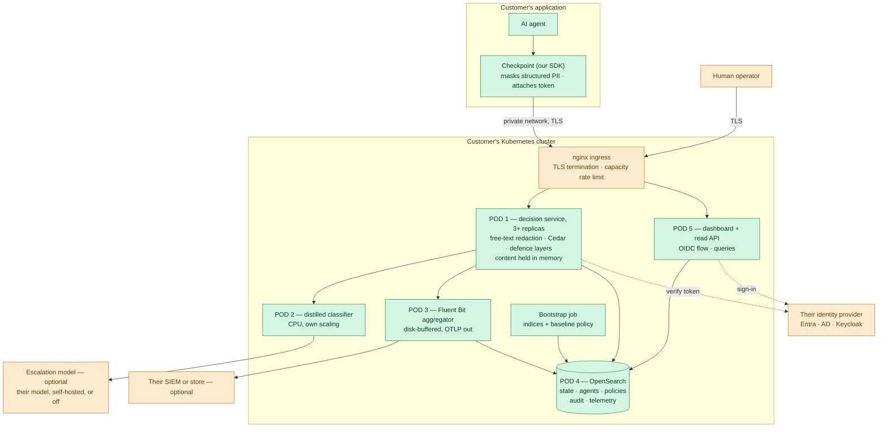
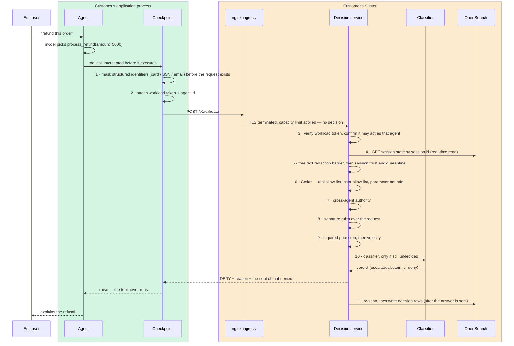
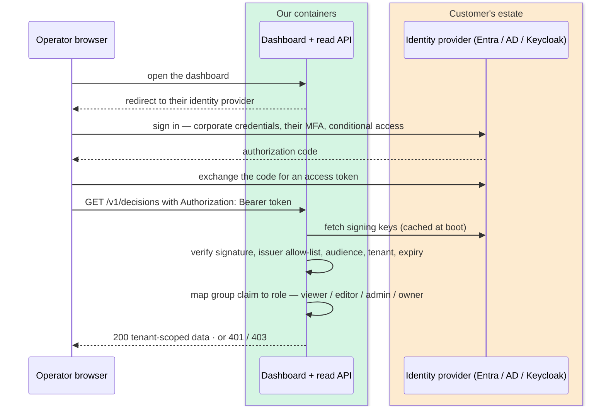
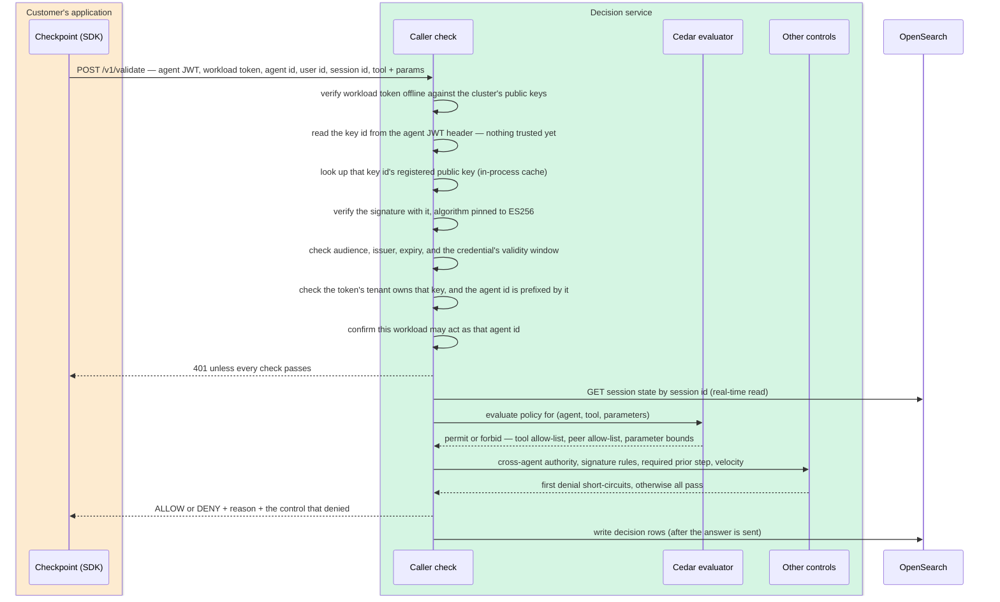

# Disconnected Deployment — Plan

**2026-09-21 · for decision** · Gaps: Appendix A · Mechanics: Appendix B · Evidence: [infra-portability-detail.md](infra-portability-detail.md)

---

## 1. Background

A Dubai enterprise on Microsoft Azure will not send their data to a vendor's cloud. They want the engine that decides allow/deny running **inside their own network**, using **their own identity provider**. Today only our checkpoint runs in their environment; everything that decides is ours, on AWS, and there is no artifact we can hand them.

Two things get called "disconnected", and the plan differs:

| | **In-tenant (private)** — this customer | **Zero-egress** — harder variant |
|---|---|---|
| Runs in | Their subscription, their network, no public inbound | Their datacenter, no outbound at all |
| Operator identity | Their Entra ID | Their internal AD or Keycloak |
| Escalation model | Their own model in their tenant | Self-hosted, or off |
| Telemetry out | Live to Sentinel | Exported as a file |

Settle which one they mean before work starts; it changes roughly ten weeks.

---

## 2. Current state

| Component | Status |
|---|---|
| **Checkpoint** — masks structured identifiers (card, SSN, email) before anything leaves; denies rather than sending raw | **Disconnected-ready** |
| **Decision logic** — policy, signatures, trust, sequence, cross-agent, velocity | **Evaluation portable; loading AWS-wired** — evaluation is in-process, but policies and rules load from DynamoDB and S3 |
| **Decision engine** — hosts the logic, exposes the validate API | Ours, AWS-wired |
| **Dashboard** — decisions, sessions, policies, threats | Ours, AWS-wired |
| **API Gateway** — public entry, API key, capacity throttle | AWS-only. Not the only caller check: the engine verifies a per-agent JWT itself and runs its own velocity limit |
| **Load balancer + Cognito** — runs the dashboard sign-in flow | AWS-only |
| **DynamoDB, S3, CloudWatch** — state, rule files, audit, metrics | AWS-only |
| **Bedrock** — classifier and escalation | AWS-only, external |
| **~10 CDK stacks** | AWS-only |

The part that *decides* is already portable. The part that *stores, logs, authenticates and classifies* is not. Specific defects: **Appendix A**.

---

## 3. Target architecture

**Green — our code, one implementation everywhere. Orange — their infrastructure or a config choice.**

| Component | What it is |
|---|---|
| **Checkpoint** | One line in their agent code. Masks **structured identifiers** (card, SSN, email) before the request exists, and attaches the caller token. |
| **nginx ingress** | TLS termination for both pods, plus **capacity rate limiting**. Makes no security decision. |
| **POD 1 — decision service** | **Free-text PHI redaction**, Cedar and the deterministic layers in one process for latency. Content in memory. Stateless, so capacity is replicas. |
| **POD 2 — classifier** | Our small CPU model, separate so its memory profile and scaling never touch the decision path. |
| **POD 3 — Fluent Bit** | Disk-buffered aggregator. Emits OTLP, so their existing collector composes with us rather than competing. |
| **POD 4 — OpenSearch** | Single store: operational state, agent inventory, customer policies, audit and telemetry indices. |
| **POD 5 — dashboard + read API** | Standard OIDC flow against their provider, plus every query the dashboard needs. Separate from POD 1 so a heavy search cannot slow a decision. |
| **Bootstrap job** | Creates indices and seeds the baseline policy. Must finish before decision pods go ready. |
| **Escalation model** | Optional — their model in their tenant, self-hosted, or off. Off is the disconnected default. |

### Four rules that make a single store correct

One store keeps the customer's compute footprint minimal, which is the right priority. It works on four conditions, because OpenSearch search is *near-real-time* — a document is not searchable until a refresh, one second by default.

1. **Every decision-path read is a GET by document id, never a search.** GET by id is real-time; search is not. Break this and the sequence precondition ("was identity verified in this session in the last 300 seconds?") reads stale and **denies a legitimate action**.
2. **The document id is the lookup key** — session id for session state, action id for the idempotency guard, key id for credentials. Uniqueness can only be enforced on the id, so this is what keeps tenant attribution unambiguous.
3. **The idempotency guard uses create-only semantics** on the action id, which gives exactly one winner between concurrent attempts. That is what prevents a money action being reversed twice.
4. **Audit indices get their own volume**, with lifecycle retention and disk alarms. At 95% disk OpenSearch turns indices read-only, so audit volume sharing a disk with state would stop state writes and deny every action. Fluent Bit buffers to local disk so audit can never block a decision.

Rate limiting splits cleanly: **nginx handles capacity**, and the engine keeps a **velocity limit** as a security control. It is per-session today and should become per-agent *(G2)*. Either way it only needs to be approximately right, so it needs no transactional counter — which is what makes one store viable.

### Other decisions, with their catch

- **The escalation model is a customer-filled adaptor.** One configuration block carries provider, endpoint, model id, authentication mode and credential reference, timeout, and the failure target. The same adaptor serves a model we deploy in their cluster, a model in their own cloud tenant, or ours — so the escalation tier is a configuration choice, not a build-time dependency. Any model we have not calibrated against needs its prompt re-tuned and the attack corpus re-run before we quote a detection number for it.
- **Every control ships enabled, and every layer has its own switch.** Each defensive layer — trust and quarantine, policy evaluation, cross-agent authority, signature rules, sequence, velocity, the local classifier, the escalation tier — carries an individual flag, all defaulting on, so a customer disables only what they do not want rather than discovering something shipped off. A short companion document states, per layer, what is lost by disabling it. Two qualifications: the *escalation target* is edition-specific, so in the disconnected profile it points at the local model or abstains and "enabled by default" never means "calls out by default"; and **policy evaluation should not be silently disableable** — it is the product, so turning it off belongs behind an explicit, logged, loudly-surfaced setting rather than an ordinary flag.
- **The local classifier ships deployed and on**, with a flag that exists as an operability kill switch rather than as a default-off gate.
- **Classifier unavailable ≠ cannot decide.** The deterministic floor's verdict stands. *(G3.)*
- **Enforcement posture lives in the application** — defaults on in code, one profile file as the declared posture, and a startup check that refuses a weaker state than declared. *(G4.)*
- **Content ships in the image, not on host disk.** `hostPath` is forbidden at Kubernetes' baseline security standard, so it would fail admission at exactly the regulated clusters we sell into; and because it does not pin a pod, replicas on different nodes could evaluate different rules undetected.
- **The port needs a test suite before it needs adapters.** Existing tests pin DynamoDB's wire behaviour and would stay green against a broken port. *(G5.)*
- **Sentinel processes UAE workspace data in a US region**, per Microsoft. Forwarding sends a minimal masked event; the full record stays in their store.
- **Action rollback is P1, not first release.** It depends on cloud-specific log queries in two places and does not function today; both lookups move onto the audit table once the store port lands *(G9)*.

---

## 4. How one request flows

The ingress terminates TLS, applies a capacity limit, and forwards. It makes **no authorization decision** — the engine authenticates its own caller, so a request arriving by any other in-cluster route is still authenticated.

Steps 5 to 9 are the **deterministic floor**, in that order: cheapest first, and the pipeline **stops at the first denial**, so a denied action never reaches a model. Cedar sits after trust because quarantine is cheaper and can short-circuit a session that is already contained. There is no separate combine stage on the hot path — deny-overrides is the *semantics*, so the first denier's own verdict is returned and evaluation stops; the combiner runs off the response path, on the audit write and again at read time to name the deciding control.

**Redaction is two tiers in two places, deliberately.** Structured identifiers — card numbers, SSNs, emails — are masked at the edge in the checkpoint at step 1, before the request object exists, which is what makes the payment-data guarantee enforceable: raw values never leave the customer's own process. **Free-text redaction runs inside the decision service** at step 5, as a barrier ahead of the detection layers, because narrative text needs a model the SDK cannot carry and the engine is inside their boundary anyway. A third pass at step 11 re-scans the record before storage so a residual identifier never lands in the audit trail.

Two limits travel with this. Masking is a property of the **enforcement point**, not a system-wide guarantee: it is unconditional and fail-secure on the SDK checkpoint and the Azure interceptor, and **absent on the Bedrock action-group connector**, which still sends raw parameters — closing that wire is part of the port. And the server-side tier applies on the content and memory phases; the output phase has no live handler and fail-secure denies.

Audit is written **after** the verdict is returned, so it never adds latency to the agent.

---

## 5. Security — two separate authentications

There are two callers, and they are authenticated differently. Keeping them apart is what makes the model explainable.

| | **User auth** | **Agent auth** |
|---|---|---|
| Who | A human operator | An agent workload |
| Reaching | The dashboard and read API | The decision service |
| Authenticated by | **Their identity provider**, via OIDC | **Their cluster**, via a platform-issued workload token |
| Authorized by | Role from their group claim — viewer / editor / admin / owner | **Cedar policy** — which tools and peer agents this agent may use |
| We verify | The token signature, issuer, audience, tenant | The workload token offline against cluster keys |
| We do not verify | Anything about how they logged in — their MFA and conditional access are theirs | The end-user identity carried in the request, which is asserted context |

### 5.1 User auth — the dashboard

**Authentication.** The dashboard has no password store and never sees their credentials. It redirects to their provider, they sign in with corporate credentials under their own MFA and conditional-access rules, and the token that comes back is verified by us: signature, issuer against an explicit allow-list, audience, tenant, expiry.

**Headers on a dashboard request:**

| Header | Purpose | Verified? |
|---|---|---|
| `Authorization: Bearer` + a **JWT** access token | The operator's token from their provider | **Yes** — signature, issuer, audience, expiry |
| `X-Request-Id` | Correlation for support | No, informational |

No API key, and no session-cookie proxy in front — the browser carries the token to the read API directly.

The token is a signed **JWT**. The engine validates these claims:

| Claim | Used for |
|---|---|
| `iss` | Checked against an explicit allow-list — never a prefix match |
| `aud` | Must be our client id |
| `exp`, `nbf` | Validity window |
| `oid` + `tid` | The stable user key. **Not `sub` alone** — with Entra that is per-application — and never `email`, which is mutable |

**The role is not read from the token.** It is resolved from our own membership record — one document per operator, holding their tenants and roles — which is how it works today and is the right place for it: only we know what our permissions mean, and it lets a customer who does not model our roles in their directory assign them in our console instead. One correction to carry into implementation: that record is keyed on the token's `sub` today, which is fine with Cognito but a trap with Entra, where `sub` is *pairwise* — per application — so a second app registration would orphan every membership row. Key it on a normalised stable identifier (`oid` plus `tid` for Entra) instead. Where a customer does want directory-driven roles, map from an **app role** claim rather than group membership — Entra's `groups` claim emits object GUIDs rather than names, and for a user in many groups it is **omitted entirely** and replaced with a pointer the application must resolve by calling Microsoft Graph, which fails in a disconnected site.

**Authorization.** The resolved role gates the operation, and every call is additionally scoped so the named resource belongs to the caller's own organisation. Roles live with us, because only we know what "may edit a refund policy" means; a customer who does not want to model our roles in their directory assigns them in our console instead. Their provider answers *who*; we answer *what that entitles them to*.

**Four consequences of delegating sign-in.** Offboarding is theirs and takes effect immediately: disabling the user stops their provider issuing tokens, so the next visit fails and no orphaned account remains on our side. Their MFA and conditional-access rules apply unchanged, because those run before a token exists. We store no credential of theirs. And changing provider is configuration, not code. "AWS IAM" is not an identity provider for human sign-in — IAM Identity Center is; on Google it is Cloud Identity. *(G6.)*

### 5.2 Agent auth — the SDK calling the decision service

**Authorization is the product.** Every call is evaluated by **Cedar** — open source, Apache-2.0, run in-process, chosen over OPA/Rego because Cedar policies are *analysable*: a policy can be reasoned about, not only executed. Above Cedar sit the checks a policy language cannot express — cross-agent authority, signature detection, a required prior step in the session, session trust, velocity. Any single denial stops the call, and the record names which control decided. Cedar is the live policy authority in the deployed stack today; reading it from a **signed** bundle is what this document adds, since no policy signing exists yet.

**How the agent signature is verified.** The agent's credential is a JWT. The engine reads the key id from its header *without trusting anything else in it*, looks up that key's registered public key from an in-process cache — so the hot path never reads the store — and verifies the signature with the algorithm **pinned to ES256** rather than reading the algorithm the token declares. That pinning is what closes the classic downgrade attack, where a forged token asks to be verified with no algorithm at all. It then checks audience, issuer and expiry with a small clock-skew allowance, confirms the token's tenant claim matches the tenant that actually owns that key — a mismatch means a key is being reused across tenants, and is logged as tampering — and confirms the agent id is prefixed by that tenant using a delimited comparison, so one tenant id cannot match another's merely by being a prefix of it.

All of that exists and works in the code today. The first branch of that function is the kill switch: with both latches off it returns immediately and never looks at the token. That is what *(G1)* means by the gate being switched off.

**We hold public keys, never secrets.** The agent generates its own keypair; the private half stays in the customer's secret store and is never sent to us. What we store is the public half plus the agent id, tenant, status and validity window — material that is safe to disclose by definition. So the credential store holds nothing whose leak would harm the customer, which is also the answer to the reviewer question it invites.

**How an agent gets registered, and when.** Once per agent at onboarding, before its first guarded call, and again on rotation. An **admin** in the customer's own team performs it — from our console, a script, or their own pipeline — and the engine checks that the operator owns the agent before accepting. The sequence: generate the keypair locally (the SDK ships a helper), mount the private half into the agent's pod from their secret store, register the public half against the agent id, and the engine returns the key id that tokens will carry. A working reference script exists.

**Key lifecycle today, and the one rule that must hold.** Generation is manual: an operator runs a provisioning command on their own machine, which creates the keypair, registers the public half, writes the private half to a mode-600 file, and prints the environment to set before redeploying the agent. The agent then reads it as an environment variable or a mounted PEM file. Two things to fix: keys are delivered as plaintext environment variables in the current demos, which leak into crash dumps, child processes and pod descriptions — they belong in a mounted file from the customer's secret store, which the SDK already supports; and nothing about this is automatic, so rotation is an operator task.

Automating it is desirable but has a trap: an SDK that re-registers on expiry would let **any** caller mint itself an identity, which makes the registry meaningless. So **enrollment and renewal must be separated**. Enrollment creates a new identity and must be authorised by something that is not the agent — an admin, or platform attestation. Renewal replaces a key for an identity that already exists and can be fully automatic, authenticated by the *current* key: prove you hold the key you have to receive the next one. A stranger holds no current key, so cannot enroll.

**For agents inside the cluster this step disappears.** With platform-issued workload tokens the cluster is the issuer, so there is no keypair to generate, no registration call, no private key to custody and nothing to rotate — the onboarding task becomes adding a projected volume to the pod spec. Key registration then remains only for agents running outside the cluster, where no platform attestation exists.

**A registry check is not authentication.** Requiring the agent id to exist in the registry is worth doing as a sanity check — an unknown id is rejected outright — but it proves only that the name exists, so any caller could still claim any *registered* name. Likewise, listing agents from the customer's cloud gives an inventory, not a per-call proof that this request came from that agent. Only the token establishes that.

**Headers on a validate request:**

| Header | Purpose | Verified? |
|---|---|---|
| `Authorization: Bearer` + the workload token | Proves *which workload* is calling. Issued by their cluster, audience-bound, ~10 min lifetime | **Yes** — offline against the cluster's signing keys, no network call |
| `X-Aegion-Agent-Id` | Selects which Cedar policy applies | **Yes** — must be permitted for the calling workload |
| `X-Aegion-Agent-Assertion` | The agent's own signed token. Only for agents **outside** the cluster, where no platform attestation exists | Yes, when present |
| `X-Aegion-End-User` | The human the agent is acting for. Policy input and audit metadata | **No — asserted context.** Marked unverified in the record |
| `X-Aegion-End-User-Token` | Optional: their user's own token, if the customer wants the end user verified | Yes, when present |
| `X-Aegion-Session-Id` | Correlates a conversation; carries trust and sequence state | No — generate it server-side where possible *(G2)* |
| `X-Request-Id` | Correlation for support | No |

**Two rate limits, and they behave differently.** Confusing them is how a capacity problem gets recorded as a security event.

| Limit | Purpose | On breach |
|---|---|---|
| **Velocity limit** — in the engine | A security control: a runaway or hijacked agent must not fire thousands of actions. Per-session today, per-agent after *(G2)* | **Deny**, recorded in the decision record as a denial. This is the product working |
| **Capacity ceiling** — in nginx | Protects the engine itself | **Shed** with a 429 and a retry hint, recorded as a service response, never as a policy decision |

**The caller check applies inside their cluster too.** The end user's authentication to their application is a separate question: the decision service's subject is the **agent**, and the agent is the one component certain to be untrusted, since prompt injection is the threat the product exists to stop. The agent id in a request **selects which policy applies and labels the audit record**, so a header the agent controls would let an injected low-privilege agent claim a high-privilege identity, inherit its allow-list, and have the resulting action filed against the wrong agent. The control would defeat itself at the moment it is needed.

The cost is small: the cluster mints a workload token for each pod and mounts it as a file, so there are no keys to distribute, no rotation burden and no registration step — one block of YAML in their pod spec. The engine verifies it offline against the cluster's own public keys, adding no network call and working fully disconnected. *(G1.)*

**Recorded alternative.** Header-asserted agent identity is acceptable for a time-boxed, single-tenant pilot: in a customer-operated deployment the blast radius of spoofing stays inside their own estate, materially different from a multi-tenant service. That path requires a written accepted risk with an expiry date, and the audit records produced under it marked non-evidentiary, since an identity the caller chose is not evidence.

### 5.3 The engine to its dependencies

The engine takes an identity from their platform to reach OpenSearch and read their secrets, so **we hold no credential to their environment**. Conversely, any secret we ship into their cluster is readable by their administrator, so we place none there whose disclosure harms us: **verification keys only** (public halves), the content-bundle key excepted (§7), and never our signing key, a cloud credential, or anything shared across customers. Secrets are read from projected files rather than environment variables, and never logged.

**Open gaps.** Changing a policy takes one editor and one call, with no second-person approval; regulated customers require maker-checker. And the tenancy model — how tenants are created, keyed and isolated across the indices — is being revisited separately and is not settled by this document.

---

## 6. Data, telemetry and the dashboard

**The audit trail is ours** — our schema, in their store, read by our dashboard. Forwarding to their SIEM is an integration we offer, not a replacement, so the system of record stays in one place with one query surface.

| Index | Holds | Written |
|---|---|---|
| **State** | Session trust and quarantine, velocity counters, idempotency guards | On the decision path, by id |
| **Agents, credentials, policies** | Agent inventory, public keys, customer-authored Cedar policies | Control plane |
| **Audit** | One row per contributing control per decision, plus the rolled-up record and the abstain / error / not-run markers | After the verdict, via Fluent Bit — disk-buffered, drained to OpenSearch |
| **Telemetry** | Per-control latency, end-to-end latency, throughput, error rates, escalation rate, replica health | Continuously, as OTLP |

The dashboard's views are computed at read time, not stored: all rows for a request are re-read, the combiner re-run to find which control decided and where the pipeline stopped, and every control sorted into ran / abstained / errored / did-not-run. **That work is pure computation over rows, which is why the store is swappable at all.**

**Per-control latency is part of the decision record, not only a metric.** Each control's wall-clock time is stamped on the decision row, so the console can show where a decision spent its time, and the same values leave as OTLP metrics for their monitoring stack. That split matters: the row answers "why was this one call slow", the metric answers "is the fleet healthy".

**Audit and telemetry go to OpenSearch, which ships with the deployment, so nothing needs integrating.** It is built for exactly this: full-text and faceted search over decision records, aggregation over time for telemetry, and lifecycle-managed retention. The console queries it directly, and multi-year retention is index lifecycle plus snapshots to whatever storage the customer provides — not a second copy of the data.

**Local disk keeps one job: buffering.** The forwarder buffers to a persistent volume and drains to OpenSearch, so a store restart, a rolling upgrade or a slow node can never block a decision or lose a record. That is the safety valve behind the rule that audit must never sit on the decision path. Two constraints: it is a persistent volume rather than the container filesystem or the node's disk, so the buffer survives a pod restart and no pod is pinned to a node; and the backlog is bounded and alarmed, with a written policy for what happens when the buffer fills.

The reason audit and telemetry indices sit on their **own volume** with their own retention (§3, rule 4) is this same concern from the other side: at 95% disk OpenSearch flips indices read-only, so log volume sharing a disk with state would stop state writes and deny every action. Separate volumes, retention policy, disk alarms.

**OpenSearch is the default destination, not the only one.** It ships self-hosted so a disconnected site works with nothing else installed, and every stream can additionally or instead be sent to what the customer already runs. Because the engine emits OTLP for telemetry and a documented JSON event for the audit record, each destination is a Fluent Bit output plus configuration — not engine code, so the second and third are days of work.

| Stream | Default | Also available |
|---|---|---|
| **Audit** | Self-hosted OpenSearch | AWS CloudWatch Logs · Azure Monitor Logs (a Log Analytics workspace via the Logs Ingestion API, which is what Microsoft Sentinel reads) · GCP Cloud Logging · Elastic · a file or syslog drop for their own collector |
| **Telemetry** | Self-hosted OpenSearch | Prometheus and Grafana · AWS CloudWatch Metrics · Azure Monitor workspace · Splunk via HEC · Microsoft Sentinel · Datadog · any OTLP consumer |
| **SIEM events** | — | Microsoft Sentinel · Splunk · QRadar and others via syslog or CEF |

Microsoft documents that for Log Analytics workspaces outside Europe and Israel, **Sentinel processes customer data in a US region**. Forwarding to Sentinel therefore sends a minimal, masked event, and the full record stays in their own store. This belongs in the written residency statement.

**What comes back to us — aggregates only, opt-in:** counts and rates, no content or identifiers, signed and reviewable before it leaves. False-positive rate comes from a labelled corpus and from operator overturns; **false-negative rate comes from the corpus, and on live traffic from an offline re-classification pass that is designed and not yet built** (preconditions in Appendix B). There is **no dashboard over their estate** — support is bundle-based, which for this buyer is a feature, and it changes how support is priced.

---

## 7. Protecting our detection content

**Threat model: their cluster administrator is root, and we do not try to defeat root.** The goal is that casual extraction is expensive and redistribution is attributable.

Content ships as an **encrypted, signed bundle inside the image**, decrypted into memory at boot and never written to disk in plaintext, with an init container verifying the signature so an unverified bundle yields a pod that never serves. The key is derived from a secret in their **licence file** plus a salt in the image — one image for everyone, a different key per customer, revocation by non-renewal. Both halves of the key sit on their disk by construction, so a root user recovers it. What the scheme delivers is that a copied bundle is useless elsewhere and every decryptable copy is attributable to a named customer.

**Bundle lifecycle.** The bundle is built per customer at release time: assemble the rules, policy and prompts, sign the manifest, encrypt with a key derived from that customer's licence secret plus a salt in the image, sign the ciphertext, and publish it as part of the image. At the customer's end the licence file arrives as a mounted secret, an init container verifies the outer signature and decrypts into memory, and the decision service loads from there. Rotation is a new image or a new signed content artifact plus a reload; revocation is non-renewal of the licence. The exact key-derivation parameters, file layout, error handling, rotation runbook and test vectors belong in the **LLD** — this document fixes the decisions the LLD implements.

**Compiling the rules would not hide them** — bytecode, a Cython extension and a serialized matcher database each leave the pattern literals recoverable by a plain `strings` scan, and Nuitka's own documentation states that constants stay readable without its paid feature. Confirmed by a one-off experiment; no committed artifact, so treat it as reasoned rather than regression-tested. Encryption plus memory-only is the only thing that works. Extraction detection is **attribution, not alerting**: per-customer canaries feed a contractual remedy, and the realistic posture is attributable if a ruleset surfaces publicly, otherwise undetectable. Push value into the model over time — weights are far less legible than a wordlist. Mechanics and the hardening list: Appendix B.

---

## 8. Scale and cluster settings

**One deployment. Not one per agent, not one per account.** Sizing follows **tool calls per second**, not agent count — 5,000 occasional agents can be lighter than 50 busy ones. The engine is stateless, so capacity is replicas.

**Agents in many subscriptions or accounts are fine** — the checkpoint only needs network reachability to the engine, and each agent keeps its own key, so identity stays per-agent regardless of where it runs. Inside one deployment, business units get their own policies with audit scoped so one cannot read another's. More than one deployment is the customer's choice, not a product limit: prod versus non-prod, a jurisdiction needing its own store, a DIFC entity keeping its audit trail separate from the onshore entity, blast-radius isolation, or independent upgrade cycles. **For 5,000 agents: one deployment per environment**, three or more replicas spread across availability zones.

Three Kubernetes settings are cheap and matter because the engine denies when it cannot decide:

- **Topology spread** tells the scheduler to distribute replicas evenly across nodes and zones instead of letting them land together. Without it, one node drain can deny every governed action in their estate.
- **The readiness probe must check only local state, never the store.** Otherwise one slow store node marks every replica unready at once, pulls every pod from the service, and turns a store blip into a total authorization outage.
- **A default-deny network policy** is worth shipping as blast-radius reduction: Kubernetes pod networks are flat by default, so any pod can reach any other, and this restricts which namespaces may reach the decision port on the cluster's internal network. It is not the control — authentication is — and it is a no-op unless their networking plugin enforces it, which we say in writing rather than implying coverage.

**Measured ceiling.** The largest concurrency measured to date is twenty, against one instance with no autoscaling. Sizing is established during the POC by measuring their real call rate. *(G10.)*

---

## 9. Sequence and effort

| Stage | Weeks | Gated? |
|---|---|---|
| Close G1–G7: dual-token caller auth, engine velocity limit, enforcement defaults into config, in-app sign-in, the two offline boot fixes; plus a deterministic-only offline demo | **~4.5** | No — owed to the AWS product anyway |
| Store interface and OpenSearch implementation, content bundle in the image, Fluent Bit and forwarders, Helm chart, finish the local classifier | ~12 | No — equally the AWS, Azure, GCP and disconnected build |
| Azure landing zone, Sentinel forwarder, Dubai compliance pack | ~2.5 | **Yes** |

**Two offline demos, not one.** The engine has no local-store mode today, so the three-day demo ships a throwaway in-memory adapter for state — counted in the estimate, thrown away when the store interface lands — plus content on disk, caller auth from a mounted key, and a real sign-in flow via a Keycloak container. It cannot include the model tier until the classifier is wired, which is three small fixes rather than a modelling effort *(G11)*. So: deterministic-only in week one — policy, signatures, masking, trust and sequence all denying with no internet — then the full demo shortly after. Estimates are extrapolated from a code audit, not measured.

## Appendix A — Gaps to close

Every item below is true of the code today. Two different kinds are mixed here deliberately: **live defects** that are wrong even on AWS (G2, G4, G8) and **AWS coupling** that is correct today and simply has to be replaced to run anywhere else (G1, G3, G6, G7, G9, G11). G5 and G10 are gaps in evidence rather than in code. The third column names the fix and where it is specified, so nothing on this list is open-ended.

| # | Gap | Fix, and where it is specified | Stage |
|---|---|---|---|
| **G1** | The application verifies a per-agent **ES256 JWT** against that agent's registered public key — but it is **inert**, because two latches ship off. The only enforced caller check today is the API Gateway key, and neither cloud connector mints a token | Enable both latches; add workload-token verification and bind it to the agent record; teach the two connectors to attach a token — **§5.2**. This is configuration plus connector work, not building authentication | 1 |
| **G2** | The velocity limit is **per-session, not per-agent**, and the session id is a caller-supplied body field. The tenant quota is **fail-open** | Key counters on the **verified** agent identity, and generate the session id server-side — **§5.2, Appendix B**. The server-side session id is an SDK contract change, so it ships with the caller-auth work | 1 |
| **G3** | The escalation **model id** is configurable; the **provider** is not — the client is hard-wired to Bedrock. Every local-tier failure escalates to that hosted model | A **model adaptor the customer fills in**: provider, endpoint, model id, authentication mode and credential reference, timeout, and failure target. The same adaptor points at a model we deploy locally in their cluster, their own cloud model, or ours — **§3** | 2 |
| **G4** | The deterministic floor comes up live, but the **classifier and three deep detectors default off** in application config, switched on by literals in the CDK stack; three deployment-YAML flags have no reader | **Everything defaults on**, including the escalation tier, and the customer disables what they do not want. One profile file is the declared posture, a startup check refuses a weaker state than declared, and a short companion doc states what each control costs them if switched off — **§3** | 1 |
| **G5** | Tests pin DynamoDB wire behaviour rather than behaviour; the store-level expiry contract is untested; and no stack provisions the rollback ledger table | Write behaviour-based contract tests **before** the store work — **§3**. The unprovisioned ledger table is resolved by G9 | 2 |
| **G6** | Sign-in is performed by the AWS load balancer. The injected header is verified, but there is **no in-application flow** — no redirect, no callback, no code exchange | Build the authorization-code-with-PKCE flow and the token verifier, using a certified library — **§5.1**. One implementation covers Entra, Okta, Keycloak, Cognito and the rest | 1 |
| **G7** | The engine cannot start without AWS for one reason: the audit logger creates a CloudWatch log group inside its constructor and catches only one error class | Make log-group creation lazy and widen the caught error class, then make the **default sink the in-cluster OpenSearch** so no external integration is required — **§6**. About a day for the boot fix | 1 |
| **G8** | Per-control latency **is** measured and emitted as a structured timing line, and reaches the trail builder — but it is never written onto the row the dashboard reads, so the latency column renders empty. The resolved deciding control is likewise never stored, only recomputed | Persist both onto the decision row: per-control latency and the resolved deciding control — **Appendix B**. The instrumentation already exists, so this is a write-path change, not new measurement | 2 |
| **G9** | Rollback depends on cloud-specific log queries **twice** — to resolve the owning tenant of an action or conversation, and to re-read the original action record when building the compensating call. It also binds a hardcoded demo table, imports a dependency absent from the manifest, and its ledger table is provisioned by no stack | **P1, after the store port.** Both lookups move to the audit table, the ledger table gets provisioned, the demo binding and missing dependency are fixed. Not in the first release, and not declared permanently unavailable | P1 |
| **G10** | The only concurrency ever measured came from a one-off latency script on 2026-07-02 that fired 150 requests at the deployed API twice, at 5 and 20 in flight, to record percentiles. It was never a sustained load test, and the controller runs one task with no autoscaling policy | Not a code fix — a measurement. A load test against their real call rate is a **POC deliverable**, and no customer figure is quoted before it — **§8** | POC |
| **G11** | The local classifier is trained, its **caller is live and on by default**, and it ships **deployed** in the target architecture with a kill-switch flag — but today the model service behind it was never deployed: the build copies from a directory that does not exist, no stack instantiates the service construct, and its URL is set nowhere, so every call takes the unset-URL branch and escalates to the hosted model | Three wiring fixes — copy path, construct instantiation, one environment variable — **§9 stage 2**. Nothing to train, which is why the full offline demo follows the deterministic one closely | 2 |

## Appendix B — Mechanics

**Credential and membership lookups.** A token arrives carrying only a key id, and the store is partitioned by tenant, so the engine needs a direct lookup from key id to the owning tenant and agent — the one read that happens before a tenant is known. That means the **document id is the key id** (rule 1 and 2), making it a real-time GET and enforcing uniqueness, which matters because two records sharing a key id would resolve a caller to an arbitrary tenant. Operator memberships follow the same shape: **one document per operator**, keyed on their stable identifier, holding the list of tenants and roles — one GET rather than a search across membership rows.

**Single store on OpenSearch.** Search is near-real-time (one-second default refresh), so every decision-path read is a GET by document id, which *is* real-time. Document ids are the lookup keys: session id, action id, key id. The idempotency guard writes with create-only semantics for exactly one winner; design for the ambiguous case — a timeout where the write may have landed — by storing the result in the document rather than inferring from its presence. Session state uses compare-and-swap on the document's sequence number with a bounded retry. Velocity counters use a scripted update with the retry count raised above its default of zero, and only need to be approximately right because nginx carries capacity limiting. They must be keyed on the verified agent rather than the caller-supplied session id. Audit indices sit on their own volume with lifecycle-managed retention and disk alarms, because at 95% disk OpenSearch applies a read-only index block and audit volume must never be able to stop state writes. Fluent Bit buffers audit to local disk so the store being unavailable cannot block a decision. A single node is acceptable for a minimal footprint provided the degradation rule is documented; three cluster-manager nodes are needed for availability.

**Audit shape.** One row per contributing control per decision, plus abstain / error / not-run markers, plus the rolled-up record. Write the rows and their markers together so a partial failure cannot silently thin the trail. Store the resolved deciding control rather than only recomputing it, add per-control latency to the row, and stamp the active content-bundle digest into every decision record so "which rules decided this?" is answerable.

**Content bundle.** One archive of rule files, baseline policy and classifier prompts, with a manifest carrying schema version, bundle version, customer id, validity window, per-file hashes and an inner signature. Encrypted symmetrically with the customer id and bundle version bound into the authenticated data, then a detached outer signature over the ciphertext. Verification is fail-closed in order: verify the outer signature **before** decrypting anything, decrypt, verify the inner manifest signature, verify per-file hashes, confirm the customer id matches the licence. Ed25519, public half compiled into the image. The bundle ships in the image layer so the image digest *is* the content version; per-customer content can also arrive as a signed artifact pulled by an init container. Two-phase staged/active activation with an authenticated reload endpoint means a policy change needs no restart, and a bundle failing compile or self-test is refused.

**Workload tokens.** Projected with an explicit audience and a ten-minute expiry, re-read by the SDK every few minutes. Verified offline against the cluster's OIDC discovery document and signing keys, cached at boot. Never verified by a synchronous API-server call on the request path — that call's latency target is twice our budget and it sheds load under pressure, which deny-by-default would turn into a fleet outage. Use the API-server check only at agent bootstrap and as a low-rate background sweep.

**Identity provider details.** Validate the issuer against an explicit allow-list, never a prefix match. With multi-tenant endpoints the issuer varies by signing tenant, so pin the tenant identifier too. Entra does not issue identity tokens by default — the setting must be enabled. Entra subject identifiers are per-application, so key the user on object identifier plus tenant, never on subject alone and never on email.

**Content hardening.** Alongside encryption: mark the process non-dumpable, disable core dumps, ship no rule-dump endpoint, and keep rule text out of logs and API error bodies. A caller holding the ptrace capability bypasses the non-dumpable check, so this stops an idle operator and an accidental core dump, not a determined node root. Extraction attribution uses per-customer canary rules with unique identifiers and harmless high-entropy patterns that never fire on real traffic, plus per-customer rule ordering and salted identifiers so a fingerprint survives renaming, recorded in our own ledger mapping bundle digest to customer. Because a disconnected site sends us nothing, this only pays off when a ruleset resurfaces somewhere we can probe. Not worth building: a phone-home key server as the only path, a commercial obfuscator, an engine swap justified as protection, custom crypto, anti-debugging, or a hardware-token dependency.

**Measurement preconditions** for the live-traffic false-negative pass: records retain user input truncated to 200 characters on a 90-day window, so re-scoring must happen inside that window and a miss found this way is a lower bound; the opt-in redacted corpus it reads is not deployed and holds nothing; and the re-scorer must be genuinely stronger than the detector it audits, so a disconnected site needs a stronger local model we do not yet ship.

---

## Appendix C — To resolve in the security LLD

This document fixes the decisions; the LLD specifies the mechanisms. Each item below is open and needs a flow, a data shape or a written rule.

**Identity and key lifecycle** — enrollment versus renewal as two distinct authorised paths; what attests an enrollment in each edition; automatic rotation driven by the current key; key delivery as a mounted secret rather than an environment variable; revocation propagation and its worst-case latency; what happens to in-flight calls during rotation; and the agent-id naming rule, since the engine requires the id to be prefixed by its tenant.

**Workload attestation** — projected token audience and lifetime; offline verification against cluster keys and how those are cached and refreshed; binding a workload to the agents it may act as; the fallback for agents outside the cluster; and the behaviour when a cluster's issuer keys rotate.

**Tenancy** — how a tenant is created, keyed and isolated across every index; how the tenant is resolved on the pre-tenant read; what a single-tenant deployment collapses; migration of existing composite keys; and the test that proves one tenant cannot read another's rows.

**Operator identity and authorization** — the authorization-code flow end to end; the normalised stable user key and migration off `sub`; role resolution and the membership document shape; enforced MFA; maker-checker for policy change; and whether policy evaluation may be disabled at all.

**Caller admission and limits** — header contract and rejection codes; the velocity limit keyed on verified identity; server-generated session ids and what that changes for the SDK; and the distinction between a denial and a shed in the record.

**Content bundle** — key derivation parameters; file layout; verification order and failure handling; staged versus active activation; rotation runbook; and test vectors.

**Audit and evidence** — index shapes and document ids; the write transaction covering rows and markers together; hash chaining and sealing; buffer-full policy; and what the export to their auditor looks like.

---

## Cross-references

- **Upstream:** [infra-portability-detail.md](infra-portability-detail.md) — dependency register, port inventory, per-cloud service mapping.
- **Sibling:** [airgap-and-licensing-approach.md](airgap-and-licensing-approach.md) — licence artifact and expiry state machine; shares the signing primitive and the licence-derived key.
- **Shared contracts introduced here:** the `/v1/validate` dual-token caller contract (§5.1) · OpenSearch index shapes (§6, Appendix B) · content-bundle format and verification order (§7, Appendix B) · telemetry event schema (§6).
- **Customer-facing status:** [../pitch/customer/capability-proposal-2pager.md](../pitch/customer/capability-proposal-2pager.md) — availability claims must stay consistent with §2 and Appendix A.
- **Decisions to record as ADRs:** single OpenSearch store with the four correctness rules · caller authentication in the application, not the gateway · nginx for capacity limiting with the security limit in the engine · content in the image rather than host disk · the local classifier as the default off AWS.
