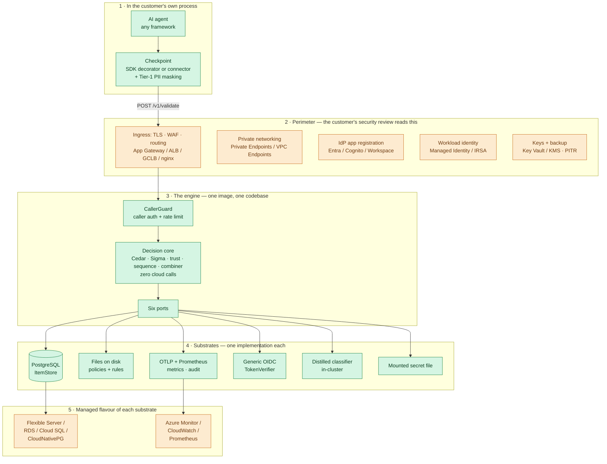
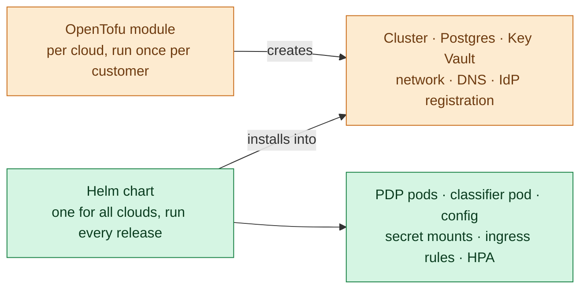

# Infra portability plan — dependency register, port inventory, Azure landing zone

**Status:** decision input, internal only · **Date:** 2026-09-21
**Driver:** Dubai enterprise on Microsoft Azure, in-tenant (private-network) deployment, Entra ID, Microsoft Sentinel
**Companion:** [airgap-and-licensing-approach.md](airgap-and-licensing-approach.md)
**Evidence:** code re-count of 213 AWS data-API call sites across 35 files; Microsoft/AWS primary docs fetched 2026-09-21; Azure Retail Prices API queried 2026-09-21

---

## Read this first — the whole plan on one page

**The decision:** one codebase with a **portable core** on five substrates that exist as a managed service on every cloud *and* self-host with zero egress — PostgreSQL, files on disk, OpenTelemetry, OIDC, Kubernetes. Cloud-specific code **only at the perimeter**, where a security reviewer actually reads the artifact. Not three native stacks, and not a from-scratch rebuild.

**Why not per-cloud native:** the AWS coupling is not I/O plumbing — it is DynamoDB dialect inlined into business logic as correctness invariants (47 conditional-write sites, one guarding double-reversal of a money action; a GSI lookup that *establishes the tenant* on every call). Those fork per backend, inside handlers. Six invariants × N backends is the real test matrix — 12 pairs at two clouds, 18 at three — and three of them are a cross-tenant isolation guarantee, a financial idempotency guarantee and a retention guarantee. At N=3 you still owe a fourth portable build, because DynamoDB, CloudWatch, Cognito, API Gateway and Bedrock have no on-prem form at all. **You pay for the portable build anyway, so build it first.**

### The architecture — green is written once, orange is per cloud

### What is common vs cloud-specific

| Layer | Written once | Per cloud |
|---|---|---|
| Checkpoint in the agent's process | SDK decorator, Tier-1 PII masking | — |
| Perimeter | — | Ingress/TLS/WAF · private networking · IdP app registration · workload identity · keys/backup/PITR |
| Caller auth + rate limiting | **in-app middleware** | — |
| Decision core | Cedar · Sigma · trust · sequence · combiner | — |
| State | `ItemStore` → PostgreSQL | *which* managed Postgres |
| Policies + detection rules | files on local disk, in-memory snapshot | the job that puts files on disk |
| Metrics + audit | one OTel implementation | exporter endpoint + DCE/DCR config |
| Operator login | one generic OIDC verifier | issuer URL + app registration |
| Secrets | one file read from `${SECRETS_DIR}` | the projection driver |
| Inference | one OpenAI-wire client | `base_url` + `model_id` |
| Deploy | **one Helm chart** | ~300–600 lines of OpenTofu |

### Deployment — two tools, two jobs

OpenTofu builds the building; Helm moves our furniture in. They never overlap — OpenTofu does not know what the app is, Helm does not create databases.

### The five decisions

1. **PostgreSQL, not Cosmos DB.** Cosmos has no whole-item conditional write and no secondary index, which breaks 47 condition sites and the hot-path `kid` lookup.
2. **Caller auth and rate limiting move into the app.** They exist today only in API Gateway IaC — ship a Helm chart without this and the engine is unauthenticated inside the customer's network.
3. **Policies and rules are read from disk**, not object storage. Removes a network dependency from the deny path.
4. **One Helm chart plus per-cloud OpenTofu.** Not CDK + Bicep + Deployment Manager.
5. **The distilled classifier is the default off AWS** — in UAE North there is no in-region pay-per-token chat model, so this is a residency requirement, not a latency optimisation.

### The numbers

| | Weeks | Gate |
|---|---|---|
| Zero-egress demo, boot blockers, secure-by-default flags, caller auth, Entra login | **~4.5** | None — all of it is owed to the AWS product anyway |
| Ports, Postgres, OTel, Helm, finished classifier | ~14 | Target-agnostic: equally the AWS, Azure, GCP and air-gap build |
| Azure landing zone + Dubai acceptance pack | ~2.5 | **A signature** |

Ask the customer one question before starting the Postgres port: does "air-gapped" mean **zero egress** or **no public internet**? If the latter, all four of their requirements are satisfiable without touching DynamoDB, and the path drops from ~21.5 weeks to ~11.

---

## 0. The two SKUs — name them and never blur them

| | **In-tenant (private)** — this deal | **Disconnected (zero-egress)** |
|---|---|---|
| Runs in | Customer's Azure subscription, their VNet, private endpoints, no public inbound | Customer datacenter, no egress |
| Reachable | Entra ID, Log Analytics/Sentinel, ACR, their Postgres, NTP | Nothing external |
| Operator identity | **Entra ID** via generic OIDC | Local AD / Keycloak — **not Entra** |
| SIEM | Sentinel via Logs Ingestion API (+ AMPLS Private Only) | File / syslog to their own collector |
| Content updates | Pulled through their egress proxy or an internal mirror | Signed content packs, operator-imported |
| Inference | Self-hosted distilled classifier (see §4) | Self-hosted only |

Microsoft's own disconnected AI product makes the same split: Foundry Local on Azure Local "doesn't use public Microsoft Entra ID endpoints. Instead, Foundry Local integrates with the Active Directory infrastructure configured in the disconnected Azure Local environment." **So "Entra ID integration" and "air-gapped" are partly contradictory asks** — the customer must choose per environment. Raise it.

---

## 1. Infra dependency register

Class: **A** = executed during `POST /v1/validate` · **B1** = control-plane CRUD (must port) · **B2** = console analytics (cloud-native-optional) · **C** = admin/discovery (out of scope per target) · **D** = dead/demo

| # | Dependency | Used for | Sites | Class | Target substrate | Action |
|---|---|---|---|---|---|---|
| 1 | **DynamoDB** (18 tables) | Sessions, agent registry, policy metadata, signal/decision store, credentials, quota counters, feedback, tenants | **144** in 24 files | A(33) B1 C | **PostgreSQL** — managed on all 3 clouds + air-gap | Port behind `ItemStore` (7 ops). Biggest item. §2 |
| 2 | **CloudWatch Metrics** | 30 `put_metric_data` + 8 `get_metric_data` | **38** | A(20) B2(8) | **OTLP + Prometheus** | One OTel implementation. Do **not** use Azure Monitor custom metrics (§3) |
| 3 | **CloudWatch Logs** | Audit archive + 15 Logs-Insights query sites | **23** | A(4) B2(15) | **OTLP/JSONL → Log Analytics via Logs Ingestion API**; file/syslog for disconnected | Split: audit sink ports; the Insights *queries* do not port (§3) |
| 4 | **S3** | Sigma rule bodies, Cedar/YAML policy artifacts | **8** in 5 files | A(2) B1 | **Files on disk**; object store demoted to distribution only | §2. Azure Blob has **no S3-compatible API** and MinIO Gateway mode was removed in 2022 |
| 5 | **Bedrock runtime** | ML threat classifier, `ml_classifier.py:82-90` | **1** | A | **OpenAI `/v1/chat/completions` wire format**; self-hosted distilled model as default | §4. The one irreducible break |
| 6 | **API Gateway** (ApiKey + UsagePlan) | **The only caller auth + rate limit for `/v1/validate`** | **0 in app** | A | **In-app middleware** | Net-new code. Highest-leverage item (§5) |
| 7 | **Cognito + ALB `authenticate-cognito`** | Operator console login; `deps.py:286-293` fetches the ALB key from a hardcoded public AWS URL, no override | — | A (boot gate) | **Generic OIDC** (Entra, Cognito, Keycloak, Okta) | Rewrite, not adapter. Also removes a boot blocker (§6) |
| 8 | **DynamoDB GSI `kid-index`** | Agent public-key lookup — the pre-tenant read on **every** validate | 1 (in #1) | A | Postgres `UNIQUE INDEX(kid)` | Strictly stronger than today; fixes a latent duplicate-kid bug |
| 9 | **Secrets Manager** | 2 sites (Azure SP secret, second API key) | **1–2** | C | **Mounted file** (`${SECRETS_DIR}/{name}`) | Cheapest port. §7 |
| 10 | **STS AssumeRole** | Cross-account discovery | **2** | C | **Azure has no AssumeRole** — managed identity is a property of where code runs | Declare out of scope for non-AWS; FIC cap is 20 per Entra app |
| 11 | **ECS Fargate** | Hosts the PDP | 1 (`describe_services`) | B2 | **AKS + one Helm chart** | §8 |
| 12 | **ECR** | Image distribution; build script hardcodes our account (13 occurrences) | — | — | ACR / customer registry / OCI tarball | Parameterise the build script. Also plan how the 465MB model artifact crosses |
| 13 | **ALB + ACM certs** | Private ingress; certs hardcoded in shipped configs | — | — | App Gateway / AKS ingress | Per-cloud native — do not abstract (§9) |
| 14 | **Cloud Map `*.sentra.internal`** | `rollback_coordinator.py:122-123` hardcoded URLs; `import requests` not in requirements | 12 | **D** | — | **Delete the module.** Removes 12 AWS sites, 6 of 15 Insights sites, and a latent ImportError |
| 15 | **VPC endpoints** | 3 interface (ECR, ECR-Docker, Logs) + S3/DDB gateway; **none for Bedrock** | — | — | Azure Private Endpoints | Bedrock traffic exits via NAT today |
| 16 | **SNS** | Alarm email to one vendor address | — | C | Their alerting | Out of scope; route via the audit sink |
| 17 | **EventBridge** | Canary hourly schedule | — | C | K8s CronJob | Trivial |
| 18 | **Google Fonts** (3 console entry points) | Web fonts | — | — | Vendored | Breaks in a private network |
| 19 | **nginx `resolver 169.254.169.253`** | Console proxy uses AWS VPC DNS | — | — | Cluster DNS | 502s outside AWS |
| 20 | **`x-amzn-oidc-data` header** | Console + Streamlit auth model | — | — | Real login flow | Subsumed by #7 |
| 21 | **KMS** | *None today* | 0 | — | Key Vault / CMK | Gap, not a dependency. Regulated buyers will ask |

Non-cloud: `cedarpy==4.8.4`, `PyJWT[crypto]`, 11 pinned requirements; `presidio-analyzer`/`onnxruntime`/`requests` are imported somewhere but **not pinned**.

**Reading of the register:** 144 of 213 sites (68%) are one service. 61 (29%) are CloudWatch. Only 3 sites total are exotic. 38 sites (18%) are declarable out of scope or deletable. So this is **two big ports plus scaffolding**, not thirty adapters.

---

## 2. State and artifacts

### Postgres, not Cosmos — with evidence

Cosmos DB is the commonly-asserted Azure equivalent of DynamoDB and it is behaviourally wrong for this code:

- **No `ConditionExpression`.** The only conditional-write primitive is optimistic concurrency via the system `_etag` + `if-match` → HTTP 412. Arbitrary predicates exist only on *Patch*, as a `filter_predicate`, capped at 10 operations. We have **47 condition sites**, including the rollback replay guard — a fail-secure correctness control. Porting it means a read-then-if-match retry loop (which reintroduces the TOCTOU window the guard exists to close) or a JavaScript stored procedure — a security invariant rewritten in a second language, inside the database.
- **No GSI.** Auto-indexing is not a secondary index: a query on non-partition-key `kid` fans out to all physical partitions. That lookup is on **every** `/v1/validate`. Fixing it needs a second kid-partitioned container, and Cosmos ACID is scoped to one logical partition, so there is no transaction to keep the two in sync.
- **TTL is silently ignored** unless the container has `DefaultTimeToLive` set non-null; on serverless, TTL deletes are billed.
- **Serverless is permanently single-region** and the account type cannot be changed. **Hierarchical partition keys are immutable at container creation.** 20GB per logical partition.

Postgres is *strictly more expressive* for the idioms we actually use, and three of the six hard semantics get **simpler**:

| Semantic | DynamoDB today | Postgres |
|---|---|---|
| Replay guard | conditional `PutItem` + `ClientError` branch | `INSERT … ON CONFLICT DO NOTHING` + rowcount; composable into a real transaction with the decision write |
| Quota counter | write-sharded across N shard rows + a second read to sum | **delete the sharding entirely** — one `UPDATE … SET used = used + $1 WHERE … RETURNING used`. Sharding only existed to dodge DDB's per-partition WCU cap |
| `kid` lookup | GSI, non-unique, eventually consistent | `UNIQUE INDEX(kid)` — stronger; today two rows sharing a kid resolve to an arbitrary tenant and nothing detects it |
| Batch write | 25-item chunks + `UnprocessedItems` retry loop | one multi-row `INSERT` |
| Projections (8 sites) | `ProjectionExpression` | `SELECT` column list |
| **TTL** | server-side reap, no read filter anywhere | **new cost:** unreaped rows are still visible, so every read of session / feedback / quota needs `AND ttl > now()`, plus `pg_partman` partitions + `pg_cron` `run_maintenance()` to detach and drop |

`Azure Database for PostgreSQL Flexible Server` is priced in `uaenorth` (B2ms $0.158/hr) and supports all `contrib` extensions including `pg_cron 1.6` and `pg_partman 5.4.3`.

**Two new operational costs, accepted deliberately:**
1. **Connection limits.** `max_connections` is derived from the SKU and Microsoft advises against raising it — use **PgBouncer in transaction mode**. Burstable SKUs have **no built-in PgBouncer**, so do not pick Burstable for production. A horizontally-scaled FastAPI PDP with a per-process pool multiplies connections by replica count. This is the one genuinely new failure mode that DynamoDB (a stateless HTTPS API) did not have.
2. **TTL read filters** (above) — and nothing in the current test suite would catch their absence.

**Excluded:** Aurora DSQL (no PL/pgSQL, no triggers, 3,000-row transaction cap, 1 DDL per transaction — and `isBeingPlannedIn` for `me-central-1`, i.e. not available in the UAE). **Aurora Serverless v2 scale-to-zero is wrong for this product** — a paused database means the first request after idle eats a cold resume and, under deny-by-default, **denies the customer's action**. Set `MinCapacity >= 0.5` in production; scale-to-zero is fine for dev.

### There is no "export the data" step

Worth correcting explicitly: we do not ship our own Postgres and later migrate the customer onto theirs. We speak the **Postgres wire protocol** and the customer points us at whatever Postgres they already have — Flexible Server, RDS/Aurora, Cloud SQL/AlloyDB, or a container we ship for POC/air-gap. We ship **migrations, not a database**. One schema, one migration tool, one set of contract tests. The export/migration problem only exists if we start on a non-Postgres store.

### Artifacts: files on disk, and latency goes *down*

Today a policy or rule cache miss is a **DynamoDB lookup plus an S3 GetObject on the request path**, and an S3 hiccup risks a DENY. Moving to disk removes a network dependency from the hot path rather than adding one.

Design:
- **Runtime contract = a mounted directory.** Load at boot into an **immutable in-process snapshot**: the compiled Cedar policy set (already LRU-keyed on `content_hash` in `cedar/policy_loader.py`) and the 161 compiled Sigma matchers.
- **Reload** on SIGHUP, an admin endpoint, or a ~10s file-hash poll, via **atomic reference swap**.
- This also fixes a live bug: invalidation today is a blanket per-process `cache.clear()`, cross-instance staleness is TTL-bounded at 300s, and with `--workers 2` there are already two divergent caches per task.
- **Writes** (console policy authoring) go to Postgres as system of record; a publisher materialises the on-disk snapshot and bumps a version row; replicas poll the version (cheap) and reload. Same ~10s propagation the Sigma path already has, generalised and made coherent.
- Object storage becomes a **distribution** concern handled by an init container / operator job, off the request path. Air-gap mounts a ConfigMap or a signed tarball with **no object store at all**.
- This finishes a half-done job: 13 Sigma rule YAMLs already sit on disk with **no code path reading them**.

---

## 3. Telemetry, audit, and Sentinel

One OTLP implementation genuinely replaces the 491 CloudWatch references — Azure's native OTLP ingestion via the OpenTelemetry Collector is **GA** (only the AMA and AKS paths are preview), and AWS exposes OTLP endpoints for metrics, logs and traces. But the details matter:

- **Do not use Azure Monitor custom metrics.** Microsoft states the feature is public preview and "won't be made generally available." Limits: 50,000 active time series per subscription per region, 10 dimension keys, and explicit guidance to keep dimension cardinality under 100 values ("up to 300 is a gray area"). Our metrics are per-tenant and per-agent — exactly the shape that throttles and breaks alerting.
- **Do not put audit in Application Insights.** Microsoft: it "throttles or samples … you can't use it for auditing purposes because some records are likely to be dropped." **Metrics → App Insights / Azure Monitor workspace; audit → Log Analytics custom table via the Logs Ingestion API.** Make that split explicit in the design.
- **Azure's OTLP leg is real IaC**, not a URL: a Data Collection Endpoint, a Data Collection Rule, the `Monitoring Metrics Publisher` role **on the DCR** (not the workspace — a frequent misconfiguration), and stream-scoped URLs. Collector ≥ 0.132.0, and the `azureauthextension` is supported "exclusively through community channels" — an Azure platform team will ask about that.
- **Silent-wrong-data trap:** App Insights requires **delta temporality and exponential histograms**; cumulative metrics ingest and render nonsense. Add a `cumulativetodelta` processor.
- **Design the event schema against Log Analytics column rules now:** columns start with a letter, ≤45 alphanumeric/underscore, and `TenantId`, `id`, `Type`, `UniqueId`, `Title`, `_ResourceId`, `_SubscriptionId` are **reserved** — `TenantId` collides with our obvious field name. Custom columns on built-in tables need a `_CF` suffix. The audit schema becomes a *deployed Azure resource*, so adding a field is an IaC change coupled to a code change.
- **Keep the record shape fixed and the sinks dumb** — one canonical decision record, serialised once; sinks are writers (file, syslog, OTLP, Logs Ingestion, Splunk HEC). Per-sink field drift is what bites SIEM integrations.
- **Add a local spool + retry.** Audit writes today are best-effort with no retry on the CloudWatch leg and no DLQ. For a compliance archive in a private-network site, that is not acceptable.

### Sentinel — the finding to raise first

**Microsoft Sentinel does not process UAE customer data in the UAE.** Microsoft's own doc: "For Log Analytics workspaces located in Europe, Microsoft Sentinel processes customer data in Europe. For workspaces located in Israel … in Israel. **For workspaces located in any other location, Microsoft Sentinel processes customer data in a US region.**" There is also no Sentinel data-lake region for the UAE, and Sentinel "may share data, including customer data" with Defender XDR, Log Analytics and Security Copilot.

So *"integrate with Microsoft Sentinel"* and *"customer data must not leave"* are in direct conflict, and Microsoft says so in writing. **Mitigate at the source, not the destination:** emit a minimised, tokenised event to Sentinel (decision, reason code, threat type, correlation id, hashed principal) and keep the full payload in the customer-controlled store in `uaenorth`. Our Tier-1 masking engine running *before* the emitter turns this from a compliance liability into a differentiator.

Mechanics are small: the **Logs Ingestion API** path is one HTTP emitter plus one DCR (~1 day), not the multi-week AMA/CEF-forwarder path people assume. `AMPLS` in **Private Only** mode gives a defensible "nothing on the public internet" answer while remaining honest that the data still lands in Azure and is processed in the US. Use **one AMPLS per DNS namespace** — multiple AMPLS resources override each other's DNS zones and break existing environments.

**Credibility gap to scope explicitly:** Sentinel's built-in cross-source detections are written against **ASIM** schemas. "Our logs are in Log Analytics" is not Sentinel integration — their SOC will ask which ASIM schema we normalise to. DENY decisions map naturally to **Audit Event**; identity-gate failures to **Authentication Event**. That is ~a week of KQL and a bounded, high-credibility deliverable.

---

## 4. Inference — the one irreducible break

**The fact that changes the plan: UAE North has no chat model available on Standard/Regional.** Microsoft's availability table for `uaenorth` lists exactly four models — `text-embedding-3-large`, `text-embedding-3-small`, `text-embedding-ada-002`, `whisper`. Zero chat models. And there is **no Data Zone covering the UAE** (only US, EU, APAC), so the EU-style compromise does not exist here.

That leaves exactly three options, and one must be chosen before any adapter is written:

1. **Global Standard** — "prompts and responses may be processed in any geography where the relevant model sold by Azure is deployed." Only *data at rest* stays in the designated geography. This **contradicts the customer's stated requirement**; saying "it's in your tenant in UAE North" while running Global Standard is a false statement.
2. **Regional Provisioned Managed (PTU)** in `uaenorth` — available for gpt-4.1, gpt-4o, gpt-5-mini, gpt-5.1, o1, o3-mini, o4-mini. Public price **$2.36 per PTU per hour**, billed whether or not a token is sent. And "having PTU quota doesn't guarantee that capacity is available … the deployment fails" — verify capacity in the customer's own subscription *before* signing.
3. **Self-host** — the in-repo distilled CPU classifier.

**Therefore the distilled model is P0 for residency, not only for latency.** Make it the **default classifier for all non-AWS SKUs**. Economics favour CPU in `uaenorth`: `D8s_v5` $0.471/hr vs `NC40ads_H100_v5` $9.98/hr; GPUs are available if ever needed.

Blockers to clear (all from the audit): the CDK construct is instantiated by no stack, `DISTILLED_SERVICE_URL` is set nowhere, `Dockerfile.distilled-classifier:48` copies a `model_bundle/` directory that does not exist so **the image cannot build**, and `distilled_allow_shortcircuit_enabled` is deliberately off because a confident-ALLOW with nothing behind it is fail-open.

**Worse than the above, and the finding that matters most here:** `distilled_classifier.classify()`'s own docstring states *"Every failure path returns a concrete escalate (→ Haiku), never an abstain"*, and the unset-URL branch returns `_escalate("service url unset → escalate to Haiku")`. So in a zero-egress install **every timeout and every HTTP error reaches for an unreachable external API** — not only the unset-URL case. Until the escalation target is configurable with an air-gap value of **abstain-or-DENY**, the claim *"no mandatory external API dependency for core security controls"* is **false in code**. This is a correctness fix, not a packaging one.

**One inference interface:** adopt the **OpenAI `/v1/chat/completions` wire format**, spoken by vLLM, Ollama, llama.cpp, Azure AI Foundry, and Bedrock's own `/openai/v1` path. One port, config triple `(base_url, api_key, model_id)`. *Unverified:* whether Claude models are callable on Bedrock's OpenAI-compatible path — AWS's examples all use `openai.gpt-oss-*` and route Claude via `/anthropic` or Converse. Check the model cards before coding against it.

**Do not use Foundry Local.** Microsoft: it "isn't designed as a server inference stack," explicitly lacking "concurrent request queuing, continuous batching, and efficient GPU sharing," and directs server use to **vLLM or Triton**. Foundry Local on Azure Local (the genuine on-prem product) is preview, access-gated, and **UAE North is not in its supported Arc-extension region list** — a Dubai customer's control plane would anchor in Central India / UK South / North Europe, reintroducing the cross-border question at the control-plane layer.

**Claude on Azure is worse residency than Bedrock, not better:** Anthropic is "the seller and operator … and acts as an independent data processor," Global Standard only, and some designated Covered Models require data retention and reject zero-data-retention subscriptions — "Microsoft can't change this setting for you."

**Abuse monitoring:** by default, flagged prompts and completions are stored and can be human-reviewed by authorised Microsoft employees via SAW + JIT. The in-region reviewer guarantee is **EEA-only and does not extend to the UAE**. The remedy — *modified abuse monitoring* — is gated on the **customer** having a Microsoft account team and applying via a Microsoft form; even once approved, automated classifiers still process every prompt. Verify with `az cognitiveservices account show` → `ContentLogging: false`, and put that check in the go-live runbook as an acceptance test.

**A model-family change is not free:** a different family means re-tuning the classifier prompt, the ABSTAIN discipline and the 8-value `threat_type` enum, and re-running the attack corpus (2–4 weeks, irreducible). Structured outputs help but impose their own rewrite — every field in `required`, optionality as `["string","null"]`, `additionalProperties: false`, and `minLength`/`pattern`/`format`/`minimum`/`minItems` unsupported (move to Python post-validation). Not supported with parallel function calls.

**To resolve empirically:** the Retail Prices API exposes *regional* pay-per-token gpt-4o meters in `uaenorth` (`$0.003025`/1K input) while the docs table lists no chat models. If the meter is genuinely deployable, the economics improve dramatically. Run `az cognitiveservices model list -l uaenorth` in the customer's subscription. **Do not state either version in a customer document until that command has been run.**

---

## 5. Edge — API Gateway does three jobs; only one is hard

| Job | Who does it today | Azure | Verdict |
|---|---|---|---|
| Public entry, TLS, routing | API Gateway | App Gateway / Container Apps ingress / AKS ingress / nginx | Easy, swappable |
| **Caller authentication** (API key) | **Only API Gateway** — `grep x-api-key` over the app returns zero non-test hits | APIM subscription keys | **Move into the app** |
| **Rate limiting** (100 rps / 200 burst) | **Only API Gateway** | APIM `rate-limit-by-key` | **Move into the app** |

APIM is the wrong answer for jobs 2–3: `rate-limit-by-key` is unavailable in Consumption; `renewal-period` caps at 300s; Microsoft states "rate limiting is never completely accurate" and it "tracks calls independently at each gateway … doesn't aggregate call data across the entire instance" — so it is a traffic shaper you cannot assert as a control. VNet injection is Developer/Premium only, Developer has no SLA, and the **self-hosted gateway requires outbound TCP 443 to Azure** with 1-minute heartbeats, so it cannot serve a disconnected site at all.

So: **you still have a gateway on Azure — it just stops being load-bearing for security.** Moving auth and rate limiting into the app means any L7 works on any cloud including a plain K8s ingress; it is unit-testable and identical everywhere; you can issue per-tenant or per-agent keys (or mTLS), which a UsagePlan cannot; and it closes a **live gap on AWS today** — anything inside the VPC that reaches the ALB or the service bypasses API Gateway entirely and hits an unauthenticated PDP. For an in-tenant deployment the engine should have **no public endpoint at all**.

This is the single highest-leverage item in the whole plan, and it must land **before** the first non-AWS deployment.

---

## 6. Identity

**Operator console — one generic OIDC verifier**, which *is* the pluggable answer, not a home-grown IdP. Entra is standards-conformant: discovery at `https://login.microsoftonline.com/{tenant}/v2.0/.well-known/openid-configuration`, authorize/token/JWKS/end-session endpoints. Implement authorization-code + PKCE, then:

- Validate `iss` against an **explicit allowlist**, never a prefix match (classic multi-tenant confused-deputy).
- With `common`/`organizations` the issuer varies per signing tenant, so additionally **pin `tid`**.
- **ID tokens are not issued by default** — `enableIdTokenIssuance` must be enabled or authorize returns `unsupported_response`.
- `subject_types_supported` is `pairwise`, so **`sub` is per-application and is not a stable cross-app user id** — key on `oid` + `tid`, never `sub` alone and never `email`.

This one item satisfies the Entra requirement, builds the console login flow that does not exist today, removes one of the two offline boot blockers, and covers Cognito / Keycloak / Okta / Ping with zero extra code. **Do this first.**

**Agent data plane — keep our ES256 keys.** Already local crypto, already portable, already air-gap-clean; the only coupling is the DynamoDB key lookup, which the Postgres move fixes. **Do not adopt SPIFFE/SPIRE now** — it requires the customer to run a SPIRE server plus an agent on every node hosting an agent workload, i.e. a second control plane as a precondition for installing ours. Record it as the known destination for when a customer brings their own SPIFFE trust domain. Also cache verified `kid → public key` in-process with a short TTL, which removes the lookup from the hot path and makes the store choice much less load-bearing.

**Entra Agent ID is real** — agent identity blueprints, OAuth 2.0 / MCP / A2A support, and explicit third-party integration: "Organizations can integrate third-party agents from platforms such as AWS Bedrock and n8n by using the Microsoft Entra ID Auth SDK (sidecar) or workload identity federation." But **the security features are gated behind Microsoft Agent 365** (included in M365 E7, add-on to E5/A5/Business Premium), licensed per user — which most UAE enterprises do not hold. That is our window, and it is a licence-cost argument, not a technical one. **Position AegionAI as the authorization layer (inline allow/deny per tool call, which Agent ID does not do) on top of Entra Agent ID as the authentication layer.** Accepting an Entra-issued agent token is ~2 days once the generic verifier exists.

Caveat: **Azure has no AssumeRole.** No sessions, no role chaining, no ExternalId, no session policies. Identity is a property of where code runs. Managed-identity-as-FIC is capped at **20 FICs per Entra app** — check that before any multi-tenant design depends on it.

---

## 7. Secrets — a mounted file, not an SDK per cloud

The right default is **not** three cloud SDKs. Every target can project a secret into the filesystem without our process linking a cloud SDK: Kubernetes Secrets mount natively; the **Secrets Store CSI driver** projects AWS Secrets Manager, Azure Key Vault and GCP Secret Manager into a pod volume; Vault has Agent Injector; an air-gapped install mounts a sealed file. So the interface is `get_secret(name) -> bytes` reading `${SECRETS_DIR}/{name}`, with one optional direct-SDK implementation where a customer insists on runtime rotation. Cheapest port in the plan (1–2 call sites today) — do not over-engineer it into a provider framework.

Licensing: if we ever bundle HashiCorp Vault, it is **BSL 1.1** (licensor IBM) with an embedding/competitive restriction; **OpenBao is MPL 2.0**. Better: bundle nothing and read a mounted file.

---

## 8. Kubernetes *and* Terraform — different layers

Not alternatives.

- **Helm chart = the application.** One chart serves EKS, AKS, GKE, OpenShift, on-prem and air-gap. Azure Container Apps **cannot** consume it — Microsoft: it "doesn't provide direct access to the underlying Kubernetes APIs" — so the Fargate / Container Apps / Cloud Run route needs three or four hand-maintained deployment specs that drift. AKS + one chart is the answer for customer deployments.
- **Terraform / OpenTofu = the substrate**, per cloud: cluster, managed Postgres, secret store, ingress + TLS, identity registration, private endpoints. Roughly **300–600 lines per cloud**, against 9.6k lines of CDK serving exactly one.
- **Do not write Bicep and Deployment Manager too.** That is three unrelated toolchains and three sets of idioms for one founder. One HCL codebase with three provider blocks means one skill and one review surface — and enterprise platform teams already run Terraform and will accept a module; they will not accept learning our CDK app.
- **Licensing:** Terraform is **BSL 1.1** (IBM) with the same embedding restriction; **OpenTofu is MPL 2.0**. Use **OpenTofu for anything we ship to a customer**; Terraform is fine for infra we operate ourselves.
- If Container Apps is kept for our own SaaS, set `minReplicas >= 2` explicitly — the default is **0**, which means cold starts on a deny-by-default security hot path. Also note its documented scale behaviour: 30s polling, 300s cool-down, no vertical scaling, and "replica quantities are a target amount, not a guarantee."

---

## 9. Where per-cloud native is genuinely correct

Portability belongs in the **data plane and the application**. Native belongs in the **security perimeter and the control plane**. Do not abstract:

1. **IdP app registration** — redirect URIs, `enableIdTokenIssuance`, group claims, admin consent have no portable expression.
2. **Ingress, TLS, WAF** — certificate management and WAF rule syntax differ; an abstraction forfeits managed certs and buys nothing.
3. **Workload identity federation** — IRSA vs Azure Workload Identity vs GKE Workload Identity. Papering over these ends in a long-lived secret in a file, which is strictly worse security.
4. **Network isolation** — VPC endpoints vs Private Endpoints vs Private Service Connect. These are the artifacts the Dubai security review actually reads; write them natively and precisely.
5. **Backup / PITR / key management** — use each cloud's native, and BYOK via its own KMS / Key Vault.

**Inverse trap:** `botocore` honouring `AWS_ENDPOINT_URL_<SERVICE>` makes S3→MinIO and DynamoDB→DynamoDB-Local look free. That is true for local dev and a **dead end for Azure**, because no Azure service speaks either wire protocol. Do not let a working `docker compose` create false confidence about Azure.

---

## 10. The general rule, sharpened

The stated rule — "pull enablement out of infra code, or make sure it is in all the infra codes" — is right in instinct. The durable form is stronger: **infrastructure must not be the source of truth for security posture at all.** "Keep it in all three IaCs and make sure they agree" drifts by construction, and already has: `dev.yaml` sets `tenancy_v2_enabled: true` and `tenant_identity_mode: enforce`, while `prod.yaml` sets false and omits the second.

1. **The app owns its defaults, and they default fail-secure (ON), not off.** Precisely: `d1_enforce_enabled` (`config.py:512`), `d2_enforce_enabled` (`:500`), `d3_enforce_enabled` (`:501`) and `ml_classifier_enabled` (`:333`) all default **False**, and the `"true"` values exist **only** as literals in `cdk/stacks/compute_stack.py:1566/1574/1575/1544` — 6 such literals in the controller task definition, not the 22 quoted earlier. The substance is worse than the count suggests, because the four that matter are the named enforcement flags: **the first Helm install ships a deny-by-default PDP with all three enforcement detectors and the classifier OFF, with no CDK present to fix it.** The `ml_classifier_enabled` YAML key additionally has no reader at all.
2. **One `aegion.yaml` profile on disk** (mounted ConfigMap) is the single declared posture; env vars override for ops convenience only.
3. **A startup assertion** refuses to boot if the resolved posture is weaker than the profile's declared minimum — the `assert_*_ready` pattern already exists at `main.py:59`.
4. **`GET /v1/config/effective`** (admin) plus logging the resolved posture at boot, so "what is actually enforced here" is answerable without reading IaC.
5. **A CI test** that fails when a new security-relevant setting has an unsafe default or is missing from the profile schema.
6. **A CI test that fails the build on any `boto3` or `azure` import under `app/validators/` or `app/redaction/`.** Any new cloud call added to the decision path is a regression against this deal; enforce it mechanically rather than by review.

---

## 11. Sequencing

Steps 1–3 are AWS-only wins that happen to unlock every other target, so nothing is wasted if the Dubai deal slips.

| # | Item | Effort | Why here |
|---|---|---|---|
| 0 | **Zero-egress demo — ship this first, in parallel** | **3 days** | `docker-compose` with DynamoDB-Local + MinIO driven purely by `AWS_ENDPOINT_URL_DYNAMODB` / `_S3`. Zero code change, and zero existing `endpoint_url` overrides to fight. Result: Cedar + Sigma + Tier-1 masking + local ES256, no egress, on a laptop. Highest customer-visible progress per hour in the plan. **Discipline: it proves air-gap feasibility and nothing whatsoever about Azure**, since no Azure service speaks either wire protocol |
| 0 | **Freeze the `tenancy_v2` cutover** (retire the v1 branch in all 7 key builders) | ~1 week | Both shapes are live behind a flag; otherwise every port method carries a doubled code path. `tenancy.py` is not a wrappable seam — its functions return `KeyConditionExpression` strings and `boto3.dynamodb.conditions.Key` objects |
| 0 | **Delete `rollback_coordinator.py`** and the two routes it drags | ~1 day | Removes 12 AWS sites, 6 of 15 Insights sites, a hardcoded demo table, and a latent ImportError |
| 1 | **Fix the two offline boot blockers** — `audit_logger.py:110-112` (`_ensure_log_group_exists()` in `__init__`, catching only `ClientError`) and `main.py:59` (ALB-OIDC pin gate) | ~2 days | Nothing portable boots until these go |
| 2 | **In-app caller auth + rate limiting** on `POST /v1/validate` | 1–2 weeks | Net-new. Also closes a live AWS security gap. Must precede any non-AWS deploy |
| 3 | **Move the hardcoded enforcement literals into fail-secure config defaults** + the profile/assertion/CI rule (§10) | ~3 days | A deny-by-default engine whose flags live in one cloud's IaC is not portable in any meaningful sense |
| 4 | **Generic OIDC operator login** (Entra first) | 1–2 weeks | Highest-value: satisfies Entra, builds the missing login flow, removes a boot blocker |
| 5 | **`ItemStore` port + Postgres implementation** + **a new port-contract test suite** | 4–7 weeks | The big one. See the test warning below |
| 6 | **Files-on-disk artifacts** + snapshot/reload + publisher | 1–2 weeks | Removes S3 from the hot path |
| 7 | **OTLP metrics + audit sink ports**; re-point `/metrics/overview` and `/decisions-timeseries` at the signal store; flag 3 endpoints AWS-only; delete `/v1/logs` | 2–3 weeks | Replaces 61 CloudWatch sites |
| 8 | **Deploy the distilled classifier**; adopt the OpenAI wire format; write the detection-posture decision | 1–2 weeks + a decision | Revenue-blocking for any non-AWS SKU |
| 9 | **Helm chart**, then OpenTofu substrate modules (Azure first) | 1 week + 1 week/cloud | The deployment artifact |
| 10 | **Sentinel emitter + one ASIM parser** | ~1 week + ~1 week | Named customer requirement |

**The largest single line item is not the adapters — it is the tests.** Of 91 test files, 26 use moto, and every test guarding the six hard semantics pins **AWS wire mechanics rather than behaviour**: `test_rollback_idempotency.py` manufactures a `ConditionalCheckFailedException` a Postgres implementation will never raise; `test_signal_store_writer.py`'s four tests construct `{"UnprocessedItems": …}` response dicts; `test_multitenancy_quota.py` is moto-backed; and **zero tests assert that an expired TTL row stops being returned**. Those suites would stay green against a port with inverted branch logic. They must be replaced by port-contract tests — two concurrent claims and exactly one wins; N items in, N rows visible, partial failure reported as `(ok, failed)`; an expired row is not returned; `scan_tenant` never returns a foreign-tenant row.

**Do not collapse `query_or_scan` and `fleet_scan`** (`tenancy.py:322` and `:347`). The first injects the tenant key condition; the second deliberately omits it for SOC aggregates. In SQL they differ by one `WHERE` clause, so a single `scan(table, filter)` method makes them indistinguishable at the call site — and one wrong call site is a cross-tenant leak in a product sold on "customer data must not leave."

### Commitment shape

Full Dubai critical path is roughly **21.5 engineer-weeks** (~5 calendar months solo) — extrapolated from audited call-site counts, not measured, and assuming ports-first, Postgres not Cosmos, and the query port refused.

- **Commit in the room: ~4.5 weeks** — the demo, the deletions, the boot blockers, secure-by-default flags, in-app caller auth, generic OIDC login. This produces a demonstrable zero-egress PDP with Entra login and real caller authentication, and **every hour of it is owed to the AWS product regardless.**
- **~14 weeks is target-agnostic** — ports, Postgres, OTel, Helm, finished classifier. Equally the AWS, Azure, GCP and air-gap build. Nothing is wasted if the deal slips.
- **Only ~2.5 weeks is Dubai-specific** (landing zone + acceptance pack). **Gate only that on a signature.**
- GCP later is ~2–3 weeks of substrate work and **zero application code** — one OpenTofu module, one OTel exporter config, one issuer entry, one values file. Defer until a paying GCP customer exists (GCP appears to have no UAE region, and every GCP claim in the research is unverified against Google primary docs).

### The one question to ask before starting the Postgres port

**Ask the customer whether "air-gapped" means true zero egress, or no-public-internet / private networking.** The SKU split turns entirely on the answer, and so does whether the 5-week Postgres migration is necessary at all:

- **No-public-internet** → achievable Azure-native (Private Endpoints + AMPLS Private Only + PTU inference), and all four of their stated requirements — deployable in their environment, non-egress, Entra, Sentinel — are satisfiable **without touching DynamoDB**: run the container on AKS reaching a DynamoDB endpoint they never see. That defers the port to the second Azure customer and cuts the path to ~11 weeks.
- **True zero egress** → the port is mandatory, because DynamoDB-Local is a development tool, not something to put in a bank's production estate behind a support contract.

The honest counter-case against the port: it is 144 call sites, six correctness invariants and a live 18-table dataset with no dual-write or zero-downtime design assessed yet, in exchange for a store the customer never asked about — and it trades a connectionless, zero-ops, pay-per-request store for a fixed SKU floor plus a genuinely new failure mode (connection exhaustion, which under deny-on-unreachable **denies production traffic**). Two things would change the recommendation: a measured benchmark showing Postgres with PgBouncer in the path misses the inline p99 budget (then Cosmos goes in behind the same port — which is precisely why the port comes first), or the customer answering "no-public-internet" and expressing no store preference.

What is **not** deferrable under either answer: secure-by-default enforcement flags, in-app caller auth, and a classifier that fails closed instead of calling out. Those are not portability work — they are live fail-open defects in a deny-by-default product, and they are the findings that would lose the security review the demo earns.

---

## 12. Dubai deal — non-engineering items

- **DFSA GEN 5.3.22(3)** (if DIFC-regulated): a material outsourcing contract must require the provider to give the DFSA information about the firm **and access to the provider's business premises**, and to "deal in an open and co-operative way with the DFSA." GEN 5.3.21(2): the outsourced function "shall be deemed as being carried out by the Authorised Person itself." Draft a standing **Regulatory Access & Co-operation schedule** now, before deal pressure. And note the commercial upside: running inside the customer's own subscription shrinks the outsourcing footprint toward software licensing, reducing their material-outsourcing notification and premises-access burden — **sell the in-tenant SKU as a regulatory cost reduction for the buyer**, not only as a security feature.
- **Qualify the zone first:** onshore UAE (CBUAE + federal PDPL), DIFC (DFSA), or ADGM. The applicable law, regulator and contract schedule differ; do not write one generic "UAE compliance" response.
- **If they are a Stored Value Facility or Retail Payment Service Provider**, CBUAE localisation rules reportedly require customer, transaction and payment data to be kept in the UAE — which would make "processed in a US region" (Sentinel) and "processed in any geography" (Global Standard) **disqualifiers rather than trade-offs**. *Source is secondary and ~8 months stale — get the circulars from their compliance function; CBUAE's rulebook returned 403 to every retrieval attempt.*
- **UAE Central is a restricted-access region** — in-country DR must be conditioned on a Microsoft subscription approval, not promised.
- Every platform service we need is priced in `uaenorth` (AKS, Container Apps, PostgreSQL Flexible Server, Cosmos, Key Vault, Log Analytics, Sentinel, App Gateway, APIM, ACR, plus A10/H100 GPUs). A priced meter proves catalogue availability, **not** deployability or quota — confirm with `az` in the customer's subscription before go-live.

---

## 13. The written "will not support" list

Publishing this is the sharpest expression of the strategy — it is what makes the rest of the claims credible. Every 501 returns a customer-safe message plus a correlation id, **never a 200 with an empty result set** (which reads as "no findings").

**AWS-only, returns HTTP 501 elsewhere:** CloudWatch Logs Insights-backed audit search (`audit_logger.py:784/:796`) · Insights-backed per-agent tool discovery (`GET /v1/agents/{id}/tools`) · log-group health introspection (`health_service` `describe_log_groups`) · ECS deployment-health reporting (`agent_service` `ecs.describe_services`) · STS-based cross-account discovery — **Azure has no AssumeRole as a concept**: no session, no ExternalId, no duration, no role chaining, and managed-identity-as-FIC caps at 20 per Entra app.

**Deleted outright:** `GET /v1/logs` (already deprecated; the dashboard reads `/v1/sessions/{id}/decisions` on the hot path).

**No Claude off AWS, at any tier.** There is no self-hosted Claude, and Claude on Foundry is a *worse* residency posture than Bedrock for this buyer. The Sonnet escalation tier is AWS-only.

**No in-region pay-per-token chat inference in UAE North.** Regional PTU or nothing. Say it before the security review, not during it.

**No claim that Sentinel keeps their data in the UAE.** We mask and minimise at the source and disclose the rest in writing. For a CBUAE Stored Value Facility or Retail Payment Service Provider licensee this is likely a disqualifier rather than a trade-off — qualify the licence type on the first call.

**No Entra ID in a true air gap.** The same generic OIDC verifier serves Keycloak / AD FS in a disconnected site.

**No managed gateway as a security control, on any cloud.**

**No Cosmos DB implementation in v1** — recorded in an ADR with the four breaking semantics named; reopened only for a customer who contractually buys the Cosmos SLA, and then behind the same `ItemStore` port, touching no business logic.

**No Aurora DSQL** as the portable Postgres, ever. **No multi-region Azure or in-country DR at signature** (UAE Central is Reserved Access). **No scale-to-zero in production on any cloud** — under deny-on-unreachable, a cold start *is* a DENY of the customer's action. **No Foundry Local on any roadmap slide.** **No bundled AGPL/BSL components** in a shipped image. **No SPIFFE/SPIRE requirement on the customer.**

---

## Cross-references

- Licensing + air-gap decisions: [airgap-and-licensing-approach.md](airgap-and-licensing-approach.md)
- Customer-facing status: [../pitch/customer/capability-proposal-2pager.md](../pitch/customer/capability-proposal-2pager.md)
- Editions ladder (describes in-VPC/air-gapped in the present tense and must be corrected): [../pitch/share/architecture-brief.md](../pitch/share/architecture-brief.md)
