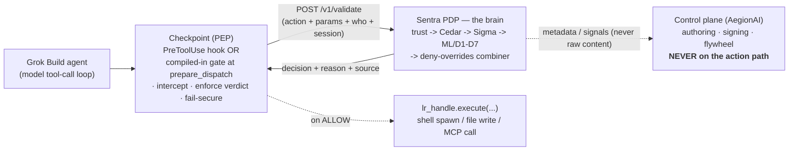

# Integrating AegionAI Guard with Grok Build

**In one line:** Grok Build (xAI's open-source Rust terminal coding agent) fires a pre-action hook that *waits* for a yes/no before the agent runs a shell command, edits a file, or calls an MCP tool. We ship the checkpoint that answers. It calls our policy engine (`POST /v1/validate`) and blocks the harmful action before it happens.

Unlike Cursor (closed source, hook-only), **Grok Build's source is available** — so we are no longer limited to a config-declared hook. We can, if we choose, compile our checkpoint *into* a fork at the tool-dispatch chokepoint. This doc lays out the seams, scores them, and recommends a phased path.

---

## What Grok Build is, and why source access changes our options

Grok Build is a terminal coding agent in the Claude-Code / Cursor class: an LLM drives a tool loop (run shell commands, edit files, read files, search the web, call MCP servers). It is written in Rust and, per the maps, ships a Claude-Code-compatible hook system plus an OS sandbox.

For a **closed** agent (Cursor) our only wire was the config-declared hook — a doorway the vendor shipped, that we plug a script into. That is still available in Grok (two flavors: an HTTP hook and a spawn-a-script command hook). But because Grok's source is open, two **native** seams also open up:

- The agent has **one genuine in-process chokepoint** for every tool call — `FinalizedToolset::prepare_dispatch` feeds the only two `lr_handle.execute(...)` sites, and there is *already* a pre-execute permission gate (`SessionRoutedToolHandler::handle_call`, `hub.rs:471`) that runs a local deterministic policy engine and fails closed on transport error. [FACT, native-tool-trait map]
- Below that, an **OS sandbox** (`xai-grok-sandbox`, on the `nono` crate) applies Landlock/Seatbelt + per-child seccomp once at startup. It is truly non-bypassable once applied but has **no per-action verdict callback** — it can't ask a PDP anything. [FACT, sandbox-shell-mcp map]

So the decision is no longer "do we take the hook or not" — it is "how deep do we go," trading zero-fork speed against enforcement strength.



---

## How it works (the fast path)

Grok's agent doesn't run a command directly — just before it does, `dispatch_pre_tool_use` serializes a `HookEventEnvelope` and hands it to every matching hook, waiting for a verdict; a parseable `{"decision":"deny"}` stops the action. [FACT, http-hook-pep / command-hook-pep maps] Our checkpoint takes that action, asks `POST /v1/validate`, and returns Grok's answer — the same enforcement pattern we already run for Bedrock, Azure, and Cursor.

```mermaid
sequenceDiagram
    participant Agent as Grok model loop
    participant Grok as Grok Build runtime
    participant Hook as Our checkpoint (PEP)
    participant PDP as Sentra policy engine

    Agent->>Grok: "Run: aws s3 rb s3://prod-backups --force"
    Grok->>Hook: PreToolUse { toolName, toolInput{command} } — and waits
    Hook->>PDP: POST /v1/validate (action + params + agent_id + session_id)
    PDP-->>Hook: {"decision":"DENY", reason:"destructive op on production resource"}
    Hook-->>Grok: {"decision":"deny","reason":"..."}
    Grok--xAgent: command NOT run; surfaces "denied: <reason>" to model + UI
```

---

## Integration options — the four seams, scored

All four are real seams verified in the maps. They differ sharply on enforcement strength and cost.

| Seam | Latency | Fail-secure default | Non-bypassable claim honesty | Coverage (shell / file / MCP) | Effort | Upstream-friendly |
|---|---|---|---|---|---|---|
| **(a) HTTP-hook** PreToolUse → `POST` PDP | In-process async HTTP, **no subprocess spawn**; blocks tool dispatch; N hooks serialize; default 5s timeout [http-hook-pep: dispatcher.rs:79-92, config.rs:124-126] | **FAIL-OPEN**, hard-coded; no fail-closed flag [http-hook-pep: dispatcher.rs:49-56] | **No** — reserve for sidecar. Fail-open + removable config + name-based disable file [hooks-trust-discovery: trust.rs:42] | All three via one gate; MCP `toolName` = `server__tool` [maps]. PostToolUse observe-only | **Zero-fork config** to stand up; **fork** to fail-close | High (no source change) |
| **(b) Command-hook** spawn our script | **One fork+exec per matching hook per tool call**, sequential, 5s default [command-hook-pep: command.rs, config.rs:126] | **FAIL-OPEN**, hard-coded [command-hook-pep: dispatcher.rs:44-59] | **No** — same as (a) plus the spawn adds nothing to tamper-resistance | Same one-gate coverage as (a) | **Zero-fork config**; Claude-style matchers alias-map to Grok tool names [matcher.rs:88-102] | High |
| **(c) Native in-process interceptor** at `prepare_dispatch` / permission gate (fork) | **Fully in-process tokio await**, no spawn; local `CompiledPolicy` floor first, network PDP on residual [native-tool-trait map] | **FAIL-CLOSED already the in-repo convention** (`request_permission_via_hub` denies on transport error) [hub_permission.rs:292] | **Stronger** — compiled-in at the sole funnel; still your fork of your client, so "non-bypassable" only within the binary you ship | **All tools** if hooked at `prepare_dispatch` (registry/types.rs:1638); permission gate alone skips reads/todos/dynamic [native-tool-trait map] | **Fork-and-maintain**, but LOW-to-MODERATE — seam already exists | Fork, so rebase burden |
| **(d) OS sandbox / shell-MCP chokepoint** (deep fork) | **Zero per-action latency** — kernel-enforced once at startup [sandbox-shell-mcp: lib.rs:179] | Fail-open at *apply* time (unsupported platform → unconfined); **fail-closed at runtime** once applied [sandbox-shell-mcp: lib.rs:203-247] | **Strongest containment** (kernel, irreversible, confines every child) — but **coarse**: path/network allow-deny, **no per-action verdict, cannot call a PDP** [sandbox-shell-mcp map] | Confines all syscalls but is not action-semantic; not a decision seam | **Config** to tighten profiles; **deep fork** to wire any PDP logic — and it still can't adjudicate semantics | Config-friendly for profiles; a decision hook is a deep fork |

Key reads:
- (a) and (b) are the same gate and same fail-open policy; **(a) is strictly better than (b)** for us — it avoids the per-call subprocess spawn that was the latency wall in Cursor, while giving identical coverage. [FACT, http-hook-pep latency vs command-hook-pep latency]
- (c) is where source access pays off: the fail-**closed** posture and a local deterministic floor **already exist** in the code we'd fork. [FACT, native-tool-trait failure_mode]
- (d) is a **defense-in-depth backstop**, not a PEP — it can't ask our PDP anything. Use it beneath (c), never instead of it.

---

## Recommendation — phased, fastest-to-value first

**Phase 1 (now, zero-fork): stand up the HTTP-hook PEP (seam a) in shadow/advisory mode.** Ship one `http` hook entry for `PreToolUse` (aliases `beforeShellExecution` / `beforeMCPExecution` / `beforeReadFile`) pointing `url` at a Sentra PDP endpoint; the PDP already accepts the generic action shape with no controller change. [FACT, sentra-pdp-contract integration_effort] This proves the wire and starts feeding the flywheel immediately. It is **advisory-only** and we must say so — see the fail-secure caveat below.

**Phase 2 (fork, for real enforcement): compile the checkpoint into the native gate (seam c).** Add a `PdpClient` and inline verdict call inside the existing gate block at `hub.rs:471-532`, or — for total coverage including read-class/dynamic tools — a short guard at the top of `prepare_dispatch` (`registry/types.rs:1638`) returning `Err(ToolError::PermissionDenied)` on DENY. Reuse `access_kind_for_hub_tool` / `AccessKind` (`types.rs:163`) as the ready-made action classifier and `CompiledPolicy` as the local deterministic floor; deny via the existing `ToolError::PermissionDenied` path. To make it mandatory you must compile-out the three escape hatches: `hitl_permission_live_enabled()` (`hub_permission.rs:62`), `session.yolo_mode()` (`hub.rs:472`), and `set_auto_mode`/classifier auto-allow. [FACT, native-tool-trait bypassability]

**Phase 3 (defense-in-depth): tighten the `nono` sandbox profile (seam d)** beneath the gate — deny-paths + `restrict_network` via `load_sandbox_config`, config-only — so that even if the gate is somehow skipped, kernel confinement still bounds the blast radius. Never marketed as the decision layer.

**Exact Grok Build touch-points to fork (Phase 2):**
- `crates/codegen/xai-grok-workspace/src/hub.rs:471-532` — the existing permission gate; add PDP call.
- `crates/codegen/xai-grok-tools/src/registry/types.rs:1638` — `prepare_dispatch`, the sole funnel, for total coverage; also confirm `call_raw` (`:1457`, used by `use_tool` inner dispatch) is gated so MCP-via-`use_tool` can't slip past. [open question, native-tool-trait]
- `crates/codegen/xai-grok-workspace/src/permission/hub_permission.rs:62,292` and `hub.rs:472` — compile-out the escape hatches.

### Field-mapping table: `HookEventEnvelope` → `/v1/validate` (`ValidationRequest`)

The PreToolUse wire fields (camelCase, `event.rs:389-405`) map onto `ValidationRequest` (`models.py:54`) as follows. [FACT, both maps]

| Grok `HookEventEnvelope` field | Sentra `ValidationRequest` field | Notes |
|---|---|---|
| `toolName` (resolved; MCP = `server__tool`) | `tool_name` (:66) | Direct. For MCP the resolved `server__tool` string carries the target. |
| `toolInput` (opaque `serde_json::Value`) | `tool_params` (:67, `Dict[str,Any]`) | Adapter must parse per-tool: shell → command string; edit → path+content; MCP → arg object. Grok passes it untyped. |
| `sessionId` | `session_id` (:64) | Accumulated-trust key. |
| (see gap below) `promptId` / transcript | `user_input` (:68) | **Partial gap** — envelope carries no clean "original NL prompt" field on PreToolUse; best source is `transcriptPath`/`promptId` context, else send empty and rely on action-level checks. |
| `hookEventName` = `pre_tool_use` | `phase` = `request` (default, :77) | Leave at `request` for a tool-call gate. |
| `toolName` (READ vs WRITE inferred) | `operation_type` (:70, READ\|WRITE) | Adapter classifies: shell/edit/MCP-write → WRITE; read_file/grep → READ. Reuse `AccessKind` in seam (c). |
| `cwd` / `workspaceRoot` / `permissionMode` | `context` (:118, dict) | Carries cwd, workspace, permission mode as context; `source_ip` auto-derived server-side. |
| (adapter clock) | `timestamp` (:69, ISO-8601) | Adapter sets. |
| (adapter UUID) | `request_id` (:63) | Adapter generates a trace id. |
| — (identity) | `agent_id` (:65) / tenant | **From the verified agent JWT, server-side — NOT the body** (`routes.py:243`). A tenant-bound Grok wire must send a signed agent JWT; with identity OFF it runs untenanted. [FACT, sentra-pdp-contract] |
| `toolInputTruncated` = true (>128KB) | (no field) | **Gap + fail-secure requirement** — PDP sees a truncated action; the adapter MUST deny/abstain on a truncated payload rather than validate a partial action. [both maps] |

**Missing / flagged mappings:**
1. **`user_input`** — no clean NL-prompt field on the PreToolUse envelope; action-level governance still works, but prompt-injection detection is weaker without it. Verify whether `transcriptPath` gives the last user turn cheaply.
2. **Truncation** — `toolInputTruncated=true` has no PDP field; enforce deny-on-truncated in the adapter.
3. **Auth header** — the HTTP-hook `RawHandler` carries only `url`/`command`/`timeout`/`env`, **no custom-headers field shown** (open question, http-hook-pep). A production PDP token must ride the URL (leak risk) or `env`-injected headers if supported — verify before Phase 1.
4. **Deciding source** — `winning_source` (`sources.py:15`) is not a top-level `/v1/validate` response field today; if Grok's UI needs "which layer blocked," parse it from `reason`/`matched_rule` or add it to the response contract (a `propagate-change` to SDK/connector consumers).

---

## The three caveats, re-evaluated for Grok Build (with evidence)

### (i) Latency — how many blocking round-trips, and why Serverless is unusable

A Grok task fires many actions; each gated action blocks on a verdict, and hooks run **sequentially in config order** (`dispatcher.rs:79`). [FACT] On the Serverless edition each verdict is a network round-trip to AegionAI cloud at **~0.6–1.2s deterministic** (target ≤500ms p99, LLD 24). [FACT, sentra-pdp-contract] A 30–100-action run × 0.6–1.2s blocking = tens of seconds of added wall-clock — unusable interactively, the identical finding to Cursor. **=> the in-VPC local-floor edition (check runs on-box) is required for a blocking Grok deployment.**

**Grok-specific improvement over Cursor:** the **HTTP-hook path (seam a) avoids the per-call subprocess spawn** that Cursor's command-hook model and Grok's command-hook (seam b) both pay — it's an in-process async `reqwest` call. [FACT, http-hook-pep latency] Seam (c) is better still: fully in-process with a local `CompiledPolicy` floor answering the common case in microseconds and the network PDP hit only on the residual. [FACT, native-tool-trait latency] So on Grok we can cut the per-action cost that made Cursor painful — but the network-PDP residual still argues for in-VPC.

### (ii) Non-bypassable — be honest per seam

- **Seams (a)/(b) — NO.** Three documented bypasses: fail-open on any induced timeout/crash/garbled body (no anti-tamper); a plaintext `$GROK_HOME/disabled-hooks` file that disables any hook **by name with no provenance/tier check** — so a local user can silence even a root-delivered `/etc/grok` managed hook; and matcher-scoping gaps. [FACT, hooks-trust-discovery bypassability: trust.rs:42, dispatcher.rs:27] Delivery integrity exists (root-owned `/etc/grok/managed_config.toml` is not user-writable) but that is **not** runtime non-bypassability given fail-open + the disable file.
- **Seam (c) — STRONGER but bounded.** Compiled into the sole dispatch funnel, a malicious agent cannot bypass it from within a tool call. But it's a fork of the customer's own client, so "non-bypassable" holds only for the binary we ship — anyone who controls the build can rebuild without it. [FACT, native-tool-trait bypassability]
- **Seam (d) — STRONGEST containment**, kernel-enforced and irreversible once applied — but coarse and not a decision seam. [FACT, sandbox-shell-mcp]

**Honest claim:** across seams (a)/(b), *"enforced across a managed fleet"* (central push + managed devices + SSO), **not** "non-bypassable." Reserve "non-bypassable" for the **network sidecar** (physically in the path) and, with the binary-control caveat, the compiled-in native fork + OS sandbox. Same discipline as the Cursor doc. [FACT]

### (iii) Fail-secure — the default is FAIL-OPEN, and there is no config flag

Every hook seam ((a),(b), and the discovery layer) is **hard-coded FAIL-OPEN for PreToolUse**: any timeout, crash, command-not-found, non-2xx-with-no-body, or unparseable/unknown-`decision` body is logged and treated as **ALLOW** — the tool proceeds. [FACT, dispatcher.rs:49-56 / dispatcher.rs:44-59 / http.rs branches] The rationale in-code is that Grok "runs in protected environments where induced-failure bypass is not part of the threat model." **Critically, unlike Cursor there is NO `failClosed` flag on the hook** — `RawHandler`/`HookSpec` expose no such knob. [FACT, http-hook-pep / command-hook-pep failure_mode]

Consequences:
- **In Phase 1 (hook), we CANNOT honestly claim fail-secure enforcement** — a slow/unreachable PDP silently allows the action. We ship Phase 1 as **advisory/shadow only** and say so explicitly.
- **To get fail-closed we must FORK** — patch `dispatch_pre_tool_use` to treat `HookRunnerResult::Failed` as deny (`dispatcher.rs:129-142`) and the empty/garbled/timeout branches in `http.rs`, and drop/lock the `disabled-hooks` consult. There is no supported flag. [FACT]
- **Seam (c) inverts this in our favor:** fail-closed is *already* the in-repo convention (`request_permission_via_hub` → deny on transport error, `hub.rs:504-517` denies when no hub transport). [FACT, native-tool-trait] The PDP itself is already fail-secure (unreachable → DENY, `ARCHITECTURE.md:281`) — the gap is purely Grok's hook harness default.

**Bottom line:** the fail-open default is the single strongest reason Phase 2 (native fork) is not optional if we want to sell *enforcement*, not *observation*.

---

## What we can do that a decorator can't

An SDK decorator sees only what the agent hands its own wrapped function. At Grok's tool chokepoint we see the **resolved action and its real parameters**, so we govern the *action*, not just the prompt:

- **Real shell argv** — the actual `command` string in `BashToolInput` (`bash/mod.rs:261`), so we evaluate `aws s3 rb ... --force` against parameter bounds and sequence integrity, not a paraphrase. [FACT, native-tool-trait key_types]
- **File diffs** — `SearchReplaceInput{file_path, old_string, new_string, replace_all}` (`search_replace/mod.rs:74`) and read paths, so we catch a secret being written into source or a sensitive file being read. [FACT]
- **MCP target + args** — the resolved `server__tool` name plus its arg object, so an MCP call to an external system is governed by *what it does*, not that "an MCP call happened." [FACT]
- **Session/trust state** — `session_id` threads accumulated trust across the whole run, so we can quarantine an agent whose behavior degrades — the stateful action governance that is our edge over stateless prompt-level point tools.

This is the "govern the action with session state" position from our CLAUDE.md core value prop, realized on a coding agent: block-before-execute on the concrete argv/diff/MCP-target, not a content classifier on the prompt.

---

## Cross-references

- **Implements:** the "5th PEP wire" after SDK decorator (LLD 23/36), Bedrock/Azure connector (`src/connectors`, `ARCHITECTURE.md:249`), network sidecar (roadmap, `ARCHITECTURE.md:250`), Cursor Agent Hooks (`docs/cursor-integration.md`).
- **Shared contracts:** `POST /v1/validate` — `ValidationRequest` (`src/security-controller/app/api/models.py:54`), `ValidationResponse`/`ValidationDenyResponse` (`:139`/`:166`), handler `validate_tool_call` (`routes.py:158`).
- **Decisions:** fail-secure / deny-by-default (global engineering rule); latency ≤500ms p99 deterministic floor (LLD 24 / CLAUDE.md Critical Constraints).
- **Upstream:** CLAUDE.md architecture (PEP/PDP split); `pitch/share/architecture-brief.md` editions ladder (Serverless → in-VPC → air-gapped).
- **Sibling refs:** `docs/cursor-integration.md` (mirrored structure; shares the two-honest-limits framing and the in-VPC-latency finding).
