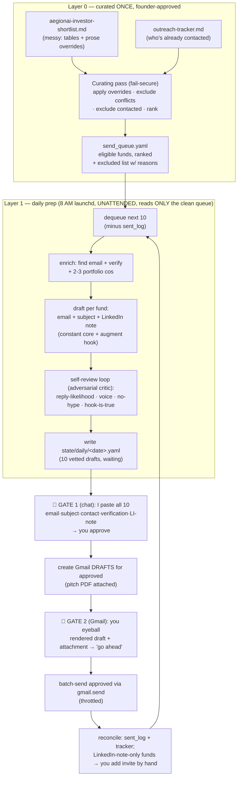

# VC Outreach Automation — Plan

**Status**: Draft for founder approval
**Owner**: Shashank
**Goal**: Every weekday, automatically prep 10 personalized, review-vetted investor emails with the pitch PDF attached, surface them for a quick human review, and send from the founder's Gmail — advancing through the curated fund list without duplicates.

---

## 1. What this is (and is not)

**Is:** a daily, quality-at-moderate-volume outreach loop. 10 emails/weekday, each with a *constant core pitch* plus a *personalized augment-portfolio hook*, every draft passed through an automated critic and a human glance before it sends.

**Is not:** a cold-blast tool. 150+ machine-sent emails from a personal Gmail would hit spam filters and singe the founder's reputation with the exact partners we want to impress. The throttle (≤10/day), genuine per-VC personalization, and the human send-gate are what keep us in the primary inbox.

**Governing safety rule — fail-secure eligibility.** The investor shortlist is not a clean table: competitor-conflict and already-contacted status live in layered prose override blocks that *supersede* the inline row flags (e.g. Runtime / Mango / SVCI read "safe" in the tables but are flipped to CONFLICTED by a later override). A naive parser would email a competitor's backer. So eligibility is decided **once, by a curating pass, fail-secure — any ambiguity excludes the fund** — and the daily loop only ever reads that clean, human-approved queue.

---

## 2. Architecture — two layers



**Layer 0** holds all the messy judgment and runs once (re-run only when the shortlist changes). **Layer 1** is deterministic plumbing around one LLM prep stage; it can never email a fund Layer 0 didn't clear.

---

## 3. The daily flow (concretely)

Two moments: **8 AM unattended prep** (fully automated — no ping from the founder needed to create content), then **interactive review whenever the founder sits down** (two human gates before anything sends).

### 3a. 8 AM — automated prep (`launchd` fires `prep_daily.py`, unattended)

0. **Dequeue a working set + fresh conflict re-check (refill to 10).** Take the next **~20** eligible funds (2× the cap) from `send_queue.yaml`, skipping `sent_log.jsonl` *and* `dropped_funds.jsonl`. Then, per fund **in priority order**, do a **fresh apple-to-apple competitor re-verify** against [scripts/outreach/templates/competitor_rubric.md](../scripts/outreach/templates/competitor_rubric.md): pull the fund's live portfolio + recent funding news, classify every security portco as **twin (CONFLICT) / adjacent (CAUTION) / clean**, and assign the fund its most-severe verdict. **Drop any CONFLICT** (recorded to `dropped_funds.jsonl` so it isn't re-picked), keep going down the list until **10 pass** (CLEAN/CAUTION). This catches a fund that was clean at curation but has since backed a competitor — the Runtime-Ventures failure mode. Fail-secure: unresolved → drop + flag. Only the 10 survivors proceed.
1. *(the surviving 10 from step 0 continue below)*
2. **Enrich + verify** (per fund, LLM + web):
   - **Find email + provenance.** Web-search the firm site / public sources + pattern inference (`deals@firm.vc`, `first.last@firm.vc`, `info@`). Every email carries a **provenance tag** — `found_on_site` · `verified_pattern` (2+ known @firm emails match the pattern) · `public_source` · `inferred_unverified` — and a confidence. A fund that is **portal/form/LinkedIn-only with no email** is kept but marked `email: none` → it gets a **LinkedIn note only**, no Gmail draft.
   - **Verify the person** — LinkedIn profile URL + current-title line + a recency signal where available (recent post / portfolio news) confirming they're active at the firm, not stale.
   - **Pull 2-3 portfolio companies** whose AI agents we'd govern (fintech / dev-tools / infra that move money or touch prod) — feeds the augment hook.
3. **Draft per fund** (LLM, reuses `brand-voice` + `outreach` / `outreach-pack`):
   - **Email** — constant core (pitch spine from [pitch/share/AegionAI-pitch.md](../pitch/share/AegionAI-pitch.md): live two-cloud system today → $5M to make the Serverless/SaaS edition enterprise-ready + deepen defenses (ML shadow→enforce, 3rd cloud) → climb in-VPC → air-gapped as regulated buyers pull) + **subject line** + variable augment-portfolio hook (§4).
   - **LinkedIn connection note** — ≤300 chars (LinkedIn's invite cap), same augment angle, no attachment. For every fund (used directly when email is `none`; a warm-touch option otherwise).
4. **Self-review loop** (LLM, adversarial — this is the "vet it, not lame" gate) — each draft scored: *would a partner reply?* · *founder's voice, not generic AI?* · *every claim in the pitch and provable?* · *portfolio hook names REAL, agent-relevant companies (fabrication = instant fail)?* A failing draft is regenerated once, then flagged (not shown clean).
5. **Write `state/daily/<date>.yaml`** — the 10 vetted drafts wait here. (Unattended jobs can't paste into a chat that isn't open; the file is the handoff.) Optional: ping "10 ready."

### 3b. Interactive — the two human gates

6. **GATE 1 (chat).** When the founder opens a session, I detect the pending `daily/<date>.yaml` and **paste all 10**: per fund — `Name · Title · Firm · LinkedIn URL · Email + provenance + confidence · Subject · Email body · LinkedIn note`. Founder reviews → **"approve"** (all, or a subset).
7. **Create Gmail drafts** for the approved emails — Gmail API, one draft each, [pitch/share/AegionAI-pitch.pdf](../pitch/share/AegionAI-pitch.pdf) attached, `To:` set. **Nothing sends.**
8. **GATE 2 (Gmail).** Founder opens Gmail, eyeballs the real rendered draft + attachment, comes back and says **"go ahead"**.
9. **Batch-send** — all Gate-1-approved drafts sent via `gmail.send` (throttled). 
10. **Reconcile** — append sent funds to `sent_log.jsonl`, update [pitch/internal/outreach-tracker.md](../pitch/internal/outreach-tracker.md); LinkedIn-note-only funds are listed for the founder to add the invite by hand. Queue advances; nothing sent twice.

---

## 4. Personalization — augment, not differentiate

Every email is **~85% constant core, ~15% variable hook**. The hook's job: show the VC that governing AI-agent actions makes *the companies they already back* safer and more valuable.

- **Core (constant):** the AegionAI pitch spine — proof today, the $5M sequence, the neutral cross-vendor + in-boundary moat.
- **Hook (per VC):** "You've backed [Portfolio A] and [Portfolio B] — both run AI agents that [move money / touch production]. When one of those agents takes a wrong action, that's their incident and your markdown. We're the neutral layer that stops the harmful action before it fires, across any cloud they run on. Backing us de-risks the agent bets already in your portfolio."

The critic enforces that the named companies are **real and actually agent-relevant** — a fabricated or irrelevant portfolio name is an instant fail. Proof over adjectives; no hype words.

---

## 5. File layout

```
scripts/outreach/
├── send_queue.yaml         # Layer 0 — curated eligible funds + excluded list (founder-approved)
├── config.yaml             # throttle=10, schedule, sender addr, pitch PDF path, dry_run flag
├── credentials.json        # Gmail OAuth client — FOUNDER PROVIDES (gitignored)
├── token.json              # OAuth token cache (gitignored)
├── prep_daily.py           # morning job: dequeue → enrich → draft → review → Gmail drafts → notify
├── reconcile.py            # nightly: Sent folder → sent_log + tracker
├── setup_gmail_oauth.py    # one-time: run the OAuth consent flow, cache token
├── lib/
│   ├── queue.py            # dequeue next N (deterministic, no LLM)
│   ├── gmail.py            # OAuth, create draft w/ attachment, read Sent
│   └── prep_agent.py       # invokes the LLM prep (enrich+draft+review)
└── state/
    ├── sent_log.jsonl      # append-only: {fund, email, date, gmail_msg_id}
    ├── manual_pile.yaml    # portal/LinkedIn-only funds → founder handles by hand
    └── daily/<date>.yaml   # the 10 prepped that day (audit trail)
```

Everything under `state/` plus `credentials.json` / `token.json` is **gitignored** — no secrets or PII in the repo.

---

## 6. What the founder does (one-time + daily)

**One-time setup (only you can do this — it's your Google account):**
1. Google Cloud Console → create a project → enable the **Gmail API**.
2. Create an **OAuth client ID**, type **Desktop app**, in **Testing** mode with your address as a test user.
3. Download `credentials.json` → drop it in `scripts/outreach/`.
4. Run `python scripts/outreach/setup_gmail_oauth.py` once → approve in the browser → token cached. **Scopes: `gmail.compose` (create drafts) + `gmail.send` (batch-send on your "go ahead") + `gmail.readonly` (reconcile from Sent).**
5. Review and approve `send_queue.yaml` (the curated eligible list).

**Daily:** prep is automatic at 8 AM. When you sit down — review the 10 in chat (Gate 1: "approve") → I create Gmail drafts → you eyeball them in Gmail (Gate 2: "go ahead") → I batch-send. LinkedIn-note-only funds: I hand you the note, you add the invite.

---

## 7. Deliverability & safety guardrails

- **≤10 sends/weekday**, hard cap in `config.yaml`. No weekend sends by default.
- **Two human gates** — content is created unattended, but nothing sends without (1) chat approval of the drafts and (2) a "go ahead" after you eyeball them in Gmail. The automation prepares; you authorize twice.
- **Fail-secure eligibility** — ambiguous conflict/contacted status → excluded, never queued.
- **No duplicate sends** — `sent_log.jsonl` + tracker reconcile is the idempotency key; the send step is idempotent on `gmail_msg_id`.
- **`dry_run` mode** — first week, prep + Gate-1 review but skip real send (drafts only); you sanity-check quality before enabling `gmail.send`.
- **Plain-text personal-Gmail send** — no tracking pixels, no bulk headers; reads as a founder wrote it, because one did.

---

## 8. Resolved decisions

- **Volume:** 10/weekday. **Prep trigger:** `launchd` timer at 8 AM, fully automated — no manual ping to create content.
- **Send:** batch — one "go ahead" (Gate 2) sends all Gate-1-approved drafts, throttled. Requires `gmail.send` scope.
- **Personalization:** augment-portfolio hook (name 2-3 of their agent-running portfolio cos) over a constant pitch core; critic hard-fails fabricated/irrelevant names.
- **Prep runtime:** **Claude Code headless** (`claude -p …`) of the prep step, so it reuses `brand-voice` / `outreach` / `outreach-pack` rather than re-implementing the craft in raw API calls — this is why drafts read like a founder, not a template.
- **Verification data (per contact, shown at Gate 1):** email + provenance tag + confidence; LinkedIn URL + current title + recency signal. (No SMTP inbox-probing — that itself trips spam defenses; provenance + pattern-confidence is the honest substitute.)

### Still to confirm
- **Voice profile** — recommend running `brand-voice` on your existing sent investor emails first so drafts match your voice. Do this before the first real send.

---

## 9. Build order

- [ ] **Stage ① Layer-0 queue** — `send_queue.yaml`, curated fail-secure. *(in progress)*
- [ ] Founder reviews/approves the eligible list.
- [ ] **Stage ② Gmail plumbing** — `setup_gmail_oauth.py`, `lib/gmail.py`, draft-creation + Sent-read (test in `dry_run`).
- [ ] **Stage ③ Prep stage** — enrich + draft + review, producing `daily/<date>.yaml`.
- [ ] **Stage ④ Wire the loop** — `prep_daily.py` + `reconcile.py` + `launchd` plist.
- [ ] **Stage ⑤ Dry-run week** — prep only, no drafts created; founder reviews quality.
- [ ] Flip `dry_run` off.
```
