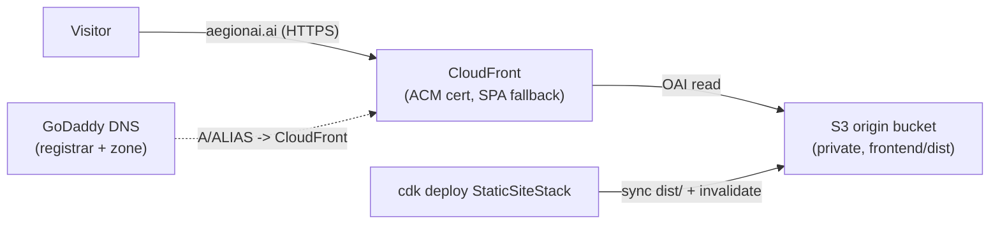

# AegionAI marketing site — move hosting from GoDaddy to AWS

**Status:** ready to execute · **Owner:** founder · **Last updated:** 2026-07-27

Moves the public marketing site (`aegionai.ai`) off GoDaddy shared hosting onto
**AWS S3 + CloudFront**, with DNS still registered at GoDaddy. The site is a fully
static Vite/React SPA ([frontend/](../frontend/)); the only "backend" is the demo
form, which posts to a third-party service (Web3Forms), so nothing server-side moves.

The infrastructure is a config-gated CDK stack ([cdk/stacks/static_site_stack.py](../cdk/stacks/static_site_stack.py)),
wired into [cdk/app.py](../cdk/app.py) and disabled by default in
[cdk/config/dev.yaml](../cdk/config/dev.yaml) (`static_site.enabled: false`) so it
cannot touch the existing controller/console deploys until you flip it on.



## What it costs

At marketing-site traffic this is ~**$1–5/month** (S3 storage + CloudFront egress
+ requests; the first TB of CloudFront out is on the AWS free tier for 12 months).
ACM certs are free. No NAT/ALB/compute — CloudFront is serverless.

## Two DNS paths — pick one

| | **Option 1 — keep DNS at GoDaddy** (recommended to start) | **Option 2 — move DNS to Route53** |
|---|---|---|
| GoDaddy change | Repoint the apex + `www` records at CloudFront | Change **nameservers** to the Route53 zone's NS set |
| Route53 | not used | Create a public hosted zone; stack adds apex+www alias records |
| CDK config | leave `hosted_zone_id` empty | set `hosted_zone_id` + `hosted_zone_name` |
| Reversibility | fastest rollback (just repoint records back) | slower (NS propagation both ways) |
| Best when | you want the lowest-risk cut now | you want console/dashboard/apex all in one DNS system later |

Registrar stays GoDaddy either way (no domain transfer). Everything below defaults
to **Option 1**; Option-2 deltas are called out inline.

---

## Step 1 — Request the ACM certificate (us-east-1)

CloudFront **requires the cert in `us-east-1`** regardless of where the site is
served. The existing ALB cert (`*.aegionai.ai`, arn ...`522142fe`...) does **not**
cover the apex `aegionai.ai`, so request a new one covering both apex and www:

```bash
export AWS_PROFILE=sentra AWS_REGION=us-east-1
aws acm request-certificate \
  --domain-name aegionai.ai \
  --subject-alternative-names www.aegionai.ai \
  --validation-method DNS \
  --region us-east-1
```

Then add the **CNAME validation records** ACM returns:
- `aws acm describe-certificate --certificate-arn <arn> --region us-east-1` → read `ResourceRecord` (Name/Value) for each domain.
- **Option 1:** add those CNAMEs in the GoDaddy DNS panel.
- **Option 2:** if the Route53 zone already exists, `aws acm ... ` + the console "Create records in Route 53" button does this for you.

Wait until status is `ISSUED` (`describe-certificate` → `"Status": "ISSUED"`). Copy the cert ARN.

## Step 2 — Configure and enable the stack

Edit [cdk/config/dev.yaml](../cdk/config/dev.yaml) → `static_site:` block:

```yaml
static_site:
  enabled: true                       # was false
  domain_name: "aegionai.ai"
  alternate_domains: ["www.aegionai.ai"]
  certificate_arn: "arn:aws:acm:us-east-1:531109575379:certificate/<the-issued-cert>"
  # Option 2 only — otherwise leave empty:
  hosted_zone_id: ""
  hosted_zone_name: "aegionai.ai"
```

> Note: `cdk/config/dev.yaml` is gitignored (holds account specifics). The default
> (disabled) block is committed as documentation; your enabled values stay local.

## Step 3 — Deploy (creates the bucket + CloudFront, publishes the site)

```bash
export AWS_PROFILE=sentra AWS_ACCOUNT_ID=531109575379 AWS_REGION=us-east-1
./scripts/deploy_marketing_site.sh          # builds frontend/dist + cdk deploy
```

The stack's `BucketDeployment` uploads `frontend/dist/` and invalidates the CDN.
Note the stack **outputs**: `DistributionDomainName` (e.g. `d1234.cloudfront.net`)
and `DistributionId`.

## Step 4 — Smoke-test on the CloudFront domain BEFORE touching DNS

```bash
curl -sI https://<DistributionDomainName>/ | head -n1        # expect 200
curl -s  https://<DistributionDomainName>/ | grep -o '<title>.*</title>'
# deep-link / SPA fallback check — a non-root path must still return the app (200):
curl -sI https://<DistributionDomainName>/anything | head -n1  # expect 200, not 403/404
```

Open it in a browser; confirm the corrected copy renders and the demo form submits.
**Do not change DNS until this passes** — the live GoDaddy site is untouched so far.

## Step 5 — Cut DNS over

**Option 1 (GoDaddy DNS):** in the GoDaddy DNS panel:
- Apex `aegionai.ai`: GoDaddy supports a **"Forwarding"**-free apex via its own
  ALIAS-like record only inconsistently — the robust move is to point apex + `www`
  at CloudFront. If GoDaddy won't ALIAS the apex to a CloudFront hostname, either
  (a) use `www` as canonical + a GoDaddy apex→www forward, or (b) switch to Option 2
  (Route53 alias handles the apex natively). Set `www` as a **CNAME → `<DistributionDomainName>`**.
- Lower the record TTL to 600s a day beforehand so the cut is fast/reversible.
- Remove the old GoDaddy hosting A-records once CloudFront is serving.

**Option 2 (Route53):** the stack already created the apex + `www` **A/AAAA alias**
records. Just change the **nameservers** at GoDaddy to the four Route53 NS values
(`aws route53 get-hosted-zone --id <zone>` → `DelegationSet`). Propagation: minutes to a few hours.

Verify: `dig aegionai.ai +short` and `dig www.aegionai.ai +short` resolve to
CloudFront; `curl -sI https://aegionai.ai/` returns 200 with a valid cert.

## Step 6 — Decommission GoDaddy hosting

Once `aegionai.ai` serves from CloudFront and has been stable for a day:
- Cancel/park the GoDaddy **web/shared hosting** plan (keep the **domain registration**).
- Keep the GoDaddy zone records (Option 1) or the Route53 zone (Option 2) as the DNS authority.
- The GoDaddy deploy artifacts under [frontend/](../frontend/) (`aegionai-godaddy/`,
  `*.zip`) are no longer the publish path — the CDK deploy is. Leave or delete at will.

## Rollback

- **Before Step 5:** nothing to roll back — DNS still points at GoDaddy.
- **After Step 5, Option 1:** repoint the GoDaddy records back to the old hosting
  A-records (kept from before). Fast because TTL was lowered in Step 5.
- **After Step 5, Option 2:** revert nameservers at GoDaddy to GoDaddy's defaults
  (slower — NS propagation).
- **Tear down AWS side:** `cdk destroy <stack>` (or set `static_site.enabled: false`
  + redeploy the app). With `retain_on_delete: false` (default) the bucket is emptied
  and removed; set it true first if you want to keep objects.

## Follow-ups / caveats

- **Demo-form key.** [frontend/.env](../frontend/.env) hardcodes a Web3Forms key
  registered to a personal Gmail (`shashank31mar@gmail.com`), and it ships in the
  client bundle (any `VITE_` var is public by design). Move the form to `info@aegionai.ai`
  and consider a server-side/API-Gateway form handler if you want the address off
  the public bundle. Independent of hosting, but worth doing at cutover.
- **CI publish.** Later, wire `scripts/deploy_marketing_site.sh` into a pipeline so a
  merge to `main` republishes the site (the invalidation is already built in).
- **Cache.** Vite emits content-hashed asset filenames (safe to cache forever);
  `index.html` is short-cached via the CloudFront default + the deploy invalidation,
  so a new deploy is visible immediately.
