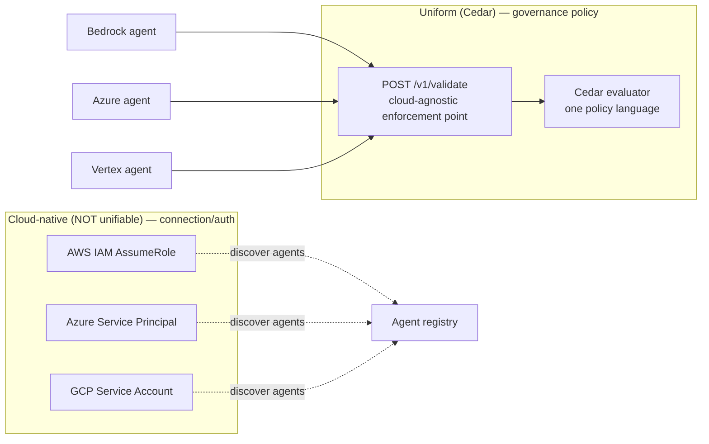

# Feature — Cedar as the Uniform Agent-Governance Policy Layer (AWS / GCP / Azure)

**Status:** DRAFT v1.0 — eight Kiro passes; build-ready. v1.0: `generator_version` added to the compiled-Cedar cache key (a generator fix changes `.cedar` from the same source → source-hash alone goes stale); CT08 stamps it + regeneration is required on bump; CT06b depends on CT06c only (CT08 backfill gated on CT06b) so the sequencing guard and the dependency graph agree. (Feature §7.1 & the workstream already agreed on `s3_key`/`content_hash` since v0.9 — the prior "contradiction" was a stale re-read.) v0.9 reconciles the two-artifact addressing: structured source keeps its `.yaml` key (no rename), `s3_key` points at it, the `.cedar` key is DERIVED by convention (no new field), `content_hash` hashes the source (the `.cedar` is its deterministic function) — feature §7.1 and the workstream now agree on `s3_key` semantics. v0.8 closes the **storage-model gap** (the load-bearing one): the structured `AgentPolicyDocument` is the **stored source of truth**, `.cedar` is a **generated co-artifact** beside it (§7.1/workstream §1/CT06c) — non-Cedar fields (`allowed_callers`, full `cross_cloud_dependencies`, `max_calls_per_minute`) are sourced from the structured object, never parsed from `.cedar`; this is what makes CT12's no-round-trip rule valid. v0.7 fixes two blockers + two self-found gaps in §7.1: **`get_agent_policy` is a shared loader** read by 4 enforcement paths (cross-agent `allowed_callers` **fail-open**, context cross-cloud, abuse rate, validation_service cloud-stamp) — it **keeps returning the structured dict** + adds Cedar (never swaps the return type); the **signal contract is `(violation_type, violated_policy, penalty)`** with the full 7-reason set (the **−10 refund tier** feeds trust scoring); `INVALID_AGENT_INVOCATION` is a structural **pre-Cedar** check; `get_agent_tools` (YAML parse) must branch on `policy_format`; `max_refund_amount` default-5000 must be translated. v0.6 fixes the §7 diagram (dropped stale `op_type`, annotated the `invoke_agent` two-call) and adds the **`violation_type`-preservation** rule through the collapse (call-1→`UNAUTHORIZED_TOOL`, call-2→`UNAUTHORIZED_AGENT_INVOCATION`) + a CT09 reason-parity assertion (the verdict-only gate wouldn't catch a reason flip). v0.5 closes the last four: **§5.1 amount row → Long cents** (was inconsistently still "float"), **`invoke_agent` decomposed into two AND-ed authorizations** (`UseTool`+`InvokeAgent` — the one tool that doesn't survive a 1:1 port, §6.1), **`has`-guards required for schema *validation*** not just runtime (§6.1), **`operation_type` dropped from the context shape** (no policy referenced it, §5.1/§6). v0.4 fixed money=`Long` cents / `forbid` `has`-guard + deny-on-missing / entity synthesis / determining-policy set / two-layer cache / inert-rule inventory. Decisions locked (Cedar ✅; **open-source in-process engine** ✅; replaces & **retires** the current YAML/hardcoded evaluation after a shadow migration). No code yet.
**Owner:** Security Controller (`src/security-controller`) + Console (`web/console`) + Policy authoring
**Last updated:** 2026-06-11
**Related:** agent-policy-management/feature.md (binding model, cloud-from-agent §2.3), multicloud-agent-import/feature.md (§14 verified identity, §8.1 lifecycle), LLD 03 (policy engine), LLD 11 (policy CRUD), LLD 21 §13 (API)

---

## 1. Summary

Adopt **Cedar** ([cedarpolicy.com](https://www.cedarpolicy.com) — Amazon's open-source authorization language) as Sentra's agent-governance policy language, **replacing and retiring** today's bespoke evaluation.

**Primary win (true today, single-cloud):** the current policy is enforced by **hardcoded per-tool Python** + an **inert** "rule expression" field that is never executed (§3). That doesn't scale and gives a false impression of expressiveness. Cedar replaces both with a **declarative, statically-analyzable, `eval`-free** engine — real value even if no second cloud ever exists.

**Strategic multiplier (the payoff as we add clouds):** because the enforcement point (`POST /v1/validate`) is **already cloud-agnostic**, one Cedar policy set then governs an agent **identically on AWS Bedrock, Azure AI Foundry, or GCP Vertex** — uniform policy across clouds, with no per-cloud enforcement fork (§8). Cross-cloud uniformity is the multiplier on top of the near-term declarative-engine win, not the sole justification.

**Evaluator (decided):** embed the **open-source Cedar engine in-process** (the *same* Rust engine AWS Verified Permissions runs internally) — not AVP-over-the-network. Rationale + the AVP trade-off are in §9.1. **We are not building an evaluator** — we link Cedar's.

**End state (decided):** Cedar **replaces** the current policy evaluation; after a shadow-migration parity gate, the hardcoded per-tool checks and the inert YAML rules are **removed**. The hybrid store (DDB metadata + S3 content) and the binding model are **reused** — minimal new infrastructure (§7.1).

> **The one-line trap this doc exists to avoid:** "use Cedar everywhere" is often imagined as *"Cedar replaces how we connect to each cloud."* It does **not** — cloud **connection/auth** is inherently cloud-native (AWS IAM role, Azure service principal, GCP service account) and Cedar cannot unify it. What Cedar **can** unify is the **governance policy** evaluated at runtime. Those are two different layers (§2), and conflating them produces a design that can't ship.

---

## 2. The mental model — two layers, only one is unifiable

| Layer | Unifiable by Cedar? | Mechanism |
|---|---|---|
| **Cloud connection / discovery auth** (read the account to find agents) | **No — cloud-native** | AWS `sts:AssumeRole` + external-id · Azure service principal · GCP service account (multicloud-agent-import §7). Cedar is irrelevant here. |
| **Agent-governance policy** (what an agent's tool calls are allowed to do) | **Yes — the real cross-cloud constant** | One Cedar policy set, evaluated by *our* control plane at `/v1/validate`, regardless of the agent's host cloud. |



**Why this is already half-true:** our enforcement point is cloud-agnostic today — a Bedrock, Azure, or Vertex agent's tool call all hit the same `/v1/validate` and the same engine. Adopting Cedar swaps the *policy format* the engine reads; it does **not** require new per-cloud enforcement. The cross-cloud uniformity is therefore a **policy-language** change, not a runtime re-architecture.

---

## 3. Current-state analysis (verified against code)

| What | State today |
|---|---|
| Policy document | `AgentPolicyDocument` (`scripts/schemas/policy_schema.py`): `allowed_tools[]`, `policies[]` (`PolicyRule`), `allowed_agents[]`, `cross_cloud_dependencies[]`, `max_calls_per_minute`, `platform`/`cloud_region`. Stored as **YAML in S3 + metadata in DDB** (`sentra-policies-metadata`). |
| How it's enforced | `policy_engine.validate` does **hardcoded** checks: `tool ∈ allowed_tools` (`UNAUTHORIZED_TOOL`), `process_refund` amount ≤ `max_refund_amount`, `verify_identity` high-fraud refuse, `invoke_agent` target ∈ `allowed_agents`. Cross-cloud deps enforced in `context_validator`. |
| `PolicyRule.rule` (the `policies[]` array) | A **"Python expression" string**, only **syntax-validated** (`policy_validator: compile(rule, '<string>', 'eval')`) and **not executed at runtime** (verified: the sole `compile` is the validator; no `eval`). → **The structured `policies[]` rules are largely decorative today**; real enforcement is the hardcoded checks above. |
| Resolution | `policy_engine.get_agent_policy` loads the bound policy (`attached_policy_id`) by id → S3 YAML; cloud identity resolved from the **agent** record, not the policy (agent-policy-management §2.3). |

**Two takeaways that motivate Cedar:** (1) the most expressive part of our schema (`policies[].rule`) is an unexecuted custom expression language — a maintenance/securirty smell Cedar removes; (2) real enforcement is per-tool **hardcoded** Python, which doesn't scale to new tools/clouds without code changes. Cedar moves both into declarative, analyzable policy.

---

## 4. Why Cedar (and what it is)

Cedar is a small, **provable** authorization language: `permit`/`forbid` rules over **principal / action / resource / context**, validated against a **schema**, with formal analysis tooling. Used by AWS **Verified Permissions (AVP)**.

- **Standards-based + analyzable** — Cedar policies are statically validated against a schema and can be checked for conflicts/coverage; our Python-expression rules cannot.
- **Safe** — no `eval`; the evaluator is sandboxed by construction.
- **Cloud-neutral** — Cedar has zero AWS coupling (open source, Rust core); it is *not* an AWS-only thing despite AVP. We can self-host the evaluator and stay multi-cloud.
- **Optionality** — start self-hosted (in-process evaluator), keep AVP as a managed option later without changing policy syntax.

**vs OPA/Rego:** Rego is more general (Turing-ish) but harder to analyze and heavier to embed. Cedar is purpose-built for authz, smaller, and statically analyzable — a better fit for "is this agent allowed to call this tool" than a general policy engine. (CLAUDE.md tech stack lists "OPA (Rego) or custom DSL" as *planned* — this doc proposes Cedar as the concrete choice.)

---

## 5. Scope — what Cedar replaces, and what explicitly stays in the pipeline

**Critical boundary (the make-or-break of this design):** Cedar makes a **stateless** decision *given* a context. It does **not** count, score, or call models. So:

| Concern | Cedar? | Where it lives |
|---|---|---|
| Tool authorization (`tool ∈ allowed_tools`) | ✅ Cedar | `permit(... action==UseTool ...)` |
| Agent-to-agent (`invoke_agent`) — **two checks** (§6.1) | ✅ Cedar | **AND of two authorizations**: `UseTool` on `Tool::"invoke_agent"` (∈ allowed_tools) **and** `InvokeAgent` on `Agent::target` (∈ allowed_agents) |
| Parameter limits (`process_refund` amount ≤ N) | ✅ Cedar | `forbid(... when { context.amount > N })` |
| Identity gate (`verify_identity` fraud=high) | ✅ Cedar | `forbid(... when { context.fraud_risk == "high" })` |
| Cross-cloud preconditions | ⚠️ Cedar **decides**, pipeline **computes** | pipeline sets `context.preconditions_met`; Cedar `forbid(... unless { context.preconditions_met })` |
| Rate limit (`max_calls_per_minute`) | ⚠️ Cedar **decides**, pipeline **counts** | pipeline sets `context.calls_this_minute`; Cedar can compare, but the COUNT is stateful → ours |
| Trust score / quarantine | ❌ stays | `trust_checker` (stateful, step 1) |
| Sigma detection | ❌ stays | `sigma_engine` (pattern match) |
| ML threat classifier | ❌ stays | `ml_classifier` (model call) |

→ **Cedar replaces the `policy_engine` authorization step.** The other pipeline stages (trust, sigma, ML, context-gathering) remain; they now *feed Cedar's context* and contribute their own signals to the combiner. Cedar is **one validator** (a better `policy_engine`), not the whole pipeline.

**Why route already-computed booleans (`preconditions_met`, rate) *through* Cedar instead of a plain pipeline DENY?** A fair pushback (Kiro): if the pipeline already computed the boolean, Cedar re-checking it is indirection. We do it **only** when the decision belongs to *policy* (per-agent, operator-editable) rather than to a platform invariant: e.g. *which* cross-cloud dependency an agent requires, or whether *this* agent's policy opts into the rate cap, is policy and benefits from one auditable decision point + a determining-policy id. A **platform-wide** guard with no per-policy variation (e.g. a hard global rate ceiling) should stay a plain pipeline DENY — do **not** route it through Cedar for completeness. Rule of thumb: *operator-editable per-agent → Cedar; fixed platform invariant → pipeline.*

### 5.1 Context schema & provenance (the real work — Kiro #2/#3)

Cedar's verdict is only as good as the `context` we hand it. "These signals already exist" undersells the assembly: they're scattered across the pipeline today and must become **one coherent context record with a stable per-field contract**. Context assembly is a first-class component (`CedarContext`), and it — not Cedar, not two places — **owns input coercion** (e.g. `"$100,000" → 100000.0`, non-numeric → DENY-sentinel) so parity disagreements are real policy differences, not parsing differences.

| Cedar `context` field | Source | Type | Missing-semantics | **Trust** |
|---|---|---|---|---|
| `amount` | request `tool_params` → **coerced by assembly to integer cents** (`"$100,000"` → `10000000`; non-coercible → omit ⇒ deny-on-missing fires, §6) | **`Long?`** (cents — Cedar has no float; §6) | absent for non-amount tools; `has`-guarded so the cap rule never errors | ⚠️ **agent-supplied** |
| `fraud_risk` | request `tool_params.fraud_risk` | str? | absent ⇒ rule doesn't fire | 🔴 **agent-supplied — see caveat** |
| `cloud_region` | **agent record** (agent-policy-management §2.3) | str | fallback to provider default | ✅ controller-derived |
| `preconditions_met` | `context_validator` (cross-cloud state) | bool | absent ⇒ treat as **not met** (fail-secure) | ✅ controller-derived |
| `calls_this_minute` | `abuse_detector` (rate counter) | number | absent ⇒ 0 (cap won't fire) | ✅ controller-derived |
| `tenant_id`, `agent_id` (principal) | **verified** identity (multicloud-import §14); request body until then | str | required | ⚠️→✅ hardens with §14 |

> **🔴 Self-asserted-context caveat (do NOT enshrine as "done").** `fraud_risk` (and `amount`) come from the calling agent's own `tool_params` today — the agent effectively tells us its own risk. A 1:1 Cedar port (`forbid when context.fraud_risk == "high"`) **carries the vulnerability forward**: an agent that omits or lowers the field bypasses the rule. Cedar fixing the *principal* (verified identity) does **not** fix self-asserted *context*. **Action:** the context-provenance table is the source of truth for which fields are agent-supplied; agent-supplied risk inputs must be **controller-derived** before they can be trusted as enforcement inputs (e.g. fraud signal computed server-side, not read from `tool_params`). The Cedar migration is the moment to flag this so it isn't frozen as "correct" in Cedar form. (Ships *no worse* than today — but explicitly *not* "solved".)

---

## 6. The Cedar data model (concrete)

**Entities / schema** (the agent tool-call domain):
- **Principal** = `Agent::"{tenant_id}#{agent_id}"` — the **verified** identity (multicloud-agent-import §14: from the JWT, never the request body). Tenant-scoped by construction.
- **Action** = `Action::"UseTool"`, `Action::"InvokeAgent"`, `Action::"CrossCloudCall"`.
- **Resource** = `Tool::"{tool_name}"`, `Agent::"{target_agent}"` (for invoke).
- **Context** = `{ amount?, fraud_risk?, cloud_region, calls_this_minute?, preconditions_met?, ... }` — assembled by the pipeline from the `ValidationRequest` + stateful lookups. (`operation_type` is on the request but **not** in the context shape — no current policy references it; add it only when a rule needs it, e.g. WRITE-gating.)

**Example policies.** ⚠️ These reflect **two Cedar-semantics rules** a naive 1:1 port gets wrong (Kiro Cedar-semantics pass) — read §6.1 before treating them as the spec:
- **Money is `Long` (cents), not float.** Cedar's only numeric type is `Long`; `>` on floats won't compile. `CedarContext` coerces `amount` to **integer cents** (`"$100,000"` → `10000000`); `max_refund_amount` is stored as cents. (Alternative: the Cedar `decimal` extension + `.greaterThan()`, *if* the binding exposes it — the P0a spike must confirm. Default = cents.)
- **A `forbid` that reads missing context fails OPEN.** Accessing `context.amount` when absent is an *error* → the policy is *dropped* → a matching `permit` then ALLOWs. So every `forbid` must `has`-guard its context **and** a dangerous tool needs an explicit **deny-on-missing**.

```cedar
// allowed_tools — allow-list is a Set<Tool> entity-set attribute (schema §6.1), not Set<String>
permit(principal, action == Action::"UseTool", resource)
when { resource in principal.allowed_tools };

// refund cap — Long CENTS; has-guard so a missing amount doesn't error-drop this forbid
forbid(principal, action == Action::"UseTool", resource == Tool::"process_refund")
when { context has amount && context.amount > principal.max_refund_amount };

// deny-on-missing — REQUIRED so "no amount" fails SECURE (not open) on a dangerous tool
forbid(principal, action == Action::"UseTool", resource == Tool::"process_refund")
unless { context has amount };

// high-fraud identity gate (has-guard)
forbid(principal, action == Action::"UseTool", resource == Tool::"verify_identity")
when { context has fraud_risk && context.fraud_risk == "high" };

// agent-to-agent
permit(principal, action == Action::"InvokeAgent", resource)
when { resource in principal.allowed_agents };

// cross-cloud precondition — fail-secure: forbid unless the precondition is present AND met
forbid(principal, action == Action::"UseTool", resource)
when { resource has requires_precondition && resource.requires_precondition }
unless { context has preconditions_met && context.preconditions_met };
```

**Mapping table — current YAML → Cedar:**

| Today (`AgentPolicyDocument`) | Cedar construct |
|---|---|
| `allowed_tools[]` | principal attribute + `permit(UseTool) when resource in allowed_tools` |
| `allowed_agents[]` (+ `invoke_agent` ∈ `allowed_tools`) | **two `isAuthorized` calls, AND-ed** (§6.1): `permit(UseTool) when resource in allowed_tools` for `Tool::"invoke_agent"` **and** `permit(InvokeAgent) when resource in allowed_agents` for `Agent::target`. Both must ALLOW. |
| `max_refund_amount` (hardcoded) | principal attribute + `forbid when context.amount > …` |
| `verify_identity` fraud (hardcoded) | `forbid when context.fraud_risk == "high"` |
| `cross_cloud_dependencies[]` | `forbid … unless context.preconditions_met` (pipeline computes) |
| `policies[].rule` (Python expr, inert) | **real** Cedar `permit`/`forbid` rules (now enforced) |
| `platform` / `cloud_region` | **not** in Cedar — stays agent-sourced (agent-policy-management §2.3) |
| `max_calls_per_minute` | pipeline counts; optional Cedar `forbid when context has calls_this_minute && context.calls_this_minute > …` |

### 6.1 Entity synthesis + schema typing (what we actually hand Cedar — Kiro #3/#4)

Cedar evaluates over **entities**, not loose dicts. Per request the pipeline builds a small **entity store** — and crucially the **principal is a synthesized merge of two origins**:

- **`Agent` (principal)** = `Agent::"{tenant}#{agent_id}"`, attributes merged from:
  - **verified identity → agent record**: `cloud_region` (agent-sourced, §2.3) — and the *identity* itself.
  - **bound policy → authz attributes**: `allowed_tools`, `allowed_agents`, `max_refund_amount` (cents).
  > One line to internalize: **identity + cloud come from the agent; authz attributes come from the bound policy; the entity is merged per-request.** This split origin is exactly where tenancy/binding bugs hide — keep it explicit.
- **`Tool` (resource)** = `Tool::"{tool_name}"`, attributes (e.g. `requires_precondition`) sourced from the **tool registry** or derived from the policy's `cross_cloud_dependencies[]`. **The entity store must include Tool entities + their attributes**, not just the principal — otherwise `resource.requires_precondition` errors (and, per the missing-context rule, mis-fires).

**Schema typing that's easy to get wrong:**
- `allowed_tools` / `allowed_agents` must be declared **`Set<Tool>` / `Set<Agent>` (entity sets)** so `resource in principal.allowed_tools` validates — **not** `Set<String>`.
- `max_refund_amount` is **`Long`** (cents).
- Optional context fields are declared optional; every `forbid` `has`-guards them (§6 / §10). **`has`-guards are required for strict Cedar *schema validation*, not just runtime safety** — Cedar's validator flags an unguarded optional-attribute access as a validation error, so a policy without them won't pass `cedar validate` (CT02/CT12), let alone fail safely at runtime.

**`invoke_agent` is the one tool that does NOT survive a 1:1 port (decided — two AND-ed authorizations).** Today's engine enforces *both* `invoke_agent ∈ allowed_tools` **and** `target ∈ allowed_agents` for a single `invoke_agent` call. Cedar models those as two different `(action, resource)` pairs, so `CedarPolicyEngine` issues **two `isAuthorized` calls and AND-s them** (both must ALLOW, neither forbidden):
1. `UseTool` on `Tool::"invoke_agent"` — is the agent allowed to invoke at all?
2. `InvokeAgent` on `Agent::"{tenant}#{target}"` — is *that target* allowed?
Both determining-policy sets fold into the one `ValidationResult` (§7 collapse rule); a DENY from either is the agent's verdict. *(Alternative considered: a single `InvokeAgent` action with the tool-allow-list checked in its `when` via a context flag — rejected as less faithful to the existing two-list semantics and harder to audit.)*

---

## 7. Architecture & flow

Cedar slots in as the authorization decision inside the existing pipeline. The pipeline **gathers context** → **asks Cedar** → Cedar returns Allow/Deny → combiner folds it with sigma/ML/trust as today.

```mermaid
sequenceDiagram
    participant A as Agent (any cloud) via SDK
    participant V as /v1/validate
    participant P as Pipeline (context gather)
    participant CE as Cedar evaluator (in-process)
    participant ST as Policy store (S3 Cedar + DDB meta)
    A->>V: tool call (verified JWT → tenant, agent_id)
    V->>P: ValidationRequest
    P->>P: build context {amount(cents), fraud_risk,<br/>cloud_region, calls_this_minute, preconditions_met}
    P->>ST: load agent's Cedar policies + entities (cached)
    P->>CE: isAuthorized(principal=Agent, action, resource=Tool, context)
    Note over P,CE: invoke_agent → TWO calls (UseTool + InvokeAgent), AND-ed (§6.1)
    CE-->>P: ALLOW / DENY (+ determining policies — a SET)
    P->>P: collapse determining-set → singular violated_policy<br/>(preserve per-call reason); combine w/ trust/sigma/ML
    P-->>A: final verdict (+ audit signal stamped sentra.policy)
```

> **Determining-policy is a set, not one id (Kiro #7).** Cedar returns the **set** of policies that determined the decision (multiple `forbid`s can match a DENY); our `ValidationResult.violated_policy` is **singular**. The engine needs an explicit collapse rule — proposed: on DENY, pick the highest-priority `forbid` (or join all ids into `metadata`); on ALLOW, the determining `permit`(s) are informational. Pin this in the engine mapping so the audit field is deterministic.
>
> **Preserve distinct `violation_type` across the `invoke_agent` two-call (Kiro, this pass — subtle).** The two AND-ed calls (§6.1) deny for *structurally different* reasons, and today's code emits **distinct** types (verified: `policy_engine.py:275` `UNAUTHORIZED_TOOL`, `:392` `UNAUTHORIZED_AGENT_INVOCATION`). The collapse rule must map: **call-1 (`UseTool`) DENY → `UNAUTHORIZED_TOOL`; call-2 (`InvokeAgent`) DENY → `UNAUTHORIZED_AGENT_INVOCATION`; both → call-1 wins** (matches today's check order — allowed_tools is evaluated before the target). ⚠️ The **parity gate (§12) checks ALLOW/DENY, not the `violation_type` string** — so a reason-flip here would **not** trip it. Add `violation_type` to the invoke_agent parity assertions (CT09) so the audit reason can't silently regress.

**New/changed pieces:**
- **`CedarPolicyEngine`** — replaces/augments `policy_engine.validate`: builds principal/action/resource/context, calls the evaluator, emits the `Source.SENTRA_POLICY` signal (same combiner contract).
- **Evaluator** — Cedar's Rust engine via Python bindings **in-process** (µs-scale, no network — preserves the latency budget); AVP (managed) is a later option behind the same interface.
- **Policy store** — Cedar policy text + schema in S3 (mirrors today's YAML-in-S3), metadata in `sentra-policies-metadata`. Per-tenant, bound to agents exactly as today (`attached_policy_id`).
- **Cloud-from-agent preserved** — `platform`/`cloud_region` stay agent-sourced; a single Cedar policy bound to a Bedrock *and* an Azure agent governs each correctly because cloud identity is **not** in the policy (agent-policy-management §2.3).

### 7.1 Implementation impact — DDB, S3, code, deps, CDK

**Headline:** Cedar **replaces and retires** the current evaluation (the hardcoded `policy_engine` checks + the inert YAML `policies[].rule`). The **hybrid store (DDB metadata + S3 content)** and the **binding model** (`attached_policy_id`) are **reused** — almost no new infrastructure. Everything below piggybacks on the policy-management + tenancy work already shipped.

**Dependencies / build**
- Add the open-source Cedar engine Python binding (e.g. `cedarpy`) to `src/security-controller/requirements.txt`. The Cedar core is Rust → the **controller Docker image** must bundle the native wheel (build-stage change); confirm it builds on the image base (slim vs alpine/musl). **Fallback:** a localhost Cedar **sidecar** if the wheel won't build.

**S3 (artifacts bucket) — reuse, new content type**
- **Storage model: structured source + Cedar co-artifact (NOT a replacement).** The structured `AgentPolicyDocument` stays the **stored source of truth** at its **existing key + extension** (`policies/agents/{agent_id}/v{version}.yaml` — **no rename**); the **`.cedar` text is generated beside it** at the **same key with the extension swapped** (`…/v{version}.cedar`). Both objects exist; `policy_format=cedar` flips only *which drives authz*. This is mandatory because the non-Cedar fields (`allowed_callers` — translated nowhere; the **full** `cross_cloud_dependencies` list, which Cedar's `Tool.requires_precondition` boolean doesn't preserve; `max_calls_per_minute`) have **no home in the `.cedar` text**, and CT12's no-round-trip rule requires the structured form to persist for re-editing. The loader sources those fields from the structured object; `CedarPolicyEngine` reads the `.cedar`.
- One **shared, versioned Cedar schema** object: `schema/agent-policy-v{n}.cedarschema` — entity types (`Agent`, `Tool`), actions (`UseTool`/`InvokeAgent`/`CrossCloudCall`), and the `context` shape. Not per-policy.

**DDB `sentra-policies-metadata` — reuse table, additive only**
- Add `policy_format` (`yaml` | `cedar`) so old + new coexist during migration; the loader branches on it.
- **`s3_key` keeps pointing at the structured source** (`.yaml`) — it's the source of truth and what CRUD writes; **the `.cedar` key is derived by convention** (swap the extension on `s3_key`), so **no second key field is added** (stays additive-only). `schema_version` → Cedar schema version. **`content_hash` hashes the structured source** (unchanged meaning).
- **Compiled-Cedar cache key = `schema_version` + `content_hash` + `generator_version` (Kiro).** The `.cedar` is a deterministic function of (source, `schema_version`, **generator logic**). A source edit (new `content_hash`) or schema bump invalidates correctly — **but a generator/translator fix produces different Cedar from the *same* source**, so `content_hash`+`schema_version` are both unchanged and the key would serve stale compiled Cedar. Therefore the key **must include a `generator_version`** (a constant in the deployed translator). Bumping it on any generator change both misses the cache **and** signals that CT08 must **regenerate** the persisted `.cedar` artifacts (the S3 `.cedar` is otherwise stale regardless of cache). Don't rely on "a deploy clears the per-process cache" alone — that doesn't refresh the stale S3 `.cedar`.
- **No key/GSI change.** PK `policy_id`, `agent-index`, `status-index`, and the tenant-scoped v2 keys are all unchanged. The agent binding (`attached_policy_id`) is unchanged. → Cedar inherits all the binding + tenancy work for free.
- **No `sentra-agent-registry` change.** Cedar principal **attributes** (allowed_tools, allowed_agents, max_refund_amount) are read from the policy/agent at eval time and handed to Cedar — those fields already exist; nothing new to store.

**Code (`src/security-controller`)**
- **NEW** `app/validators/cedar_policy_engine.py` — builds principal/action/resource/context, calls the embedded evaluator, emits the **same** `Source.SENTRA_POLICY` signal. The contract is **`(violation_type, violated_policy, penalty)`** — not just `violation_type` — because `penalty` feeds trust scoring (`audit_logger.py:286`). Full set: `UNAUTHORIZED_TOOL` (−15), `POLICY_VIOLATION`/`max_refund_amount` (**−10**), `POLICY_VIOLATION`/`high_fraud_identity_block` (−15), `INVALID_AGENT_INVOCATION` (−15, structural pre-check), `UNAUTHORIZED_AGENT_INVOCATION` (−15), `POLICY_NOT_FOUND`/`POLICY_DISABLED`/`POLICY_ERROR` (−15). The −10 refund tier is the only non-−15 — a flat penalty drifts trust scores. Combiner contract unchanged.
- **`policy_engine.get_agent_policy` — shared loader; MUST keep returning the structured dict.** ⚠️ It is read by **4 enforcement paths**, each pulling structured fields off the returned dict: `cross_agent_validator` (`allowed_callers` — **empty ⇒ fail-OPEN**), `context_validator` (`cross_cloud_dependencies`), `abuse_detector` (`max_calls_per_minute`), `validation_service` (`platform`/`cloud_region`, stamped here). So the loader **keeps returning the full dict** (allowed_tools, allowed_agents, allowed_callers, cross_cloud_dependencies, max_refund_amount, max_calls_per_minute, platform, cloud_region) — **sourced from the retained structured object, not parsed from the `.cedar` text** (see the storage model above) — **and additionally** surfaces the Cedar text/entities for `CedarPolicyEngine`. It does **not** swap the return type to Cedar text. (`allowed_callers`/`cross_cloud` enforcement live **outside** the §5 Cedar authz subset, so the parity gate won't catch a break here — hence the explicit constraint.) Keep binding resolution + cloud-from-agent. Cache: §7.1.
- **Display path** `agent_service.get_agent_tools` parses the policy as **YAML** today (`yaml.safe_load`) for the Agent Detail → Tools tab → it must branch on `policy_format` (read `allowed_tools` from the structured view / Cedar entities when `cedar`), else the Tools tab breaks for migrated agents.
- **Context assembly** — wire *already-computed* signals into Cedar's `context`: `amount` (request, → Long cents), `fraud_risk` (tool_params), `cloud_region` (agent), `preconditions_met` (from `context_validator`, cross-cloud), `calls_this_minute` (from `abuse_detector`, rate). These exist today; Cedar just consumes them.
- **`policy_validator`** — replace the `compile(rule, 'eval')` syntax-only check with **Cedar schema validation** (validates policy text against the schema — far stronger).
- **Retire hardcoded checks** — the per-tool `if tool_name == "process_refund"/"verify_identity"/"invoke_agent"` blocks in `policy_engine.validate` become Cedar policies and are **deleted** post-migration (this is the "do away with current evaluation").
- **Caching + invalidation (load-bearing — Kiro #5)** — parse/compile Cedar policies + schema once, keyed by **`schema_version` + `content_hash` + `generator_version`** (the third closes the generator-fix-with-same-source staleness; see the DDB bullet above). A policy edit (new hash) or schema bump (new version) must miss the cache; a **stale-schema / fresh-policy mismatch validates wrong → fail-secure DENY storm**. **Two-layer (the subtlety):** content-hash keying only helps if the **metadata lookup** that *learns* the new hash is itself fresh — if the metadata read is TTL-cached, the hash is stale and the keying buys nothing. So invalidation correctness = compiled-policy-cache (hash-keyed) **+** metadata-layer freshness/TTL, not the hash alone. Multi-task ECS: no cross-task invalidate — short TTL on the metadata layer (same constraint as the policy cache today).
- **Pipeline slot** — `CedarPolicyEngine` takes the current policy step in `validation_service`; trust/sigma/ML/context stages are untouched (the §5 boundary).

**Authoring / structured view**
- `AgentPolicyDocument` (`scripts/schemas/policy_schema.py`) is kept as the **structured "common rules" view that generates Cedar** (operators needn't hand-write Cedar) — the §6 mapping table is the generator spec — then deprecated once the Cedar editor lands.
- **Single source of truth during the window (Kiro #6).** Structured-view → generated Cedar → Cedar authoritative creates a **generation-drift** risk if someone edits the generated Cedar directly. **Rule:** while the structured view exists it is the **only** editor and the generated Cedar is **read-only** (regenerated, never hand-edited). Raw-Cedar editing unlocks **only** when the structured view is retired (one-way migration, not round-trip).

**Scripts**
- **NEW** `scripts/translate_policies_to_cedar.py` — YAML → Cedar text + entity attributes; idempotent + dry-run; backfills S3 and stamps `policy_format=cedar`.
- `seed_policies_metadata.py` + the seed policy artifacts → Cedar equivalents (via the translator).

**CDK**
- **No new tables / infra** (reuse S3 + `sentra-policies-metadata`).
- Add `CEDAR_ENABLED` + `CEDAR_SHADOW_MODE` env flags (mirror the ML-classifier shadow flags) + `CEDAR_SCHEMA_VERSION`. Docker build bundles the Cedar native lib (or the sidecar).

**API / console**
- Policy CRUD endpoint **shapes unchanged**; bodies carry Cedar text (or structured → generated). The Cedar editor UI is P2.

> **Net:** one new validator + one new dependency + a translator script + additive metadata fields. No new tables, no GSI/key changes, no new IAM beyond what policy storage already has. The current evaluation is removed at the end of the shadow migration.

---

## 8. Cross-cloud uniformity — the payoff, concretely

Bind **one** Cedar policy (`payments-baseline`) to `bedrock-payments` and `azure-payments`. Both agents' tool calls hit `/v1/validate`; both are evaluated against the *same* Cedar policy; each resolves its *own* cloud from its agent record. No per-cloud policy fork, no per-cloud enforcement code. Adding GCP later adds a **connector** (discovery) — **zero** policy-layer change. That is the "constant way" across clouds — at the policy layer, where it's actually achievable.

---

## 9. Decisions & open questions (proposed defaults)

1. **Evaluator placement.** **(DECIDED)** embed the **open-source Cedar engine in-process** (Rust core via Python binding, e.g. `cedarpy`). This is **not** reinventing an evaluator — it is the *same* engine AVP runs; the only choice is *where* it executes. In-process is chosen over **AWS Verified Permissions (AVP)** because the validate path is a per-tool-call hot path:
   - **Latency:** AVP is a network call (~10–50ms+) **per tool call** against a p95 ≤100ms budget; in-process is µs.
   - **Multi-cloud neutrality:** routing **Azure/GCP** agents' decisions through an **AWS** managed service is wrong for a uniform multi-cloud control plane; the open-source lib has zero cloud coupling.
   - **Availability/blast radius:** an AVP throttle/outage on the hot path → fail-secure DENYs everywhere (fleet outage). No external dep in-process.
   - **Cost:** AVP bills per authorization request = per tool call.
   - **Residual risk (named):** Python-binding maturity for the Rust engine. **Fallback** = a localhost Cedar **sidecar** (still no AWS coupling), not AVP-on-the-hot-path. **AVP stays an option later for the *management plane*** (managed policy store / console-API authz), never the agent hot path.
   - **De-risk FIRST (Kiro #4):** a `cedarpy`-builds-on-the-controller-image **spike is the very first P0 task and a hard gate** before any schema/engine work (§11). If the wheel won't build and we fall to the sidecar, the latency case shifts: in-process is µs, but a sidecar is a **localhost IPC hop per tool call** (sub-ms, but not µs) — still far better than AVP's cross-network call and still cloud-neutral, but the budget must be re-stated (target sidecar round-trip ≪ the validate p95 budget). Decide in-process-wheel vs sidecar at the spike, not mid-build.
2. **Partial-Cedar boundary (§5).** **(proposed)** Cedar replaces only the authorization step; trust/sigma/ML/rate-counting stay. Confirm we are NOT trying to push stateful/ML logic into Cedar.
3. **Schema ownership.** **(proposed)** one Sentra-owned Cedar schema (entity types Agent/Tool, actions, context shape) versioned in-repo; per-tenant policies validate against it.
4. **Authoring UX.** **(proposed)** editor offers Cedar text + a structured "common rules" form that generates Cedar; Cedar's validator replaces the syntax-only check. Confirm we keep a structured view (operators won't all write Cedar).
5. **Migration.** **(proposed)** auto-translate existing YAML → Cedar + a **shadow/dual-eval** phase (run both, log disagreements) before Cedar is authoritative. Confirm shadow gate.
6. **Identity coupling.** Cedar principal = the **verified** `(tenant, agent)` from multicloud-agent-import §14 JWT — so this feature depends on / composes with that identity work. Confirm sequencing.

---

## 10. Edge cases

| Case | Handling |
|---|---|
| Agent has no Cedar policy bound | Fail-secure DENY (`POLICY_NOT_FOUND`), exactly as today's binding model. |
| Cedar `permit` + `forbid` both match | Cedar semantics: **forbid wins** — matches our fail-secure stance. |
| Context attribute missing — **on a `permit`** (e.g. `amount` absent on a non-refund tool) | Safe: a `permit` that doesn't fire just means "no allow" → default deny. Action/resource scoping keeps the `amount` rule from touching other tools. |
| Context attribute missing — **on a `forbid`** (Kiro #2, **fail-OPEN trap**) | **Dangerous:** accessing `context.amount` when absent **errors** → Cedar **drops** the forbid → a matching `permit` then ALLOWs (a regression from today's fail-secure DENY-on-missing-amount). **Fix (designed in, not discovered):** every `forbid` `has`-guards its context, **and** dangerous tools get an explicit `forbid … unless { context has <required> }` deny-on-missing (§6). "Rule doesn't fire" must never silently mean "allow." |
| Cross-cloud precondition state | Pipeline computes `preconditions_met` (stateful) and passes it; Cedar only decides. Never push the state into Cedar. |
| Shared policy across clouds | Cloud identity stays agent-sourced (§8) → safe; no cloud literals in Cedar policies. |
| Evaluator unavailable / parse error | Fail-secure DENY + alarm; never fail-open. |
| Migration disagreement (YAML vs Cedar verdict) | Shadow logs it (`controller.discrepancy`), triaged `parsing`/`cedar-intentional`/`unexplained` (§12); Cedar authoritative only when **parsing + unexplained = 0**. |

---

## 11. Phased implementation

- **P0a — cedarpy build spike (GATE — Kiro #4).** *Before any schema/engine work:* confirm the Cedar Python binding builds + imports on the controller image base. Outcome decides **in-process wheel vs localhost sidecar** (§9.1). Hard gate.
- **P0b — Schema + evaluator + context + shadow.** Define the Cedar schema (Agent/Tool entity types + attrs per §6.1; Long-cents money); embed the evaluator; build the `CedarContext` assembler (§5.1, owns coercion → **Long cents**); build the **entity-store synthesizer** (principal = identity⊕policy merge; Tool entities + attrs — §6.1); add `CedarPolicyEngine` running in **shadow** (logs verdict, no live influence). Translate existing YAML → Cedar (from the **real** behavior, not the inert rules). **Emit a one-time inert-rule inventory report (Kiro #6)** — "these N `policies[].rule` expressions were never enforced; here's what we generated/dropped" — for operator sign-off, since silently dropping live-looking rules is bad change-management. No behavior change.
- **P1 — Cedar authoritative for the authz subset.** Flip `CedarPolicyEngine` to replace `policy_engine`'s authorization step once the parity gate (§12) is met. Trust/sigma/ML/rate stay. `POLICY_NOT_FOUND`/`POLICY_DISABLED`/`UNAUTHORIZED_TOOL` reasons preserved. Then **remove** the hardcoded checks + inert-rule path; swap `policy_validator`'s syntax-check for Cedar schema validation.
- **P2 — Authoring.** Console: Cedar editor + structured "common rules" generator + Cedar schema-validation (replaces syntax-only). Policy CRUD/versioning reuse the hybrid store.
- **P3 — Cross-cloud + managed option.** Same Cedar policy bound across Bedrock/Azure/Vertex agents; optional AVP backend behind the evaluator interface.

---

## 12. Testing plan
- **Schema/eval unit:** principal/action/resource/context construction; permit/forbid precedence; missing-context safety.
- **Parity gate (redefined — Kiro #1): zero *unexplained* disagreements, not zero disagreements.** Cedar *will* legitimately differ from the current engine — e.g. the inert `policies[].rule` expressions never executed, so once they become real Cedar rules they *should* change verdicts. A flat "zero" gate could never flip. Instead, every shadow disagreement is **triaged into a bucket**:
  - **`parsing`** — a coercion difference (string/currency `amount`, missing field), **not** a real policy difference → fix by making `CedarContext` own coercion (§5.1); must reach zero.
  - **`cedar-intentional`** — Cedar is *more correct* (a previously-inert rule now enforced) → recorded + signed off, allowed.
  - **`unexplained`** — anything else → **must be zero** before P1.
  The **parity corpus must include dirty inputs**: string/currency amounts (`"$100,000"`), non-coercible amounts, missing `fraud_risk`/`amount`, and the cross-cloud/rate context — so coercion differences surface in shadow, not prod.
- **Mapping:** each current hardcoded check (allowed_tools, refund cap, fraud gate, invoke_agent, cross-cloud) has an equivalent Cedar policy with the same ALLOW/DENY on fixtures.
- **Cross-cloud:** one Cedar policy bound to a Bedrock and an Azure agent → each resolves its own cloud; same authz outcome.
- **Fail-secure:** evaluator error / no policy / parse failure → DENY.
- **Context provenance (§5.1):** assert each field's source + missing-semantics; agent-supplied fields (`amount`, `fraud_risk`) flagged; coercion lives only in `CedarContext`.
- **Gates:** controller `pytest` green; latency budget held (in-process µs, or sidecar budget if §9.1 spike fell back); parity = **0 parsing + 0 unexplained** disagreements.

---

## 13. Open questions for review

**Decided:**
- **Cedar** as the policy language (over OPA/Rego). ✅
- **Open-source Cedar engine in-process** (not AVP on the hot path; sidecar fallback; AVP optional later for the management plane only). ✅
- Cedar **replaces and retires** the current YAML/hardcoded evaluation after a shadow-parity gate. ✅
- Cedar principal = the **verified** `(tenant, agent)`; full guarantees compose with multicloud-import §14 identity, but Cedar ships **no worse than today** on the current self-asserted identity. ✅ (§4/Q4)

**Decided (Cedar-semantics pass):**
- **Money = `Long` cents** (float `>` won't compile in Cedar); `CedarContext` coerces, `max_refund_amount` stored as cents. The `decimal` extension is the only alternative and **only if the P0a spike confirms the binding exposes it** — default is cents. (§5.1/§6)
- **`forbid` rules `has`-guard context + deny-on-missing** on dangerous tools (missing context fails OPEN otherwise). (§6/§10)
- **Entity store = synthesized per request** — principal merges identity (agent) ⊕ authz attrs (policy); Tool entities carry their own attrs. Schema: `allowed_tools` is `Set<Tool>`. (§6.1)

**Still open:**
1. **Partial-Cedar boundary (§5)** — confirm Cedar = authorization only; trust/sigma/ML/rate-counting stay in the pipeline and feed Cedar's context.
2. **Python-binding maturity (§9.1)** — validate `cedarpy` (or the official binding) builds on the controller image base; else commit to the sidecar.
3. **Structured view vs raw Cedar editor (§7.1)** — keep the generated structured form for operators, or go Cedar-text-first.
4. **Sequencing vs verified identity** — ship Cedar now (no-worse) and harden when §14 lands, or sequence after identity.
