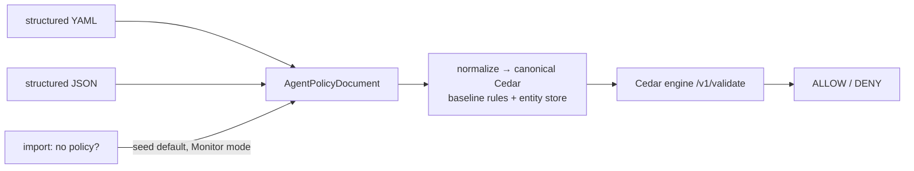
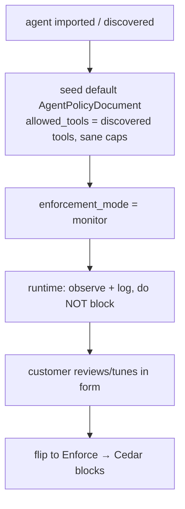

# Feature: Structured Multi-Format Policy Authoring (YAML / JSON → Cedar) + Seeded Default Policy

**Version:** 0.4 (PARKED — see §0.1)
**Last Updated:** 2026-06-14
**Status:** 🅿️ Parked / design-ahead — nothing being built now. The shipping capability (YAML/JSON → Cedar engine + Cedar schema validation) already exists; remaining items are deferred.
**Prerequisites:** [`cedar-policy/feature.md`](../cedar-policy/feature.md) (the Cedar engine — live on dev), [`agent-policy-management/feature.md`](../agent-policy-management/feature.md) (binding, cloud-from-agent), [`multicloud-agent-import/feature.md`](../multicloud-agent-import/feature.md) (Connect/Import flow).

---

## 0.1 Parked (v0.4 — founder decision 2026-06-14)

Everything below is **design-ahead; not being built now.** What already exists and stands on its own:
- **YAML/JSON structured policy → Cedar engine** (compile + evaluate) — live on dev.
- **Cedar schema validation** on save — live.

Explicitly **parked for later**:
- **Cedar in the frontend** (raw-Cedar editor / authoring surface) — not needed; YAML/JSON→Cedar + engine validation already cover authoring. (Already deferred in §8; now parked at the FE level too.)
- **Seeded default policy + Monitor-mode runtime** (§5) — parked; revisit when onboarding UX is prioritized. (Likely belongs in the import / agent-policy-management workstreams when picked up.)

This doc is retained as the captured design for when either is revisited.

## 0. Scope decision (v0.3)

Founder decision (2026-06-13), narrowing v0.2:
1. **Authoring formats = structured YAML and structured JSON only.** Both are the same `AgentPolicyDocument`; both normalize to canonical Cedar and are evaluated by the Cedar engine. **Customers do not hand-write Cedar.**
2. **Raw-Cedar authoring is DEFERRED** (design-ahead retained in §8) — it would mean a forever public Cedar contract + a fail-open footgun on the enforcement path; revisit only on real customer demand + prod-matured Cedar.
3. **Default policy is seeded in Monitor mode on import** so no agent is ever unpoliced (§5).

Net effect: this feature is now **small and safe** — JSON is a near-free input add on top of the live YAML→Cedar path, plus a default-seeding/onboarding improvement. None of v0.2's heavy machinery (contract freeze, raw-Cedar validation/lint, audit-engine change, consumer fail-open risk) is needed.

---

## 1. Summary

Customers define an agent's policy as a **structured `AgentPolicyDocument`** in **YAML or JSON**; Sentra normalizes it to canonical Cedar and the **Cedar engine enforces it** at `/v1/validate`. When a customer hasn't defined a policy (e.g. a freshly imported agent), the system **seeds a sensible default in Monitor mode** so the agent is governed from minute one without a wall of denials.

> Mental model: **structured policy (YAML | JSON) → compile to Cedar → Cedar engine evaluates.** The format is a serialization choice; the meaning and the engine are identical.

---

## 2. The model

The Cedar engine, schema, entity synthesis, and storage convention are unchanged (cedar-policy). YAML and JSON are two serializations of the **same** document → **identical** normalization and Cedar output.

---

## 3. Current state

| Capability | Today | This feature |
|---|---|---|
| YAML structured → Cedar engine | ✅ live (dev cutover) | unchanged |
| JSON structured input | ⚠️ API parses JSON bodies; no explicit format record / JSON editor | first-class: record `authoring_format`, optional JSON editor view |
| Default when no policy defined | fail-secure DENY-all (`POLICY_NOT_FOUND`) | **seed a default in Monitor mode on import** (§5) |
| Raw-Cedar authoring | ❌ disabled (generated, read-only) | **stays deferred** (§8) |

---

## 4. JSON input (the near-free add)

- **Same document, different serialization.** `structured_json` carries the identical `AgentPolicyDocument` as `structured_yaml`. The backend already accepts JSON request bodies, and `yaml.safe_load` parses JSON, so normalization to Cedar is byte-identical between the two.
- **Persistence:** the source object may be stored as `.json` (read fine via `yaml.safe_load`; the storage convention's `_SOURCE_EXTS` already includes `.json`) — no transcoding to YAML required. The `.cedar` co-artifact is generated as today.
- **Metadata:** record `authoring_format ∈ {structured_yaml, structured_json}` (default `structured_yaml` for back-compat) so the console renders the right editor view and the source round-trips.
- **Console:** a YAML/JSON toggle on the editor (the form remains the primary editor; YAML/JSON are source views of the same document). The JSON editor is **optional/low-priority** — its main value is API/IaC users posting JSON; the form already covers humans.

---

## 5. Seeded default policy (Monitor mode) — never-unpoliced onboarding

**Problem:** today an agent with no bound policy fails-secure DENY-all — every newly imported agent is dead until configured.

**Decision:** on **import/discovery**, auto-seed a **default structured policy** in **Monitor mode**, which the customer reviews in the form and flips to **Enforce**.

- **Seed content:** a conservative starter — `allowed_tools` from the agent's discovered/visible tools, default refund cap / rate, empty `allowed_callers` (note: empty `allowed_callers` is cross-agent fail-open — Monitor mode makes that observe-only until the customer sets it).
- **Monitor-mode runtime dependency (must build):** the import UI already records a Monitor/Enforce posture, but **the controller does not yet honor it at runtime** ("imports observe in Monitor today" — posture is recorded, not enforced). For this to mean "observe, don't block," the controller must, when an agent's posture is `monitor`, **convert a DENY into a logged would-have-blocked signal and ALLOW** (record the decision + reason for review, no enforcement). That is real runtime work, not just seeding a row.
- **Flip to Enforce:** posture → `enforce`; the same Cedar verdict now blocks. No policy change needed — only the posture.
- **Home:** the seeding belongs with the **import flow** (multicloud-agent-import) and the **monitor-mode runtime** with agent-policy-management; cross-referenced here because it's how "policy gets defined when the customer hasn't."

---

## 6. Storage

Minimal extension of cedar-policy §7.1 / CT06c:
- `authoring_format ∈ {structured_yaml, structured_json}` on the metadata row (default `structured_yaml`).
- Source object at `s3_key` (`.yaml` or `.json` — both YAML-loadable); `.cedar` co-artifact generated as today; `content_hash`/cache unchanged (the generated Cedar is identical regardless of source serialization, so the existing cache key holds).
- `enforcement_mode ∈ {monitor, enforce}` on the agent/policy binding (drives §5).

No new artifact shapes, no raw-Cedar object, no contract-versioning — the canonical Cedar pipeline is untouched.

---

## 7. Scope / boundary (unchanged from cedar-policy §5)

Cedar governs authorization only. Cross-cloud sequence, rate, trust, sigma, ML stay in the pipeline, data-driven from the structured document. YAML vs JSON changes nothing here.

---

## 8. Deferred: raw-Cedar authoring (design-ahead, NOT building)

Retained from the v0.2 analysis so the thinking isn't lost. **Not in scope.** Why deferred:
- **Forever public contract** — the moment customers write Cedar against our entity schema, it can't change. Too large a commitment to make speculatively.
- **Fail-open footgun** — validation can't prove a customer's Cedar won't fail open (a type-valid `forbid` without a deny-on-missing companion passes validation but allows on missing context). Putting that on the enforcement hot path weakens the "Sentra is the floor" guarantee.
- **Premature** — Cedar cut over on dev only (2026-06-13); no prod traffic yet.

**Revisit when:** (a) a real customer hits a policy the structured form genuinely can't express, **and** (b) Cedar has been authoritative in prod long enough to trust. If revisited, the model must be **raw Cedar layered on a mandatory structured envelope** (not rules-only — it starves the four shared-loader consumers), with a frozen `policy_contract_version`, the `invoke_agent` two-call + tenant-id conventions documented, a determining-id audit engine change, a deny-on-missing lint, and policy-size limits. (Full prior analysis in git history of this file @ v0.2.)

**Cheaper alternative if expressiveness pressure shows up first:** extend the **structured form's** condition vocabulary (the specific predicates customers ask for) rather than dropping to a DSL — most of the value, none of the forever-contract or footgun.

---

## 9. Testing plan
- YAML and JSON of the **same** document → byte-identical generated `.cedar` + identical ALLOW/DENY.
- JSON source persists + round-trips; `authoring_format` recorded; back-compat default for existing rows.
- Seeded default: imported agent gets a Monitor-mode policy from discovered tools; runtime **observes + logs, does not block**; flip to Enforce → Cedar blocks the same verdicts.
- Boundary: cross-cloud/rate enforced regardless of source format.
- Gates: controller `pytest` green; `tsc -b`/build clean.

---

## 10. Phased rollout
1. **JSON input** — accept + record `authoring_format`; persist `.json` source; (optional) console JSON toggle.
2. **Seed default on import** — auto-create the starter `AgentPolicyDocument` from discovery, `enforcement_mode=monitor`.
3. **Monitor-mode runtime** — controller honors `monitor` (observe + log, don't block); flip-to-Enforce in the import/agent UI.
4. (Deferred) raw-Cedar authoring — only on demand + prod maturity (§8).
