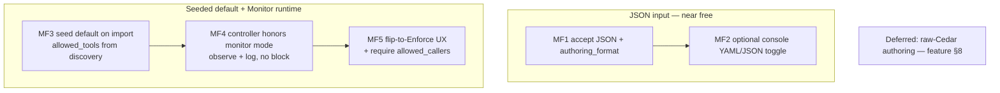

# Workstream — Structured Multi-Format Authoring (YAML/JSON) + Seeded Default Policy

**Version:** 0.4 (PARKED)
**Last Updated:** 2026-06-14
**Status:** 🅿️ Parked — nothing being built now. YAML/JSON→Cedar + Cedar-engine validation already ship. Frontend Cedar authoring and seed-default/Monitor-runtime are deferred (founder decision 2026-06-14). Tasks below are the spec for when revisited.
**Contract reference:** [`feature.md`](./feature.md). Builds on [`cedar-policy`](../cedar-policy/workstream.md) (engine/storage), [`multicloud-agent-import`](../multicloud-agent-import/feature.md) (import/Monitor-Enforce toggle), [`agent-policy-management`](../agent-policy-management/feature.md).

> **Scope (v0.3):** (1) accept **structured JSON** as an input format alongside YAML — same `AgentPolicyDocument`, same Cedar pipeline; (2) **seed a default policy in Monitor mode on import** so no agent is unpoliced. **No raw-Cedar authoring** (deferred — feature §8). The Cedar engine/normalization is unchanged.
>
> **Where the real work is:** NOT the JSON input (near-free) — it's the **Monitor-mode runtime** (the controller must actually observe-and-not-block, which it doesn't do today) and the **default-seeding** on import.

---

## 0. Critical callouts

| # | Severity | Issue | Action |
|---|----------|-------|--------|
| **C1** | **Info** | **JSON is the same document.** `yaml.safe_load` parses JSON; `_SOURCE_EXTS` includes `.json`; generated Cedar is identical to the YAML twin. So JSON adds **no** Cedar-pipeline change — only a format record + (optional) editor view. | MF1/MF2 stay small; don't over-engineer. |
| **C2** | **High** | **Monitor mode is recorded but NOT runtime-enforced today** ("imports observe in Monitor today" — posture stored, not honored). Seeding a Monitor-mode policy means nothing until the controller honors it. | **MF4:** controller converts a DENY → logged would-have-blocked + ALLOW when `enforcement_mode=monitor`. Real runtime work. |
| **C3** | **High** | **Seeded default has empty `allowed_callers` ⇒ cross-agent fail-open** (cedar-policy C6). Harmless in Monitor (observe-only), but **flipping to Enforce with it empty is fail-open**. | **MF5:** flip-to-Enforce must surface/prompt `allowed_callers` (and other fail-open-prone fields) before enforcing. |
| **C4** | **Med** | **Back-compat:** existing metadata rows have no `authoring_format`/`enforcement_mode`. | Default `authoring_format=structured_yaml`; default `enforcement_mode=enforce` for existing bound policies (don't silently downgrade live agents to monitor). |

---

## 1. Cluster map

---

## 2. C0 — JSON input

| ID | Task | Type | Pri | Status |
|----|------|------|-----|--------|
| **MF1** | Accept `authoring_format ∈ {structured_yaml, structured_json}` on create/update; persist the source as `.yaml` or `.json` (both YAML-loadable); record the field (default `structured_yaml`). Normalization to Cedar unchanged. | 🔧 | P1 | ☐ |
| **MF2** | *(optional, P2)* Console editor **YAML/JSON source toggle** (source view of the same `AgentPolicyDocument`; the form stays primary). Main value = API/IaC users; skip if not prioritized. | 🔧 | P2 | ☐ |

**C0 acceptance:** a policy posted as JSON and its YAML twin produce **byte-identical** generated `.cedar` + identical ALLOW/DENY; `authoring_format` recorded + round-trips; existing rows default to `structured_yaml`.

---

## 3. C1 — Seeded default policy + Monitor-mode runtime

| ID | Task | Type | Pri | Depends | Status |
|----|------|------|-----|---------|--------|
| **MF3** | **Seed default on import:** when an agent is imported/discovered with no policy, auto-create a starter `AgentPolicyDocument` — `allowed_tools` from discovered/visible tools, default refund cap + rate, empty `allowed_callers` — bound to the agent with `enforcement_mode=monitor`. Idempotent; never overwrites an existing customer policy. | 🛑 | P0 | — | ☐ |
| **MF4** | **Monitor-mode runtime (C2 — the real work):** `validation_service` honors `enforcement_mode`. When `monitor`: run the full pipeline, but a DENY becomes a **logged "would-have-blocked"** signal (decision + reason recorded for review) and the request is **ALLOWED** (no block). When `enforce`: today's behavior. Audit/metrics distinguish observed-vs-enforced denials. | 🛑 | P0 | MF3 | ☐ |
| **MF5** | **Flip-to-Enforce UX (C3):** import/agent UI shows the seeded policy + observed would-have-blocked decisions; flipping `monitor→enforce` **surfaces fail-open-prone fields** (`allowed_callers` empty ⇒ prompt) so the customer doesn't enforce a fail-open policy. | 🔧 | P1 | MF4 | ☐ |

**C1 acceptance:** an imported agent is immediately governed (Monitor) with a discovery-seeded policy; in Monitor the controller **observes + logs, never blocks**; flip to Enforce makes the same Cedar verdicts block; empty `allowed_callers` is surfaced before enforce; existing live (enforce) agents are not downgraded (C4).

---

## 4. Deferred (not building)
Raw-Cedar authoring — feature §8. Parked behind real customer demand + prod-matured Cedar. If revisited: mandatory structured envelope, frozen `policy_contract_version`, invoke_agent two-call + tenant-id contract, determining-id audit engine change, deny-on-missing lint, size limits.

---

## 5. Testing plan
- **JSON parity:** JSON doc vs YAML twin → identical generated `.cedar` + verdicts; `.json` source round-trips; back-compat default.
- **Seed:** imported agent → Monitor-mode policy from discovered tools; idempotent; never clobbers existing.
- **Monitor runtime:** a request that would DENY under Enforce is **ALLOWED + logged** under Monitor; metrics/audit mark it observed; Enforce blocks it.
- **Flip safety:** monitor→enforce with empty `allowed_callers` prompts; existing enforce agents unaffected (C4).
- Boundary: cross-cloud/rate enforced regardless of source format.
- Gates: controller `pytest` green; `tsc -b`/build clean.

---

## 6. Out of scope
- Raw-Cedar authoring (feature §8).
- Cedar engine/normalization changes (unchanged — JSON is the same document).
- Cedar-JSON AST (`JSON` = structured AgentPolicyDocument).
- Cross-cloud/rate/trust/sigma/ML in policy text (boundary).
