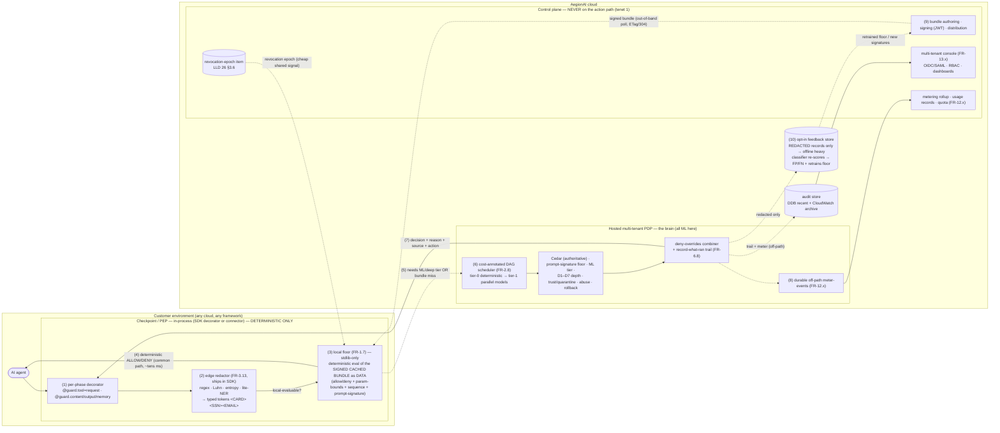
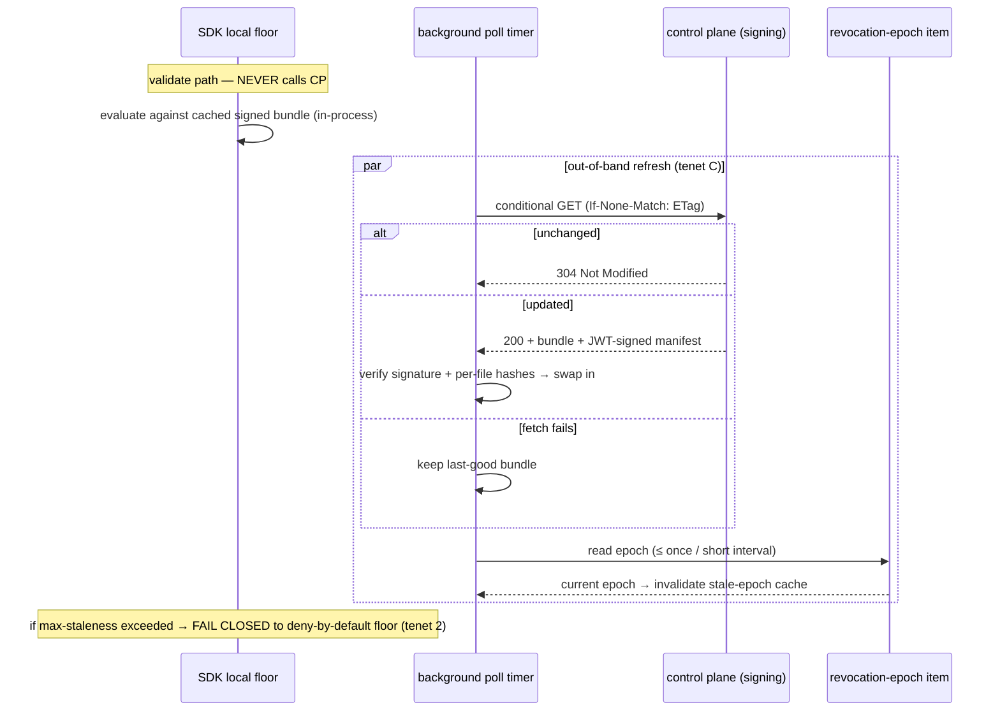
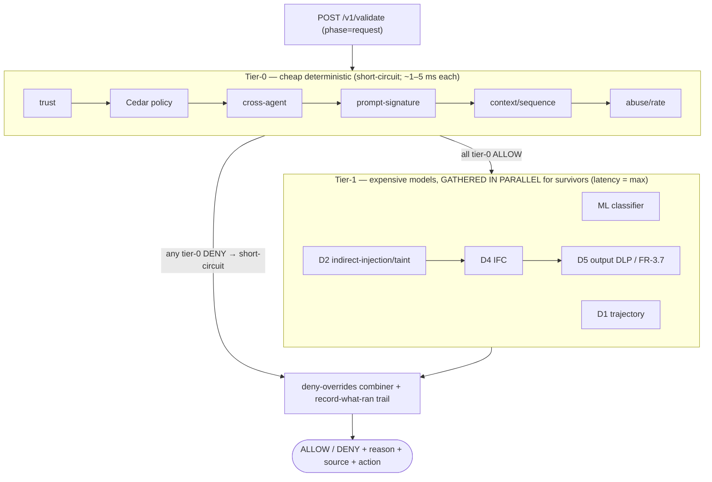
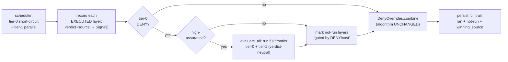
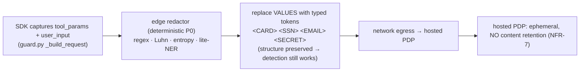
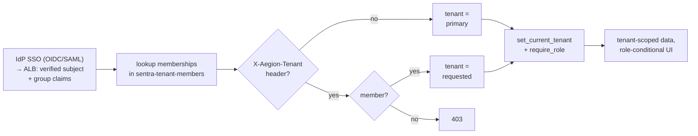
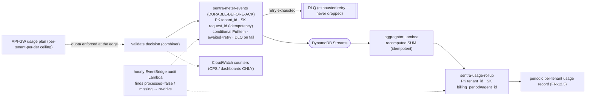

# HLD: AegionAI Guard — Serverless Edition

**Version**: 1.0
**Last Updated**: 2026-06-28
**Status**: Draft for Review (Gate-3 plan approved 2026-06-28)
**Owner**: Shashank Gupta (Founder/CEO)
**Designs against**: [prd/serverless-edition.md](../prd/serverless-edition.md) (Sub-PRD v1.2) — which descends from master [PRD.md](../PRD.md) v1.3 (FR-9.1)
**Anchors to**: [lld/ARCHITECTURE.md](../lld/ARCHITECTURE.md) (AD-1…10 + the 8 tenets, §1.4)

> **What this is.** The **anchor high-level design for the Serverless (multi-tenant SaaS) edition** — the edition where an in-customer checkpoint (PEP) calls a hosted multi-tenant policy engine (PDP) in the AegionAI cloud. It **explores options and recommends** for the four P0 architecture-benders, the data-boundary trust model, the console, the metering/billing surface, and the production Cedar mode; it does **not** elaborate any single component (that is the downstream per-component LLD via `plan-workstreams`). Every recommendation here was approved at Gate 3; reviewers may stress-test, and the rejected alternatives are kept as the trade-off record. The *preference* calls (which of A/B/C) are fixed and not re-litigated — but a **CRITICAL/HIGH architecture-soundness finding** (a recommendation that is internally inconsistent, infeasible at GA, or opens a security hazard) **can reopen the affected recommendation**; the Gate-3 freeze covers settled preferences, not soundness defects a review exists to catch.
>
> **What this is not.** Not a re-plan of built work. The Serverless engine already exists and runs multi-tenant on dev (sub-PRD §5 status table). This HLD **blends into DONE work** and **scopes PARTIAL work to its gap** — it never re-litigates what ships today. **Scope honesty (so the build estimate isn't anchored low):** what is *proven* is the deterministic **engine core** (multi-tenant validate, Cedar-authoritative, deny-overrides) on dev; the Serverless **product** — the local-floor topology, the edge redactor, the multi-phase handlers, the DAG scheduler, the durable meter ledger, and the tenant-scoped console UI (the five §1 deltas + D1–D7 depth + console + billing) — is **substantially unbuilt and is the bulk of this slice**. "Blends into DONE work" means the engine is the foundation, not that the commercial product is mostly done.

## Table of Contents
0. Terms used in this document
1. Executive summary
2. What exists today
3. The problem
4. Tenets (the tie-breakers)
5. Requirements (FR / NFR by stable ID)
6. Architecture
   1. High-level block diagram
   2. How we approach each part of the design
      - (a) Making validation fast — running checks inside the agent
      - How the policy bundle gets updated
      - (b) One contract for every moment we check
      - (c) Running many detectors without getting slow
      - (d) Recording everything that ran
      - (e) Keeping the customer's data safe
      - (e2) Prompt-signature rules — an honest rename and a real dialect
      - (f) Console sign-in & who-sees-what
      - (g) Which policy engine runs in production
      - (h) Detection strength
   3. Security & networking
   4. Scaling & resiliency
   5. Metering & billing
   6. The architecture-bender recommendations, in one table
7. Cross-references
8. Hand-off to LLD / plan-workstreams
9. FAQ
10. Appendix (A–I)

---

## Terms used in this document

A one-line key for the unavoidable acronyms, so the rest of the doc reads without a decoder:

| Term | Plain meaning |
|---|---|
| **PEP** | the in-customer *enforcement point* — the checkpoint, in the SDK/connector, that intercepts an action and applies the verdict |
| **PDP** | the *decision engine* — the hosted "brain" that decides allow/deny |
| **FR / NFR** | a *functional* / *non-functional* requirement (a numbered, stable requirement ID from the PRD) |
| **ADR / AD** | an *architecture decision record* — a logged, numbered design decision |
| **DAG** | a *dependency graph* of detectors (which can run together, which must wait for another's result) |
| **DPA** | a *data processing agreement* — the legal contract governing what we may do with a customer's data |
| **DSAR** | a *data subject access request* — a person's right to see/delete their personal data |
| **DLQ** | a *dead-letter queue* — where a failed write is parked for retry, never silently dropped |
| **redaction / typed token** | scrubbing a sensitive value and replacing it with a placeholder like `<CARD>` that keeps its shape but not its value |
| **architecture-bender** | a design choice that, if added *late*, forces a re-architecture — so it must be decided up front (the four P0 "benders" are this doc's core) |

*The bracketed tags in earlier drafts (B1, N4, G-MED-8, Fork-4, etc.) were internal review-tracking labels. They have been removed from the prose; the decisions they marked are carried in §7 (Decisions) and the appendices.*

## 1. Executive summary

AI agents now take real actions — move money, change records, call APIs — at machine speed, and a wrong or hijacked action is real money or real damage. The Serverless edition lets a customer turn on a guard that checks every action *before* it runs and blocks the bad ones, by adding one line of code per action — no infrastructure project, run as a hosted service. This document is the engineering design for making that safe and practical, built on four promises: keep the common checks running **inside the customer's own app** so it stays fast and keeps working even if our service is down; **scrub sensitive data out** before anything leaves the customer; give customers a **console** to see what is happening and who can do what; and **meter usage fairly**. We keep the proven split between the in-customer enforcement point and the hosted decision engine, and build the four promises on top of the engine that already runs today.

---

## 2. What exists today

Serverless is not a greenfield design. The engine, the multi-tenancy, and the connectors are built and (on dev) enforcing. Per sub-PRD §5 (code-grounded with `file:line`), the **DONE** baseline this HLD designs *into*:

| Area | Built & DONE (do not re-plan) | Evidence |
|---|---|---|
| **Cedar cutover** | `cedar_enabled` selects shadow-vs-authoritative (not existence); cutover wired, dev-authoritative | [validation_service.py:300](../src/security-controller/app/services/validation_service.py#L300); commits `605db63`, `8902b4e` |
| **Deterministic floor** | tool allow/deny + param bounds + single-session sequence; **prompt-signature rules** (today a case-insensitive *substring* matcher over prompt text, [sigma_engine.py:358](../src/security-controller/app/validators/sigma_engine.py#L358) — not real Sigma; (e2) below designs the real dialect); trust scoring; quarantine; abuse/rate | LLD 18, 19; [context_validator.py:92](../src/security-controller/app/validators/context_validator.py#L92); [sigma_engine.py:358](../src/security-controller/app/validators/sigma_engine.py#L358); [trust_checker.py:82](../src/security-controller/app/validators/trust_checker.py#L82) |
| **Combiner** | deny-overrides + prioritized `source` attribution (`winning_source`) | [combiners/deny_overrides.py](../src/security-controller/app/combiners/deny_overrides.py) |
| **Multi-tenancy (TENANCY_V2)** | `tenant_id` keys, signed-JWT per-agent identity verify, tenant-scoped APIs/stores; **enforcing on dev**, tenant `acme`, 0 `_unverified` | LLD 26; [99-go-live-runbook.md](../tasks/26-multi-tenancy/99-go-live-runbook.md) |
| **Connectors / SDK** | Bedrock + Azure connectors; stdlib-only Python SDK + Lambda-layer packaging; request-id correlation | [bedrock_connector.py:1](../src/connectors/bedrock/bedrock_connector.py#L1); [azure_connector.py:1](../src/connectors/azure_foundry/azure_connector.py#L1); SDK [guard.py:212](../demo-agents/sdk/aegion-guard-python/src/aegion_guard/guard.py#L212) |
| **Audit** | tamper-evident, dual-write (DynamoDB recent + CloudWatch archive), off the response path | [audit_logger.py:1](../src/security-controller/app/utils/audit_logger.py#L1) |
| **Console (web SPA)** | the product UI is **`web/console`** (React/Vite SPA, API-backed via `/v1/*`, behind ALB Cognito); the legacy Streamlit `src/dashboard` is **decommissioned** (LLD 26 §5.3) — not the console reference | [web/console/src](../web/console/src); LLD 26 §5 |
| **Metering counters** | per-tenant `Decisions{tenant_id}` + per-agent `ValidationsTotal{AgentId}` CloudWatch streams | [metrics_publisher.py:111](../src/security-controller/app/utils/metrics_publisher.py#L111) |

The **PARTIAL/NOT-DONE gaps this HLD scopes** are the five deltas in §1 plus the console-UI tenant-scoping, metering records/quota, and the D1–D7 detection depth. The single most consequential fact for the design: **today the pipeline is fixed-sequential and short-circuits on first DENY** ([validation_service.py:220](../src/security-controller/app/services/validation_service.py#L220) — `_run_validation_pipeline`, docstring "Short-circuits on first DENY"), and **every `@guard.tool` call is a blocking network POST that carries `tool_params` + `user_input` un-redacted** ([guard.py:325](../demo-agents/sdk/aegion-guard-python/src/aegion_guard/guard.py#L325), `_build_request`). Those two facts are what benders (c)/(d) and (e) respectively re-architect.

**Why now.** Serverless wins the *adoption* half of the problem — enforcement today, no deployment project — but a hosted control plane raises the data-boundary objection, the network round-trip blows the latency budget, and a single sequential pipeline can't carry the D1–D7 depth a security buyer expects. These must be designed in from the start (the architecture-bender rule, sub-PRD §3.3), not retrofitted.

---

## 3. The problem

A customer's AI agents take real actions at machine speed. A single wrong or hijacked action is real money moved or real damage done. The customer needs enforcement they can **leave turned on** — it cannot be so slow they switch it off. It must **not leak their data** to us. It must **catch real attacks**, not just obvious ones. And it must come with a **console** to watch it and **fair billing**. That is the whole job.

Serverless is the only edition where customer content leaves the customer's boundary, so the data question is the hardest one — and it carries a tension that shapes the GA gate: scrubbing sensitive values before they leave (to keep data safe) removes the very values the deep detectors would otherwise read, so "safe enough" and "deep enough" pull against each other.

*(The full set of engineering tensions this design balances is in **Appendix A**; how the design compares to AWS Bedrock AgentCore — and the two facts the local-floor build is gated on — is in **Appendix B** and the measure-first gate in §8.)*

---

## 4. Tenets

The **8 master tenets** (ARCHITECTURE §1.4, verbatim, most-important-first) govern this design. Four **HLD tie-breakers (A–D)** extend them for the specific tensions this edition raises; they are subordinate to the master tenets and break ties the master tenets leave open.

**Master tenets (verbatim):**

1. **Enforcement is local; the control plane is never on the action path.** The decision authority may be remote, but the *enforcement point* lives in the customer's environment.
2. **Fail secure, never fail open.** Any failure denies (or degrades to the cached hard-rule floor) — it never silently permits.
3. **Deny-by-default, explainable.** Every verdict names its deciding source and is auditable.
4. **Defense in depth.** Independent layers; evading one is caught by another; no single point of detection failure.
5. **Latency scales with risk, not volume.** Cheap deterministic checks first; expensive models only on borderline cases.
6. **The data boundary is the customer's to set.** What leaves is a deployment choice (edition); sensitive values are redacted or never leave.
7. **Multi-tenant and multi-cloud from the foundation**, not retrofitted.
8. **Honest staging.** Ship deterministic floors first; layer ML and deeper detection behind shadow-then-enforce gates.

**HLD tie-breakers (this design):**

- **A. Shape the contract once, additively.** When a central contract must grow (the `phase` field, redaction markers), grow it by an *additive, defaulted, validated* field — never a breaking change and never a parallel surface — so SDK/connectors/combiner/audit never have to be re-cut.
- **B. Record what ran; force nothing extra.** The decision trail records every layer that *actually executed* and marks the rest "not-run"; producing the trail must not force the scheduler to run layers it would otherwise skip. Auditability is achieved by *recording*, not by *over-executing*.
- **C. Refresh out-of-band; decide in-process.** Policy/bundle freshness is reached by an out-of-band refresh path; the validate decision is made locally from already-cached state. The refresh path is never on the validate hot path (this is how the local-floor honors tenet 1).
- **D. An unattributable verdict is a metering and isolation defect.** Every billable/securable event must be attributable to the correct tenant *and* agent. A verdict counted against the wrong tenant (or no tenant) is both a billing error and an isolation blind spot, not a cosmetic gap.

---

## 5. Requirements

Referenced by **stable ID** from [prd/serverless-edition.md](../prd/serverless-edition.md) (IDs are the join key for propagation). This HLD realizes:

**The four P0 architecture-benders** — FR-1.7 (in-process local enforcement), FR-3.4 (multi-phase `/v1/validate` contract), FR-2.8 (parallel-gather scheduler), FR-6.8 (full decision-trail).

**Data boundary** — FR-3.13 (input-side redaction), NFR-7 (Serverless trust model: redact-before-egress + no-retention), NFR-12 (metering integrity ≥99.9%). Supporting depth: FR-3.12 (distilled classifier — *server-side fast tier* on Serverless; distilled-at-edge is in-VPC/sidecar, §6.2(e) note), FR-3.2/3.3 (ML tier — **now enforcing**, shadow removed as part of the FR-2.8 scheduler cutover / ADR-030; the benign-FP graduation gate is WS-F, LLD 31 §6.5/§14.2), FR-3.5–3.11 (D1–D7), FR-3.7 (output DLP/REDACT).

**Console** — FR-13.1 (multi-tenant console), FR-13.2 (exhaustive dashboard set), FR-13.3 (login/tenancy model), FR-6.4 (SOC console, DONE), FR-6.8/6.9 (decision detail + session forensics views).

**Metering & billing** — FR-12.1 (usage metering off-path), FR-12.2 (usage-based limits/quota), FR-12.3 (billing/usage records), NFR-12.

**Assumed DONE (designed against, not re-planned)** — FR-2.4 (Cedar authoritative), FR-2.7 (deny-overrides combiner), FR-10.1/10.2/10.3 (multi-tenant isolation + verified agent identity, enforcing on dev), FR-7.1/7.2/7.5/7.6 (connectors + SDK packaging). **Predecessor (not a design blocker):** FR-10.5 (prod TENANCY_V2 activation).

**NFRs (sub-PRD §9):** NFR-1 (≤500 ms p99 deterministic; FR-1.7 targets low-tens-of-ms), NFR-2 (≤900 ms fast-ML, ≤2.5 s deep — **in-boundary targets; the escalated *Serverless* path is held only to the ≤2.5 s deep ceiling and even that is GA-measured, not asserted — §6.4**), NFR-3 (≥99.99% enforcement availability), NFR-4 (fail-secure; degrade-to-cached-floor), NFR-5 (horizontal scale), NFR-6 (strict tenant isolation), NFR-7 (data boundary), NFR-9 (signed/versioned policy), NFR-10 (full decision trail), NFR-12 (metering integrity).

---

## 6. Architecture

### 6.1 High-level block diagram

The shape: an in-customer **checkpoint (PEP)** with a new **in-process local floor** calls the **hosted multi-tenant PDP**; the **control plane** signs bundles and runs the console/flywheel but stays off the action path; the **edge redactor** sits in the SDK before egress. **The edge runs deterministic checks only** — no ML model runs customer-side; all model inference is server-side (§6.2(e)).

The numbered flow (the numbers match the diagram below):

1. agent calls a guarded action;
2. the SDK redacts sensitive values;
3. the local floor evaluates the cached signed bundle in-process;
4. the common path returns ALLOW/DENY locally in ~tens of ms;
5. only survivors that need the ML/deep tier (or a bundle miss) escalate over the WAN to the hosted PDP;
6. the scheduler → engine → combiner produce the verdict;
7. the verdict returns to the SDK;
8. the trail + meter-event are written off-path;
9. the bundle is refreshed out-of-band by a background poll (never on path 5);
10. redacted records flow to the opt-in feedback store, where an offline classifier re-scores them — producing false-positive/false-negative metrics and retraining the edge deterministic floor / signatures (§6.2(e)).

### 6.2 How we approach each part of the design

Each subsection below starts with a plain-language explanation a newcomer can follow ("In plain terms"), then lays out the credible options and the **approved recommendation** with the tenet that breaks the tie. The recommendations are fixed (Gate 3); the alternatives are the trade-off record. The dense justifications and side-tracks have been moved to the FAQ and Appendix and are linked from each subsection so the body reads clean.

---

#### (a) Making validation fast — running checks inside the agent

*Requirement: FR-1.7 (in-process local enforcement). New decision: ADR-029.*

**In plain terms.** Today, every time the agent is about to take an action, the guard makes a call over the internet to our service and waits for an answer. That round-trip can cost up to a second, and if our service is unreachable the agent cannot enforce anything at all. The fix: ship the fast, rules-only checks (is this tool allowed? are the parameters in range? is the sequence valid? does the prompt match a known-bad pattern?) so they run **right inside the agent's own process**, with no internet call. To do that, the agent keeps a local copy of the rules — a small signed file we call the *bundle*. The bundle is signed so it cannot be tampered with, and the agent refreshes it in the background. Only the heavier machine-learning and deep checks, or a case the local copy cannot answer, still go to our hosted service. No machine-learning model ever runs at the edge; all of that stays on our servers (§6.2(e)).

*Two evaluators, one policy (a common question).* There are **two** places a policy is evaluated, and that is deliberate. At the **edge**, the stdlib-only SDK ships a tiny **pure-Python interpreter** that reads the signed bundle — which is a **data file derived from the authoritative Cedar policy**, not the Cedar engine itself (the real `cedarpy` engine can't be embedded in a dependency-free SDK — see FAQ: *Why isn't the local floor "real Cedar"?*). On **our servers**, the real **Cedar engine is authoritative** and runs the full policy. The edge interpreter only handles the small closed subset it understands; anything outside that subset **escalates to the server's Cedar**. So the *same policy* is enforced in both places — evaluated fast locally for the common case, and authoritatively on the server for everything else.

**The problem in detail.** Today every guarded call is a blocking WAN POST (`_send`, invoked at [guard.py:358](../demo-agents/sdk/aegion-guard-python/src/aegion_guard/guard.py#L358) sync / [:388](../demo-agents/sdk/aegion-guard-python/src/aegion_guard/guard.py#L388) async, defined at [:561](../demo-agents/sdk/aegion-guard-python/src/aegion_guard/guard.py#L561)); the deterministic floor pays a full round-trip (~0.6–1.2 s) and an agent stops enforcing entirely if the hosted PDP is unreachable. FR-1.7 splits the PDP into the hosted engine **plus an in-process SDK evaluator** for the deterministic tier (tool allow/deny, parameter bounds, sequence, and egress destination/host/path/port matching — see the FAQ: *Why does the local floor include egress matching?*). A cached local evaluator is only safe if its policy is fresh, revocable, and fails closed when stale. The design must resolve four things: **distribution channel, refresh cadence, staleness bound, revocation.**

The local evaluator is **pure-Python and stdlib-only**: it reads the bundle *as data*, it does **not** load our native Cedar engine in-process — see the FAQ: *Why isn't the local floor "real Cedar"?* The interpreter is a closed lookup table, not a second policy engine; the soundness argument for that is in **Appendix C: Why the bundle interpreter is safe**.

**Options:**

- **Option A — Background poll of a signed bundle (recommended).** The control plane publishes a **bundle**: the deterministic policy ruleset **derived/compiled from the authoritative Cedar policy** (the resolved allow/deny + parameter-bounds + sequence rules, emitted as a data artifact the SDK *interprets* — **not** the native `cedarpy` engine, which the stdlib-only SDK cannot load; see the recommendation note) + prompt-signature rules + a **manifest of per-file SHA-256 hashes**, the whole manifest **signed as a JWT** (detached-signature, OPA-bundle style). The SDK polls on a background timer (not on the validate path), using **conditional GET with ETag → 304 Not Modified** so an unchanged bundle costs almost nothing, and **keeps the last-good bundle on any fetch failure**. An explicit **max-staleness bound** (e.g. last-successful-refresh age) **fails closed**: past the bound the local floor stops trusting the cache and reverts to a deny-by-default deterministic floor (deny dangerous tools, allow only an explicit safe set) until refreshed. A cheap **revocation-epoch** item (a single small DDB item carrying a monotonically-bumped epoch — the exact LLD 26 §3.6 `revoked-since` pattern) is read at most once per short interval (not per request); any bundle cached before the current epoch is invalidated, tightening the revocation bound below the poll interval.
- **Option B — Push / long-poll (server-initiated).** The control plane pushes bundle updates to each SDK instance (WebSocket/SSE/long-poll). *Cons:* ephemeral Lambda/Function instances are short-lived and numerous; maintaining server-held connections to a churning fleet is heavy and stateful, and a cold-started instance still needs a pull to bootstrap — so push doesn't remove the poll, it adds a second mechanism.
- **Option C — DDB-signal-only (no cached bundle).** The SDK reads policy state from a shared DynamoDB signal on each evaluation. *Cons:* couples the SDK to a per-call DDB read on the hot path — re-introduces a network round-trip and a cross-tenant hot partition (the exact problem LLD 26 §3.6 designs *around* for the verify path). Used only as the **epoch layer** above, never as the policy source.
- **Option D — No local eval (status quo, hosted-only).** *Cons:* fails the two reasons the bender exists — latency stays at a WAN round-trip, and an unreachable PDP means the agent can't enforce at all (violates NFR-4 resilience).

**Recommendation (approved): Option A — background poll of a JWT-signed bundle + conditional-GET/304 + keep-last-good + fail-closed max-staleness bound + revocation-epoch.** It honors **tenet C** (refresh out-of-band, decide in-process), **tenet 1** (the control plane is never on the validate path — only the background timer talks to it), and **tenet 2** (stale-past-bound fails closed, not open). B is rejected as too heavy/stateful for an ephemeral fleet; C-alone is rejected because it re-introduces the hot-path round-trip (kept only as the cheap epoch layer); D is rejected because it fails the latency and resilience reasons the bender exists. **New decision → ADR-029.**

The two knobs that make this safe are the **refresh cadence** (how often the poll runs) and the **max-staleness bound** (how long a cached copy is trusted before the floor reverts to deny-by-default). These are *safety* mechanisms, not just freshness niceties — see the FAQ: *Why is a stale policy the most dangerous failure?* §6.4 requires the LLD to pin both, plus the control-plane availability target behind them. The bundle resists tampering through a signature the SDK verifies before use — FAQ: *How do we keep the policy bundle from being tampered with?* The full signing-key lifecycle (rotation, per-tenant keys, compromise response, anti-rollback) is **Appendix D: Signing-key lifecycle**, and ADR-029 carries all of it.

##### How the policy bundle gets updated

*Requirement: FR-1.7 / tenet C (refresh out-of-band, decide in-process).*

The agent keeps a local copy of the rules — the bundle. In the background, never while it is checking an action, the SDK periodically asks our service "is there a newer version?" If there is, and it is validly signed and newer than the copy on hand, the SDK swaps it in. If our service cannot be reached, the SDK keeps the copy it already has — but only for a bounded time. Once that time runs out, the local floor stops trusting the stale copy and denies by default until it can refresh. So a customer who loses contact with us keeps enforcing the last-known-good rules for a while, then fails safely closed rather than drifting into a stale state. (See the FAQ for what happens if an attacker *blocks* the refresh.)

*(The refresh sequence above appears once, here; the earlier draft's duplicate diagram in the options block has been folded into this subsection.)*

---

#### (b) One contract for every moment we check

*Requirement: FR-3.4 (multi-phase `/v1/validate` contract). Refines AD-3.*

**In plain terms.** An agent does more than one thing worth checking. It takes an action (calls a tool, hits an API, writes to a database). It reads in untrusted data (a web page, a retrieved document, the output of another tool). It produces output. And it writes to its own memory. We want to be able to check at any of these moments. Rather than build a separate way to ask about each one, we add a single optional field — `phase` — to the one request we already send, with four values: `request`, `content`, `output`, `memory`. Existing callers that send nothing keep working (they default to `request`). New moments can be added later without breaking the contract. There is one decorator per moment: `@guard.tool` for actions today, and `@guard.content` / `@guard.output` / `@guard.memory` for the rest as their handlers ship.

**The problem in detail.** The agent loop has more than one moment worth governing. The four phases, concretely:
- **`request`** — the tool / API / DB **action** the agent is about to execute (the only phase live today).
- **`content`** — untrusted data the agent **ingests**: retrieved documents, tool output, web-page text (where indirect injection arrives).
- **`output`** — data the agent **emits** (the surface for output DLP / exfiltration checks).
- **`memory`** — a **write** to the agent's persistent memory. *Where memory lives:* it is the **customer's own agent memory store**, not ours — we govern the memory-**write action**, we do **not** store per-customer session memory ourselves (no long-term content retention; ties to NFR-7). *What we save of content:* **no raw content** — every phase is evaluated **transiently**; the only thing that may persist is **redacted** records in the opt-in feedback store (§6.2(e)/F2), never raw values.

Today the contract carries only the request phase ([models.py:17](../src/security-controller/app/api/models.py#L17), no `phase` field). Adding the other phases late would ripple through SDK, connectors, combiner, and audit — so the **contract shape must be frozen P0** even though the `content`/`output`/`memory` handlers land later.

**Options:**

- **Option A — Additive optional `phase` enum, forward-compatible (recommended).** Add `phase: Phase = "request"` to `ValidationRequest`, where `Phase` enumerates `{request|content|output|memory}` (default `request`, so every existing caller is unchanged). Ship **one SDK decorator per phase**: `@guard.tool` (= `request`, today) and `@guard.content` / `@guard.output` / `@guard.memory` (handlers may lag, decorator surface defined now). One endpoint, branch on `phase` (AD-3). The enum is **forward-compatible, not a frozen-shut set**, and the not-yet-permitting cases split in two (refined in [lld/30](../lld/30-multiphase-contract.md) §3.1, owner-confirmed): an **unknown/typo phase value is a malformed request → 422** (a validation error at the edge, *not* a verdict and *not* counted in the deny metric — a client contract error the developer fixes), while a **known-but-unbuilt phase (`content`/`output`/`memory` today) fails secure (DENY)** — a real verdict on a committed surface we can't check yet. So a 5th moment (e.g. a future `plan`/`delegation` phase for multi-agent governance) can be *added later without re-cutting the contract*: before it is registered a caller asserting it gets a 422; after it is registered but before its handler ships it is denied fail-secure, never silently bypassed. This is how tie-breaker A (grow additively) and tenet 2 (fail-secure) co-exist: the field and its handled-set grow additively; an unknown value 422s and a known-but-unbuilt value never fails open.
- **Option B — Separate per-phase endpoints** (`/v1/validate/content`, …). *Cons:* multiplies the API surface and breaks AD-3 ("three moments = three round-trips regardless of URL count; keep the surface small"); every connector and the audit schema would carry N endpoints instead of one defaulted field.
- **Option C — Free-form `phase` string.** *Cons:* the edge can't validate/narrow an arbitrary string (violates "never trust external data"); a typo'd phase would silently mis-route or bypass a handler — fails secure-by-validation.

**Recommendation (approved): Option A — additive optional `phase` enum, default `request`, forward-compatible (unknown/typo → 422 validation error; known-but-unbuilt → fail-secure DENY), one decorator per phase, contract *shape* frozen P0.** It honors **tie-breaker A** (grow the central contract once, additively — the field is added once; the handled-phase set grows additively after) and **AD-3** (one endpoint, `phase` field). Validating against the enum (vs. a free string) lets the edge narrow before acting: an *unknown/typo* value is rejected as a malformed request (422, kept out of the deny metric), while a *known-but-unbuilt* value fails secure (DENY) — and because the accepted set widens by addition, a future phase is an *additive* change, not a breaking schema re-cut. B and C are rejected as above. *(The exact 422-vs-DENY split — which case is a validation error and which is a verdict — is pinned in [lld/30](../lld/30-multiphase-contract.md) §3.1.)*

The phases are independent surfaces, not a fixed sequence; we still validate the *action* sequence within the `request` phase — see the FAQ: *Are the phases a fixed sequence — do we still check action order?* Some deep detectors do need to reason across phases (a taint picked up while reading content, checked again on output). How they do that **without retaining raw content** — via a small bounded-TTL session-label store of derived findings, and the costs that come with it — is **Appendix E: Cross-phase detector state**. It is a named LLD deliverable, not an assumed capability.

**Refines AD-3** (no new ADR — AD-3 already names the `phase` field; this fixes its handled values, the decorator surface, and the phase-error split: an unknown/typo value is a 422 validation error, a known-but-unbuilt value fails secure DENY — see [lld/30](../lld/30-multiphase-contract.md) §3.1).

---

#### (c) Running many detectors without getting slow

*Requirement: FR-2.8 (parallel-gather scheduler). New decision: ADR-030.*

**In plain terms.** We want to run a lot of checks — the cheap rule checks plus several deeper machine-learning detectors. If we run them one after another, every detector we add makes every request slower, and we will eventually break the latency budget. The answer: run the cheap deterministic checks first, and if any of them says "deny," stop right there — no point paying for the expensive detectors. For the requests that survive, run the expensive detectors **at the same time** rather than in sequence, so the total wait is the slowest one, not the sum of all of them. We organize the detectors as a dependency graph (a *DAG*) so we know which can run together and which must wait for another's result.

**The problem in detail.** Today the pipeline is a **fixed sequential chain of 6 deterministic steps then the ML classifier last** — STEP 1 trust → STEP 2 policy/Cedar → STEP 2.5 cross-agent → STEP 3 prompt-signature → STEP 4 context → STEP 5 abuse → STEP 6 ML classifier (runs last), each `await`ed in order ([validation_service.py:220](../src/security-controller/app/services/validation_service.py#L220), with ML moved last in WS24 M4.1). Adding D1–D7 to a sequential chain grows p99 with each added layer — the latency budget (NFR-1/2) breaks. Moving ML last is already a frontier-first *partial* optimization (the expensive model runs after the cheap deterministic floor); the scheduler **generalizes** that single placement into a cost-annotated graph rather than introducing parallelism from a naive all-sequential baseline. (The code docstring, master PRD FR-2.8 and sub-PRD still say "5-step" — a stale count that **omits the cross-agent validator (STEP 2.5)**; the propagate pass adds cross-agent as a named step → "6 deterministic steps + ML-last," see Cross-references.)

**Options:**

- **Option A — Cost-annotated DAG (recommended).** Model the validators as nodes in a directed graph annotated with **cost** (latency class) and **dependency edges**. **Tier-0** = cheap deterministic checks (trust, Cedar, prompt-signature, context, abuse — ~1–5 ms each) run first **with short-circuit**: a DENY here stops before any model (tenet 5). **Tier-1** = expensive models (ML classifier, D1–D7) are **gathered in parallel** (latency = max, not sum) only for the survivors that passed tier-0. Dependency edges express the real D1–D7 ordering (e.g. taint-tag (D2) → information-flow control (D4) → output DLP (D5/FR-3.7)). The **static two-phase split** (all-cheap-then-all-expensive) is the first implementable milestone *inside* this DAG — the DAG generalizes it without re-architecture when a dependency edge is needed.
- **Option B — Static two-phase split only (no DAG).** *Cons:* can't express D1–D7 dependencies (taint must precede IFC must precede output-DLP); the moment a layer consumes another's output, a flat two-phase model needs a re-write — the very late-add the bender rule rejects.
- **Option C — Keep sequential.** *Cons:* latency grows linearly with each added layer; this is precisely the failure the bender exists to prevent.

**Recommendation (approved): Option A — cost-annotated DAG, tier-0 short-circuit then tier-1 parallel-gather, static two-phase split as the first milestone inside it.** It honors **tenet 5** (latency scales with risk; cheap DENY skips model cost) and **tenet 4** (independent layers, parallel, no single point of detection failure). It realizes **AD-4** ("deterministic-first, parallel models (DAG scheduler)"). B is rejected (can't carry D1–D7 dependencies); C is rejected (latency grows with each added layer). **New decision → ADR-030.** Replaces the fixed-sequential pipeline at [validation_service.py:220](../src/security-controller/app/services/validation_service.py#L220).

---

#### (d) Recording everything that ran

*Requirement: FR-6.8 × FR-2.8 (decision-trail / scheduler reconciliation). New decision: ADR-031.*

**In plain terms.** For audit and compliance, we need a record of every detector that ran on a request and what it decided. But the scheduler in (c) deliberately *skips* detectors — it stops at the first "deny," and it gates expensive detectors behind the cheap ones. These two goals seem to fight: a full record versus running as little as possible. We reconcile them by recording **what actually ran** plus its verdict, and explicitly marking the rest "not-run (skipped because an earlier check denied, or to save cost)." We do not run extra detectors just to fill the record. Tenants who want the complete deterministic picture on every request can switch on a mode that runs the full cheap tier for the record's sake. The deny-overrides logic that combines the verdicts is unchanged. This is the single most important reconciliation in the document.

**The problem in detail.** FR-6.8 wants the audit to record **every** detector that ran and its verdict; the combiner today **short-circuits on first DENY** so later layers don't run ([validation_service.py:220](../src/security-controller/app/services/validation_service.py#L220) docstring; the `Signal[]` accumulated by `_capture()` is "the prefix up to and including the short-circuit"). The scheduler (c) *also* governs which/how layers run. Two requirements both touch the run model — they must define **one** execution model, or they conflict. This is the single most important reconciliation in the doc.

**Options:**

- **Option A — Record-what-ran, force nothing extra (recommended).** The scheduler runs tier-0 (with short-circuit) plus tier-1 parallel for survivors (exactly (c)); the **trail records every layer that *actually executed* and its verdict**, and on a short-circuit DENY explicitly records the **prefix that ran** plus marks later layers **"not-run (gated by earlier DENY/cost)"**. The seed already exists: the `Signal[]` collected via `_capture()` ([validation_service.py:237](../src/security-controller/app/services/validation_service.py#L237)) is the run record; the change is the **run model** (persist not-run markers + keep the trail under the scheduler) — **not** the DenyOverrides algorithm ([deny_overrides.py](../src/security-controller/app/combiners/deny_overrides.py): any DENY wins → highest priority → confidence → alphabetical source stays byte-for-byte). PLUS a **tunable per-tenant/per-session mode** ("run the full frontier for the trail even after a DENY") for high-assurance tenants who want the complete picture — this is option C below, offered as a *setting*, not the default. **As-built refinement (LLD 31 §6.7, ADR-031):** this mode is the `evaluate_all` run-mode, and it runs the **whole frontier — tier-0 *and* tier-1** — after a DENY, not tier-0 only; every post-decider signal (tier-0 and tier-1 alike) is captured **verdict-neutral / advisory** so it enriches the trail but can never change `(decision, should_deny, winning_source)`. Running tier-1 too is deliberate: this same mode is also the **shadow-graduation** mode, and a shadow layer's incremental lift cannot be measured if a prior DENY hides it (LLD 20 §3.4). Default remains `fail_fast` (short-circuit, no tier-1 on a tier-0 DENY).
- **Option B — Always run all layers, every request.** *Cons:* blows the latency budget and contradicts tenet 5 — a tier-0 DENY would still pay for D1–D7. Re-runs the exact cost the scheduler exists to avoid.
- **Option C — Run-the-full-frontier-for-the-trail (record what every layer would have said, verdict-neutral).** *Pros:* a complete trail on every request — every detector's opinion recorded even after a DENY. *Cons:* overhead on every DENY (the expensive tier runs too). Kept as the **tunable high-assurance mode** inside A, not the default. *(This sketch originally read "gate only the expensive tier" — tier-0-only; the as-built `evaluate_all` runs **tier-0 and tier-1** verdict-neutral, because the same mode doubles as the shadow-graduation mode which must execute the deep tier to measure it. See LLD 31 §6.7 / ADR-031; the tier-0-only reading is superseded.)*

**The trail record — explicit fields (FR-6.8, owner ask for precision).** Per validated request the trail captures:
- **(1) coverage** — every decision/detector that *could* run for this phase, and which of them actually **ran** vs. were **not-run** (gated by earlier DENY or cost), with each run layer's verdict + source + latency.
- **(2) the block point + why, with depth** — the state/layer at which it was blocked and the reason, plus the request detail: the **prompt**, the **tool + its parameters**, **which agent (caller) → which target**, and **IP/source** where available.
- **(3) both outcomes** — ALLOW *and* DENY are recorded (the trail is not deny-only).
- **(4) the phase** — which of `{request|content|output|memory}` the problem occurred in.

This is the persisted record shape referenced in §6.3 and the meter/audit substrate (LLD 17).

**Recommendation (approved): Option A — "record-what-ran, force nothing extra," with option C as a tunable per-tenant/per-session high-assurance mode.** It honors **tie-breaker B** (record what ran; don't over-execute to get a trail), **tenet 5** (don't pay for layers risk didn't warrant), and **tenet 3** (every verdict names its deciding source and is auditable — the "not-run" markers make the trail honest about what *didn't* run). B is rejected (blows latency, contradicts tenet 5). The DenyOverrides algorithm is explicitly **out of scope of this change** — only the run model + persisted trail change. **New decision → ADR-031.**

---

#### (e) Keeping the customer's data safe

*Requirement: FR-3.13 / NFR-7 (input redaction + no-retention). New decision: ADR-032.*

**In plain terms.** Serverless is the only edition where the customer's content travels to our servers. So before anything leaves the customer's machine, our SDK scrubs out the sensitive values — card numbers, social-security numbers, emails, secrets — and replaces each with a typed placeholder like `<CARD>` or `<SECRET>`. The placeholder keeps the shape and position of the original so our detectors can still do their work; only the actual value is gone. Because our own SDK is what pulls the data across the wire, the scrubber lives **inside the SDK** and runs before the network call. On our side we keep **no raw content** — we may keep *scrubbed* records only if the customer opts in, under a data agreement, for the purpose of improving detection. A simple regex/checksum scrubber reliably catches the *structured* identifiers (card numbers, SSNs, emails, high-entropy secrets); free-text personal data buried in prose (names, addresses, medical details) needs a heavier model that runs on our servers, not at the edge. That has an honest consequence for healthcare customers, covered below.

**The problem in detail.** Serverless is the only edition where customer content leaves the boundary. Today the SDK auto-captures `tool_params` + `user_input` and POSTs them **un-redacted** ([guard.py:325](../demo-agents/sdk/aegion-guard-python/src/aegion_guard/guard.py#L325), `_build_request` → `safe_params` + `resolved_input`). The owner flagged this **serious**. The question (sub-PRD §11.3): is the un-redacted interim acceptable for design partners under DPA + no-retention, or is redaction a **hard GA gate**? And *who* redacts, *where*?

**Options (for who/where):**

- **Option A — We redact, in the SDK, at the customer edge, before egress (recommended).** The redactor **is part of the SDK** — it rides the SDK install (the same stdlib-only package), so a customer who installs the guard gets the redactor with it, no separate component. Because *our* SDK is what pulls `tool_params`/`user_input` across the wire ([guard.py:373-389](../demo-agents/sdk/aegion-guard-python/src/aegion_guard/guard.py#L373)), *we* must redact what *we* capture — before the network POST. The **P0 redactor is deterministic** (regex, Luhn card-number check, secret/credential entropy, lite-NER) so it fits the **stdlib-only SDK** and the FR-1.7 in-process bundle. Heavier **semantic / free-text PII** detection rides the **hosted server-side** model — in this Serverless edition it does **not** run at the SDK edge (the edge is deterministic-only). Redaction is **structure-preserving**: sensitive *values* are replaced with **typed tokens** (`<CARD>`, `<SSN>`, `<EMAIL>`, `<SECRET>`) so injection/threat detection still operates on the redacted text (the token preserves position and type, only the value is masked). Principle: *redact as soon as input is captured, before it is saved or transmitted anywhere.*
- **Option B — Hosted-side redaction (redact after arrival).** *Cons:* the boundary is already crossed — the raw value reached our cloud. This *violates* NFR-7 ("redacted **before** request content leaves the customer boundary"); no-retention doesn't undo that the value transited.
- **Option C — Customer pre-redacts before calling us.** *Cons:* we can't burden the customer to redact for *our* detection, and we can't trust a self-asserted "already clean" — and our SDK still auto-captures raw `tool_params` they never touched.

**On the GA-gate question (human-decided), with the P0-vs-later dependency made explicit:** the deterministic P0 redactor reliably catches **structured-token** sensitive data — card numbers (Luhn), SSNs, emails, high-entropy secrets/credentials. It does **not** reliably catch **free-text/semantic PHI** (names, conditions, addresses in prose), which is handled by the **hosted server-side** semantic layer. So the GA gate is scoped honestly to what the P0 mechanism can deliver:
  - **Hard GA gate (P0 mechanism):** edge-redaction of **structured-token PII/PCI** is a hard gate for any sensitive-data customer — no GA without it.
  - **Free-text/semantic PHI** is caught by a **semantic NER model that runs server-side** (it is too heavy for the stdlib edge — see the latency note below). **This server-side layer is P0 — it ships in the first-wave Serverless build, not a later phase** (owner decision 2026-06-29), so HIPAA/PHI is a launch segment, gated only by the layer's measured recall target + counsel's BAA sign-off. A **non-PHI sensitive-data customer** can ship on the structured-token redactor alone, with an explicitly owned residual: free-text fields are not semantically scrubbed (constrained by the data-class allowlist).
  This avoids the trap of claiming the P0 regex/Luhn redactor closes the *PHI* objection it cannot: structured PII is closed deterministically at the edge; free-text PHI is closed by the server-side semantic layer and named as a dependency, not hand-waved as covered. How the data-class allowlist is actually enforced on free-text fields (it cannot be trusted from a field label alone) is **Appendix F: Enforcing the data-class allowlist**.

**What standard the redactor targets.** The redactor is anchored to named standards, not an ad-hoc list:
- **HIPAA Safe Harbor (45 CFR 164.514(b)(2))** — the 18 identifier categories. The *structured* ones (SSN, MRN/account/license/device numbers, phone/fax, email, IP/URL, explicit dates) are caught deterministically at the edge; the *free-text* ones (names, prose addresses, conditions, and the catch-all "any other identifying characteristic") need the server-side semantic model.
- **PCI-DSS** — PAN masked to first-six/last-four; sensitive authentication data (CVV/CVC, full track, PIN) under a hard **never-store / never-log** rule. This is the most fully deterministic obligation and matters most for the fintech/payments beachhead.
- **GDPR Recital 26** — reversible masking/tokenization is **pseudonymisation** and **remains personal data**; we therefore call our redaction "pseudonymisation," never "anonymised" and never "Safe-Harbor de-identified" for free-text we did not semantically scrub.

**Serverless CAN serve HIPAA/PHI customers — the mechanism (decided).** Earlier drafts routed all PHI to in-VPC on the reasoning that the semantic model runs on our servers, so raw PHI would have to leave the customer and "break NFR-7." That reasoning rested on a **self-imposed bar, not on HIPAA**: 45 CFR 160.103 defines a business associate to explicitly include the "data analysis, processing or administration" of PHI, so HIPAA plainly contemplates a SaaS processing PHI **under a Business Associate Agreement (BAA)** — and per OCR you must sign a BAA regardless. So **NFR-7 is refined** (see the Retention clause below) and PHI on Serverless ships via **mechanism (d): raw PHI is processed transiently server-side under a BAA, redacted there by the semantic layer, and never retained or logged, with no human access.** This is the honest, HIPAA-valid claim — *not* "machine-unreadable by us" (our redaction code does read the value to scrub it; making it provably unreadable would require the **confidential-computing enclave**, mechanism (b), a named **later hardening** that would upgrade the claim — Appendix I). **In-VPC routing stays as the floor for air-gapped / no-egress mandates only**, not the default HIPAA answer. The full reasoning is in the FAQ: *Can a HIPAA customer use Serverless?*

*Latency reality (why semantic PHI redaction is server-side, not inline at the edge).* Deterministic regex+checksum redaction is **sub-millisecond to low-single-digit-ms** in-process — it fits inline on the hot path with headroom. Semantic NER is an **order of magnitude heavier**: a CPU spaCy model adds ~50 ms+, a transformer NER ~700 ms (blows the ≤500 ms floor), and a managed API (Comprehend Medical / Google DLP) adds a whole network round-trip. So the **inline edge stays deterministic-only**; the semantic layer runs **server-side / off the blocking path** (gated by the recall measurement below).

*FR-3.12 wording reconciliation (propagate to PRD, §8):* FR-3.12's "distilled **local** classifier that replaces the hosted classifier" over-promises for the stdlib Serverless edge — the at-edge distilled model belongs to the in-VPC/sidecar editions; on Serverless its value is delivered as a faster **server-side** tier. Flagged for propagate-change.

The design-partner-only **interim** is allowed under a **signed DPA + enforced no-retention + a data-class allowlist** (no regulated data classes until the matching redaction layer ships).

**Redaction covers every phase that sends content, not just `request`.** Today the edge redactor is wired to the `request` phase only (`_build_request`), but `content` (retrieved docs, tool output, web text — often the richest PII surface), `output`, and `memory` also send content to the hosted PDP. The redactor **must** run before egress on all four. Two adjacent surfaces are explicitly scoped **out** of this slice (named, not silently dropped): **(1) image/binary content (FR-3.15)** — the text redactor cannot scrub images, so image content is either blocked from egress or routed to in-VPC until an image-redaction mechanism is designed; **(2) the server-side `REDACT` verdict (FR-3.7)** — acting on it requires the PEP to *rewrite* outgoing content, which the decorator cannot do today (it only allows or denies); the rewrite path is a named LLD deliverable.

**Measure the cost to detection before locking the gate.** Scrubbing values at the edge removes the very values the deep detectors would read — so the redactor and the deep tier pull against each other, and the recall-delta on masked content (residual #5) is exactly what decides whether the deep-detection SKU still catches what it is sold to catch. The recall-delta measurement is therefore a **precondition of locking the redaction GA gate**, not a residual to defer past it: the LLD must produce it for exfiltration and indirect-injection *before* the structured-token redactor is locked as the gate. The redactor still ships at GA; what is forbidden is *declaring the deep-tier depth claim met* on masked content before the delta is on paper. The gate's own pass/fail rule — a concrete recall target, an obfuscated/non-US test corpus (not canonical-only), and what happens if the deterministic redactor misses the target — is **Appendix G: The redaction gate's own pass/fail rule**.

**Recommendation (approved): a two-tier redactor.** **(1) Structured PII/PCI — inline at the edge:** the SDK (the redactor ships in the SDK install) redacts card numbers, SSNs, emails, secrets, etc. into structure-preserving typed tokens **before egress** — sub-ms, deterministic, raw never leaves. Hard GA gate for any sensitive-data customer. **(2) Free-text PHI — server-side under a BAA (mechanism d) — P0:** raw free-text transits to the hosted PDP, is redacted transiently by the semantic NER layer, and is **never retained, never logged, no human access**; this is what lets **HIPAA/PHI customers use Serverless**. **The server-side semantic-redaction layer is P0 (first-wave build), not a deferred gate** — it ships in the initial Serverless build alongside the edge redactor, gated only by its measured recall target (Appendix G) and counsel's BAA sign-off, not pushed to a later phase. The **Nitro Enclave (b)** is a named later hardening that upgrades the claim to "never readable." **In-VPC (c)** stays as the air-gapped floor only. It honors **tenet 6** (the data boundary is the customer's — set by edition + the BAA) and **tenet 2** (deterministic structured redaction fails safe inline). Customer-pre-redaction is rejected (can't burden/trust the customer; the SDK auto-captures raw `tool_params` anyway). **New decision → ADR-032** (two-tier redactor + the NFR-7 (c) PHI-transit amendment; supersedes the old "PHI → in-VPC only" conclusion and the Option-B "hosted redaction always violates NFR-7" rejection *for the BAA-covered PHI case*). Realizes AD-6's data-boundary lever for the Serverless edition.

**Retention & the data boundary — NFR-7 refined.** NFR-7 now has three clauses:
- **(a) No raw retention, any edition.** RAW / un-redacted action content is **NEVER persisted on ANY edition** — not in logs, the audit store, the meter store, the feedback store, or crash dumps.
- **(b) Redacted feedback store (opt-in).** Serverless **MAY** retain **REDACTED** records in a separate, access-controlled, OPT-IN, DPA-scoped, retention-bounded feedback store for offline re-scoring + model retraining. This is the only thing that may outlive a single transient evaluation.
- **(c) PHI transit clause (the amendment — replaces the old "raw never leaves the customer boundary").** For structured PII the raw value never leaves (redacted inline at the edge). For **free-text PHI**, the raw value **may transit to the hosted PDP under a BAA**, where it is **processed transiently, redacted by the server-side semantic layer, never retained, never logged, with no human access** — then discarded. The honest claim is *"transient + not-retained + not-logged + no human access under a BAA,"* **not** "machine-unreadable by AegionAI" (the redaction code reads the value to scrub it). A later hardening — the **Nitro Enclave (Appendix I)** — would upgrade this to "redacted inside a TEE we provably cannot observe," at which point the claim becomes "never readable." Until then, the BAA + no-retention posture is the GA bar and it is HIPAA-valid. *No-retention here is a hard engineering invariant the LLD must PROVE (no raw in logs/feedback/crash dumps), because under (c) a logging bug is a reportable breach, not just an NFR miss.*

**The feedback store — concrete.**
- **What is stored:** the **redacted** prompt + **redacted** context + verdicts + detector outcomes — **never raw values** (the typed tokens, not what they masked).
- **Where:** a **separate, tenant-scoped** store (not the audit store, not the meter store).
- **How long:** a **bounded TTL** (DPA-scoped; tenet 6 — the customer sets the boundary).
- **Gated on, before any record is written:** a **redaction-quality eval gate** (identifier false-negative rate must pass — no record is written if redaction recall is below threshold), a **DSAR / deletion API + per-tenant record locator** (GDPR Recital 26: pseudonymized data is **still personal data**, so it must be locatable and deletable), and **counsel sign-off**. Opt-in and DPA-scoped.
- **The loop it closes (FR-3.14 continuous improvement, made concrete):** redacted feedback store → an **offline heavy classifier re-scores past traffic** → produces **FP/FN metrics** *and* **retrains**; new signatures / weights are pushed back into the signed bundle (the edge deterministic floor / prompt-signature corpus) and the hosted models. This loop **also feeds the prompt-signature corpus** ((e2) below).
- **Moat tension (residual #5):** edge redaction thins the **content-fed** flywheel (it learns from structure, not raw payloads) — the **redacted, opt-in feedback store is what partially recovers it**. This is a STRATEGY propagate-change target (§8).

---

#### (e2) Prompt-signature rules — an honest rename and a real dialect

*Requirement: FR-3.14 (prompt-signature engine). Decision logged in the ADR-032 loop.*

**In plain terms.** The code today has something called the "Sigma engine," but it does not do what real Sigma does — it just checks whether a known-bad phrase appears inside the prompt text. We are renaming it to "prompt-signature rules" so the name matches reality, building it into a real pattern-matching dialect, and growing our own small but correct rule set by red-teaming rather than importing a third-party one (published Sigma rules match fields in structured logs and are useless on free prompt text). A test harness with both attack and benign examples, gating in CI, must exist before any rule auto-grows.

**The honest current state.** What the code calls the "Sigma engine" is today a **case-insensitive SUBSTRING matcher** (`pattern.lower() in user_input_lower`, [sigma_engine.py:358](../src/security-controller/app/validators/sigma_engine.py#L358); `|contains`-only field handling at [:300](../src/security-controller/app/validators/sigma_engine.py#L300)) over **prompt text** — it is **not real Sigma** (no regex, no conditions, no log-event field matching). Throughout this HLD the engine is therefore named **"prompt-signature rules"** (the prompt-signature engine), not "Sigma," to state what it is honestly.

**Design.**
- Build a **real regex + condition dialect over PROMPT TEXT** (not the current substring-only matcher).
- **Migrate the existing rules cheaply.** The ~11 current `|contains` substring rules convert **mechanically** to the new dialect — a substring match *is* a trivial regex (escape the literal, anchor as needed), so the rules we have port with no loss as the first step. (That only moves the rules we already have; *growing* the corpus still needs the red-teaming + CI harness below.)
- Build **OUR OWN corpus** (small-but-correct is fine) via red-teaming — not an imported third-party ruleset.
- An **eval / CI harness** — a labeled **true-positive** corpus + a **benign false-positive** corpus + a **CI gate** — is a **PREREQUISITE before any rule auto-grows** (a rule that hasn't passed the FP corpus does not ship).

**Why not import online HTTP / SigmaHQ rules.** Published Sigma rules are **field-matchers over structured logs** (Windows events, proxy logs) — they are **useless on free prompt text**, which has no such fields. Importing them would be cargo-culting the name. Separately, the **infra-ACTION surface** (an agent calling cloud APIs) is governed by **Cedar** (deterministic allow/deny + parameter bounds), **not** by signatures — signatures cover the *prompt-text* threat surface, Cedar covers the *action* surface. Stating this keeps the two engines from drifting into each other's job.

**Corpus source (P1, reference only).** A public **red-team / rule-authoring game** (the lever Lakera's "Gandalf" and HackAPrompt used to build a labeled injection dataset) can feed the prompt-signature corpus and the FR-3.14 loop. It is a **P1 initiative with its own brief**, referenced here as a corpus source only — **not scoped into this runtime HLD** (see §8 residuals).

---

#### (f) Console sign-in & who-sees-what

*Requirement: FR-13.3 (console login/tenancy). Refines AD-8 / ADR-019; adds deferred ADR-035.*

**In plain terms.** The console is the web app where a customer's operators log in to watch their agents. Today they sign in, but the app does not properly scope what they see to their own company, and it has no roles. We fix this so that: a person signs in through their company's identity provider (the usual single-sign-on); we look up which company (tenant) and which role that person has from a membership table we control — never from their email domain, which can be faked; and the app shows only what their role allows. A person who works across several tenants (a partner, a platform admin) can switch tenants, but the server checks they are actually a member before honoring the switch. We keep the current sign-in technology (Cognito) for now because it can add SAML/OIDC federation later as a configuration change, and we pre-design that switch so it is cheap when we make it. The roles are owner, admin, editor, viewer. *(Refined 2026-07-06 — see the refinement block below the recommendation: the customer's own identity provider becomes the source of truth for **who** their operators are, sequenced right after the RBAC coverage; we keep the roles uniform on our side; the console opens with an "enter your organization" page that sets the tenant for the session.)*

**The problem in detail.** The web console (the product UI) authenticates operators via Cognito OIDC but is **not tenant-scoped** (no tenant claim, no membership mapping, no RBAC — sub-PRD §4.10). The backend already resolves tenant (TENANCY_V2); the UI layer is the gap. The model must match how comparable security consoles do it (Zenity, Splunk, Auth0 Organizations).

**Options:**

- **Option A — Keep Cognito now, harden the seam, defer the provider switch (recommended).** **Stay on Cognito as the auth substrate NOW** — it **natively federates SAML/OIDC LATER** (a config add, not a re-platform), so the actual auth-provider switch is done **LAST** (it touches too much to do early). **IdP group claims map to roles**; per-tenant operator membership lives in **`sentra-tenant-members`** (PK `operator_sub` / SK `tenant_id` — the table LLD 26 §5 already defines). A multi-tenant operator (a partner, or a platform admin) gets a **tenant switcher**: the API accepts an **`X-Aegion-Tenant`** header **validated server-side against the membership set** (deny if not a member) before honoring; default = the operator's sole/primary tenant. RBAC roles **owner | admin | editor | viewer** + a reserved **`_platform`** role; **`require_role`** (LLD 26 §6.3) is the server-side authority, and the UI renders to role (viewers never see actions they can't take — client gating is UX only, never the boundary). This **blends into the already-designed LLD 26 §5–6** — it is not reinvented here.
  **Two insurance moves taken NOW (so the eventual federation is cheap):** (1) rename the tenant-root identity from "Cognito `sub`" to an **IdP-NEUTRAL "verified operator subject"** behind **ONE claim-extraction seam** — so when federation lands, only that seam changes, not every call site; (2) **write the SAML + OIDC + SCIM federation ADR now** (scoped, deferred) so the switch is pre-designed, not improvised later.
- **Option B — Cognito-only email-domain inference (this is today's SECURITY ISSUE, not just a weaker option).** Today the console derives tenant **cosmetically from the email domain** — `web/console/src/lib/auth.ts:54-56` literally marks it **"DISPLAY-ONLY, NON-AUTHORITATIVE tenant label from the email domain … Cosmetic header hint only. The authoritative tenant is server-derived."** As an *authority* this **breaks isolation**: a contractor with a customer's email domain (or a customer with multiple domains) would map to the wrong tenant. **The fix (proposed):** **server-derived membership (`sentra-tenant-members`) is the authority**, never the email domain — the cosmetic label may stay for display, but every tenant *decision* resolves server-side against the membership set. Email-domain inference cannot be the isolation boundary.
- **Option C — Bespoke RBAC from scratch.** *Cons:* reinvents the Auth0-Organizations / Splunk-Cloud org→tenant→role pattern (corroborated prior art); violates reuse, and a hand-rolled authz model is a security-risk surface.

The design deliberately keeps the identity provider pluggable beneath a stable membership/role layer, matching how Splunk, Datadog, Auth0, and Okta do it — see the FAQ: *Why keep the identity provider pluggable instead of assuming AWS?* We build the four roles now and can refine finer dashboard-level gating later.

**Recommendation (approved): Option A — keep Cognito now behind an IdP-neutral "verified operator subject" claim-extraction seam; server-derived `sentra-tenant-members` membership is the tenant authority (NOT email domain — fixes the security issue in Option B); IdP-group→role, server-validated `X-Aegion-Tenant` switcher, RBAC owner|admin|editor|viewer + reserved `_platform`; the actual SAML/OIDC/SCIM provider switch is pre-designed in a deferred ADR and done LAST; blends into LLD 26 §5–6.** It honors **tenet 7** (multi-tenant from the foundation, not retrofitted) and the reuse discipline. B's email-domain inference is rejected as the authority (it is the current security issue — the membership table is the fix); C is rejected (reinvents a proven pattern). **Refines AD-8 / ADR-019** for the runtime decision; **plus a new, scoped-but-deferred federation ADR — ADR-035** (SAML + OIDC + SCIM behind the seam) written now so the switch is pre-designed. **Residual (non-blocking):** SAML-now vs OIDC-now is a sequencing sub-question (§ residual open questions).

**Refinement (2026-07-06, founder brainstorm — sharpens Option A; does not reverse it).** WS-M's LLD authoring (→ [lld/39](../lld/39-authz-rbac-edge-authorizer.md)) reopened §6.2(f) with fresh competitor + standards grounding (OWASP Multi-Tenant + Authorization cheat sheets; Azure multitenant control-planes guide; how Wiz / CrowdStrike / Zenity actually onboard operators). Five points now decided:

1. **Federate AuthN to the customer's IdP is the committed end-state, no longer "done last / indefinitely deferred" — it is sequenced *right after* the server-side RBAC coverage lands (WS-M M1–M5).** The universal enterprise pattern (Wiz, CrowdStrike): **the customer's IdP (Okta/Entra/Google Workspace) owns *who* the operators are** (federated in via **SAML/OIDC SSO**, lifecycle synced via **SCIM 2.0** — the customer's admin adds/removes their own people; a departed employee loses console access automatically), **while we keep AuthZ uniform in-app** (our role ladder). This *is* ADR-035, pulled forward from "last" to "next after coverage."
2. **The two credential lanes are distinct and must never be conflated.** *Operator identity* (console login) = the customer's **IdP** (SSO), cloud-agnostic — **not** the customer's cloud IAM. *Workload/cloud access* (the control plane reaching into the customer's AWS/Azure/GCP to scan/govern) = **cross-account assume-role + external-id** / workload-identity-federation, **already built correctly** ([connections_service.py:14-18, 438-488](../src/security-controller/app/services/connections_service.py#L14): stored `role_arn` + minted `external_id`, 900 s STS temp creds, Azure SP secret held as a *vault reference*, never the raw secret). Console login goes through the IdP; cloud IAM is only for the separate scanning job — conflating them would break the cross-vendor story (an IdP seam is neutral; an IAM-login seam would be AWS-specific).
3. **Role customization is tiered.** **Tier 1 — fixed role ladder + IdP-group→role mapping (NOW, live on dev):** the customer maps their IdP groups onto our four fixed roles; they control *who*, we guarantee *what* — `admin` means the same for every tenant. **Tier 2 — customer-composed custom roles from *our* permission primitives (roadmap, enterprise upsell):** e.g. a read-only "Compliance-Auditor" role — the Wiz/CrowdStrike model; additive (the permission primitives already exist implicitly in the `require_role` gates). **Tier 3 — customer authors arbitrary permission logic: explicitly rejected** (no comparable vendor does it; it makes every tenant a distinct security model to audit — breaks uniform-authz + SOC 2 reasoning).
4. **Org-first console.** The console's first page asks for the **organization (= tenant)**; selecting it routes login to that org's IdP (Tier-1 federation) and *sets the tenant for the session*. The load-bearing invariant (OWASP multi-tenant §1): **the typed org name is a client preference, never proof** — after IdP authentication the server validates the verified `sub` against `sentra-tenant-members` and denies a non-member (this is the existing `X-Aegion-Tenant` re-validation promoted to a first-class landing page, [deps.py:340-353](../src/security-controller/app/api/deps.py#L340)). A non-member selection → **exception/403**. (Pre-login "org exists?" is a mild enumeration leak, accepted with a generic message — as Zenity does.)
5. **Verified per-agent identity (data plane, AD-7 / M5) is a *hard* GA gate, no longer interim-mitigated for the beachhead.** For money-movement / regulated agents the strong per-agent signed-JWT identity is **mandatory before prod-enforce**; the shared/tenant-scoped API key is not acceptable as the standing posture. (See [lld/39 §5](../lld/39-authz-rbac-edge-authorizer.md); ADR-035 consequences updated.)

---

#### (g) Which policy engine runs in production

*Requirement: FR-2.4 / §11.5 (Cedar production mode). Confirms AD-2.*

**In plain terms.** Cedar is our policy engine — it answers "is this action allowed by the rules?" We have been running it in two modes: a shadow mode where it just compares its answer against the old engine without being in charge, and an authoritative mode where its answer *is* the decision. The question is which mode production runs. The answer: Cedar is authoritative in production. The old engine is retired; if code ever falls back to it, that path now denies (fail-secure), because reaching it means something is broken. Cedar is already authoritative and enforcing on dev; turning it on in production is founder-gated. See the FAQ: *Is the Cedar cutover done?*

**The problem in detail.** `cedar_enabled` does not gate Cedar's *existence* — it selects **shadow-compare vs. authoritative** (`cutover = cedar is not None and settings.cedar_enabled and not settings.cedar_shadow_mode`, [validation_service.py:300](../src/security-controller/app/services/validation_service.py#L300)). The PDP design must assume one production mode.

**Options:**

- **Option A — Cedar authoritative in prod (recommended).** `cedar_enabled=true`, `cedar_shadow_mode=false`: Cedar **is** the decision; the legacy engine is retired and its fallback path becomes a **fail-secure DENY if ever reached** (a reached-legacy path is a defect, not a silent permit).
- **Option B — Prod shadow-first.** *Cons:* contradicts the legacy-retirement decision; the shadow→enforce gate already passed on dev (since 06-14); a fresh prod shadow re-opens a settled decision.
- **Option C — Per-deployment "both."** *Cons:* the hand-waving the bender rule rejects — the PDP can't assume a single policy authority if every deployment might run either.

**Recommendation (approved): Option A — Cedar authoritative in prod; legacy retired (fail-secure DENY if reached).** It honors **tenet 8** (honest staging — the shadow→enforce gate passed on dev) and **AD-2** (Cedar is the policy engine). B and C rejected as above. **Confirms AD-2** (no new ADR). **Residual (operational, not architectural):** whether prod activation gets a brief shadow/canary window first (sub-PRD §11.2) — a go-live runbook detail, not a design choice.

---

#### (h) Detection strength

*Decision: ADR-034 (the deterministic floor is non-disableable; no customer dial now).*

**In plain terms.** We are *not* building a customer-facing dial to choose light / medium / strong detection right now. For now every detector is on and nothing can be turned off. The reason: a "light" mode is a one-way door — once we sell a weaker setting it is hard to take back — and today's differentiation is too thin to split into tiers. The one thing locked permanently: the deterministic floor (Cedar policy + prompt-signature rules) can **never** be disabled, in any mode or any edition, so a future "mode" can never mean "unprotected."

**Decision (approved).** The customer-selectable **light / medium / strong / extra-strong detection dial is NOT built now.** For now **ALL detectors are enabled and NOTHING is customer-disableable**; revisit later. **Why:** today's differentiation is thin (ML **now enforces** — shadow removed in the FR-2.8/ADR-030 cutover, LLD 31 §6.5 — but D1–D7 is still roadmap), and a "light" tier is a **one-way door** (selling a weaker mode then trying to retract it is hard). The focus now is **basic billing**, not a detection-strength SKU.

**Invariant (locked as an ADR).** Whatever modes ever exist, the **Cedar + prompt-signature deterministic floor is NON-DISABLEABLE in every mode and every edition** — so a future "mode" can **never** mean "unprotected." This guards against the one-way-door turning into a hole. **New decision → ADR-034.**

---

### 6.3 Security & networking

> **Tense note.** This section describes the **designed** security posture of the Serverless edition. Except where a line cites built code (`file:line`) or the proven TENANCY_V2 baseline, the controls below are **design-future** — read "the design requires / the SDK will verify / the redactor will run," not as a description of shipped controls (§1.0 scope note: the local floor, edge redactor, multi-phase handlers, and deep tier are substantially unbuilt).

**Trust boundaries.** Three: (1) the **customer environment** (agent + PEP + edge redactor + local floor) — content originates here and sensitive *values* never leave it un-redacted (tenet 6, bender (e)); (2) the **hosted PDP** (AegionAI cloud) — receives redacted, structure-preserving content, processes it **ephemerally with no retention** (NFR-7), and is multi-tenant-isolated; (3) the **control plane** — signs bundles and runs the console/billing/flywheel, **never on the action path** (tenet 1), so a control-plane outage cannot stop enforcement (the local floor keeps deciding).

**AuthN/Z.**
- *Agent → PDP:* per-agent **signed JWT identity** (TENANCY_V2, LLD 26 §3) so the controller resolves `(tenant_id, agent_id)` from a **verified credential**, never a self-asserted field (AD-7/FR-10.3, enforcing on dev). Public-key verification uses the in-process LRU keyed by `kid` (LLD 26 §3.6) — no per-request GSI hit. **Interim** (where JWT identity isn't yet enforced): tenant-scoped API keys — carried as a security-posture residual question, *is verified identity a hard GA gate or interim-mitigated?* (sub-PRD §11.4).
- *Operator → console:* OIDC + SAML SSO, membership + `require_role` (bender (f)).
- *SDK → bundle:* the bundle manifest is **JWT-signed**; the SDK verifies the signature + per-file hashes before swapping it in (bender (a)) — a tampered or unsigned bundle is rejected (fail-secure, tenet 2).

**Data in transit / at rest.** TLS for every egress (PEP→PDP, poll→control plane). At rest: signed/versioned policy artifacts (NFR-9; signing is the FR-2.5 P1 gap this HLD scopes), tamper-evident dual-write audit (DDB + CloudWatch, [audit_logger.py:1](../src/security-controller/app/utils/audit_logger.py#L1)). **No content at rest** in the hosted PDP (NFR-7).

**Network shape.** The hosted PDP is reached through **API Gateway + ALB** (CDK); the control-plane refresh path is a separate, cacheable, out-of-band channel (ETag/304) — deliberately *not* the same hot path as `/v1/validate`. Per-tenant **API-Gateway usage plans** (bender metering) are the rate-limit boundary.

**Threat surface of the recommended design.**
- *Bundle staleness/tamper* → JWT signature + hash manifest + fail-closed max-staleness + revocation epoch (bender (a)).
- *Tenant spoofing* → verified per-agent JWT; identity-DENY fails secure and is dual-tagged for the **security/audit + billing** views but **not** the victim's quota series (so an attacker can't exhaust the claimed tenant's rate-limit budget — §6.5).
- *Redaction bypass / token confusion* → typed tokens are structure-preserving and non-reversible; the deterministic redactor runs before egress. **Two hazards the LLD must design, not assert (both are real on a stdlib regex/Luhn redactor):** (1) **False negatives** — a regex/Luhn/entropy redactor reliably catches *canonical-form* card/SSN/email/high-entropy secrets, but the same data in non-canonical form (spaced or punctuation-broken digits, base64/hex-encoded, non-US formats) can slip past; the GA-gating redactor therefore needs an explicit **recall target and a leak test-corpus** (canonical + obfuscated + non-US variants) before it is locked as the gate — its actual leak rate is not "reliably catches" by assertion. (2) **Token confusion / spoofing** — typed tokens (`<CARD>`, `<SECRET>`) are injected into the very text the deep tier reasons over, so an adversary who writes a *literal* `<SECRET>`/`<CARD>` string into `user_input` could spoof or mask a detection signal; the disambiguation mechanism must be explicit — e.g. the redactor **escapes or namespaces any pre-existing token-shaped substring in the input before it emits its own tokens** (so attacker text can never present as a redactor-emitted token), and the deep tier treats only redactor-emitted (namespaced) tokens as signals. "Structure-preserving and non-reversible" is necessary but not sufficient; the escape/namespacing rule is the load-bearing part and is an LLD deliverable. **Scope honesty:** the hosted deep tier reasons over masked tokens — structural/positional injection and egress-*destination* signals survive, but **value-dependent** detection (which specific masked secret is leaving) is out of scope on masked content and its lift is the **measured residual** (recall-delta on masked vs. unmasked content, per ARCHITECTURE §2 moat note — **unmeasured**; the load-bearing open question, §3 #3). Free-text/semantic PII that the deterministic P0 redactor misses (names/conditions in prose) is itself a residual until the **server-side semantic-redaction layer** lands — see bender (e) (the distilled-model-AT-EDGE story is in-VPC/sidecar, not Serverless; §6.2(e) FR-3.12 note).
- *Cross-tenant leakage in console* → server-derived tenant on every call, `X-Aegion-Tenant` validated against membership, `require_role` server-side authority (bender (f)).

### 6.4 Scaling & resiliency

**In plain terms.** The local floor (a) makes the common, benign path fast because it answers in the agent's own process — no internet call. But the hard cases (borderline, multi-turn, injection-suspect) are exactly the ones that still go over the network to the deep checks, so *those* stay slow. That means the speed-up lands mostly on traffic that least needed it, and the real question — "is it fast enough on the cases that matter?" — is only answered by measuring the slow path, not the fast one. Separately, this design *fails closed*: if our service is unreachable for too long, agents stop trusting their cached rules and deny by default. That is safe, but it has a cost — if the thing that hands out rules goes down for everyone at once, every customer's agents could drop to the restrictive floor together. So the design hardens that distribution path (multiple regions, signed rules) and the deep sizing of it lives in **Appendix H**.

**Load profile.** One synchronous validate per guarded action; volume scales with agent count × actions/agent. The **local floor (a) removes the WAN round-trip on the deterministic-tier common path** — that path is in-process (low tens of ms). **What it does *not* close:** any request that **escalates to the ML/deep tier (or misses the bundle)** still pays the full WAN round-trip ([§6.1](#61-high-level-block-diagram) `needs ML/deep tier OR bundle miss`). So the NFR-1 deterministic win (0.6–1.2 s → tens of ms) applies to the **locally-resolvable fraction**, and the residual borderline/security-relevant cases (§3 #3) are *precisely* the ones that escalate and keep WAN latency. The size of the win is therefore the **local-short-circuit hit rate vs. escalation rate** — currently **unquantified** (residual; the LLD must measure it, and it sets how much of NFR-1 the local floor actually closes). It still flattens hosted-PDP load for the locally-resolved fraction. **The skeptical version of this is load-bearing:** the security-relevant requests (borderline, multi-turn, injection-suspect) are *by construction* the ones that escalate — and the ML tier is itself a remote Bedrock call ([ml_classifier.py:11](../src/security-controller/app/validators/ml_classifier.py#L11)), so the escalated path keeps the full WAN cost *plus* model latency. The latency win can therefore concentrate on the benign traffic that least needed it. So the LLD must report **two** numbers, not one: the locally-resolvable fraction on a real money-movement agent **and the p99 of the *escalated* path** (the one that decides the hard cases) — the headline "fast enough to leave on synchronously" thesis (§3 #1) is unfalsifiable without the second.

> **Which NFR-2 ceiling the escalated Serverless path is held to (stated, not silently assumed satisfied).** NFR-2's fast-ML ceiling (≤900 ms) and deep ceiling (≤2.5 s) are **in-boundary targets**; the escalated **Serverless** path is the full WAN round-trip (~0.6–1.2 s today, §3 #1) **plus** a Bedrock `ml_classifier` inference, so on its face the escalated common case **can exceed ≤900 ms** and the HLD does **not** assert NFR-2's fast-ML ceiling is met on it. **Explicit stance:** the **≤900 ms fast-ML ceiling is a target the in-VPC editions are expected to meet** (local floor + in-boundary model, no WAN leg); on **Serverless the escalated path is held only to the ≤2.5 s deep ceiling**, and even that is the §6.4 GA-gate measurement (escalated-p99), not an assertion. NFR-2's fast-ML number is therefore **NOT treated as satisfied on the escalated Serverless path** — closing the budget there is one of the reasons the in-VPC editions exist. The latency win NFR-1/NFR-2 buys on Serverless is the **locally-resolved** common path (tens of ms); the escalated path's number is measured and gated, never assumed.

> **The two theses must be proved on ONE page, on the SAME agent (combined GA-gate, not two deferred residuals).** The "fast enough to leave on" claim (§3 #1) and the "deep enough to catch real attacks" claim (§3 #3) are *both* load-bearing on the **escalated path** — and this design degrades *both* there: the escalated path keeps full WAN+Bedrock-model latency (§6.4) **and** reasons over value-masked tokens (§6.2(e)). Splitting the proof across the two residuals (escalated p99; masked-content recall-delta) lets the contradiction hide between two tables. **GA evidence is therefore ONE combined table on a real refund/payment agent:** (a) escalation rate, (b) escalated-path p99, (c) recall on masked vs. unmasked content for exfiltration + indirect-injection. **Fallback rule (decision, not a deferral):** if escalation is high **and** masked-recall is low (the worst quadrant — slow *and* shallow on the requests that matter), GA does **not** ship the unconditional "leave it on synchronously + deep" claim for money-movement; the documented fallbacks are (i) raise the local-floor coverage so fewer security-relevant cases escalate, (ii) offer the in-VPC edition where the deep tier sees unmasked content in-boundary, and/or (iii) a per-tenant *escalate-async* mode (block on the deterministic floor synchronously, run the deep tier out-of-band and quarantine on a late DENY) — never a silent claim the measured table contradicts.
>
> **escalate-async is FORBIDDEN for irreversible / financial / money-movement actions** — the worst-quadrant fallback must not become an unfenced fail-open. "Allow-now, deep-tier out-of-band, quarantine on a late DENY" abandons **block-before-execute** on an action whose effect can't be taken back — for money movement that is a fired wire, not a recoverable state. So escalate-async (fallback iii) is permitted **ONLY for reversible / low-blast-radius actions** where a late compensating DENY is still meaningful; for **irreversible/financial/money-movement actions it is not offered** — those MUST take the **synchronous block-before-execute fallback (fail-closed)**: if the deep tier can't be reached synchronously within budget, the action is **denied**, never allowed-now-detect-later. This is the **money-movement fail-closed default, which OVERRIDES the per-agent fail-mode** (FR-1.4, NOT-DONE): until FR-1.4 ships, money-movement is **hard fail-closed** and escalate-async is unavailable for it. Per tenet 2 (fail secure, never fail open) and the CLAUDE.md stance — *"never a promise to undo the irreversible."*

**Scaling strategy.** Hosted PDP is **horizontal and stateless on the decision path** (NFR-5) — tenant state is in DynamoDB/the signal store (LLD 17), not in-instance; the per-`kid` public-key LRU and the revocation-epoch read are bounded per-instance caches, not shared state. The DAG scheduler (bender (c)) bounds tier-1 latency at **max(independent parallel nodes, longest dependency chain)** — *not* a flat `max` of all detectors: where the doc's own DAG has a dependency chain (D2 taint → D4 IFC → D5 output-DLP, §6.2(c)), that chain runs **sequentially** and its members **sum**. So depth that adds *independent* detectors is near-free (they parallel-gather), while depth that *extends a chain* still adds its own latency — the scheduler removes the *all-sequential* cost, not the cost of genuine data dependencies.

**Failure modes & fail-secure (tenet 2, NFR-4):**

| Failure | Behavior |
|---|---|
| Hosted PDP unreachable | **Degrade to cached deterministic floor** (bender (a)) — the agent keeps enforcing the deterministic tier in-process; ML/deep tier is skipped, recorded as "not-run". |
| Bundle stale past max-staleness | **Fail closed** to deny-by-default floor until refreshed. |
| Validation error / transport failure | **DENY** (deny-by-default) — `_run_validation_pipeline` returns DENY on error ([validation_service.py:667](../src/security-controller/app/services/validation_service.py#L667)); SDK unknown→DENY ([guard.py:416](../demo-agents/sdk/aegion-guard-python/src/aegion_guard/guard.py#L416)). **But this is customer-overridable, not unconditional:** transport-failure→DENY is gated on `fail_secure`, which defaults `True` but is settable via the `SENTRA_FAIL_SECURE` env var ([config.py:167](../demo-agents/sdk/aegion-guard-python/src/aegion_guard/config.py#L167) default `True`; [guard.py:396](../demo-agents/sdk/aegion-guard-python/src/aegion_guard/guard.py#L396)). **Money-movement tenants MUST NOT be able to set `fail_secure=false`** — a **server-side policy floor overrides the client env var** for those tenants. For other tenants, flipping it to `false` converts that agent to **fail-OPEN on a PDP/transport outage** (the action proceeds un-validated) — document this explicitly so it is a chosen risk, not a surprise. |
| Per-agent fail mode | fail-closed vs degrade-to-floor is configurable (FR-1.4, NOT-DONE — scoped here); money-movement defaults fail-closed. |
| Control-plane outage | No *immediate* action-path impact (tenet 1) — console/billing pause and bundle refresh stops, but enforcement continues on the cached bundle *within* the max-staleness bound. If the outage runs **longer than that bound**, every agent fails closed — it denies by default (deny dangerous tools, allow only the explicit safe set), the same path as a stale bundle. The risk this hides — that one bundle-distribution outage could degrade every customer's fleet at once — and how the bound is sized against availability (multi-region distribution, the NFR-3 soundness gate) are in **Appendix H**. |

**Blast radius.** A single tenant's policy/bundle is signed and scoped to that tenant; a bad bundle is contained by the revocation epoch and keep-last-good. Tenant isolation (NFR-6) is the existing TENANCY_V2 guarantee — this HLD does not weaken it.

**End-to-end canary / integration tests (build requirement, carried to plan-workstreams).** The load-bearing flows must be covered by **exhaustive end-to-end scenario tests that run on every PR and gate the PR** (not just unit tests of each part). At minimum: **(1) validate decision** (ALLOW/DENY round-trip); **(2) bundle-refresh + staleness fail-closed** (stale-past-bound reverts to deny-by-default; tampered/unsigned bundle rejected); **(2b) bundle-interpreter ≡ `cedarpy` differential conformance — over a closed subset, not full Cedar.** The local floor's pure-Python bundle interpreter (§6.2(a)) is a *second* evaluator that must give the **same** ALLOW/DENY as the authoritative `cedarpy` engine; any divergence is a silent fail-open (edge ALLOWs what the server would DENY) or false-block, not cosmetic drift. The soundness of this is **bounded architecturally, not by the test alone** (§6.2(a) invariants): the interpreter covers only the **closed, non-Cedar subset** the bundle-emit step is allowed to compile (literal allow/deny + param-bounds + sequence + prompt-signature), and **fails closed (escalates to the hosted PDP) on any unrecognized construct** — so the differential corpus runs over a *finite, enumerable* space, not the infinite Cedar input space. A **differential test that runs the same shared policy+input corpus through both evaluators and asserts identical verdicts on that subset** is a hard build requirement, run on every bundle-emit change (and must include the subset-boundary cases: an out-of-subset construct must never reach a bundle, and an unrecognized bundle construct must escalate, not locally ALLOW); **(3) redaction-before-egress** (no raw sensitive value leaves the edge); **(4) metering no-miss / dedup** (durable-before-ack, re-driven event doesn't double-count); **(5) multi-tenant isolation** (no cross-tenant read/decision); **(6) console login** (membership-derived tenant, role-gated mutation). This is a build requirement, not a design choice — flagged for plan-workstreams.

### 6.5 Metering & billing

**In plain terms.** We charge per *governed agent*, not per check — so a customer with cleaner traffic isn't billed more just for being safer. The catch the local floor (a) introduces: most benign checks now resolve *inside the agent* and never reach our servers, so we can't simply count server calls to know who to bill. We solve that two ways: an agent registers itself durably the first time it fetches its rule bundle (so we always know which agents exist, even ones that never escalate), and a lightweight usage signal rides along to fill in volume. Billing needs a ledger that never silently loses an event, which the today's best-effort counters can't be — so this section builds a durable meter pipeline. The fine-grained loss model and the spoof-resistance rules are in **Appendix H**.

**What is metered — the substrate vs. the charged dimension (reconciles ARCHITECTURE §2.10).** The **metered substrate is the per-call meter event** keyed `(tenant_id, agent_id, request_id)`; the **charged dimension stays per *governed agent* (tiered)**, consistent with the logged architecture stance ARCHITECTURE §2.10 ("we charge per governed agent, not per action — metering per validation would tax coverage"). The per-call event is the *evidence/usage substrate* (it powers the per-agent rollup, quota enforcement, the security view, and any future pricing dimension); it is **not** the charged unit. This matters because **bender (a) breaks the assumption that every call reaches the server**: a locally-resolved common-path call (the majority of benign traffic) produces **no server-side meter event**, so a per-server-call billable unit would structurally under-count usage and couple the bill to the *threat mix* (a customer with cleaner traffic escalates less and would be billed less for the same coverage) — the exact coverage-tax §2.10 rejects. Charging per governed agent is therefore not just the legacy stance but the **correct unit given the local floor**: governed-agent count does not depend on how many calls happen to reach the server. **Governed-agent count is established off the signal store** (the existing per-agent telemetry) plus, where the local floor resolves calls without a server event, **edge-emitted usage beacons** carried on the out-of-band channel — not server-arrived call counts. The **tiered base plan** = **(agents under governance) × (a request-volume tier per agent)** + **add-on SKUs** (D1–D7 deep detection, redaction, compliance reports, SIEM export — the Datadog/Snowflake platform+SKU shape). The per-agent request **ceiling** is enforced via **API-Gateway usage plans keyed per-tenant-per-tier** (FR-12.2).

> **Supersession flag (propagate-change, §8).** ARCHITECTURE §2.10 also asserts "metering **reuses the audit pipeline** (count of governed agents off the signal store) — **no separate metering path**." The "no separate metering path" half is **superseded by this HLD**: the audit/counter pipeline is **fire-and-forget / best-effort** (verified below + LLD 17 §7 "DDB write is sync best-effort with 200ms timeout"), so it cannot be a billing source of truth — a dropped write is silently lost. This HLD keeps §2.10's **charged dimension (per governed agent)** but replaces its **mechanism claim** with the durable meter-event pipeline below. §8 flags ARCHITECTURE §2.10's mechanism sentence for reconciliation; the per-agent *charged dimension* is unchanged and re-affirmed.

**Why a NEW durable pipeline — the existing counters CANNOT be the billing ledger (verified).** Every event write today is **fire-and-forget** ([validation_service.py:512/535/542/608](../src/security-controller/app/services/validation_service.py#L512) via `_fire_and_forget`; metrics "never let a metric tag block validation," [metrics_publisher.py:126](../src/security-controller/app/utils/metrics_publisher.py#L126) swallows failures) and the **signal store has no DynamoDB Streams** — so **neither the CloudWatch counters nor the audit store can serve as the billing source of truth** (a dropped write is silently lost, and there is no stream to drive a rollup). The CloudWatch counters (`Decisions{tenant_id}`, `ValidationsTotal{AgentId}`) **stay for OPS / dashboards only.** Billing needs its own durable ledger.

**The durable meter-event pipeline (adapted from the internal Synapse multi-tenant metering pattern — durable source-of-truth + dedup-on-unique-id + recomputed aggregate + hourly audit/re-drive).**
- **`sentra-meter-events`** (durable source of truth): **PK `tenant_id`, SK `request_id`** (idempotency key); attrs `agent_id`, `event_time`, `decision`, `phase`, `sku` (`base` | `addon:<name>`), `usage_unit=1` (a *usage*-count marker — the rollup/quota substrate, **not** the charged billing unit; the charged dimension is per governed agent, §6.5 "What is metered"), `processed` (bool), `claimed_tenant_id`, `expires_at` (TTL ~13 mo). Write = **conditional `PutItem attribute_not_exists(request_id)`**, **AWAITED with back-off retry** (DURABLE-BEFORE-ACK — the *opposite* of today's fire-and-forget) → **DLQ on exhausted retry, never silently dropped.** **DynamoDB Streams ENABLED.** GSI: PK `tenant_id#billing_period`, SK `agent_id#event_time`.
- **`sentra-usage-rollup`** (aggregate): **PK `tenant_id`, SK `billing_period#agent_id`**; attrs `call_count`, `allow/deny_count`, `sku_breakdown`, `tier`, `quota_limit`. Aggregation = **recomputed SUM over the period** — **idempotent**, so a re-driven event changes nothing (no duplicate billing).
- **Streams → aggregator Lambda → rollup.** An **hourly EventBridge-Scheduler audit Lambda** finds `processed=false` / missing-from-rollup events and **re-drives** them (completeness).
- **Guarantees (mapped to the no-miss / exactly-once / re-drivable thumb-rule):** **NO-MISS** *for server-arrived events* = durable-before-ack + DLQ + hourly audit re-drive; **EXACTLY-ONCE** = conditional-put dedup (`request_id`) + idempotent recomputed-SUM; **RE-DRIVABLE after a large-scale event** = Streams + hourly audit (DDB 99.999% + 6-min back-off).
- **Edge-resolved usage is not unconditionally no-miss — and that is OK because of how we bill.** A locally-resolved call produces **no server-side meter event**; it bills off a lightweight **edge usage beacon** sent on the out-of-band channel from an ephemeral process that may die before the beacon flushes. So the durable ledger's no-miss guarantee covers **server-arrived events**, not edge-resolved usage. The reason a lost beacon doesn't mis-bill: the **charged unit is per governed agent**, and an agent's *existence* is registered durably (on its first bundle-fetch + a low-frequency heartbeat — paths every agent uses regardless of whether it ever escalates), **not** off the lossy beacon. The beacon carries only *usage volume*, never agent existence. **Why volume loss is still safe:** volume only sets the per-agent request *tier*, and tiers are deliberately **coarse bands** (order-of-magnitude steps), so a single-digit-percent beacon loss cannot move a customer across a band; near-boundary cases resolve from the durable (non-lossy) registration + server-arrived events. **Quota on the locally-resolved path** is enforced *at the edge* from a per-agent allotment carried in the signed bundle (the SDK decrements a local counter and fails closed once exhausted), since API-Gateway usage plans can only cap calls that actually reach the server. *The precise loss model, the durable-vs-off-path resolution, and the LLD acceptance criteria (billing error bounded to NFR-12 ≥99.9% + a DLQ-drain runbook/SLA) are in **Appendix H**.*

**Failure modes (the metering hazards):**
- **Under-counting via invisible denials (the correctness fix, tenet D) — and the DoS it must NOT introduce.** Identity/spoof DENYs currently attribute the **metric** only to the reserved `_unverified` tenant ([routes.py `_identity_deny`](../src/security-controller/app/api/routes.py); [metrics_publisher.py:62](../src/security-controller/app/utils/metrics_publisher.py#L62)) — so a spoof-DENY against tenant *acme*'s agent never lands in *acme*'s security view. The audit path already dual-tags the **`claimed_tenant_id`**; the metric path does not. **Fix, split into two views that must not be conflated:**
  - **Security/visibility view** — dual-tag the metric to **both** `_unverified` **and** the claimed tenant so spoof-DENYs against *acme*'s agents are *visible* in *acme*'s security/detection/alerting series. This is the correctness fix (tenet D — an unattributable verdict is a metering and isolation defect). **But the security view is itself a third-party-floodable surface:** because `claimed_tenant_id` is attacker-asserted, an attacker can spoof *acme*'s agent_id at volume to **flood *acme*'s SOC/alert view with noise** (alert fatigue) — and worse, the `_identity_deny` audit/metric writes are today **best-effort** ([routes.py `_identity_deny`](../src/security-controller/app/api/routes.py); [metrics_publisher.py:62](../src/security-controller/app/utils/metrics_publisher.py#L62)), so they are **suppressed exactly under a flood** (the moment the signal matters most). Two fixes the LLD must carry: **(1) rate-limit / cap the spoof security-series per `claimed_tenant`** (a bounded, aggregable "N spoof attempts against your agents" signal, not one alert per spoofed call), and **(2) make that spoof-DENY audit write DURABLE** (not best-effort), so a flood cannot erase the very evidence of itself. This does not change the quota/billing split below — security visibility is capped + durable; quota is still drawn only from `_unverified`.
  - **Quota/billing view (the hazard, explicitly addressed)** — the `claimed_tenant_id` on a spoof is **attacker-asserted by definition**, so it **must not** feed the claimed tenant's billable usage **or** the API-GW usage-plan quota/rate-limit budget. If it did, an unauthenticated attacker could repeatedly spoof *acme*'s agent_id and exhaust *acme*'s quota — a quota-exhaustion DoS triggerable by a third party. Spoof-DENYs are therefore counted against `_unverified` for billing/quota (or a separate non-billable spoof series), **never** drawn down from the claimed tenant's plan. Metering on an attacker-controllable key is a hazard, not just a billing line.

  Net: count spoofs for **detection** under the claimed tenant; charge/throttle them only under `_unverified`. **New decision → ADR-033.**
- **Over-counting** → the `request_id` conditional-put dedup + the idempotent recomputed-SUM rollup (a retried/re-driven event changes nothing).
- **Metering outage ≠ enforcement outage** → the meter write is **off the response path** and **never changes the verdict returned**. A crash in the small window between deciding and writing the meter event could lose that event; the hourly audit re-drive catches that. Unlike today's fire-and-forget audit/metric, the meter write is **durable-before-ack with DLQ + hourly re-drive**, so being off-path does **not** mean best-effort/droppable (that is exactly the property the existing counters lack and the new ledger adds). The fine-grained loss model and tier math are in **Appendix H**.

**Deep-detection add-on SKU — gated on the same recall-delta (so a revenue line isn't sold on an unmeasured substrate).** The **D1–D7 deep-detection SKU** is sold to catch real attacks (exfiltration, indirect injection) — but on Serverless that tier reasons over **value-masked tokens**, and its added recall over the deterministic floor is the unmeasured **masked-vs-unmasked recall-delta** (residual #5). So the deep-tier SKU may not be **positioned as "catches value-dependent attacks on Serverless"** until that delta is measured (§6.2(e) sequencing constraint). What it *can* be sold on at GA is the **structure/position/egress-destination** signal that survives masking; the value-dependent lift, if any, follows the measurement. **This is an explicit gate on the GTM/pricing ARTIFACTS, not only on the internal depth "claim" (so the constraint can't be satisfied in the doc but breached in the deck):** the **deep-detection SKU's price point and its positioning in STRATEGY / pricing collateral / sales materials are HELD until the masked-vs-unmasked recall-delta (residual #5) is on paper** — a revenue line whose value substrate is unmeasured may not be priced or sold. A competitor doing deep detection on **unmasked** content in-process (a non-hosted point tool) is strictly deeper on exactly the value-dependent attacks this SKU is sold to catch, so pricing the Serverless deep tier as their equal before the delta is measured is a positioning the measurement could directly contradict. §8 carries this as a propagate-change gate on STRATEGY/pricing, not an internal note. Where the buyer needs unmasked-content depth, the honest routing is the **in-VPC edition** (deep tier sees raw content in-boundary) — i.e. the deepest content moat lives in the edition that is *not* the Serverless revenue edition, which STRATEGY must reflect (§8).

**Cost / COGS envelope (rough estimate, so the per-governed-agent tier price isn't set blind; the metering LLD owns the precise model).** This design adds **three new COGS drivers** the prior architecture did not have, each labelled as an **[ESTIMATE]** to be confirmed in the metering LLD:
- **The awaited meter `PutItem` on every escalated validate.** Durable-before-ack means **one DDB write per server-arrived event**, on top of the audit write — **roughly doubles the per-call DynamoDB write cost** for escalated calls. Order-of-magnitude: a DDB write ≈ $1.25 / million WCU-writes → at ~1 KB/event this is **sub-$0.000002 per escalated call** — negligible per-call, but it scales with escalation volume and is **net-new**. Locally-resolved calls incur **no** server write (they bill off the edge beacon), so this driver is bounded by the **escalation rate** (residual #6).
- **Per-escalation Bedrock `ml_classifier` inference.** Each escalated call that reaches the ML/deep tier is a **Bedrock model call** ([ml_classifier.py:11](../src/security-controller/app/validators/ml_classifier.py#L11)) — the **dominant** per-call COGS driver by orders of magnitude (model inference ≫ a DDB write), again bounded by escalation rate. This is the cost that makes the **local-floor short-circuit** a COGS lever, not just a latency one: a higher local-resolve fraction directly lowers inference COGS.
- **Multi-region CDN + HSM for bundle distribution (§6.4).** The signed-bundle serving tier (multi-region CDN) + HSM-backed multi-region signer is a **largely fixed/amortized** cost (per-tenant signing keys add per-tenant key-management cost), not per-call — it sets a **fixed-cost floor** under the edition.
- **Rough per-validate envelope [ESTIMATE]:** a **locally-resolved** call ≈ near-zero marginal COGS (edge compute the customer already pays for + a cheap beacon); an **escalated** call is dominated by the Bedrock inference cost + two DDB writes. So **blended per-validate COGS ≈ (escalation rate) × (Bedrock inference + 2 DDB writes) + amortized CDN/HSM/key-management** — which makes the **escalation rate the single biggest COGS variable** (it drives both latency, residual #6, and cost). **The metering LLD owns the precise figures**; this envelope exists so the tier price isn't set against an unstated cost base, and it names the three drivers explicitly.

**Open (carry to STRATEGY, not resolved here):** the exact **pricing dimension** (per-decision vs per-agent vs per-seat vs tiered RPS) is a STRATEGY call that constrains the usage-record data model (sub-PRD §11.1) — the *mechanism* above supports any of them; the *charged dimension is per governed agent today* (ARCHITECTURE §2.10, re-affirmed above), and any change to it must be set before the metering LLD's data model is fixed.

---

### 6.6 The architecture-bender recommendations, in one table

All approved at Gate 3. The *preference* call in each row is frozen, but three rows are **conditionally frozen pending a named measurement** — the architecture is approved, but a CRITICAL/HIGH soundness result on the cited number can reopen it (per the §1 freeze rule): **(a)** the local-floor topology is conditional on the **escalation rate + escalated-path p99** (residual #6) — if the worst latency quadrant materializes, the synchronous-deep claim for money-movement falls back to escalate-async (§6.4); **(c)** the DAG depth claim is conditional on that same escalated-p99; **(e)** the redaction GA gate is conditional on the **masked-vs-unmasked recall-delta** (residual #5), which §6.2(e) makes a *precondition* of locking the gate. The other rows (b/d/f/g + metering) are settled preference calls not contingent on unmeasured data.

| # | Bender | Recommendation | New ADR? | Key tenet |
|---|---|---|---|---|
| (a) | **FR-1.7** in-process local enforcement | Background **poll** of a JWT-signed bundle manifest (per-file SHA-256; conditional GET / ETag-304, keep-last-good; SDK verifies signature + hashes before swap, rejects tampered/unsigned → fail-secure); explicit **max-staleness bound that fails closed** to a deny-by-default floor (a stale policy that still ALLOWs is the most devastating failure — staleness is a *safety* mechanism, not just freshness); a **revocation-epoch** item (reuse LLD 26 §3.6) to tighten revocation below the poll interval. | **ADR-029** | C, 1, 2 |
| (b) | **FR-3.4** multi-phase contract | Additive optional `phase` **enum** on `ValidationRequest`, default `request`, **forward-compatible** (unknown/typo value → 422 validation error, kept out of the deny metric; known-but-unbuilt phase → fail-secure DENY; set grows additively, not a schema break — [lld/30](../lld/30-multiphase-contract.md) §3.1); one decorator per phase; handlers may lag, **contract shape frozen P0**. | refines **AD-3** | A |
| (c) | **FR-2.8** scheduler | Cost-annotated **DAG**: tier-0 cheap deterministic (short-circuit) → tier-1 expensive models **gathered in parallel** for survivors; static two-phase split is the first milestone *inside* the DAG (ML-last is the existing partial form it generalizes). | **ADR-030** | 5, 4 |
| (d) | **FR-6.8 × FR-2.8** trail reconciliation | **"Record-what-ran, force nothing extra"** — the trail records every layer that executed + its verdict; gated layers marked "not-run"; option C (run full deterministic tier) is a **tunable per-tenant/per-session mode**. DenyOverrides algorithm unchanged. | **ADR-031** | B, 5, 3 |
| (e) | **FR-3.13 / NFR-7** data boundary | **Two-tier redactor.** Structured PII/PCI → deterministic redaction **inline at the edge** (ships in the SDK), structure-preserving typed tokens, raw never leaves — hard GA gate. Free-text PHI → **server-side semantic layer under a BAA** (transient, not retained, not logged, no human access) — this is how **HIPAA/PHI runs on Serverless** (mechanism d; enclave (b) a later "never-readable" hardening). **NFR-7 amended to 3 clauses** (no raw retention any edition · opt-in DPA-scoped redacted feedback store · PHI-transit-under-BAA). In-VPC = air-gapped floor only. | **ADR-032** | 6, 2 |
| (f) | **FR-13.3** console login/tenancy | **OIDC + enterprise SAML SSO**, IdP-group→role, `sentra-tenant-members`, `X-Aegion-Tenant` switcher validated server-side, RBAC owner\|admin\|editor\|viewer + reserved `_platform`. Blends into LLD 26 §5–6 (`web/console`). | refines **AD-8** / ADR-019 | 7 |
| (g) | **FR-2.4** Cedar production mode | **Cedar authoritative** in prod (`cedar_enabled=true`, `cedar_shadow_mode=false`); legacy retired (fail-secure DENY if reached). | confirms **AD-2** | 8 |
| (h) | **FR-2.x** detection strength | **No customer detection dial now**; all detectors on, nothing customer-disableable; the Cedar + prompt-signature deterministic floor is **non-disableable in every mode/edition**. | **ADR-034** | 4, 8 |
| — | **FR-12.x** metering model | **Tiered base** = (governed agents) × (requests/agent); a **NEW durable meter-event pipeline** (`sentra-meter-events` durable-before-ack + dedup-on-`request_id` + recomputed-SUM `sentra-usage-rollup`, Streams + hourly audit re-drive — adapted from the internal Synapse metering pattern), **not** the existing fire-and-forget CloudWatch counters (those stay ops-only); quota via API-GW usage plans; add-on SKUs; **dual-tag identity DENYs** to `_unverified` (billing/quota) *and* the claimed tenant (security view only) — spoof-DENYs **never** draw the claimed tenant's quota/rate budget (attacker-asserted key → DoS; see §6.5). | **ADR-033** | D |

---

## 7. Cross-references

- **Implements (sub-PRD stable IDs):** the four benders **FR-1.7, FR-3.4, FR-2.8, FR-6.8**; data boundary **FR-3.13, NFR-7, NFR-12**; depth **FR-3.2, FR-3.3, FR-3.5–3.11, FR-3.12, FR-3.7**; console **FR-13.1, FR-13.2, FR-13.3** (+ FR-6.4, FR-6.8, FR-6.9 views); metering **FR-12.1, FR-12.2, FR-12.3**; designed-against (DONE) **FR-2.4, FR-2.7, FR-10.1–10.3, FR-7.1/7.2/7.5/7.6**; predecessor **FR-10.5**. NFRs: **NFR-1–7, NFR-9, NFR-10, NFR-12.**
- **Who approved these.** Every recommendation in this HLD was **approved at the Gate-3 design review (2026-06-28)**; this revision pass applies human-approved owner feedback on top — the preference calls are not re-opened.
- **Decisions (ADR candidates this HLD logs).** *Numbering note:* adr.md reserves **ADR-023…028** under "Future ADRs to Consider" for unrelated topics (EKS migration, Cedar-language support, ML-anomaly layer, automated rollback, multi-region, SIEM). To avoid an ID collision on the traceability join key, these new decisions take the **next free sequential numbers, ADR-029…035** (ADR-028 is the highest reserved). The adr.md sync (§8 sibling list) must write 029…035 and leave 023–028 as the reserved placeholders (or formally retire them) — never re-use 023–028.
  - **ADR-029** — In-process local enforcement: signed-bundle background poll + JWT-signed per-file-hash manifest (SDK verifies before swap; **crypto extra is the DEFAULT/REQUIRED tier for money-movement** — hash-only stdlib is not edge-cache-safe; **the crypto extra (`cryptography`/`cffi`) is itself a per-platform compiled wheel, so money-movement SDKs either take a per-platform Lambda-layer packaging path (costed) OR use a *confirmed-to-exist* portable pure-Python ES256 verify (`ecdsa` 0.19.2, `py3-none-any`, verify-only-no-secret rationale) — at least one path preserves the drop-in promise; the LLD picks one and costs it**) + fail-closed max-staleness (a *safety* bound, not just freshness, computed from a **monotonic clock**) + revocation epoch; **plus the signing-key lifecycle: rotation + dual-sign overlap sized below the staleness bound, a pinned bundle-signing pubkey distinct from the per-agent `kid`-LRU, per-tenant(-group) signing to bound blast radius, and a key-compromise path (rotate + force-rotate pin + reject `kid`) distinct from bundle revocation; and anti-rollback: a monotonic `bundle_version` + `nbf`/`iat` inside the signed payload, SDK rejects version `<=` highest-seen (keep-last-good bounded by it)** (bender a). *New (expanded scope: availability + compromise + downgrade).*
  - **ADR-030** — Cost-annotated DAG scheduler replacing the fixed-sequential pipeline (bender c). *New.*
  - **ADR-031** — Record-what-ran decision trail (explicit field list: coverage / block-point+why / both outcomes / phase) reconciled with the scheduler; DenyOverrides algorithm unchanged (bender d). *New.*
  - **ADR-032** — **Two-tier input redaction** + **NFR-7 amended to THREE clauses**. Tier 1: structured PII/PCI redacted **inline at the edge** (redactor ships in the SDK; structure-preserving typed tokens, with token-namespacing/escape against attacker-supplied token strings) — raw never leaves; hard GA gate (recall target + leak corpus; masked-content recall-delta measured *before* the gate locks). Tier 2: **free-text PHI redacted server-side under a BAA** (mechanism d — transient, not retained, not logged, no human access), which is how **HIPAA/PHI runs on Serverless**; the **Nitro Enclave (mechanism b, Appendix I)** is a named later hardening that upgrades the claim to "never readable." NFR-7 clauses: (a) no raw retention any edition; (b) opt-in DPA-scoped redacted feedback store; (c) **PHI-transit-under-BAA** (replaces the old "raw never leaves the customer" — that was stricter than HIPAA). Anchored to HIPAA Safe Harbor 18 + PCI-DSS (PAN mask / SAD never-store) + GDPR pseudonymisation. **Redaction extends to EVERY egressing phase (request/content/output/memory), not just `request`; FR-3.15 image content and the FR-3.7 REDACT-verdict rewrite path are scoped OUT/stubbed explicitly.** Supersedes the old "PHI → in-VPC only" conclusion and Option-B's blanket "hosted redaction violates NFR-7" *for the BAA-covered PHI case* (bender e). *New.*
  - **ADR-033** — **Durable meter-event pipeline** (adapted from the internal Synapse multi-tenant metering pattern): `sentra-meter-events` durable-before-ack + dedup-on-`request_id` + recomputed-SUM `sentra-usage-rollup` + Streams + hourly audit re-drive; CloudWatch counters demoted to ops-only; API-GW usage plans; dual-tag identity-DENYs (claimed tenant = security view only, **rate-limited/capped + durable audit write so it can't be third-party-flooded or self-erased**; `_unverified` = billing/quota, never the claimed tenant's quota). **Edge-resolved usage bills off a non-durable edge beacon (NOT covered by the ledger's no-miss); billing error bounded to NFR-12 ≥99.9% as an acceptance criterion + a DLQ-drain runbook/SLA as an LLD deliverable**; **governed-agent presence registered via the durable bundle-fetch/heartbeat path (not per-call beacons), so an agent that never escalates is still a counted governed agent**. *New (ADR-033 is wholly new — no prior ADR-033 exists; the existing CloudWatch fire-and-forget counters this design supersedes were never an ADR).*
  - **§6.4 escalate-async fence** — the worst-quadrant *escalate-async* fallback is **FORBIDDEN for irreversible/financial/money-movement actions** (those take the synchronous block-before-execute fail-closed path); money-movement is hard fail-closed and overrides the per-agent fail-mode until FR-1.4 ships (tenet 2). Logged in §6.4; referenced from ADR-031's run-model.
  - **ADR-034** — The **Cedar + prompt-signature deterministic floor is non-disableable in every mode/edition**; no customer detection-strength dial now (bender h). *New.*
  - **ADR-035** — **Console SAML + OIDC + SCIM federation behind the IdP-neutral "verified operator subject" seam** — scoped now, **deferred** (the provider switch is done last); membership (`sentra-tenant-members`), not email domain, is the tenant authority (bender f). *New (scoped/deferred).*
  - **AD-3** (refined) — `phase` enum + per-phase decorator + the phase-error split (unknown/typo → 422 validation error; known-but-unbuilt → fail-secure DENY, [lld/30](../lld/30-multiphase-contract.md) §3.1) frozen (bender b).
  - **AD-2** (confirmed) — Cedar authoritative/enforcing on dev, prod founder-gated (bender g).
  - **AD-8 / ADR-019** (refined) — console multi-tenant SSO/RBAC layer on `web/console`, Cognito-now-seam-hardened (bender f).
- **Shared contracts (this HLD owns/constrains).** *This is a machine-findable reference list (the join keys for change-propagation), not prose to read straight through — scan it for a name when a contract changes:* `POST /v1/validate` + the additive `phase` enum `{request|content|output|memory}`; the signed policy **bundle** (JWT manifest + hashes) + revocation-epoch item; the per-phase SDK decorator surface (`@guard.tool`/`content`/`output`/`memory`); the **edge-redaction typed-token** convention (`<CARD>`/`<SSN>`/`<EMAIL>`/`<SECRET>`); the **decision trail** record shape (ran-layers + verdicts + not-run markers + `winning_source`); the deny-overrides combiner `source` attribution (unchanged); `tenant_id` scoping + `sentra-tenant-members` (the **tenant authority**, not email domain) + `X-Aegion-Tenant` + the IdP-neutral **"verified operator subject"** claim-extraction seam; the **durable meter-event** contract — `sentra-meter-events` (PK `tenant_id`, SK `request_id` idempotency key; `processed`, `claimed_tenant_id`, `sku`, TTL) + `sentra-usage-rollup` (recomputed-SUM) + Streams + hourly audit re-drive — with `Decisions{tenant_id}` / `ValidationsTotal{AgentId}` demoted to **ops-only**, and the spoof-DENY **dual-tag split** (claimed tenant for the security view; `_unverified` for the quota/billing view); the **opt-in redacted feedback store** (redacted records only, bounded TTL, DSAR/deletion API).
- **Upstream:** [prd/serverless-edition.md](../prd/serverless-edition.md) (Sub-PRD v1.2, ← master FR-9.1); [lld/ARCHITECTURE.md](../lld/ARCHITECTURE.md) §1.4 (tenets) + §3 (AD-1…10).
- **Sibling refs (the LLDs this HLD blends into and the per-component LLDs that elaborate it):** [LLD 17](../lld/17-validation-signal-store.md) (signal store / audit substrate — the trail + meter-events persist here), [LLD 18](../lld/18-deterministic-enforcement.md) (the deterministic floor the local bundle evaluates), [LLD 19](../lld/19-ml-threat-classifier.md) (**ML classifier** — the scheduler's ML tier, FR-3.2/3.3; *not* Cedar), [LLD 20](../lld/20-defense-in-depth-layers.md) (D1–D7 — the scheduler's tier-1), [LLD 23](../lld/23-sentra-guard-sdk.md) (SDK — local floor, per-phase decorators, edge redactor), [LLD 24](../lld/24-latency-optimization.md) (latency — local floor + DAG + distilled classifier), [LLD 26](../lld/26-multi-tenancy.md) (tenancy — console SSO/RBAC §5–6 on `web/console`, revocation epoch §3.6 — **reused, not reinvented**). **Cedar (FR-2.4, authoritative mode + the signed-bundle Cedar artifact) has no dedicated LLD** — its authority lives in the controller pipeline ([validation_service.py:300](../src/security-controller/app/services/validation_service.py#L300)) + the Cedar validator code ([app/validators/cedar/](../src/security-controller/app/validators/cedar/)) under **ARCHITECTURE AD-2**; a Cedar policy-engine LLD is a **gap to create** (see §8 hand-off).

---

## 8. Hand-off to LLD / plan-workstreams

This HLD ends with **one approved option per decision**; `write-lld`/`plan-workstreams` start from these and do **not** re-litigate the choice. The single thing each LLD deepens:

| Decision | Approved option to elaborate | ADR | Anchor LLD to extend |
|---|---|---|---|
| FR-1.7 local floor | Signed-bundle background poll + fail-closed staleness (**monotonic-clock-sourced**) + revocation epoch; **the full signing-key lifecycle (rotation + dual-sign overlap < staleness bound, pinned signing pubkey distinct from the `kid`-LRU, per-tenant signing, key-compromise path) and anti-rollback (`bundle_version`+`nbf`/`iat` in the signed payload)** — LLD deliverables; **crypto-extra-required for money-movement** (hash-only not edge-cache-safe); **pure-Python stdlib-only bundle interpreter in the SDK** (no `cedarpy` in-process — preserves LLD 23 §2 vendor-unchanged); the interpreter covers a **closed, non-Cedar subset** (bundle-emit refuses out-of-subset Cedar — **never silently drops a `forbid`**; unrecognized construct → escalate/fail-closed — §6.2(a); **egress IS in the subset — resolved to GROW, honoring parent FR-1.7; drop+re-cut FR-1.7 only as fallback**); **a differential conformance test asserting the bundle interpreter ≡ `cedarpy` on that closed subset (egress-match cases included)** (a divergence = silent fail-open) | ADR-029 | LLD 23 (SDK interpreter — must NOT add a native dep) + LLD 24 (latency) + **new Cedar LLD** (hosted-side: emit the deterministic bundle from the authoritative Cedar policy + own the interpreter↔`cedarpy` differential corpus) |
| FR-3.4 contract | Additive `phase` enum + per-phase decorator + phase-error split (unknown/typo → 422 validation error; known-but-unbuilt → fail-secure DENY — [lld/30](../lld/30-multiphase-contract.md) §3.1) | AD-3 | LLD 23 + the `/v1/validate` contract (LLD 03/API) |
| FR-2.8 scheduler | Cost-annotated DAG, tier-0 short-circuit → tier-1 parallel (generalizes existing ML-last) | ADR-030 | LLD 20 (D1–D7) + the controller pipeline (LLD 03) |
| FR-6.8 trail | Record-what-ran + not-run markers + tunable full-tier mode | ADR-031 | LLD 17 (signal store / trail shape) |
| FR-3.13 boundary | Two-tier redactor: edge deterministic structured-token (ships in SDK, typed tokens + namespacing/escape) + **server-side free-text-PHI semantic layer under a BAA** (mechanism d; enclave b later); NFR-7 3-clause (no raw retention · opt-in redacted feedback store · PHI-transit-under-BAA); anchored to HIPAA Safe Harbor 18 + PCI-DSS + GDPR pseudonymisation; GA gate + measured recall-delta precondition; **redaction on EVERY egressing phase, not just `request`; FR-3.15 image + FR-3.7 REDACT-rewrite scoped-out/stubbed**; **prove no-raw-PHI-in-logs invariant** | ADR-032 | LLD 23 (SDK edge redactor) + LLD 17 (feedback store) + a server-side-semantic-redaction LLD (+ counsel on BAA) |
| FR-3.14 prompt-signature | Rename from "Sigma"; real regex+condition dialect over prompt text; own red-teamed corpus; CI eval gate prereq | (in ADR-032 loop) | LLD 20 / a prompt-signature LLD; corpus loop via the feedback store (LLD 17) |
| Detection modes | NO customer dial now; deterministic floor non-disableable | ADR-034 | controller pipeline / config |
| FR-13.3 console | Cognito-now behind IdP-neutral seam; `sentra-tenant-members` membership = authority (not email domain); switcher, RBAC; federation deferred | AD-8/ADR-019 + ADR-035 | LLD 26 §5–6 (**`web/console`**; LLD 04/Streamlit is decommissioned, §5.3 — not the anchor) |
| FR-2.4 Cedar mode | Authoritative/enforcing on dev, prod founder-gated, legacy retired (→fail-secure DENY if reached) | AD-2 | controller pipeline ([validation_service.py:300](../src/security-controller/app/services/validation_service.py#L300)) + ARCHITECTURE AD-2; **new Cedar LLD to create** (not LLD 19 = ML) |
| FR-3.2/3.3 ML tier | ML classifier as the scheduler's ML node (runs last today); **all ML server-side** (no edge model) | AD-4 | **LLD 19** (ML-Based Threat Classifier) |
| FR-12.x metering | **Durable meter-event pipeline** (`sentra-meter-events` + `sentra-usage-rollup` + Streams + hourly audit re-drive); counters ops-only; usage plans; dual-tag (security view **capped + durable**; spoofs off claimed-tenant quota); **edge-beacon loss model + billing error bounded to NFR-12 ≥99.9% + DLQ-drain runbook/SLA**; **governed-agent registration anchored to the durable bundle-fetch/heartbeat path, NOT per-call beacons** (so a never-escalating agent is still counted); **cost envelope: the 3 named COGS drivers (awaited meter PutItem, per-escalation Bedrock inference, multi-region CDN+HSM) → precise per-validate model** | ADR-033 | LLD 17 + a new metering LLD |

**MEASURE-FIRST GATE — a pre-build spike OWNS residuals #5 and #6 BEFORE `plan-workstreams` commits the bulk of the build (the conditional-freeze rows must be measured at the design gate, not deferred past it).** The three CONDITIONALLY-frozen §1 rows (a/c escalation+escalated-p99, e masked-recall) gate the *viability* of the Serverless money-movement thesis, and the §1 freeze rule reserves the right to reopen them on a CRITICAL soundness result — but that reopening is impossible if the numbers only arrive *after* the SDK/redactor/scheduler are built and the sunk cost has made the honest "route to in-VPC" call un-makeable. So this is a hard sequencing constraint on `plan-workstreams`, not a residual:

- **Spike scope:** produce the **§6.4 combined GA-gate table on ONE real refund/payment agent** — (a) local-resolve fraction + escalation rate, (b) escalated-path p99 (full WAN + Bedrock `ml_classifier`), (c) masked-vs-unmasked recall on exfiltration + indirect-injection — **plus** the §6.2(a)(ii) **measured fraction of real Cedar policies that force escalate** (the *shared hidden variable*: it sets both the latency win in (a) AND how much of NFR-1 the local floor actually closes — a floor that only locally-evaluates the trivial allow/deny subset while every interesting policy escalates is a far smaller win than §1 sells) — **plus two NON-numeric kill checks the local-floor build is bet on (§3):** **(d) AgentCore interception scope** — a *verified* statement of exactly what AgentCore Gateway/Policy can and cannot intercept on **customer-owned / off-Bedrock / off-AWS** infra (direct tool calls not routed through Gateway), resolved from AWS docs/a solutions-architect, **not** assumed; and **(e) the not-behind-Gateway segment size** (the GTM number). If (d) shows AgentCore reaches off-platform agents broadly, neutrality is a sliver, not a moat — and (e) sizes whatever remains.
- **Owner / date (a HARD sequencing gate, not a soft target — the spike cannot be schedule-pressured past the build).** The **founder (Shashank Gupta) is the accountable owner-of-record** and the **single named sign-off** on the spike packet; because a one-person spike has no second to escalate to, the gate's teeth are **sequencing, not a calendar date**: **`plan-workstreams` MUST NOT decompose the local-floor / redactor / scheduler / deep-tier workstreams until a DATED, written spike-result packet (the §6.4 combined table + the (d)/(e) AgentCore-scope + segment-size checks) is signed off** — the packet's own completion date *is* the gate date, and it is recorded in the workstreams index as the entry precondition. The spike is itself the first, smallest workstream (a throwaway instrumented harness on the existing engine + a stub local floor, not the production build), so "no date" cannot become "indefinite build-anyway": no signed dated packet → no local-floor decomposition. If the founder cannot own the spike in the build window, the gate does not waive — the local-floor build does not start.
- **Kill / pivot criterion (the threshold that changes the build):** if the table lands in the **worst quadrant — high escalation AND low masked-recall** — the unconditional "leave-it-on-synchronously + deep" claim for money-movement does **not** ship on Serverless; the build pivots to one of §6.4's documented fallbacks (raise local-floor coverage / route money-movement to in-VPC where the deep tier sees unmasked content / reversible-only escalate-async), and the Serverless money-movement edition is **descoped to structured-token-PII non-deep-tier customers** until a later coverage milestone. This is the explicit kill-criterion residual #6 lacked. **Second, independent kill check (the differentiator, not the tuning): if (d) AgentCore is verified to govern customer-owned/off-AWS agents broadly AND (e) the not-behind-Gateway segment is small, the local-floor / signed-bundle workstream is NOT committed at all** — the neutrality wedge it serves does not exist at a size that justifies re-implementing off-platform what a hyperscaler reaches in-platform; the slice falls back to the connector/SDK-as-thin-PEP path against the hosted PDP for whatever non-AgentCore-reachable fleet remains. The numeric quadrant gates *synchronous-deep*; this gate decides whether the local floor is *built*.

**Residual open questions carried (framed, not resolved):**
1. **Verified agent identity as a GA gate** (FR-10.3 / §11.4) — mechanism DONE on dev (per-agent JWT, LLD 26 §3); interim relies on tenant-scoped API keys. **Resolved for the revenue segment (consistent with residual #7 — Serverless IS the money-movement / structured-token-PII / BAA-covered-HIPAA revenue edition):** verified per-agent JWT identity is a **hard GA gate for money-movement / sensitive-data / PHI customers** — the §6.5 spoof-DoS defense (dual-tag split, quota off the claimed tenant) and tenet D (an unattributable verdict is a metering + isolation defect) both *assume* a verified credential, so shipping money-movement on self-/shared-asserted identity would undercut the doc's own isolation tenets and a money-movement buyer's first question ("how do you know which agent asked?"). Tenant-scoped API keys remain an acceptable **interim only for non-money-movement design partners under DPA**. What stays open for the LLD/go-live is the *timing* (does prod activation gate on the same dev-soak as TENANCY_V2, residual #2), not *whether* it gates money-movement GA.
2. **Prod TENANCY_V2 activation shadow/canary window** (FR-10.5 / §11.2) — operational sequencing (dev soak since 06-24 may suffice to flip prod directly), not a design blocker.
3. **SAML-now vs OIDC-now** for the console (bender f) — sequencing, not architectural.
4. **Metering pricing dimension** (FR-12.3 / §11.1) — STRATEGY call constraining the usage-record data model; the mechanism (§6.5) supports any dimension.
5. **Redaction recall-delta on masked content** (§3 #3 / §6.2(e) / §6.3 / NFR-7) — the load-bearing, still-**unmeasured** number: how much value-fed detection lift (exfil, indirect injection) is lost when the deep tier sees typed tokens instead of raw values. Until measured, the Serverless deep-tier depth claim is scoped to *structure-preserving* signals; the LLD must produce a recall-delta on masked vs. unmasked content for the named attack classes — and per §6.2(e) this measurement is a **precondition of locking the redaction GA gate** (the deep-tier depth claim can't be declared met on masked content before the delta is on paper), not a residual to defer past GA. (Also a STRATEGY moat-1 input — §7 reconciliation target.) **Explicit dependency to size:** the content-moat *recovery* runs entirely through the **opt-in, DPA-scoped redacted feedback store** (§6.2 F2/F3), so the recovered content signal is only as large as the **feedback-store opt-in attach-rate** — an unproven assumption the LLD/STRATEGY must state a number for. A content moat whose substrate is opt-in *and* value-stripped does not "compound with scale" by default; the honest claim is that the **behavioral/structural track** (egress reputation/anomaly, fed by de-identified metadata from every edition) carries the Serverless flywheel, with the content track thinner than STRATEGY currently asserts.
6. **Local-floor short-circuit hit rate vs. escalation rate — *and the escalated-path p99*** (§6.4 / NFR-1) — how large the local-floor latency win actually is depends on what fraction resolves in-process vs. escalates to the WAN ML/deep tier; currently unquantified. The LLD must measure **both** the locally-resolvable fraction (how much of NFR-1 the local floor closes, how much hosted-PDP load flattens) **and the p99 of the escalated path** — because the security-relevant cases are exactly the ones that escalate and keep WAN+model latency, so the headline synchronous-on thesis is unfalsifiable without the escalated-path number.
7. **Serverless IS the revenue edition — for money-movement, structured-token-PII, AND HIPAA/PHI (under a BAA) (decided 2026-06-29).** Serverless is the revenue edition for money-movement and structured-token-PII customers, and — per the NFR-7 (c) amendment in §6.2(e) — **also for HIPAA/PHI customers under a BAA**: structured health identifiers are masked at the edge, free-text PHI is redacted server-side transiently (not retained, not logged, no human access). The heavy redaction GA-gate is **correctly heavy** — right-sized, not over-built. **In-VPC is the floor only for air-gapped / no-egress mandates** (raw must never leave the customer at all), not the default HIPAA answer. *This reverses the earlier "PHI → in-VPC only" position, which rested on a self-imposed bar stricter than HIPAA (HIPAA permits BAA-covered processing — 45 CFR 160.103).* Two gates remain open and are LLD/counsel deliverables, not reasons to descope PHI: (i) the still-unmeasured masked-content recall-delta (residual #5) is a precondition of *locking* the redaction gate; (ii) counsel must confirm the BAA obligations and the no-retention-of-raw-PHI invariant must be engineered + proven (a logging bug there is a reportable breach). *Whether* to gate GA on redaction is settled: yes.
8. **Crowdsource prompt-signature game (P1 initiative, reference only).** A public red-team / rule-authoring game (the lever Lakera's "Gandalf" and HackAPrompt used to build a labeled injection dataset) feeds the prompt-signature corpus ((e2)) and the FR-3.14 loop. **P1 with its own brief** — referenced here as a corpus source, **not scoped into this runtime HLD**.

**Sibling docs to sync (per `propagate-change`, after this HLD is approved):**
- [design-hld.md](../design-hld.md) — add the Serverless local-floor + DAG + edge-redaction shape to the high-level architecture.
- [adr.md](../adr.md) — write **ADR-029…035** (the next free numbers — matches the §7 Decisions list and the §8 hand-off table, which both define ADR-034 (non-disableable deterministic floor) and ADR-035 (deferred SAML/OIDC/SCIM federation); 023–028 are already reserved placeholders under "Future ADRs to Consider" — do **not** overwrite or duplicate them); mark AD-3 refined, AD-2 confirmed, AD-8/ADR-019 extended (the AD-N table lives in [lld/ARCHITECTURE.md](../lld/ARCHITECTURE.md) §3).
- [lld/ARCHITECTURE.md](../lld/ARCHITECTURE.md) **AD-2 rationale** — the AD-2 row reads "embeddable (enables the in-process local tier)" ([lld/ARCHITECTURE.md:327](../lld/ARCHITECTURE.md#L327)), which now overstates *what* enables the local tier. Per the §6.2(a) buildability reconciliation, `cedarpy` cannot be embedded in the stdlib-only SDK (native-wheel-only, no `py3-none-any`), so the local tier is enabled by a derived **signed data bundle the SDK interprets**, not by embedding the Cedar evaluator. Tighten the AD-2 join-key text to: "embeddable on the server host; the SDK local tier interprets a derived signed bundle, not the native engine."
- [lld/ARCHITECTURE.md](../lld/ARCHITECTURE.md) **§2.10 Metering & Billing mechanism sentence — partial supersession (§6.5).** §2.10 reads "Metering reuses the audit pipeline (count of governed agents off the signal store) — **no separate metering path**." This HLD **keeps §2.10's charged dimension (per governed agent)** but **supersedes the "no separate metering path" mechanism claim**: the audit/counter pipeline is fire-and-forget/best-effort (LLD 17 §7 "DDB write is sync best-effort with 200ms timeout"; §6.5 fire-and-forget evidence), so it cannot be a billing source of truth. Reconcile §2.10's mechanism sentence to: "the *charged dimension* is per governed agent; *billing accuracy* is served by a durable meter-event pipeline (HLD serverless-edition §6.5 / ADR-033), not by the best-effort audit counters." Do **not** change §2.10's per-agent charging principle — only its mechanism claim.
- [flow.md](../flow.md) — add the bundle-refresh flow, the DAG/short-circuit flow, the record-what-ran trail flow, the edge-redaction flow, the console-login flow.
- [demo.md](../demo.md) — add the user-facing behaviors (local-floor latency, redacted-content view, multi-tenant console login, usage/billing view).
- master [PRD.md](../PRD.md) — the net-new families (FR-12.x metering, FR-13.x console, FR-5.5, FR-6.8/6.9, FR-7.11, FR-10.5, NFR-12) propagate per sub-PRD §12. **Also normalize the stale "5-step pipeline" wording** in master PRD FR-2.8 and the validation_service.py docstring to **"6 deterministic steps + ML-last"** (matches [validation_service.py:265-381](../src/security-controller/app/services/validation_service.py#L265)). **The count is not just a bump — the missing step must be NAMED.** The docstring's "5-step" undercount is because it **omits the cross-agent validator (the HLD's STEP 2.5)** from the enumerated steps; the real deterministic floor is **6 named steps: (1) trust → (2) policy/Cedar → (2.5→re-number 3) cross-agent → (4) prompt-signature → (5) context/sequence → (6) abuse/rate, then ML-last** (§6.2(c)). So the reconciliation must **ADD `cross-agent` as a named step in the enumeration**, not merely change "5" to "6". **And reconcile BOTH lines in one edit:** the docstring is *internally* inconsistent — "5-step" on the summary line ([validation_service.py:226](../src/security-controller/app/services/validation_service.py#L226)) but "it contains all six" in the `Signal[]` comment ~10 lines down ([validation_service.py:236](../src/security-controller/app/services/validation_service.py#L236)); the propagate pass fixes the summary line to "6 deterministic steps (incl. cross-agent) + ML-last" so it matches the "all six" comment — do not fix the summary and leave the comment, or vice-versa.
- **Combiner contract name — mostly reconciled; one open dir-tree line.** The canonical spelling is `app/combiners/deny_overrides.py` (class `DenyOverrides`, `combine()`, `metadata['winning_source']`). Verified current: sub-PRD FR-2.7 ([prd/serverless-edition.md:273](../prd/serverless-edition.md#L273)) and [CLAUDE.md:157,216](../CLAUDE.md#L157) **both already cite it correctly** and both note `signal.py` in that package is the `Signal` type, not the algorithm. No flat `app/combiners.py` reference remains. **One residual:** the [CLAUDE.md:45](../CLAUDE.md#L45) repo-dir-tree line still labels the package as `combiners/signal.py (deny-overrides)` — the wrong file for the algorithm — propagate that single line to `combiners/deny_overrides.py (deny-overrides) + signal.py (the Signal type)`.
- **New Cedar policy-engine LLD (gap to create)** — there is no standalone Cedar LLD; FR-2.4 authoritative-mode + the signed-bundle Cedar artifact currently have no per-component LLD anchor. The LLD pass must create one (anchored to [app/validators/cedar/](../src/security-controller/app/validators/cedar/) + ARCHITECTURE AD-2), and LLD 19 must stay scoped to the ML classifier only.
- **STRATEGY (moat-1 content track) — architecture↔business-fact reconciliation.** This edition's edge-redaction strips discriminating *values* before egress, so the content-fed flywheel learns from **structure/positions, not raw injection/exfil payloads** — a materially thinner content signal than STRATEGY/CLAUDE.md's "moat-1 content track is fed by Serverless **redacted** content." Either STRATEGY narrows that claim (content moat is thinner on Serverless; the behavioral/structural signal carries more) **or** the design relies on the **opt-in, DPA-scoped redacted feedback store** (§6.2 F2/F3) to partially recover the content moat — and that recovery is bounded by the store's **opt-in attach-rate** (an opt-in, value-stripped substrate does not "compound with scale" by default; residual #5). The honest STRATEGY edit is to acknowledge the Serverless **content** moat is thinner than "fed by Serverless redacted content" implies and lean the Serverless flywheel on the **behavioral/structural** track. This is a propagate-change target — an architecture decision here changes a load-bearing moat fact (still flagged, not resolved in this HLD).
- **NFR-7 THREE-clause amendment — blast radius (load-bearing; reverses "PHI → in-VPC only").** NFR-7 now reads: (a) raw content never persisted on any edition; (b) Serverless *may* keep redacted records in the opt-in DPA-scoped feedback store; **(c) free-text PHI MAY transit to the hosted PDP under a BAA — processed transiently, redacted server-side, never retained/logged, no human access** (replacing the old "raw never leaves the customer boundary," which was stricter than HIPAA requires — 45 CFR 160.103). Propagates to: [PRD.md:348](../PRD.md#L348) (NFR-7 wording → 3 clauses), [PRD.md:349](../PRD.md#L349) (NFR-8 — HIPAA now a Serverless-servable segment under a BAA, not in-VPC-only), [lld/ARCHITECTURE.md](../lld/ARCHITECTURE.md) (no-retention + editions/data-boundary statements; AD-6), [lld/19-ml-threat-classifier.md](../lld/19-ml-threat-classifier.md) (retraining data source), [lld/17-validation-signal-store.md](../lld/17-validation-signal-store.md) (TTL / feedback-store retention), [pitch/share/STRATEGY.md](../pitch/share/STRATEGY.md) (flywheel + "data never leaves" moat claim — now "raw never *retained*, PHI under a BAA"), and the sub-PRD [prd/serverless-edition.md](../prd/serverless-edition.md) (NFR-7 + the PHI-edition scope). **Counsel must confirm the BAA obligations (45 CFR 164.308/164.314) before the HIPAA GA claim ships.** Reconcile all to the three-clause form.
- **FR-3.12 wording reconciliation.** FR-3.12 "distilled **local** classifier (replaces the hosted classifier)" over-promises for the stdlib Serverless edge — propagate to [prd/serverless-edition.md:149](../prd/serverless-edition.md#L149) + [PRD.md:223](../PRD.md#L223): the distilled-local-AT-EDGE story is **in-VPC/sidecar**; on **Serverless its value is delivered server-side** (faster hosted tier), not at the SDK edge.
- **FR-1.7 + FR-2.9 egress-scope reconciliation (RESOLVED to GROW; this note now records the consistency check, not an open fork).** The egress-scope question (§6.2(a)) is **decided: the local-floor closed-subset GROWS to include egress destination/host/path/port matching**, honoring the parent — sub-PRD **FR-1.7** ([prd/serverless-edition.md:117](../prd/serverless-edition.md#L117)) already lists local-floor scope as "tool allow/deny, parameter bounds, sequence, **egress**." So **on the default (grow) branch, FR-1.7 and the HLD are already consistent — no FR-1.7 re-cut is needed.** The re-cut is required **only if** the LLD takes the *fallback* (drop) branch (egress routed to the hosted deep tier because its differential-test cost proves prohibitive) — then FR-1.7's wording must drop "egress" from the local-floor list. Separately, **FR-2.9** (endpoint/destination-level egress policy, [prd/serverless-edition.md:129](../prd/serverless-edition.md#L129), P1, NOT-FOUND in code) is the requirement that *owns* destination-level egress allow/deny — its committed mechanism is now a **grown local-floor primitive** (default) with a hosted-tier-only check as the fallback. The propagate target across **both** FR-1.7 (local-floor scope wording — unchanged on grow) **and** FR-2.9 (mechanism = grown local-floor primitive; update status) records the grow decision; only the fallback branch triggers an FR-1.7 wording change. (Growing the subset also expands the §6.4 (2b) differential-conformance corpus — egress matching becomes a new interpreter primitive.)
- **"Sigma" → "prompt-signature rules" rename.** The engine is a substring matcher over prompt text, not real Sigma ([sigma_engine.py:358](../src/security-controller/app/validators/sigma_engine.py#L358)). Propagate the rename to ARCHITECTURE, LLD 18/20, PRD, and any doc calling it "Sigma" — the *code symbol* can stay `sigma_engine` for now, but the *doc/contract* name is "prompt-signature rules." (Real-dialect design is (e2).)
- **Cedar/PRD status tighten.** Master PRD **FR-2.4** + the sub-PRD understate the cutover — propagate to read **"Cedar authoritative/enforcing on dev ([dev.yaml:64/70](../cdk/config/dev.yaml#L64)); prod activation founder-gated; code default conservative-off,"** parallel to the TENANCY_V2 status fix — not "roadmap/shadow."

---

## 9. FAQ

Plain answers to the questions a newcomer (or a skeptical CISO) asks. These are explanatory; the binding design lives in §6 and the ADRs.

**Does the SDK call our API on every action?**
No. The common path runs **locally, in the agent's own process** against the cached signed bundle, with no network call. The SDK only calls our hosted service for the heavier machine-learning / deep checks, or when it has no fresh bundle to decide from. So most benign traffic never leaves the customer's machine for a verdict.

**Why isn't the local floor "real Cedar"?**
The hosted service runs the real Cedar engine (`cedarpy`). The SDK cannot. `cedarpy` ships only as native, compiled, per-platform wheels — there is no pure-Python build — and the SDK is deliberately stdlib-only (`dependencies = []`) so the exact same code vendors unchanged into a Lambda zip and into an Azure Function whose build cannot reliably `pip install` (LLD 23 §2). Shipping a compiled Cedar wheel in the SDK would break that portability. So the local floor does **not** embed Cedar. Instead, our server compiles the resolved Cedar policy into a small data file (the bundle), and the SDK reads that file as a lookup table. It executes the decision Cedar already made, expressed as data — it does not re-run the policy language. (Verified: `cedarpy==4.8.4` is native-wheel-only, no `py3-none-any` fallback, pypi.org/project/cedarpy/4.8.4. AD-2's "Cedar is embeddable" holds for the server host, not the SDK.) The soundness argument for treating the bundle as a closed lookup table is in Appendix C.

**Why is a stale policy the most dangerous failure?**
Because a stale policy that still says ALLOW is worse than a slow or failed call. A slow call still enforces the *right* rule. A stale ALLOW enforces the *wrong* rule — it permits an action a newer policy has since forbidden (a revoked tool, a tightened bound). That is a silent fail-open, the one failure mode this design works hardest to prevent. So the max-staleness bound and the revocation epoch are **safety** mechanisms, not freshness niceties: they cap how long a no-longer-valid ALLOW can survive. The two load-bearing knobs of the whole local-floor design are the refresh cadence and the max-staleness bound; §6.4 requires the LLD to pin both plus the control-plane availability target behind them.

**How do we keep the policy bundle from being tampered with?**
The bundle is delivered over TLS by background poll, and it is **signed**. The signature covers a manifest of per-file SHA-256 hashes. Before the SDK swaps a new bundle in, it verifies the signature and re-checks every file hash. A tampered, corrupted, or unsigned bundle is rejected and the last-good bundle is kept (fail-secure). One honest constraint: full signature verification needs a crypto primitive the Python stdlib does not ship, so it requires the SDK's optional crypto extra. For money-movement tenants the signature-verify path is **required**, not optional — a hash-only check is not safe when the bundle is served behind a CDN (a compromised CDN node could serve a tampered bundle whose hash travels with it). A confirmed-to-exist portable pure-Python verifier (`ecdsa` 0.19.2, verify-only) preserves the drop-in promise without shipping compiled `cryptography`; the full key lifecycle is Appendix D.

**What if an attacker blocks or removes the bundle-refresh endpoint?**
They cannot trap the agent in a permissive state. If the refresh endpoint is unreachable, the SDK keeps its last-good bundle and keeps enforcing it — but the staleness clock keeps ticking. Once the cached bundle is older than the max-staleness bound, the local floor stops trusting it and **fails closed**: it reverts to a deny-by-default floor (deny dangerous tools, allow only an explicit safe set) until it can refresh. So blocking the refresh does not freeze the agent in an "allow" state; it eventually forces "deny." The staleness clock is read from a monotonic clock, so an attacker cannot extend the trusted window by rewinding the host wall clock. (This is the owner's p7 question, answered directly.)

**Are the phases a fixed sequence — do we still check action order?**
The four phases (`request`, `content`, `output`, `memory`) are **independent surfaces**, not a pipeline. An agent may emit `output` with no prior `content` call, or never write `memory`. We do **not** assume a fixed phase ordering. We do still validate the *action* sequence — that is the existing single-session sequence check (`context_validator`), and it runs inside the `request` phase, unchanged. An *unknown/typo* phase is a malformed request → 422 (a validation error, not a deny, kept out of the Decisions metric); a *known-but-unbuilt* phase (content/output/memory today) fails secure (DENY) — a real verdict on a committed surface we can't check yet.

**Can a HIPAA customer use Serverless?**
Yes — under a Business Associate Agreement (BAA). Structured health identifiers (MRN, SSN, account numbers treated as tokens) are scrubbed deterministically at the edge and never leave. Free-text PHI (names, conditions, addresses in prose) needs a semantic model that is too heavy to run at the edge, so for that the raw value transits to our hosted service, where the semantic layer redacts it **transiently — never retained, never logged, no human access** — then discards it. This is HIPAA-valid: HIPAA explicitly contemplates a business associate "processing" PHI under a BAA (45 CFR 160.103); the earlier "PHI must stay in-VPC" answer was a self-imposed bar stricter than the law. The honest claim is *"transient, not-retained, not-logged, under a BAA"* — not "we can't read it" (the redaction code does read it to scrub it). A later hardening — a confidential-computing enclave (Appendix I) — would make it provably unreadable and upgrade the claim. Customers with an air-gapped / no-egress mandate (raw must *never* leave their boundary at all) still use the in-VPC edition. (Counsel must confirm the exact BAA obligations before the HIPAA GA claim ships, and no-retention of raw PHI must be engineered and proven, not asserted — a logging bug there is a reportable breach.)

**Why keep the identity provider pluggable instead of assuming AWS?**
Because Splunk, Datadog, Auth0, and Okta all decouple the membership and role layer from the identity provider: an org→membership→role model, IdP-group→role mapping, and SCIM for deprovisioning, with the IdP pluggable beneath a stable membership/role layer. LLD 26 §5–6 already matches this shape, which is why keeping Cognito now and federating SAML/OIDC later is a configuration change, not a re-platform. We build the four roles and the server-side `require_role` authority now, and can refine finer dashboard-level gating later if it proves needed.

**Is the Cedar cutover done?**
Cedar is authoritative and enforcing **on dev** ([dev.yaml:64](../cdk/config/dev.yaml#L64) `cedar_enabled: true`, [:70](../cdk/config/dev.yaml#L70) `cedar_shadow_mode: false`, verified). The code default is conservative-off; prod and staging are founder-gated. The PRD wording understates this and is flagged for propagation (§8): it should read "Cedar authoritative/enforcing on dev; prod activation founder-gated," not "roadmap/shadow."

**Why does the local floor include egress matching?**
Egress destination matching (which host/path/port an action is allowed to reach) is part of the local floor's deterministic scope because the parent sub-PRD already commits it: FR-1.7 ([prd/serverless-edition.md:117](../prd/serverless-edition.md#L117)) lists local-floor scope as "tool allow/deny, parameter bounds, sequence, *egress*." A child HLD may not silently drop the parent's committed scope, so the closed bundle subset **grows** to include literal egress destination/host/path/port matching as an enumerated primitive (a finite match-table, still non-Turing). The cost: the differential-conformance corpus (§6.4 (2b)) gains egress cases. If that cost proves prohibitive in the spike, the fallback is to route egress to the hosted deep tier *and* re-cut FR-1.7 to remove "egress" from the local-floor list (propagate, §8) — never a silent drift.

---

## 10. Appendix

The heavy deep-dives, moved out of the body so it reads clean. Each is binding design, not optional reading; the body links to each from its plain-language summary.

### Appendix A: The five tensions in detail

The Serverless edition succeeds only if it is simultaneously:

1. **Fast enough to leave on synchronously** — today every validation is a WAN round-trip (~0.6–1.2 s) against a ≤500 ms p99 deterministic target (sub-PRD §3.2). A blocking call on every tool invocation that costs a second is a call a developer turns off.
2. **Safe enough to send content to** — it is the *only* edition where customer content leaves the customer boundary. A CISO will not approve hosted processing of `tool_params`/`user_input` that may contain PHI/PCI/PII unless sensitive values are redacted before egress and nothing is retained (NFR-7).
3. **Deep enough to catch real attacks** — signatures alone miss multi-turn manipulation, indirect injection, exfiltration. The D1–D7 depth needs an execution model that adds detection without adding latency per added layer. **Tension to own (with #2):** because the edge redactor (bender (e)) masks sensitive *values* to typed tokens before egress, the hosted deep tier reasons over **structure-preserving tokens, not raw values**. Structural/positional signals (injection grammar, indirect-injection markers, anomalous tool/parameter shape, egress *destination*) survive masking and are the deep tier's primary substrate on Serverless. Value-dependent detection — e.g. confirming the *specific* secret being exfiltrated — is *not* claimed on masked content; its lift is the **measured residual** (recall-delta on masked vs. unmasked content, per ARCHITECTURE §2 moat note, still unmeasured — §6.3 / residual). The depth claim here is scoped to what survives masking; the unmeasured value-fed delta is not asserted.
4. **Operable as a real SaaS** — a multi-tenant console with sane SSO/RBAC and a metering/billing surface that bills and rate-limits fairly, off the hot path.
5. **Isolating** — strict multi-tenant isolation so onboarding customer #2 is a data op, not a re-architecture (already proven on dev; this HLD must not weaken it).

The four benders are the load-bearing ones because a late add of any forces a re-architecture: the topology split (1), the central contract shape (2), the execution model (3), and the run/record model the trail and scheduler must *share* (4). The data boundary (2 above) is the GA-gating commercial question.

### Appendix B: How this compares to AWS AgentCore, and what the local-floor build is bet on

The single most expensive sub-problem in this HLD — in-process local Cedar-*derived* enforcement + signed-bundle distribution + the `cedarpy`-can't-embed interpreter workaround (§6.2(a)) — is precisely the problem **AWS Bedrock AgentCore solves natively** (its **Policy** service authors fine-grained rules in NL or **Cedar** and *"integrates with AgentCore Gateway, to intercept every tool call before execution"* [docs.aws.amazon.com/bedrock-agentcore, *Policy* service, fetched 2026-06-29]), with *no* bundle-distribution / staleness / fleet-wide-fail-closed machinery, lower latency, and at no extra cost.

AgentCore is **not** Bedrock-only the way an earlier draft asserted — AWS markets it as *"Any framework. Any model… LangChain, OpenAI Agents SDK, Claude Agent SDK, Strands SDK, or your own framework,"* and *"the same code that runs on your laptop can deploy to production"* [aws.amazon.com/bedrock/agentcore + docs, fetched 2026-06-29]. **The real boundary of AgentCore's reach is not the agent's framework or model — it is the call path:** its Policy layer intercepts a tool call only where that call flows through *AgentCore Gateway* (the MCP-tool endpoint) and/or the agent is onboarded to the AWS-hosted AgentCore Runtime. [VERIFIED partial — the docs state Policy intercepts at Gateway and Runtime is AWS-hosted serverless; they do **NOT** state whether enforcement can bind to an agent making tool calls *directly* (not via Gateway) on the customer's own EC2/EKS/on-prem/off-AWS infra. That scope is UNVERIFIED from public docs.]

So the design's edge over AgentCore is **neutrality at the call path**: governing agents on the customer's *own* infra whose tool calls do **not** route through AgentCore Gateway (multi-cloud, off-AWS, or AWS-but-direct-tool-call). For a customer whose agents already route tools through AgentCore Gateway, "just use AgentCore" is the honest default and this design's local-floor machinery is **not** a differentiator.

**Two load-bearing unknowns the local-floor build must NOT be committed before resolving** (both fold into the §8 measure-first gate as kill criteria, not just the GTM number): **(1) segment size** — how large the genuinely-not-behind-AgentCore-Gateway agent fleet is (the GTM number this HLD does not own); **(2) AgentCore's *actual* interception scope** — whether AgentCore Gateway can in fact be put in front of, or otherwise govern, agents the customer runs on their own/off-AWS infra. If (2) turns out broad (Gateway reaches off-platform infra), the wedge narrows from "neutrality" toward "AWS-but-not-via-Gateway + Azure/GCP/on-prem" — a far smaller sliver — and re-implementing off-platform, at higher operational risk (fleet-wide fail-closed, §6.4), what a hyperscaler may already reach is a poor bet. **Both must be answered before the local-floor workstream is committed.**

**vs Zenity** (Foundry-only, already shipping action-governance + console): nothing in this HLD's console/metering/RBAC is a differentiator they lack — the differentiator there is again neutrality + the deterministic action-floor, not the console.

### Appendix C: Why the bundle interpreter is safe (buildability + differential soundness)

**Buildability reconciliation (resolves the local-floor ↔ LLD-23 contradiction).** The local floor evaluates a **pure-Python, stdlib-only deterministic interpreter** of the signed bundle — it re-derives the bundle's allow/deny + parameter-bounds + sequence rules + prompt-signature patterns from the *data* artifact; it does **not** invoke the production `cedarpy` engine in-process. This is required, not optional: `cedarpy==4.8.4` (the only Cedar engine in the codebase, [evaluator.py:27](../src/security-controller/app/validators/cedar/evaluator.py#L27)) ships **only** native, CPython-version × OS × arch-pinned wheels (manylinux/macOS/Windows) with **no `py3-none-any` pure-Python fallback** [verified, pypi.org/project/cedarpy/4.8.4]; the SDK is contractually **`dependencies = []` / stdlib-only** *specifically* so the same code vendors unchanged into a Lambda zip **and** an Azure Function whose Oryx build cannot reliably `pip install` (LLD 23 §2, *Design Goals & Constraints*, "Zero/low dependencies"; [pyproject.toml:23-26](../demo-agents/sdk/aegion-guard-python/pyproject.toml#L23)). A native per-platform Cedar wheel cannot ride that SDK without breaking the very invariant LLD 23 exists to protect. So **AD-2's "Cedar is embeddable" holds for the Rust/server host (the hosted PDP), not for the stdlib-only SDK** — the local floor honors AD-2 by *executing the policy Cedar decided*, expressed as a portable data bundle, not by embedding the Cedar evaluator. (Authoring/signing the bundle from the authoritative Cedar policy is the hosted-side control-plane step; LLD 23 + the new Cedar LLD own the bundle-emit and SDK-interpret contract — §8.)

**The interpreter is a lookup table, not a second Cedar engine (bounds the differential-soundness hazard — architectural, not test-only).** A hand-rolled stdlib interpreter that re-implemented *full* Cedar (forbid-overrides-permit, partial evaluation, `has`-guards, type-coercion, set/record operators, unknowns) would inevitably diverge from the authoritative `cedarpy` on some edge case — and a divergence where the **edge ALLOWs what the server would DENY is a silent fail-OPEN** (the stale-ALLOW catastrophe). The interpreter must therefore **not** be a Cedar engine. Two invariants, both LLD-binding: **(i)** the bundle dialect is a **deliberately small, closed, non-Turing subset** — *only* literal tool allow/deny sets, numeric/string parameter bounds, the single-session sequence rule, the prompt-signature patterns, **and (resolved to GROW) literal egress destination/host/path/port matching** — provably **not** full Cedar; the hosted bundle-emit step, on any authoritative Cedar construct outside that subset, **MUST refuse to compile / fail-closed-ESCALATE that policy to the hosted PDP (it stays server-side only) — and MUST NEVER silently DROP the unsupported rule**, because a dropped `forbid` is an ALLOW-by-omission, i.e. a silent fail-OPEN. "Refuse to compile → escalate" therefore explicitly covers the **drop case**: an out-of-subset rule never becomes a missing rule. So the interpreter is reducing a lookup table, not evaluating a policy language. **The emitter is an ALLOWLIST, not a denylist — this is the load-bearing structural guarantee, not the differential test.** The bundle-emit step is built from an **explicit enumerated allowlist of supported Cedar constructs**; it emits a bundle rule **only** for a construct on that allowlist and **fail-closed-escalates everything else by default** — so a Cedar construct the emitter's author *never anticipated* (the exact divergence class that produces a dropped `forbid` = ALLOW-by-omission = silent fail-open) deterministically escalates **because it is not on the allowlist**, without the differential corpus having to *contain* that construct to catch it. A denylist (escalate known-bad constructs, emit the rest) would silently pass an unanticipated construct; the allowlist makes "unanticipated" ≡ "not allowlisted" ≡ "escalate." The differential test then proves *equivalence on the allowlisted subset*; the **allowlist + escalate-by-default is what makes an unenumerated construct safe even when the test corpus misses it** — the proof's coverage gap is closed by the structure, not by hoping the corpus is complete. **(ii)** if the interpreter ever meets a bundle construct it does **not** recognize, it **fails CLOSED — escalates that request to the hosted PDP** (never locally ALLOWs an un-interpretable rule), and the LLD must report the **measured fraction of real policies that forces to escalate** (the ceiling on (i)'s coverage).

**Egress in the closed subset (RESOLVED to the GROW branch, honoring the parent PRD).** The literal-allow/deny + param-bounds + sequence + prompt-signature enumeration does **not** by itself include host/path/port matching, yet §6.3/§6.4 lean on egress-destination as a surviving deep-tier and local-floor signal — and the parent sub-PRD already commits the branch: **sub-PRD FR-1.7 ([prd/serverless-edition.md:117](../prd/serverless-edition.md#L117)) lists the local-floor deterministic scope as "tool allow/deny, parameter bounds, sequence, *egress*"** — egress is **in** the parent's committed local-floor scope. A child HLD may not silently contradict its parent's committed scope (the traceability join-key authority), so the HLD **decides the GROW branch: the closed subset INCLUDES literal egress destination/host/path/port matching** as an enumerated interpreter primitive (a finite match-table, still non-Turing — not a general matcher). The stated cost is owned: growing the subset **expands the §6.4 (2b) differential-conformance corpus** (egress matching becomes a new primitive the conformance test must cover), and the bundle-emit step must enumerate it under invariant (i)'s allowlist. **The DROP branch is the explicit fallback, NOT a co-equal LLD choice:** the LLD may route egress-destination matching to the hosted deep tier *only* if the differential-test cost of the egress primitive proves prohibitive in the spike — **and in that case it MUST re-cut sub-PRD FR-1.7 to remove "egress" from the local-floor list** (propagate, §8), so the parent and the HLD do not drift. Default = grow (honors the parent); fallback = drop + re-cut FR-1.7. The differential conformance test (§6.4 (2b)) then verifies equivalence *on the closed subset only* — a finite, enumerable space — rather than chasing an infinite Cedar input space. The test is the proof; the closed subset + fail-closed-on-unrecognized is what makes the proof *possible*. AD-10 (self-hostable model) is the parallel pattern for the *ML* tier, not for this deterministic floor.

### Appendix D: Signing-key lifecycle

**The crypto extra is the default/required tier for money-movement tenants.** The hash-only stdlib path is **not** safe for them: TLS terminates at the CDN edge (the bundle is served multi-region behind a CDN, §6.4), so a compromised/malicious CDN node or a TLS-terminating MITM proxy can serve a *tampered* bundle that a hash-only check (the hash travels *with* the bundle) accepts — edge-cache integrity holds **only** with the asymmetric-signature verify, not with hash-over-TLS. The pure-stdlib hash-only install is therefore acceptable **only for non-money-movement tenants under the accepted-risk note**. The LLD must state which integrity guarantee each install tier gets and enforce crypto-extra-required for money-movement.

**Honest asymmetry — the crypto extra punctures the same stdlib-only invariant this doc uses to bar `cedarpy`.** `PyJWT[crypto]` pulls in `cryptography`/`cffi` — itself a compiled, per-platform wheel with the same "no single `py3-none-any` artifact, Oryx-can't-reliably-pip-install" problem that bars `cedarpy`. So requiring the crypto extra for the flagship money-movement segment means one of two things, and the LLD must pick and cost it: **(1)** money-movement SDKs are no longer pure-stdlib-portable — those tenants get a per-platform packaging path (a vendored wheel set or a Lambda-layer/Function-bundle that ships compiled `cryptography` per CPython×OS×arch); **or (2)** the crypto primitive is satisfied without `cryptography` (a minimal pure-Python ES256/Ed25519 verify, or a platform-native binding) so the extra stays portable. What is **not** acceptable is asserting "money-movement requires the crypto extra" while leaving the per-platform packaging burden uncosted.

**HLD-level feasibility check (so the LLD is not handed a possibly-empty pick).** Path (2) — a portable pure-Python ES256 verifier — is **confirmed to exist and is maintained**: `ecdsa==0.19.2` (released 2026-03-26) ships a `py2.py3-none-any` universal wheel with **only `six`** as a runtime dependency (vendorable, pure-Python), and supports `VerifyingKey.verify()` over secp256r1/prime256v1 — the exact curve ES256 uses [verified, pypi.org/project/ecdsa/0.19.2, fetched 2026-06-29]. So a pure-Python signature **verify** path that preserves the vendor-unchanged install **does exist**; the SDK does not have to ship compiled `cryptography` to money-movement tenants. **One caveat the LLD must own:** the `ecdsa` maintainers warn it is "not for production security settings" and offers no side-channel protection — a real concern for *signing* (secret-key) operations, but the edge's job is public-key bundle-signature **verification with no secret material on the edge**, where timing/side-channel exposure is far less severe. The LLD must therefore **either (2a)** validate `ecdsa` (or an equivalently-portable verifier) for verify-only — pinning version, vendoring it, recording the verify-only-no-secret rationale — **or (2b)** fall back to the per-platform packaging path (1) and cost it. Hand-rolling a from-scratch ES256 implementation is **off the table** — a maintained pure-Python verifier exists, so reuse it.

**Signing-key COMPROMISE, not just availability (§6.4's multi-region signer/HSM covers availability; this covers compromise + downgrade).** The integrity story resists a *tampered* bundle but is silent on a leaked signing key and a replayed old-but-validly-signed bundle. ADR-029 must therefore design:
- **Rotation + overlap.** The bundle-signing key rotates on a fixed cadence with a **dual-sign overlap window sized explicitly *below* the max-staleness bound** — so a routine rotation never fleet-wide-degrades the way a signing outage does. During overlap the SDK trusts the union of {old, new} pubkeys; outside it, only the current key.
- **Pubkey distribution + bootstrap trust.** The bundle-**signing public key** is a **different keypair from the per-agent-identity `kid`-LRU** (LLD 26 §3.6); do not conflate them. The SDK obtains and **PINS** the bundle-signing pubkey at SDK build/install time (the bootstrap trust anchor), rotated forward via the overlap window.
- **Blast radius — per-tenant signing.** One global signing key means one leak = fleet-wide forged-bundle fail-OPEN. The design signs bundles with **per-tenant (or per-tenant-group) keys**, so a leaked key is contained; if a deployment must use a global key, ADR-029 states the accepted risk and the compromise-response runbook explicitly.
- **Compromise response.** The revocation epoch invalidates *stale* bundles — it does not stop a maliciously-signed *fresh* one. A distinct key-compromise path is required: rotate the signing key, force-rotate the pinned pubkey (via the overlap window), and reject the compromised `kid` at the SDK. This is separate from bundle-version revocation.
- **Anti-rollback / downgrade-replay.** A signed hash-manifest has no monotonic version inside the signed payload, so an old-but-validly-signed bundle replayed by a TLS-terminating proxy or compromised CDN passes signature + hash verify. ADR-029 bakes a **monotonic `bundle_version` (sequence counter) AND an `nbf`/`iat` INSIDE the JWT-signed payload** (not just the hash manifest). The SDK **rejects any bundle whose version `<=` the highest it has already seen** and rejects `nbf`-in-future / too-old. **Interaction with keep-last-good:** keep-last-good is bounded by the monotonic version — the SDK never accepts an older version even as "last good" once a newer version has been seen — plus the staleness bound.
- **Staleness clock source.** The max-staleness age **MUST be computed from a MONOTONIC clock** (e.g. `time.monotonic`), not the host wall clock, so a wall-clock rewind / NTP-drift / manipulation cannot silently extend the trusted window of a stale bundle.

### Appendix E: Cross-phase detector state

**"Independent stateless surfaces" vs. the stateful cross-phase detectors (D2 taint → D4 IFC → D5 output-DLP) — the seam resolved.** The §6.2(c) DAG hard-codes a detection chain where **D2 taint** (set on the `content` phase, where untrusted data is ingested) feeds **D4 information-flow control** and **D5 output-DLP** (checked on the `output` phase). Information-flow control is *inherently stateful across the ingest→emit boundary* — yet phases are independent stateless `validate` calls and NFR-7 forbids retaining raw content server-side. This is **not** a contradiction, but it forces an explicit mechanism the LLD must build: the cross-phase detectors get their state from **per-session DERIVED METADATA — taint labels / IFC tags / detector findings keyed by session_id — NOT raw content.** NFR-7 bars persisting raw *content*; it does **not** bar a small, bounded-TTL, tenant-scoped **session-label store** (e.g. "this session ingested content tainted by an indirect-injection marker at phase `content`") — that is metadata about a finding, not the payload. So D4 reasons over "did a tainted `content` event precede this `output` in the same session," answered from the label store, never from retained text. **Two invariants the LLD must hold:** (1) the session-label store holds **only derived labels/findings, never raw or even redacted content** (it is distinct from the opt-in feedback store, which is content; this is metadata and is *not* opt-in but *is* bounded-TTL and tenant-scoped); (2) if a session's label state is **missing** (label expired, first emit with no prior ingest seen, cross-instance miss), the cross-phase detector **abstains and fails to the deterministic floor / escalates** — it never silently treats "no taint label" as "clean." Without this store the D1/D2/D4 trajectory/taint/IFC detectors — the deep tier that justifies the deep-detection SKU — **cannot function on the stateless multi-phase contract**, so it is a named LLD deliverable, not an assumed capability. (This is the only retained-cross-call state in the design and it is metadata, keeping the "no raw content retention" posture intact.)

**Three consequences the LLD must own (so this relaxation is costed, not waved through).** **(1) Backing store + per-call cost.** The label store is **DynamoDB, tenant-scoped, keyed `session_id`, bounded-TTL** (the PDP is stateless on the decision path, §6.4 — labels live in DDB, not in-instance), so each **deep-tier** (escalated) call that consults/updates a label is **a DDB read + conditional write on the escalated path** — a per-call COGS/latency item that belongs in the §6.5 envelope (add it to the "two DDB writes" line for escalated deep-tier calls; locally-resolved calls never touch it). **(2) Cross-instance miss rate = how often deep detection silently degrades.** On a horizontally-scaled stateless fleet there is **no session affinity guarantee**, but because the label store is **shared DDB (not in-instance memory)**, a label written by one instance is readable by any other — so the miss source is **not** cross-instance routing, it is **TTL expiry / a first-emit-before-ingest / a genuinely-absent label**. The LLD must report the **expected label-miss rate** on a real multi-turn agent, because every miss makes the cross-phase detector **abstain → fall to the deterministic floor** — i.e. silently downgrades D4-class detection on exactly the multi-turn attacks D4 exists to catch; an unmeasured miss rate is an unmeasured hole in the deep tier. **(3) The DSAR asymmetry, explained.** The feedback store gets a DSAR/deletion API because it holds **redacted content records** that persist for *re-scoring/retraining* (a processing purpose that outlives the request); the label store holds **only short-lived derived findings keyed by session, auto-expiring on a bounded TTL with no retraining/re-processing purpose** — its GDPR exposure is bounded by TTL-expiry-as-deletion. **But the asymmetry is a default, not a law:** if the label TTL is set long, or labels become individually identifying, the label store inherits the same DSAR/deletion obligation — so the LLD must either keep the TTL short enough that TTL-expiry *is* the deletion mechanism, or extend the DSAR locator to the label store too. The HLD does not grant the label store a blanket DSAR exemption; it grants it only while the bounded-TTL/no-reprocessing conditions hold.

### Appendix F: Enforcing the data-class allowlist on free-text

**How the data-class allowlist is ENFORCED on free-text — the residual is narrowed, not assumed away.** A data-class *label* is a **schema-level** control: it can constrain a field declared to hold a given class, but it **cannot** stop a customer (or an agent) putting a disallowed-class PII *string* (a name, a non-US address in prose) into a **free-text** field labelled "allowed" — the same un-redacted-free-text-PII-crossing-the-boundary category the §6.2(e) PHI conclusion treats as disqualifying. So the allowlist is enforced two ways, and the non-PHI residual is bounded to match: **(1) STRUCTURED fields** are class-enforced at the schema/contract layer (a field declared a disallowed class is blocked or routed to in-VPC); **(2) FREE-TEXT fields** are **not** class-trustable from their label, so the residual is **explicitly narrowed**: the deterministic edge redactor runs on free-text (catching the *structured-token* PII it can — card/SSN/email/secret even when embedded in prose), and the **un-catchable free-text-PII residual on Serverless is the SAME bounded category as the PHI conclusion** — free-text *names/addresses/conditions* the deterministic redactor misses. A non-PHI customer whose **risk-accepted, DPA-scoped** data genuinely contains such free-text PII is therefore handled the same way a PHI customer is (per the NFR-7 (c) amendment): the **server-side semantic layer under a BAA/DPA** redacts the free-text transiently (not retained, not logged), or — for an air-gapped / no-egress mandate — the customer uses the **in-VPC edition**, or the data is held until the server-side semantic layer ships. The non-PHI Serverless residual is **not** "any free-text PII is fine"; it is "structured-token PII is masked even in prose at the edge, and free-text non-structured PII is either redacted server-side under the BAA/DPA or the customer is on in-VPC" — i.e. the residual is owned and bounded, not a blanket permission for un-redacted prose PII reaching anything that persists.

### Appendix G: The redaction gate's own pass/fail rule

**So GA isn't gated on a mechanism that can't pass its own gate.** §6.3 is honest that a pure-stdlib regex/Luhn/entropy redactor can leak on non-canonical/obfuscated/non-US forms, and that token-confusion needs an explicit escape/namespacing mechanism — so the gating mechanism's leak rate is itself unknown until measured. The LLD must therefore set, *up front*: **(i)** a concrete **identifier-recall target** for the structured-token redactor (the false-negative ceiling), **(ii)** the **leak test-corpus composition** it is measured against (canonical + obfuscated/encoded + non-US variants — not canonical-only, which would pass vacuously), and **(iii)** a **decision rule if the deterministic P0 redactor misses that target:** GA for *structured-data* customers slips to the point where either (a) the deterministic redactor is hardened to pass on the obfuscated corpus, or (b) the **server-side semantic-redaction layer** ships and becomes part of the gate — GA does **not** weaken the gate to ship on a redactor that fails its own recall corpus. (The deterministic edge redactor closes the *structured-token* objection; it was never claimed to close the *free-text/semantic PHI* objection — that is gated on the server-side semantic layer per the GA-gate split.)

### Appendix H: Control-plane availability, fail-closed sizing, and the metering loss model

This appendix carries the deep sizing the §6.4 "control-plane outage" row and the §6.5 edge-beacon and metering-durability bullets summarize in plain terms.

**Why fail-closed is also an availability liability.** "Fail closed past the staleness bound" is a correctness win — a stale ALLOW can never outlive the bound — but it hides an availability liability: the thing that hands out bundles is shared, so a *bundle-distribution* outage that runs longer than the max-staleness bound could push **every customer's fleet to the deny-by-default floor at the same time** (a correlated, fleet-wide degrade). The whole point of the hardening below is to make that require a *correlated multi-region* loss, not a single-component failure.

**Blast-radius sizing.** A single tenant's bundle is signed and scoped to that tenant, and a bad bundle is contained by the revocation epoch + keep-last-good — so a *content* fault is per-tenant. The fleet-wide risk is purely the *distribution/signing* path being unavailable longer than the staleness bound. Sizing it has three levers, each an LLD deliverable:
1. **Multi-region signed-bundle distribution** — the bundle is served from a multi-region CDN so a single-region loss does not stop refresh.
2. **HSM-backed multi-region signer** — the signing path (not just the serving path) is multi-region and HSM-backed, so signer loss in one region does not halt fresh-bundle production.
3. **A staleness bound sized generously against the signing path's recovery time** — the bound must exceed the realistic recovery time of the distribution+signing path with margin, plus a **non-empty safe-set** (the deny-by-default floor still permits an explicit safe set, so a fleet-degrade is restrictive, not a full outage).

**Three HLD-altitude commitments the LLD inherits (not re-decidable downstream):** (1) the staleness bound is sized *above* the signing-path recovery time, never below it; (2) the safe-set is non-empty (a degrade is restrictive, not a hard stop); (3) clearing **NFR-3 (99.99% enforcement availability)** against this fail-closed design is a **soundness gate the LLD must demonstrate, not assert** — the availability math (distribution+signing path availability, correlated-failure probability, staleness-bound margin) must show that only a correlated multi-region loss can fleet-degrade, and that its probability clears NFR-3.

**The metering edge-beacon loss model (the §6.5 detail).** A locally-resolved call produces no server-side meter event; its volume rides a lightweight edge beacon on the out-of-band channel, sent from an ephemeral process that may die before flushing. So:
- **Agent *existence* is durable, beacon *volume* is not.** Governed-agent count — the charged unit — is registered on the durable bundle-fetch + low-frequency heartbeat paths every agent uses, *not* off the beacon. A lost beacon therefore cannot drop an agent from the bill.
- **Why volume loss is tolerable — tier math.** Volume only sets the per-agent request *tier*, and tiers are deliberately **coarse, order-of-magnitude bands**. A single-digit-percent beacon loss cannot move a customer across a band; near-boundary cases resolve from the durable registration + server-arrived events. The LLD must state the band boundaries and confirm the expected beacon-loss rate stays well inside one band's width.
- **Acceptance criterion.** Total billing error (server-arrived no-miss path + edge-beacon volume) must stay within **NFR-12 (≥99.9% metering integrity)** — an LLD acceptance criterion, measured, not assumed.

**The DLQ-drain runbook (the §6.5 durability detail).** Server-arrived meter events are durable-before-ack with a back-off retry; on exhausted retry the event lands in a **DLQ, never silently dropped**. The LLD owns a **DLQ-drain runbook + SLA**: who is paged, the drain cadence, the maximum tolerable DLQ depth/age before it threatens the NFR-12 budget, and the re-drive procedure that feeds drained events back through the idempotent (`request_id`-dedup, recomputed-SUM) rollup so a drain can never double-bill.

### Appendix I: PHI redaction on Serverless — the mechanism, the standard, and the enclave hardening

**The two tiers (full detail of §6.2(e)).** *Structured* PII/PCI (card numbers via Luhn, SSNs, emails, phones, IPs, format-anchored MRN/account/license/device numbers, explicit dates) is caught **deterministically at the edge** by regex + checksum + dictionary — sub-millisecond, in-process, raw never leaves. *Free-text* PHI (names, prose addresses, conditions, profession, and the Safe-Harbor catch-all) cannot be caught deterministically — it needs a **semantic NER model**, which is too heavy for the stdlib edge (CPU spaCy ≈ 50 ms+, transformer ≈ 700 ms, a managed API adds a network round-trip), so it runs **server-side**.

**What standard the redactor targets.** HIPAA **Safe Harbor (45 CFR 164.514(b)(2))** — the 18 identifier categories; **PCI-DSS** — PAN masked to first-six/last-four, sensitive authentication data (CVV/track/PIN) under a hard never-store/never-log rule; **GDPR Recital 26** — reversible masking is *pseudonymisation* and remains personal data (so we call it "pseudonymisation," never "anonymised"). Reference de-id tools are all hybrid for exactly this reason: Microsoft Presidio (regex + spaCy/transformer NER), AWS Comprehend Medical (ML, and HHS notes its entities don't map 1:1 to Safe Harbor — needs human review), Google Cloud Sensitive Data Protection (pattern + checksum + ML). The honest line: structured = deterministic; free-text Safe-Harbor compliance = a model + human-review problem, never a 100% guarantee.

**Why a BAA + in-cloud redaction is HIPAA-valid (mechanism d).** 45 CFR 160.103 defines a *business associate* to explicitly include the "data analysis, processing or administration" of PHI on a covered entity's behalf — HIPAA plainly contemplates a SaaS processing PHI under a **BAA**, and per OCR's cloud-computing guidance even a no-view encrypted vendor is a business associate that must sign one. So "raw PHI transits encrypted, is redacted server-side, and is never retained/logged" is compliant under a BAA. The old NFR-7 "raw never leaves the customer boundary" was therefore **a self-imposed (moat/brand) bar stricter than the regulation** — keeping it strict was a positioning choice, not a legal requirement, and it cost the hosted HIPAA mid-market. *Counsel must confirm the exact 164.308/164.314 BAA safeguards before the HIPAA GA claim ships; the §160.103 "processing" definition is cleanly sourced but the OCR interpretation was asserted-not-quoted in research.*

**The enclave hardening (mechanism b — named, later, not GA).** Mechanism (d) is honest that our redaction code *reads* the raw value to scrub it, so the GA claim is "transient + not-retained + not-logged + no human access under a BAA," **not** "machine-unreadable." To upgrade to "never readable," process the raw value inside an **AWS Nitro Enclave** (a TEE whose memory the parent-instance operator — us — provably cannot read; KMS attestation bound to the enclave's PCR measurements proves *which* code touched the data; only the redacted output leaves; raw is discarded). Tradeoffs the LLD/roadmap must own: it is **AWS-Nitro-specific** (Azure CVM / GCP Confidential VM need parallel builds — cuts against the neutral-cross-vendor moat), and the trust rests on reproducible-build + attestation discipline a CISO will probe. It is a **later hardening**, not a GA dependency.

**Mechanism (a), edge semantic NER — the premium "strict-residency" tier.** For buyers who contractually require raw to *never* leave their boundary at all, an **optional native SDK extra** (`onnxruntime` + a distilled/quantized NER model, ~66M params, Presidio-style) runs free-text de-id in-process at the edge. This is the only literal "raw never leaves" satisfier, but it **breaks the stdlib-only default SDK** (a native, per-platform dep), ships a model + update burden into the customer process, and is gated on a measured recall target (Appendix G) before it can carry a HIPAA claim. Offered as a premium tier, not the default.

**The three caveats that gate any "HIPAA GA" claim, regardless of mechanism.** (1) De-id recall is **unmeasured and never 100%** — no HIPAA GA without clearing a measured recall target on a narrative/non-US PHI leak corpus (residual #5, Appendix G). (2) **No-retention must be engineered and proven** — under (b)/(d) any path that logs/persists raw PHI is a *reportable breach*; the LLD must prove raw never lands in logs, the feedback store, or crash dumps. (3) **Counsel confirms the BAA obligations** before relying on (d) for GA.

---

*High-level design for the Serverless edition. It explores options and recommends; the per-component LLDs (via `plan-workstreams`) elaborate the single approved option in each section. Where this HLD and the sub-PRD's status column disagree, the sub-PRD status wins; where this HLD and the master ARCHITECTURE tenets/ADRs disagree, ARCHITECTURE wins (and this doc is fixed).*
