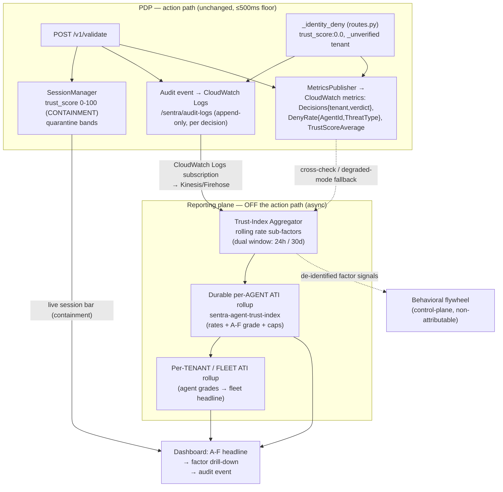
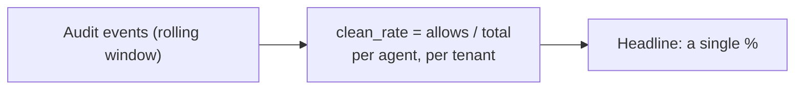
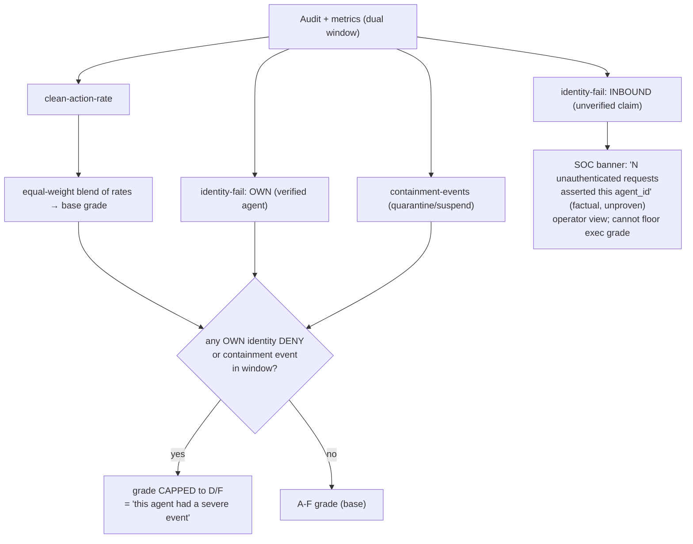

# HLD: Customer-Facing Trust KPIs for AegionAI Guard Agents

**Version**: 1.0
**Last Updated**: 2026-07-01
**Status**: Draft — options explored; *architecture shape* locked (the split + refined-B if built), but **build priority is opportunistic, not committed** — see the scope/prioritization note (§13). The letter grade itself is gated on the Open-Q4 distribution measurement passing on real traffic.
**Prerequisites**: [lld/03-security-controller.md](../lld/03-security-controller.md) §6 (Trust Scoring & Quarantine), [lld/ARCHITECTURE.md](../lld/ARCHITECTURE.md) (PDP pipeline), [PRD.md](../PRD.md) §FR-4

---

## Table of Contents
1. Executive Summary
2. Context — what exists today
3. Problem Statement
4. Tenets (tie-breakers)
5. Requirements (FR / NFR)
6. Architecture
   - 6.1 High-level block diagram
   - 6.2 Approach — options with trade-offs + Recommendation
   - 6.3 How refined-B rolls up across all three tiers
   - 6.4 How the labeled per-factor signals feed the two-moat flywheel
7. Containment vs Reporting — the clean split
8. Security & Networking
9. Scaling & Resiliency
10. Metering & Billing
11. Decisions to log as ADRs
12. Cross-references
13. Open Questions

---

## 1. Executive Summary

**The decision.** We are separating two jobs that today are forced onto one number, and adding a new customer-facing reporting metric.

1. **Keep the per-session `trust_score` unchanged as the containment control.** The 0–100 session score in `sentra-session-context` (init 100, per-violation decrement, asymmetric recovery, quarantine bands) is a good *instantaneous containment* signal — quarantine this session **now** — and it stays exactly as it is on the PDP response path. It was never a good *reporting* KPI, and we stop asking it to be one.
2. **Add a new durable customer-facing reporting KPI: the Agent Trust Index (ATI), surfaced as an A–F letter grade.** The grade is computed **off the action path** from the append-only audit log and the CloudWatch metrics the PDP already emits. Its sub-factors are **durable rolling rates** (not a mean of live mutable scores), so the number is explainable to a CISO, drills down to operator-actionable factors and then to the underlying audit events, and produces a durable week-over-week trend per agent and per fleet/tenant.

**What the grade measures — and what it does not.** The ATI grades **enforcement-outcome quality** — *did our controls fire correctly on this agent's traffic over the window* — **not agent safety** (it is not a warranty that the agent is safe). This distinction is load-bearing and must survive into the customer-facing copy: a `B` means "our enforcement saw mostly-clean, well-handled traffic," never "this agent is safe to trust." An **allowed-but-harmful action** — a policy-clean action that is nonetheless malicious (the exact action-level-governance failure the product exists to catch, CLAUDE.md core value prop) — is *by construction* invisible to the clean-action-rate factor, which counts only allow-vs-deny, not allow-correctness. The grade is therefore explicitly **not a safety warranty**; §7 states this as a product/legal-review constraint, and NFR-TK-5 caps the reach of the un-backstopped factor. Because it is durable, exported, and audit-traceable, a wrong-but-confident grade is a liability artifact, not just a bad number — treat the framing as a shipping gate, not cosmetics. **Export gate (hard):** the A–F headline does **not** ship until Open Q12 (fold a real caught-harm/detection-positive signal into the base grade *or* rename the surface to "Enforcement Coverage" / "Controls Health" so the noun cannot be read as a safety warranty) **and** Open Q11 (bucket ML-ABSTAIN into a distinct "undetermined" class, out of the clean numerator) are both decided, and the Open-Q4 distribution measurement passes on WS-K traffic (§13). A disclaimer in the doc is not a substitute for resolving Q12 — a CISO and a jury read the letter, not the footnote.

**Why it is defensible (not just a dashboard feature).** A letter grade over one vendor's telemetry is trivially copyable. The ATI's reason-to-exist is that it is a **single cross-vendor, cross-cloud durable trust signal** — one agent's grade spans AWS + Azure + on-prem in one number, which single-cloud competitors (Zenity/Foundry-only, cloud-native controls) structurally cannot produce (FR-4.4, the neutrality moat, STRATEGY §2). The commoditizable half (per-cloud rate → grade) is v1; the neutrality unification is the defensibility. **Honest bound on that claim:** a cross-vendor letter grade is still a *reporting rollup*, and a competitor with connectors on two clouds can ship a "unified grade" quickly — neutrality is a property of the **enforcement** plane (blocking a rival's cloud), not of a dashboard rollup. So the durable moat is **not the letter grade as an object**; it is (a) the enforcement plane's neutrality and (b) the **outcome-labeled behavioral data at scale** the factors feed (§6.4) — the ATI's own defensibility is retention/UX + being the surface that *produces* those labels, and it should be sold as such, not as a moat in itself. What a two-connector competitor cannot trivially replicate is the labeled-data volume, not the grade.

**The recommended shape is a refined Option B** — a composite index of *equal-weighted rate sub-factors* surfaced as an A–F grade — hardened with three grafts that a four-voice council flagged as load-bearing:

- **Graft 1 (A-inside-B):** v1 ships a **minimal** factor set — **clean-action-rate** as the sole *base* rate, with **identity-failure-rate** and **containment-events** as severe-event *caps* (Graft 2), not blended terms. So v1 is honestly **"Option A + caps"**, and the "equal-weighted composite" shape only materializes when a second non-capped base factor is added (P1). No tuned weights until the behavioral flywheel supplies outcome labels to justify them — unvalidated weights are false precision a CISO's auditor cannot defend.
- **Graft 2 (severe-event grade caps, rate-thresholded — not single-event):** identity-failure and containment/quarantine events act as **hard grade caps**, not averaged terms — so the worst attack class can never be arithmetically averaged away and silently re-buried. To preserve the durable week-over-week *trend* that is this KPI's whole reason to exist (Tenet 3), the cap fires on a **rate/count of severe events crossing a threshold**, not on a single event: a lone severe event **dents** the grade (a bounded, decaying penalty), a sustained rate of them **floors** it (to D/F). A single-event hard floor would collapse the grade to bimodal A-or-F for any agent under real adversarial pressure — erasing the trend — so the threshold is deliberate. The exact dent penalty, floor threshold, and slow-window decay are Open Q1/Q4; the invariant is: severe events are un-averageable, and a severe event's effect must not fully vanish at the next window boundary (a decaying residual on the slow window, so an attacker cannot game the window edge).
- **Graft 3 (own-vs-inbound identity split, with untrusted-key containment):** the identity-failure factor is split into (a) the **verified agent's own** auth anomalies (count toward its grade) and (b) **unverified inbound claims asserting this agent_id** (an attack-surface indicator that drives the SOC/operator view but is rate-normalized and cannot drive the durable exec grade to F). This closes a griefing/DoS-of-reputation surface the identity-attribution decision opens. **Critically, the inbound attribution key `(claimed agent_id, claimed tenant_id)` is attacker-controlled and cryptographically unproven** — so the inbound path is not just rate-normalized against the *grade*, it is bounded against the *write*: it must be namespaced under the claimed tenant with `provenance=UNPROVEN`, MUST NOT auto-create a durable per-agent ATI record for an agent_id that has never verified (no phantom agents in a victim's fleet view), and MUST coalesce/rate-cap inbound updates per `(claimed_tenant, source)` window so a spoof flood cannot amplify writes or pollute a cross-tenant namespace. Without these bounds, Graft 3 would convert a reputation-griefing problem into a storage/cost-amplification and cross-tenant-write vector — strictly worse (SEC-3, NFR-TK-4, NFR-TK-6).

Options A (bare rate), C (credit/reputation), and D (EWMA/time-decay) are evaluated in §6.2 and shown to degenerate into, or belong under, this recommendation. The A–F **vocabulary** is adopted from C. Grading uses **absolute thresholds** for v1; peer-relative benchmarking and tuned weights are deferred to P1, gated on tenant scale and flywheel labels.

**Why now.** WS-K production activation puts real multi-tenant traffic on the PDP, and the behavioral moat (STRATEGY §2, Moat 1 behavioral track) needs a **durable, comparable, cross-tenant-de-identified trust signal** to compound on. A mean-of-live-sessions that resets every 24h backs neither the customer's "how are my agents doing over time" question nor the flywheel.

---

## 2. Context — what exists today

The word "trust score" today refers to exactly one thing: a **per-session** score. Everything customer-facing is derived from it, weakly.

**The session score (the containment control, verified in code).**
- Stored per `session_id` in DynamoDB table `sentra-session-context`, **24h TTL**, initial value **100.0**, range 0–100 (`app/utils/session_manager.py:107-175`, `get_or_create_session` — the file lives in `app/utils/`, not `app/services/`, throughout this doc).
- On a **DENY**, decremented by a per-violation penalty (`session_manager.py:61-76`, `self.PENALTIES`): `JAILBREAK -30`, `DATA_EXFILTRATION -25`, `PROMPT_INJECTION -20`, `POLICY_VIOLATION`/`SEQUENCE_VIOLATION`/`UNAUTHORIZED_TOOL`/`UNAUTHORIZED_AGENT_INVOCATION`/`POLICY_NOT_FOUND`/`POLICY_DISABLED` `-15`, `RATE_LIMIT_EXCEEDED` `-10`, `SYSTEM_ERROR`/default `-10`.
- **Asymmetric recovery**: consecutive ALLOWs needed to climb (`session_manager.py:475-497`): score<40 → 15 allows for +2; 40–69 → 12 for +3; ≥70 → 10 for +5.
- **Quarantine bands** (`_get_quarantine_status`, `session_manager.py:499-520`, mirrored in `trust_checker.py:37-39`): ≥70 `active`; >40 `warning`; ≥10 `quarantined` (DENY read+write); <10 `suspended`. A score of exactly 40 is quarantined (LLD 03 §6.2).

**The "per-agent trust" derivative (the weak reporting number).**
- `get_agent_session_stats(agent_id)` (`session_manager.py:749-789`) returns `avg_trust_score` = **arithmetic mean of that agent's live sessions**, computed on-read via the `agent-updated-index` GSI, defaulting to `100.0` when the agent has no sessions.
- The **fleet** number `count_agents_below_trust(threshold=70)` (`session_manager.py:722`, in `app/utils/`) does a single paginated **full `fleet_scan`** of the session table and aggregates per-agent means in memory — an **O(table) full scan per invocation** (its own docstring calls it a "best-effort full scan (acceptable at MVP scale)").

**What's surfaced.**
- Dashboard: per-session bar + per-agent average (`src/dashboard/`, [lld/04-dashboard-v2.md](../lld/04-dashboard-v2.md)).
- CloudWatch (`metrics_publisher.py`): `TrustScoreAverage{AgentId}` (`:78-85`), `DenyRate{AgentId,ThreatType}` (`:96-101`), tenant-keyed `Decisions{tenant_id,verdict}` and `ValidateLatency{tenant_id}` (`:111-125`), plus `QuarantinedSessions`/`SuspendedSessions` gauges. `MetricsQueryService` rolls these up session→agent→fleet via `SEARCH`-collapsed `GetMetricData` (`metrics_query_service.py`).

**The identity-DENY blind spot (verified in code).**
- Identity-failure DENYs (`_identity_deny`, `routes.py:161-204`) return `trust_score: 0.0` in the response but **write no session state** and are audited under the reserved `_unverified` tenant. They *do* emit a `Decisions{tenant_id=_unverified,verdict=DENY}` CloudWatch point (`routes.py:185-189`), but because they touch no session and no per-agent state, they are **invisible to the per-agent and fleet trust aggregate**. The claimed `agent_id`/`sub` is bound only on the *verified* path (`deps.py`), so on a failed-identity event the claimed `agent_id` is **cryptographically unproven**.

---

## 3. Problem Statement

**One number is being asked to do two incompatible jobs, and it does the reporting job badly.** The five confirmed defects:

1. **Gameable, non-comparable mean.** Per-agent trust = mean of live sessions. One long clean session dilutes a burst of malicious ones; a chatty agent and a quiet agent are not comparable; a mean of a mutable 0–100 with asymmetric decay is not a statistically meaningful quantity and cannot be explained to a buyer.
2. **Resets every 24h.** Session TTL is 24h, so there is **no durable per-agent or fleet trend** to watch week-over-week. The entire "how trustworthy are my agents over time" story has no durable state behind it.
3. **Identity DENYs are excluded from the aggregate.** The most severe attack class writes no per-agent state, so the headline can read healthy while an agent is under a sustained identity/spoofing attack.
4. **Conflated concerns.** Instantaneous containment ("quarantine this session now") and durable reporting ("is this agent trustworthy over time") have opposite requirements. A good containment threshold makes a poor dashboard number and vice-versa. Forcing one value to serve both means neither is right.
5. **Opaque inverted scale.** "100 = good," but the drivers (which violations, how often, blocked-vs-allowed) are hidden. A customer told "trust dropped to 62" cannot act on it.

The customer's actual questions: **(1)** a better KPI showing how their agents are performing on trust (per agent, and per fleet, over time), and **(2)** whether a fundamentally better KPI should replace the current one.

---

## 4. Tenets (tie-breakers, priority order)

These settle the option choice when the alternatives are close. Most important first.

1. **Containment and reporting are separate concerns.** One number that must decide "block this session now" cannot also be the durable board-level trend — split the jobs, and let each metric be shaped by its own single purpose.
2. **Explainable to a buyer beats mathematically elegant.** A CISO and their auditor must be able to read the number, name its drivers, and defend it. A transparent rate beats a cleverly-weighted composite whose weights no one can justify.
3. **Durable trend beats resettable snapshot.** The reporting KPI is anchored in persistent state derived from the append-only audit log (SEC-5), so week-over-week comparison is real — a metric that evaporates on a 24h TTL cannot answer "over time."
4. **The headline never hides the worst class of attack.** Identity DENYs count toward the grade and are structurally un-averageable — the most severe class moves the grade mechanically, it is never diluted by good behavior on other factors.
5. **The reporting KPI stays off the action path.** It is computed asynchronously from audit events and metrics; it adds zero latency to `POST /v1/validate` and can never block or delay a verdict.
6. **One exec number drills down to operator-actionable sub-factors, then to the audit event.** The headline grade is a door, not a wall: exec sees A–F, operator sees the named rate factors behind it, analyst clicks through to the deciding audit events.

---

## 5. Requirements (FR / NFR)

**Implements (PRD, stable IDs):**
- **FR-4.1** — Per-agent trust scoring from violations *(P0, "Built (single-cloud)" — PRD.md:231)*. This HLD adds a durable per-agent index alongside the existing live-session mean; updating the FR-4.1 status note to reflect the durable index is a traceability change to make via `propagate-change` (see §12), not asserted here.
- **FR-4.2** — Automatic quarantine of an agent **or session** *(P0)*. Quarantine events feed the reporting KPI as a capped factor (§7); the containment mechanism is unchanged.
- **FR-4.4** — Cross-cloud trust propagation *(P1)*. A durable per-agent/tenant index is the object that can be propagated cross-cloud; the live-session mean cannot.
- **FR-4.6** — Rate-limit / abuse detection *(P0, "Built (live)" — PRD.md:236)*. Abuse/rate signals are a deferred (P1) rate sub-factor. **Deferring FR-4.6's *role as an ATI factor* does not defer FR-4.6 itself** — the P0 rate-limit/abuse requirement ships independently of this KPI; only its use as a second non-capped base factor is P1.

**Non-functional:**
- **NFR-3 (Availability / latency):** the reporting KPI is computed **off the response path**. The PDP's ≤500 ms deterministic-floor p99 (CLAUDE.md Constraint 1) is untouched — the KPI pipeline is a reporting plane, never a validate dependency.
- **NFR-4 (Resilience / fail-secure):** the headline **never masks the worst class of attack** (Tenet 4). A missing/lagging factor computation must degrade toward *worse* grade or an explicit "insufficient data," never a falsely-clean A. **Cold-start / low-volume handling:** an agent below a defined **minimum-volume floor** for the window shows *no grade* (not a scary "insufficient data" and not a default A) and is **excluded from both its own grade and the fleet aggregate**, with an explicit **"N agents below reporting threshold"** fleet indicator so the long tail of rarely-invoked agents is neither silently dropped nor allowed to skew the headline. This prevents a day-one dashboard of question marks and the two bad naive mixings (treat-as-F = false alarm; treat-as-A = the falsely-clean case NFR-4 forbids).

**New NFRs introduced by this design:**
- **NFR-TK-1 (Durable-trend retention — rollups outlive raw events).** Per-agent and per-tenant index history is retained long enough to support the slow exec window (≥30d rolling, retained ≥90d for trend), independent of the 24h session TTL. **Constraint:** the raw sources retain only ~90d (CloudWatch Logs 90-day retention; `sentra-validation-signals` `expires_at` at the `signal_store_ttl_days`=90 default), so the trend window **cannot exceed what the raw source retains via replay** — the durable **rollups must be snapshotted to their own longer-lived storage** (the `sentra-agent-trust-index` table, retained ≥90d and independently of the raw TTL), because a trend window at or past the 90d edge cannot be reconstructed by replaying raw events that have TTL'd out. Either the rollup is the durable record (recommended — it must outlive raw events anyway), or the trend window is capped at the raw retention; it cannot be both "≥90d trend" and "replayable from raw at the 90d edge."
- **NFR-TK-2 (Cross-tenant isolation of the aggregate).** A tenant's ATI and its sub-factors are computed and served **per-tenant**; no tenant's grade, factors, or agent list is ever visible to another. (The de-identified flywheel signal in §6.4 is a *separate*, aggregated, non-attributable path.) **Gated on `TENANCY_V2_ENABLED` (build dependency).** Per-tenant isolation of the ATI is only *enforceable* once tenancy-v2 is live in the deployment: until the cutover, `current_tenant()` always returns the single `"default"` tenant (`tenancy.py:139-140`, P0a), so all rows resolve to one tenant and per-tenant serving cannot be enforced. This is a named pre-build follow-up (§12) alongside the audit-schema change, not an assumed property.
- **NFR-TK-3 (Drill-down completeness).** Every headline grade resolves to its named factors, and every factor resolves to the underlying audit events that produced it — no dead-end numbers.
- **NFR-TK-4 (Griefing-resistance of the identity-inbound factor).** Unverified inbound claims asserting an agent_id cannot drive that agent's durable exec grade below a floor; they raise a SOC/attack-surface signal, not a reputation-tanking one (Graft 3).
- **NFR-TK-5 (Grade is enforcement-outcome, not a safety warranty).** The ATI grades whether enforcement fired correctly on the window's traffic; it is **not** an assertion that the agent is safe, and customer-facing copy must never let a passing grade be read as a safety warranty (§1, §7). The un-backstopped base factor (clean-action-rate) cannot show an A while a known severe event sits in the window (the caps handle *detected* severe events); an *allowed-but-harmful* action is out of scope of the grade by construction and must be labeled as such, pending legal/product review of the exported-grade liability. **The base factor is also write-side gameable** in two ways that a compromised agent (or an attacker who owns it) can exploit: (a) **allow-volume dilution** — flooding trivially-clean allow traffic dilutes a burst of denies within a single agent (a *rate* is comparable *across* agents but still dilutable *within* one), and (b) **ABSTAIN-as-allow** — the ML classifier ABSTAINs (ALLOW, low confidence) on infra failure (threat-taxonomy / LLD 19 §9), so an attacker who can induce or time a model outage converts would-be detections into clean-rate. **The gameable surface here is specifically the *ML-detected* classes** (`PROMPT_INJECTION`/`JAILBREAK`/`DATA_THEFT` lean on the ML layer): the deterministic Sigma engine and Cedar policy DENYs still fire during an ML outage, so the deterministic floor is unaffected — but critically, the severe-event **caps** (Graft 2) are largely *deterministic* classes (own-identity DENY, containment), so an induced-ML-outage injection/exfil burst becomes clean-rate AND **never trips a cap** at any tier. The severe-event caps are the mitigation for the *deterministic* severe classes; the base rate and the ML-detected classes remain gameable, which is *why* Open Q11 (bucket ML-ABSTAIN into a distinct "undetermined" class, out of the clean numerator — a cheap decision-classification branch in the aggregator) is a **hard export gate** (§1), not a deferred nicety.
- **NFR-TK-6 (Bounded, contained inbound write-attribution).** Inbound (unproven) identity attribution MUST NOT auto-materialize a durable per-agent ATI record for an agent_id that has never verified, MUST tag such rows `provenance=UNPROVEN` under the *claimed* tenant, and MUST coalesce/rate-cap inbound updates per `(claimed_tenant, source)` window — so an unauthenticated spoof flood cannot amplify writes, mint phantom agents in a victim's fleet, or pollute a cross-tenant namespace (SEC-3, threat-model S/D).
- **NFR-TK-7 (`claimed_*` are untrusted input — never a verbatim payload in a durable/rendered surface; threat-model I).** `claimed_agent_id`/`claimed_tenant_id` are attacker-supplied free-text on the pre-auth `_identity_deny` path, and the Graft-3 build persists them as first-class queryable attributes on `/sentra/audit-logs` (§8) — so an attacker could stuff PII, another tenant's real id, or an attack-pattern string into `claimed_agent_id`, which would then land durably and render into a victim tenant's SOC banner. These attributes inherit the **same "never a verbatim attacker-controlled payload in the durable/rendered surface" discipline the `reason` field already carries** (threat-taxonomy): (1) validate/normalize against the expected id charset+length before persisting; (2) when rendering the inbound SOC banner, **never echo the raw claimed string as free text** — show a bucketed count against a *resolved/known* id, or an opaque hash for an unknown id, never the raw attacker-chosen bytes.

---

## 6. Architecture

### 6.1 High-level block diagram

The PDP response path is untouched. A new asynchronous reporting plane consumes the **already-emitted** audit events and metrics, maintains durable per-agent and per-tenant index rollups, and serves the A–F headline plus factor drill-down.

**Ingestion source (must name a real substrate).** The per-decision audit trail today is **CloudWatch Logs** (log group `/sentra/audit-logs`, written by `app/utils/audit_logger.py:168,337` `_write_log_event`) — **not** a DynamoDB table, so there is no DynamoDB Stream on the audit substrate to attach to. (The only per-decision DDB table, `sentra-validation-signals` / LLD 17, has **no** `StreamViewType` — `signal_store_table_construct.py`; the one DDB stream in the infra is on `sentra-session-context`, the very table this design replaces — `storage_stack.py:166`.) The recompute pipeline is therefore fed via a **CloudWatch Logs subscription filter → Kinesis Data Stream / Firehose → the Trust-Index Aggregator** (a real, buildable path off today's substrate). The DDB-Streams alternative is only available if a build task **enables `StreamViewType` on `sentra-validation-signals`** (LLD 17 schema change, or a new `sentra-audit` DDB table); ADR-4 records this as the source decision. The MetricsQueryService/CloudWatch-metrics series is a cross-check and the degraded-mode fallback (RES-4), not the primary factor source.

### 6.2 Approach — options with trade-offs

All four options assume the **split is already made** (Tenet 1): the session `trust_score` remains the containment control regardless of which reporting KPI wins. The question below is only *what the customer-facing reporting KPI should be*.

#### Option A — Bare durable rate ("Agent Risk Score")

Keep the session score for containment; expose **one** durable rate per agent computed off the audit trail — e.g. blocked-action-rate (or its inverse, clean-action-rate) over a rolling window, persisted per agent and rolled up to the fleet as a request-weighted rate.

- **Pros.** Simplest to build; a rate is inherently comparable across busy vs quiet agents (fixes Defect 1); durable off audit (fixes Defect 2); trivially explainable.
- **Cons.** A single rate **conflates all violation classes into one number** — it structurally violates Tenet 4 (a sustained identity attack is just "a few more denies," averaged into the rate) and Tenet 6 (nothing to drill into; one number, no sub-factors). It re-creates Defect 5's opacity at a coarser grain: "clean-rate 96%" doesn't say *why*.
- **Cost/risk.** Low build cost, but low ceiling — it cannot carry the identity-DENY-visibility requirement or the operator drill-down.

#### Option B — Composite Agent Trust Index, A–F grade over named rate sub-factors *(RECOMMENDED, refined)*

A durable per-agent **index** whose value is derived from a **small set of named, transparent rate sub-factors**, surfaced as an **A–F grade** with defined absolute bands. Each sub-factor is itself an Option-A-style durable rolling rate — so A is literally B's one-factor degenerate case.

**v1 factor set (Graft 1 — minimal, equal-weighted):**
1. **clean-action-rate** — allows / total decisions in the window (per agent).
2. **identity-failure-rate** — split per Graft 3 into (a) *own* verified-agent auth anomalies and (b) *inbound* unverified claims asserting this agent_id.
3. **containment-events** — count of quarantine/suspend transitions attributable to the agent in the window.

**Grading (Graft 2 — severe-event caps, not weighted average):** the *severe* factors (own identity DENY, containment/quarantine) act as **caps** on a rate-threshold (Graft 2, §1), not as averaged terms; the *inbound* identity split (Graft 3b) is rate-normalized, drives the SOC "under attack" banner and the fast operator view, but **cannot** push the durable exec grade below a floor.

> **Honest v1 framing (do not oversell "equal-weighted composite").** Once the severe factors are caps rather than blended terms, the only **base-grade** input in v1 is **clean-action-rate**. So v1 ATI is precisely **"Option A (bare clean-action-rate) + severe-event caps,"** not a multi-factor weighted average — the "equal-weighted composite" only becomes real when a second *non-capped* base factor exists (e.g. a deferred abuse/rate factor, FR-4.6, P1). The "equal weights avoid false precision" argument (Graft 1) is honest but note equal-weighting is *itself* an unvalidated choice; it is defensible here only because there is one base factor to weight. State it plainly as A-plus-caps rather than dressing it as a composite it is not yet.

- **Pros.** Delivers every tenet: explainable named factors (T2), durable off audit (T3), identity DENYs mechanically move the grade and cannot be averaged away (T4, via the cap), one exec grade drilling to factors then audit (T6). Grafts 1–3 remove the three council-flagged kill-risks (unvalidated weights, averaged-away severe class, griefing). The A-F grade is a familiar exec vocabulary.
- **Cons.** More moving parts than A (a factor set + cap logic + drill-down). Absolute band thresholds are a judgment call for v1 (mitigated: equal weights + published bands, tunable later). Requires the identity-attribution path to be built (§8).
- **Cost/risk.** Moderate. The main risk — indefensible weights — is neutralized by Graft 1 (equal weights until flywheel labels justify otherwise).

#### Option C — Credit-score / security-posture reputation

A slowly-decaying durable reputation number (credit-score analogue) or a posture grade with defined bands, where trust is *earned back slowly* and *lost fast*, and agents/tenants are optionally benchmarked peer-relative.

- **Pros.** Intuitive "reputation" mental model; slow decay gives a stable, non-jittery board number; peer-relative benchmarking is a compelling flywheel story.
- **Cons.** Peer-relative benchmarking has a **chicken-and-egg problem** — it needs many tenants at scale to be meaningful, which we don't have at v1 launch, and it risks cross-tenant leakage (NFR-TK-2). A single opaque reputation number re-introduces Defect 5 unless it's decomposed — at which point it *is* Option B. The slow-decay curve is a **window-tuning choice**, not a distinct architecture.
- **Cost/risk.** The valuable parts (A-F vocabulary, slow-decay window) fold into B; the distinctive part (peer-relative) is premature.

#### Option D — EWMA / time-decayed trust

Replace the asymmetric-counter recovery with an exponentially-weighted moving average / time-decay model, so trust decays with inactivity and recovers smoothly. LLD 03 §6.4 already flags time-decay as a Phase-2 item for the *session* score.

- **Pros.** Smoother, more principled than the step-counter; naturally down-weights stale behavior; well-understood math.
- **Cons.** EWMA is a **containment-score mechanism**, not a customer KPI. Surfacing a decaying float as the headline re-commits Defect 5 (opaque) and Defect 4 (one number, two jobs) and violates Tenet 1. It is a candidate *evolution of the session containment score*, independent of and orthogonal to the reporting KPI.
- **Cost/risk.** Out of scope as the *KPI*; noted as a deferrable, independent improvement to the containment score.

#### Recommendation — refined Option B

**Adopt refined Option B** (composite A-F index of equal-weighted rate sub-factors, Grafts 1–3), keeping the session `trust_score` as the containment control.

Tie-breaking against the alternatives by the tenets:
- **vs A** — A fails **Tenet 4** (identity attacks average into one rate) and **Tenet 6** (no sub-factors to drill into). B *contains* A as its per-factor math but adds the visibility and drill-down A structurally can't. A ships alone would re-bury the exact attack class we're fixing.
- **vs C** — B **is** C's decomposed, non-opaque form; C's A-F vocabulary is adopted, but C's peer-relative benchmarking violates **NFR-TK-2** risk + chicken-and-egg and is deferred to P1. C's slow-decay informs B's window tuning, not a separate build.
- **vs D** — D violates **Tenet 1** as a KPI (it's a containment mechanism); reserved as the future evolution of the *session* score only, never surfaced as the customer KPI.

The refinement (Grafts 1–3) is what makes B beat *raw* B: **Graft 1** honors **Tenet 2** (equal weights = defensible, no false precision); **Graft 2** enforces **Tenet 4** structurally (caps, not averageable weights); **Graft 3** satisfies **NFR-TK-4** (griefing-resistance) — an outsider spamming `IDENTITY_MISMATCH` events naming a victim agent raises an "under attack" SOC signal, it does **not** tank the victim's board-level grade.

**Disposition of the other options, stated for the record:** A = subsumed as B's per-factor math (not shipped standalone). C = A-F vocabulary adopted; slow-decay informs window tuning; peer-relative deferred (P1, flywheel/scale-gated). D = deferred, independent evolution of the *containment* session score only (LLD 03 §6.4), never the KPI.

### 6.3 How refined-B rolls up across all three tiers

Every tier is mandatory and each has a distinct job:

| Tier | Object | What it is | Source |
|------|--------|-----------|--------|
| **T1 — Session** | `trust_score` 0–100 + quarantine band | **Containment control** — quarantine/suspend this session *now*. Unchanged; on the action path. | `sentra-session-context` (`session_manager.py`) |
| **T2 — Per-agent** | **Agent Trust Index (ATI)** = A-F grade + named rate factors | **Durable reporting** — how this agent is trending on trust, week-over-week, per dual window. | `sentra-agent-trust-index` rollup, fed from the `/sentra/audit-logs` CloudWatch Logs subscription (§6.1) |
| **T3 — Fleet / tenant** | **Fleet ATI** = A-F headline | **Exec headline** — one grade the CISO watches for the whole tenant, with the count of agents at each grade. | Aggregation of the per-agent ATI rollups within the tenant |

**Roll-up rules.**
- **Session → agent (T1→T2):** the agent ATI is **not** an average of session scores (that's the defect we're removing). It is computed from the *audit events* attributed to the agent (allows, denies-by-class, identity events, containment transitions) over the rolling window. Session-level quarantine/suspend transitions feed the T2 containment-events **cap** factor.
- **Agent → fleet (T2→T3):** the fleet grade is derived from the distribution of per-agent grades within the tenant (e.g. worst-N or a grade-weighted aggregate — the exact aggregator is an LLD detail), plus the same **caps**: any agent floored to F by a severe event pulls a visible "N agents at F" indicator into the fleet headline so a single bad agent is never averaged into an A fleet. This directly replaces the O(scan) `count_agents_below_trust` mean-of-means (§10).
- **Dual window at every tier:** each of T2 and T3 is computed on **both** a **~24h fast operator window** (reacts fast, drives the SOC view) and a **7d/30d slow exec window** (durable trend, drives the board headline). The exact windows and any decay half-life are locked in the LLD; the intent here is: fast = containment-adjacent situational awareness, slow = defensible durable reputation.

### 6.4 How the labeled per-factor signals feed the two-moat behavioral flywheel

The ATI sub-factors are, by construction, **labeled behavioral signals** per agent (clean-rate, identity-failure-rate own/inbound, containment-events). De-identified and aggregated (never per-tenant-attributable — NFR-TK-2), these feed **Moat 1's behavioral track** (CLAUDE.md: egress reputation / anomaly / trust / outcome labels from every edition's metadata). This is the moat-positive property that a mean-of-live-sessions lacks: the index is a **comparable, durable, cross-tenant signal** whose factors can later become flywheel-labeled and (P1) tuned-weight. The flywheel path is a **separate, one-way, aggregated** export — it does not read back into any tenant's grade, and it carries no raw content (consistent with the behavioral-vs-content moat split). **Minimum-cohort (k-anonymity) constraint (NFR-TK-2):** a per-agent factor tuple (clean-rate, own/inbound identity-fail-rate, containment-events) for a low-volume single-agent tenant is effectively a re-identifying fingerprint, so a factor tuple is exported **only when aggregated over ≥k agents/tenants** (mirroring the NFR-4 minimum-volume floor for grades) — this is the named mechanism behind the "non-attributable by construction" claim, not an assertion.

---

## 7. Containment vs Reporting — the clean split

This is the crux decision (Tenet 1), stated explicitly:

- **Session `trust_score` = containment.** Instantaneous, mutable, 24h-scoped, on the PDP action path, drives quarantine/suspend. **Unchanged by this HLD.** It answers "block this session now?"
- **Agent Trust Index = reporting.** Durable, rate-based, off the action path, drives the customer dashboard and exec headline. It answers "how trustworthy is this agent/fleet over time?"

**Does quarantine feed the reporting KPI?** **Yes — as a capped factor (Graft 2), not as a score input.** A containment event (quarantine/suspend transition) is a *severe event* that floors the agent's grade for the window. Quarantine does **not** feed the KPI by having the reporting number average in the session's low trust_score — that would re-import the mean-of-scores defect. The *event* caps the grade; the *score* stays a containment artifact. This keeps the two metrics coupled where it matters (a contained agent visibly grades badly) without collapsing them back into one number.

**What the ATI deliberately does not capture (stateless-by-design, and the seam to close).** The ATI is a **per-window rate view** computed from independent audit events; it deliberately does **not** carry the session score's **sequence / accumulated-state** information (asymmetric recovery, per-violation penalties, quarantine bands). That stateful, sequence-aware dimension — which CLAUDE.md names the product's core differentiator ("governing the action *with session state*") — remains in **T1 (containment)** and, at the reporting layer, is represented only via the **containment-events cap** and the **count of sequence-integrity DENYs** (`SEQUENCE_VIOLATION`) as a named factor. So two agents with identical clean-action-rates but different session trajectories (one steadily degrading, one spiky-then-recovered) are distinguished at the reporting layer *by their containment/sequence-DENY factors*, not by the base rate. Whether a richer trajectory signal (e.g. slow-window trend-of-session-score) becomes a named ATI factor is an Open Question — flagged so the reporting layer does not silently undersell the headline capability.

---

## 8. Security & Networking

Covers the SEC domains at HLD altitude; the LLD pins mechanisms.

- **Trust boundary (SEC-1).** The ATI is computed and stored **control-plane-side**, entirely **off the customer action path**. It reads the append-only audit log and CloudWatch metrics — both already-emitted artifacts — and never sits between an agent action and its verdict. The control plane is never on the action path (ARCHITECTURE tenet 1); the reporting plane inherits that.
- **Per-tenant isolation of the aggregate (SEC-2, NFR-TK-2).** ATI rollups are keyed by `tenant_id` and served only to that tenant. The aggregator reads the audit trail scoped per tenant; the fleet headline aggregates only within the tenant. Cross-tenant leakage of a grade, factor, or agent list is a security defect. The de-identified flywheel export (§6.4) is the *only* cross-tenant path and it is aggregated + non-attributable by construction.
  - **Read-path authz — no caller-supplied tenant/agent (SEC-2a, threat-model I/E).** The new `GET agent-trust`/`fleet-trust` endpoints (§12) derive `tenant_id` **from the verified JWT/Cognito context** — the platform's tenancy-v2 `current_tenant()` contextvar — **never** from a caller-supplied path/query parameter, and the rollup Query is scoped to that tenant's composite-key partition (`tenant_agent_id`). **Isolation is real only once tenancy-v2 is live:** `current_tenant()` returns the single `"default"` tenant until the `TENANCY_V2_ENABLED` cutover (`tenancy.py:139-140`, P0a), so per-tenant scoping of the ATI is a build dependency on that cutover (NFR-TK-2, §12), not an already-true guarantee. A request **cannot name another tenant's `agent_id`/`tenant_id`**; an out-of-tenant `agent_id` resolves to no partition, not another tenant's row. Without this, a `tenant_id`-keyed read endpoint is a cross-tenant IDOR — and the ATI (a durable, exported posture artifact) is exactly the high-value target such a leak would expose (a rival's fleet risk posture). Cross-ref the tenancy module already cited below (`storage_stack.py:706-775`, `TENANCY_V2_ENABLED`).
- **Identity DENYs mechanically move the grade — fail-secure (SEC-3, Tenet 4, NFR-4, NFR-TK-6).** Identity-failure DENYs *count* toward the target agent's ATI (fixing Defect 3). Because the claimed `agent_id` **and claimed `tenant_id`** on a failed-identity event are cryptographically unproven — on the unverified/mismatch path both come from what the caller asserted (`deps.py`; `sub`/tenant bound only on the verified path) — the **Graft-3 split plus untrusted-key containment is the load-bearing security requirement**:
  - **Own identity anomalies** (the *verified* agent's own auth failures) count toward its grade and can trigger the cap.
  - **Inbound unverified claims** asserting this agent_id are surfaced as an **attack-surface indicator** — they drive the fast operator window but are **rate-normalized and grade-capped so they cannot drive the durable exec grade to F**. The banner asserts only what the unproven data supports: **"N unauthenticated requests in the window asserted this agent_id"** — a factual statement about attacker behavior, **not** "this agent is under attack" (an inference the unproven claim cannot support). If the claimed `agent_id` matches **no provisioned agent** in the claimed tenant, it is **not** shown as an agent row; it routes to a tenant-level **"spoofing observed against unknown/unregistered id"** counter (no phantom agents). This closes the griefing/DoS-of-reputation surface: an outsider spamming `IDENTITY_MISMATCH`/`IDENTITY_UNVERIFIED` events naming a victim agent (today audited under `_unverified`, `routes.py:161-204`) raises a factual, rate-capped attack-surface count, not a reputation-tanking grade.
  - **Untrusted attribution key — write-side containment (NFR-TK-6).** Because the attacker chooses `(claimed agent_id, claimed tenant_id)`, the inbound rollup MUST: (1) key under the *claimed* tenant but tag `provenance=UNPROVEN`; (2) never auto-create a durable per-agent record for a never-verified id; (3) coalesce/rate-cap inbound updates per `(claimed_tenant, source)` window so one source cannot amplify writes into a victim namespace.
  - **Untrusted attribution *content* — validate + never echo raw (NFR-TK-7, threat-model I).** The `claimed_agent_id`/`claimed_tenant_id` *values* are also attacker-controlled free-text, not just the write volume: they must be charset/length-validated before they are persisted to `/sentra/audit-logs`, and the inbound SOC banner must render a bucketed count against a resolved/known id (or an opaque hash for an unknown id) — never the verbatim claimed string — so the audit log and the victim's rendered banner do not become a delivery surface for attacker-chosen PII/attack-pattern text (same rule the `reason` field carries). The pre-auth `_identity_deny` path is the *cheapest* event for an unauthenticated attacker to mint at scale (no valid JWT needed — it fires before the post-verification RPS gate at `routes.py:137`), so the pre-auth DENY flood must be **rate-limited/shed at the edge** before it fans out to the reporting plane, and inbound rollup updates coalesced per `(claimed_agent, window)` rather than per-event (RES threat row, §9).
  - **Durable attribution path for pre-auth events (build requirement, not "already carries").** Today `_identity_deny` writes no per-agent state, lives under `_unverified` (unmetered), and the audit persistence layer **drops** the claim: `_build_log_event` (`audit_logger.py:237-336`) lifts only `conversation_id`/`parent_request_id`/`caller_agent_id`/`call_depth` into `multi_agent_context` and persists **no** `claimed_tenant_id`/`claimed_agent_id`. So Graft 3 / NFR-TK-4 **cannot be implemented until** LLD 17's audit schema persists `claimed_tenant_id` and `claimed_agent_id` as first-class, queryable attributes on the `_unverified` path (`routes.py:161-204` sets `request.context['claimed_tenant_id']` at `:101-103`, but it must be *written onto the event*). This attribution is explicitly the *inbound* (unproven) class, never the *own* (proven) class.
  - **Fleet-headline containment (threat-model T).** The fleet **"N agents at F"** / "under attack" counts MUST separate **proven-severe** (own identity DENY, real containment) from **unproven-inbound**, so a forged-inbound storm cannot inflate the exec headline's severe-count. Only proven-severe events roll into the durable fleet grade; inbound raises a separately-labeled, rate-capped attack-surface banner.
  - **Inbound is attacker-behavior, never the victim's own health (SEC-3a, UX invariant).** A sustained inbound-claim stream against a **known-good, provisioned** agent (an attacker who knows a real `(tenant, agent_id)` pair) must be rendered as **"targeted spoofing campaign against this agent"** — a fact about attacker behavior — and MUST NOT be renderable as the victim agent's own operator-view health degradation (else it re-opens Defect 3 in the operator view and becomes an alert-fatigue/reputation grief vector inside the tenant). The banner is per-`(claimed_agent, source)` rate-capped.
  - **Exec bridge for sustained inbound attacks (SEC-3b).** Because the inbound factor cannot floor the exec grade (Graft 3, anti-griefing), a sustained/high-volume spoofing campaign would otherwise stay invisible at exec altitude while the operator banner fires — a CISO whose board grade stays A through a documented spoofing storm will not accept "it's in a different banner." So above a defined inbound rate×duration threshold, the campaign surfaces at exec altitude as a **distinct "under active identity attack" state** — **not** the trust grade (it must not tank a victim's letter grade), but present on the board view alongside it. This bridges the operator-banner/exec-grade split for real sustained attacks without giving a griefer a lever on the durable grade. (Threshold is an Open Question, tied to Q5.) **Anti-FUD affordance (or the fix becomes the problem).** Because this state is attacker-driven and by-design un-suppressible from the durable grade, an attacker who floods the *cheapest* events (pre-auth `_identity_deny`, no JWT) could otherwise keep a victim's board view permanently lit with an attack they cannot stop — a churn/alert-fatigue vector. So the exec "under active identity attack" state MUST have (1) an operator **acknowledge/mute-with-audit** affordance (the mute itself audit-logged, RES-6a), (2) a **decay** so a stale campaign self-clears when the inbound rate falls, and (3) a signal bounded by the edge rate-limit/shed (§9, NFR-TK-6) + inbound coalescing so the banner reflects a *deduped, bounded* count, never a raw attacker-controlled volume knob.
  - **Attribution key = tenancy-v2 composite (platform consistency).** Per-agent rollups and their attribution keys are specified against the platform's existing **tenancy-v2 composite-key convention** (`tenant_agent_id` = `{tenant}#{agent_id}`, compliance GSI on `tenant_decision_date`; `storage_stack.py:706-775`, behind `TENANCY_V2_ENABLED`), not a fresh `agent_id`+`tenant_id` scheme, so the isolation model (NFR-TK-2) does not diverge from the platform's.
- **Data in transit / at rest (SEC-4).** ATI state and audit reads use the platform's existing encrypted DynamoDB/CloudWatch paths; no new content leaves the boundary (factors are metadata, not payloads).
- **Append-only audit log is the source of truth (SEC-5).** The KPI derives from the **append-only audit log** — CloudWatch Logs `/sentra/audit-logs` (retention **currently configured** to 90d / `THREE_MONTHS` via the `retention_map` default, `storage_stack.py:88-96`, **not** CloudWatch Logs' own default of indefinite — so a change to `retention_days` is itself an input to the trend-window contract, NFR-TK-1) plus the `sentra-validation-signals` DDB store (LLD 17; TTL attribute `expires_at`, `signal_store_table_construct.py:79`, computed from `signal_store_ttl_days` default **90**, `config.py:205` + `signal_store_writer.py:207-208`) — so the grade traces to logged evidence, not a mutable score, and is **more** defensible than a resettable session mean. Honest scoping: neither substrate is **cryptographically** tamper-evident today (no hash-chain / WORM / object-lock — CLAUDE.md: "append-only audit is live; full forensic chain-of-thought is roadmap"). Any SOC-2 claim of *immutability* is therefore **gated on a cryptographic tamper-evidence control** (hash-chained log or object-lock) as a dependency/roadmap item; until it exists, describe the substrate as append-only, not tamper-evident.
- **Grade source is audit-only; CloudWatch is a labeled provisional fallback (SEC-6).** The durable, drill-down-traceable grade (NFR-TK-3) comes from the audit log. The degraded-mode CloudWatch-metrics grade (RES-4) is **lossy, aggregated, and not audit-traceable**, so it is presented as a **distinct, clearly-labeled *provisional* signal** in its own visual channel, is **never persisted as durable history**, and is never shown in the same channel as the audit-derived grade — so a customer who screenshots a provisional grade during an aggregator outage does not later see an unexplained grade "flip" when the audit-derived series backfills.
- **The provisional fallback cannot represent the inbound-identity attack-surface signal — fail toward "insufficient data on the severe class" (SEC-6a, Tenet 4 / NFR-4).** The CloudWatch series `Decisions{tenant_id=_unverified,verdict=DENY}` (`metrics_publisher.py:111-119`, emitted by the `_identity_deny` path `routes.py:161-204`) carries **no `claimed_agent_id`/`claimed_tenant_id` dimension** — the claim is not on the metric. So in degraded mode the provisional grade **cannot compute the inbound-identity factor at all** — the exact worst-class-visibility this design exists to add (Defect 3, Tenet 4) is not merely coarser, it is *absent* from the fallback path. Therefore: (1) the degraded-mode provisional grade is explicitly labeled as **not reflecting inbound-identity attack surface**, and (2) the SOC "under attack" banner must show a distinct **"attack-surface signal unavailable (degraded mode)"** state rather than an implied all-clear — a provisional grade can **never** be read as "no identity attack in progress." This keeps the fallback consistent with the tenet the primary path upholds (the headline never hides the worst class), rather than fail-open toward a falsely-clean A.

## 9. Scaling & Resiliency

Covers the RES items at HLD altitude.

- **Load profile & scaling strategy (RES-1).** Recompute is **async, batched, and event-driven** off a **CloudWatch Logs subscription filter → Kinesis/Firehose** on the `/sentra/audit-logs` audit substrate (§6.1) — the audit trail is CloudWatch Logs, not a DDB table, so this is the buildable source; a DDB-Streams source is available only if `StreamViewType` is first enabled on `sentra-validation-signals` (LLD 17 schema change) or a new `sentra-audit` DDB table is introduced (ADR-4). The per-agent/per-tenant rollup is **incremental** (windowed counters updated on each streamed event, coalesced per `(agent, window)`), explicitly avoiding the **O(table) full `fleet_scan`** that `count_agents_below_trust` does today (`session_manager.py:722`, `app/utils/`). Reads of the headline are O(1) lookups against the pre-computed rollup. **Adversarial-load guard:** pre-auth `_identity_deny` events are the cheapest to mint at scale, so inbound event volume into the subscription/aggregator must be rate-limited/shed at the edge and coalesced (NFR-TK-6, SEC-3) so a spoof flood cannot amplify writes into the reporting plane.
- **Failure modes & response (RES-2).**
  - *KPI pipeline lag or outage* → the PDP is unaffected (reporting plane, not the PDP); validate keeps serving verdicts at full speed (Tenet 5, NFR-3). The dashboard shows a stale-but-labeled grade with a "last updated" timestamp; it **never** blocks a verdict.
  - *Missing/insufficient data for a window* → grade degrades to an explicit "insufficient data," never a falsely-clean A (NFR-4, fail-secure toward the customer).
  - *Aggregator crash* → recompute is **replayable from the durable audit store** (the audit trail is the source of truth), so no grade is permanently lost.
- **Fault isolation / blast radius (RES-3).** The reporting plane is fully isolated from the action path; a bug or overload in the aggregator cannot degrade `POST /v1/validate`. Per-tenant rollups isolate one tenant's recompute cost from another's.
- **Graceful degradation (RES-4).** If the subscription-fed aggregator is down, the dashboard falls back to the CloudWatch-metrics series (`MetricsQueryService`, SEARCH-collapsed `GetMetricData`, `metrics_query_service.py`) for a **coarse, provisional grade** — presented per SEC-6 in a distinct labeled channel, **not persisted as durable history**, so no unexplained grade "flip" occurs when the audit-derived series backfills on recovery. The customer still sees *something* real, sourced from PDP-emitted metrics. **But the inbound-identity attack-surface factor is unavailable in this mode** (the `_unverified` `Decisions` series carries no `claimed_agent_id` dimension — SEC-6a), so the provisional grade is labeled as not reflecting inbound-identity attack surface and the SOC banner shows an explicit "attack-surface signal unavailable (degraded mode)" state — never an implied all-clear.
- **Recovery (RES-5, RTO/RPO intent).** RPO ≈ 0 for the grade because it is a *derived* view over the durable audit trail — recovery = replay the window from audit. RTO is bounded by replay time over the retention window, not by any live-state reconstruction. **Bounded by raw retention (see NFR-TK-1):** replay-from-audit only reconstructs windows still within the ~90d raw retention; for the trend at/beyond the 90d edge the recovery source is the **durable `sentra-agent-trust-index` rollup snapshots** (which outlive raw events by design), not raw replay — the rollup is the system of record for long-horizon trend, raw replay is the recovery path for recent windows.
- **Change-safety / rollback (RES-6).** Band thresholds and the factor set are config, versioned; a threshold change is a forward-only recompute over the retained window, and the previous grades remain reconstructable from audit. Introducing a new factor is additive (Graft 1's whole point) — no destructive re-scoring.
  - **Config-integrity + comparability contract (RES-6a, threat-model T).** Because a grade is a durable, exported liability artifact (§1), silently loosening a band (e.g. moving the A cut-point down) would retroactively repaint an agent's history as healthier on the next recompute. So band/weight/factor config changes MUST be (1) **restricted to control-plane admins**, (2) **themselves audit-logged** (who/when/old→new), and (3) carry a **scoring-version** surfaced as a versioned banner ("graded under band-config vN"). The UI never silently compares grades across scoring versions — a grade shift caused by a config or factor-set change (e.g. adding the P1 abuse factor) is shown as a **scoring-model change**, the way credit bureaus do, so it is never mistaken for an agent-behavior change. This also settles the dual-window ambiguity into a contract: exactly one window (slow/exec) is the **board number**; the fast window is operator-only, so the exec is never choosing between two grades for the same agent.

## 10. Metering & Billing

- **What is measured.** Per-agent and per-tenant **decision events** — already emitted as `Decisions{tenant_id,verdict}` (`metrics_publisher.py:111-119`) and as audit events per decision. The ATI factors are computed from these; no new *measurement* is introduced, only new *aggregation*.
- **Attribution.** Every factor is attributed to `agent_id` and `tenant_id`. This is consistent with the tenant-keyed metering pattern from WS-K/WS-E (per-tenant `Decisions`). The reporting KPI is not itself a billed quantity in v1; it consumes the same attributed event stream billing does.
- **The identity-DENY under-count / invisibility failure mode and its fix.** Today identity DENYs are **unmetered** in the per-agent/fleet trust aggregate (they touch no session state and live under `_unverified`) — this is Defect 3 and a metering blind spot. The fix: the aggregator counts them toward the **claimed** target agent as the *inbound* factor (§8), so the worst class is no longer invisible to the aggregate. Note the tenant-billing treatment is intentionally separate: `_unverified` traffic stays un-billed-to-a-tenant (you can't bill a tenant for an unauthenticated outsider's spoof attempts), but it **is visible** in the target agent's under-attack signal.
- **Busy-vs-quiet non-comparability handled by rates, not counts (Defect 1).** Because the factors are **rates** (per-total-decisions), a high-volume agent and a low-volume agent are directly comparable — the metering plane counts events, the KPI normalizes them. This is the property the mean-of-live-sessions lacked.

## 11. Decisions to log as ADRs

Each material decision below should be captured via the `adr` skill, Context linking back to this HLD §:

1. **Split containment from reporting** (the crux, §7) — session `trust_score` stays containment; a new durable reporting object (ATI) is added.
2. **Reporting shape = refined Option B** (§6.2) — composite A-F index of equal-weighted rate sub-factors, Grafts 1–3.
3. **Identity-DENY attribution + own-vs-inbound split** (§8, Graft 3) — how pre-auth `_unverified` events are anchored to the claimed target agent as the *inbound* factor.
4. **Durable state = subscription-fed incremental rollup, not derive-on-read; and the ingestion source** (§6.1, §9) — a per-agent/per-tenant `sentra-agent-trust-index` rollup fed from the `/sentra/audit-logs` CloudWatch Logs subscription (audit is CloudWatch Logs, not a DDB table today), chosen over an O(table)-scan derive-on-read to avoid the `count_agents_below_trust` fleet_scan. The ADR must **name the chosen source explicitly** and, if a DDB-Streams source is preferred, record the schema change (enable `StreamViewType` on `sentra-validation-signals` or add a `sentra-audit` DDB table) rather than assuming a stream that does not exist.
5. **Dual rolling window + grade-cap mechanism** (§6.3, Graft 2) — 24h operator / 7d–30d exec; severe factors cap rather than average.
6. **Absolute thresholds for v1; peer-relative + tuned weights deferred to P1** (§6.2) — flywheel/scale-gated.
7. **Containment score stays asymmetric-counter for now; EWMA (Option D) deferred** (§6.2) — an independent future evolution of the session score only.

## 12. Cross-references

- **Implements:** FR-4.1 (per-agent trust scoring), FR-4.2 (auto-quarantine agent or session), FR-4.4 (cross-cloud trust propagation, P1), FR-4.6 (rate-limit/abuse); NFR-3 (latency — KPI off the response path), NFR-4 (fail-secure — headline never masks the worst class).
- **Decisions:** ADRs 1–7 above (to be numbered by the `adr` skill).
- **Shared contracts:**
  - `trust_score` (per-session, 0–100, `sentra-session-context`) — **containment control, unchanged**.
  - **`AgentTrustIndex` (ATI)** — new durable per-agent/per-tenant reporting metric: A–F grade + named rate sub-factors (`clean-action-rate`, `identity-failure-rate` {own, inbound}, `containment-events`).
  - `sentra-agent-trust-index` — new durable rollup table (per-agent + per-tenant).
  - `GET` agent-trust / fleet-trust endpoints (new; the dashboard's drill-down source) — supersede the `get_agent_session_stats` mean as the customer-facing per-agent number. **Build constraint (LLD):** the API Gateway uses explicit per-resource, no-proxy routing (`api_stack.py:275,363-484` — `add_resource`/`add_method` per path), so these GET routes MUST be registered in `api_stack.py`, not only in the controller — an unregistered route 403s (undefined-route). Tenant scoping is enforced from the verified identity, not a path param (SEC-2a).
  - Audit event schema (LLD 17, `17-validation-signal-store.md`) — the KPI source of truth; **build requirement:** `_build_log_event` must persist `claimed_tenant_id` and `claimed_agent_id` as first-class queryable attributes on the `_unverified` path (today it does not — `audit_logger.py:237-336` lifts only the 4 `multi_agent_context` fields), or inbound-identity attribution (Graft 3 / NFR-TK-4) cannot be implemented. Because those attributes are attacker-controlled free-text, the same build must charset/length-validate them before persisting and must not echo them verbatim in any rendered surface (NFR-TK-7).
  - CloudWatch `TrustScoreAverage`, `Decisions{tenant_id,verdict}`, `DenyRate{AgentId,ThreatType}`, `QuarantinedSessions`, `SuspendedSessions` — cross-check / degraded-mode source.
- **Upstream:** [lld/ARCHITECTURE.md](../lld/ARCHITECTURE.md) (PDP pipeline; control-plane-never-on-action-path tenet).
- **Sibling refs:** [lld/03-security-controller.md](../lld/03-security-controller.md) §6 (trust & quarantine — the containment control; §6.4 time-decay = the deferred Option D), [lld/04-dashboard-v2.md](../lld/04-dashboard-v2.md) (dashboard — **must be reconciled:** LLD 04 today surfaces the numeric 0–100 trust everywhere and reads `sentra-session-context` directly; the A–F grade + drill-down + `GET agent-trust/fleet-trust` endpoints are a real change to LLD 04's data source and components — `components/agent_status.py` — that this HLD introduces and LLD 04 has not yet absorbed; the `MetricsQueryService` is the correct existing mechanism for the RES-4 degraded-mode path), [lld/12-multi-agent-workflow.md](../lld/12-multi-agent-workflow.md) (cross-agent trust), [lld/17-validation-signal-store.md](../lld/17-validation-signal-store.md) (validation-signal store + audit — KPI source of truth). Also touches [PRD.md](../PRD.md) §FR-4: FR-4.1 currently reads **"Built (single-cloud)"** (PRD.md:231) with no "live-session mean" wording, and FR-4.4 reads **"Demonstrated (S2)"** (PRD.md:234). Updating FR-4.1's status note to reflect the durable index alongside the live mean, and reconciling FR-4.4's "Demonstrated (S2)" against the durable per-agent/tenant index this HLD introduces as the propagatable object, are **traceability changes to make explicitly via `propagate-change`**, not to imply silently here.

**Pre-build follow-ups (must be opened as explicit tasks before this ships — the two siblings drift until they run).** These are tracked, not silent, but the design should not ship with the siblings left inconsistent:
  1. `propagate-change` on **PRD.md:231** (FR-4.1 status note) and **PRD.md:234** (FR-4.4 status).
  2. Reconcile **LLD 04** (`lld/04-dashboard-v2.md`) — today `components/agent_status.py` surfaces the numeric 0–100 trust read from `sentra-session-context` directly (`lld/04` §… agent_status data source); the A–F grade + drill-down + new `GET agent-trust/fleet-trust` endpoints change LLD 04's data source and components and have not yet been absorbed there.

## 13. Open Questions

Only the user/customer can settle these:

1. **Rolling windows — exact values.** 24h fast + 30d slow is the locked *shape*; are the exact windows 24h/7d/30d, and is there a decay half-life on the slow window (folding in C's slow-decay) or a hard rolling boundary?
2. **Absolute grade bands.** What clean-action-rate → A/B/C/D/F cut-points? (v1 is absolute; needs a defensible first-cut a CISO's auditor accepts.)
3. **Does the fleet headline use worst-N, grade-weighted mean, or a threshold count** of agents-at-F? (§6.3 leaves the aggregator to the LLD, but the *exec's mental model* is a product call.)
4. **Cap severity + dent-vs-floor threshold.** Does an *own* identity DENY *dent* (bounded penalty) or *floor* the grade, and at what **rate/count of severe events** does the dent become a floor to D/F (Graft 2, rate-thresholded — not a single-event floor, to preserve the trend)? Does a single quarantine floor as hard as a suspend? And what is the **slow-window decay residual** so a severe event doesn't fully vanish at the next window boundary (anti-window-gaming)? Validate on real dev traffic (WS-K now puts multi-tenant traffic on the PDP) that the resulting grade distribution is **not bimodal A-or-F** (a meaningful fraction of agents in B/C/D, grades that *move* week-over-week for a given agent). **This may be irreconcilable:** "floor the worst class" (Tenet 4) and "preserve a moving trend" (Tenet 3, the KPI's reason to exist) can genuinely conflict if no threshold yields both. Decision rule if no such Goldilocks band exists on real data: **do not ship the letter grade** — fall back to a coverage/incident view (surface the severe-event counts and clean-rate as raw factors without collapsing them into an A–F headline), rather than shipping a grade that is either bimodal-useless or averages-away-the-severe-class. The letter grade is gated on this measurement passing, not assumed.
5. **Inbound-identity floor.** How far *can* inbound (unproven) identity attacks move the grade before the floor stops them — a fixed floor (e.g. never below C), or a rate-normalized cap? (NFR-TK-4.)
6. **Peer-relative timing.** At what tenant scale does peer-relative benchmarking (Option C, P1) become meaningful and safe (NFR-TK-2)?
7. **Retention.** How long is per-agent/tenant ATI history retained (NFR-TK-1)? Compliance may set a floor.
8. **Does the ATI ever feed billing** (e.g. risk-based pricing), or is it purely a reporting/trust surface? (§10 assumes reporting-only for v1.)
9. **Minimum-volume floor** below which an agent shows no grade and is excluded from the fleet aggregate (NFR-4 cold-start): what decision count per window?
10. **Trajectory factor.** Should a slow-window trend-of-session-score (the sequence/stateful signal, §7) become a named ATI factor, or does the containment-events + `SEQUENCE_VIOLATION` cap suffice to represent it?
11. **ABSTAIN bucketing (base-factor anti-gaming, threat-model T/S).** Should ML-ABSTAIN decisions (ALLOW + low confidence, infra-fail — LLD 19 §9) be counted in the clean numerator, or split into a distinct **"undetermined"** bucket so an ML-outage window cannot masquerade as a clean window and inflate the grade? (Ties to NFR-TK-5's write-side-gameable note.)
12. **Does the exec headline surface a real allowed-but-harmful catch-rate?** NFR-TK-5 concedes the base factor is blind to allowed-but-harmful actions — the one threat class the product exists to catch. Should a named catch-rate factor (e.g. `SEQUENCE_VIOLATION`/egress-anomaly DENYs as a *positive* detection signal) be folded into the base grade so the number correlates with real caught-harm, rather than leaving "looks safe" and "is safe" decoupled behind a disclaimer? This is the product/naming gate flagged in §1/§7 — decide it before the A–F grade is exported, since a letter grade reads as a safety warranty regardless of disclaimer.

**Scope / prioritization note (not a blocker).** This design is deliberately **low-cost and opportunistic**: it rides on *already-emitted* audit events and CloudWatch metrics (§10) — the only net-new build is the subscription-fed aggregator + rollup table + dashboard surface + the `claimed_*` audit-schema persistence (§8). It is **scoped to not pull engineers off the latency/in-VPC and shadow→enforce roadmap** (CLAUDE.md Constraint 1). The behavioral-flywheel *consumption* and tuned weights are explicitly deferred (§6.4, P1); the "why now" is that WS-K puts durable multi-tenant traffic on the PDP and the behavioral moat needs a durable signal to *begin* accumulating — not that a durable grade closes a specific regulated-buyer objection (those are residency/latency/enforcement-correctness). If a named design partner is not asking for durable week-over-week grades, treat this as the cheap reporting improvement it is, not a roadmap priority. **Resolving "locked shape vs opportunistic build" (no contradiction):** what is *locked* is the **architecture** — the containment/reporting split and refined-B *if and when this is built*; what is **not** committed is the *build now*. The cheapest independently-valuable slice to pull forward is the **`claimed_tenant_id`/`claimed_agent_id` audit-schema attribution change alone** (§8), which has standalone value for identity-attack visibility (it fixes Defect 3 in the audit trail regardless of the grade); the aggregator + rollup table + Kinesis subscription + dashboard/LLD-04 rework should wait for a customer pull or a flywheel-consumption decision. Build the attribution change now; defer the grade surface.
