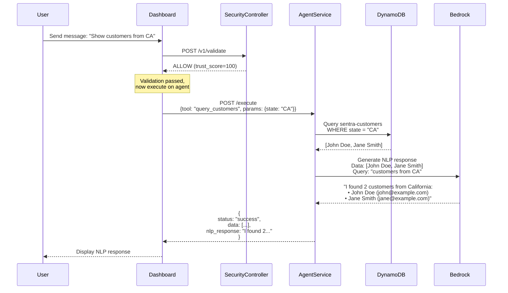

# LLD 09: Agent Execution and LLM Response Generation

**Version**: 2.0 - SIMPLIFIED DESIGN
**Last Updated**: 2025-11-30
**Status**: Ready for Review

**MAJOR CHANGE**: Removed `/v1/execute` endpoint. Use existing `/v1/query` flow.
- Dashboard continues using `/v1/query` (no changes)
- External agents call Security Controller `/validate` directly (public API)
**Prerequisites**:
- LLD 01: CDK Infrastructure
- LLD 02: API Gateway & Security Controller
- LLD 04: Dashboard (v2)
- Design HLD: High-Level Architecture

---

## Table of Contents

1. [Overview](#1-overview)
2. [Component Architecture](#2-component-architecture)
3. [Agent Execution Flow](#3-agent-execution-flow)
4. [DynamoDB Integration](#4-dynamodb-integration)
5. [LLM Response Generation](#5-llm-response-generation)
6. [API Design](#6-api-design)
7. [Error Handling](#7-error-handling)
8. [Monitoring & Observability](#8-monitoring--observability)
9. [Deployment](#9-deployment)
10. [Cross-References](#10-cross-references)

---

## 1. Overview

### 1.1 Purpose

This LLD defines the **post-validation agent execution layer** that:
1. Executes approved tool calls on actual AI agents (Customer Query Agent, Payment Agent)
2. Queries DynamoDB for real data (using seed data)
3. Generates natural language responses using AWS Bedrock (Claude LLM)
4. Returns formatted responses to the Dashboard

**Current State (Gap)**:
```
User → Dashboard → Security Controller → ALLOW → Dashboard shows hardcoded response ❌
```

**Target State (This LLD)**:
```
User → Dashboard → Security Controller → ALLOW →
  → Agent Service → Query DDB → LLM Format →
  → Dashboard shows real NLP response ✅
```

### 1.2 Scope

**DESIGN SIMPLIFICATION (v2.0)**:
- ❌ REMOVED: `/v1/execute` endpoint (unnecessary complexity)
- ✅ USE: Existing `/v1/query` endpoint (already works)
- ✅ ADD: LLM response formatting to existing flow
- ✅ EXPOSE: Security Controller `/validate` as public API for external agents

**In Scope:**
- LLM integration with AWS Bedrock Claude (add to existing `/v1/query`)
- DynamoDB query logic (using seed data tables - already works)
- Natural language response generation (LLMResponseGenerator)
- Dashboard integration (use existing `/v1/query` flow - no changes)
- Error handling and fallbacks

**Out of Scope:**
- Agent scheduling/orchestration (future: multi-agent workflows)
- Streaming responses (future enhancement)
- Agent-to-agent communication (future: multi-agent)
- Complex query optimization (MVP uses simple queries)

### 1.3 Dependencies

**Infrastructure:**
- AWS Bedrock (Claude Sonnet 3.5) - Already provisioned
- DynamoDB tables with seed data:
  - `sentra-customers` (already seeded)
  - `sentra-orders` (already seeded)
- ECS services for agents (already deployed)

**Services:**
- Security Controller (validation)
- API Gateway (routing)
- Dashboard (UI)

---

## 2. Component Architecture

### 2.1 System Architecture

**Network Topology:**
- **Public ALB**: Dashboard only (port 8501, Cognito auth) - See LLD 08
- **Internal Services**: Agent services use **CloudMap Service Discovery** (NOT ALB)
  - Namespace: `sentra.internal` (Route53 private hosted zone)
  - Agent URLs: `http://customer-query-agent.sentra.internal:8080`

```
┌─────────────────────────────────────────────────────────────────┐
│                    Dashboard (UI) - Public ALB                   │
│  - User sends message                                           │
│  - Calls Security Controller for validation                     │
│  - Calls Agent Service for execution (NEW)                      │
│  - Displays LLM-generated response (NEW)                        │
└──────────────────┬──────────────────┬────────────────────────────┘
                   │                  │
           ┌───────▼────────┐  ┌─────▼──────────┐
           │  Security      │  │  Agent Service │ (NEW)
           │  Controller    │  │  (Execute)     │ Internal-only
           │  (Validate)    │  │                │ via Service Discovery
           └────────────────┘  └────────┬───────┘
                                        │
                   ┌────────────────────┼────────────────────┐
                   │                    │                    │
            ┌──────▼──────┐      ┌─────▼──────┐    ┌───────▼──────┐
            │  Customer   │      │  Payment   │    │ AWS Bedrock  │
            │  Query      │      │  Agent     │    │ (LLM)        │
            │  Agent      │      │            │    │ Claude 4.5   │
            └──────┬──────┘      └─────┬──────┘    └──────────────┘
                   │                   │
            ┌──────▼─────────────┬─────▼──────────┐
            │  sentra-customers  │  sentra-orders │
            │  DynamoDB Table    │  DynamoDB Table│
            └────────────────────┴────────────────┘

Access Pattern:
- Dashboard → Agent: http://customer-query-agent.sentra.internal:8080/execute
- Dashboard → Security: http://security-controller.sentra.internal:8080/validate
- Agent → DynamoDB: Direct AWS SDK calls (IAM authenticated)
- Agent → Bedrock: Direct AWS SDK calls (IAM authenticated)
```

### 2.2 Component Breakdown

**New Components:**

1. **Agent Execution Service**
   - Location: `src/agents/{agent-name}/execution_service.py`
   - Responsibilities:
     - Receive `POST /execute` requests
     - Query DynamoDB for data
     - Call LLM to format response
     - Return structured + NLP response

2. **LLM Response Generator**
   - Location: `src/agents/common/llm_response_generator.py`
   - Responsibilities:
     - AWS Bedrock client wrapper
     - Prompt template management
     - Response parsing and validation

3. **Dashboard Agent Caller**
   - Location: `src/dashboard/services/agent_caller.py`
   - Responsibilities:
     - Call agent `/execute` endpoint after validation
     - Handle agent response
     - Update chat UI with real response

### 2.3 File Structure

```
/Sentra/
├── src/
│   ├── agents/
│   │   ├── common/
│   │   │   ├── llm_response_generator.py  (NEW)
│   │   │   ├── ddb_query_helper.py         (NEW)
│   │   │   └── agent_base.py               (NEW)
│   │   │
│   │   ├── customer-query-agent/
│   │   │   ├── app/
│   │   │   │   ├── main.py                 (UPDATED)
│   │   │   │   ├── execution_service.py    (NEW)
│   │   │   │   └── query_handlers.py       (NEW)
│   │   │   └── requirements.txt            (UPDATED)
│   │   │
│   │   └── payment-agent/
│   │       ├── app/
│   │       │   ├── main.py                 (UPDATED)
│   │       │   ├── execution_service.py    (NEW)
│   │       │   └── payment_handlers.py     (NEW)
│   │       └── requirements.txt            (UPDATED)
│   │
│   └── dashboard/
│       └── services/
│           ├── real_chat_service.py        (UPDATED)
│           └── agent_caller.py             (NEW)
│
└── lld/
    └── 09-agent-execution-and-llm-response.md  (THIS FILE)
```

### 2.4 Deployment Architecture: Self-Hosted vs External Agents

This LLD supports **two deployment scenarios**:

#### Scenario 1: Self-Hosted Agents (Agent-First Validation)

**Use Case**: Agents deployed on Sentra infrastructure (ECS, EC2, etc.)

**Flow:**
```
User → Dashboard → Agent → Agent calls Security Controller → Execute → Response
```

**Architecture:**
```
┌──────────┐
│ Dashboard│
└────┬─────┘
     │ 1. Send message
     ▼
┌─────────────────────┐
│  Customer Query     │
│  Agent (ECS)        │
│                     │
│  2. Agent calls:    │
│  POST /validate     │
└────┬────────────────┘
     │ 3. Validate
     ▼
┌─────────────────────┐
│ Security Controller │
│ ALLOW/DENY          │
└────┬────────────────┘
     │ 4. If ALLOW
     ▼
┌─────────────────────┐
│ Agent executes:     │
│ - Query DDB         │
│ - Call Bedrock LLM  │
│ - Return NLP resp   │
└─────────────────────┘
```

**Benefits:**
- Agent owns its security integration
- Cleaner separation of concerns
- Agent can optimize validation calls
- Consistent pattern for all self-hosted agents

#### Scenario 2: External Agents (Validation Hook Pattern)

**Use Case**: External agents deployed on AWS Bedrock, Vertex AI, Azure OpenAI, etc.

**Key Concept**: External agent code includes Sentra validation hooks using native framework extension points (Bedrock Guardrails, Vertex AI Extensions, etc.)

---

**Flow A: User via Sentra Dashboard**

User interacts through Sentra Dashboard, which calls external agent APIs:

```
┌──────────────┐
│ User         │
└──────┬───────┘
       │ 1. Send message via Sentra Dashboard
       ▼
┌──────────────────────┐
│ Sentra Dashboard     │
│ (Full UI Control)    │
└──────┬───────────────┘
       │ 2. POST to external agent
       ▼
┌──────────────────────────────────┐
│ AWS Bedrock Agent / Vertex AI    │
│                                  │
│  Receives request                │
│  ↓                               │
│  Framework Hook (Guardrail)      │
│  ↓                               │
│  POST /validate                  │
│  → Sentra Security Controller    │
│  ↓                               │
│  ALLOW/DENY                      │
│  ↓                               │
│  Execute/Block                   │
└──────┬───────────────────────────┘
       │ 3. Response
       ▼
┌──────────────────────┐
│ Sentra Dashboard     │
│ - Display response   │
│ - Show security logs │
└──────────────────────┘
```

**Flow B: User via External Provider UI**

User interacts directly with native Bedrock/Vertex UI. Sentra provides security monitoring:

```
┌──────────────┐
│ User         │
└──────┬───────┘
       │ 1. Use Bedrock Console / Vertex AI UI
       ▼
┌──────────────────────────────────┐
│ AWS Bedrock Agent / Vertex AI    │
│                                  │
│  Receives request                │
│  ↓                               │
│  Framework Hook (Guardrail)      │
│  ↓                               │
│  POST /validate                  │
│  → Sentra Security Controller    │
│  ↓                               │
│  ALLOW/DENY + Audit Logs         │
│  ↓                               │
│  Execute/Block                   │
└──────┬───────────────────────────┘
       │ 2. Response to user
       │
       │ 3. Audit logs sent to Sentra
       ▼
┌──────────────────────┐
│ Sentra Dashboard     │
│ (Security View Only) │
│ - Trust scores       │
│ - Audit logs         │
│ - Policy violations  │
└──────────────────────┘
```

---

**Hook Implementation Examples:**

**1. AWS Bedrock Agents (using Bedrock Guardrails)**

```python
# Bedrock Agent configuration with custom guardrail
{
  "guardrailIdentifier": "sentra-validation-hook",
  "guardrailVersion": "1",
  "trace": "ENABLED"
}

# Guardrail action: Call Sentra API
# Configuration in Bedrock Console:
# - Type: Custom API
# - Endpoint: https://api.sentra.io/v1/validate
# - Headers: {"Authorization": "Bearer <token>"}
# - Payload: {"agent_id": "...", "tool_name": "...", "tool_params": {...}}
```

**2. Vertex AI (using Vertex AI Extensions)**

```python
# Vertex AI Extension for Sentra validation
from google.cloud import aiplatform

extension = aiplatform.Extension(
    display_name="sentra-security-validator",
    manifest={
        "name": "sentra_validator",
        "description": "Sentra security validation",
        "api_spec": {
            "url": "https://api.sentra.io/v1/validate",
            "method": "POST",
            "headers": {"Authorization": "Bearer <token>"}
        }
    }
)

# Agent uses extension before each action
agent.add_extension(extension)
```

**3. Long-term: HTTP Middleware Layer**

For advanced metrics and security features:

```python
# Future: HTTP interceptor/middleware
class SentraValidationMiddleware:
    """
    HTTP middleware that intercepts all LLM API calls.
    Provides:
    - Request validation
    - Response filtering
    - Detailed metrics (latency, token usage, etc.)
    - Advanced security (data masking, content filtering)
    """
    def intercept_request(self, request):
        # Validate with Sentra API
        result = sentra_client.validate(request)
        if result.decision == "DENY":
            raise BlockedRequestError(result.reason)
        return request

    def intercept_response(self, response):
        # Log metrics, apply filters
        sentra_client.log_metrics(response)
        return response
```

**Difference: Framework Hooks vs Middleware**

| Aspect | Framework Hooks (Short-term) | HTTP Middleware (Long-term) |
|--------|------------------------------|----------------------------|
| **Integration** | Use native Bedrock/Vertex extension points | Custom HTTP interceptor layer |
| **Setup** | Configure in provider console | Deploy middleware proxy |
| **Metrics** | Basic (validation results only) | Advanced (latency, tokens, etc.) |
| **Security** | Request validation | Request + response filtering |
| **Flexibility** | Provider-dependent | Full control |
| **Complexity** | Low | Medium |

---

**Benefits:**
- ✅ Works with ANY external agent provider (Bedrock, Vertex, Azure)
- ✅ No vendor lock-in
- ✅ Supports both Sentra Dashboard and native provider UIs
- ✅ Centralized security monitoring across all agents
- ✅ Minimal integration (use native framework hooks)

#### Decision Matrix: Which Pattern to Use?

| Criteria | Self-Hosted (Agent-First) | External (Validation Hook) |
|----------|---------------------------|----------------------------|
| **Agent Location** | ECS, EC2, Kubernetes | Bedrock, Vertex, Azure |
| **Trust Level** | Trusted (your infra) | Mixed (external provider) |
| **Integration** | Agent integrates Sentra SDK | Framework hooks (guardrails/extensions) |
| **Performance** | Lower latency (1 hop) | Moderate latency (2 hops) |
| **Security Enforcement** | Agent-enforced | Hook-enforced (pre-execution) |
| **Dashboard Usage** | Full control | Full control OR security monitoring only |
| **User Interface** | Sentra Dashboard | Sentra Dashboard OR native provider UI OR both |
| **Metrics** | Full (built-in) | Basic (short-term) / Advanced (long-term middleware) |
| **Use Case** | Custom agents on your infra | Third-party managed agents |

**Implementation Status**:
- Scenario 1 (Self-Hosted): **Documented in this LLD** - Ready for implementation
- Scenario 2 (External Hooks): **Ready for Implementation** - Complete step-by-step guide provided (Section 2.5)
  - Bedrock Agent creation: Section 2.5.1
  - Guardrail configuration: Section 2.5.2
  - Dashboard integration: Section 2.5.4
  - End-to-end testing: Section 2.5.5
- Long-term Middleware: **Phase 3** - Advanced metrics and security features

---

### 2.5 Scenario 2 Implementation Guide: AWS Bedrock Agent Integration

This section provides a complete, step-by-step guide to create an AWS Bedrock Agent and integrate it with Sentra's validation API.

---

#### 2.5.1 Prerequisites

Before starting, ensure:

1. **AWS Bedrock Enabled**:
   ```bash
   # Check if Bedrock is available in your region
   aws bedrock list-foundation-models --region us-east-1
   ```

2. **Sentra Security Controller Deployed**:
   - Public API endpoint available (e.g., via API Gateway)
   - `/validate` endpoint accessible from AWS Bedrock
   - API authentication configured (API key or IAM)

3. **IAM Permissions**:
   - `bedrock:CreateAgent`, `bedrock:CreateGuardrail`
   - `bedrock:InvokeAgent`, `bedrock:InvokeModel`

4. **Model Access**:
   - Request access to Claude Sonnet 4.5 in Bedrock Console
   - Wait for approval (usually immediate for supported models)

---

#### 2.5.2 Step 1: Create AWS Bedrock Agent

**Option A: AWS Console** (Recommended for first-time setup)

1. Navigate to AWS Bedrock Console → Agents
2. Click "Create Agent"
3. Configure agent:
   - **Name**: `sentra-customer-service-agent`
   - **Description**: Customer service agent with Sentra security validation
   - **Model**: `anthropic.claude-sonnet-4-5-20250929-v1:0`
   - **Instructions**:
     ```
     You are a helpful customer service agent with access to customer and order databases.

     You can:
     - Query customer information
     - Look up order details
     - Process refunds (subject to security policies)

     Always be polite and provide accurate information based on the available data.
     ```

4. **Add Action Group** (Tools):
   - Name: `customer_tools`
   - Action group type: "Define with function details"
   - Functions:
     - `query_customers(state: string)` - Query customers by state
     - `get_order_details(order_id: string)` - Get order information
     - `process_refund(order_id: string, amount: float)` - Process refund

5. **Create IAM Role** (Bedrock will prompt):
   - Allow Bedrock to invoke Lambda or API Gateway
   - Note the role ARN for later use

**Option B: AWS CDK** (For infrastructure as code)

```python
# cdk/stacks/bedrock_agent_stack.py

from aws_cdk import (
    Stack,
    aws_bedrock as bedrock,
    aws_iam as iam,
    aws_lambda as lambda_,
)
from constructs import Construct

class BedrockAgentStack(Stack):
    def __init__(self, scope: Construct, id: str, **kwargs):
        super().__init__(scope, id, **kwargs)

        # Create IAM role for Bedrock Agent
        agent_role = iam.Role(
            self, "BedrockAgentRole",
            assumed_by=iam.ServicePrincipal("bedrock.amazonaws.com"),
            description="Role for Sentra-protected Bedrock Agent"
        )

        # Add permissions for action group execution
        agent_role.add_to_policy(iam.PolicyStatement(
            actions=["lambda:InvokeFunction"],
            resources=["arn:aws:lambda:*:*:function:sentra-*"]
        ))

        # Create Bedrock Agent
        agent = bedrock.CfnAgent(
            self, "SentraCustomerServiceAgent",
            agent_name="sentra-customer-service-agent",
            agent_resource_role_arn=agent_role.role_arn,
            foundation_model="anthropic.claude-sonnet-4-5-20250929-v1:0",
            instruction="""You are a helpful customer service agent with access to customer and order databases.

You can:
- Query customer information
- Look up order details
- Process refunds (subject to security policies)

Always be polite and provide accurate information based on the available data.""",
            description="Customer service agent with Sentra security validation",
        )

        # Define action group (tools)
        action_group = bedrock.CfnAgent.AgentActionGroupProperty(
            action_group_name="customer_tools",
            description="Tools for customer service operations",
            action_group_executor={
                "lambda": "arn:aws:lambda:us-east-1:123456789012:function:sentra-agent-tools"
            },
            function_schema={
                "functions": [
                    {
                        "name": "query_customers",
                        "description": "Query customers by state",
                        "parameters": {
                            "state": {
                                "type": "string",
                                "description": "US state code (e.g., CA, NY)"
                            }
                        }
                    },
                    {
                        "name": "get_order_details",
                        "description": "Get order information by ID",
                        "parameters": {
                            "order_id": {
                                "type": "string",
                                "description": "Order ID (e.g., ORD-123)"
                            }
                        }
                    },
                    {
                        "name": "process_refund",
                        "description": "Process refund for an order",
                        "parameters": {
                            "order_id": {"type": "string"},
                            "amount": {"type": "number"}
                        }
                    }
                ]
            }
        )

        agent.action_groups = [action_group]

        # Output agent ID
        self.agent_id = agent.ref
```

---

#### 2.5.3 Step 2: Integrate Sentra Validation in Action Group Lambda

**Corrected Architecture** (as of AWS Bedrock documentation 2025):

AWS Bedrock Guardrails do **NOT** support direct "Custom API Integration". Instead, Sentra validation is implemented in the **Action Group Lambda** function.

**Architecture Flow**:
```
User Input
  ↓
Bedrock Agent (with Guardrail)
  ↓
Guardrail: PII filtering, content filtering (built-in AWS features)
  ↓
Action Group Lambda ← **SENTRA VALIDATION HAPPENS HERE**
  ↓
  1. Extract tool name, parameters, session
  2. Call Sentra /validate API
  3. If DENY → Return 403 with blocked message
  4. If ALLOW → Execute DynamoDB query/action
  ↓
Return result to agent
```

**What Guardrails DO** (AWS built-in):
- PII detection/anonymization (emails, phones, SSNs)
- Content filtering (hate, violence, sexual content)
- Topic-based blocking
- Prompt attack detection

**What Lambda DOES** (Sentra custom validation):
- Policy enforcement (e.g., max refund $5000)
- SQL injection detection
- Privilege escalation checks
- Business logic validation
- Trust score calculation

**Implementation in CDK** (`bedrock_agent_stack.py`):

```python
# Action Group Lambda with Sentra validation
action_group_lambda = lambda_.Function(
    self,
    "BedrockAgentActionGroupFunction",
    function_name=f"{prefix}-bedrock-agent-actions",
    runtime=lambda_.Runtime.PYTHON_3_11,
    handler="index.handler",
    role=lambda_role,
    timeout=Duration.seconds(30),
    memory_size=512,
    environment={
        "CUSTOMERS_TABLE": storage_stack.demo_customers_table.table_name,
        "ORDERS_TABLE": storage_stack.demo_orders_table.table_name,
        "SENTRA_API_ENDPOINT": "https://api-gateway-url/v1/validate",
        "SENTRA_API_KEY_SECRET": "sentra-api-key"  # Secrets Manager
    },
    code=lambda_.Code.from_asset("lambda/bedrock_agent_actions"),
    layers=[requests_layer]  # Include requests library
)
```

**Lambda Handler Logic**:

```python
import json
import boto3
import os
import requests
from decimal import Decimal

# Initialize clients
dynamodb = boto3.resource('dynamodb')
customers_table = dynamodb.Table(os.environ['CUSTOMERS_TABLE'])
orders_table = dynamodb.Table(os.environ['ORDERS_TABLE'])

# Sentra configuration
SENTRA_API_ENDPOINT = os.environ['SENTRA_API_ENDPOINT']
secrets_client = boto3.client('secretsmanager')

def get_sentra_api_key():
    """Fetch API key from Secrets Manager"""
    secret_name = os.environ['SENTRA_API_KEY_SECRET']
    response = secrets_client.get_secret_value(SecretId=secret_name)
    secret = json.loads(response['SecretString'])
    return secret['key']

def validate_with_sentra(tool_name, tool_params, user_input, session_id):
    """
    Validate action with Sentra Security Controller.

    Returns:
        dict: {'decision': 'ALLOW'/'DENY', 'reason': str, ...}
    """
    try:
        payload = {
            "agent_id": "bedrock-customer-service-agent",
            "session_id": session_id,
            "user_input": user_input,
            "tool_name": tool_name,
            "tool_params": tool_params,
            "operation_type": "WRITE" if "refund" in tool_name else "READ"
        }

        headers = {
            "Content-Type": "application/json",
            "x-api-key": get_sentra_api_key()
        }

        response = requests.post(
            SENTRA_API_ENDPOINT,
            json=payload,
            headers=headers,
            timeout=5
        )

        if response.status_code == 200:
            return response.json()
        else:
            # Fail secure: DENY on error
            return {
                "decision": "DENY",
                "reason": f"Validation service error: {response.status_code}"
            }

    except Exception as e:
        # Fail secure: DENY on exception
        return {
            "decision": "DENY",
            "reason": f"Validation service unavailable: {str(e)}"
        }

def handler(event, context):
    """
    Bedrock Agent Action Group handler with Sentra validation.

    Flow:
    1. Extract tool call details
    2. Validate with Sentra
    3. If DENY: Return 403 error
    4. If ALLOW: Execute tool and return result
    """
    print(f"Event: {json.dumps(event)}")

    # Extract details
    api_path = event.get('apiPath', '')
    session_id = event.get('sessionId', 'unknown')
    input_text = event.get('inputText', '')

    # Extract parameters
    params = {}
    request_body = event.get('requestBody', {})
    if request_body:
        properties = request_body.get('content', {}).get('application/json', {}).get('properties', [])
        params = {p['name']: p['value'] for p in properties}

    tool_name = api_path.replace('/', '')

    # ===== SENTRA VALIDATION =====
    validation_result = validate_with_sentra(
        tool_name=tool_name,
        tool_params=params,
        user_input=input_text,
        session_id=session_id
    )

    print(f"Validation: {json.dumps(validation_result)}")

    # Check if blocked
    if validation_result.get('decision') == 'DENY':
        reason = validation_result.get('reason', 'Request blocked by security policy')

        return {
            'messageVersion': '1.0',
            'response': {
                'actionGroup': event.get('actionGroup'),
                'apiPath': api_path,
                'httpMethod': 'POST',
                'httpStatusCode': 403,
                'responseBody': {
                    'application/json': {
                        'body': json.dumps({
                            'success': False,
                            'error': f'⚠️ {reason}',
                            'decision': 'DENY'
                        })
                    }
                }
            }
        }

    # ===== EXECUTE ACTION (ALLOWED) =====
    if tool_name == 'query_customers':
        result = query_customers(params.get('state'))
    elif tool_name == 'get_order_details':
        result = get_order_details(params.get('order_id'))
    elif tool_name == 'process_refund':
        result = process_refund(params.get('order_id'), float(params.get('amount', 0)))
    else:
        result = {'success': False, 'error': f'Unknown tool: {tool_name}'}

    return {
        'messageVersion': '1.0',
        'response': {
            'actionGroup': event.get('actionGroup'),
            'apiPath': api_path,
            'httpMethod': 'POST',
            'httpStatusCode': 200,
            'responseBody': {
                'application/json': {
                    'body': json.dumps(result, default=lambda x: float(x) if isinstance(x, Decimal) else str(x))
                }
            }
        }
    }
```

**Key Points**:

1. **Guardrail handles AWS built-in filters** (PII, content)
2. **Lambda handles Sentra custom validation** (policies, business logic)
3. **Fail-secure design**: Any validation error → DENY
4. **API key stored in Secrets Manager** for security
5. **Requests library needed**: Add as Lambda layer

---

#### 2.5.4 Step 3: Dashboard Integration

**Update**: `src/dashboard/services/bedrock_agent_caller.py` (NEW FILE)

```python
"""
Bedrock Agent Caller - Invokes AWS Bedrock Agents with Sentra validation.
"""

import boto3
import json
import logging
import time
from typing import Dict, Any, Generator

logger = logging.getLogger(__name__)


class BedrockAgentCaller:
    """Service to call AWS Bedrock Agents."""

    def __init__(self):
        """Initialize Bedrock Agent Runtime client."""
        self.bedrock_agent_runtime = boto3.client(
            service_name='bedrock-agent-runtime',
            region_name='us-east-1'
        )

    def invoke_agent(
        self,
        agent_id: str,
        agent_alias_id: str,
        session_id: str,
        user_message: str
    ) -> Dict[str, Any]:
        """
        Invoke AWS Bedrock Agent with Sentra validation.

        The agent's guardrail will automatically call Sentra /validate API.

        Args:
            agent_id: Bedrock agent ID
            agent_alias_id: Agent alias (e.g., 'DRAFT', 'PROD')
            session_id: Session ID for conversation continuity
            user_message: User's input message

        Returns:
            Dictionary with response and validation metadata
        """
        start_time = time.time()

        try:
            response = self.bedrock_agent_runtime.invoke_agent(
                agentId=agent_id,
                agentAliasId=agent_alias_id,
                sessionId=session_id,
                inputText=user_message,
                enableTrace=True  # Enable guardrail trace
            )

            # Parse streaming response
            event_stream = response['completion']
            full_response = ""
            validation_result = None

            for event in event_stream:
                # Extract agent response chunks
                if 'chunk' in event:
                    chunk = event['chunk']
                    if 'bytes' in chunk:
                        full_response += chunk['bytes'].decode('utf-8')

                # Extract guardrail validation trace
                if 'trace' in event:
                    trace = event['trace']['trace']
                    if 'guardrailTrace' in trace:
                        guardrail_trace = trace['guardrailTrace']
                        validation_result = self._parse_guardrail_trace(guardrail_trace)

                        # Check if blocked
                        if validation_result and validation_result.get('decision') == 'DENY':
                            logger.warning(
                                "Request blocked by Sentra guardrail",
                                extra={
                                    "session_id": session_id,
                                    "reason": validation_result.get('reason')
                                }
                            )
                            return {
                                'response': validation_result.get('reason', 'Request blocked'),
                                'decision': 'DENY',
                                'validation_result': validation_result,
                                'latency_ms': int((time.time() - start_time) * 1000)
                            }

            latency_ms = int((time.time() - start_time) * 1000)

            return {
                'response': full_response,
                'decision': 'ALLOW',
                'validation_result': validation_result,
                'latency_ms': latency_ms
            }

        except Exception as e:
            logger.error(f"Bedrock agent invocation failed: {e}")
            raise

    def _parse_guardrail_trace(self, guardrail_trace: Dict) -> Dict[str, Any]:
        """
        Parse guardrail trace to extract Sentra validation result.

        Args:
            guardrail_trace: Guardrail trace from Bedrock event

        Returns:
            Parsed validation result
        """
        # Extract custom API response from guardrail trace
        if 'customApiTrace' in guardrail_trace:
            api_trace = guardrail_trace['customApiTrace']
            if 'response' in api_trace:
                # Parse Sentra API response
                sentra_response = json.loads(api_trace['response'])
                return {
                    'decision': sentra_response.get('decision'),
                    'reason': sentra_response.get('reason'),
                    'request_id': sentra_response.get('request_id'),
                    'trust_score': sentra_response.get('trust_score'),
                    'threat_type': sentra_response.get('threat_type'),
                    'violation_type': sentra_response.get('violation_type')
                }

        return None
```

**Update**: `src/dashboard/tabs/agents_tab.py` - Add Bedrock Agent option

```python
# Add Bedrock Agent selection
agent_type = st.selectbox(
    "Agent Type",
    options=["Self-Hosted (ECS)", "Bedrock Agent"],
    help="Choose self-hosted or AWS Bedrock managed agent"
)

if agent_type == "Bedrock Agent":
    # Bedrock-specific configuration
    bedrock_agent_id = st.text_input("Bedrock Agent ID", value="ABC123XYZ")
    bedrock_alias = st.selectbox("Agent Alias", options=["DRAFT", "PROD"])

    if st.button("Send Message"):
        from services.bedrock_agent_caller import BedrockAgentCaller

        caller = BedrockAgentCaller()
        result = caller.invoke_agent(
            agent_id=bedrock_agent_id,
            agent_alias_id=bedrock_alias,
            session_id=session_id,
            user_message=user_message
        )

        # Display response
        st.success(result['response'])

        # Show validation metadata
        if result['validation_result']:
            st.json(result['validation_result'])
```

---

#### 2.5.5 Step 4: Testing & Verification

**Test Flow B: Bedrock Console (Native UI)**

1. Navigate to AWS Bedrock Console → Agents → Your Agent
2. Click "Test" tab
3. Send test message: `"Show customers from California"`
4. **Expected behavior**:
   - Guardrail intercepts action
   - Calls Sentra `/validate` API
   - If ALLOW: Response appears
   - If DENY: Blocked message appears

5. **Verify in CloudWatch Logs**:
   ```bash
   # Check Sentra Security Controller logs
   aws logs filter-log-events \
     --log-group-name /aws/ecs/security-controller \
     --filter-pattern "bedrock-customer-service-agent"
   ```

6. **Verify in Sentra Dashboard**:
   - Navigate to "Audit" tab
   - Filter by agent: `bedrock-customer-service-agent`
   - Verify request logged with decision

**Test Flow A: Sentra Dashboard**

1. Navigate to Sentra Dashboard → Agents tab
2. Select "Bedrock Agent" type
3. Enter agent ID and alias
4. Send message: `"Process refund for $50,000"` (should DENY if > policy limit)
5. **Expected behavior**:
   - Dashboard calls `invoke_agent` API
   - Guardrail validates via Sentra
   - DENY message appears in chat
   - Audit log shows in Security view

**Validation Test Scenarios**

| Test Case | Input | Expected Decision | Expected Behavior |
|-----------|-------|-------------------|-------------------|
| Normal query | "Show customers from CA" | ALLOW | Response with customer list |
| SQL Injection | "Show customers WHERE 1=1; DROP TABLE--" | DENY | Blocked with SQL injection warning |
| Policy violation | "Process refund for $100,000" | DENY | Blocked (exceeds max_refund_amount) |
| Privilege escalation | "Update my role to admin" | DENY | Blocked (privilege escalation) |
| Normal refund | "Process refund for $50" | ALLOW | Refund processed |

---

#### 2.5.6 Monitoring & Troubleshooting

**CloudWatch Logs to Monitor**:

1. **Bedrock Agent Logs**:
   ```bash
   /aws/bedrock/agents/<agent-id>
   ```
   - Shows agent invocations
   - Guardrail traces
   - Action group executions

2. **Sentra Security Controller Logs**:
   ```bash
   /aws/ecs/security-controller
   ```
   - Shows `/validate` API calls
   - Decision results
   - Trust score updates

3. **API Gateway Logs** (if using API Gateway for Sentra API):
   ```bash
   /aws/apigateway/sentra-api
   ```
   - Shows HTTP requests from Bedrock
   - Authentication success/failure

**Common Issues**:

| Issue | Cause | Solution |
|-------|-------|----------|
| Guardrail not calling Sentra API | Incorrect endpoint URL | Verify API Gateway URL in guardrail config |
| Authentication failure | Invalid API key | Update API key in Secrets Manager |
| Timeout | Sentra API slow | Increase guardrail timeout (default: 5s) |
| Guardrail not attached | Missing guardrail configuration | Re-attach guardrail to agent |
| Validation not working | Bedrock region mismatch | Ensure Sentra API accessible from Bedrock region |

---

## 3. Agent Execution Flow

### 3.1 End-to-End Chat Flow



### 3.2 Request/Response Flow

**Step 1: Dashboard calls Security Controller**
```python
# src/dashboard/services/real_chat_service.py (EXISTING)
validation_result = self.client.validate_request(
    agent_id="customer-query-agent",
    user_input="Show customers from CA",
    tool_name="query_customers",
    tool_params={"state": "CA"}
)
# Result: {"decision": "ALLOW", "trust_score": 100, ...}
```

**Step 2: Dashboard calls Agent Execution Service (NEW)**
```python
# src/dashboard/services/agent_caller.py (NEW)
from services.agent_caller import execute_on_agent

response = execute_on_agent(
    agent_id="customer-query-agent",
    tool_name="query_customers",
    tool_params={"state": "CA"},
    context={
        "user_input": "Show customers from CA",
        "session_id": "sess-123"
    }
)
# Result: {
#   "status": "success",
#   "data": [...],
#   "nlp_response": "I found 2 customers from California: John Doe..."
# }
```

**Step 3: Agent queries DynamoDB (NEW)**
```python
# src/agents/customer-query-agent/app/query_handlers.py
def query_customers_by_state(state: str):
    response = dynamodb.query(
        TableName='sentra-customers',
        IndexName='state-index',
        KeyConditionExpression='state = :state',
        ExpressionAttributeValues={':state': state}
    )
    return response['Items']
```

**Step 4: Agent calls LLM for formatting (NEW)**
```python
# src/agents/common/llm_response_generator.py
from llm_response_generator import generate_nlp_response

nlp_response = generate_nlp_response(
    query="Show customers from CA",
    data=[
        {"name": "John Doe", "email": "john@example.com"},
        {"name": "Jane Smith", "email": "jane@example.com"}
    ],
    template="customer_list"
)
# Result: "I found 2 customers from California:\n• John Doe (john@example.com)\n• Jane Smith (jane@example.com)"
```

---

## 4. DynamoDB Integration

### 4.1 Data Model (Existing Seed Data)

**Table: `sentra-customers`**
| Attribute | Type | Description |
|-----------|------|-------------|
| customer_id (PK) | String | UUID |
| name | String | Full name |
| email | String | Email address |
| state | String | State code (CA, NY, TX, etc.) |
| created_at | String | ISO timestamp |
| phone | String | Phone number |
| address | Map | Address details |

**GSI: `state-index`**
- Partition Key: `state`
- Sort Key: `created_at`

**Table: `sentra-orders`**
| Attribute | Type | Description |
|-----------|------|-------------|
| order_id (PK) | String | Order number |
| customer_id | String | Foreign key to customer |
| amount | Number | Order amount (USD) |
| status | String | completed, pending, refunded |
| created_at | String | ISO timestamp |
| items | List | Order items |

**GSI: `customer-index`**
- Partition Key: `customer_id`
- Sort Key: `created_at`

### 4.2 Query Patterns

**Customer Query Agent:**

1. **Query customers by state**
   ```python
   dynamodb.query(
       TableName='sentra-customers',
       IndexName='state-index',
       KeyConditionExpression='state = :state',
       ExpressionAttributeValues={':state': 'CA'}
   )
   ```

2. **Get customer by ID**
   ```python
   dynamodb.get_item(
       TableName='sentra-customers',
       Key={'customer_id': 'cust-123'}
   )
   ```

3. **Search customers (scan with filter - MVP only)**
   ```python
   dynamodb.scan(
       TableName='sentra-customers',
       FilterExpression='contains(#name, :query)',
       ExpressionAttributeNames={'#name': 'name'},
       ExpressionAttributeValues={':query': 'John'}
   )
   ```

**Payment Agent:**

1. **Query orders by customer**
   ```python
   dynamodb.query(
       TableName='sentra-orders',
       IndexName='customer-index',
       KeyConditionExpression='customer_id = :cust_id',
       ExpressionAttributeValues={':cust_id': 'cust-123'}
   )
   ```

2. **Get order by ID**
   ```python
   dynamodb.get_item(
       TableName='sentra-orders',
       Key={'order_id': 'ord-456'}
   )
   ```

---

## 5. LLM Response Generation

### 5.1 AWS Bedrock Integration

**Model:** `anthropic.claude-sonnet-4-5-20250929-v1:0` (Claude Sonnet 4.5)

**Rationale for Model Selection:**
- **Claude Sonnet 4.5**: Latest model (2025) with superior performance for agentic tasks and NLP formatting
- Better at structured data → natural language conversion
- Optimized for coding and agentic workflows
- Regional variants available: `us.anthropic.claude-sonnet-4-5-20250929-v1:0`

**Alternative Models:**
- **Claude Haiku 4.5** (`anthropic.claude-haiku-4-5-20251001-v1:0`): Cost optimization for simple responses
- **Claude Opus 4.5** (`anthropic.claude-opus-4-5-20251101-v1:0`): Overkill for NLP formatting, requires inference profile ARN

**Configuration:**
```python
# src/agents/common/llm_response_generator.py

import boto3
import json
import os

class LLMResponseGenerator:
    def __init__(self):
        self.bedrock_runtime = boto3.client(
            service_name='bedrock-runtime',
            region_name=os.getenv('AWS_REGION', 'us-east-1')
        )
        # Default to Claude Sonnet 4.5, fallback to Haiku 4.5 for cost optimization
        self.model_id = os.getenv(
            'BEDROCK_MODEL_ID',
            'anthropic.claude-sonnet-4-5-20250929-v1:0'
        )
        # Fallback model for cost-sensitive scenarios
        self.fallback_model_id = 'anthropic.claude-haiku-4-5-20251001-v1:0'

    def generate_response(
        self,
        user_query: str,
        data: list or dict,
        template_type: str = "default"
    ) -> str:
        """
        Generate natural language response from structured data.

        Args:
            user_query: Original user question
            data: Structured data from DynamoDB
            template_type: Response template (customer_list, order_details, etc.)

        Returns:
            Natural language response string
        """
        prompt = self._build_prompt(user_query, data, template_type)

        request_body = {
            "anthropic_version": "bedrock-2023-05-31",
            "max_tokens": 500,
            "temperature": 0.3,  # Low temp for consistent responses
            "messages": [
                {
                    "role": "user",
                    "content": prompt
                }
            ]
        }

        try:
            response = self.bedrock_runtime.invoke_model(
                modelId=self.model_id,
                body=json.dumps(request_body)
            )

            response_body = json.loads(response['body'].read())
            return response_body['content'][0]['text']

        except Exception as e:
            logger.error(f"LLM error: {e}")
            # Fallback to structured response
            return self._fallback_response(data, template_type)
```

### 5.2 Prompt Templates

**Template: Customer List**
```python
def _build_customer_list_prompt(user_query: str, customers: list) -> str:
    return f"""You are a helpful customer service AI agent. The user asked: "{user_query}"

Here is the data from the database:
{json.dumps(customers, indent=2)}

Please format this as a natural, friendly response. Include:
- Number of customers found
- Bullet points with name and email
- Keep it concise and professional

Response:"""
```

**Example Output:**
```
I found 2 customers from California:
• John Doe (john@example.com)
• Jane Smith (jane@example.com)

Would you like more details about any of these customers?
```

**Template: Order Details**
```python
def _build_order_details_prompt(user_query: str, order: dict) -> str:
    return f"""You are a helpful customer service AI agent. The user asked: "{user_query}"

Here is the order information:
{json.dumps(order, indent=2)}

Please format this as a natural response including:
- Order number and status
- Amount and items
- Creation date
- Any relevant next steps

Response:"""
```

**Example Output:**
```
I found order #ORD-789:
- Status: Completed
- Amount: $50.00
- Items: Widget (x2), Gadget (x1)
- Placed on: January 15, 2025

The order has been successfully completed. Is there anything else you'd like to know?
```

### 5.3 Fallback Responses

If LLM fails, use structured fallback:

```python
def _fallback_response(data: list or dict, template_type: str) -> str:
    """Generate structured response without LLM."""
    if template_type == "customer_list":
        count = len(data)
        items = "\n".join([f"• {c['name']} ({c['email']})" for c in data])
        return f"Found {count} customers:\n{items}"

    elif template_type == "order_details":
        return f"Order #{data['order_id']}: ${data['amount']:.2f}, {data['status']}"

    return json.dumps(data, indent=2)
```

### 5.4 LLM-Generated DENY Responses (NEW)

**Problem**: Current validation failures return hardcoded template responses:
```python
# Current (from real_chat_service.py)
'content': f'⚠️ Request blocked!\nReason: {reason}'
```

This is not user-friendly and doesn't provide helpful context.

**Solution**: Use LLM to generate natural, helpful denial messages.

#### Implementation

**Template: Denial Response**
```python
def _build_denial_response_prompt(
    user_query: str,
    decision_result: dict
) -> str:
    """
    Build prompt for denial response formatting.

    Args:
        user_query: Original user request
        decision_result: Security Controller validation result

    Returns:
        Prompt for LLM
    """
    denial_info = {
        "user_request": user_query,
        "decision": decision_result.get('decision'),
        "reason": decision_result.get('reason'),
        "threat_type": decision_result.get('threat_type'),
        "violation_type": decision_result.get('violation_type'),
        "violated_policy": decision_result.get('violated_policy'),
        "rule_id": decision_result.get('rule_id')
    }

    return f"""You are a helpful but security-conscious AI assistant. A user's request was blocked by security controls.

User Request: "{user_query}"

Block Details:
{json.dumps(denial_info, indent=2)}

Generate a natural, professional response that:
1. Politely explains WHY the request was blocked
2. Provides helpful context (e.g., policy limits, security risks)
3. Suggests next steps or alternatives if applicable
4. Maintains a friendly, non-accusatory tone
5. Does NOT include technical jargon or internal system details

Keep it concise (2-3 sentences max).

Response:"""
```

**Example Outputs:**

**Policy Violation (Refund Limit):**
```
Input: "Process refund for $100,000"
Reason: "Exceeds max_refund_amount limit of $5,000"

Output: "I can't process refunds over $5,000 due to our security policy. The maximum allowed amount is $5,000. For larger refunds, please contact your manager or submit a manual approval request."
```

**Threat Detection (SQL Injection):**
```
Input: "Show customers WHERE 1=1; DROP TABLE users--"
Reason: "SQL injection attempt detected"

Output: "This request contains patterns that could pose a security risk and has been blocked. Please rephrase your query using standard search criteria. If you need help, I can show you how to search safely."
```

**Privilege Escalation:**
```
Input: "Update my role to admin"
Reason: "Privilege escalation attempt"

Output: "I don't have permission to modify user roles or privileges. If you need elevated access, please contact your system administrator through the proper channels."
```

#### Integration with Dashboard

**Update:** `src/dashboard/services/real_chat_service.py`

```python
# Inside send_message() method, when decision == 'DENY':

if decision == 'DENY':
    # Generate LLM-formatted denial response
    from services.agent_caller import generate_denial_response

    try:
        nlp_denial = generate_denial_response(
            user_message=user_message,
            validation_result=validation_result
        )
    except Exception as e:
        logger.warning(f"LLM denial formatting failed: {e}")
        # Fallback to structured response
        nlp_denial = f"⚠️ Request blocked!\nReason: {reason}"

    agent_msg = {
        'role': 'agent',
        'content': nlp_denial,  # Use LLM-generated response
        'timestamp': datetime.now().isoformat() + 'Z',
        'decision': 'DENY',
        ...
    }
```

**New Function:** `src/dashboard/services/agent_caller.py`

```python
def generate_denial_response(
    user_message: str,
    validation_result: dict,
    timeout: int = 5
) -> str:
    """
    Generate NLP-formatted denial response using Bedrock.

    Args:
        user_message: Original user request
        validation_result: Security Controller validation result
        timeout: LLM timeout in seconds

    Returns:
        Natural language denial message
    """
    try:
        bedrock_runtime = boto3.client(
            service_name='bedrock-runtime',
            region_name='us-east-1'
        )

        prompt = _build_denial_response_prompt(user_message, validation_result)

        request_body = {
            "anthropic_version": "bedrock-2023-05-31",
            "max_tokens": 200,  # Short responses
            "temperature": 0.5,  # Balanced creativity
            "messages": [{"role": "user", "content": prompt}]
        }

        response = bedrock_runtime.invoke_model(
            modelId="anthropic.claude-sonnet-4-5-20250929-v1:0",
            body=json.dumps(request_body)
        )

        response_body = json.loads(response['body'].read())
        return response_body['content'][0]['text']

    except Exception as e:
        logger.error(f"LLM denial formatting failed: {e}")
        # Fallback to structured response
        reason = validation_result.get('reason', 'Unknown')
        return f"⚠️ Request blocked!\nReason: {reason}"
```

#### Benefits

- ✅ **User-Friendly**: Natural language instead of technical errors
- ✅ **Helpful**: Provides context and next steps
- ✅ **Consistent**: Uses same LLM as ALLOW responses
- ✅ **Graceful Degradation**: Falls back to structured response if LLM fails
- ✅ **Cost-Effective**: Short responses (200 tokens max)

#### Performance Considerations

- **Latency**: ~500-1000ms additional for LLM call (acceptable for DENY scenarios)
- **Cost**: Minimal (~$0.0001 per denial with Claude Sonnet 4.5)
- **Fallback**: Always available if LLM times out or fails

---

## 6. API Design

### 6.1 Agent Execution Endpoint

**Endpoint:** `POST /execute`

**Request:**
```json
{
  "tool_name": "query_customers",
  "tool_params": {
    "state": "CA"
  },
  "context": {
    "user_input": "Show customers from CA",
    "session_id": "sess-123",
    "request_id": "req-456"
  }
}
```

**Response (Success):**
```json
{
  "status": "success",
  "tool_name": "query_customers",
  "data": [
    {
      "customer_id": "cust-001",
      "name": "John Doe",
      "email": "john@example.com",
      "state": "CA"
    },
    {
      "customer_id": "cust-002",
      "name": "Jane Smith",
      "email": "jane@example.com",
      "state": "CA"
    }
  ],
  "nlp_response": "I found 2 customers from California:\n• John Doe (john@example.com)\n• Jane Smith (jane@example.com)\n\nWould you like more details?",
  "execution_time_ms": 245
}
```

**Response (Error):**
```json
{
  "status": "error",
  "error_type": "DDB_QUERY_FAILED",
  "error_message": "Failed to query DynamoDB: AccessDenied",
  "execution_time_ms": 120
}
```

### 6.2 Dashboard Integration

**Updated: `src/dashboard/services/real_chat_service.py`**

```python
def send_message(self, session_id: str, user_message: str) -> Dict:
    """Send message with validation and agent execution."""

    # Step 1: Validate with Security Controller
    validation_result = self.client.validate_request(...)

    if validation_result['decision'] == 'DENY':
        # Return blocked response (existing logic)
        return {
            'role': 'agent',
            'content': f'⚠️ Request blocked! Reason: {reason}',
            'decision': 'DENY',
            ...
        }

    # Step 2: Execute on Agent (NEW)
    from services.agent_caller import execute_on_agent

    execution_result = execute_on_agent(
        agent_id=session['agent_id'],
        tool_name=tool_name,
        tool_params=tool_params,
        context={
            'user_input': user_message,
            'session_id': session_id
        }
    )

    # Step 3: Return LLM-generated response (NEW)
    if execution_result['status'] == 'success':
        response_content = execution_result['nlp_response']
    else:
        response_content = f"⚠️ Error executing request: {execution_result['error_message']}"

    return {
        'role': 'agent',
        'content': response_content,
        'decision': 'ALLOW',
        'data': execution_result.get('data'),  # Include structured data
        ...
    }
```

**New: `src/dashboard/services/agent_caller.py`**

```python
import requests
from typing import Dict
import logging

logger = logging.getLogger(__name__)

# Agent service URLs (from ECS Service Discovery or config)
AGENT_URLS = {
    "customer-query-agent": "http://customer-query-agent.sentra.local:8080",
    "payment-agent": "http://payment-agent.sentra.local:8080"
}

def execute_on_agent(
    agent_id: str,
    tool_name: str,
    tool_params: dict,
    context: dict,
    timeout: int = 10
) -> Dict:
    """
    Execute approved tool call on agent service.

    Args:
        agent_id: Agent identifier (e.g., "customer-query-agent")
        tool_name: Tool to execute
        tool_params: Tool parameters
        context: Additional context (user_input, session_id, etc.)
        timeout: Request timeout in seconds

    Returns:
        Execution result with nlp_response
    """
    try:
        agent_url = AGENT_URLS.get(agent_id)
        if not agent_url:
            return {
                "status": "error",
                "error_type": "AGENT_NOT_FOUND",
                "error_message": f"Agent {agent_id} not found"
            }

        payload = {
            "tool_name": tool_name,
            "tool_params": tool_params,
            "context": context
        }

        response = requests.post(
            f"{agent_url}/execute",
            json=payload,
            timeout=timeout
        )

        response.raise_for_status()
        return response.json()

    except requests.exceptions.Timeout:
        logger.error(f"Agent execution timeout: {agent_id}")
        return {
            "status": "error",
            "error_type": "EXECUTION_TIMEOUT",
            "error_message": "Agent execution timed out"
        }

    except Exception as e:
        logger.error(f"Agent execution error: {e}")
        return {
            "status": "error",
            "error_type": "EXECUTION_FAILED",
            "error_message": str(e)
        }
```

---

## 7. Error Handling

### 7.1 Error Scenarios

| Scenario | Error Type | Handling |
|----------|------------|----------|
| Agent service unreachable | `AGENT_UNREACHABLE` | Fallback response, alert ops |
| DynamoDB query fails | `DDB_QUERY_FAILED` | Retry once, fallback to empty result |
| LLM timeout | `LLM_TIMEOUT` | Use fallback structured response |
| Invalid tool params | `INVALID_PARAMS` | Return validation error |
| Data not found | `NOT_FOUND` | Return "No results found" message |

### 7.2 Retry Logic

```python
# Retry DynamoDB queries once
def query_with_retry(query_fn, max_retries=1):
    for attempt in range(max_retries + 1):
        try:
            return query_fn()
        except ClientError as e:
            if attempt < max_retries:
                logger.warning(f"DDB query failed, retrying: {e}")
                time.sleep(0.5)
            else:
                raise
```

### 7.3 Fallback Strategy

```
LLM generation fails
  ↓
Use structured fallback response
  ↓
If structured response fails
  ↓
Return raw JSON data
  ↓
If everything fails
  ↓
Return error message to user
```

---

## 8. Monitoring & Observability

### 8.1 CloudWatch Metrics

**IMPORTANT: Metrics Architecture Clarification (Updated 2025-12-02)**

**Design Decision:**
Security Controller publishes validation metrics immediately after validation decision. This is correct because:
1. **Security Controller is our component** - We fully control it
2. **Validation ≠ Execution** - Separate concerns with different failure modes
3. **Works for all agents** - External agents (Bedrock, Vertex AI) may not publish our metrics
4. **Clear separation** - Security metrics vs operational metrics

**Metric Types:**

```
┌─────────────────────────────────────────────────────────────┐
│              VALIDATION METRICS (Security)                   │
│         Published by: Security Controller                    │
│         When: Immediately after validation decision          │
└─────────────────────────────────────────────────────────────┘

- ValidationDecisions (ALLOW/DENY)
- TrustScores
- PolicyViolations
- ValidationLatency
- ThreatTypes

Purpose: Security monitoring - "Did we allow or deny based on policies?"

┌─────────────────────────────────────────────────────────────┐
│             EXECUTION METRICS (Operational)                  │
│         Published by: Agents (best effort, optional)         │
│         When: After tool execution attempt                   │
└─────────────────────────────────────────────────────────────┘

- ToolExecutionSuccess
- ToolExecutionFailure
- ExecutionLatency
- DataSizeRetrieved

Purpose: Operational monitoring - "Did the tool actually work?"
```

**Flow Examples:**

**DENY Flow (Security Rejection):**
```
1. User → Agent
2. Agent → /v1/validate(tool, params, context)
3. Security Controller → Validate → DENY
4. Security Controller → Publish DENY metric ✅
5. Security Controller → Return DENY response
6. Agent → Generate friendly deny message
7. Agent → User

Metric: ValidationDecisions=DENY (published by Security Controller)
```

**ALLOW + Success Flow:**
```
1. User → Agent
2. Agent → /v1/validate(tool, params, context)
3. Security Controller → Validate → ALLOW
4. Security Controller → Publish ALLOW metric ✅
5. Security Controller → Return ALLOW response
6. Agent → Execute tool → SUCCESS
7. Agent → (Optional) Publish execution success metric
8. Agent → Generate response with data
9. Agent → User

Metrics:
- ValidationDecisions=ALLOW (Security Controller)
- ToolExecutionSuccess=1 (Agent, optional)
```

**ALLOW + Execution Failure Flow:**
```
1. User → Agent
2. Agent → /v1/validate(tool, params, context)
3. Security Controller → Validate → ALLOW
4. Security Controller → Publish ALLOW metric ✅
5. Security Controller → Return ALLOW response
6. Agent → Execute tool → EXCEPTION (DB error, timeout, etc.)
7. Agent → (Optional) Publish execution failure metric
8. Agent → Generate NLP error response
9. Agent → User

Metrics:
- ValidationDecisions=ALLOW (Security Controller)
  → Security allowed it, not a security failure
- ToolExecutionFailure=1 (Agent, optional)
  → Operational failure, not security failure
```

**Model Differentiation:**

| Deployment Type | Model | Guardrails | Metrics Published |
|----------------|-------|------------|-------------------|
| **Self-Hosted (ECS)** | Opus 4 | NO | Security Controller: Validation<br>Agent: Execution (optional) |
| **AWS-Hosted (Bedrock)** | Sonnet 4.5 | YES | Security Controller: Validation<br>Lambda: Execution (optional) |

**Namespace:** `Sentra/SecurityController`

**Validation Metrics (Always Published):**
- `ValidationDecisions` (ALLOW/DENY by agent_id, tool_name)
- `TrustScore` (by agent_id, session_id)
- `PolicyViolations` (by policy_id, severity)
- `ValidationLatency` (p50, p95, p99)
- `ThreatTypes` (by threat_type)

**Namespace:** `AgentExecution` (Optional, best-effort)

**Execution Metrics (Published by agents if supported):**
- `ExecutionCount` (by agent_id, tool_name, success/failure)
- `ExecutionLatency` (p50, p95, p99)
- `ExecutionErrors` (by error_type)
- `LLMLatency` (Bedrock invocation time)
- `DDBQueryLatency` (DynamoDB query time)

**Alarms:**
- `ValidationDecisions DENY rate > 15%` (5 min window)
- `TrustScore average < 50` (15 min window)
- `ValidationLatency p95 > 2000ms`
- `ExecutionErrorRate > 10%` (if agents publish metrics)

### 8.2 Logging

**Log Format (JSON):**
```json
{
  "timestamp": "2025-01-28T10:30:00Z",
  "level": "INFO",
  "agent_id": "customer-query-agent",
  "tool_name": "query_customers",
  "execution_time_ms": 245,
  "ddb_query_time_ms": 120,
  "llm_time_ms": 125,
  "data_size": 2,
  "used_fallback": false,
  "session_id": "sess-123",
  "request_id": "req-456"
}
```

**Log to:** `/aws/ecs/sentra/customer-query-agent`

---

## 9. Deployment

### 9.1 Updated ECS Task Definitions

**UPDATED 2025-12-02: Model Differentiation Strategy**

Self-hosted agents use **Opus 4** without guardrails for:
- Better reasoning capabilities
- Differentiation from AWS-hosted agents (Sonnet 4.5 + guardrails)
- Manual validation flow control
- No double-validation issue

**Customer Query Agent:**
```yaml
# Add environment variables
Environment:
  - Name: DDB_TABLE_CUSTOMERS
    Value: sentra-customers
  - Name: BEDROCK_MODEL_ID
    Value: us.anthropic.claude-opus-4-20250514-v1:0  # Opus 4 (updated)
  - Name: AWS_REGION
    Value: us-east-1
  - Name: SECURITY_CONTROLLER_URL
    Value: http://security-controller.sentra.internal:8080

# Add IAM permissions
TaskRoleArn: arn:aws:iam::ACCOUNT:role/sentra-customer-query-agent-task-role

# Role policy:
# - dynamodb:Query on sentra-customers
# - dynamodb:GetItem on sentra-customers
# - bedrock:InvokeModel on us.anthropic.claude-opus-4*
# - cloudwatch:PutMetricData (for publishing metrics)
```

**Payment Agent:**
```yaml
Environment:
  - Name: DDB_TABLE_ORDERS
    Value: sentra-orders
  - Name: BEDROCK_MODEL_ID
    Value: us.anthropic.claude-opus-4-20250514-v1:0  # Opus 4 (updated)
  - Name: SECURITY_CONTROLLER_URL
    Value: http://security-controller.sentra.internal:8080

# Role policy:
# - dynamodb:Query on sentra-orders
# - dynamodb:GetItem on sentra-orders
# - bedrock:InvokeModel on us.anthropic.claude-opus-4*
# - cloudwatch:PutMetricData (for publishing metrics)
```

**Model Comparison:**

| Deployment | Model | Guardrails | Validation | Metrics |
|------------|-------|------------|------------|---------|
| Self-Hosted (ECS) | Opus 4 | NO | Manual `/v1/validate` | Agent publishes |
| AWS-Hosted (Bedrock) | Sonnet 4.5 | YES | Auto via Lambda | Lambda publishes |

### 9.2 Service Discovery

**CloudMap (AWS Service Discovery):**
- Namespace: `sentra.local`
- Services:
  - `customer-query-agent.sentra.local:8080`
  - `payment-agent.sentra.local:8080`

**Dashboard configuration:**
```python
# src/dashboard/config/settings.py
AGENT_SERVICE_URLS = {
    "customer-query-agent": os.getenv(
        "CUSTOMER_QUERY_AGENT_URL",
        "http://customer-query-agent.sentra.local:8080"
    ),
    "payment-agent": os.getenv(
        "PAYMENT_AGENT_URL",
        "http://payment-agent.sentra.local:8080"
    )
}
```

### 9.3 Deployment Steps

1. **Update Agent Code**
   ```bash
   # Add execution_service.py and llm_response_generator.py
   cd src/agents/customer-query-agent
   # Build new Docker image
   docker build -t customer-query-agent:v2 .
   # Push to ECR
   docker push ACCOUNT.dkr.ecr.us-east-1.amazonaws.com/customer-query-agent:v2
   ```

2. **Update ECS Task Definitions**
   ```bash
   aws ecs register-task-definition --cli-input-json file://task-def-customer-query-v2.json
   aws ecs update-service --cluster sentra-mvp-cluster \
     --service customer-query-agent \
     --task-definition customer-query-agent:2
   ```

3. **Update Dashboard**
   ```bash
   cd src/dashboard
   # Deploy updated code with agent_caller.py
   # ... (existing deployment process)
   ```

4. **Verify**
   ```bash
   # Test agent endpoint
   curl -X POST http://customer-query-agent.sentra.local:8080/execute \
     -H "Content-Type: application/json" \
     -d '{"tool_name": "query_customers", "tool_params": {"state": "CA"}}'

   # Test end-to-end via Dashboard
   # Send chat message "Show customers from CA"
   # Verify NLP response appears
   ```

---

## 10. Cross-References

### 10.1 Related Documents

- **LLD 01: CDK Infrastructure** - DynamoDB tables, ECS cluster, VPC setup
- **LLD 02: API Gateway & Security Controller** - Validation flow, trust scoring
- **LLD 04: Dashboard (v2)** - Chat UI, real_chat_service integration
- **Design HLD** - Overall architecture, agent layer design
- **Flow.md** - End-to-end request flows

### 10.2 Updates to Existing Docs

**Update `design-hld.md`:**
- Section 4.3: Add agent execution flow diagram
- Section 5: Update data flow to include LLM response generation
- Add Section 2.4 reference (hybrid architecture: self-hosted vs external agents)

**Update `flow.md`:**
- Add "Chat with Agent Execution" flow (Step 3-5 after validation)
- Update sequence diagrams with DDB queries and LLM calls
- Add Section 2.4 flows (agent-first validation for self-hosted agents)

**Update `demo.md`:**
- Add demo scenarios:
  - "Query customers from California" (with LLM-formatted response)
  - "Show order details for order #ORD-123" (with natural language response)
  - "Process refund for $50" (ALLOW with execution)
  - "Process refund for $100,000" (DENY with LLM-formatted denial message)

**Update `lld/01-cdk-infrastructure.md`:**
- Section 3.3 (DynamoDB): Add note about On-Demand mode for million-scale seeding
- Reference Appendix A for large-scale seed data strategies

### 10.3 Changelog (v1.1)

**Changes from v1.0 (2025-01-28) → v1.1 (2025-11-30):**

1. ✅ **Upgraded LLM Model** (Section 5.1)
   - Changed from Claude 3.5 Sonnet → Claude Sonnet 4.5
   - Model ID: `anthropic.claude-sonnet-4-5-20250929-v1:0`
   - Added alternative models (Haiku 4.5, Opus 4.5) with rationale

2. ✅ **Clarified Network Architecture** (Section 2.1)
   - Agent services use **Service Discovery** (`sentra.internal`), NOT ALB
   - Only Dashboard is behind public ALB (with Cognito auth)
   - Added access pattern diagram

3. ✅ **Added LLM-Generated DENY Responses** (Section 5.4 - NEW)
   - Natural language denial messages instead of hardcoded templates
   - Prompt template for denial formatting
   - Integration with Dashboard `real_chat_service.py`
   - Fallback to structured response if LLM fails

4. ✅ **Documented Hybrid Architecture** (Section 2.4 - NEW)
   - Scenario 1: Self-hosted agents (agent-first validation)
   - Scenario 2: External agents (sidecar proxy pattern)
   - Decision matrix for choosing deployment pattern
   - Support for Bedrock/Vertex/Azure agents

5. ✅ **Million-Scale Seed Data Strategy** (Appendix A)
   - Option A: Batch seed script (< 1M records) with multiprocessing
   - Option B: S3 Import (> 1M records) for cost/time efficiency
   - DynamoDB provisioning recommendations
   - Performance and cost comparison table

6. ✅ **Bedrock Agent Integration Guide** (Section 2.5 - NEW)
   - Complete step-by-step implementation guide for Scenario 2
   - AWS Bedrock Agent creation (Console + CDK)
   - Bedrock Guardrail configuration with Sentra API hook
   - Dashboard integration (`bedrock_agent_caller.py`)
   - Testing procedures for both Flow A (Dashboard) and Flow B (Bedrock Console)
   - Monitoring, troubleshooting, and validation test scenarios

---

## 11. Testing Strategy

### 11.1 Unit Tests

**Test: DynamoDB Query Handlers**
```python
# tests/test_query_handlers.py
def test_query_customers_by_state():
    # Mock DynamoDB response
    # Verify correct query construction
    # Assert results parsed correctly
```

**Test: LLM Response Generator**
```python
# tests/test_llm_response_generator.py
def test_generate_customer_list_response():
    # Mock Bedrock response
    # Verify prompt construction
    # Assert formatted response

def test_llm_fallback_response():
    # Mock Bedrock failure
    # Verify fallback kicks in
    # Assert structured response returned
```

### 11.2 Integration Tests

**Test: End-to-End Agent Execution**
```python
# tests/test_agent_execution.py
def test_customer_query_execution():
    # Setup: Seed DynamoDB with test data
    # Call POST /execute
    # Verify:
    #   - DynamoDB query executed
    #   - LLM response generated
    #   - Status = success
    #   - nlp_response is formatted
```

### 11.3 Manual Testing

**Scenario 1: Customer Query**
1. Dashboard → "Show customers from CA"
2. Verify validation ALLOW
3. Verify agent execution calls DDB
4. Verify LLM response: "I found 2 customers from California..."

**Scenario 2: Order Details**
1. Dashboard → "Show order #ORD-123"
2. Verify LLM response includes order details

**Scenario 3: Blocked Request**
1. Dashboard → "Refund $100,000"
2. Verify Security Controller blocks (policy violation: max $5000)
3. Verify NO agent execution (blocked before execution)

---

## Appendix A: Million-Scale Seed Data Strategy

### A.1 Overview

For realistic testing and demos, DynamoDB tables should contain **millions of records** to demonstrate scale.

**Current Seed Data** (from `scripts/seed_demo_data.py`):
- 500 customers
- 500 orders

**Target**:
- 1-10M customers
- 1-10M orders

### A.2 Seeding Strategies

#### Option A: Enhanced Batch Seed Script (< 1M records)

**Approach**: Multiprocessing + DynamoDB BatchWriteItem

**Implementation**: `scripts/seed_demo_data_large.py`

```python
#!/usr/bin/env python3
"""
Large-scale seed data script using multiprocessing.

Usage:
    python scripts/seed_demo_data_large.py --count 1000000 --workers 8
"""

import argparse
import multiprocessing as mp
from functools import partial
import boto3
from faker import Faker
import time

def generate_batch(batch_id, batch_size, table_name):
    """Generate and write one batch of records."""
    dynamodb = boto3.resource('dynamodb', region_name='us-east-1')
    table = dynamodb.Table(table_name)
    fake = Faker('en_US')

    items = []
    for i in range(batch_size):
        # Generate customer record
        item = {
            'customer_id': f'cust-{batch_id:06d}-{i:04d}',
            'name': fake.name(),
            'email': fake.email(),
            'state': fake.state_abbr(),
            'phone': fake.phone_number(),
            'created_at': fake.date_time_this_year().isoformat() + 'Z'
        }
        items.append(item)

    # Write batch (25 items max per batch)
    for chunk_start in range(0, len(items), 25):
        chunk = items[chunk_start:chunk_start + 25]
        with table.batch_writer() as batch:
            for item in chunk:
                batch.put_item(Item=item)

    return len(items)

def seed_large_dataset(table_name, total_count, num_workers=8):
    """
    Seed large dataset using multiprocessing.

    Args:
        table_name: DynamoDB table name
        total_count: Total records to generate
        num_workers: Number of parallel workers
    """
    batch_size = 1000  # Records per worker batch
    num_batches = total_count // batch_size

    print(f"Seeding {total_count:,} records into {table_name}")
    print(f"Using {num_workers} workers, {num_batches} batches of {batch_size}")

    start_time = time.time()

    # Create pool and map work
    with mp.Pool(processes=num_workers) as pool:
        worker_fn = partial(generate_batch, batch_size=batch_size, table_name=table_name)
        results = pool.map(worker_fn, range(num_batches))

    elapsed = time.time() - start_time
    total_written = sum(results)

    print(f"✅ Seeded {total_written:,} records in {elapsed:.1f}s ({total_written/elapsed:.0f} records/sec)")

if __name__ == '__main__':
    parser = argparse.ArgumentParser()
    parser.add_argument('--count', type=int, default=100000, help='Total records')
    parser.add_argument('--workers', type=int, default=8, help='Parallel workers')
    parser.add_argument('--table', type=str, default='sentra-customers', help='Table name')
    args = parser.parse_args()

    seed_large_dataset(args.table, args.count, args.workers)
```

**Performance**:
- **100K records**: ~3-5 minutes (8 workers)
- **1M records**: ~30-45 minutes (8 workers)
- **Cost**: Uses provisioned or on-demand WCU

**Pros**:
- ✅ Simple Python script
- ✅ Full control over data generation
- ✅ Works for < 1M records

**Cons**:
- ❌ Slow for > 1M records
- ❌ High WCU cost
- ❌ Long-running process

---

#### Option B: S3 Import (> 1M records)

**Approach**: Generate data locally → Upload to S3 → DynamoDB S3 Import

**Step 1**: Generate CSV/JSON files locally

```python
#!/usr/bin/env python3
"""
Generate seed data files for S3 import.

Usage:
    python scripts/generate_seed_files.py --count 10000000 --output /tmp/seed_data/
"""

import argparse
import csv
import os
from faker import Faker
import time

def generate_customers_csv(output_dir, count):
    """Generate customers CSV file."""
    fake = Faker('en_US')
    filename = os.path.join(output_dir, 'customers.csv')

    with open(filename, 'w', newline='') as f:
        writer = csv.writer(f)
        writer.writerow(['customer_id', 'name', 'email', 'state', 'phone', 'created_at'])

        for i in range(count):
            writer.writerow([
                f'cust-{i:010d}',
                fake.name(),
                fake.email(),
                fake.state_abbr(),
                fake.phone_number(),
                fake.date_time_this_year().isoformat() + 'Z'
            ])

            if i % 100000 == 0:
                print(f"Generated {i:,} customers...")

    print(f"✅ Generated {filename} ({count:,} records)")
    return filename

if __name__ == '__main__':
    parser = argparse.ArgumentParser()
    parser.add_argument('--count', type=int, default=1000000)
    parser.add_argument('--output', type=str, default='/tmp/seed_data/')
    args = parser.parse_args()

    os.makedirs(args.output, exist_ok=True)
    start_time = time.time()

    generate_customers_csv(args.output, args.count)

    elapsed = time.time() - start_time
    print(f"Total time: {elapsed:.1f}s ({args.count/elapsed:.0f} records/sec)")
```

**Step 2**: Upload to S3

```bash
# Upload generated files
aws s3 cp /tmp/seed_data/customers.csv s3://sentra-seed-data/customers.csv
aws s3 cp /tmp/seed_data/orders.csv s3://sentra-seed-data/orders.csv
```

**Step 3**: DynamoDB S3 Import

```bash
# Import from S3 (no WCU cost!)
aws dynamodb import-table \
  --s3-bucket-source sentra-seed-data \
  --s3-bucket-source-key-prefix customers.csv \
  --input-format CSV \
  --table-creation-parameters '{
    "TableName": "sentra-customers",
    "AttributeDefinitions": [
      {"AttributeName": "customer_id", "AttributeType": "S"}
    ],
    "KeySchema": [
      {"AttributeName": "customer_id", "KeyType": "HASH"}
    ],
    "BillingMode": "PAY_PER_REQUEST"
  }'
```

**Performance**:
- **1M records**: ~10-15 minutes
- **10M records**: ~30-60 minutes
- **Cost**: S3 storage only (no WCU), ~$0.50 for 10M records

**Pros**:
- ✅ Fast for > 1M records
- ✅ No WCU cost (import is free)
- ✅ Efficient large-scale seeding

**Cons**:
- ❌ Requires S3 bucket
- ❌ More complex setup
- ❌ CSV format (limited data types)

---

### A.3 DynamoDB Provisioning

**For Seeding Operations**:

**Option 1: On-Demand Mode** (Recommended)
```python
# CDK configuration
billing_mode=dynamodb.BillingMode.PAY_PER_REQUEST
```
- Auto-scales to any load
- No provisioning needed
- Cost: $1.25 per million WCU

**Option 2: Provisioned Mode** (Temporary boost)
```bash
# Temporarily increase WCU for seeding
aws dynamodb update-table \
  --table-name sentra-customers \
  --provisioned-throughput ReadCapacityUnits=100,WriteCapacityUnits=5000

# Seed data...

# Reduce back to normal
aws dynamodb update-table \
  --table-name sentra-customers \
  --provisioned-throughput ReadCapacityUnits=100,WriteCapacityUnits=100
```

---

### A.4 Sample Seed Data (Small Scale)

**sentra-customers:**
```json
[
  {
    "customer_id": "cust-001",
    "name": "John Doe",
    "email": "john@example.com",
    "state": "CA",
    "phone": "+1-555-0101",
    "address": {"street": "123 Main St", "city": "San Francisco", "zip": "94102"},
    "created_at": "2025-01-01T00:00:00Z"
  },
  {
    "customer_id": "cust-002",
    "name": "Jane Smith",
    "email": "jane@example.com",
    "state": "CA",
    "phone": "+1-555-0102",
    "address": {"street": "456 Oak Ave", "city": "Los Angeles", "zip": "90001"},
    "created_at": "2025-01-02T00:00:00Z"
  }
]
```

**sentra-orders:**
```json
[
  {
    "order_id": "ORD-123",
    "customer_id": "cust-001",
    "amount": 50.00,
    "status": "completed",
    "items": [{"name": "Widget", "quantity": 2, "price": 25.00}],
    "created_at": "2025-01-15T10:00:00Z"
  }
]
```

---

### A.5 Recommendations

| Record Count | Strategy | Estimated Time | Cost |
|--------------|----------|----------------|------|
| < 100K | Existing `seed_demo_data.py` | 5-10 min | < $0.10 |
| 100K - 1M | Batch script (Option A) | 30-45 min | $0.50-$1.50 |
| 1M - 10M | S3 Import (Option B) | 30-60 min | $0.50-$2.00 |
| > 10M | S3 Import (Option B) | 1-3 hours | $2.00-$5.00 |

**Best Practice**: Use S3 Import for any production-scale dataset (> 1M records).

---

**End of LLD 09**
