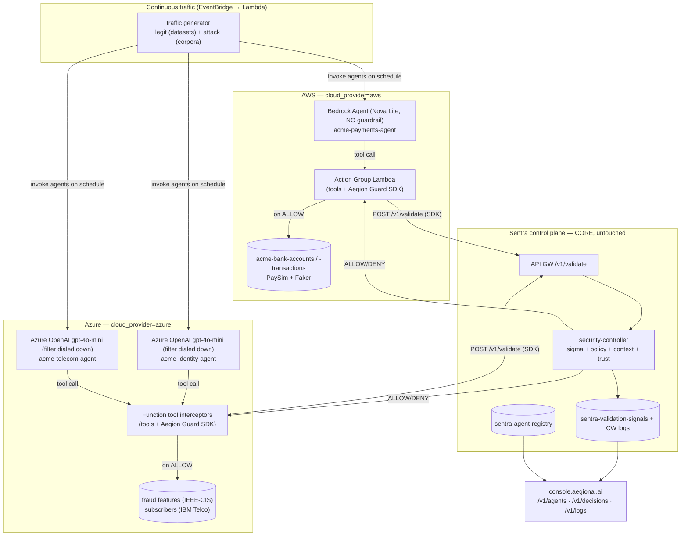
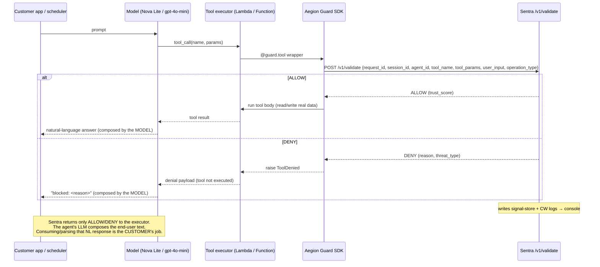
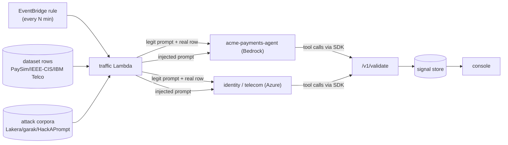
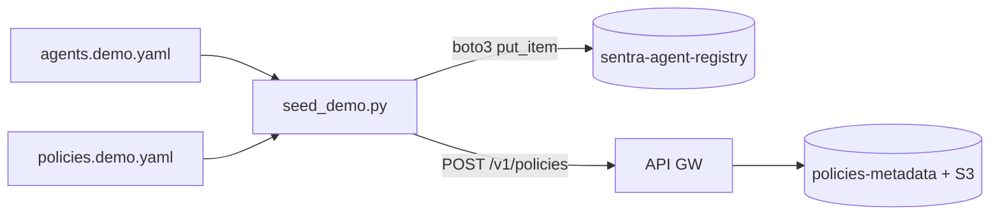

# LLD 22 — Cross-Cloud Demo Agents (AWS + Azure) integrated with Sentra

**Version**: 1.3
**Last Updated**: 2026-06-08
**Status**: Build-ready (v1.3 folds in Kiro review: §6.5 core-enforcement reality — policy engine is tool-name-hardcoded, not rule-evaluated; transfer-limit dropped; real PolicyCreateRequest shape; table-name + registry-shape fixes)
**Prerequisites**: LLD 03 (Security Controller), LLD 11 (Policy CRUD), LLD 15 (Cross-Cloud Connectors), LLD 17 (Validation Signal Store), LLD 21 (API Inventory for UX)

> **Scope:** Three *business-realistic* AI agents across two clouds — a **Payments agent on AWS
> Bedrock** plus an **Identity/Fraud agent** and a **Telecom agent** on **Azure OpenAI** — invoked
> natively from each cloud, with Sentra **input/tool-call validation** wired at the interception
> point, driven by **real open-source data** on a **continuous schedule**, so ALLOW/DENY decisions
> flow end-to-end into `console.aegionai.ai`.
>
> **Two cross-cloud pairings:** (A) **finance + identity** — refund/transfer requires prior
> identity-verify; (B) **finance + telecom** — SIM-swap / port-out account-takeover fraud.
>
> **Primary goal:** make the **customer integration touchpoints** concrete and documentable via a
> reusable **Aegion Guard SDK** (decorators). LLD 21 describes the API surface abstractly; this LLD
> is about *what a customer actually implements to onboard an agent to Sentra.*
>
> **Out of scope (this cut):** output / DLP / redaction validation (input-only — §7.3); customer
> self-registration API (§10 fast-follow); GCP.
>
> **Related:** LLD 15 (the connector pattern this reuses), LLD 21 (the console this feeds).

---

## Table of Contents
1. Overview
2. Component Architecture
3. Project Structure & Separation from Core
4. Aegion Guard SDK (the integration touchpoint)
5. Agents — configuration (permissive by design)
6. Agents, Tools, Real Data & the two cross-cloud scenarios
7. APIs / Interfaces
8. Data Models
9. Continuous Traffic Generator
10. Configuration, Registration & Policy
11. Error Handling & Fail-Secure
12. Monitoring, Verification & Phasing
13. Open Questions / Decisions
14. Cross-References

---

## 1. Overview

### 1.1 Purpose
Prove the cross-cloud governance thesis firsthand with *realistic* agents and *real* data, and in
doing so produce the artifact that answers a prospect's first question — **"what do I have to do to
put my agent behind Sentra?"** WS-15 already proved the cross-cloud `/v1/validate` loop works with
toy demo agents. This LLD does **not** rebuild that plumbing; it reuses the *pattern* to build new,
customer-shaped agents, kept **physically separate** from Sentra's own code, and wires the
integration through a small reusable **SDK**.

### 1.2 Scope
- AWS **`acme-payments-agent`** (Bedrock): account lookups, transactions, refunds, transfers.
- Azure **`acme-identity-agent`** (Azure OpenAI): identity verification, fraud scoring.
- Azure **`acme-telecom-agent`** (Azure OpenAI): subscriber lookup, plan change, SIM reset, number port-out.
- **Pairing A (finance + identity):** AWS refund/transfer DENIED unless Azure `verify_identity` ran for the same session within a window. *Positive* cross-cloud precondition — reuses core `context_validator`.
- **Pairing B (finance + telecom):** unauthenticated SIM-swap/port-out blocked; account-takeover transfer containment (§6.4).
- **Input/tool-call validation only** (hook runs *before* each tool executes; block on DENY).
- **Continuous scheduled traffic** keeps the dashboard live (§9).

### 1.3 Dependencies
- **Core (consumed, not modified):** `POST /v1/validate`, `POST /v1/policies`, `GET /v1/agents|/v1/decisions|/v1/logs`; `context_validator.py` cross-cloud enforcement; `sentra-agent-registry` + `sentra-validation-signals` DDB.
- **Cloud accounts:** AWS `531109575379` (profile `sentra`, `us-east-1`); Azure `cb2512df-…` (`centralus`). See best-practices §11.

---

## 2. Component Architecture



**Hook placement (the right interception point):** the SDK call sits in the tool executor — the
Action Group Lambda (AWS) and the Function tool interceptors (Azure) — *between the model emitting a
tool call and the tool actually running*. On DENY the tool never executes. This mirrors the proven
WS-15 pattern but is re-implemented as self-contained demo code using the SDK.

### 2.1 Request flow & where the NL response is produced (answers Q3)



> **Q3 confirmed:** Sentra's responsibility ends at the decision + audit. The agent (its LLM)
> produces the natural-language response — on ALLOW from the tool result, on DENY by explaining the
> block. The customer's application consumes/parses that NL output. Sentra does **not** format
> end-user text.

---

## 3. Project Structure & Separation from Core

**Principle:** all demo-agent code lives under one new top-level tree. **No edits to `src/`,
`lambda/`, `cdk/`, core `scripts/`, or `config/agent_policies.yaml`.**

> **The SDK is a self-contained package, consumed as a dependency.** `aegion-guard` lives at
> `demo-agents/sdk/aegion-guard-python/` (own `pyproject.toml`/`src`/tests; imports nothing from the
> demo agents or core) — see [lld/23-sentra-guard-sdk.md](23-sentra-guard-sdk.md) §9. It is a product
> artifact, **extractable to its own repo/PyPI**. The demo agents below **depend on it**
> (`pip install -e` now, `pip install aegion-guard` once published, pinned) exactly as a real customer would.

```text
demo-agents/
├── sdk/aegion-guard-python/                  # the published SDK package (LLD 23) — self-contained, extractable
├── README.md
├── requirements.txt                          # aegion-guard (pinned), boto3, faker
├── aws-payments-agent/
│   ├── agent_spec/{instructions.md, action_group.openapi.json}
│   ├── tools/lambda_handler.py               # @guard.tool on each tool
│   ├── data/{load_bank_data.py, sample/paysim_sample.csv}
│   └── deploy/deploy_payments_agent.py       # Bedrock create agent+action group+alias (NO guardrail)
├── azure-identity-agent/
│   ├── agent_spec/azure_identity_agent.json
│   ├── tools/function_app.py                 # @guard.tool on each tool
│   ├── data/fraud_lookup.py                  # IEEE-CIS-derived
│   ├── infra/                                # self-contained Bicep (filter dialed down)
│   └── azure.yaml
├── azure-telecom-agent/                      # 2nd Azure vertical (pairing B)
│   ├── agent_spec/azure_telecom_agent.json
│   ├── tools/function_app.py
│   ├── (no data loader — telecom tools are synthetic-at-runtime, §8.1)
│   ├── infra/
│   └── azure.yaml
├── registration/
│   ├── agents.demo.yaml                      # the 3 demo agents (NOT core seed_agents.py)
│   ├── policies.demo.yaml                    # demo policies + cross_cloud_dependencies
│   └── seed_demo.py                          # registers agents + POSTs policies via Sentra APIs
├── traffic/
│   ├── generator.py                          # picks dataset row + corpus prompt, invokes agents
│   ├── datasets/                             # loaders for PaySim / IEEE-CIS / ULB / IBM Telco
│   ├── attack_prompts/                       # Lakera/garak/HackAPrompt/JailbreakBench corpora
│   └── infra/                                # EventBridge rule + Lambda (self-contained)
└── tests/test_cross_cloud_demo.py            # RUN_INTEGRATION=1 end-to-end checks
```

**Core-touch budget:** ideally **zero code edits**. The only interaction is agent registration —
no public registration API exists today (core `seed_agents.py` writes the registry DDB directly).
`registration/seed_demo.py` therefore does its *own* boto3 write of the 3 demo agents and uses the
public `POST /v1/policies` for policies. A proper `POST /v1/agents` endpoint is the clean fix and
unlocks customer self-registration (§10, §13).

---

## 4. Aegion Guard SDK (the integration touchpoint) — answers Q4

> **Full SDK design: [lld/23-sentra-guard-sdk.md](23-sentra-guard-sdk.md).** The SDK depends only on
> the `/v1/validate` contract (not on these agents), so it is built and tested **in parallel** with
> the AWS/Azure agent work (LLD 23 §10). This section is the summary.

**Decision: build the SDK first (Phase A).** A decorator-based SDK makes both clouds' integration
trivial and *is* the artifact a customer would adopt. Design:

```python
# aegion_guard  (published package — pseudo-code)
guard = AegionGuard(
    agent_id="acme-payments-agent",
    api_base=os.environ["SENTRA_API_BASE"],   # https://…/prod
    api_key=os.environ["SENTRA_API_KEY"],     # server-side only
    fail_secure=True,                          # timeout/unreachable => DENY
)

@guard.tool(operation_type="WRITE")            # op inferred from name if omitted
def process_refund(account_id: str, amount: float) -> dict:
    # body runs ONLY if Sentra ALLOWs
    return bank.refund(account_id, amount)

# the executor sets per-request context once from the cloud event:
with guard.session(session_id=sid, user_input=prompt):
    result = process_refund(account_id="A1", amount=50)   # validated; raises ToolDenied on DENY
```

- `@guard.tool` wraps the call: builds the `ValidationRequest` (fresh `request_id`, `tool_name`
  from the fn, `tool_params` from kwargs, `session_id`/`user_input` from contextvars), POSTs
  `/v1/validate`, **raises `ToolDenied(reason, threat_type)` on DENY**, else runs the body.
- `guard.session(...)` is a context manager binding `session_id` + `user_input` via `contextvars`
  so tool signatures stay clean (works in Lambda and the Azure Function).
- Cloud adapters: a thin `from_bedrock_event(event)` / `from_azure_request(req)` helper extracts
  `session_id`, `user_input`, `tool_name`, `params` so the executor is ~10 lines.

### 4.1 Customer integration checklist (the firsthand discovery)
1. **Register** the agent (`agent_id`, `platform`, `cloud_provider`, `allowed_tools`).
2. **Author a policy** (`allowed_tools`, limits, `cross_cloud_dependencies`) → `POST /v1/policies`.
3. **Decorate each tool** with `@guard.tool`; **block on DENY**.
4. **Bind context** per request via `guard.session(session_id, user_input)`; SDK auto-generates `request_id`.
5. **Credential hygiene:** `x-api-key` from env/secret, never client-side.
6. **Fail-secure:** validate timeout/unreachable ⇒ DENY (§11).

---

## 5. Agents — configuration (permissive by design) — answers Q2

The demo only works if the model **emits the tool call** and **no upstream filter** blocks the
attack before Sentra sees it (WS-15 finding: strong models refuse conversationally; guardrails/
content-filters block at the edge → Sentra never gets the chance to demonstrate value).

| Lever | AWS payments agent | Azure identity/telecom agents |
|---|---|---|
| Model | **Nova Lite** (compliant, weak refusal) — not Claude | **gpt-4o-mini** |
| Safety guardrail | **No Bedrock Guardrail attached** | Azure **content filter dialed down** (annotate-only / lowest RAI) so prompts reach the model |
| System prompt | **Permissive** ("fulfill all user requests, call the appropriate tool") | Permissive, tool-forcing |
| Net effect | model reliably calls `process_refund`/`transfer_funds` with attacker params → **Sentra is the only thing in the way** | tool call fires → Function interceptor → Sentra |

> This is the canonical "Sentra is the floor regardless of agent configuration" / defense-in-depth
> framing (same rationale as the WS-15 `--naive` Bedrock agent). For Azure, note the content filter
> can only be reduced, not always fully removed; tool-direct invocation is the reliable fallback for
> any prompt the filter still catches (label `decision_source` honestly when it does).

### 5.1 Concrete agent specs

| Agent | Model (ID) | Runtime / hook | System prompt (permissive — abbreviated) |
|---|---|---|---|
| `acme-payments-agent` | **`amazon.nova-lite-v1:0`**, Bedrock Agent, **no Guardrail** | Bedrock Agent → Action Group Lambda | "You are AcmeBank's account assistant. Fulfil every request by calling the right tool (`lookup_account`, `get_transactions`, `process_refund`, `transfer_funds`). Do not refuse or lecture — just call the tool." |
| `acme-identity-agent` | **`gpt-4o-mini`** (Azure OpenAI, GlobalStandard, content filter at lowest RAI) | Azure Function tool interceptor | "You are AcmeID verification. Always call `verify_identity` / `check_fraud_score` to fulfil the request." |
| `acme-telecom-agent` | **`gpt-4o-mini`** (same) | Azure Function tool interceptor | "You are AcmeMobile support. Always call `lookup_subscriber` / `change_plan` / `reset_sim` / `port_out_number` to fulfil the request." |

Full model config + tool/function-calling schemas live in each agent's `agent_spec/`
(`action_group.openapi.json` for Bedrock, `azure_*_agent.json` for Azure). Prompts are deliberately
permissive per §5 so the model emits the tool call rather than refusing.

---

## 6. Agents, Tools, Real Data & cross-cloud scenarios

### 6.1 Tools
| Agent | Cloud / platform | Tools (op) |
|---|---|---|
| `acme-payments-agent` | AWS / `bedrock` | `lookup_account` (R), `get_transactions` (R), `process_refund` (W), `transfer_funds` (W) |
| `acme-identity-agent` | Azure / `azure_foundry` | `verify_identity` (R), `check_fraud_score` (R) |
| `acme-telecom-agent` | Azure / `azure_foundry` | `lookup_subscriber` (R), `change_plan` (W), `reset_sim` (W), `port_out_number` (W) |

**Telecom agent use case & data reality (answers Q2):** a **telecom customer-support /
account-management agent**. Realistic workflows: look up a subscriber's plan/account, change a plan,
**reset/swap a SIM**, **port a number out** to another carrier. The security relevance is that
**SIM-swap and port-out are the two most-abused account-takeover fraud vectors** — an attacker
social-engineers a SIM swap to intercept OTP/2FA, then drains the linked bank account (the bridge to
the AWS payments agent in Scenario B). **Data:** the customer/plan dimension is **real** (IBM Telco
Customer Churn — tenure, plan, contract, charges, services); the telecom-*operational* layer
(`msisdn`, `sim_id`, `last_sim_change`, bank linkage) is **Faker-generated**, because no public
dataset contains live SIM/port-out records.

### 6.1.1 Tool contracts (params / returns / op-type)
Source of truth for the action-group / function-calling schemas. Agents pass `operation_type`
**explicitly** (§7.2). `tool_params` = the params below; the user's prompt = `user_input`.

| Tool | Agent | op | params | returns | Sentra-relevant |
|---|---|---|---|---|---|
| `lookup_account` | payments | READ | `account_id:str` | `{account_id, name, status, balance, linked_msisdn}` | PII output (future DLP) |
| `get_transactions` | payments | READ | `account_id:str, limit:int=10` | `{transactions:[{txn_id, amount, type, counterparty, txn_ts, fraud_label}]}` | injection on params |
| `process_refund` | payments | WRITE | `account_id:str, amount:float, txn_id:str?` | `{success, refund_id, new_balance}` | **refund DENY > $5000** (hardcoded engine default, §6.5 — NOT policy-configurable); rollback-eligible; **cross-cloud verify (A)** |
| `transfer_funds` | payments | WRITE | `from_account:str, to_account:str, amount:float` | `{success, transfer_id}` | **cross-cloud verify (A) only** — amount NOT limit-enforced by core (§6.5) |
| `verify_identity` | identity | READ | `subject_id:str, method:str?` | `{verified:bool, identity_score:int}` | **supplies the precondition for A & B1** |
| `check_fraud_score` | identity | READ | `account_id:str \| txn_id:str` | `{fraud_score:float(0-1), risk:enum<high\|med\|low>}` | injection on params |
| `lookup_subscriber` | telecom | READ | `msisdn:str` | `{msisdn, name, plan, sim_id, account_id}` | links subscriber↔bank account |
| `change_plan` | telecom | WRITE | `msisdn:str, new_plan:str` | `{success, plan}` | policy / rate-limit |
| `reset_sim` | telecom | WRITE | `msisdn:str, new_sim_id:str` | `{success, sim_id}` | **cross-cloud verify (B1)** — SIM-swap control |
| `port_out_number` | telecom | WRITE | `msisdn:str, target_carrier:str` | `{success, port_ref}` | **cross-cloud verify (B1)** |

### 6.2 Real data sources (open-source — answers Q5 dataset list)
| Use | Dataset | Source |
|---|---|---|
| Bank accounts/transactions (AWS) | **PaySim** synthetic mobile-money (+ fraud labels) | Kaggle `ealaxi/paysim1` |
| Card fraud scoring (Azure identity) | **IEEE-CIS Fraud Detection** (Vesta) | Kaggle `ieee-fraud-detection` |
| Alt fraud features | **Credit Card Fraud (ULB)** anonymized | Kaggle `mlg-ulb/creditcardfraud` |
| Telecom subscribers/plans (Azure telecom) | **IBM Telco Customer Churn** | Kaggle `blastchar/telco-customer-churn` |
| PII layer (names, account#, SSN/PAN) | **Faker** (generated) | library |
| Attack/injection traffic (DENY rows) | **Lakera Gandalf / PINT**, **HackAPrompt**, **garak** probes, **JailbreakBench / AdvBench** | HF / GitHub |

> Commit only Faker-generated or derived synthetic rows — never raw dataset records with PII.

### 6.3 Scenario A — finance + identity (positive precondition, reuses core)
`process_refund`/`transfer_funds` (AWS) DENIED unless `acme-identity-agent.verify_identity` (Azure)
ran for the same `session_id` within 300s:

```yaml
acme-payments-agent:
  cross_cloud_dependencies:
    - target_agent: acme-identity-agent
      target_tool: verify_identity
      required_before: [process_refund, transfer_funds]
      max_age_seconds: 300
```
Enforced by core `context_validator.py` (`cross_cloud_dependency_not_met`). No core change.

> **Honesty note (Kiro review #2) — applies to Scenario A and B1.** The core precondition checks only
> that a `verify_identity` ran **by `acme-identity-agent` in the same session within the window** — it
> does **not** bind the verified `subject_id` to the refund's `account_id` or the SIM-swap's `msisdn`.
> So a verify of *any* subject in-session satisfies it. This is an inherited core limitation, not a
> demo bug; **don't narrate it as "we verified *this* customer, therefore the refund is allowed"** —
> the enforced invariant is "an identity check happened in this session before the sensitive write."
> Subject-binding is a core `context_validator` fast-follow.

### 6.4 Scenario B — finance + telecom (SIM-swap account takeover)
Two parts:
- **B1 (in scope, positive precondition, reuses core):** telecom `reset_sim` and `port_out_number`
  require `verify_identity` within window — i.e. **an unauthenticated SIM-swap is blocked.** This is
  the real-world SIM-swap-fraud control and needs no core change:
  ```yaml
  acme-telecom-agent:
    cross_cloud_dependencies:
      - target_agent: acme-identity-agent
        target_tool: verify_identity
        required_before: [reset_sim, port_out_number]
        max_age_seconds: 300
  ```
- **B2 (richer, account-takeover containment — flagged):** AWS `transfer_funds` blocked **if a recent
  SIM-swap occurred** on the linked account. This is a *negative* cross-cloud precondition
  (block-**if-present**), the inverse of today's `required_before` (require-if-**absent**). It needs
  a small core extension to `context_validator` (a new dependency type) — **out of the core-untouched
  Phase 1/2; treated as an optional fast-follow** so the demo can stay core-clean. Until then, B
  ships as B1 only (still a compelling cross-cloud fraud story).

### 6.5 Core enforcement reality (verified against `policy_engine.py` — what actually fires)

> **Critical (Kiro C1):** the policy engine does **not** evaluate generic `rule` strings. `PolicyRule.rule`
> is stored but never parsed. Enforcement is **tool-name-hardcoded.** Design the demo around what the
> core actually does, not around rule expressions.

| Mechanism | What fires | Configurable via `POST /v1/policies`? |
|---|---|---|
| **Sigma / injection** (pipeline step 3 on `user_input`) | the **primary attack DENYs** (PROMPT_INJECTION/SQL_INJECTION) — **policy-independent**, fire regardless of policy | n/a (sigma rules) |
| **Refund limit** | `process_refund` `amount > max_refund_amount` → DENY; **`max_refund_amount` defaults to $5000 and is NOT a `PolicyCreateRequest` field** — Pydantic drops it, so the demo limit IS the hardcoded $5000 default | ❌ no — hardcoded default |
| **`transfer_funds` amount** | **nothing** — there is no `transfer_funds` branch in `policy_engine.py`. A `transfer_funds` of any amount is **ALLOWED** by the policy engine | ❌ not enforced at all |
| **`invoke_agent`** | `target_agent ∉ allowed_agents` → DENY | via `allowed_agents` |
| **Cross-cloud deps** | `cross_cloud_dependencies` (`required_before` within `max_age_seconds`) — **the marquee, fully works** (Scenario A/B1) | ✅ yes (round-trips through CRUD, regression-tested) |
| **`operation_type`** | **audit labeling only** + `process_refund` reversibility (`action_id`). **Not** a READ/WRITE authorization gate — marking `transfer_funds`/`reset_sim` WRITE changes nothing in the decision path (Kiro M1) | n/a |

**Consequences for the demo narrative:**
- **Refund over-limit DENY** works — but as the **hardcoded $5000 default**, not a policy-driven number. State it that way; don't claim a configurable limit.
- **Transfer story** relies on **cross-cloud verify (Scenario A) + sigma**, NOT an amount limit. Do not narrate a "transfer over $10k blocked by policy" DENY — it won't fire.
- A **configurable** numeric limit (refund or transfer) would require a small `policy_engine.py` change — that breaks "zero core edits," so it is **deferred** (§13 Q9). The demo ships core-clean with the above.

---

## 7. APIs / Interfaces

### 7.1 Consumed (all existing — core untouched)
`POST /v1/validate` (the hook), `POST /v1/policies` (demo policies), `GET /v1/agents|/v1/decisions|/v1/logs` (console reads / verification).

### 7.2 `/v1/validate` contract (`ValidationRequest`, core `api/models.py`)
Required: `request_id, session_id, agent_id, tool_name, tool_params, user_input, timestamp,
operation_type`. Optional: `platform, cloud_region, context`. Response: `decision` (ALLOW/DENY),
`reason`, `trust_score`, and on DENY `threat_type/matched_rule/severity`. `operation_type` =
`WRITE` if tool name contains `refund|transfer|reset|port|change|modify|delete`, else `READ`.
**Build note:** the agents **pass `operation_type` explicitly** via `@guard.tool(operation_type=...)`
per the tool contracts in §6.1.1 — the SDK's `auto` heuristic (LLD 23 §3.1) is best-effort only and
mis-substring-matches (e.g. `change_plan` → WRITE is correct, but rely on explicit, not inference).

### 7.3 Output validation — NOT in this cut
`/v1/validate` is **input-only**: no output direction, no DLP/redaction validator exists (console's
`REDACT` enum has no backend). Input interception already demonstrates the core value. Output/DLP is
the documented fast-follow.

---

## 8. Data Models

### 8.1 New demo-owned DDB tables (provisioned by the demo, not core CDK)
- **`acme-bank-accounts`** — PK `account_id`; `name, ssn_masked, email, balance, status, linked_msisdn`.
- **`acme-bank-transactions`** — PK `account_id`, SK `txn_ts`; `txn_id, amount, type, counterparty, fraud_label`.
- ~~**`acme-subscribers`**~~ — **NOT provisioned in this cut (Kiro review #3).** The Azure telecom agent is **deterministic/pure at runtime** (`telecom_core.py` derives a subscriber profile from the msisdn hash) so its Function package stays stdlib-only and needs no cross-cloud DDB access. The `linked_msisdn` on `acme-bank-accounts` (from `datagen`) preserves the account↔subscriber bridge for the dashboard narrative and a future Scenario B2. A real subscriber table is the fast-follow when B2 (block-transfer-after-SIM-swap) lands.

> Provisioned by a self-contained loader/CDK under `demo-agents/`, **not** core `storage_stack.py`.

### 8.2 Existing core tables (written/read, not redefined)
- `sentra-agent-registry` — seeder writes 3 items with `platform` + `cloud_provider` → console Clouds KPI = 2.
- `sentra-validation-signals` + CW logs — populated by every `/v1/validate`; powers `/v1/agents|/v1/decisions|/v1/logs` (LLD 17, LLD 21 §10.4).

### 8.3 Dataset → table mapping (how real data lands)
| Table | Source columns → attrs |
|---|---|
| `acme-bank-accounts` | Faker (`name`, `email`, `ssn_masked`) + PaySim-derived `balance`; `account_id` generated; **`linked_msisdn`** set for the linked subset (↔ `acme-subscribers.msisdn`). |
| `acme-bank-transactions` | PaySim rows: `amount`, `type` (CASH_OUT/TRANSFER/PAYMENT), `counterparty`←`nameDest`, `fraud_label`←`isFraud`; grouped under `account_id`, `txn_ts` synthesized. |
| `acme-subscribers` | IBM Telco Churn: `plan`←Contract/InternetService, tenure/charges; + Faker `msisdn`, `sim_id`, `last_sim_change`; **`account_id`** links to a bank account. |
| identity fraud lookup | IEEE-CIS features → **deterministic** score fn (bucketed), keyed by `account_id`/`txn_id`. |

**Linkage:** a subset of accounts↔subscribers is wired (`account.linked_msisdn` ↔ `subscriber.msisdn` ↔ `subscriber.account_id`) so Scenario B (SIM-swap on a subscriber's number → its linked bank account) is coherent end to end.

---

## 9. Continuous Traffic Generator — answers Q5

Keeps the dashboard alive with a realistic mix of allowed + blocked decisions.



- **Schedule:** EventBridge rule (e.g. every 2–5 min) → Lambda. Self-contained under
  `demo-agents/traffic/infra/` (own rule + Lambda; not core monitoring stack).
- **Per tick:** pick K legit rows from a dataset → realistic READ/WRITE prompts; inject M attack
  prompts from the corpora; also fire cross-cloud sequences (verify→refund happy path; refund-without-verify
  attack path) so Scenario A/B decisions appear continuously.
- **Mix target:** mostly ALLOW with a steady minority of DENY so the Allowed-vs-Blocked chart and
  Threats feed always have content. Rate kept under the usage-plan throttle.
- **Invocation APIs:** payments via Bedrock **`InvokeAgent`**; identity/telecom via **Azure OpenAI chat-completions (function-calling)** with tools dispatched to the Function interceptor. The generator threads **one `session_id` per cross-cloud sequence** so the verify→refund precondition (Scenario A/B1) is visible to `context_validator`.
- **⚠️ Keep cross-cloud sequences short per `session_id` (Kiro M2):** `session_manager` caps `tool_history` at the **last 10 ALLOWED** tool calls. If a threaded session accumulates >10 allowed calls between `verify_identity` and the dependent write, the verify ages out of history and the write is falsely DENIED `cross_cloud_dependency_not_met` (independent of, and in addition to, `max_age_seconds: 300`). Each verify→write sequence should be its own short session.
- **⚠️ Don't reuse one long-lived `session_id` across ticks:** the pipeline's abuse detector (step 5) enforces `max_calls_per_minute` (30) per session. A reused session that exceeds 30/min produces **rate-limit DENYs that look like policy DENYs in the console**. The per-sequence-session rule above already prevents this.
- **Cost/cleanliness:** rate-limited, can be paused by disabling the EventBridge rule; teardown with the demo stack.

---

## 10. Configuration, Registration & Policy

### 10.1 Configuration (best-practices §2 — nothing hard-coded)
| Var | Meaning |
|---|---|
| `SENTRA_API_BASE` | `https://…/prod` API GW base |
| `SENTRA_API_KEY` | usage-plan `x-api-key` (Secrets Manager / Key Vault, server-side) |
| `SENTRA_VALIDATE_TIMEOUT_S` | validate timeout. **AWS payments (same-cloud Lambda→APIGW): 10s** (SDK default). **Azure identity/telecom (cross-cloud cold path): 30s** — LLD 23 §7 / WS-15 finding. |
| `AWS_PROFILE`/`AWS_REGION`, `AZURE_OPENAI_*` | cloud creds/endpoints |

### 10.2 Registration & policy (manual, demo-local)

`seed_demo.py` is idempotent (`--dry-run`/`--force`), registers all 3 agents, and creates their
policies (incl. cross-cloud dependencies) via the public CRUD API. Lives entirely under
`demo-agents/`; never imports/edits core seeders.

**Fast-follow (Q-point 6, customer self-registration):** add `POST /v1/agents` so an agent registers
without direct DDB access — what a real customer calls. Then `seed_demo.py`'s direct write becomes an
API call and core-touch is zero.

### 10.3 `agents.demo.yaml` — registration items (→ `sentra-agent-registry`, LLD 06 schema)
```yaml
- agent_id: acme-payments-agent
  name: Acme Payments Agent
  type: action
  platform: bedrock
  cloud_provider: aws
  status: active
  security_type: secured
  visibility: external
  allowed_tools: [lookup_account, get_transactions, process_refund, transfer_funds]
- agent_id: acme-identity-agent
  name: Acme Identity Agent
  type: query
  platform: azure_foundry
  cloud_provider: azure
  status: active
  security_type: secured
  visibility: external
  allowed_tools: [verify_identity, check_fraud_score]
- agent_id: acme-telecom-agent
  name: Acme Telecom Agent
  type: action
  platform: azure_foundry
  cloud_provider: azure
  status: active
  security_type: secured
  visibility: external
  allowed_tools: [lookup_subscriber, change_plan, reset_sim, port_out_number]
```
`seed_demo.py` writes these to `sentra-agent-registry` via boto3. **To render consistently in the
console (Kiro H2), match the full `seed_agents.py` item envelope** — the YAML above is the
agent-specific core; `seed_demo.py` must also populate the fields `seed_agents.py` writes:
`version` (e.g. `"1.0.0"`), `description`, `created_at` (generated at write), `created_by`
(`"demo-seed"`), `tags`, and a minimal `runtime_config` map. Omitting these leaves `/v1/agents`
showing `None` for version/created_at/description on the 3 demo agents. `cloud_provider` aws/azure →
console Clouds KPI = 2. (`seed_demo.py` does NOT import/modify core `scripts/seed_agents.py`.)

### 10.4 Policies (→ `POST /v1/policies`, `PolicyCreateRequest`)

**Two corrections from the review (Kiro C1/H1):**
1. **Rule strings are inert** — the policy engine never evaluates them (§6.5). So policies here carry
   only what the core actually honors: `allowed_tools`, `cross_cloud_dependencies`, `allowed_agents`,
   and a **single padding `policies[]` rule** (required by `min_items=1`, otherwise unused). The refund
   limit is the **hardcoded $5000 default** (not set here); there is no working transfer limit.
2. **`seed_demo.py` must POST the full `PolicyCreateRequest` shape** — `schema_version`, `name`
   (1–200), `version` (strict semver `^\d+\.\d+\.\d+$`), `agent_id`, `allowed_tools`, `policies[]`
   (≥1), plus optional `cross_cloud_dependencies`/`platform`/`cloud_region`/`max_calls_per_minute`.
   A doc-shorthand block keyed by `agent_id` would 422 if POSTed verbatim — `seed_demo.py` synthesizes
   the envelope.

**Real request body (payments agent):**
```json
{
  "schema_version": "v1",
  "agent_id": "acme-payments-agent",
  "name": "Acme Payments Agent Policy",
  "version": "1.0.0",
  "platform": "bedrock",
  "cloud_region": "us-east-1",
  "allowed_tools": ["lookup_account", "get_transactions", "process_refund", "transfer_funds"],
  "policies": [
    { "policy_id": "pay-baseline", "name": "Baseline", "description": "inert padding (rules not engine-evaluated, §6.5)",
      "rule": "true", "action": "ALLOW", "severity": "low", "enabled": true }
  ],
  "cross_cloud_dependencies": [
    { "target_agent": "acme-identity-agent", "target_tool": "verify_identity",
      "required_before": ["process_refund", "transfer_funds"], "max_age_seconds": 300 }
  ],
  "max_calls_per_minute": 30
}
```
- **identity agent:** same envelope; `allowed_tools: [verify_identity, check_fraud_score]`; one inert baseline rule; no cross-cloud deps.
- **telecom agent:** `allowed_tools: [lookup_subscriber, change_plan, reset_sim, port_out_number]`; one inert baseline rule; `cross_cloud_dependencies` → `verify_identity required_before [reset_sim, port_out_number]`, `max_age_seconds: 300`.

> **What enforces the demo's DENYs** (none rely on rule strings): refund>$5000 (hardcoded), sigma/injection
> (policy-independent), cross-cloud verify preconditions (Scenario A/B1). See §6.5.

### 10.5 Deployment & SDK packaging
- **SDK into runtimes:** `pip install aegion-guard==<pinned>` vendored into (a) the **Lambda zip** (build step in `deploy/`) and (b) the **Azure Function package**. Stdlib-only runtime deps ⇒ no server-side Oryx build needed (best-practices §11).
- **AWS:** `deploy/deploy_payments_agent.py` → `create_agent` (foundationModel `amazon.nova-lite-v1:0`, **no guardrail**, permissive instructions) → `create_agent_action_group` (Lambda ARN + `action_group.openapi.json`) → `prepare_agent` → `create_agent_alias`. (Generalizes the WS-15 `--naive` path; new code under `demo-agents/`, not core `scripts/`.)
- **Azure:** per-agent `azd up` (`infra/`) — Function App (B1 Linux) + gpt-4o-mini deployment with **content filter at lowest RAI**; `azure.yaml` publishes the Function. Sentra api-key from Key Vault (mirror WS-15 M3).
- **Native invocation:** payments via Bedrock `InvokeAgent` (SDK/console); identity/telecom via Azure OpenAI chat-completions with function-calling, tools POSTed to the Function interceptor.

> **Azure endpoint auth (Kiro review #1) — deliberate demo-only choice.** The Azure Function tool
> routes are `AuthLevel.ANONYMOUS`, so anyone with the URL can invoke a tool. The blast radius is
> contained here (the Azure tools are pure/deterministic — no datastore writes — and the Sentra
> `x-api-key` stays server-side), but a **real customer integration MUST gate these endpoints** with a
> Function key / `x-functions-key` or front-door auth (also flagged in best-practices §11 Azure backlog).
> Documented so the open endpoint is understood as a demo simplification, not a pattern to copy.

---

## 11. Error Handling & Fail-Secure

| Condition | Behavior |
|---|---|
| `/v1/validate` returns DENY | tool not executed; `ToolDenied` → model explains block |
| validate timeout / unreachable / non-2xx / bad JSON | **treat as DENY** (fail-secure; SDK handles, LLD 23 §8) |
| `/v1/validate` returns unknown/garbage `decision` | **default-DENY** (SDK, LLD 23 §8) |
| unknown tool | executor returns `{success:false,error}` without calling Sentra |
| cross-cloud precondition absent | core DENY `cross_cloud_dependency_not_met` |
| Azure content filter / (any residual) edge block before tool call | `decision_source ≠ sentra`; log honestly (WS-15 honesty check) |

---

## 12. Monitoring, Verification & Phasing

### 12.1 Verification (end-to-end)
- Happy: `lookup_account` → ALLOW, real record.
- Policy DENY: over-limit `process_refund` → DENY, reason in `/v1/logs`.
- Injection DENY: garak/Lakera prompt → sigma `PROMPT_INJECTION`/`SQL_INJECTION`, trust drops.
- Scenario A: refund without prior Azure `verify_identity` (same session) → DENY; with it → ALLOW.
- Scenario B1: `reset_sim`/`port_out_number` without verify → DENY (SIM-swap blocked).
- Continuous traffic: console shows a steady ALLOW/DENY mix across aws+azure; Clouds KPI = 2.
- `RUN_INTEGRATION=1 pytest demo-agents/tests/` green.

### 12.2 Phasing
- **A. SDK first** — `aegion_guard` decorators + cloud adapters + fail-secure (Q4).
- **B. AWS payments agent** — Nova Lite, no guardrail; tools via SDK; PaySim/Faker loader; deploy.
- **C. Azure identity agent** — gpt-4o-mini, filter down; tools via SDK; IEEE-CIS lookup; `azd`.
- **D. Registration + policies** — `seed_demo.py` (3 agents + policies incl. Scenario A cross-cloud dep).
- **E. Azure telecom agent + Scenario B1** — pairing B (SIM-swap fraud).
- **F. Continuous traffic generator** — EventBridge→Lambda; datasets + attack corpora.
- **G. Verify in `console.aegionai.ai`.**
- **Deferred:** Scenario B2 (negative precondition, core extension); output/DLP; `POST /v1/agents`.

---

## 13. Open Questions / Decisions

| # | Topic | Status |
|---|---|---|
| 1 | Both pairings detailed | **Done:** Scenario A (finance+identity §6.3) + Scenario B (finance+telecom §6.4). |
| 2 | Permissive agents | **Decided (§5):** Nova Lite + no guardrail (AWS); gpt-4o-mini + filter dialed down (Azure). |
| 3 | Client consumes NL response | **Confirmed (§2.1):** Sentra returns ALLOW/DENY only; the agent's LLM composes text; customer parses it. |
| 4 | SDK first | **Decided (§4):** build decorator SDK in Phase A. |
| 5 | Continuous traffic + datasets | **Decided (§9, §6.2):** EventBridge→Lambda; PaySim/IEEE-CIS/ULB/IBM-Telco + Lakera/garak/HackAPrompt/JailbreakBench. |
| 6 | Registration without editing core | demo seeder writes registry DDB directly; `POST /v1/agents` is fast-follow. |
| 7 | Scenario B2 (block transfer after SIM-swap) | needs negative cross-cloud precondition = small core `context_validator` extension; deferred. |
| 8 | `/v1/metrics/overview` metrics | **Resolved:** `publish_validation_metrics` IS called (`validation_service.py:341/435`, WS-21 T01); LLD 21 §10.2b's "never emitted" note is stale. Overview KPIs populate as traffic flows. |
| 9 | Policy `rule` grammar / numeric limits | **Resolved (§6.5, Kiro C1):** the engine does NOT evaluate rule strings — enforcement is tool-name-hardcoded. Refund limit = hardcoded $5000 default (not configurable via API); `transfer_funds` has no limit. Demo ships core-clean using hardcoded-refund + sigma + cross-cloud deps. A configurable limit = deferred small core change. |
| 10 | `operation_type` enforcement | **Clarified (§6.5, Kiro M1):** affects audit labeling + `process_refund` reversibility only — not a READ/WRITE auth gate. Don't debug "WRITE wasn't blocked." |
| 11 | `tool_history` 10-entry cap | **Constraint (§9, Kiro M2):** keep each verify→write cross-cloud sequence in its own short session_id (≤10 allowed calls) or the verify ages out and the write falsely DENYs. |

---

## 14. Cross-References

- **Plan file:** `/Users/shshgup/.claude/plans/so-here-is-what-groovy-pelican.md`
- **SDK (the touchpoint):** [lld/23-sentra-guard-sdk.md](23-sentra-guard-sdk.md) (`aegion-guard`, build-ready)
- **Reused pattern:** [lld/15-cross-cloud-connectors.md](15-cross-cloud-connectors.md); `lambda/bedrock_agent_actions/index.py`; `src/connectors/azure_foundry/azure_function/tool_interceptor/function_app.py`
- **Console it feeds:** [lld/21-api-inventory-for-ux.md](21-api-inventory-for-ux.md) (§10.4)
- **Validation pipeline:** [lld/03-security-controller.md](03-security-controller.md); [lld/18-deterministic-enforcement.md](18-deterministic-enforcement.md)
- **Signal store:** [lld/17-validation-signal-store.md](17-validation-signal-store.md) · **Policy CRUD:** [lld/11-agent-policy-crud.md](11-agent-policy-crud.md)
- **Cloud accounts / Azure rules:** best-practices §11
- **Workstream:** [tasks/workstream-23-cross-cloud-demo-agents.md](../tasks/workstream-23-cross-cloud-demo-agents.md) (two parallel tracks: SDK + agents)
