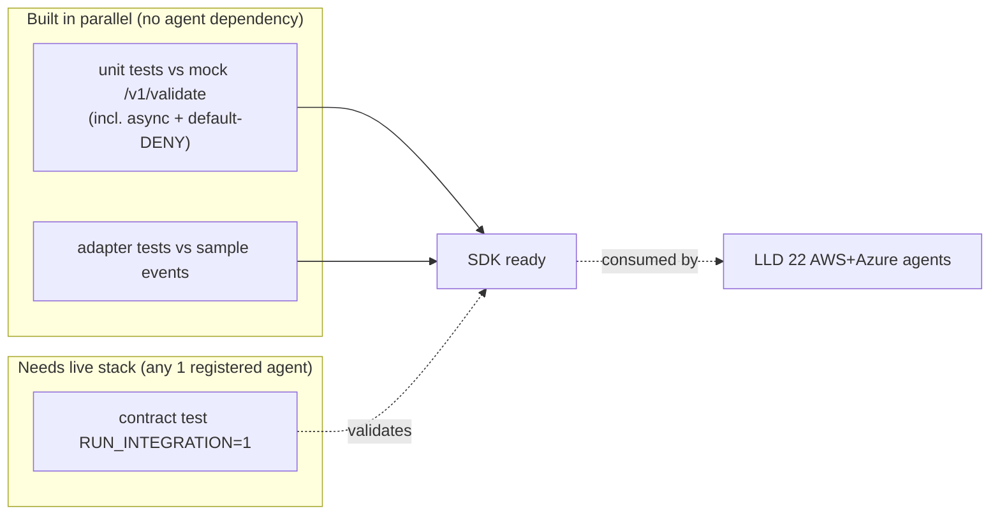

# LLD 23 — Aegion Guard SDK (the customer integration touchpoint)

> Distribution **`aegion-guard`** (import `aegion_guard`, class `AegionGuard`). The file is named
> `23-sentra-guard-sdk.md` for historical reasons; "Sentra" is the internal control-plane codename,
> "AegionAI" is the customer-facing brand the shipped SDK carries (§9).

**Version**: 1.2
**Last Updated**: 2026-06-08
**Status**: Build-ready (v1.2 adds §12.1 implementer caveats from Kiro re-review of v1.1)
**Prerequisites**: LLD 21 (API Inventory — `/v1/validate` contract), LLD 03 (Security Controller)
**Parallelizable**: ✅ This SDK depends **only** on the `/v1/validate` request/response contract,
**not** on the demo agents (LLD 22). It can be built and fully unit-tested in parallel with the
AWS/Azure agent work, against a mock validate endpoint.

> **Scope:** A small, dependency-light Python SDK that a customer drops into their agent's tool
> executor to route every tool call through Sentra **before execution** and block on DENY. It is the
> concrete answer to "what do I implement to put my agent behind Sentra?" — the headline artifact of
> the cross-cloud demo (LLD 22 §4).
>
> **Out of scope:** output/DLP validation (the API is input-only); non-Python runtimes (TS/Go are
> future ports); auto-registration (LLD 22 §10 fast-follow).
>
> **Related:** LLD 22 (consumes this SDK), LLD 21 (the contract), LLD 15 (the connector pattern this generalizes).

> **Correctness note (verified against code):** `/v1/validate` returns **HTTP 200 even on a DENY**
> decision (DENY is in the JSON body, not the status). The SDK's "non-2xx ⇒ fail-secure DENY" rule
> therefore never misreads a real DENY as a transport failure — DENY is parsed from the 200 body.

---

## Table of Contents
1. Overview
2. Design Goals & Constraints
3. Public API (incl. sync/async)
4. Internal Architecture
5. Validation Request/Response Contract
6. Cloud Adapters
7. Configuration
8. Error Handling, Fail-Secure & Availability
9. Packaging, Home & Distribution
10. Testing & Parallel Development
11. Usage Examples (AWS + Azure)
12. Open Questions / Decisions
13. Cross-References

---

## 1. Overview

The SDK turns the Sentra integration from "hand-roll an HTTP call to `/v1/validate` in every tool"
into a **decorator + context manager**:

```python
guard = AegionGuard(agent_id="acme-payments-agent")

@guard.tool(operation_type="WRITE")
def process_refund(account_id: str, amount: float) -> dict:
    return bank.refund(account_id, amount)        # runs ONLY if Sentra ALLOWs

with guard.session(session_id=sid, user_input=prompt):
    process_refund(account_id="A1", amount=50)    # validated; raises ToolDenied on DENY
```

Everything Sentra needs (`request_id`, `tool_name`, `tool_params`, `session_id`, `user_input`,
`operation_type`, `timestamp`) is assembled by the SDK from the decorated function + the active
session context, so tool signatures stay clean and the customer never builds a payload by hand.

---

## 2. Design Goals & Constraints

| Goal | Why / How |
|---|---|
| **Zero/low dependencies** | stdlib **`urllib`** for HTTP (no `requests`). Matches the Azure Functions Oryx-build constraint (best-practices §11 rule 4) so the same code vendors into a Lambda *and* an Azure Function unchanged. |
| **Block before execution** | The decorated body runs only after an ALLOW. DENY raises before any side effect. |
| **Fail-secure by default** | Validate timeout/unreachable/garbage/unknown-decision ⇒ treat as DENY (configurable; see §8 availability tradeoff). |
| **Sync *and* async** | Target runtimes use both (`def` Lambda handlers, `async def` Azure Functions). The decorator detects coroutine functions and awaits them (§3.2). Sync-only would silently return an un-awaited coroutine that never validates — unacceptable. |
| **Clean signatures** | Per-request context (`session_id`, `user_input`) flows via `contextvars`, not extra args (propagates correctly across `await`). |
| **Runtime-agnostic** | Lambda, Azure Functions, plain script; thin cloud adapters extract context per event shape. |
| **Server-side credentials** | `x-api-key` from env/secret; never a function argument or client-visible. TLS verification stays **on** (no `ssl._create_unverified_context`). |
| **Observable** | Optional `on_decision(Decision)` hook for logging/metrics — no PII in logs; hook errors swallowed. |
| **Parallel-buildable** | Depends only on the `/v1/validate` JSON contract; testable against a mock. |

---

## 3. Public API

```python
class AegionGuard:
    def __init__(
        self,
        agent_id: str,                      # MUST be pre-registered (§3.4)
        *,
        api_base: str | None = None,        # default env SENTRA_API_BASE (…/prod)
        api_key: str | None = None,         # default env SENTRA_API_KEY (server-side)
        timeout_s: float = 10.0,            # default env SENTRA_VALIDATE_TIMEOUT_S; raise for cross-cloud (§7)
        fail_secure: bool = True,           # transport/garbage error => DENY
        connect_retries: int = 1,           # bounded retry on CONNECTION errors only, never on DENY (§8)
        platform: str | None = None,        # optional hint (bedrock|azure_foundry|vertex_ai)
        cloud_region: str | None = None,    # optional hint
        on_decision: Callable | None = None # optional hook for logging/metrics
    ): ...

    def tool(self, name: str | None = None, operation_type: str = "auto") -> Callable: ...
    def session(self, session_id: str, user_input: str, *, request_id=None, context=None) -> ContextManager: ...
    def validate(self, *, tool_name, tool_params, session_id, user_input,
                 operation_type="auto", request_id=None, context=None) -> "Decision": ...
    async def avalidate(self, **kwargs) -> "Decision": ...   # async twin (§3.2)

@dataclass
class Decision:
    decision: str            # "ALLOW" | "DENY"  (anything else => treated as DENY, §8)
    reason: str | None
    trust_score: float | None
    threat_type: str | None
    matched_rule: str | None
    severity: str | None
    latency_ms: float | None
    request_id: str
    raw: dict                # full response body (forward-compat passthrough)

class ToolDenied(Exception):       # raised by @guard.tool / validate() on DENY
    reason: str; threat_type: str | None; decision: "Decision"
class UnknownAgentError(ToolDenied):  # controller reports agent not registered (§3.4)
    pass
class SentraUnavailable(Exception):    # only when fail_secure=False and transport fails
    cause: Exception
```

### 3.1 `operation_type="auto"` — best-effort, an **expansion** of the existing heuristics
The existing interceptors classify narrowly: Bedrock (`index.py:104`) is `WRITE` **only** if `refund`
is in the name; Azure (`function_app.py:124`) checks `refund|modify|delete`. The SDK's `auto`
**deliberately widens** this to `refund|transfer|reset|port|change|create|update|modify|delete|write`.

- This is an **improvement, not a mirror** — `transfer`/`delete` *should* be WRITE — but it is a
  **behavior change**: a call the old interceptors saw as READ may now be WRITE, which affects
  rate-limit checks, trust penalties, and reversible-action handling. **Migration note:** when porting
  the existing demo agents onto the SDK, re-confirm each tool's intended `operation_type`.
- **Substring matching is fragile** — `update` matches `get_update_history` (a READ), `create` matches
  `get_create_date`. `auto` is therefore documented as **best-effort only.**
- **Strong guidance:** pass `operation_type` **explicitly** for every WRITE tool. Explicit always
  wins (this is the safe, recommended path; `auto` is a convenience for unambiguous READs).

### 3.2 Sync / async
`@guard.tool` inspects the wrapped function with `inspect.iscoroutinefunction`:
- **Sync fn** → sync wrapper → `self.validate(...)` (blocking `urllib`).
- **Async fn** → async wrapper → `await self.avalidate(...)`, which runs the blocking client via
  `asyncio.to_thread(...)` (keeps the stdlib-only client; no event-loop blocking). `contextvars` set
  by `session()` propagate across `await`, so context resolves correctly in both paths.

### 3.3 Nested `session()`
Re-entrant: `session()` uses `contextvars.Token`; an inner `session()` **shadows** the outer and the
outer is **restored on exit** (inner-wins, no error). Documented so nested orchestration is predictable.

### 3.4 `agent_id` must be pre-registered
`validate` against an unregistered `agent_id` yields blanket DENYs (auto-registration is out of scope —
LLD 22 §10). The SDK documents this precondition, and **if the controller returns a recognizable
"unknown agent" reason, the SDK maps it to `UnknownAgentError`** (a distinct subclass) rather than a
generic `ToolDenied`, so integrators see the real cause immediately. **Best-effort (caveat §12.1):**
the controller does not expose a stable machine code for this today — the mapping is string-matching
on a `reason` that may change, and degrades safely to plain `ToolDenied`. A dedicated
`UNKNOWN_AGENT` `error_code` is filed as a WS-21 follow-up.

---

## 4. Internal Architecture

```mermaid
flowchart TB
  subgraph SDK["aegion_guard"]
    DEC["@guard.tool wrapper<br/>(sync OR async — coroutine-detected)"]
    CTX["context.py (contextvars:<br/>session_id, user_input, request_id)"]
    BLD["build ValidationRequest<br/>(tool_name, params, op, ts)"]
    CLI["client.py (urllib POST + timeout<br/>sync; async via asyncio.to_thread)"]
    PAR["parse -> Decision<br/>(default-DENY on unknown)"]
    DEC --> CTX --> BLD --> CLI --> PAR
  end
  PAR -->|ALLOW| RUN["run wrapped fn body (await if async)"]
  PAR -->|DENY / unknown| RAISE["raise ToolDenied / UnknownAgentError"]
  CLI -.->|transport error (after connect_retries)| FS{"fail_secure?"}
  FS -->|yes| RAISE
  FS -->|no| SU["raise SentraUnavailable"]
  CLI -->|POST 200 (ALLOW or DENY in body)| GW["/v1/validate (core)"]
```

**Modules** (`aegion_guard/`): `guard.py` (`AegionGuard`, `@tool`, `session()`, `validate`/`avalidate`),
`context.py` (contextvars + `current()`; clear error if a tool runs outside `session()`), `client.py`
(stdlib `urllib` POST, `x-api-key`, `timeout_s`, bounded connect-retry, defensive JSON), `config.py`
(env resolution + init-time validation), `exceptions.py`, `adapters.py` (§6).

### 4.1 Decorated-call algorithm
1. Resolve context (`session_id`, `user_input`, `request_id` — fresh uuid per call). Missing ⇒ `RuntimeError("call inside guard.session(...)")`.
2. Build `ValidationRequest`. **Timestamp:** ISO-8601-with-milliseconds-Z is the system convention, so the SDK **reimplements a 3-line formatter** (it does *not* import the controller-internal `_isoformat_ms_z` from `signal_store_writer.py`). This is a *convention*, not a correctness gate — the request `timestamp` is an audit/echo field; the signal-store sort key is computed by the writer from its own clock, not from `request.timestamp` (both existing interceptors send microsecond ISO and validation works). Millisecond formatting is kept only for tidiness/consistency.
3. Serialize `tool_params` to JSON. **Non-serializable params** (datetime/Decimal/bytes/dataclass) ⇒ raise a clear `TypeError`/usage error (a custom default encoder for common types may be offered), **never a silent allow** (§8).
4. `client.post()` (with bounded connect-retry, §8).
5. Parse: clean `ALLOW` → run body; `DENY` → raise; **anything else (unknown/missing decision) → treat as DENY** (§8).
6. Transport failure after retries → `fail_secure` ? `ToolDenied(reason="validation_unavailable")` : `SentraUnavailable`.
7. `on_decision(Decision)` invoked if set; its own exceptions are swallowed + logged, never propagated.

---

## 5. Validation Request/Response Contract

Source of truth: core `src/security-controller/app/api/models.py` (`ValidationRequest`/`ValidationResponse`/`ValidationDenyResponse`), LLD 21 §3. **Verified:** DENY is returned as **HTTP 200** with `decision:"DENY"` in the body.

**Request (SDK builds):**
```json
{ "request_id":"…", "session_id":"…", "agent_id":"acme-payments-agent",
  "tool_name":"process_refund", "tool_params":{"account_id":"A1","amount":50},
  "user_input":"refund my last order", "timestamp":"2026-06-08T10:30:00.123Z",
  "operation_type":"WRITE", "platform":"bedrock", "cloud_region":"us-east-1",
  "context":{"user_id":"u1"} }
```
**Response (SDK maps → `Decision`):** `decision`, `reason`, `trust_score`, and on DENY
`threat_type`/`matched_rule`/`severity`, plus `latency_ms`. Unknown/extra fields preserved in `raw`.

**Contract versioning:** the SDK pins to the `/v1` validate shape. `raw` passthrough gives
forward-compat for additive fields; a future `/v2` would be a new pinned base path. `__contract__`
records the target version but is **informational only** — the controller does **not** advertise a
contract version on the response today, so there is nothing to actively compare against and **no
version-matching is performed.** Drift is handled **defensively at parse time, not by version
checks:** additive `/v1` fields are absorbed by `Decision.raw`, and any body that isn't a clean
`ALLOW`/`DENY` **fails closed** (default-DENY, §8). If the controller later emits a contract version,
an explicit warn-and-continue check can be added against `__contract__` — never a hard-fail (that
would be an availability footgun on a benign additive field).

> The SDK does not import any controller code — keeping it independently buildable and shippable.

---

## 6. Cloud Adapters

Thin functions turning a cloud event into `(session_id, user_input, tool_name, params)`:

```python
def from_bedrock_event(event) -> dict:   # apiPath->tool, requestBody->params, sessionId, inputText->user_input
def from_azure_request(req) -> dict:     # route_param tool_name, JSON body params, session_id + user_input
```
Executor pattern (sync or async):
```python
ctx = from_bedrock_event(event)
with guard.session(ctx["session_id"], ctx["user_input"]):
    return TOOLS[ctx["tool_name"]](**ctx["params"])   # each TOOL is @guard.tool-decorated
```

---

## 7. Configuration

| Env var | Meaning | Required |
|---|---|---|
| `SENTRA_API_BASE` | API GW base incl. stage, e.g. `https://iw3limi4k7.execute-api.us-east-1.amazonaws.com/prod` | yes |
| `SENTRA_API_KEY` | usage-plan `x-api-key` (Secrets Manager / Key Vault) | yes |
| `SENTRA_VALIDATE_TIMEOUT_S` | per-call timeout (default **10**) | no |
| `SENTRA_FAIL_SECURE` | `true` (default) ⇒ DENY on transport error | no |

Constructor args override env. `config.py` raises at init if `api_base`/`api_key` are absent. No
values hard-coded (best-practices §2).

**Timeout guidance (reconciles hot-path latency vs. cross-cloud cold paths):** the controller's own
p95 is ~100–300ms, so a high timeout only helps pathological cases while making outages feel slow —
hence the **10s default** (down from 30s). **But** the cross-cloud Azure→AWS path can take **15s+ on
cold starts** (WS-15 finding; they used 30s for exactly this). So **cross-cloud interceptors should
raise `timeout_s` to ~30s** via env/constructor; same-cloud (Lambda→APIGW) keeps the 10s default.

---

## 8. Error Handling, Fail-Secure & Availability

| Condition | Behavior |
|---|---|
| `decision == "DENY"` (HTTP 200) | `raise ToolDenied(reason, threat_type, decision)` — body not run |
| controller reports unknown/unregistered agent | `raise UnknownAgentError` (distinct subclass, §3.4) |
| `decision` neither `ALLOW` nor `DENY`, or missing | **default-DENY** (contract drift / proxy-injected body must never default-allow) |
| `tool_params` not JSON-serializable | raise clear usage error (or coerce via default encoder) — **never silent allow** |
| timeout / connection error / non-2xx / non-JSON (after `connect_retries`) | `fail_secure` (default) ⇒ `ToolDenied(reason="validation_unavailable")`; else `SentraUnavailable` |
| decorated tool called outside `session()` | `RuntimeError` with guidance |
| missing config at init | `ValueError` listing missing vars |
| `on_decision` hook raises | swallowed + logged; never breaks the tool path |

**Availability tradeoff (honest note for design partners):** fail-secure is the correct *security*
posture, but "transport error ⇒ DENY" means a transient validate-endpoint blip hard-fails legitimate
tool calls (a 0.5% blip = 0.5% of legit calls blocked). For the demo this is fine; for real customers
the SDK exposes two knobs to soften it **without weakening security**: (1) `connect_retries` — a small
bounded retry on **connection-establishment errors only** (ECONNREFUSED / DNS failures), **never on a
read-timeout** (retrying a 10s timeout doubles the wait before fail-secure — §12.1) and **never on a
DENY** (an authoritative decision), and (2) `fail_secure=False` → raise `SentraUnavailable` so the
customer chooses degrade-vs-block. Defaults stay secure (`fail_secure=True`, `connect_retries=1`).

**Latency note:** every decorated call adds one synchronous validate round-trip (~controller p95
100–300ms + network) *before* the tool runs. Integrators should size timeouts and user-facing latency
expectations accordingly; the async path keeps the event loop free during that wait.

---

## 9. Packaging, Home & Distribution

**The SDK is a published customer artifact — it is a product, not demo-internal code.** Customers
install it into *their own* agents to call the AegionAI security controller, so it is packaged and
distributed like any public client library.

- **Home (as built):** a **standalone, self-contained package** at
  **`demo-agents/sdk/aegion-guard-python/`** (own `pyproject.toml`, `src/` layout, tests) —
  repo-ready and **extractable to its own GitHub repo / PyPI** without code change. It is a *product
  artifact*, not demo-internal code: it imports **nothing** from `demo-agents/` or core `src/`, and
  the demo agents (LLD 22) consume it as an ordinary pinned dependency (`pip install -e` now,
  `pip install aegion-guard` once published), exactly as a real customer would.
  - *(Note: v1.0–1.2 of this LLD said "not under `demo-agents/`." The implementation placed it under
    `demo-agents/sdk/` for repo cohesion. That is accepted — the self-containment that mattered
    (no demo/core imports, own package metadata, extractable) holds regardless of the parent dir.)*
  - The patterns it generalizes live in `lambda/bedrock_agent_actions/` and
    `src/connectors/azure_foundry/...`, but the SDK does **not** live there or import them.
- **Distribution:** PyPI (`pip install`) is the primary path. **stdlib-only runtime deps** also let it
  vendor into Lambda zips / Azure Function packages with no server-side `pip install` (Oryx
  constraint) — so both `pip install` and zip-vendoring work from the same source.
- **Packaging:** `pyproject.toml`, semver `__version__`, pinned `__contract__` (the `/v1` validate
  shape). README = the public integration guide. CI publishes tagged releases to PyPI.
- **Naming (decided):** distribution **`aegion-guard`**, import `aegion_guard`, main class
  `AegionGuard`. Chosen because the **customer-facing brand is AegionAI** (`console.aegionai.ai`),
  while "Sentra" is the internal control-plane codename — a shipped customer SDK carries the market
  brand. (The LLD filename keeps `sentra` for historical reasons; the shipped package is `aegion-guard`.)

---

## 10. Testing & Parallel Development

**Independent of the agents** — tested against a mock validate endpoint:
- **Unit:** monkeypatch `client.post` → canned ALLOW / DENY / unknown-decision / timeout / non-JSON;
  assert run/block/default-DENY/fail-secure; assert payload shape (`auto` op inference incl. the
  substring-misfire cases, ms timestamp, fresh `request_id` per call, contextvar binding).
- **Async:** decorate an `async def` tool; assert it is awaited and validated (not returned un-awaited).
- **Serialization:** non-JSON `tool_params` → clear error, not silent allow.
- **Adapter:** sample Bedrock event + Azure HttpRequest JSON → assert extracted context.
- **Contract (when controller reachable):** `RUN_INTEGRATION=1` POSTs known-safe + known-injection to the real `/v1/validate` using any already-registered agent → asserts ALLOW/DENY (the only test needing the live stack).
- Coverage ≥80% (best-practices §6).



---

## 11. Usage Examples

**AWS payments tool (sync Lambda):**
```python
guard = AegionGuard(agent_id="acme-payments-agent", platform="bedrock", cloud_region="us-east-1")

@guard.tool(operation_type="WRITE")     # explicit — recommended for all writes
def process_refund(account_id, amount): return bank.refund(account_id, float(amount))

def handler(event, _ctx):
    c = from_bedrock_event(event)
    try:
        with guard.session(c["session_id"], c["user_input"]):
            return ok(TOOLS[c["tool_name"]](**c["params"]))
    except ToolDenied as d:
        return blocked(d.reason)          # 403 → model explains the denial
```

**Azure identity/telecom tool (async Function, higher timeout for cross-cloud):**
```python
guard = AegionGuard(agent_id="acme-identity-agent", platform="azure_foundry",
                    cloud_region="centralus", timeout_s=30)   # cross-cloud cold path (§7)

@guard.tool()                            # verify_identity -> READ (auto, unambiguous)
async def verify_identity(subscriber_id): return await idp.verify(subscriber_id)

@app.route(route="tool/{tool_name}", methods=["POST"])
async def tool_call(req):
    c = from_azure_request(req)
    with guard.session(c["session_id"], c["user_input"]):
        return json_response(await TOOLS[c["tool_name"]](**c["params"]))
```

---

## 12. Open Questions / Decisions

| # | Topic | Status |
|---|---|---|
| 1 | SDK home / distribution / name | **Built:** standalone package **`aegion-guard`** (import `aegion_guard`, class `AegionGuard`) at `demo-agents/sdk/aegion-guard-python/` — self-contained, extractable to its own repo/PyPI; demo agents depend on it like a real customer (§9). |
| 2 | `operation_type` auto-inference | **Decided:** best-effort + widened; steer customers to explicit for WRITE (§3.1). |
| 3 | Async support | **Decided:** dual sync/async wrapper via coroutine detection + `asyncio.to_thread` (§3.2). |
| 4 | Unknown decision / unserializable params | **Decided:** default-DENY / clear usage error — never silent allow (§8). |
| 5 | Timeout default | **Decided:** 10s default; raise to ~30s for cross-cloud (§7). |
| 6 | Availability under fail-secure | **Decided:** bounded connect-retry + `fail_secure=False` escape; defaults stay secure (§8). |
| 7 | Timestamp format | **Decided:** reimplement 3-line ms-Z formatter; convention not correctness gate (§4.1). |

### 12.1 Implementer caveats (Kiro re-review of v1.1 — non-blocking)

1. **`connect_retries` must exclude read-timeouts.** Retry only connection-establishment failures
   (ECONNREFUSED / DNS) — cheap to retry. **Do not** retry a read-timeout: a timed-out validation at
   `timeout_s` would then wait up to `2×timeout_s` before failing secure. (Reflected in §8.)
2. **Async + retry + `to_thread` can saturate the default thread pool.** The async path runs the
   blocking client in a thread; worst-case wall-clock is `(timeout + retry)` while holding a pool slot.
   The default `asyncio` executor is `min(32, cpu+4)` threads — fine at demo scale, but
   **high-concurrency async deployments should pass a tuned executor.** Document; not a v1 blocker.
3. **`UnknownAgentError` is best-effort pending a stable controller code.** The controller has no
   documented machine code for "unregistered agent" today (the DENY `reason` flows from a policy-engine
   lookup miss and could change wording). The mapping is string-matching that degrades safely to
   `ToolDenied`. **Filed as a WS-21 follow-up: add a dedicated `UNKNOWN_AGENT` `error_code`** so the SDK
   maps on a contract, not a string.
4. **`__contract__` is informational; there is no active mismatch detection** (§5) — the controller
   advertises no contract version to compare against. Drift is handled defensively: additive `/v1`
   fields are absorbed by `raw`, and non-`ALLOW`/`DENY` bodies fail closed (default-DENY). A
   warn-and-continue version check can be added if/when the controller emits a version — never a hard-fail.

---

## 13. Cross-References

- **Consumer:** [lld/22-cross-cloud-demo-agents.md](22-cross-cloud-demo-agents.md) (§4 references this SDK)
- **Contract:** [lld/21-api-inventory-for-ux.md](21-api-inventory-for-ux.md) §3; core `src/security-controller/app/api/models.py`
- **Pattern generalized from:** `lambda/bedrock_agent_actions/index.py` (op_type `index.py:104`); `src/connectors/azure_foundry/azure_function/tool_interceptor/function_app.py` (op_type `:124`)
- **Fail-secure / timestamp / cross-cloud timeout:** [lld/15-cross-cloud-connectors.md](15-cross-cloud-connectors.md); [lld/17-validation-signal-store.md](17-validation-signal-store.md)
- **Azure stdlib constraint:** best-practices §11 (Oryx build rule)
- **Workstream (to be created):** `tasks/workstream-23-cross-cloud-demo-agents.md` (SDK = Phase A, parallel track)
```
