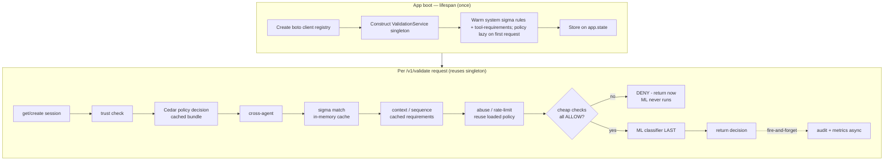
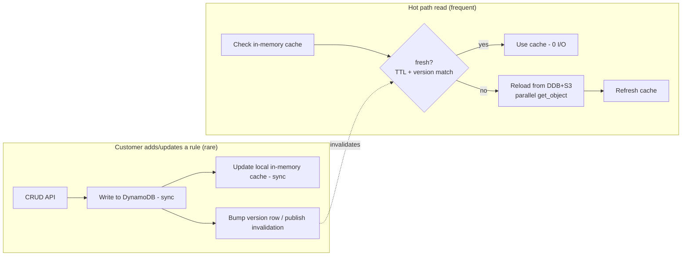

# LLD 24: `/v1/validate` Latency Optimization

**Version**: 1.0
**Last Updated**: 2026-06-14
**Status**: v1.1 — reviewed; M1 instrumentation + M2 singleton landed in code
**Prerequisites**: [LLD 03 — Security Controller](03-security-controller.md), [LLD 17 — Validation Signal Store](17-validation-signal-store.md), [LLD 18 — Deterministic Enforcement](18-deterministic-enforcement.md), [LLD 19 — ML Threat Classifier](19-ml-threat-classifier.md), [LLD 20 — Defense-in-Depth Layers](20-defense-in-depth-layers.md)

## Table of Contents
1. Overview
2. Current State — Measured Root Causes
3. Target Architecture
4. Fix Design (per root cause)
5. Caching Design (Sigma + Policy + Tenant rules)
6. Execution-Order Change (ML last)
7. Telemetry Off the Hot Path
8. Configuration
9. Rollout, Measurement & Rollback
10. Cross-References

---

## 1. Overview

### 1.1 Purpose
`/v1/validate` currently runs at **~2.5s average** in dev. This LLD specifies the changes to bring the **deterministic path under 500ms p99**, and to bound (not yet minimize) the ML-on path. It is the implementation contract for **Workstream 24**.

### 1.2 Scope
- Service & client **lifecycle** (singleton, no per-request construction).
- **Caching** of Sigma rules, Cedar/structured policy, and tool-sequence requirements — tenant-aware, write-through, long-TTL + invalidation.
- **Execution order**: move the ML classifier to the end of the pipeline (after all cheap deterministic checks).
- **Telemetry**: move audit + metrics off the response path.
- **Event-loop**: stop blocking it with synchronous boto3.
- **Instrumentation**: per-step timing to measure before/after.

### 1.2.1 Preconditions
- **Cedar cutover is live**: `cedar_enabled=true`, `cedar_shadow_mode=false`. The legacy `PolicyEngine.validate()` is **RETIRED (CT11)** and returns a fail-secure `POLICY_ERROR` DENY when reached — so Cedar MUST be the authoritative engine or every STEP-2 request denies. If Cedar **abstains** (agent not yet migrated), the pipeline falls back to that retired floor → DENY; the §5.3 policy-cache reuse applies only on the cutover path.
- **`gather` convention (authoritative, stated once):** `asyncio.gather` is **prohibited across validators in the decision pipeline** (deferred to the WS20.0 DAG). It **is permitted for fan-out I/O within a single step** (e.g., parallel S3 GETs loading a rule set). Every "parallel" below means the latter.

### 1.3 Non-Goals (explicitly deferred)
- **No change to ML thresholds, escalation band, model choice, or risk-gating.** ML stays enabled; we only **reorder** it. Deeper ML latency work (selective/risk-gated ML, narrowing the [0.5, 0.9] escalation band) is tracked as a follow-up — see §6.3 and [WS24 M6](../tasks/workstream-24-latency-optimization.md).
- **No parallel-DAG refactor.** The cost-annotated parallel pipeline is owned by **[LLD 20 §3.4 / WS20.0](20-defense-in-depth-layers.md)**. This LLD's ML-reorder is a frontier-first *interim* step compatible with that future DAG.

### 1.4 Target budget

| Path | Today (measured) | Target (this LLD) |
|---|---|---|
| Deterministic only (ML not reached / ML off) | ~0.6–1.2s | **≤ 500ms p99** |
| ML hot path (Haiku, sigma-ALLOW) | ~1.2–2.0s | **≤ 900ms p99** |
| ML w/ Sonnet escalation | ~2.5s (budget ceiling) | bounded ≤ 2.5s; minimized in follow-up |

*Targets are **single-instance, warm**, measured at the M1 documented concurrency (state serial vs N-concurrent with the numbers). F6 (`to_thread`) mainly helps the **concurrent** p99 — the ≤500ms deterministic target is an at-load number, not an in-isolation one.*

---

## 2. Current State — Measured Root Causes

All references are to `src/security-controller/`. Severity = estimated contribution to the 2.5s.

> **⚠️ Re-baseline required.** The `~2.5s average` cited below predates the **singleton merge (R1/M2), which is already in the code**. R1/R3/R8 are therefore *already mitigated* — they must be **re-measured against post-singleton code** (M1) before their severities are trusted or further work is sequenced on them. The table marks current status explicitly.

| ID | Root cause | Evidence | Status / Severity |
|---|---|---|---|
| **R1** | A fresh `ValidationService()` was built **per request** | **FIXED** — `lifespan` now builds it once: `app.state.validation_service = ValidationService()` ([app/main.py](../src/security-controller/app/main.py)); route reuses it ([api/routes.py](../src/security-controller/app/api/routes.py), `ValidationService()` is test-fallback only) | **ADDRESSED (M2) — verify in M1** |
| **R2** | **ML classifier runs live on every request**, Haiku + Sonnet escalation, up to 2.5s budget | `ML_CLASSIFIER_ENABLED=true`, `SHADOW_MODE=false` ([cdk/stacks/compute_stack.py:1344-1345](../cdk/stacks/compute_stack.py#L1344)); `ML_CLASSIFIER_TOTAL_BUDGET_SECONDS=2.5`; escalation band [0.5, 0.9] (LLD 19 §4.4) | **Dominant — live** |
| **R3** | Sigma instance cache was defeated by R1 → S3 reload every request | `self.rules_cache` instance attr ([sigma_engine.py:73](../src/security-controller/app/validators/sigma_engine.py#L73)); per-rule `get_object` loop ([:162-173](../src/security-controller/app/validators/sigma_engine.py#L162)); 12 rules → 12 S3 GETs | **Largely mitigated by R1 (cache now persists, 300s TTL) — verify; remaining work = tenant-aware + invalidation + long TTL** |
| **R4** | Structured policy fetched **uncached, THREE times** on the ALLOW path | STEP 2 (Cedar bundle), **STEP 4** (`context_validator._check_cross_cloud_dependencies` → `get_agent_policy`), STEP 5 ([validation_service.py:309](../src/security-controller/app/services/validation_service.py#L309) abuse). Each `resolve_policy_bundle` = 2 DDB reads + 1 S3 `get_object`, no cache. `POLICY_CACHE_TTL_SECONDS=10` is **dead config** | **Medium — live (3 call sites)** |
| **R5** | Hot-path boto3 calls are **synchronous inside `async def`** → block the event loop | none wrapped in `asyncio.to_thread` (only ML is) | High under concurrency — live |
| **R6** | Audit + metrics are **`await`ed before the decision returns** | `audit_logger.log_signals` + `metrics_publisher.publish_validation_metrics` on both paths. (The `_handle_deny` inline comment calling metrics "fire-and-forget … never blocks" is **false today** — fix it too.) | Medium — live |
| **R7** | **ML is ordered before** the cheap context + abuse checks | ML at STEP 3.5; context (4) + abuse (5) run after → ML cost paid even when a cheap check would DENY | Medium — live |
| **R8** | `config/tool_requirements.yaml` read from disk per request | [context_validator.py:46-92](../src/security-controller/app/validators/context_validator.py#L46) `_load_requirements` in `__init__` | **ADDRESSED by R1 — verify** |

> **Correction note:** an earlier surface diagnosis ranked Sigma reload #1. Thorough reading shows **ML (R2) is the dominant *remaining* driver** — the ~2.5s average ≈ the ML total budget. R1 (singleton) is now fixed, which also mitigates R3/R8; the dominant live items are **R2 (ML), R4 (3× policy), R5/R6 (blocking I/O + telemetry)**.

---

## 3. Target Architecture



**Principle:** everything tenant-agnostic and slow-changing is built/warmed **once at boot** and reused; the request path does **in-memory** lookups + the minimum unavoidable I/O, runs **cheap deterministic checks first** with short-circuit, and pays the **ML cost only at the very end** for traffic that survived every cheaper gate.

---

## 4. Fix Design (per root cause)

### F1 — Singleton service + client registry (fixes R1, R8; enables R3/R4 caches)
- Construct `ValidationService` **once** in the FastAPI `lifespan`, store on `app.state.validation_service`; the route resolves it via a dependency instead of `ValidationService()`.
- Introduce a **boto client registry** created at boot:
  ```
  clients.dynamodb(), clients.s3(), clients.cloudwatch(), clients.logs(), clients.bedrock()
  ```
  All validators take clients from the registry instead of calling `boto3.client/resource` in their own `__init__`.
- **Forward-compat for multi-tenant isolation:** the registry is a **factory keyed by tenant** that returns the shared default client today, and can return a per-tenant assume-role client later — no validator change required when that lands.
- Effect: ~10 client constructions/request → 0; instance caches (sigma, etc.) now **survive across requests**; YAML read once.

### F2 — Sigma cache redesign (fixes R3) — see §5.
### F3 — Policy cache + single load (fixes R4) — see §5.
### F4 — ML reorder to last (fixes R7) — see §6.
### F5 — Telemetry off hot path (fixes R6) — see §7.

### F6 — `asyncio.to_thread` for remaining sync boto3 (fixes R5)
Wrap each synchronous boto3 call on the hot path (`session_manager`, `policy_engine`, `sigma_engine` loads, `abuse_detector`, signal-store write) in `asyncio.to_thread`. This is **per-call offloading**, NOT the `asyncio.gather` pipeline change forbidden by best-practices §14.3 / deferred to WS20.0 — the validator order is unchanged.

### F7 — Per-step timing instrumentation (measurement)
Add `time.perf_counter()` spans around each pipeline step; emit a single structured `validation.timing` log line (`{step: ms}`) at DEBUG/sampled. Establishes the before-number and proves each fix. Ship this **first**.

---

## 5. Caching Design (Sigma + Policy + Tenant rules)

### 5.1 Rule taxonomy
Two classes of rule, both for Sigma and (future) sequence requirements:
- **System rules** — Sentra-authored, change only when *we* publish. Shared across all tenants.
- **Customer rules** — tenant-authored via CRUD. Scoped per `tenant_id`.

### 5.2 Write-through, long-TTL, with cross-instance invalidation



- **Write-through:** rule CRUD writes DDB **and** updates the local cache synchronously (rare operation, sync is fine).
- **Long TTL:** raise from 5min → **6–24h** (system + customer) — rules change rarely.
- **TTL is a safety net, not the propagation path.** Because multiple controller tasks run, a write on one instance must invalidate the others. Mechanism: a cheap **version/etag row in DynamoDB** checked on read (single-digit-ms), or a **Redis pub/sub invalidate** (Redis already used for sessions). A customer's new security rule must take effect fleet-wide in **seconds**, never "up to the TTL."
- **Mapping onto the current store:** rules load from `sentra-sigma-rules-metadata` (status-index GSI, `status='stable'` filter) + per-rule S3 GETs. The **version row lives in that same table** — a single `meta#version` item bumped on every CRUD; readers compare it cheaply before trusting cache. The write-through CRUD path MUST keep the `status='stable'` filter consistent when it updates the cache.
- **Boot warm:** load **system** rules at `lifespan`; tenant rules load lazily / on first use (don't pre-load every tenant).
- **Parallel cold load:** the per-rule S3 `get_object` loop runs via `asyncio.gather` over `to_thread` (rule-loading parallelism — distinct from the forbidden pipeline gather). Matters only on cold/invalidate.

### 5.3 Policy (F3)
The ALLOW path resolves the policy **three times** — STEP 2 (Cedar bundle), STEP 4 (`context_validator._check_cross_cloud_dependencies → get_agent_policy`), STEP 5 (abuse) — see R4. Fix with **one cache, not call-site surgery**:
- **Cache on `resolve_policy_bundle(agent_id)`** — the single choke point all three sites flow through. A **request-scoped memo** collapses the 3 loads to 1 within a request; a short **cross-request TTL** collapses repeat agents. This covers STEP 2/4/5 at once — preferred over "reuse the bundle," which fixes only 2 of 3 sites and only on the cutover path.
- **Reuse the existing Workstream-5 cache framework** (`config.py`: `cache_enabled`, `max_cache_size`, `policy_cache_ttl_seconds`, …) rather than greenfielding one; wire the dead `POLICY_CACHE_TTL_SECONDS` (10s→minutes). The Cedar `_compiled_cache` ([validators/cedar/policy_loader.py](../src/security-controller/app/validators/cedar/policy_loader.py)) is the in-repo pattern to mirror.
- Net: 3 policy S3 reads/request → 0 on warm cache.

### 5.4 Tenant sequence rules (F8, deferred) — addresses "do it now?"
`config/tool_requirements.yaml` becomes a **per-tenant rule set** in the same system/customer write-through store as Sigma (§5.1–5.2), retiring the static file. **This is a data-model/tenancy change, not a latency win** (F1 already removes the per-request read), so it is sequenced **after** the core latency fixes and implemented on the §5.2 machinery. Tracked as [WS24 M5](../tasks/workstream-24-latency-optimization.md).

---

## 6. Execution-Order Change (ML last)

### 6.1 Today
`trust → policy(Cedar) → cross-agent → sigma → **ML (3.5)** → context → abuse` (LLD 19 §3.2).

### 6.2 Target
`trust → policy(Cedar) → cross-agent → sigma → context → abuse → **ML (last)**`

Every **cheap, local** check (context/sequence, abuse/rate-limit) now short-circuits **before** the expensive LLM call. The ML cost is paid only for traffic that passed *all* deterministic gates — strictly fewer ML invocations, no behavior change to verdicts on the deny path (deny-overrides semantics preserved; ML still short-circuits nothing cheaper than itself).

> **Conscious side-effect (verdict attribution, not the binary):** for a request that *multiple* validators would independently DENY, the attributed `violation_type`/`threat_type` and the trust-score **penalty** now come from the earliest cheaper check rather than from ML. The final ALLOW/DENY is unchanged (and that's what the verdict guard asserts), but per-session trust *trajectories* can differ slightly vs. the old STEP-3.5 ordering. This is accepted: a cheaper, deterministic attribution is generally a *better* audit reason than "ML denied," and ML's penalty only mattered when nothing cheaper fired — which is exactly the path where ML still runs.

### 6.3 Explicitly deferred (per founder decision)
- ML stays **enabled**. No threshold/escalation-band/model/risk-gating change in this LLD.
- Deeper ML latency reduction (risk-gated ML, narrowing [0.5, 0.9] escalation, Haiku-inline + Sonnet-async) is **revisited after** R1/R3/R4/R5/R6 land and we re-measure — [WS24 M6](../tasks/workstream-24-latency-optimization.md). Long-term execution model = the parallel DAG in [LLD 20 §3.4](20-defense-in-depth-layers.md).

---

## 7. Telemetry Off the Hot Path (F5)

- **Now:** emit audit (`log_signals`) and metrics (`publish_validation_metrics`) via **fire-and-forget** (`asyncio.create_task`) so the decision returns immediately. The **CloudWatch dual-write stays** (mandatory per best-practices §12.5) — it just no longer blocks the response.
  - **Task hygiene:** retain each task in a module-level set and attach a `done`-callback that logs exceptions — a bare `create_task` can be GC'd mid-flight and silently swallow errors. Also correct the false "fire-and-forget … never blocks" comment in `_handle_deny` (it's `await`ed today) and normalize the deny/allow audit↔metrics ordering while there.
  - **Interim durability gap:** until the M7 durable buffer, a crash between "decision returned" and "telemetry flushed" loses those audit rows. Founder-approved for now; stated so it's a conscious risk.
- **Keep the DDB signal write prompt** — the SOC console reads it within minutes (LLD 17 §2); a bounded async write (existing 200ms timeout) is fine, but it must not be dropped/over-delayed.
- **Long-term (WS24 M7):** durable local buffer (append-file) + **shipper sidecar** (Fluent Bit / OpenTelemetry Collector / CloudWatch agent) tailing stdout/file → removes all telemetry I/O from the app and survives spikes. Pure in-memory fire-and-forget can lose audit rows on crash, so the durable buffer is the compliance-grade target.

---

## 8. Configuration

| Env var | Today (deployed) | Code default | Target | Notes |
|---|---|---|---|---|
| `SIGMA_RULES_CACHE_TTL_SECONDS` | **not set in CDK** | 300 | 21600 (6h) | This **adds a new env var**, not "300→change". Also remove orphan `SIGMA_REFRESH_INTERVAL=300` (CDK sets it; controller reads nothing). |
| `POLICY_CACHE_TTL_SECONDS` | 10 ([compute_stack:1335](../cdk/stacks/compute_stack.py#L1335)) | 300 | 300 | Currently **dead** (no reader). Remove orphan duplicate `POLICY_CACHE_TTL=10` (line 1311) to avoid wiring the wrong var. |
| WS5 cache framework | `cache_enabled`, `max_cache_size`, `policy_cache_ttl_seconds`, `agent_metadata_cache_ttl_seconds`, `tool_registry_cache_ttl_seconds` exist in `config.py` | — | **reuse** | Policy/sigma caching is **not greenfield** — reuse this or state why bypassing. |
| `ML_CLASSIFIER_*` | enabled, shadow off | false | unchanged | reorder only (§6) |
| (new) `RULE_CACHE_INVALIDATION` | — | — | `version`\|`redis` | cross-instance invalidation (§5.2) |

---

## 9. Rollout, Measurement & Rollback

1. **M1 — instrument first** (F7): deploy timing, capture the real per-step before-breakdown (confirm ML vs sigma split, escalation rate via CloudWatch ML metrics).
2. **M2 — singleton** (F1): biggest, lowest-risk win; re-measure.
3. **M3 — sigma + policy caches** (F2/F3): re-measure.
4. **M4 — ML reorder + telemetry async + to_thread** (F4/F5/F6): re-measure.
5. **M5 — tenant sequence rules** (F8, data-model).
6. **M6 — ML latency deep-dive** (deferred ML work).
7. **M7 — durable telemetry shipper.**

**Rollback:** each fix is independently revertable. F1 behind `app.state` is the only structural change; the rest are cache/order/async toggles. Acceptance gate per milestone: p99 from the F7 timing log.

**Acceptance:** deterministic-path p99 ≤ 500ms (M3, at the M1 documented concurrency); ML-hot p99 ≤ 900ms (M4); **final-verdict parity** vs. a recorded baseline set. The guard asserts on the **final ALLOW/DENY only — NOT signal-set equality**: ML-last means cheap-denied requests no longer invoke ML, so their `sentra.ml_classifier` signal legitimately disappears from the audit trail (expected, benign; signal-set assertion would throw false diffs). The baseline must include ML-on traffic.

---

## 10. Cross-References
- [LLD 19 §3.2 / §4.4](19-ml-threat-classifier.md) — ML execution model, escalation bands (reordered here).
- [LLD 20 §3.4](20-defense-in-depth-layers.md) — cost-annotated parallel DAG (WS20.0); long-term execution model this LLD is interim to.
- [LLD 17 §2, §12](17-validation-signal-store.md) — signal-store read freshness constraint on telemetry async.
- [best-practices.md §3, §12.5, §14](../best-practices.md) — reuse principle, mandatory dual-write, ML/pipeline rules.
- Workstream: [tasks/workstream-24-latency-optimization.md](../tasks/workstream-24-latency-optimization.md).
