# LLD 25 — Network Sidecar & In-Boundary Data Plane

> The **network sidecar** is the non-cooperative interception model for the in-boundary editions
> (Dedicated / Self-Managed). It runs **inside the customer's VPC** alongside their agents, captures
> agent actions at the network layer, and enforces the verdict from the policy engine (PDP) — which
> may run in-boundary (Dedicated/Self-Managed) or in AegionAI's cloud (Serverless hybrid).
> "AegionAI Guard" is the customer-facing brand; "Sentra" is the internal control-plane codename.

**Version**: 0.3 (draft for review — multiple options open per §15 Decision Register)
**Last Updated**: 2026-06-22
**Status**: Draft — design exploration; **no option is final**. Sections present 2–3 candidates with trade-offs.
**v0.3 changes** (Sr-PE review): §1.8 — content-ML on the non-cooperative path is conditional on 3T-D, and
preventive-only/no-rollback made explicit; §1.7 + new §8.1.1 — per-tool fail-mode reconciled with fail-secure
(D-failmode); §1.4 — redaction-recall measurement plan; §2C — single shared evaluator crate; §2.1 — force-central
thundering-herd bound; §3.1 — admission-webhook `failurePolicy` (D-webhook); §7.3 — non-bypass narrowed + residual
paths; new §7.4 — egress-routing change management; §8.3 — in-VPC latency budget; §9.1 — stateful-detector state
model; §9.2 — illustrative sizing table; §10.2 — air-gapped metering is entitlement-based; §14 — protocol-coverage
reality (HTTP-framed vs DB/bus/streaming). **R1 residuals:** §8.3 in-VPC RTT target ceiling (≤5 ms p99,
placeholder); §9.2 QPS/agent flagged as a variable to characterize; new **D-escalation** register row
(escalation fraction as the one cross-cutting unknown).
**v0.2 changes**: added §1.3 brain/wires concept primer + PEP explainer; §1.4 metadata classification;
disambiguated serverless-edition vs serverless-hosted-agent; §3.4 multi-account brain placement;
§4.6 onboarding prerequisites/effort; tenets → list (+ progressive-onboarding); simplified triangle.
**Owner**: Shashank Gupta
**Prerequisites**:
[LLD 23 — Aegion Guard SDK](23-sentra-guard-sdk.md) (cooperative PEP, `/v1/validate` contract) ·
[LLD 18 — Deterministic Enforcement](18-deterministic-enforcement.md) ·
[LLD 19 — ML Threat Classifier](19-ml-threat-classifier.md) ·
[LLD 24 — Latency Optimization](24-latency-optimization.md) ·
[LLD 15 — Cross-Cloud Connectors](15-cross-cloud-connectors.md) ·
[LLD 17 — Validation Signal Store](17-validation-signal-store.md) ·
[ARCHITECTURE.md](ARCHITECTURE.md) §2.4 (editions), §2.7 (threat model)
**Maps to**: FR-1.5 (network sidecar), FR-1.7 (in-process local tier), FR-3.12 (distilled local model),
FR-3.13 (input-side redaction), FR-9.2/9.3 (Dedicated/Self-Managed), FR-10.3 (verified identity),
FR-11.1–11.3 (safe enforcement adoption), NFR-1/2/3/4/6/7/11.

## Table of Contents
0. Glossary (acronyms used throughout)
1. Overview & Overall Approach
2. The PEP / PDP Split (the load-bearing decision)
3. Networking — how traffic flows in the customer VPC, and TLS
4. Customer Experience (the most important section)
5. Infrastructure — shipping binaries and model weights
6. IP Protection — code and weights
7. Security — posture and per-failure-point mitigations
8. Resilience
9. Scalability
10. Metering & Billing
11. APIs
12. Metrics & Instrumentation
13. Cloud-Specific Adjustments (AWS / Azure / GCP)
14. Coverage Reality (what the sidecar does and does not see)
15. Decision Register (open calls to settle)
16. Cross-References & Sources
17. FAQ

---

## Glossary (acronyms used throughout)

| Term | Expansion / meaning |
|---|---|
| **PEP** | Policy Enforcement Point — the "wire" that captures an action and enforces the verdict (sidecar / SDK / connector) |
| **PDP** | Policy Decision Point — the "brain": Cedar + Sigma + distilled model + detectors that returns allow/deny |
| **CA** | Certificate Authority — issuer of TLS certificates; trusting a CA means trusting everything it signs |
| **MITM** | Man-in-the-Middle — a proxy that terminates TLS to read the body ("break-and-inspect"); see §3.3 |
| **TLS / mTLS** | Transport Layer Security (HTTPS encryption); **m**TLS = both sides authenticate each other |
| **SNI** | Server Name Indication — the destination hostname, visible even on an encrypted connection |
| **HSM / KMS** | Hardware Security Module / Key Management Service — where private keys live and never leave |
| **SPIFFE / SVID / SPIRE** | Workload-identity standard / its short-lived X.509 cert / the issuer implementation |
| **SDS** | Secret Discovery Service — Envoy API that delivers rotating certs without writing them to disk |
| **IRSA** | IAM Roles for Service Accounts — AWS workload identity for pods |
| **OIDC** | OpenID Connect — token-based identity federation used at enrollment |
| **TEE / SKR** | Trusted Execution Environment (confidential computing) / Secure Key Release into it |
| **eBPF** | in-kernel packet/syscall interception (Cilium, Pixie); blocked on some managed platforms |
| **UDR** | User-Defined Route (Azure) — routes egress through a firewall |
| **DLP** | Data Loss Prevention — detecting/masking sensitive data leaving the boundary |
| **A2A / MCP** | Agent-to-Agent messaging / Model Context Protocol (tool-manifest standard) |
| **FR / NFR** | Functional / Non-Functional Requirement (from the PRD) |

---

## 1. Overview & Overall Approach

### 1.1 Purpose
Define the in-boundary data plane: the software that runs **inside the customer's cloud account/VPC**
to intercept agent actions at the network layer (zero-code, framework-agnostic, non-bypassable for
network egress) and enforce the policy engine's verdict — without the customer hand-wrapping every
tool with the SDK ([LLD 23](23-sentra-guard-sdk.md)).

### 1.2 Three reframes that shape every section
These correct common misconceptions and drive the options below:

1. **The "sidecar" is two components, not one.** The **PEP** (Policy Enforcement Point — capture +
   enforce) and the **PDP** (Policy Decision Point — Cedar + Sigma + distilled model + detectors)
   have opposite scaling and security profiles. We design them separately (§2).
2. **We do not tap *all* customer traffic.** Only **governed-agent** traffic is routed through the
   data plane (scoped egress, not a transparent account-wide tap). Everything else is untouched (§3).
3. **Network interception ≠ total coverage.** It captures the **network-egress subset** of actions
   (API/DB/tool/LLM calls, networked agent-to-agent). **In-process** tool calls and in-process
   multi-agent handoffs have no packet and need the SDK. Coverage = union of modes (§14).

### 1.3 Core concepts — the brain (PDP) and the wires (PEP)

Read this before the deep-dive; everything later assumes this model.

**Think of the system as a *brain* and *wires*.**

- **The brain = the PDP (Policy Decision Point).** A **running service** (a container/task fleet) that
  holds the policy engine (Cedar + Sigma), the distilled model, and the detectors, and answers
  **allow / deny** for each action. **The model and policies *always* run in the brain — never in a
  wire.** In the in-VPC editions the brain runs **inside the customer's cloud**.
- **A wire = a PEP (Policy Enforcement Point).** Whatever **carries an agent's action to the brain and
  enforces the answer.** There are **three wire types**, differing only in *how* they capture — the
  brain is identical behind all of them:

| Wire (PEP form) | What it is | Code change | Captures |
|---|---|---|---|
| **Network sidecar** | a proxy in the agent's outbound network path | **none** | network-egress actions |
| **SDK** ([LLD 23](23-sentra-guard-sdk.md)) | our library running **in-process inside the agent** (one wrapper per tool); on Lambda/Functions shipped as a **layer/extension** | small | in-process **and** network actions; effect-capture for rollback |
| **Connector** ([LLD 15](15-cross-cloud-connectors.md)) | a hook at the **cloud's tool-execution point** (Bedrock action-group Lambda / Azure Function) | **none** | platform-executed tool calls |

**How any PEP works (same four steps regardless of form):**
1. capture the outbound action + identity + destination (+ content if it can see it);
2. call the brain's `POST /v1/validate`;
3. **ALLOW** → let the action proceed; **DENY** → block it and return an error;
4. (optional) capture the result on ALLOW for rollback (effect-capture; SDK only).

**Why more than one wire if the brain is already in the customer's account? (FAQ-1)** Because **no single wire
reaches everything** (see §14): the network sidecar can't see *in-process* tool calls, in-process
multi-agent handoffs, content behind un-terminated TLS, or rollback handles — and it can't attach to a
**serverless-hosted agent** at all. The SDK/connector cover those gaps. **None of them run the model** —
they only feed the same brain. Which wire is even *possible* depends on where the agent runs:

| Agent hosting | Network sidecar possible? | Wire used |
|---|---|---|
| Pod / container (EKS / AKS / GKE / ECS-EC2) | yes | **sidecar** (or SDK) |
| Fargate / Container Apps / Cloud Run | explicit-proxy only (no eBPF / redirect) | explicit-proxy sidecar **or** SDK |
| **Lambda / Azure Functions** (serverless-hosted agent) | **no** | **SDK (layer/extension) or connector** |

> **Disambiguation — two unrelated uses of "serverless":**
> **Serverless-hosted agent** = the *customer's own* agent code running on serverless compute
> (Lambda / Azure Functions / Cloud Run); the customer builds and owns it. It can't host a sidecar
> container next to it, so its wire is the SDK or connector.
> **Serverless *edition*** = *our* hosting model (the brain runs in AegionAI's cloud, §1.5).
> Same word, unrelated things.

> **SDK-as-a-Lambda-layer / connector, concretely:**
> AWS Lambda **layers/extensions** load shared code into the function's runtime — we ship the SDK as
> that layer, the function calls our wrapper around each tool call, and the wrapper calls the brain.
> The PEP is then **our code inside the customer's Lambda process**, no separate container. The
> **connector** instead hooks the platform's tool-execution point (the action-group Lambda / Azure
> Function), leaving agent code unchanged.

### 1.4 What "metadata" means (and what is *content*)

The data-boundary promise ("only metadata leaves" for in-VPC editions) rests on this distinction:

| Tier | Examples | Leaves to AegionAI (in-VPC)? |
|---|---|---|
| **Identity** | `tenant_id`, `agent_id`, `session_id` | yes |
| **Decision** | verdict, deciding source, reason code, detector scores, versions, latency | yes |
| **Action** | tool name, destination host / endpoint, HTTP method, API operation | yes |
| **Network** | **source/destination IP**, SNI, port, byte volume, timing | yes (see IP note) |
| **Content** *(NOT metadata)* | parameter values, request / response bodies, **prompts** | **no — stays in-boundary** |

**Two honest caveats on "only metadata leaves":**
- **IP address is metadata and we need it** — destination IP/host → tool classification + egress
  allowlist; source IP → (weak) correlation + anomaly. But **an IP is "personal data" under GDPR**, so
  metadata is not automatically risk-free.
- **Some metadata can itself be sensitive** — a destination URL with query params, or a tool name that
  reveals business logic.

**"Only metadata leaves" describes the *uplink to AegionAI*, not what the engine sees.** The brain —
wherever it runs — **always gets the content it needs within its trust zone**:
- **In-VPC:** the brain has the **full prompt/request/response locally**; only metadata crosses to us.
- **Serverless:** the brain is in our cloud, so the prompt **does** go there — **redacted**. Redaction is
  **format-preserving** (masks secrets/PII, aims to **keep the attack-relevant text**) so injection/jailbreak
  detection still works. Redaction protects the *cross-boundary hop*.
  > **Honest caveat — "keeps the attack-relevant text" is an assumption to *measure*, not a given.** You cannot
  > reliably know what is attack-relevant *before* classification — masking PII/secrets could strip the very
  > token a novel injection rides on (the claim is otherwise circular). This is the load-bearing assumption for
  > the serverless content path, so it is **validated, not asserted**: we measure **detector recall on redacted
  > vs. raw** inputs (red-team + adversarial corpus) and **gate releases on the recall-delta staying within
  > tolerance**. *Failure mode if redaction strips signal:* recall drops → a recall-delta alarm flags it, and
  > the in-VPC editions (no cross-boundary hop, no redaction for the engine, §1.5) are the mitigation for
  > tenants who can't accept the risk. This is a **Serverless-edition** concern; the in-VPC scope of this LLD
  > never redacts for the engine — it has the plaintext locally.

### 1.5 Editions context (from ARCHITECTURE §2.4)
| Edition | Brain (PDP) runs | What leaves boundary | Primary PEP (wire) | This LLD |
|---|---|---|---|---|
| Serverless | AegionAI cloud | redacted content + metadata | SDK / connector | hybrid escalation only |
| **Dedicated** | **customer's cloud (managed by us)** | **metadata only** | **network sidecar** + SDK | **primary scope** |
| **Self-Managed** | customer's cloud (customer-operated) | nothing | network sidecar + SDK | **primary scope** |

> **"In-boundary" means in the customer's *cloud / org*, not necessarily the agent's VPC or account.**
> The brain can run in (i) the **same VPC** as the agent (localhost/mesh hop), (ii) a **different VPC in
> the same account** (VPC peering), or (iii) a **separate AegionAI-managed account inside the customer's
> AWS Org / Azure tenant / GCP org** (PrivateLink / PSC / peering) — often the cleanest for separation
> of duties. Connectivity per topology is detailed in §3.4.

### 1.6 Overall topology (block diagram)

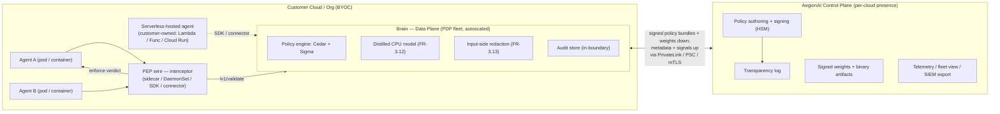

**What crosses the boundary (Dedicated/Self-Managed):** signed policy bundles + signed weights/binaries
**down**; de-identified metadata, decisions, trust signals, heartbeats **up**. **No raw content** leaves
(NFR-7). Self-Managed: nothing leaves; artifacts are side-loaded.

### 1.7 Design tenets
- **Fail-secure by default, with an explicit per-tool fail-mode knob** — by default any failure denies or
  degrades to the cached deterministic floor, never silently permitting. But fail-secure on an
  availability-critical path (a payments/refund agent) means a *PDP/control-plane outage stops the business* —
  and high-risk tools (`requires_ml`) are exactly the ones that can't fall back to the floor. So fail-mode is a
  **per-tool, customer-owned** decision (§8.1.1, D-failmode); some customers will require fail-open on named
  availability-critical tools and own that residual risk. We default secure and make the exception explicit, not silent.
- **Deny-by-default** — explicit allow only.
- **The data boundary is the customer's to set** — what leaves is an edition choice (§1.5).
- **Signed / verified everything** — policy, weights, binaries; tamper-evident audit.
- **On-by-default, customer-controllable** — disable per agent, per tool, or globally.
- **Progressive, low-friction onboarding** — zero-code and **monitor-first** by default; the
  security-driven friction (egress lockdown, fail-secure, CA install) is **opt-in and gradual**, never a
  day-one wall (§4). *Honest caveat: when ease and security genuinely conflict, security wins — so this
  is "minimize friction except where security demands it," not "easy at any cost."*

### 1.8 The trade-off triangle — and the scope of this LLD

A deployment can offer three properties; **you can pick at most two.** This defines the editions — it is
not a gap in the design:

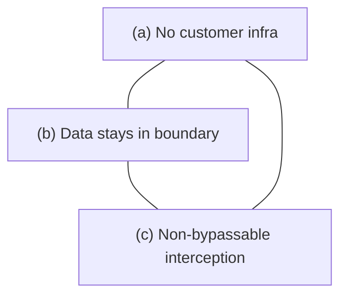

**What each property means** (running example: a *refund agent* that calls a payments API to issue a $500 refund):

| Property | What it means — **✓** vs **✗** | The refund agent under the **in-VPC sidecar** |
|---|---|---|
| **(a) No customer infra** | Does AegionAI require a separate compute service (our brain/PDP) running in their account? **✓** = just a library/config, nothing new to run · **✗** = they provision and pay for our brain | **✗** — they run our brain as compute and pay for it (the price) |
| **(b) Data stays in boundary** | Does raw content (the prompt, the API body, the `$500`, the account #) leave their cloud for ours? **✓** = never leaves · **✗** = goes to our cloud (even if redacted) | **✓** — the refund body stays in their cloud; only metadata ("DENIED: over-limit") leaves |
| **(c) Non-bypassable** | Can the agent dodge the check (forgotten wrapper, raw call)? **✓** = still intercepted · **✗** = only if it goes through our wire | **✓** — network interception + egress lockdown; can't refund without passing |

**Which deployment keeps what** (no deployment gets all three):

| Deployment | (a) no customer infra | (b) data stays in boundary | (c) non-bypassable |
|---|---|---|---|
| **In-VPC sidecar — THIS LLD** | ✗ | ✓ | ✓ |
| Cloud-backed SDK / connector (Serverless) | ✓ | ✗ redacted content leaves | ✗ cooperative |
| Local-only SDK (in-process deterministic floor, no egress) | ✓ | ✓ | ✗ cooperative |
| Hosted egress proxy (SSE-style) | ✓ | ✗ content transits us | ✓ with egress lock |

**Key reads (lead with the boundary):**
- **(b)+(c) at the network layer is metadata + the deterministic floor by default; content-level ML is *conditional*.**
  Full ML detection needs the decrypted body, and the *non-cooperative network path doesn't have it*: our TLS lean is
  metadata-only (3T-B) or SDK-for-content (3T-C, which is cooperative → not (c)). On a *network-only, non-cooperative*
  agent — the exact case the sidecar exists for — content-level ML is reachable **only when the customer already runs
  egress TLS inspection we ride (3T-D)**, or via our own MITM (3T-A, last resort, breaks on pinned certs). So the clean
  **(b)+(c)+content-ML** quadrant is the **exception** (requires 3T-D), not the default sidecar outcome; the default is
  **(b)+(c) over metadata + the deterministic floor**, with content-ML coming from the SDK (cooperative) or 3T-D.
- The **in-VPC sidecar is the only way to get (b)+(c) together at all** — content never leaving *and* non-bypassable —
  at the cost of (a). **This is why this LLD exists**; just don't oversell content-ML on the non-cooperative path (above).
- **Network enforcement is preventive-only — no rollback.** The sidecar blocks *before* an action runs; it has **no
  effect-capture handle** (§14), so once the refund is **ALLOWED** the $500 is gone and the sidecar **cannot undo it**.
  Rollback needs the SDK. Don't sell network-sidecar rollback.
- **Cloud-backed SDK/connector keeps only (a)** (content leaves *and* it's cooperative). The clean **(a)+(b)** is a **local-only SDK** — just a library that decides in-process on cached deterministic rules and never calls out (no ML, bypassable).

**Scope of this LLD: the (b)+(c) path only — infra in the *customer's* cloud (Dedicated / Self-Managed)**,
the residency-bound segment (banks, healthcare, government) where the sidecar is unavoidable. The
no-customer-infra alternatives below are **out of scope here** (a later doc); listed only to mark the boundary.

#### 1.8.1 Two wires, two threat models — which wire defends what (read this before "incomplete solution")

A recurring review objection is *"the differentiated capabilities (content inspection, rollback, cross-agent
containment) ride the **SDK**, which a hijacked agent can bypass — so the differentiation sits on the
bypassable wire."* The resolution is to stop treating the SDK as a security boundary at all and state the
threat-model split explicitly: **the two wires defend two different threats, and the boundary against a
*hostile* agent is the network chokepoint — never the SDK.**

| | **SDK (Wire A, cooperative)** | **Network chokepoint + egress lockdown (Wire B, non-cooperative)** |
|---|---|---|
| **Defends against** | the **honest/accidental** agent — misbehaving, mis-prompted, buggy | the **hostile/hijacked** agent — actively trying to dodge us |
| **What it adds** | depth: in-process tool calls, content/parameter visibility for free (plaintext), **effect-capture for rollback** | the boundary: an action **cannot leave the box** without passing us |
| **Hijacked agent** | **bypassable** — spawn a subprocess, use an un-hooked path, write its own socket (§3.1, [:543](#L543)) | **not bypassable for egress** — the VPC route table (admin-controlled, *not* the workload) sends `0.0.0.0/0` → chokepoint; default-deny drops anything else (§3.1 Step 2, S2 §7.2) |

**So the answer to "how do you protect against an agent that overrides the SDK" is: you don't rely on the
SDK for it.** A hijacked agent that skips the SDK is contained by the chokepoint, which sits *outside* its
process and which it cannot route around. Concretely, against a hostile agent that bypassed the SDK:

| Hostile action | Caught? | By what |
|---|---|---|
| Exfil to a **new/unauthorized destination** | ✅ always | default-deny egress at the chokepoint (§3.1, S2) |
| **Forge another agent's identity** to widen its allow-list | ✅ always | verified mTLS/SPIFFE cert, never self-asserted (§3.5.1, S9) |
| **Volume / rate abuse** on an allowed destination | ✅ (metadata) | rate/abuse limits + volume anomaly |
| **Malicious payload to an *allowed* destination** (the $1M refund to the real `api.stripe.com`) | ⚠️ **only with content visibility (3T-D / 3T-A)** | content inspection at the egress decrypt point (§1.8.3) |
| **DNS exfil · VPC-lateral · PrivateLink-to-cloud · peered networks** | ❌ residual | the customer's network architecture (§7.3) |
| **Non-HTTP egress** (DB wire, Kafka) | metadata-only | pending a wire parser (§14) |

**The one-line framing for the pitch:** *the network boundary **contains** hijacked agents; the SDK adds
**depth** on cooperative ones.* Never sell "the SDK protects against a hijacked agent" — it is the
bypassable wire by design. The differentiated capabilities that *do* survive a hostile agent are
(i) **non-bypassable egress containment** and (ii) **content-granular enforcement on allowed destinations
*when content is visible*** — which is the beachhead's normal case (§1.8.3), not an exotic add-on.

#### 1.8.2 The no-infra alternatives are deferred
The no-customer-infra rows in the matrix above — **cloud-backed SDK/connector**, **local-only SDK**, and
**hosted egress proxy** — plus **`ext_authz` on a customer's existing mesh/gateway** (Envoy `ext_authz` /
WASM / API-GW authorizer → our hosted brain; no *new* infra if they already run a mesh, keeps (a)+(c),
partial (b)) are the ways to govern *without* in-boundary compute. **All are deferred** — this LLD designs
the in-VPC (b)+(c) path; the no-infra family is a separate workstream tracked as **D8** (§15).

#### 1.8.3 Content-granular enforcement on the non-bypassable wire — why the beachhead gets it by default

§1.8.1's one ⚠️ — *catching a malicious payload to an **allowed** destination* (the canonical hostile case:
a hijacked refund agent issuing a fraudulent refund to the **real** `api.stripe.com`) — needs the **decrypted
body**, which the default metadata-only TLS lean (3T-B) does not have. This is the seam where "non-bypassable"
and "content-granular" appear to live on different wires. **For the regulated beachhead it collapses, because
those customers already run outbound TLS inspection.**

- Banks, government, and healthcare — the residency-bound segment this LLD scopes to (§1.8) — **almost always
  already operate central outbound break-and-inspect** at their egress, with an internal CA every workload
  trusts (AWS Network Firewall / Azure Firewall Premium / GCP SWP, §3.3.3). This is **3T-D**: we **consume
  their already-decrypted feed** and ask the customer for **nothing new**.
- TLS therefore terminates at the **customer's central egress** ("the main entrance"), and our brain consumes
  the decrypt point *there*. The per-agent PEP, sitting *before* that egress, still sees ciphertext — so the
  correct mental model is **"our brain consumes the egress decrypt point,"** not "the per-pod sidecar reads
  the prompt." Content-ML on the non-bypassable wire runs where the decrypted feed is.
- With 3T-D present, **content-granular enforcement is itself on the non-bypassable wire**: the hijacked
  agent's fraudulent refund is inspected and blocked at the chokepoint even though Stripe is an allowed
  destination — closing §1.8.1's one ⚠️ for this segment.

> **Refinement to D3 (§3.3.5) for the beachhead.** The doc's general lean is *3T-C default, 3T-D when
> network-layer content is needed*. For the **regulated beachhead, 3T-D is the *expected* default** —
> they already inspect egress, so riding it is zero new ask and gives content-ML on the non-bypassable
> wire out of the box. Make **"do you run outbound TLS inspection?" a qualifying question** in the
> beachhead sales motion: **yes** → ride it (seam closed, nothing new asked); **no** → be explicit that the
> non-bypassable wire is metadata + the deterministic floor, and content depends on the cooperative SDK.

**Residual even with 3T-D (do not over-claim):** **cert-pinned** clients/SDKs refuse *any* substitute cert,
including the customer's own break-and-inspect CA (§3.3.2 cost #2) — those connections break or are exempted,
a bounded content blind spot; and the §7.3 set (DNS/lateral/PrivateLink/peered) remains the customer's
network-architecture responsibility regardless of TLS handling.

---

## 2. The PEP / PDP Split (the load-bearing decision)

The **PDP is heavy** (model weights = IP, CPU/RAM, must scale with QPS) → make it a **shared,
horizontally-scaled fleet per VPC/account**, not one-per-agent. The **PEP is light** (capture bytes,
call PDP, apply verdict) → it sits close to each agent. This split is assumed by all later sections.

### 2.0 Vocabulary — the two enforcement tiers (read first)
The engine has two kinds of check; the options below differ only in *where each runs*:

| Tier | What it is | Cost | Needs a model? |
|---|---|---|---|
| **Deterministic floor** | **Cedar policy** (tool allow/deny, parameter bounds, required-sequence) + **Sigma signatures** (known injection/jailbreak patterns, regex/string) + **rate/abuse limits** | µs–ms; same input → same output; explainable | **no** |
| **ML / deep tier** | **distilled CPU classifier** (catches *novel* attacks signatures miss, by semantics) + detection layers **D1–D7** | tens–hundreds of ms (inference) | **yes** |

**Baseline → target (so the options below are concrete):**
- **Today's shipped baseline (Serverless):** the *whole* engine runs in **AegionAI's cloud**; every guarded call is a network round-trip to us (SDK is the wire).
- **In-VPC baseline (2A):** a **shared PDP fleet inside the customer's cloud** runs *both* tiers; the PEP only forwards. Simplest first in-VPC step.
- **In-VPC target (2C):** the **floor runs in the PEP** (local, tens of ms, survives outage); the **ML/deep tier stays in the shared fleet** (one copy of the model, not per-agent). 2B is the only option that copies the model per agent — which we avoid.

### Option 2A — Thin PEP + shared PDP fleet (recommended baseline)
PEP forwards to a shared in-VPC PDP service (internal NLB / mesh service).
- **Pros:** one copy of weights (smaller IP exposure, cheaper), PDP scales independently, PEP is tiny
  and cheap to run per-agent, model hot-reload in one place.
- **Cons:** extra in-VPC network hop (PEP→PDP) adds latency; PDP is a shared failure domain; needs
  service discovery + mTLS between PEP and PDP.

### Option 2B — Fat sidecar (PEP + embedded PDP + weights per agent)
Each sidecar embeds the full engine and weights.
- **Pros:** no PEP→PDP hop (lowest latency, matches FR-1.7 in-process tier); no shared failure domain.
- **Cons:** N copies of weights = N× IP exposure + N× memory (distilled model × every agent); weight
  rollout touches every sidecar; expensive on serverless/limited-CPU; hardest to protect (§6).

### Option 2C — Hybrid: deterministic floor in PEP, ML/deep tier in shared fleet (recommended target)
The PEP runs the **deterministic floor only** (Cedar over a signed, cached policy bundle + Sigma + rate
limits) for tens-of-ms local allow/deny that also **keeps enforcing if the shared fleet or control plane
is unreachable** (FR-1.7). The **ML/deep tier stays in the shared PDP** (one model copy, not per-agent);
the PEP **escalates only borderline cases** to it. *(Aggressive sub-variant: also run the distilled model
in the PEP per FR-3.12 — deferred; conservative 2C keeps ML shared.)*

**How "borderline" is decided (deterministic routing, not a guess) — the exact PEP logic:**
```
v = cedar.evaluate(action)                          # tool / parameter / sequence
if v == DENY: return DENY                            # terminal — policy blocks
if sigma.match_blocking(action.content): return DENY # terminal — known-attack signature
escalate = ( policy.requires_ml(action.tool)         # tool flagged high-risk
          or action.has_untrusted_content()          # ingested doc / tool output / web page
          or sigma.soft_flag(action.content)         # matched a non-blocking "suspicious" rule
          or action.phase != "request" )             # content/output/memory need semantic detectors
return ESCALATE if escalate else ALLOW               # ESCALATE → shared PDP runs ML + D1–D7
```
**What each check means:**
- *Deterministic floor — gives a terminal verdict where it can* (full definitions in §2.0): **Cedar** — is
  the tool allowed for this agent, is the parameter in bounds (e.g. refund ≤ limit), was the required prior
  step done? **Sigma** — does the content match a *known*-attack pattern?
- *Escalation triggers — send to ML only when no terminal verdict AND one of these fires:*
  - **high-risk tool** (`policy.requires_ml`) — the policy marks this tool (e.g. money-movement, data
    export) to *always* get ML, regardless of the inputs.
  - **untrusted content** (`has_untrusted_content`) — the action carries data from an untrusted source (a
    retrieved document, a web page, another tool's output) where a *novel* injection could hide.
  - **soft-signal hit** (`sigma.soft_flag`) — a Sigma rule matched as *suspicious-but-not-conclusive* (flag,
    don't block) → worth a semantic second look.
  - **non-`request` phase** (`phase != "request"`) — the call inspects ingested content / emitted output /
    memory writes, which need the semantic detectors (D1–D7), not just rules.

The clear majority (allowed tool, in-bounds params, no untrusted content) is decided locally and never escalates.

- **Pros:** best latency for the common path; resilient (floor survives a PDP/control-plane outage);
  model centralized (IP + cost); escalation subset is small (matches LLD 24 "ML last").
- **Cons (each unpacked):**
  - **Two enforcement code paths to keep consistent** — the deterministic logic now runs in *two* places
    (PEP floor *and* the PDP's full pipeline, which also has Cedar+Sigma). If they diverge (PEP caches an
    older policy, or evaluates Cedar differently) the *same action can get different verdicts*. Mitigation:
    ship a **single shared evaluator crate/library** — one compiled artifact for the Cedar+Sigma floor,
    **content-hash- and version-pinned**, linked into *both* the PEP and the PDP — **not two implementations
    kept in lockstep by discipline** (Sigma regex-engine differences alone would otherwise drift verdicts) —
    and version + content-hash the policy bundle it loads.
  - **Cached-bundle freshness** — the PEP enforces from a **local cached copy** of the policy bundle, which
    can go **stale** when policy changes. The dangerous case is *stale-permissive* (policy was tightened, PEP
    still allows). This is the biggest risk of 2C and is designed out in **§2.1** below (push invalidation +
    force-central-on-tighten), not just bounded by TTL (Time-To-Live).
  - **Signature verification in the PEP** — the bundle is cryptographically **signed**, and the PEP verifies
    that signature against a trusted public key before loading it, so a compromised control plane or a
    **man-in-the-middle (MITM)** attacker **can't push an "allow-all" bundle**; unsigned/bad bundles are
    rejected (fail-secure). The signing private key is held in a **Hardware Security Module (HSM)** — a
    tamper-resistant device the key never leaves (AWS CloudHSM/KMS, Azure Key Vault Managed HSM, GCP Cloud
    HSM) — in a **separate trust domain** (an isolated account/role, *not* the control-plane app), so even a
    full control-plane breach cannot extract the key or forge a signature. Ties to threat **S4** (§7) + the
    transparency log.
  - **Partial coverage if PDP unreachable** — ML pauses; the floor keeps enforcing hard rules (acceptable,
    fail-secure).

**Lean:** start **2A** for simplicity (all freshness/signature/consistency handled once, centrally), evolve
to **2C** as FR-1.7 lands. **2B** only where a customer demands zero shared failure domain and accepts the
per-agent IP/cost penalty.

### 2.1 Policy freshness & cache invalidation (the stale-policy risk)
Only relevant to **2C** (the PEP holds a local policy cache). The risk is asymmetric:
- **Stale-permissive (dangerous):** policy was *tightened* (e.g. "block this tool after an incident") but the
  PEP still runs the old bundle and **ALLOWs** what should now be denied. This is the real security hole.
- **Stale-restrictive (benign):** old bundle blocks something now allowed — an availability annoyance,
  fail-secure in spirit, not a breach.

**We do not fetch per call**, and the always-current authority is the **in-VPC shared PDP** (in the
customer's own cloud), so a refresh is a cheap *local* hop — never a per-call round-trip to AegionAI.
Freshness is layered:

| Mechanism | What it does | Closes which gap |
|---|---|---|
| **1. Push invalidation (primary)** | the in-VPC PDP keeps a persistent channel to the control plane and receives new-bundle pushes; each PEP subscribes to the in-VPC PDP → `bundle vN available` reaches PEPs in ~sub-second–seconds | normal propagation lag |
| **2. Force-central-on-tighten** | on a *tightening*, the control plane flags the affected tools **"must escalate"** until **every** PEP acks vN; a stale PEP then **routes those actions to the always-current in-VPC PDP** instead of deciding locally | **the stale-permissive window** — tightening is effective *immediately*, before the floor cache catches up |
| **3. Short TTL backstop + reject-on-expiry** | TTL (Time-To-Live) bounds worst-case staleness if push is down; an expired bundle is rejected → PEP fails-secure (deny / force-central) | push-channel outage |
| **4. Version monitoring** | every PEP reports its bundle version on heartbeat (§12); alert if any lags the current version beyond the staleness SLO | silent drift / a stuck PEP |

**Net:** push is fast, **force-central makes a tightening take effect instantly**, TTL + fail-secure bound
the worst case — cache performance and outage-resilience **without** a stale-permissive hole and without
per-call fetches. *Open knob (D-fresh):* the exact staleness SLO and default TTL — see §15.

**Thundering-herd guard (D-fresh).** A tightening usually fires *during an incident*, so force-central routes a
burst of affected-tool traffic to the central in-VPC PDP **exactly when it's least able to absorb it**. Bound it:
**pre-scale the PDP on a tighten event** (the control plane signals expected load *before* flipping the flag) and
**rate-limit / shed the central fallback to the deterministic floor** rather than queue unboundedly — so a
tightening can't self-inflict a latency cliff. The **affected-tool QPS** (assumed a small subset of total traffic)
is the sizing input here and must be measured (§9.2); exact bound is open (D-fresh, §15).

---

## 3. Networking — traffic flow in the customer VPC, and TLS

### 3.1 How an agent's traffic is made to go through us

**The goal, in one line:** when an onboarded agent calls a tool or API, that call must hit our checkpoint
(the **PEP**) **before** it runs. Two things make this hard: agents run on many platforms (Kubernetes, ECS,
EC2, Lambda…), and a **hijacked** agent may actively try to skip us. We solve it by borrowing two
battle-tested industry patterns, then adding one backstop.

#### Step 1 — attach a checkpoint to the agent (the "wire"). Two proven patterns:

- **Wire A — in-process auto-instrumentation (the *Datadog / New Relic* pattern).**
  - *What it is:* a small library loads **before** the agent's code (Java `-javaagent`, Python preload like
    `ddtrace-run`, Node `--require`) and automatically hooks the HTTP / tool-call libraries — so every call
    is captured with **no per-call code changes** (registration happens on the agent's "first line," for free).
  - *Why we'd use it:* the **richest** view — it sees **in-process** tool calls and content, and can capture
    results for rollback; lowest-friction to adopt (one startup flag).
  - *The catch:* it runs **inside the agent's own process**. A hijacked agent can spawn a subprocess, use an
    un-hooked path, or have the model write code that goes around it. **Great coverage, but NOT a hard
    security boundary** — this is the *cooperative* wire.
- **Wire B — transparent network capture (the *Istio / service-mesh* pattern).**
  - *What it is:* run the checkpoint as a **separate proxy next to the agent** and use OS-level rules
    (`iptables`) to **redirect all the agent's network traffic into it** — the agent doesn't cooperate or
    even know. On Kubernetes the proxy is auto-installed by an **admission webhook** (a hook Kubernetes calls
    when a new agent starts); on other platforms we attach it per-platform (§3.1.1).
  - *Why we'd use it:* the agent **can't bypass it** — capture is *outside* the agent's process, at the
    network level. This is the real **security boundary**.
  - *The catch:* it sees **network traffic only** (not in-process calls), and for encrypted traffic it needs
    §3.3 to read the body. The strong auto-install (admission webhook) is **Kubernetes-only**.

> We ship **both** wires and they compose: **Wire A** for rich in-process coverage and easy onboarding;
> **Wire B** for the can't-be-bypassed boundary. (Same as the SDK-vs-network-sidecar split in §1.3 — now
> named after the tools they're modelled on.)

#### Step 2 — make it a *guarantee*: the egress chokepoint (even Istio needs this)
- *What it is:* route the governed agents' outbound traffic so the **only way out is through our checkpoint**,
  and **deny by default** anything that arrives without a known, validated identity.
- *Why a hijacked agent can't skip it (the key point):* the chokepoint is **not something the agent chooses
  to call** — it's the **only network route out**, enforced by the **VPC route table** (controlled by the
  cloud admin, *not* the workload). The segment's route sends `0.0.0.0/0` to the egress firewall and there is
  **no direct internet route** (no IGW/NAT). So even a fully hijacked agent that ignores its wire and opens a
  raw socket to `evil.com` is **still routed to the chokepoint by the infrastructure** — it cannot route
  around it. *(How "deny" works there: the egress firewall is **default-deny** — only flows from an
  identified, validated governed agent to an allowed destination pass; anything else matches no allow-rule
  and is dropped.)*
- *What's ours vs. commodity (important — we are not reselling a firewall):* the **routing + a generic
  egress firewall (AWS Network Firewall / Azure Firewall / GCP Secure Web Proxy) is commodity plumbing the
  customer already has.** It only does coarse IP/domain allow-deny. **What we build is the agent-aware
  decision** (Cedar + Sigma + ML + identity + trust + rollback) that the chokepoint enforces — either we
  *are* the egress proxy the routing points to, or the customer's firewall **calls out to us for the
  verdict** (ext_authz). The firewall enforces; **we decide**.
- *Scoped, not blanket:* we do **not** route the whole account through us. Onboarded agents go into a
  **dedicated segment** (a subnet) whose route sends *its* egress through the checkpoint; all other traffic
  routes normally. → smaller blast radius, lighter security review, scoped latency/cost.

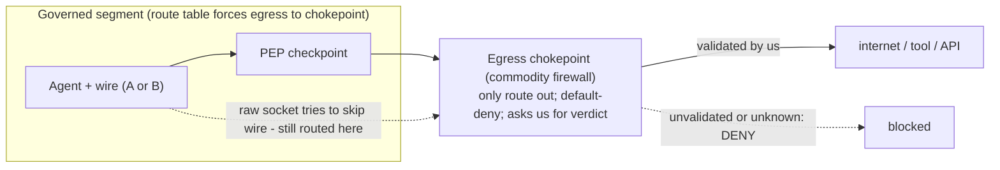

#### Step 3 — know the checkpoint is actually there (three-way reconciliation)
Three lists, each answering a different question:
- **Discovered** — every agent the **cloud APIs** say exists (pods / tasks / functions / instances) = *what is
  running.*
- **Onboarded** — agents registered in the **AegionAI control-plane registry** (from import, FR-7.7–7.9) =
  *what should be governed.*
- **Live check-ins** — wires that **announced themselves and heartbeat** = *what is actually guarded right now.*

*Registration mechanism:* on startup the wire makes an authenticated `POST /v1/register` (then periodic
`/v1/heartbeat`) call, authenticated by its **workload identity** (§3.5: SPIFFE SVID / IRSA token), carrying
`(tenant_id, agent_id, instance_id, version)`. No heartbeat ⇒ the guard is down or missing.

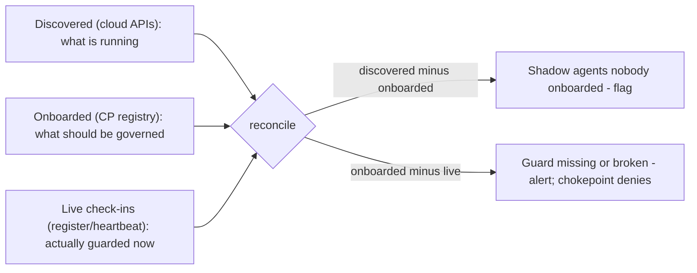
*Why it's necessary:* the CP registry tells us what to expect, the cloud APIs tell us what's really running,
and the check-ins prove the guard actually loaded — an onboarded agent whose wire failed to load looks fine
in the registry but is only caught by the missing check-in. *(On Kubernetes a **validating admission
webhook** can also reject an unguarded agent at deploy time; off-K8s we rely on detect + chokepoint-deny.)*

#### Why each step exists (one line each)
- **Wire** → so we can **see and act on** the action (and, with Wire A, see in-process calls).
- **Chokepoint + deny-by-default** → so **nothing reaches the outside without passing us**, even if a wire is missing.
- **Segment scoping** → so we inspect **only onboarded agents**, not the whole company's traffic.
- **Registration + reconciliation** → so we **know** which agents are guarded and catch the ones that aren't.

#### Catches (so no reviewer is misled)
- Wire A (in-process) is **bypassable by a hostile agent** → never rely on it alone as the boundary.
- The strong **auto-install (admission webhook) is Kubernetes-only**; other platforms are detect-fast +
  chokepoint-deny, not block-at-birth.
- The admission webhook is itself an **availability/coverage single point — its `failurePolicy` is a real
  decision**: `Fail` blocks *all* in-scope pod scheduling during a webhook outage (an availability incident);
  `Ignore` lets pods launch **unguarded** during the outage (a coverage hole). **Lean: `Ignore` + the
  three-way reconciliation backstop (Step 3) + chokepoint deny-by-default** — an unguarded pod is caught
  within seconds and can't egress ungoverned, trading a brief detect-window for not blocking the customer's
  deploys. Revisit `Fail` for high-assurance tenants. Tracked as **D-webhook (§15)**.
- The chokepoint needs the **customer to set the routing**, and **Lambdas must be VPC-attached** or they keep
  their own way out.
- Encrypted traffic: Wire B sees the destination but needs **§3.3** to read the body.
- The customer owns their cloud, so nothing is 100% against a malicious admin → we **attest** the
  webhook/routing are in place and alert on change (§12). Defense in depth, not an absolute.

#### 3.1.1 How Wire B attaches, per platform
A **variant** = the concrete way we physically insert the network-capture proxy into the agent's path. We
need several because **no single attach method works on every platform** (clouds restrict different things,
§13) — on a full K8s node you'd use 3B/3C, on Fargate you're forced to 3A, on Lambda you use the extension.

| Variant | How it attaches | Best where | Catch | Guarantee **without** egress lockdown |
|---|---|---|---|---|
| **3A Explicit proxy** | set `HTTPS_PROXY` so the agent dials the PEP | **anywhere incl. Fargate** (no privilege) | cooperative-ish (app can ignore the env var) | **capture only — cooperative, NOT (c)** |
| **3B Transparent redirect** | `iptables`/eBPF redirect in the agent's network namespace | EKS-EC2 / AKS / GKE-Standard | needs privilege; **eBPF blocked on Fargate & GKE Dataplane V2** | strong default vs. honest agents; still not a hard guarantee |
| **3C Mesh sidecar** | Envoy as a sidecar container (Istio-style) | EKS / AKS / GKE; Cloud Run / ACA multi-container | per-pod overhead; not for Lambda | strong default vs. honest agents; still not a hard guarantee |

> **Capture method ≠ guarantee level — don't conflate the two axes (CISO read).** The variant above decides *how
> richly we capture*; it does **not**, by itself, decide whether a *hijacked* agent can dodge us. **Non-bypass (c)
> against a hostile agent comes from one thing only: egress lockdown (route `0.0.0.0/0` → chokepoint + default-deny,
> §3.1 Step 2 / §7.3) on the governed subnet — not from picking 3A/3B/3C.** So the *lightest* option (3A, no network
> change) is **cooperative**: it gives capture and monitor-mode value with zero infra change, but a hijacked agent can
> ignore the env var → no (c). The customer adds egress lockdown **only when they want the hard guarantee**, on the
> **one governed subnet** (scoped blast radius, §7.4) — and for the regulated beachhead that is usually a *rule on an
> egress path they already operate and CAB-gate* (the same path that makes 3T-D work, §1.8.3), not greenfield
> re-plumbing. This is the progressive ladder (§1.7, §4.6): **scoped + cooperative + monitor-first → opt-in egress
> lockdown for (c)** — never a day-one wall. (The §7.3 residuals — DNS/lateral/PrivateLink/peered — persist regardless
> of variant *and* of subnet scoping; they are the customer's network architecture.)

**Serverless agents (Lambda / Functions) can't host a sidecar** — they use an in-execution-environment
extension instead:

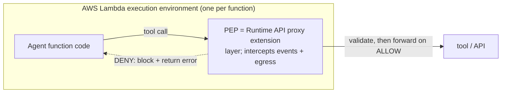

- **AWS Lambda → Runtime API proxy extension** (a layer; Rust/Go binary) that hooks the Lambda Runtime API to
  intercept/**block** the function's calls and route its egress — **no function code change** (AWS-documented).
- **GCP Cloud Run → 3C mesh sidecar** (Cloud Run supports multi-container).
- **Azure Functions → Wire A (SDK) or the connector** (no clean extension-proxy equivalent).

#### 3.1.2 Alternatives considered
- **eBPF / kernel capture (Cilium, Pixie):** capture at the kernel — most transparent, language-agnostic.
  *Catch:* needs privileged/kernel access → **blocked on Fargate & GKE Dataplane V2**.
- **Traffic mirroring (AWS VPC Traffic Mirroring / GCP Packet Mirroring):** copies traffic for **observation
  only**. *Catch:* can't block inline; Azure's vNet TAP is immature.
- **Ride the customer's existing egress proxy/firewall (§3.3, option 3T-D):** reuse what regulated orgs
  already run. *Catch:* depends on them already having it.

### 3.2 Traffic selection — deciding which connections to act on
A workload makes many outbound connections — some are agent *actions* we govern (a payment API call), many
are noise (package downloads, DNS, telemetry). "Traffic selection" answers, **per connection: (i) is this
from a governed agent, and (ii) is it an action we enforce on?** Four steps:

1. **Only governed agents reach the PEP at all.** We route *only* the agents we govern through the PEP (via
   3A/3B/3C). A workload the customer hasn't onboarded never touches us.
2. **Identify *who* is calling** — resolve the connection to `(tenant_id, agent_id)` from a credential the
   caller can't forge. **How this is set up and resolved is detailed in §3.2.1.**
3. **Identify *what* it's doing** — resolve the connection to a **logical tool** (and its policy) or, failing
   that, to a **destination**. **How the tool/endpoint is resolved is detailed in §3.2.2.**
4. **Decide whether to act** — matched governed tool → run the policy/floor (§2); a governed agent making an
   *unrecognized* call → configurable **monitor (log+allow)** by default, tightening to **deny** as
   confidence grows; non-governed traffic that slipped through → pass through untouched.

**Example:** a refund agent opens two connections — one to `api.stripe.com/refunds` (a recognized payment
tool → enforce policy) and one to `pypi.org` to fetch a library (not a governed action → pass through). The
PEP acts on the first and ignores the second.

**Both *who* and *what* are set up once at onboarding and resolved per request** — identification is not
magic; it is a registry built at onboarding and consulted at runtime. Two diagrams follow: first **who does
what at onboarding** (actors in columns), then **how a single request is resolved at runtime**.

**Onboarding — once per agent (who does what):**

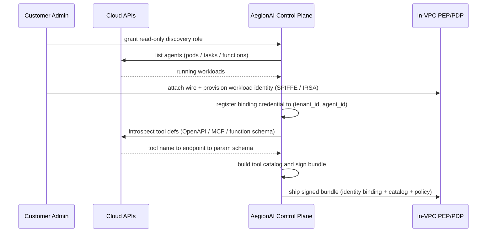

**Runtime — per request (how one call is resolved):**

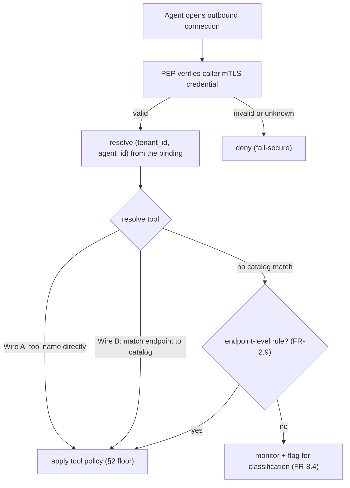

*The onboarding sequence above is the authoritative "who does what"; §3.2.1 (who) and §3.2.2 (what) detail
each step. Deployment-level rollout (connect → deploy → graduated enforce) is a separate concern — see §4.2,
not repeated here.*

#### 3.2.1 Identifying the agent (who)
*Set up once at onboarding:*
- The wire is attached and the agent's workload gets a **workload identity** — a **SPIFFE SVID** (issued by
  SPIRE) or a cloud identity (**AWS IRSA** / pod ServiceAccount) (§3.5.1).
- At enrollment we **register the binding `credential → (tenant_id, agent_id)`** in the control-plane
  registry (FR-10.3, per-agent credential) and ship it to the in-VPC PEP/PDP in the **signed bundle**.

*Resolved per request:*
- The PEP reads the caller's credential off the **mTLS** connection, **verifies** it, and looks up the
  binding → `(tenant_id, agent_id)`. **Never** a self-asserted request field.
- Fallbacks where no workload identity exists: **pod label / ServiceAccount** (trustworthy *because* the PEP
  was admission-injected, §3.1), then **source IP/subnet** (weak — supplements only).

#### 3.2.2 Identifying the tool/endpoint (what) — the binding, the catalog, two policy levels
Policy is written about a **tool** (`issue_refund`), but the PEP sees an **endpoint**
(`POST api.stripe.com/v1/refunds`). The customer does **not** type URLs — we build the **tool → endpoint
binding** at onboarding and consult it at runtime.

*Set up once at import:*
- **Introspect** the agent's tool definitions (FR-7.8) → build a per-agent **tool catalog**: each tool's
  **name ↔ endpoint (host/path/method) ↔ parameter schema**. Sources: Bedrock action-group **OpenAPI** /
  Lambda ARN, the **MCP manifest**, OpenAI/Azure function schemas, the LangChain tool registry. So
  `issue_refund` resolves to `POST /refunds` + the `amount` field automatically.
- Store the catalog in the CP registry; ship it to the PEP/PDP in the signed bundle → the PEP holds a local
  **`endpoint → tool → policy`** lookup table.

*Resolved per request:*
- **Wire A** knows the **tool name directly** (it intercepts at the tool boundary) → look up policy; it also
  records the endpoint it hit, **refining the catalog** for the network layer.
- **Wire B / network** has only **destination + protocol shape** → match against the catalog's endpoint
  patterns → resolve the tool, or fall back to **endpoint-level policy (FR-2.9)** for dynamic/unknown URLs.
- **No catalog match** → **Monitor + flag** for classification (FR-8.4); learned association then proposes a
  binding (FR-8.7).

This gives **two policy levels**, both supported:
- **Tool-level (logical)** — "`issue_refund` ≤ $1000." Needs the binding (introspection or Wire A).
- **Endpoint-level (physical)** — "allow `POST api.stripe.com/refunds`, deny other egress." Maps to traffic
  **directly, no binding needed** — this is **FR-2.9**, the primitive the network path / chokepoint enforces.

**The gap (be explicit):** a **generic "make an HTTP request" tool** where the agent builds the URL at
runtime *can't* be pre-bound. Wire A still tags it in-process; **network-only (Wire B / chokepoint) falls
back to endpoint-level rules (FR-2.9)** — coarser, but non-bypassable. Precise *tool-level* policy on such
tools needs Wire A.

### 3.3 TLS — what we must decrypt, and *who* decrypts it
Almost all agent egress is **HTTPS (encrypted)**. The rule of thumb:
- to check only the **destination / volume** (which host, how much data) — **nobody** decrypts; the visible
  metadata (SNI, destination IP, byte counts) is enough.
- to check **parameters / content** (refund ≤ limit, injection in the body) — **someone must decrypt** the
  call first.

Inside the boundary the engine always needs the decrypted body to run content checks (redaction happens
*after* decryption, before anything leaves — see FAQ-2). So the real question is never "encrypted vs not";
it is **who terminates the TLS** — covered by the four options in §3.3.4.

#### 3.3.1 What TLS interception ("MITM") actually means
To read an HTTPS body, a proxy has to **terminate the agent's TLS connection and open a fresh one to the
real site** — i.e. it sits in the middle. Step by step:
1. the agent opens an HTTPS connection believing it is talking to, say, `api.stripe.com`;
2. the proxy answers instead, presenting **its own certificate** for `api.stripe.com`, signed by a
   **Certificate Authority (CA)** the agent has been configured to trust;
3. the proxy decrypts the request, inspects (and optionally redacts) it;
4. the proxy re-encrypts and forwards it to the real `api.stripe.com`, then relays the response back.

This is a deliberate **man-in-the-middle (MITM)** — also called "break-and-inspect." It is the standard
mechanism every enterprise egress proxy uses (Zscaler, Palo Alto, AWS Network Firewall, GCP NGFW).

#### 3.3.2 The three costs of running the MITM yourself
1. **The CA private key becomes a crown jewel.** Whoever holds it can impersonate *any* site to those
   agents; if it leaks, an attacker can MITM the customer's traffic at will. It must be secured and rotated
   like a root secret.
2. **It breaks certificate pinning.** Some clients/SDKs pin the exact cert they expect and will **refuse**
   the proxy's substitute → the connection fails. Many cloud SDKs and security-sensitive APIs pin.
3. **It is detectable.** The agent can tell it is talking to a proxy cert, not the real site.

#### 3.3.3 Who creates the CA, who holds the key, and why we ride the customer's (FAQ-4, FAQ-5, FAQ-6)
**In our recommended model we run no CA and hold no CA private key.** Two cases:
- **Default (3T-D — ride the customer's existing inspection):** large/regulated customers usually
  **already run outbound TLS inspection** at a central egress point, *with their own internal CA already
  trusted by every workload*. We create nothing and hold no key — we **consume their already-decrypted
  feed**. This is standard enterprise practice; riding it asks the customer for **nothing new**. Where it
  already exists:
  - **AWS** — Network Firewall egress TLS inspection (decrypt → inspect → re-encrypt; NAT-GW + PrivateLink).
  - **Azure** — Azure Firewall Premium TLS inspection (clients must trust the org Root/Intermediate CA).
  - **GCP** — Secure Web Proxy (SWP) and/or Cloud NGFW Enterprise (certs via Certificate Authority Service + Certificate Manager).
  - Or a third-party egress proxy (Squid SSL-bump, Zscaler, Palo Alto).
- **Fallback (3T-A — we MITM):** if a customer has no existing inspection and still wants network-layer
  content, the CA should be minted in the **customer's own private-CA service** (AWS Private CA / Azure Key
  Vault Managed HSM / GCP Certificate Authority Service). The **private key stays in the customer's
  KMS/HSM** — per-tenant, short-lived, scoped to named destinations, never exported, **never in AegionAI's
  cloud**. The **customer admin** installs the public CA cert into the agents' trust store.

> **On "a per-tenant CA in the VPC":** a CA key does **not** live "in a VPC" — it lives in a regional,
> account-scoped **KMS / HSM / private-CA service**, not a VPC resource, so there is no "CA-per-VPC" limit.
> Clouds cap CAs by **per-account/per-region service quota** (adjustable), not by VPC.

> **Never MITM our own channels** (PEP↔PDP, data-plane↔control-plane) — those are our own mTLS with pinned
> certs (§3.5).

#### 3.3.4 The four options
| Option | Who decrypts | We see body? | CA liability |
|---|---|---|---|
| **3T-B Metadata-only** | nobody (passthrough) | no — SNI / destination / volume only | none |
| **3T-C Hybrid: metadata + SDK for content** | the SDK, at the app layer (already plaintext) | yes, via SDK | none at the network layer |
| **3T-D Ride the customer's existing egress inspection** | the customer's egress firewall/proxy (their CA) | yes, from their decrypted feed | **customer's, not ours** |
| **3T-A We MITM (fallback only)** | our PEP, via a CA in the agent trust store | yes | CA key in the **customer's** KMS/HSM — avoid unless 3T-C/3T-D unavailable |

#### 3.3.5 Lean
Default **3T-B / 3T-C** (metadata + SDK; no CA we own). Where a customer needs network-layer content
*without* the SDK, prefer **3T-D** (ride their existing egress inspection) over **3T-A**. We become a CA
only as a last resort, and even then the key lives in the customer's KMS/HSM — **we are never a new CA
liability**. (What 3T-C alone already covers without any MITM: FAQ-3.)

### 3.4 Where the brain sits, and how things connect

**3.4.1 Agent ↔ brain (PEP → PDP), by brain placement.** "In-boundary" is the customer's cloud/org, not
necessarily the agent's VPC (§1.5). Three topologies, increasing isolation:

| Topology | Brain location | PEP → PDP connectivity | Notes |
|---|---|---|---|
| **Same VPC** | agent's VPC | localhost / cluster service / mesh | lowest latency; simplest; least isolation |
| **Different VPC, same account** | peer VPC | **VPC peering** / Transit Gateway / VNet peering | clean network separation |
| **Separate managed account** (recommended for Dedicated) | an **AegionAI-managed account inside the customer's Org/tenant/project** | **PrivateLink / PSC / Private Link** | best separation of duties; we operate our account; customer's agent account only exposes an endpoint |

**3.4.2 Brain ↔ control-plane (uplink to AegionAI).** Prefer **private** transport; fall back to public mTLS.
- AWS: **PrivateLink**. Azure: **Private Link**. GCP: **Private Service Connect**. All are **same-cloud
  only** — no cross-cloud private links exist, so the AegionAI control plane needs **presence in each
  cloud** (or accept public-internet mTLS egress).
- Self-Managed/air-gapped: **no uplink** — bundles/weights side-loaded; telemetry exported to the
  customer's own sink (their SIEM), optionally batched out manually.

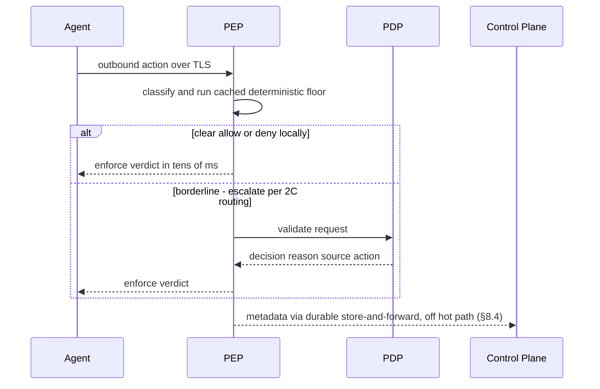

> **Escalation (per action) vs. refresh (per policy change) — two different "go to PDP" events, don't
> conflate them:** *Escalation* is decided **per request** by the §2C routing logic (high-risk tool /
> untrusted content / soft-flag / non-`request` phase) — **not** by any timer. *Bundle refresh* is the
> §2.1 freshness mechanism (push + TTL backstop) and happens **per policy change**, asynchronously, off
> the request path. A request never waits on a TTL.

### 3.5 Authentication & identity (every hop)
Every hop is **mutually authenticated** and uses **no static long-lived secrets**. Three trust boundaries:

**3.5.1 Agent → PEP (which agent is this?).** The PEP must bind each call to an authentic
`(tenant_id, agent_id)` — **never a self-asserted field** (FR-10.3). Sources, strongest first:
- **Workload identity (preferred):** the agent presents a **SPIFFE SVID** (Secure Production Identity
  Framework For Everyone — a short-lived X.509 cert, auto-rotated, issued by **SPIRE**) or a cloud workload
  identity (Kubernetes ServiceAccount token, AWS IRSA); the PEP verifies it via mTLS.
- **Platform identity:** pod label / service account from the orchestrator — trustworthy *because* the PEP
  was injected by admission control (§3.1).
- **Network identity (fallback only):** source IP/subnet — weak, supplements the above.

**3.5.2 PEP ↔ PDP (in-VPC, hot path) — mutual TLS.** Both sides present and verify certificates via
**SPIFFE/SPIRE**: SPIRE issues short-lived SVIDs to PEP and PDP; Envoy/our proxy consume them through the
**SDS (Secret Discovery Service)** API; certs auto-rotate and are never written to disk. This stops a rogue
in-VPC workload from impersonating the PDP (and feeding fake "ALLOW" verdicts) or impersonating a PEP.

**3.5.3 Data plane ↔ AegionAI control plane (the uplink).** Two phases:
- **Bootstrap / enrollment (once), with no pre-shared secret** — the data plane proves identity using
  **cloud workload identity federation (OIDC — OpenID Connect)**: **AWS IRSA** (IAM Roles for Service
  Accounts), **Azure Workload Identity**, or **GKE Workload Identity** mint a cloud-signed OIDC token, which
  the data plane exchanges with the control plane for a **per-tenant client certificate** + bootstrap token.
  (SPIRE can itself act as the OIDC issuer.) Optional **attestation** (TEE measurement, §6) gates this for
  high-assurance tenants.
- **Steady state — mTLS** with the per-tenant cert (auto-rotated). The control plane authenticates the data
  plane and binds it to `tenant_id`; the data plane authenticates the control plane via a **pinned** server
  cert **and** independently **verifies every policy bundle's signature** (§2C), so even a spoofed control
  plane can't push an "allow-all".

**3.5.4 Human / API access.** Console + management APIs use **OIDC + RBAC** (FR-8.5), federated to the
customer's IdP (Identity Provider).

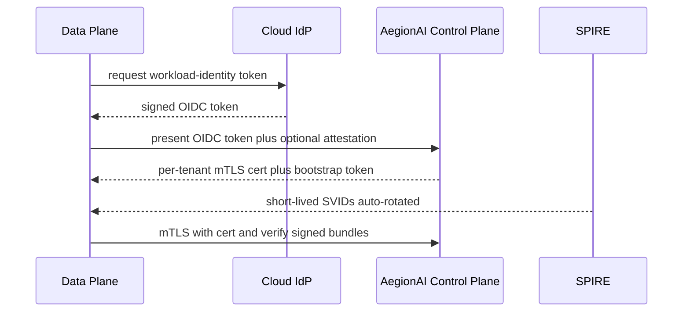

**Principles:** mutual auth on every hop; **no static long-lived secrets** (workload-identity federation +
short-lived SVIDs); auto-rotation; tenant binding from a **verified** credential, never a request field;
least-privilege per credential. *(Open: exact SVID lifetime + rotation cadence — D9, §15.)*

---

## 4. Customer Experience (the most important section)

Goal: **minimal touchpoints, monitor-first, reversible.** The customer should get an agent under
governance without rewriting it, and never be one config error away from an outage.

### 4.1 Integration model by interception choice
| Path | Customer does | Code change | Coverage | Best for |
|---|---|---|---|---|
| **SDK** ([LLD 23](23-sentra-guard-sdk.md)) | one wrapper per tool / framework hook | yes (small) | in-process **and** network actions, effect-capture for rollback | fastest start, in-process agents |
| **Connector** ([LLD 15](15-cross-cloud-connectors.md)) | point Bedrock action-group Lambda / Azure Function at us | no agent code | networked tool calls | Bedrock/Azure managed agents |
| **Network sidecar (this LLD)** | deploy data plane (Helm/Terraform) + route egress | **none** | network-egress actions, non-bypassable | scale, framework-agnostic, in-VPC editions |

### 4.2 Onboarding flow (network sidecar)

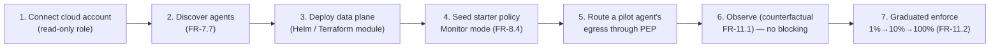

### 4.3 Concrete touchpoints (what the customer actually configures)
1. **IAM/role**: a scoped role for the deploy automation + (Dedicated) a managed role we operate.
2. **Deploy artifact**: a **Helm chart** (K8s) or **Terraform module** (ECS/ACA/Cloud Run/VM) that
   stands up the PDP fleet + PEP. Pinned image digests; values for sizing, fail-mode, editions.
3. **Egress routing**: one of — set `HTTPS_PROXY` on the agent workload (3A), enable sidecar injection
   label (3C), or apply the netns redirect (3B). Plus the **egress-lockdown** SG/NSG/firewall rules.
4. **(Only if content visibility needed)** install the **proxy CA** into the agent's trust store (3T-A).
   We make this opt-in and per-destination, and loudly document the trade-off.
5. **Policy binding**: starter policy auto-seeded in **Monitor mode** (FR-8.4) so nothing is ever
   unpoliced and no wall of denials on day one.
6. **Console — provided by AegionAI, nothing to configure**: the SOC dashboard (discovered agents,
   decisions, counterfactual "what would block") is delivered by the **AegionAI platform** — hosted by us
   for Serverless/Dedicated, or run in-boundary for air-gapped Self-Managed. The customer just logs in;
   this is not a customer build/config step.

### 4.4 Day-2 experience
- **Promotion**: graduated rollout UI (FR-11.2) with auto-rollback on FP spike.
- **Override/appeal**: per-case "why blocked" + audited override (FR-11.3).
- **Off switch**: per agent / per tool / global disable (on-by-default but customer-controlled).
- **Upgrades**: ring rollout we operate (Dedicated) or a one-command bump (Self-Managed) — §8.

### 4.5 Effort / friction matrix
| Dimension | SDK | Connector | Network sidecar |
|---|---|---|---|
| Time-to-first-decision | minutes | ~1 hr | hours–1 day (infra deploy) |
| Code change | small | none | none |
| Infra to run | none (Serverless) | none | **data-plane compute in CX account** |
| Coverage | broadest | medium | network-egress (non-bypassable) |
| Latency | network RTT (Serverless) | RTT | local floor + in-VPC RTT |

**Principle:** lead onboarding with **SDK/connector** for instant value; introduce the sidecar when the
customer needs non-bypassable coverage or in-boundary data residency. They compose.

### 4.6 What it takes to onboard (prerequisites & effort)

**Prerequisites the customer must provide** (sidecar / in-VPC editions):
| Prerequisite | Why | Who |
|---|---|---|
| **Cloud account access** — a scoped deploy role (and, for Dedicated, a managed role we operate) | stand up the brain + PEP | customer cloud admin |
| **Compute budget in their account** — CPU by default; GPU only if opted in | run the brain (PDP) (§9) | customer (it's BYOC; they pay their cloud) |
| **Network-change capability** — set egress routing + **egress-lockdown** rules | route governed agents through the PEP and make it non-bypassable (§3.1, §7.3) | customer network/platform team |
| **(Optional) trust-store access** — install proxy CA | only if content visibility via MITM is wanted (§3.3) | customer — opt-in |
| **Identity source** — pod identity / mTLS / SPIFFE | verified agent identity (FR-10.3) | customer platform |

**Onboarding steps by edition:**
| Step | Serverless (no infra) | Dedicated (managed in-VPC) | Self-Managed (air-gapped) |
|---|---|---|---|
| 1. Connect | API key | read-only discovery role + managed account/VPC | offline package + signed license |
| 2. Discover agents | import (FR-7.7) | import (FR-7.7) | manual inventory |
| 3. Deploy brain | nothing (we host) | Helm / Terraform (we operate) | customer runs Helm / Terraform |
| 4. Route a wire | add SDK / connector | route pilot agent egress to PEP | route + side-load weights |
| 5. Seed policy | Monitor mode (FR-8.4) | Monitor mode | Monitor mode |
| 6. Observe | counterfactual (FR-11.1) | counterfactual | counterfactual (local) |
| 7. Enforce | graduated (FR-11.2) | graduated | graduated |

**Rough effort / time-to-value:**
| Edition | First decision (monitor) | First enforce | Heaviest task |
|---|---|---|---|
| Serverless | minutes (SDK) / ~1 hr (connector) | same day | none (we host) |
| Dedicated | hours–1 day | days (after observe period) | provisioning compute + egress routing |
| Self-Managed | 1–3 days | days–weeks | customer-run deploy + air-gap bundle handling |

**The friction-minimizing path (ties to the progressive-onboarding tenet §1.7):** start any customer on
**SDK/connector in Monitor mode** for instant, zero-risk value; stand up the sidecar in parallel; never
ask for egress-lockdown or CA install until the customer has already seen value and chosen to enforce.

---

## 5. Infrastructure — shipping binaries and model weights

### 5.1 Image build
- **OCI image**, multi-stage → **distroless / `scratch`** base, **single static Rust binary**, no shell,
  no package manager, stripped symbols. Aligns with "lightweight Rust/Go" (ARCHITECTURE tech stack).
- **Signed** with cosign/sigstore; **SBOM** attached; base pinned by digest; admission control verifies
  signature before run.
- Separate images: **PDP** (engine+runtime), **PEP** (thin proxy + cached floor), optional **redaction**.

### 5.2 Weights packaging — 3 options
| Option | Mechanism | Pros | Cons |
|---|---|---|---|
| **5A Baked into image** | weights as image layer | one artifact; simplest; works air-gapped | huge image; rebuild to rotate; weights sit in registry (IP) |
| **5B Pulled at startup (recommended)** | image has no weights; fetch **signed** weights from artifact store over mTLS, verify, cache on **encrypted volume** | small image; rotate without rebuild; **gate delivery on attestation** (§6); air-gap via side-load | startup dependency; needs artifact store + key mgmt |
| **5C Streamed/lazy** | memory-map from object store | minimal disk | runtime dependency on object store; complexity; weak air-gap |

**Lean:** **5B** (with **5A side-load** for air-gapped Self-Managed). Format: **ONNX (ONNX Runtime)** or
GGUF/safetensors (candle) for CPU; distilled model is tens–hundreds of MB so pull-at-startup is cheap.

### 5.3 Delivery & registry strategy
- **Dedicated**: we operate; images mirrored to a registry the customer's account can pull (ECR/ACR/AR)
  via a pull-through cache or replicated repo; weights from our signed artifact store via private link.
- **Self-Managed**: **signed bundle** (image tarball + weights + policy) delivered out-of-band; verified
  by signature against a key shipped via a separate trust channel.
- **Versioning**: semver on binary; content-hash on weights and policy bundles; **decouple** so a
  weight/policy update is **data (hot-reload)**, not an image swap (§8.2).

### 5.4 Bootstrap/enrollment flow

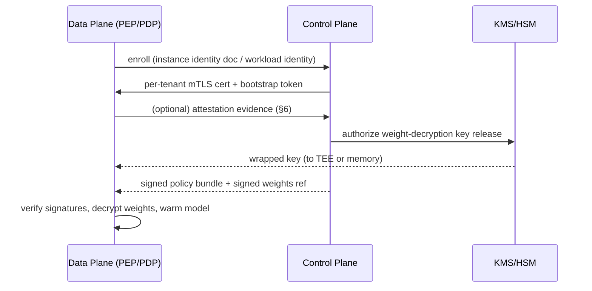

---

## 6. IP Protection — code and weights

**Hard truth:** in an environment the customer fully controls (root, memory dumps, disk snapshots), you
**cannot guarantee** code/weights secrecy. You raise cost and/or use hardware TEEs. Strategy = **tier the
IP** + optional **confidential computing**.

### 6.1 IP tiering (do this regardless)
- Ship only the **distilled** model in-boundary (a lossy derivative — lower value if leaked).
- Keep **teacher model, training data/pipeline, Sigma-rule authoring, red-team corpus** in our cloud.
- Plan for the distilled model to possibly leak; ensure that is survivable (the moat is the *pipeline*
  + cross-customer signal flywheel, not the static weights — see STRATEGY §3).

### 6.2 Technical protection — 3 options
| Option | Mechanism | Protection | Cost / constraint |
|---|---|---|---|
| **6A Encrypted-at-rest + runtime decrypt** | weights encrypted; key released at startup (KMS), decrypted in memory | deters disk snapshot, registry scrape | **key + plaintext in RAM** → root can dump; weak vs determined CX |
| **6B Confidential computing (TEE)** | run PDP in AMD SEV-SNP / Intel TDX VM or Nitro Enclave; **attest** before **secure key release** (SKR); memory encrypted from host | strong — even host/root can't read memory | **CPU TEE on all 3 clouds; GPU TEE only Azure (preview)**; instance-type constraints (collides with §9 "no compute"); ops complexity; attestation maturity varies (GCP weakest) |
| **6C Obfuscation / split-model** | obfuscated binary; keep last layers/critical head server-side, run trunk in-boundary | marginal (6C-obfusc) / strong (6C-split, but re-adds egress) | obfuscation buys little vs experts; split re-introduces a network hop + content egress |

**Lean:** **6A as the floor everywhere**, **6B (CPU TEE)** as the opt-in "high-assurance IP protection"
tier for regulated buyers who *also* want it (note: they often care more about *their* data staying in
than *our* weights — the boundary already gives them that). Use Nitro Enclave (AWS), Confidential
VM/Container (Azure — most mature), Confidential VM (GCP, CPU-only). **Do not** promise GPU-TEE
cross-cloud. Combine with 6A tiering always.

### 6.3 Attestation + secure key release (6B detail)
Boot → measure (vTPM/PCRs or enclave measurement) → present evidence to control plane / Azure Attestation
/ Nitro attestation → control plane authorizes KMS to release the **weight-decryption key** *only* to an
attested, unmodified data plane. A tampered image fails attestation → no key → no weights → fail-secure.

---

## 7. Security — posture and per-failure-point mitigations

### 7.1 Posture summary
The data plane is a high-value asset in someone else's environment, on the critical path. Posture:
least-privilege, signed-everything, fail-secure, defense-in-depth, separate trust domains, no raw-content
retention. **Two boundaries stated up front, not buried:** (1) the network PEP is **preventive-only** — it
blocks *before* an action runs but has **no effect-capture handle, so it cannot roll back an action it
ALLOWED** (§14); rollback requires the SDK. (2) Non-bypass is **scoped and conditional** (§7.3).

### 7.2 Threat / failure-point matrix (every point + mitigation)
| # | Failure / threat point | Impact | Mitigation (plain English) |
|---|---|---|---|
| S1 | **MITM CA private key stolen** (3T-A) | attacker can impersonate *any* site to the agents | **Prefer to hold no CA at all:** default to metadata-only (3T-C) or ride the customer's existing TLS inspection (3T-D), so there is no key of ours to steal. If we must decrypt ourselves (3T-A), the CA is created and kept in the **customer's** key vault (KMS/HSM), is short-lived, valid only for a named list of destinations, rotated regularly, and alerted on use (§3.3.3). |
| S2 | **Agent bypasses the PEP** by opening a direct socket | an action goes out ungoverned | **Lock the network so the only way out is through us:** the firewall / security-group rules drop any governed-agent traffic that didn't pass the PEP (deny-by-default egress). We also flag tools that were never wrapped and alarm on any unexpected direct egress. |
| S3 | **PEP/PDP container compromised** | attacker tampers with verdicts or reads content | **Give the container as little power as possible:** strip OS privileges (run it in a locked-down sandbox — seccomp/AppArmor), grant low-level network rights only where unavoidable, run a tiny image with no shell (§5.1), and optionally inside a hardware-encrypted enclave (TEE, §6.2). |
| S4 | **Malicious/compromised control plane** pushes an "allow-all" policy | mass permit | **The PEP only trusts *signed* policy, and the signature can't be forged:** the signing key lives in a separate locked vault (HSM, requires two-person control) that even a full control-plane breach can't reach; the PEP checks the signature before loading; every push is written to a tamper-evident log; if anything is off, the PEP falls back to its safe local rules (§2C). |
| S5 | **Weights/binary tampered in the supply chain** | backdoored detection | **Verify everything before it runs:** images and weights are cryptographically signed and ship with a parts-list (SBOM); the key that decrypts the weights is released only to an unmodified, attested instance (§6.3); image versions are pinned by exact digest and checked at startup. |
| S6 | **Flood of requests** (DoS) on the validate endpoint / proxy | latency spike or outage | **Shed load safely, never open the gate:** per-agent rate limits, bounded queues with backpressure, and — if the heavy ML path is swamped — fall back to the fast local rules. It degrades; it never fails open. |
| S7 | **Plaintext content exposed** after TLS is terminated (or to an AegionAI operator) | confidentiality breach | **Strip sensitive data and keep content local:** redact secrets/PII inside the boundary before anything leaves (FR-3.13), never store raw content (NFR-7), and limit + audit operator access. In the in-VPC editions content never leaves the customer's cloud at all. |
| S8 | **One tenant sees another's data** on the shared PDP fleet | cross-tenant leak | **Hard-separate tenants:** every record is tagged and filtered by tenant id (FR-10.1), each tenant has its own certificate, and customers needing physical isolation can run a PDP dedicated to them. |
| S9 | **Identity spoofing** (an agent claims to be another) | privilege escalation | **Identity comes from a verified credential, never a self-claimed field:** the PEP reads the agent's identity from its mTLS/SPIFFE certificate, which can't be forged (FR-10.3). |
| S10 | **Stale / rolled-back policy** served | old, too-loose rules get enforced | **Track versions and refuse stale bundles:** each bundle is versioned and freshness-checked, expired bundles are rejected (fail-secure), and we alert if any PEP lags the current version (§2.1). |
| S11 | **Update channel intercepted** (MITM) | bad image/weights delivered | **Authenticated, signed, private delivery:** updates travel over mutually-authenticated TLS with pinned certs, every artifact's signature is verified, and we use private cloud links where available. |
| S12 | **Audit/telemetry/metering records lost or tampered** | lost forensics / missed billing | **Durable, tamper-evident, off the hot path:** records are hash-chained (any tampering is detectable) and written to a **local durable buffer first, then shipped with retry until the destination acknowledges** (store-and-forward, §8.4) — so nothing is lost even if the uplink or AegionAI is down. Written off the request path so it never slows a verdict (FR-6.1). |

### 7.3 Non-bypass is conditional and *scoped* (state it plainly)
The precise claim is: **non-bypassable for direct internet egress from the governed segment, given egress
lockdown enforced.** Without egress lockdown it is a strong default, not a guarantee — a documented deployment
requirement, verified at onboarding and attested (§12). **Egress lockdown — not the capture variant (3A/3B/3C) — is
what delivers (c); the lightest, network-change-free option (3A) is *cooperative* and gives capture, not the hard
guarantee (see the guarantee-level column in §3.1.1).** Even *with* lockdown, default-deny on `0.0.0.0/0` to the
chokepoint does **not by itself** cover the residual exfil/bypass paths below — a hijacked agent doesn't need a
raw internet socket, it needs **any reachable hop that egresses**. Enumerate them as known gaps and close each:

| Residual path | Why default-deny-to-chokepoint misses it | Mitigation |
|---|---|---|
| **DNS-based exfil** | data tunnelled in DNS queries to the resolver, not a blocked socket | route DNS through the chokepoint / inspect resolver logs; deny direct `:53` egress |
| **VPC-internal lateral movement** | agent calls a *different* in-VPC service that then egresses on its behalf | the egressing service must itself be governed or in a deny-egress segment; micro-segmentation |
| **VPC endpoints / PrivateLink to cloud services** | traffic to S3/etc. never hits the internet route, so the `0.0.0.0/0` rule doesn't apply | endpoint policies + govern the cloud-service calls (connector/SDK), not just internet egress |
| **Peered / Transit-Gateway networks** | a peered network may offer its own egress | peering routes must also point at the chokepoint, or the peer must be deny-egress |

The sidecar's guarantee is **bounded to direct internet egress from the governed segment**; the paths above are
the customer's network-architecture responsibility, called out here so the claim is not oversold.

### 7.4 Egress-routing reconfiguration — change management (the biggest single ask)
Re-pointing a regulated VPC's egress route at our chokepoint is the **largest change-management item in the
whole design** — it touches production network plumbing under strict change control. It gets its own
rollout/rollback/risk handling, **not** a config line item (§4.3 item 3):
- **Staged rollout:** apply to a **pilot subnet** with a handful of agents first; verify every expected
  destination still reaches (destination-reachability **synthetic canary**, §12.2) before widening
  segment-by-segment.
- **Rollback:** the route change is a single declarative artifact (Terraform/Helm-managed route table); a
  one-step revert restores direct egress. Keep the prior route table versioned; **rehearse the revert** before go-live.
- **Blast radius:** scoped to the **governed segment only** (§3.1) — a bad route black-holes only onboarded
  agents, not the whole account, and only until reverted.
- **Risk if misapplied:** an over-broad route black-holes legitimate egress (availability); forgetting the
  lockdown half leaves a direct path (coverage). Both are caught by reconciliation (§3.1) + the
  destination-reachability canary **before enforce is turned on**.
- **Customer ownership:** the customer's network team owns and approves the change through their normal CAB; we
  provide the artifact, the pilot plan, and the revert — we **cannot and do not mutate their routes silently**.

---

## 8. Resilience

### 8.1 Failure-scenario matrix
| Scenario | Without mitigation | Mitigation | Resulting behavior |
|---|---|---|---|
| **PDP unreachable** (PEP up) | escalations fail | **cached deterministic floor (FR-1.7)** keeps enforcing; ML pauses | agents keep running on hard rules (secure) |
| **PEP down** (3A explicit proxy) | agent egress fails (proxy unreachable) | health-checked PEP, multiple replicas, connection retry; fail-mode config | fail-secure (block) or degrade per `fail_mode` |
| **PEP down** (3C sidecar) | pod can't egress | readiness gating, restart, keep old until new healthy | brief local block; recovers |
| **Control plane unreachable** | no policy/weight updates, no telemetry uplink | run on last **signed cached** bundle+weights; **durable spool** buffers telemetry/audit/metering (§8.4); never open | enforcement continues on cached state; records drain on recovery |
| **Bad image rollout** | fleet-wide outage | **ring + canary rollout, auto-rollback on SLO breach**, signed digests | blast radius capped to canary |
| **Bad weights/policy** | mass FP or FN | **shadow → graduated promote (FR-11.2)**, auto-rollback; data hot-reload independent of binary | revert in seconds, no restart |
| **Overload** | latency blowup | bounded queues + backpressure + fail-secure; autoscale | graceful degrade, never open |
| **Clock/cert expiry** | mTLS breaks | cert auto-rotation, expiry alerts, grace window | uninterrupted |

### 8.1.1 Per-tool fail-mode — the availability-vs-security decision (D-failmode)
§1.7's "fail-secure by default" and the `fail_mode` config (§4.3/§8.1) must be reconciled honestly: for a
business-critical agent, **fail-secure during a PDP/control-plane outage stops the business**, and the tools
that hurt most are exactly the ones the cached floor can't save. A high-risk tool is flagged `requires_ml`
(§2C) → it **always escalates** → when the PDP is unreachable there is **no local verdict** for it, so
fail-secure **blocks** it. That is a blast-radius event our *own* outage triggers. So fail-mode is **per-tool,
not global**:

| Tool class | Floor can decide alone? | Default on PDP-unreachable | Customer override |
|---|---|---|---|
| Low/medium-risk (no `requires_ml`) | yes — Cedar+Sigma terminal | **floor decides** (no outage impact) | rarely needed |
| **High-risk (`requires_ml`: money-movement, data-export)** | **no — defined to need ML** | **fail-secure = DENY** (business stops) | **opt-in fail-open on named tools**, customer owns residual risk |

- We **default secure** on every tool; the high-risk fail-open is **opt-in, per-named-tool, audited**, and the
  **residual-risk owner is the customer** (documented and signed off at onboarding).
- Mitigations that shrink the dilemma before anyone picks fail-open: **PDP HA + multi-AZ** (make "unreachable"
  rare); a **degraded-floor verdict** for some high-risk tools (e.g. tighter Cedar bounds that hold without ML)
  so they aren't *all* hard-blocked; force-central staleness handling (§2.1) keeps the *floor* current.

This is the #1 thing an enterprise architecture review pushes on — surfaced here as an **open decision
(D-failmode, §15)** rather than buried under a blanket "security wins" tenet.

### 8.2 Update strategy (decouple data from binary)
- **Hot-reload** (no restart): policy bundles, Sigma rules, weights, thresholds, fail-mode.
- **Binary update** (restart): PEP/PDP image — done via **blue-green at the proxy** + ring rollout
  (canary VPC/agent slice → wider) + **auto-rollback** on latency/error/FP SLO breach.
- **Failure posture during restart:** cached floor (FR-1.7) keeps enforcing so a restart neither opens
  nor stalls the agent. Connection draining + readiness gates avoid dropped calls.

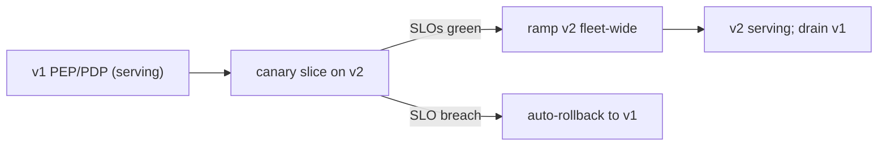

### 8.3 SLOs (inherited) & the in-VPC latency budget
Enforcement availability (local, fail-secure) ≥ 99.99% — always returns a *safe* decision; control-plane
99.9%→99.99%. The full latency model lives in [LLD 24](24-latency-optimization.md); the load-bearing numbers for
*this* (in-VPC) path are stated here, since **latency is the adoption risk** for an inline proxy:

| Path | What dominates | Rough budget (in-VPC) |
|---|---|---|
| **Common path — floor decides locally** | Cedar+Sigma over cached bundle, **no network hop** | **single-digit–tens of ms**; no PEP→PDP RTT |
| **Escalated — high-risk / untrusted content** | PEP→PDP **in-VPC RTT** (same-VPC/peering, low single-digit ms) + **distilled-CPU-model inference** (tens–hundreds of ms) | **dominated by inference** |

**Reading the budget:** the in-VPC path runs the *distilled CPU model*, not the cloud LLM tier, so LLD 24's
published p99 targets (≤500 ms deterministic, **≤900 ms ML-hot**, ≤2.5 s Sonnet-escalation) **size the cloud/
Serverless path** and are a *ceiling* the in-VPC distilled path is expected to beat, not a like-for-like budget.
LLD 24 does **not** separately publish the in-VPC PEP→PDP RTT — **target ceiling ≤ 5 ms p99** (same-VPC /
peering, mTLS) as a placeholder; **fold the measured RTT back in when LLD 24 M1 runs**.

**Assumption to validate (not yet measured — LLD 24 M1 instruments escalation rate):** only a **small minority**
of calls escalate (allowed tool + in-bounds params + no untrusted content decides locally, §2C). The added p99 on
*always-escalate* high-risk tools is therefore the inference time above **on every call** for those tools; the
common-path p99 is the floor only. If the escalation fraction turns out high, in-VPC RTT + inference become the
binding budget and the fleet must be re-sized (§9.2).

### 8.4 Telemetry, audit & metering delivery durability (store-and-forward)
Verdicts are returned on the hot path; the **records about them** — audit, telemetry, metering — must reach
AegionAI (or the customer's SIEM) **without loss even if the uplink or AegionAI is down**. Fire-and-forget
async drops data on any outage, so delivery is **durable store-and-forward**, not best-effort:
1. **Write locally first.** Each record is appended to a **local durable buffer** (an append-only spool on
   an encrypted volume) *before* it is acknowledged — surviving process crash, restart, and uplink loss.
2. **Ship with retry.** A separate shipper drains the spool to the control plane (or, air-gapped, to the
   customer's SIEM) with backoff; a record is removed only after the destination **acknowledges** it
   (**at-least-once** delivery). The hot-path verdict never waits on this.
3. **Dedupe on ingest.** Because delivery is at-least-once, every record carries an idempotency id and the
   receiving side dedupes (§11.4) — at-least-once + dedupe ≈ exactly-once in effect.
4. **Bounded, with an explicit overflow policy.** The spool is disk-bounded. On a sustained outage,
   **audit and metering records take priority** (back-pressure or alert rather than drop — they are
   compliance/billing-critical); low-value operational telemetry may be sampled or shed oldest-first. The
   policy is configurable; the default **never silently drops audit or metering**. *(Open knob — D-spool,
   §15: exact spool size, transport, and whether audit may degrade under extreme disk pressure.)*
5. **Air-gapped / Self-Managed.** No uplink — the spool is exported to the customer's own sink (their SIEM)
   and metering is the signed local ledger (§10.1, option 10B); same durability, different destination.

This is the pattern mature log/metric shippers use (Fluent Bit / Vector / OpenTelemetry Collector file
buffers). It backs **S12** (audit), **§10** (metering), and the "buffer telemetry" line in §8.1.

---

## 9. Scalability

### 9.1 Scaling model
- **PDP fleet**: **stateless *compute* workers** behind an internal LB — the per-request verdict runs from
  in-memory floor + model and needs **no shared state**, which is what lets workers **horizontally autoscale**
  on QPS / queue depth / CPU (distilled CPU model scales cheaply, ARCHITECTURE §2.6). GPU only for
  escalation/offline re-scoring, **opt-in**.
- **PEP**: scales with the agent workload (per-pod/per-node); near-zero marginal cost.
- **Cascade**: cheap deterministic floor short-circuits; ML runs only on the borderline subset
  (LLD 24 "ML last"); FR-2.8 parallel-gather bounds latency as layers grow.
- **Stateful detectors are off the verdict's critical path (best-effort, eventually-consistent) — so
  "stateless" holds.** The per-request verdict is computed from local in-memory state (floor + model); that's
  what makes the workers stateless. Detectors that need *shared* state — session correlation and validation
  signals ([LLD 17](17-validation-signal-store.md)), cross-agent anomaly/topology — read/write an **external
  store**, not local memory. Per LLD 17 that store sits **off the hot path behind a bounded (~200 ms) timeout**:
  on a slow or unavailable store the detector **degrades to best-effort and the verdict still returns** on
  floor+model — it **never blocks the response or forces a fail-secure on its own** (LLD 17 degradation model).
  So: hot path = stateless floor+ML (no external-store dependency); shared-state detectors are
  eventually-consistent and fail-degraded. (Live cross-agent *topology* as shared state is future work, not on
  the v1 hot path.)
- **Multi-region/cloud**: data planes co-located with agents per region/cloud; control plane aggregates
  fleet-wide (and must be present per cloud for private connectivity, §3.4).

### 9.2 Capacity & the "no compute on CX side" problem (FAQ-7)
- **Never require GPU for baseline** — distilled CPU model is the default (FR-3.12).
- **Degradation tiers** when CPU is also constrained:
  1. deterministic floor only (Cedar+Sigma) — cheap, always available;
  2. escalate borderline to **control plane / Serverless** for the heavy model (re-adds egress — a
     data-boundary trade-off the customer must accept);
  3. shadow/skip ML (reduced efficacy) with alerting.
- **No in-VPC compute at all → route the account to the Serverless edition** (SDK→our cloud) or a
  deterministic-only Dedicated install. Architecture↔GTM coupling: "no compute" picks an edition, it
  doesn't break the product.
- **Sizing (illustrative — validate via load test, LLD 24 M1):** the PDP is the only sized component (the PEP
  is near-zero marginal cost). Order-of-magnitude for procurement — distilled CPU model, conservative:

  | Fleet | Governed agents | Aggregate action QPS (assumed) | PDP footprint (CPU model, w/ headroom) |
  |---|---|---|---|
  | Small | ~25 | ~50 QPS | ~2–4 vCPU / 8 GB (2 replicas, HA) |
  | Medium | ~250 | ~500 QPS | ~8–16 vCPU / 32 GB (autoscaled) |
  | Large | ~2,500 | ~5,000 QPS | ~40–80 vCPU / 128 GB+ (autoscaled, multi-AZ) |

  Drivers: **escalation fraction** (most calls stop at the cheap floor, §8.3), per-inference cost of the
  distilled model, and target p99. The table assumes a flat **~2 action-QPS/agent**, but **QPS/agent is itself a
  variable** — it swings widely by agent type (a chatty orchestration agent vs. a once-a-day batch agent), so it
  is something the load test must **characterize, not a constant**. **These are planning placeholders, not
  commitments** — the real curve comes from the LLD 24 load test. If the customer caps resources below the curve,
  **backpressure + fail-secure**, never crash.

---

## 10. Metering & Billing

Billing basis (STRATEGY/ARCHITECTURE): **per governed agent (tiered), never per-action**; infra bundled
for Serverless, **customer-borne** for Dedicated/Self-Managed; we charge software subscription + managed
fee, **not** infra margin.

### 10.1 The hard part: metering when the data plane runs in the customer's account
We can't read their cloud bill; we meter **governed agents** and decision volume from our own telemetry.

| Option | Mechanism | Pros | Cons |
|---|---|---|---|
| **10A Control-plane metering** | data plane reports per-agent active counts + decision volume (metadata) to CP | accurate, central, tamper-evidenced | needs uplink (not air-gapped) |
| **10B Signed local meter (air-gapped)** | data plane keeps a **hash-chained, signed** usage ledger exported periodically | works offline / Self-Managed | reconciliation lag; trust the export |
| **10C License entitlement** | signed license caps N agents; enforced locally | simple; offline | coarse (entitlement, not true usage) |

**Lean:** **10A** for Dedicated (uplink exists), **10B + 10C** for Self-Managed/air-gapped (signed ledger
+ entitlement license). Meter = **distinct governed `agent_id`s active in a period** + decision counts;
GPU opt-in is *their* infra cost, surfaced for transparency, not our line item.

### 10.2 Tamper-resistance
Usage ledger is hash-chained and signed by the data plane's enrolled key; the control plane reconciles;
material drift between license entitlement and reported usage raises a commercial flag, not an outage.

**Air-gapped metering is entitlement-based — say so plainly.** In a customer-controlled, no-uplink environment
(10B) the customer exports the signed ledger, so reported **usage is advisory**: we can detect tampering of the
hash-chain but cannot *compel* the export. The **real enforcement is the signed license cap (10C)** —
entitlement, not measured usage. Commercial should treat the 10B ledger as **reconciliation input, not a trusted
usage source**, for air-gapped tenants.

---

## 11. APIs

Grouped by channel. (Contracts sketched; full schemas to follow the chosen options.)

### 11.1 PEP ↔ PDP (in-VPC, hot path, mTLS)
- `POST /v1/validate` — action validation (reuse [LLD 21/23](21-api-inventory-for-ux.md) contract);
  `phase ∈ {request, content, output, memory}`; body = metadata or redacted content.
- `POST /v1/effect` — effect-capture handle on ALLOW path for rollback (best-effort at network layer; see
  §14 / ARCHITECTURE "effect capture").
- `GET /healthz` `/readyz` — liveness/readiness for rollout gating.

### 11.2 Data plane ↔ Control plane (management, mTLS / private link)
- `POST /v1/enroll` — bootstrap identity → per-tenant mTLS cert + token (§5.4).
- `POST /v1/attest` — attestation evidence → authorize key release (6B).
- `GET /v1/policy/bundle?since=` — pull signed, versioned policy bundle (deterministic floor).
- `GET /v1/weights/manifest` + signed artifact fetch — model weights ref + integrity.
- `POST /v1/telemetry` (batch) — metadata, decisions, signals (off hot path, **durable store-and-forward
  with at-least-once + dedupe, §8.4**, no content).
- `POST /v1/usage` — signed metering ledger (§10).
- `POST /v1/heartbeat` — liveness + version + coverage stats (no-data detection, §12).

### 11.3 Admin / management plane
- Agent discovery/import (FR-7.7–7.9), policy CRUD + bind (FR-8.x), fail-mode + off-switch config,
  graduated-rollout control (FR-11.2), override/appeal (FR-11.3), SIEM/SOAR export config (FR-6.7).

### 11.4 API design notes
Versioned (`/v1`); idempotent telemetry/usage with client-side buffering + retry; deny-by-default on any
validate error; all admin actions audited.

---

## 12. Metrics & Instrumentation (exhaustive governance)

### 12.1 Per-decision (the governance record)
decision (ALLOW/DENY/REDACT/HOLD/QUARANTINE), **deciding source** (trust/policy/Sigma/ML/D1–D7/abuse),
reason code, `tenant_id`, `agent_id`, session, tool/destination, phase, **latency per stage**, detector
scores, policy+bundle+weights+binary versions, edition, fail-mode. (Content only in-boundary; metadata up.)

### 12.2 Coverage & efficacy (the "is it working" view)
- enforcement coverage (% guarded actions validated pre-exec, target 100%);
- **shadow/counterfactual** would-block counts + FP rate per policy/detector/agent (FR-11.1);
- missed-attack proxy via red-team replays; detector precision/recall/F1 (gates releases);
- per-agent decision-volume baseline → **no-data / silence detection** (PEP down vs bypassed vs idle);
- **synthetic canary** action success (end-to-end path health).

### 12.3 USE / RED (operations)
PDP CPU/mem/queue-depth/saturation; request rate, error rate, duration histograms (p50/p95/p99);
autoscale signals; cache hit-rate (deterministic floor); model inference time; backpressure events.

### 12.4 Distributed tracing & audit
Trace keyed to **request-id correlation (FR-7.5)** extended to PEP→PDP→CP; tamper-evident audit off the
hot path (FR-6.1); SIEM/SOAR/ITSM export (FR-6.7).

### 12.5 Fleet & drift
Per-VPC/region fleet health; version skew across the fleet; model/score drift vs baseline
(FR-3.11 metadata-only); policy-staleness alerts.

---

## 13. Cloud-Specific Adjustments (AWS / Azure / GCP)

### 13.1 Feasibility matrix
| Capability | AWS | Azure | GCP |
|---|---|---|---|
| K8s sidecar PEP | EKS ✓ | AKS ✓ | GKE ✓ |
| Serverless container sidecar | **Fargate**: sidecar ✓ but **no eBPF / NET_ADMIN / GPU**; **Lambda**: no sidecar | **Container Apps / App Service**: sidecar ✓; **Functions**: no sidecar | **Cloud Run**: multi-container sidecar ✓ (≤10, shared netns); GKE ✓ |
| Transparent redirect (iptables) | EC2 nodes ✓; Fargate ✗ | AKS nodes ✓ | GKE Standard ✓ |
| **Custom eBPF interception** | EC2 ✓; **Fargate ✗** | AKS (Cilium managed) — limited | **GKE Dataplane V2 forbids custom eBPF** |
| Explicit proxy (HTTPS_PROXY) | ✓ (only option on Fargate) | ✓ (Container Apps via UDR → Azure Firewall) | ✓ (note: GKE proxy `httpsProxy` field needs `http://` scheme) |
| **Serverless-agent interception** | **Lambda Runtime API proxy extension** (layer, no code change) | Functions → SDK/connector | Cloud Run → 3C mesh sidecar |
| **Egress TLS inspection to ride (3T-D)** | **Network Firewall** egress TLS inspection | **Azure Firewall Premium** (client trusts org CA) | **Secure Web Proxy** / **Cloud NGFW Enterprise** (CAS + Cert Manager) |
| **Workload identity (auth, §3.5)** | **IRSA** (IAM Roles for Service Accounts) | **Entra Workload Identity** federation | **GKE Workload Identity** |
| Traffic mirroring (observe) | VPC Traffic Mirroring **GA** | vNet TAP **Preview**, limited regions, no filtering | Packet Mirroring **GA** |
| Private CP connectivity | **PrivateLink** | **Private Link** | **Private Service Connect** (all same-cloud only) |
| CPU confidential computing | **Nitro Enclaves** (no GPU TEE) | Confidential VM/Containers (most mature) | Confidential VM (AMD SEV, weak attestation) |
| GPU confidential computing | ✗ | **Preview (H100)** | ✗ |

*All rows verified against vendor docs / current write-ups (June 2026); sources in §16. Cross-cloud
constant: **SPIFFE/SPIRE** is the portable workload-identity + mTLS standard (Istio, Cilium, Linkerd all
build on it), so PEP↔PDP mTLS (§3.5.2) is identical on all three clouds; only the **bootstrap** identity
provider differs (IRSA / Entra WI / GKE WI).*

### 13.2 Per-cloud implications
- **AWS**: full power on **EKS-EC2/ECS-EC2** (redirect/eBPF/mesh all viable; Nitro Enclave for 6B).
  **Fargate forces explicit-proxy (3A) only** — no transparent capture, no eBPF, no NET_ADMIN. **Lambda
  agents** → use the **Lambda Runtime API proxy extension** (3.1.1) or SDK/connector, never a sidecar.
  Auth bootstrap via **IRSA**; ride **Network Firewall** egress TLS inspection for 3T-D.
- **Azure**: strongest **confidential** story (6B); **Container Apps/App Service** support sidecars, egress
  controlled via **UDR → Azure Firewall** (note: Container Apps' Envoy edge terminates TLS at its boundary);
  AKS+Cilium for L7. Auth via **Entra Workload Identity**; ride **Azure Firewall Premium** for 3T-D. vNet
  TAP too immature → don't build on mirroring here.
- **GCP**: Cloud Run multi-container makes the **mesh-sidecar (3C)** clean for serverless-ish workloads;
  **GKE Dataplane V2 blocks custom eBPF** → use Envoy sidecar / explicit proxy. Auth via **GKE Workload
  Identity**; ride **Secure Web Proxy / Cloud NGFW Enterprise** for 3T-D. CVM is CPU-only with weaker
  attestation (temper 6B claims).

### 13.3 Portability principle
Pick mechanisms available on **all three**: **explicit proxy (3A)** + **mesh sidecar (3C)** as the
portable core; **transparent redirect/eBPF (3B)** as an EC2/AKS/GKE-Standard optimization only. Never
make the baseline depend on Fargate-forbidden or GKE-DPv2-forbidden features.

---

## 14. Coverage Reality (what the sidecar sees / misses)

**Lead with the boundary.** The network PEP is an **L7 HTTP(S) proxy** and is **preventive-only (no rollback,
§1.8/§7.1)**. A "✓" below means *the PEP can act on the connection*; **content-level** action ("inspect the
body") additionally requires the PEP to **parse that wire protocol** *and* to see plaintext (TLS terminated,
3T-A/3T-D). **v1 parses HTTP/1.1 + HTTP/2 (incl. gRPC framing) and TLS metadata (SNI/SDS)**; non-HTTP wire
protocols are **metadata-only until a parser ships**.

| Action type | Network PEP | Caveat (protocol / depth) | Needs SDK/connector |
|---|---|---|---|
| Agent → external **HTTP(S)** API / tool | ✓ | full for HTTP-framed; body only if TLS terminated (3T-A/3T-D) | — |
| Agent → **DB** (Postgres/MySQL/… wire protocol) | ✓ *metadata only* | a generic L7 HTTP proxy **does not speak the DB wire protocol** → destination/volume only, **no query inspection** in v1 | content/query via SDK |
| Agent → LLM (network, TLS) | ✓ (metadata; body only if 3T-A/3T-D) | **streaming (SSE/chunked)**: buffer→latency or stream-inspect→complexity | content via SDK |
| Agent → agent **over HTTP** (A2A) | ✓ | HTTP-framed | — |
| Agent → agent **over a bus** (Kafka / NATS) | ✗ *not HTTP* | non-HTTP wire protocol — **not parsed in v1** | ✓ |
| **gRPC / websockets** | ✓ *framing only* | metadata + gRPC framing; deep body inspection of streams is **TBD** | content via SDK |
| **In-process tool call** (local fn/subprocess/file) | ✗ (no packet) | — | ✓ |
| **In-process multi-agent handoff** (LangGraph/CrewAI in one process) | ✗ | — | ✓ |
| **Effect-capture for rollback** (side-effect handle) | ✗ (sees bytes, not app handles) | **preventive-only; no undo** | ✓ |

**Coverage = union of modes.** Sidecar = non-bypassable for **HTTP-framed network egress** (metadata for
non-HTTP protocols), preventive-only; SDK = in-process + content for any protocol + effect-capture. Sell them
as complementary, not either/or.

---

## 15. Decision Register (open calls to settle)
| # | Decision | Options | Lean |
|---|---|---|---|
| D1 | PEP/PDP topology | 2A thin+shared / 2B fat / 2C hybrid | **2C** (2A first) |
| D2 | Interception placement | host-agnostic **egress chokepoint** (base) vs per-workload **adapter** (3A explicit / 3B redirect-eBPF / 3C mesh / Lambda extension) | **chokepoint as the general base; adapters for richer coverage where available** |
| D3 | TLS handling | 3T-B metadata-only / 3T-C hybrid / 3T-D ride customer inspection / 3T-A our MITM (fallback) | **3T-C default; 3T-D when network-layer content needed; 3T-A last resort** |
| D4 | Weights packaging | 5A baked / 5B pull-at-startup / 5C streamed | **5B (+5A air-gap)** |
| D5 | IP protection | 6A encrypt / 6B TEE / 6C obfusc-split | **6A floor + 6B opt-in + tiering** |
| D6 | Metering | 10A CP / 10B signed-ledger / 10C license | **10A (Dedicated) + 10B/10C (air-gap)** |
| D7 | CP connectivity | private link per cloud / public mTLS | **private where available; CP per cloud** |
| D8 | No-in-boundary-compute alternatives (§1.8.2) | Serverless-SDK / connector / ext_authz on existing mesh / hosted egress proxy | **deferred — separate workstream after the in-VPC path lands** |
| D9 | Workload-identity stack (§3.5) | self-hosted **SPIFFE/SPIRE** / native per-cloud (IRSA · Entra WI · GKE WI) / hybrid | **SPIFFE/SPIRE portable core + native bootstrap per cloud** |
| D-fresh | Policy cache staleness (§2.1) | exact TTL + staleness SLO; push-channel transport; **force-central thundering-herd bound** (pre-scale vs rate-limit-to-floor) + affected-tool QPS assumption | **push primary + force-central (pre-scale + shed-to-floor); TTL/SLO/QPS TBD** |
| D-spool | Spool overflow policy on sustained outage (§8.4) | (a) back-pressure/alert and never drop audit+metering; (b) also let audit degrade gracefully under extreme disk pressure; spool size + reuse Fluent Bit/Vector/OTel vs build | **default: never silently drop audit/metering; exact size + transport TBD** |
| D-failmode | Per-tool fail-mode on PDP/control-plane outage (§8.1.1) | (a) fail-secure everywhere; (b) per-named-tool **opt-in fail-open** on availability-critical high-risk tools, customer owns residual risk; (c) degraded-floor verdict for some high-risk tools | **default fail-secure; fail-open opt-in per named tool, customer-owned + audited — per-tenant list TBD** |
| D-webhook | K8s admission webhook `failurePolicy` (§3.1) | `Fail` (block unguarded pods → availability risk) vs `Ignore` (allow → coverage hole) | **`Ignore` + reconciliation backstop + chokepoint-deny — don't block customer deploys; revisit `Fail` for high-assurance tenants** |
| D-escalation | **Escalation fraction** — the single cross-cutting unknown that drives latency (§8.3), sizing (§9.2), and the thundering-herd bound (§2.1) | measure via LLD 24 M1; characterize per agent type, not one global constant | **assumed a small minority today; measure before committing latency/sizing/herd numbers** |

**These are explicitly unresolved — to be re-evaluated together before build.** D8 is intentionally
out of scope for this LLD (see §1.8) and revisited later.

---

## 16. Cross-References & Sources
**Internal:** [ARCHITECTURE.md](ARCHITECTURE.md) (editions §2.4, threat model §2.7, latency §2.6) ·
[PRD.md](../PRD.md) (FR-1.5/1.7, 3.12/3.13, 9.2/9.3, 10.3, 11.1–11.3; NFR-1/2/3/4/6/7/11) ·
[LLD 23 SDK](23-sentra-guard-sdk.md) · [LLD 18 Deterministic](18-deterministic-enforcement.md) ·
[LLD 19 ML](19-ml-threat-classifier.md) · [LLD 24 Latency](24-latency-optimization.md) ·
[LLD 15 Connectors](15-cross-cloud-connectors.md) · [LLD 17 Signal Store](17-validation-signal-store.md) ·
[STRATEGY.md §3](../pitch/share/STRATEGY.md) (value floor / in-boundary intelligence model).

**External (cloud feasibility, June 2026):**
- AWS Fargate eBPF/capabilities: [containers-roadmap #1027](https://github.com/aws/containers-roadmap/issues/1027), [Fargate security considerations](https://docs.aws.amazon.com/AmazonECS/latest/developerguide/fargate-security-considerations.html)
- GKE Dataplane V2 custom-eBPF limit: [GKE Dataplane V2 docs](https://docs.cloud.google.com/kubernetes-engine/docs/concepts/dataplane-v2)
- Cloud Run sidecars: [Cloud Run multi-container](https://cloud.google.com/blog/products/serverless/cloud-run-now-supports-multi-container-deployments)
- Azure Container Apps sidecars: [Containers in Azure Container Apps](https://learn.microsoft.com/en-us/azure/container-apps/containers); confidential containers: [AKS Confidential Containers](https://learn.microsoft.com/en-us/azure/aks/confidential-containers-overview)
- Traffic mirroring: [AWS VPC Traffic Mirroring](https://docs.aws.amazon.com/vpc/latest/mirroring/what-is-traffic-mirroring.html), [GCP Packet Mirroring](https://docs.cloud.google.com/vpc/docs/packet-mirroring), [Azure vNet TAP (preview)](https://arnav.au/2025/05/05/azure-virtual-network-tap-overview/)
- Private connectivity: [AWS PrivateLink for SaaS](https://aws.amazon.com/blogs/networking-and-content-delivery/extend-saas-capabilities-across-aws-accounts-using-aws-privatelink-support-for-vpc-resources)
- Confidential computing GPU status: [Azure confidential GPUs](https://thomasvanlaere.com/posts/2025/03/azure-confidential-computing-confidential-gpus-and-ai/), [Nitro Enclaves](https://aws.amazon.com/confidential-computing/)
- TLS interception patterns: [Squid SSL-Bump](https://wiki.squid-cache.org/ConfigExamples/Intercept/SslBumpExplicit), Envoy egress TLS.
- **Egress TLS inspection to ride (3T-D):** [AWS Network Firewall egress TLS inspection](https://aws.amazon.com/blogs/security/tls-inspection-configuration-for-encrypted-egress-traffic-and-aws-network-firewall/) · [Azure Firewall Premium TLS inspection](https://learn.microsoft.com/en-us/azure/firewall/premium-features) (and [cert requirements](https://learn.microsoft.com/en-us/azure/firewall/premium-certificates)) · [GCP Cloud NGFW TLS inspection](https://docs.cloud.google.com/firewall/docs/about-tls-inspection) + [Secure Web Proxy](https://cloud.google.com/security/products/secure-web-proxy)
- **Lambda agent interception:** [AWS Lambda Runtime API proxy extension](https://aws.amazon.com/blogs/compute/enhancing-runtime-security-and-governance-with-the-aws-lambda-runtime-api-proxy-extension/)
- **Auth / workload identity (§3.5):** [SPIFFE/SPIRE concepts](https://spiffe.io/docs/latest/spire-about/spire-concepts/) · [Azure Entra Workload Identity federation](https://learn.microsoft.com/en-us/entra/workload-id/workload-identity-federation) · service-mesh mTLS (Istio/Linkerd/Cilium all build on SPIFFE)
- **Non-bypass / admission control:** [Kubernetes admission webhooks](https://kubernetes.io/docs/reference/access-authn-authz/admission-controllers/); Istio note that it "cannot securely enforce all egress flows through the gateway"
- **Native agent governance (validation):** [Amazon Bedrock AgentCore Policy → Cedar](https://docs.aws.amazon.com/bedrock-agentcore/latest/devguide/policy.html) — AWS intercepts every tool call at the boundary, NL→Cedar (AWS-only; confirms our model + the cross-cloud gap)
- **Container Apps / Cloud Run egress:** [ACA outbound via UDR/Azure Firewall](https://learn.microsoft.com/en-us/azure/container-apps/user-defined-routes) · [Securing ACA egress](https://techcommunity.microsoft.com/blog/azurepaasblog/securing-network-egress-in-azure-container-apps/3915548)

---

## 17. Frequently Asked Questions (FAQ)
Recurring questions raised in review, collected here and referenced inline as "(FAQ-N)".

**FAQ-1 — Why more than one wire if the brain is already in the customer's account?**
Because no single wire reaches everything (§14). The network sidecar can't see *in-process* tool calls,
in-process multi-agent handoffs, content behind un-terminated TLS, or rollback handles — and it can't attach
to a serverless-hosted agent at all. The SDK and connector cover those gaps. None of them run the model;
they all feed the same brain (PDP). See §1.3.

**FAQ-2 — Inside the same boundary, don't we still need the decrypted body?**
Yes. To run parameter-bound policy (refund ≤ limit) or content detection, the PDP needs the **decrypted**
body; redaction happens *after* decryption, before anything leaves the boundary. The question is never
"encrypted vs not" inside the boundary — it is **who terminates the TLS**: the customer's existing egress
proxy (3T-D), the app/SDK (3T-C), or our CA (3T-A). See §3.3.

**FAQ-3 — With 3T-C (metadata + SDK) can we really not do anything at the network layer?**
No — 3T-C is strong. At the network layer it still does **tool allow/deny, egress allowlist, rate/abuse
limits, volume anomaly, identity, and cross-agent topology**, *and* full content checks (parameter bounds,
injection, DLP) **via the SDK** (which sees plaintext for free). The only gap is reading the body of a call
from an agent that has **neither SDK nor MITM** — exactly what 3T-A or 3T-D fills. See §3.3.4.

**FAQ-4 — Who creates and gives the CA certificate?**
In the default model (3T-D) the **customer's own PKI team** — they already run an internal CA trusted by all
workloads, so we create nothing. Only in the 3T-A fallback is a CA minted for inspection, and best practice
is to mint it in the **customer's** private-CA service and have the customer admin install the public cert
into the agents' trust store. See §3.3.3.

**FAQ-5 — Who holds the CA private key in our model?**
Ideally no one on our side: default 3T-D means we hold **no CA key at all**. In the 3T-A fallback the private
key lives in the **customer's KMS/HSM** (per-tenant, short-lived, scoped, never exported, never in AegionAI's
cloud). Our own service-to-service keys are short-lived SPIRE SVIDs, never written to disk (§3.5). See §3.3.3.

**FAQ-6 — Is riding the customer's internal CA standard practice? Any "CAs per VPC" limit?**
Yes — outbound break-and-inspect with an internal root CA pre-trusted on every endpoint is standard
enterprise practice (Zscaler, Palo Alto, AWS Network Firewall, GCP NGFW/SWP). There is no "CA-per-VPC" limit
because a CA is **not** a VPC resource; clouds cap CAs by **per-account/per-region service quota**
(adjustable). See §3.3.3.

**FAQ-7 — What if the customer has no spare compute to run the brain in their account?**
The product still works (§9.2): degrade to deterministic-floor-only, or escalate borderline cases to the
Serverless edition / control plane for the heavy model (re-adds egress — a data-boundary trade-off the
customer accepts), or route that account to the Serverless edition entirely. "No compute" picks an edition;
it doesn't break the product.

**FAQ-8 — How do you protect against a *hijacked* agent that overrides / bypasses the SDK?**
You don't rely on the SDK for it — and you shouldn't. The two wires defend two different threats: the **SDK
(Wire A)** is for the *honest/accidental* agent (it adds in-process visibility, content, and effect-capture
for rollback) and is **bypassable by a hostile agent** by design — it can spawn a subprocess, take an
un-hooked path, or open its own socket. The boundary against a *hostile* agent is the **network chokepoint +
egress lockdown (Wire B)**, which sits **outside the agent's process**: the VPC route table — controlled by
the cloud admin, not the workload — forces `0.0.0.0/0` through the chokepoint with no direct internet route,
and default-deny drops anything to an unallowed destination. So a hijacked agent that skips the SDK **still
cannot reach an unauthorized destination, cannot forge another agent's identity (verified mTLS/SPIFFE cert),
and cannot exceed rate/volume limits.** One-liner: *the network boundary **contains** hijacked agents; the
SDK adds **depth** on cooperative ones.* The residual paths (DNS exfil, VPC-lateral, PrivateLink-to-cloud,
peered networks) are the customer's network architecture (§7.3). See §1.8.1.

**FAQ-9 — Then can the non-bypassable wire catch a malicious payload to an *allowed* destination (e.g. a
fraudulent refund to the real `api.stripe.com`)?**
Only if it can see the decrypted body — and **for the regulated beachhead it can, by default.** Catching a
bad payload to an allowed host needs content visibility, which the metadata-only lean (3T-B) lacks. But
banks/gov/healthcare **already run central outbound TLS inspection** with an internal CA every workload
trusts — that's **3T-D**: we consume their already-decrypted feed (asking for nothing new), TLS terminates at
their **central egress**, and our brain consumes that decrypt point. Content-granular enforcement then runs
**on the non-bypassable wire**, so the fraudulent refund is blocked at the chokepoint even though Stripe is an
allowed destination. Make **"do you run outbound TLS inspection?" a qualifying question**: yes → seam closed,
nothing new asked; no → the non-bypassable wire is metadata + the deterministic floor and content depends on
the cooperative SDK. Bounded residual: **cert-pinned** connections refuse even the customer's own
inspection CA (§3.3.2). See §1.8.3.

> *FAQ-8 through FAQ-15 are the adversarial review questions raised in design/grill sessions, kept here so the
> answers are consistent whether the asker is a technical investor, a co-founder, or a CISO.*

**FAQ-10 — Your differentiated features (content inspection, rollback, cross-agent containment) ride the SDK, which a
hijacked agent bypasses. So isn't the differentiation on the *bypassable* wire — and the non-bypassable wire just does
commodity allow/deny?**
This is the sharpest version of the objection, and the answer is to separate *two wires for two threats* (§1.8.1).
The SDK is the **cooperative** wire — it adds depth (in-process calls, content, rollback) for *honest/accidental*
agents and is bypassable by design. The boundary against a *hostile* agent is the **network chokepoint**, outside
the agent's process. What survives a hostile agent and is still differentiated is: **(i) non-bypassable egress
containment** (it can't reach an unauthorized destination, forge identity, or exceed rate/volume) and **(ii)
content-granular enforcement on *allowed* destinations when content is visible** — which, for the regulated
beachhead, is the default because they already run egress TLS inspection (3T-D, §1.8.3). The commodity part (coarse
IP/domain allow-deny) is the customer's existing firewall; **the agent-aware decision the chokepoint enforces —
Cedar + Sigma + ML + identity + trust — is ours** (§3.1 Step 2). One-liner: *the network boundary contains hijacked
agents; the SDK adds depth on cooperative ones.* Never sell SDK-rollback as a hostile-agent defense.

**FAQ-11 — If AWS, Azure, and Google each ship native governance for their own managed agent platform, what's left for
you — and how big is it?**
Their native controls (e.g. Bedrock AgentCore Policy: NL→Cedar, deny-at-Gateway, GA) only govern agents *built on
their managed platform*. Our addressable surface is **agents running *off* the managed platforms** — self-hosted,
cross-cloud, any framework — which is *exactly* the regulated/multi-cloud population that can't or won't put its
agents on a single vendor's managed runtime. So the hyperscaler-native trend **defines** our market rather than
erasing it, and it aligns with our beachhead (a bank that self-hosts for residency/control is the off-platform
customer). **The honest dependency: our TAM ≈ the fraction of enterprise agents that stay off managed platforms over
the next 24–36 months.** If everything consolidates onto Bedrock/Foundry/Vertex managed agents, we shrink; if
regulated + multi-cloud keeps a large off-platform population, we win. That single number is the business thesis —
state it as a thesis, not a certainty.

**FAQ-12 — The customers who most need the in-VPC sidecar (regulated) leak the least data back — Dedicated is
metadata-only, Self-Managed is nothing. Doesn't your beachhead starve the data-flywheel you call the moat?**
It would, if there were one moat. There are **two** (STRATEGY §2). **Moat 1 (data flywheel)** compounds with scale and
is strongest in **Serverless/mid-market**; it has two tracks — a *content* track (injection/DLP) fed by Serverless
redacted content, and a *behavioral* track (egress reputation, anomaly, trust, outcome labels) fed by de-identified
metadata from *every* edition. **Moat 2 (structural)** needs no data and is strongest in **regulated/in-VPC**:
neutrality + switching cost (egress re-routing, audit system-of-record, SIEM wiring) + compliance certification +
on-prem permanence. So the regulated beachhead is defended by Moat 2, still feeds Moat 1's behavioral track via
metadata, contributes **opt-in customer-approved derived signatures** (Sigma rules / patterns / centroids — never
content) that carry its *high-value* attack shapes out, and *receives* the improved global model. The same customer
need not be both your biggest moat-feeder and your biggest check — by design. *Load-bearing open question: the
content-fed vs. metadata/signature-fed share of detection lift — measure before claiming the regulated tier is
moat-neutral.*

**FAQ-13 — Re-routing a regulated VPC's production egress sounds like the largest change-management item in the whole
design. Why would a CISO do that — and is it the same scary change for everyone?**
It's smaller and more graduated than it sounds. (1) **Scoped, not blanket** — only *onboarded* agents go into a
**governed subnet** whose route points at the chokepoint; all other traffic is untouched, so a bad route black-holes
only onboarded agents (§3.1, §7.4). (2) **The capture variant and the guarantee are different axes** (§3.1.1): the
lightest option (3A explicit proxy, **no network change**) gives capture + monitor-mode value cooperatively; the
customer adds **egress lockdown only when they want non-bypass (c)**, on that one subnet. (3) **For the beachhead it's
usually not greenfield** — banks/gov/healthcare already operate a CAB-gated egress path with TLS inspection (the same
path that powers 3T-D); we add the governed subnet's route + an allow-rule to infra they already run. (4) It gets
real change-management rigor regardless — staged pilot-subnet rollout, destination-reachability canary, one-step
declarative revert, customer owns the change through their CAB (§7.4). The pitch is the **progressive ladder**
(§1.7): scoped + cooperative + monitor-first → opt-in egress lockdown for the hard guarantee — never a day-one wall.

**FAQ-14 — Your latency, sizing, and fail-mode numbers are all deferred to a load test that hasn't run. How do you
commit to anything?**
We don't commit yet — and we say so. The **escalation fraction** (what share of calls need the ML tier) is the single
cross-cutting unknown that drives latency, fleet sizing, and the thundering-herd bound (D-escalation, §15); the in-VPC
PEP→PDP RTT (≤5 ms p99) and QPS/agent are placeholders; the §9.2 sizing table is explicitly "planning placeholders,
not commitments." What we *can* stand behind today: the **common path decides locally on the deterministic floor with
no network hop** (single-digit–tens of ms), only borderline cases pay inference, and the architecture **fails secure
under load** (bounded queues + shed-to-floor, never fail-open). The discipline is to **run LLD 24 M1 before any
external latency/sizing claim**, and treat **fail-mode as an open per-tool decision** (next FAQ) rather than a blanket
promise. For an investor: the honest answer is "here are the few numbers that gate the claims and the one experiment
that resolves them," not a fabricated p99.

**FAQ-15 — Fail-secure means that when *your* control plane has an outage, a payments agent stops moving money. Isn't
that a worse incident than the one you're preventing?**
This is the #1 enterprise-architecture pushback and we surface it as an open decision, not a slogan (D-failmode,
§8.1.1). The tension is real: high-risk tools are flagged `requires_ml` → they *always* escalate → if the PDP is
unreachable there's no local verdict → fail-secure **blocks**, and that's a blast-radius event our own outage
triggers. So fail-mode is **per-tool, not global**: low/medium-risk tools fall back to the cached deterministic floor
(no outage impact); high-risk tools default to fail-secure (DENY) but the customer may **opt into fail-open on named
tools and owns that residual risk, audited and signed off at onboarding**. We shrink the dilemma first — PDP HA +
multi-AZ to make "unreachable" rare, and a *degraded-floor* verdict (tighter Cedar bounds that hold without ML) so
high-risk tools aren't *all* hard-blocked. The honest position: we default secure, make the exception explicit and
customer-owned, and never silently fail open.

> **Related boundary — don't oversell the demo (rollback).** The canonical refund-agent demo can *block before* a bad
> refund, but on the network sidecar it **cannot undo** an ALLOWED one (preventive-only, no effect-capture handle —
> §1.8, §14); rollback needs the SDK and only for *reversible*, handle-returning actions. Lead the network-sidecar
> demo with prevention-on-an-allowed-destination, not with "undo the $500."

---
*Draft for review. Per LLD standards: update HLD/ADR/flow/demo on changes; no option here is final until §15 is resolved.*
