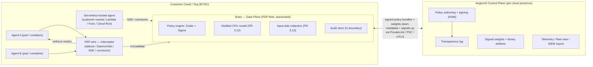
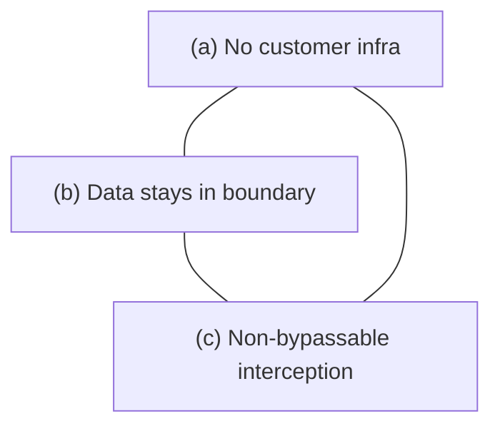
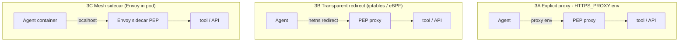
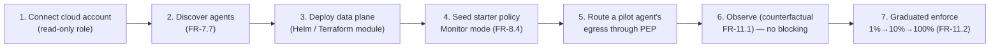
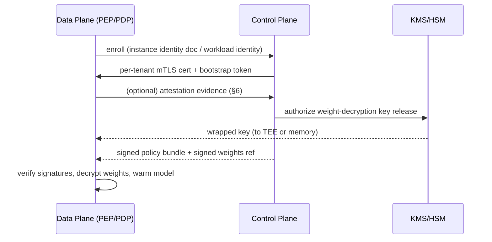
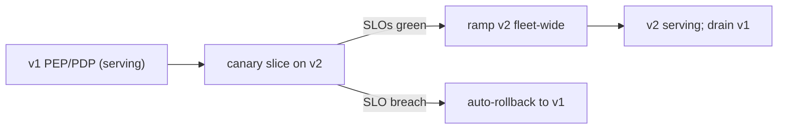

# LLD 25 — Network Sidecar & In-Boundary Data Plane

> The **network sidecar** is the non-cooperative interception model for the in-boundary editions
> (Dedicated / Self-Managed). It runs **inside the customer's VPC** alongside their agents, captures
> agent actions at the network layer, and enforces the verdict from the policy engine (PDP) — which
> may run in-boundary (Dedicated/Self-Managed) or in AegionAI's cloud (Serverless hybrid).
> "AegionAI Guard" is the customer-facing brand; "Sentra" is the internal control-plane codename.

**Version**: 0.2 (draft for review — multiple options open per §15 Decision Register)
**Last Updated**: 2026-06-19
**Status**: Draft — design exploration; **no option is final**. Sections present 2–3 candidates with trade-offs.
**v0.2 changes**: added §1.3 brain/wires concept primer + PEP explainer; §1.4 metadata classification;
disambiguated serverless-edition vs serverless-hosted-agent; §3.4 multi-account brain placement;
§4.6 onboarding prerequisites/effort; tenets → list (+ progressive-onboarding); simplified triangle.
**Owner**: Shashank Gupta
**Prerequisites**:
[LLD 23 — Aegion Guard SDK](23-sentra-guard-sdk.md) (cooperative PEP, `/v1/validate` contract) ·
[LLD 18 — Deterministic Enforcement](18-deterministic-enforcement.md) ·
[LLD 19 — ML Threat Classifier](19-ml-threat-classifier.md) ·
[LLD 24 — Latency Optimization](24-latency-optimization.md) ·
[LLD 15 — Cross-Cloud Connectors](15-cross-cloud-connectors.md) ·
[LLD 17 — Validation Signal Store](17-validation-signal-store.md) ·
[ARCHITECTURE.md](ARCHITECTURE.md) §2.4 (editions), §2.7 (threat model)
**Maps to**: FR-1.5 (network sidecar), FR-1.7 (in-process local tier), FR-3.12 (distilled local model),
FR-3.13 (input-side redaction), FR-9.2/9.3 (Dedicated/Self-Managed), FR-10.3 (verified identity),
FR-11.1–11.3 (safe enforcement adoption), NFR-1/2/3/4/6/7/11.

## Table of Contents
1. Overview & Overall Approach
2. The PEP / PDP Split (the load-bearing decision)
3. Networking — how traffic flows in the customer VPC, and TLS
4. Customer Experience (the most important section)
5. Infrastructure — shipping binaries and model weights
6. IP Protection — code and weights
7. Security — posture and per-failure-point mitigations
8. Resilience
9. Scalability
10. Metering & Billing
11. APIs
12. Metrics & Instrumentation
13. Cloud-Specific Adjustments (AWS / Azure / GCP)
14. Coverage Reality (what the sidecar does and does not see)
15. Decision Register (open calls to settle)
16. Cross-References & Sources

---

## 1. Overview & Overall Approach

### 1.1 Purpose
Define the in-boundary data plane: the software that runs **inside the customer's cloud account/VPC**
to intercept agent actions at the network layer (zero-code, framework-agnostic, non-bypassable for
network egress) and enforce the policy engine's verdict — without the customer hand-wrapping every
tool with the SDK ([LLD 23](23-sentra-guard-sdk.md)).

### 1.2 Three reframes that shape every section
These correct common misconceptions and drive the options below:

1. **The "sidecar" is two components, not one.** The **PEP** (Policy Enforcement Point — capture +
   enforce) and the **PDP** (Policy Decision Point — Cedar + Sigma + distilled model + detectors)
   have opposite scaling and security profiles. We design them separately (§2).
2. **We do not tap *all* customer traffic.** Only **governed-agent** traffic is routed through the
   data plane (scoped egress, not a transparent account-wide tap). Everything else is untouched (§3).
3. **Network interception ≠ total coverage.** It captures the **network-egress subset** of actions
   (API/DB/tool/LLM calls, networked agent-to-agent). **In-process** tool calls and in-process
   multi-agent handoffs have no packet and need the SDK. Coverage = union of modes (§14).

### 1.3 Core concepts — the brain (PDP) and the wires (PEP)

Read this before the deep-dive; everything later assumes this model.

**Think of the system as a *brain* and *wires*.**

- **The brain = the PDP (Policy Decision Point).** A **running service** (a container/task fleet) that
  holds the policy engine (Cedar + Sigma), the distilled model, and the detectors, and answers
  **allow / deny** for each action. **The model and policies *always* run in the brain — never in a
  wire.** In the in-VPC editions the brain runs **inside the customer's cloud**.
- **A wire = a PEP (Policy Enforcement Point).** Whatever **carries an agent's action to the brain and
  enforces the answer.** There are **three wire types**, differing only in *how* they capture — the
  brain is identical behind all of them:

| Wire (PEP form) | What it is | Code change | Captures |
|---|---|---|---|
| **Network sidecar** | a proxy in the agent's outbound network path | **none** | network-egress actions |
| **SDK** ([LLD 23](23-sentra-guard-sdk.md)) | our library running **in-process inside the agent** (one wrapper per tool); on Lambda/Functions shipped as a **layer/extension** | small | in-process **and** network actions; effect-capture for rollback |
| **Connector** ([LLD 15](15-cross-cloud-connectors.md)) | a hook at the **cloud's tool-execution point** (Bedrock action-group Lambda / Azure Function) | **none** | platform-executed tool calls |

**How any PEP works (same four steps regardless of form):**
1. capture the outbound action + identity + destination (+ content if it can see it);
2. call the brain's `POST /v1/validate`;
3. **ALLOW** → let the action proceed; **DENY** → block it and return an error;
4. (optional) capture the result on ALLOW for rollback (effect-capture; SDK only).

**Why more than one wire if the brain is already in the customer's account?** Because **no single wire
reaches everything** (see §14): the network sidecar can't see *in-process* tool calls, in-process
multi-agent handoffs, content behind un-terminated TLS, or rollback handles — and it can't attach to a
**serverless-hosted agent** at all. The SDK/connector cover those gaps. **None of them run the model** —
they only feed the same brain. Which wire is even *possible* depends on where the agent runs:

| Agent hosting | Network sidecar possible? | Wire used |
|---|---|---|
| Pod / container (EKS / AKS / GKE / ECS-EC2) | yes | **sidecar** (or SDK) |
| Fargate / Container Apps / Cloud Run | explicit-proxy only (no eBPF / redirect) | explicit-proxy sidecar **or** SDK |
| **Lambda / Azure Functions** (serverless-hosted agent) | **no** | **SDK (layer/extension) or connector** |

> **Disambiguation — two unrelated uses of "serverless":**
> **Serverless-hosted agent** = the *customer's own* agent code running on serverless compute
> (Lambda / Azure Functions / Cloud Run); the customer builds and owns it. It can't host a sidecar
> container next to it, so its wire is the SDK or connector.
> **Serverless *edition*** = *our* hosting model (the brain runs in AegionAI's cloud, §1.5).
> Same word, unrelated things.

> **SDK-as-a-Lambda-layer / connector, concretely:**
> AWS Lambda **layers/extensions** load shared code into the function's runtime — we ship the SDK as
> that layer, the function calls our wrapper around each tool call, and the wrapper calls the brain.
> The PEP is then **our code inside the customer's Lambda process**, no separate container. The
> **connector** instead hooks the platform's tool-execution point (the action-group Lambda / Azure
> Function), leaving agent code unchanged.

### 1.4 What "metadata" means (and what is *content*)

The data-boundary promise ("only metadata leaves" for in-VPC editions) rests on this distinction:

| Tier | Examples | Leaves to AegionAI (in-VPC)? |
|---|---|---|
| **Identity** | `tenant_id`, `agent_id`, `session_id` | yes |
| **Decision** | verdict, deciding source, reason code, detector scores, versions, latency | yes |
| **Action** | tool name, destination host / endpoint, HTTP method, API operation | yes |
| **Network** | **source/destination IP**, SNI, port, byte volume, timing | yes (see IP note) |
| **Content** *(NOT metadata)* | parameter values, request / response bodies, **prompts** | **no — stays in-boundary** |

**Two honest caveats on "only metadata leaves":**
- **IP address is metadata and we need it** — destination IP/host → tool classification + egress
  allowlist; source IP → (weak) correlation + anomaly. But **an IP is "personal data" under GDPR**, so
  metadata is not automatically risk-free.
- **Some metadata can itself be sensitive** — a destination URL with query params, or a tool name that
  reveals business logic.

**"Only metadata leaves" describes the *uplink to AegionAI*, not what the engine sees.** The brain —
wherever it runs — **always gets the content it needs within its trust zone**:
- **In-VPC:** the brain has the **full prompt/request/response locally**; only metadata crosses to us.
- **Serverless:** the brain is in our cloud, so the prompt **does** go there — **redacted**. Redaction is
  **format-preserving** (masks secrets/PII, **keeps the attack-relevant text**) so injection/jailbreak
  detection still works. Redaction protects the *cross-boundary hop*; **it never starves the detector.**

### 1.5 Editions context (from ARCHITECTURE §2.4)
| Edition | Brain (PDP) runs | What leaves boundary | Primary PEP (wire) | This LLD |
|---|---|---|---|---|
| Serverless | AegionAI cloud | redacted content + metadata | SDK / connector | hybrid escalation only |
| **Dedicated** | **customer's cloud (managed by us)** | **metadata only** | **network sidecar** + SDK | **primary scope** |
| **Self-Managed** | customer's cloud (customer-operated) | nothing | network sidecar + SDK | **primary scope** |

> **"In-boundary" means in the customer's *cloud / org*, not necessarily the agent's VPC or account.**
> The brain can run in (i) the **same VPC** as the agent (localhost/mesh hop), (ii) a **different VPC in
> the same account** (VPC peering), or (iii) a **separate AegionAI-managed account inside the customer's
> AWS Org / Azure tenant / GCP org** (PrivateLink / PSC / peering) — often the cleanest for separation
> of duties. Connectivity per topology is detailed in §3.4.

### 1.6 Overall topology (block diagram)



**What crosses the boundary (Dedicated/Self-Managed):** signed policy bundles + signed weights/binaries
**down**; de-identified metadata, decisions, trust signals, heartbeats **up**. **No raw content** leaves
(NFR-7). Self-Managed: nothing leaves; artifacts are side-loaded.

### 1.7 Design tenets
- **Fail-secure, never fail-open** — any failure denies, or degrades to the cached deterministic floor; it never silently permits.
- **Deny-by-default** — explicit allow only.
- **The data boundary is the customer's to set** — what leaves is an edition choice (§1.5).
- **Signed / verified everything** — policy, weights, binaries; tamper-evident audit.
- **On-by-default, customer-controllable** — disable per agent, per tool, or globally.
- **Progressive, low-friction onboarding** — zero-code and **monitor-first** by default; the
  security-driven friction (egress lockdown, fail-secure, CA install) is **opt-in and gradual**, never a
  day-one wall (§4). *Honest caveat: when ease and security genuinely conflict, security wins — so this
  is "minimize friction except where security demands it," not "easy at any cost."*

### 1.8 The trade-off triangle — and the scope of this LLD

A deployment can offer three properties; **you can pick at most two.** This defines the editions — it is
not a gap in the design:



*Pick at most 2.* The mapping of each pair to a deployment:

| You keep | You give up | Deployment |
|---|---|---|
| **(b) + (c)** | (a) — customer runs our compute | **in-VPC sidecar — THIS LLD** |
| (a) + (b) | (c) — cooperative, can be bypassed | SDK / connector (no-infra) |
| (a) + (c) | (b) — content transits our cloud | hosted egress proxy (no-infra) |

The **in-VPC sidecar exists precisely to get (b)+(c)**, at the cost of (a).

**Scope of this LLD: the (b)+(c) path only — infra running in the *customer's* cloud (Dedicated /
Self-Managed).** This is the residency-bound segment (banks, healthcare, government) where the sidecar is
unavoidable. The no-customer-infra alternatives below are **out of scope here, to be explored in a later
doc**; listed only so the boundary of this LLD is explicit.

#### 1.8.1 Alternatives that avoid in-boundary compute (deferred — not designed here)
| Option | Mechanism | Gives up | Customer infra |
|---|---|---|---|
| **Serverless / SDK** (shipped) | `aegion-guard` calls our hosted brain per action | (b) content leaves; (c) cooperative | none |
| **Connector** | hook the customer's existing Bedrock Lambda / Azure Function | (b) content leaves | none new |
| **ext_authz on their existing mesh/gateway** | Envoy `ext_authz` / WASM / API-GW authorizer → our hosted brain | (b) partially (decision query leaves) | none new (if they already run a mesh) |
| **AegionAI-hosted egress proxy (SSE-style)** | customer sets `HTTPS_PROXY` to our cloud proxy | (b) all content transits our cloud | none |

**Decision:** we design the **customer-infra (in-VPC) path first**; once it lands we revisit the no-infra
options above as a separate workstream. Tracked as **D8** in §15.

---

## 2. The PEP / PDP Split (the load-bearing decision)

The **PDP is heavy** (model weights = IP, CPU/RAM, must scale with QPS) → make it a **shared,
horizontally-scaled fleet per VPC/account**, not one-per-agent. The **PEP is light** (capture bytes,
call PDP, apply verdict) → it sits close to each agent. This split is assumed by all later sections.

### Option 2A — Thin PEP + shared PDP fleet (recommended baseline)
PEP forwards to a shared in-VPC PDP service (internal NLB / mesh service).
- **Pros:** one copy of weights (smaller IP exposure, cheaper), PDP scales independently, PEP is tiny
  and cheap to run per-agent, model hot-reload in one place.
- **Cons:** extra in-VPC network hop (PEP→PDP) adds latency; PDP is a shared failure domain; needs
  service discovery + mTLS between PEP and PDP.

### Option 2B — Fat sidecar (PEP + embedded PDP + weights per agent)
Each sidecar embeds the full engine and weights.
- **Pros:** no PEP→PDP hop (lowest latency, matches FR-1.7 in-process tier); no shared failure domain.
- **Cons:** N copies of weights = N× IP exposure + N× memory (distilled model × every agent); weight
  rollout touches every sidecar; expensive on serverless/limited-CPU; hardest to protect (§6).

### Option 2C — Hybrid: deterministic floor in PEP, heavy model in shared fleet (recommended target)
PEP embeds the **deterministic floor** (Cedar over a signed cached bundle + Sigma) for <tens-of-ms local
allow/deny and "keep running on PDP outage" (FR-1.7); **escalates only borderline cases** to the shared
PDP for ML/deep detection (FR-3.2, D1–D7).
- **Pros:** best latency for the common path; resilient (floor survives PDP/control-plane outage);
  weights centralized (IP + cost); escalation subset is small (matches LLD 24 "ML last").
- **Cons:** two enforcement code paths to keep consistent; cached-bundle freshness + signature
  verification in the PEP; partial coverage if PDP unreachable (ML pauses — acceptable, fail-secure).

**Lean:** start 2A for simplicity, evolve to **2C** as FR-1.7 lands. 2B only where a customer demands
zero shared failure domain and accepts the IP/cost penalty.

---

## 3. Networking — traffic flow in the customer VPC, and TLS

### 3.1 How the PEP is inserted (interception mechanism) — 3 options



| Option | Mechanism | Pros | Cons | Cloud reality |
|---|---|---|---|---|
| **3A Explicit proxy** | set `HTTPS_PROXY`/`HTTP_PROXY` (or SDK transport) so the agent dials the PEP | works **everywhere incl. Fargate** (no privilege); simple; agent-scoped | **cooperative-ish** (app can ignore env / hardcode); not non-bypassable alone | only viable option on **Fargate** (no NET_ADMIN) |
| **3B Transparent redirect** | `iptables`/`nftables` REDIRECT or eBPF in the agent's netns/node | truly **non-bypassable** for that netns; zero app change | needs **NET_ADMIN / privileged**; **eBPF blocked on Fargate & GKE DPv2** | EKS-EC2 / AKS / GKE-Standard nodes only |
| **3C Mesh sidecar** | Envoy as a pod sidecar (Istio-style), localhost interception | non-bypassable within pod; rich L7; reuses CNCF tooling | per-pod overhead; sidecar injection plumbing; not for serverless | EKS/AKS/GKE; **Cloud Run/ACA multi-container** can host it |

**Non-bypass is a *customer-side* contract, not a sidecar property.** True non-bypass requires **egress
lockdown**: security-group/NSG/firewall rules that force *all* agent egress through the PEP, else the
agent opens a direct socket and escapes (§7). We must require and verify this, or "non-bypassable" is
marketing.

### 3.2 Traffic selection — which flows we act on
We only see governed-agent traffic (routed in via 3A/3B/3C). Within that we classify:
- **Source identity:** mTLS client cert / SPIFFE id / pod label / source subnet → `(tenant_id, agent_id)`
  (FR-10.3; never trust a self-asserted field).
- **Destination:** known tool / MCP / LLM / DB endpoints (allowlist).
- **Protocol shape:** MCP JSON-RPC, OpenAI/Bedrock/Vertex API schema, SQL-over-wire, tool-call envelope.
- **Default for unmatched governed egress:** configurable **monitor (pass+log)** → **enforce (deny)**;
  unmatched *non-governed* traffic is pass-through untouched.

### 3.3 TLS — what we need to terminate, and what we do not

This is the pivotal networking choice. Almost all agent egress is HTTPS; to read **parameters/content**
the PEP must terminate TLS.

| Option | What we see | What it costs |
|---|---|---|
| **3T-A MITM termination** (proxy CA installed in agent trust store; SSL-bump/Envoy) | full L7: URL, headers, **body/parameters** | a **per-tenant MITM CA private key** in the VPC = crown-jewel liability; **breaks cert-pinned** clients; clients can detect the proxy |
| **3T-B Metadata-only passthrough** (no termination) | SNI / destination host, ports, byte volume, timing — **not** body | safe, no CA, no breakage; **cannot do parameter-bound policy or content detection at the network layer** → relies on SDK for content |
| **3T-C Hybrid** (metadata by default; **opt-in MITM per destination/tenant**; SDK for content) | metadata everywhere + content where MITM or SDK is enabled | two paths; per-destination CA scoping; clearest data-boundary story |

**What we need from TLS, explicitly:**
- **Need to terminate** when: parameter-bound policy (refund ≤ limit), content/injection detection, DLP
  on request bodies — i.e., any check on *what's inside* the call.
- **Do NOT need to terminate** for: tool allow/deny by destination, egress allowlist, rate/abuse, volume
  anomaly, cross-agent topology — these run on **metadata/SNI** alone.
- **Never** intercept the **PEP↔PDP** and **data-plane↔control-plane** channels by MITM — those are our
  own **mTLS** with pinned certs.

**Lean:** **3T-C** — metadata-only as the safe default (covers a large slice with no CA risk), content
coverage via the **SDK/connector** (already plaintext at the app layer), MITM only where a customer
explicitly accepts it for a specific destination. This keeps the dangerous CA out of most deployments.

### 3.4 Where the brain sits, and how things connect

**3.4.1 Agent ↔ brain (PEP → PDP), by brain placement.** "In-boundary" is the customer's cloud/org, not
necessarily the agent's VPC (§1.5). Three topologies, increasing isolation:

| Topology | Brain location | PEP → PDP connectivity | Notes |
|---|---|---|---|
| **Same VPC** | agent's VPC | localhost / cluster service / mesh | lowest latency; simplest; least isolation |
| **Different VPC, same account** | peer VPC | **VPC peering** / Transit Gateway / VNet peering | clean network separation |
| **Separate managed account** (recommended for Dedicated) | an **AegionAI-managed account inside the customer's Org/tenant/project** | **PrivateLink / PSC / Private Link** | best separation of duties; we operate our account; customer's agent account only exposes an endpoint |

**3.4.2 Brain ↔ control-plane (uplink to AegionAI).** Prefer **private** transport; fall back to public mTLS.
- AWS: **PrivateLink**. Azure: **Private Link**. GCP: **Private Service Connect**. All are **same-cloud
  only** — no cross-cloud private links exist, so the AegionAI control plane needs **presence in each
  cloud** (or accept public-internet mTLS egress).
- Self-Managed/air-gapped: **no uplink** — bundles/weights side-loaded; telemetry exported to the
  customer's own sink (their SIEM), optionally batched out manually.

```mermaid
sequenceDiagram
  participant Agent
  participant PEP
  participant PDP
  participant CP as Control Plane
  Note over PEP,CP: bootstrap (once): mTLS enroll + attestation, pull signed bundle + weights
  Agent->>PEP: outbound action (TLS)
  PEP->>PEP: classify; deterministic floor (cached, FR-1.7)
  alt clear allow/deny locally
    PEP-->>Agent: enforce verdict (<tens of ms)
  else borderline → escalate
    PEP->>PDP: /v1/validate (metadata or redacted content)
    PDP-->>PEP: decision + reason + source + action
    PEP-->>Agent: enforce verdict
  end
  PEP-->>CP: async metadata/signal (off hot path)
```

---

## 4. Customer Experience (the most important section)

Goal: **minimal touchpoints, monitor-first, reversible.** The customer should get an agent under
governance without rewriting it, and never be one config error away from an outage.

### 4.1 Integration model by interception choice
| Path | Customer does | Code change | Coverage | Best for |
|---|---|---|---|---|
| **SDK** ([LLD 23](23-sentra-guard-sdk.md)) | one wrapper per tool / framework hook | yes (small) | in-process **and** network actions, effect-capture for rollback | fastest start, in-process agents |
| **Connector** ([LLD 15](15-cross-cloud-connectors.md)) | point Bedrock action-group Lambda / Azure Function at us | no agent code | networked tool calls | Bedrock/Azure managed agents |
| **Network sidecar (this LLD)** | deploy data plane (Helm/Terraform) + route egress | **none** | network-egress actions, non-bypassable | scale, framework-agnostic, in-VPC editions |

### 4.2 Onboarding flow (network sidecar)



### 4.3 Concrete touchpoints (what the customer actually configures)
1. **IAM/role**: a scoped role for the deploy automation + (Dedicated) a managed role we operate.
2. **Deploy artifact**: a **Helm chart** (K8s) or **Terraform module** (ECS/ACA/Cloud Run/VM) that
   stands up the PDP fleet + PEP. Pinned image digests; values for sizing, fail-mode, editions.
3. **Egress routing**: one of — set `HTTPS_PROXY` on the agent workload (3A), enable sidecar injection
   label (3C), or apply the netns redirect (3B). Plus the **egress-lockdown** SG/NSG/firewall rules.
4. **(Only if content visibility needed)** install the **proxy CA** into the agent's trust store (3T-A).
   We make this opt-in and per-destination, and loudly document the trade-off.
5. **Policy binding**: starter policy auto-seeded in **Monitor mode** (FR-8.4) so nothing is ever
   unpoliced and no wall of denials on day one.
6. **Console**: SOC dashboard shows discovered agents, decisions, counterfactual "what would block."

### 4.4 Day-2 experience
- **Promotion**: graduated rollout UI (FR-11.2) with auto-rollback on FP spike.
- **Override/appeal**: per-case "why blocked" + audited override (FR-11.3).
- **Off switch**: per agent / per tool / global disable (on-by-default but customer-controlled).
- **Upgrades**: ring rollout we operate (Dedicated) or a one-command bump (Self-Managed) — §8.

### 4.5 Effort / friction matrix
| Dimension | SDK | Connector | Network sidecar |
|---|---|---|---|
| Time-to-first-decision | minutes | ~1 hr | hours–1 day (infra deploy) |
| Code change | small | none | none |
| Infra to run | none (Serverless) | none | **data-plane compute in CX account** |
| Coverage | broadest | medium | network-egress (non-bypassable) |
| Latency | network RTT (Serverless) | RTT | local floor + in-VPC RTT |

**Principle:** lead onboarding with **SDK/connector** for instant value; introduce the sidecar when the
customer needs non-bypassable coverage or in-boundary data residency. They compose.

### 4.6 What it takes to onboard (prerequisites & effort)

**Prerequisites the customer must provide** (sidecar / in-VPC editions):
| Prerequisite | Why | Who |
|---|---|---|
| **Cloud account access** — a scoped deploy role (and, for Dedicated, a managed role we operate) | stand up the brain + PEP | customer cloud admin |
| **Compute budget in their account** — CPU by default; GPU only if opted in | run the brain (PDP) (§9) | customer (it's BYOC; they pay their cloud) |
| **Network-change capability** — set egress routing + **egress-lockdown** rules | route governed agents through the PEP and make it non-bypassable (§3.1, §7.3) | customer network/platform team |
| **(Optional) trust-store access** — install proxy CA | only if content visibility via MITM is wanted (§3.3) | customer — opt-in |
| **Identity source** — pod identity / mTLS / SPIFFE | verified agent identity (FR-10.3) | customer platform |

**Onboarding steps by edition:**
| Step | Serverless (no infra) | Dedicated (managed in-VPC) | Self-Managed (air-gapped) |
|---|---|---|---|
| 1. Connect | API key | read-only discovery role + managed account/VPC | offline package + signed license |
| 2. Discover agents | import (FR-7.7) | import (FR-7.7) | manual inventory |
| 3. Deploy brain | nothing (we host) | Helm / Terraform (we operate) | customer runs Helm / Terraform |
| 4. Route a wire | add SDK / connector | route pilot agent egress to PEP | route + side-load weights |
| 5. Seed policy | Monitor mode (FR-8.4) | Monitor mode | Monitor mode |
| 6. Observe | counterfactual (FR-11.1) | counterfactual | counterfactual (local) |
| 7. Enforce | graduated (FR-11.2) | graduated | graduated |

**Rough effort / time-to-value:**
| Edition | First decision (monitor) | First enforce | Heaviest task |
|---|---|---|---|
| Serverless | minutes (SDK) / ~1 hr (connector) | same day | none (we host) |
| Dedicated | hours–1 day | days (after observe period) | provisioning compute + egress routing |
| Self-Managed | 1–3 days | days–weeks | customer-run deploy + air-gap bundle handling |

**The friction-minimizing path (ties to the progressive-onboarding tenet §1.7):** start any customer on
**SDK/connector in Monitor mode** for instant, zero-risk value; stand up the sidecar in parallel; never
ask for egress-lockdown or CA install until the customer has already seen value and chosen to enforce.

---

## 5. Infrastructure — shipping binaries and model weights

### 5.1 Image build
- **OCI image**, multi-stage → **distroless / `scratch`** base, **single static Rust binary**, no shell,
  no package manager, stripped symbols. Aligns with "lightweight Rust/Go" (ARCHITECTURE tech stack).
- **Signed** with cosign/sigstore; **SBOM** attached; base pinned by digest; admission control verifies
  signature before run.
- Separate images: **PDP** (engine+runtime), **PEP** (thin proxy + cached floor), optional **redaction**.

### 5.2 Weights packaging — 3 options
| Option | Mechanism | Pros | Cons |
|---|---|---|---|
| **5A Baked into image** | weights as image layer | one artifact; simplest; works air-gapped | huge image; rebuild to rotate; weights sit in registry (IP) |
| **5B Pulled at startup (recommended)** | image has no weights; fetch **signed** weights from artifact store over mTLS, verify, cache on **encrypted volume** | small image; rotate without rebuild; **gate delivery on attestation** (§6); air-gap via side-load | startup dependency; needs artifact store + key mgmt |
| **5C Streamed/lazy** | memory-map from object store | minimal disk | runtime dependency on object store; complexity; weak air-gap |

**Lean:** **5B** (with **5A side-load** for air-gapped Self-Managed). Format: **ONNX (ONNX Runtime)** or
GGUF/safetensors (candle) for CPU; distilled model is tens–hundreds of MB so pull-at-startup is cheap.

### 5.3 Delivery & registry strategy
- **Dedicated**: we operate; images mirrored to a registry the customer's account can pull (ECR/ACR/AR)
  via a pull-through cache or replicated repo; weights from our signed artifact store via private link.
- **Self-Managed**: **signed bundle** (image tarball + weights + policy) delivered out-of-band; verified
  by signature against a key shipped via a separate trust channel.
- **Versioning**: semver on binary; content-hash on weights and policy bundles; **decouple** so a
  weight/policy update is **data (hot-reload)**, not an image swap (§8.2).

### 5.4 Bootstrap/enrollment flow



---

## 6. IP Protection — code and weights

**Hard truth:** in an environment the customer fully controls (root, memory dumps, disk snapshots), you
**cannot guarantee** code/weights secrecy. You raise cost and/or use hardware TEEs. Strategy = **tier the
IP** + optional **confidential computing**.

### 6.1 IP tiering (do this regardless)
- Ship only the **distilled** model in-boundary (a lossy derivative — lower value if leaked).
- Keep **teacher model, training data/pipeline, Sigma-rule authoring, red-team corpus** in our cloud.
- Plan for the distilled model to possibly leak; ensure that is survivable (the moat is the *pipeline*
  + cross-customer signal flywheel, not the static weights — see STRATEGY §3).

### 6.2 Technical protection — 3 options
| Option | Mechanism | Protection | Cost / constraint |
|---|---|---|---|
| **6A Encrypted-at-rest + runtime decrypt** | weights encrypted; key released at startup (KMS), decrypted in memory | deters disk snapshot, registry scrape | **key + plaintext in RAM** → root can dump; weak vs determined CX |
| **6B Confidential computing (TEE)** | run PDP in AMD SEV-SNP / Intel TDX VM or Nitro Enclave; **attest** before **secure key release** (SKR); memory encrypted from host | strong — even host/root can't read memory | **CPU TEE on all 3 clouds; GPU TEE only Azure (preview)**; instance-type constraints (collides with §9 "no compute"); ops complexity; attestation maturity varies (GCP weakest) |
| **6C Obfuscation / split-model** | obfuscated binary; keep last layers/critical head server-side, run trunk in-boundary | marginal (6C-obfusc) / strong (6C-split, but re-adds egress) | obfuscation buys little vs experts; split re-introduces a network hop + content egress |

**Lean:** **6A as the floor everywhere**, **6B (CPU TEE)** as the opt-in "high-assurance IP protection"
tier for regulated buyers who *also* want it (note: they often care more about *their* data staying in
than *our* weights — the boundary already gives them that). Use Nitro Enclave (AWS), Confidential
VM/Container (Azure — most mature), Confidential VM (GCP, CPU-only). **Do not** promise GPU-TEE
cross-cloud. Combine with 6A tiering always.

### 6.3 Attestation + secure key release (6B detail)
Boot → measure (vTPM/PCRs or enclave measurement) → present evidence to control plane / Azure Attestation
/ Nitro attestation → control plane authorizes KMS to release the **weight-decryption key** *only* to an
attested, unmodified data plane. A tampered image fails attestation → no key → no weights → fail-secure.

---

## 7. Security — posture and per-failure-point mitigations

### 7.1 Posture summary
The data plane is a high-value asset in someone else's environment, on the critical path. Posture:
least-privilege, signed-everything, fail-secure, defense-in-depth, separate trust domains, no raw-content
retention.

### 7.2 Threat / failure-point matrix (every point + mitigation)
| # | Failure / threat point | Impact | Mitigation |
|---|---|---|---|
| S1 | **MITM CA private key stolen** (3T-A) | attacker impersonates any site to agents | avoid by default (3T-C metadata-only); when used: per-tenant short-lived CA in **KMS/HSM**, never egress, scoped to named destinations, rotation, monitoring |
| S2 | **Agent bypasses PEP** (direct socket) | unguarded action | **egress lockdown** (SG/NSG/firewall force-through), CI flags unwrapped tools, anomaly on unexpected direct egress; default-deny governed-agent egress not via PEP |
| S3 | **PEP/PDP compromised** (elevated caps) | tamper verdicts, read content | drop caps (seccomp/AppArmor); NET_ADMIN only where unavoidable; TEE (6B); minimal image (§5.1) |
| S4 | **Malicious/compromised control plane** pushes "allow-all" | mass permit | **policy-signing key in separate trust domain (HSM/dual-control)**; PEP verifies signature; **transparency log** of pushes; fail-secure floor (a CP can't forge a valid bundle) |
| S5 | **Weight/binary supply-chain tamper** | backdoored detection | cosign signatures + SBOM; attestation-gated key release (6B); pinned digests; admission control |
| S6 | **DoS on `/v1/validate` or proxy** | latency blowup / outage | per-agent rate/abuse limits, bounded queues, backpressure; **degrade to cached floor**; never fail-open |
| S7 | **Plaintext content exposure** (post-TLS-termination, or to AegionAI operator) | confidentiality breach | **in-boundary redaction (FR-3.13)**, no content retention (NFR-7), least-privilege operator + access audit; in-VPC editions keep content local |
| S8 | **Tenant cross-talk** (shared PDP fleet) | data leak across teams | strict `tenant_id` scoping (FR-10.1); per-tenant cert; optionally per-tenant PDP for hard isolation |
| S9 | **Identity spoofing** (agent claims another's id) | privilege escalation | verified identity from mTLS/SPIFFE, never self-asserted field (FR-10.3) |
| S10 | **Stale/rolled-back policy** served | enforce old rules | bundle version + freshness check; reject expired bundles; alert on staleness |
| S11 | **Update channel MITM** | bad image/weights | mTLS pinned; signature verify; private link where available |
| S12 | **Audit tampering** | lost forensics | tamper-evident (hash-chained) audit, written off the hot path (FR-6.1) |

### 7.3 Non-bypass is conditional (state it plainly)
The sidecar is "non-bypassable" **only with egress lockdown enforced**. Without it, it is a strong
default, not a guarantee. This must be a documented deployment requirement and verified at onboarding.

---

## 8. Resilience

### 8.1 Failure-scenario matrix
| Scenario | Without mitigation | Mitigation | Resulting behavior |
|---|---|---|---|
| **PDP unreachable** (PEP up) | escalations fail | **cached deterministic floor (FR-1.7)** keeps enforcing; ML pauses | agents keep running on hard rules (secure) |
| **PEP down** (3A explicit proxy) | agent egress fails (proxy unreachable) | health-checked PEP, multiple replicas, connection retry; fail-mode config | fail-secure (block) or degrade per `fail_mode` |
| **PEP down** (3C sidecar) | pod can't egress | readiness gating, restart, keep old until new healthy | brief local block; recovers |
| **Control plane unreachable** | no policy/weight updates, no telemetry uplink | run on last **signed cached** bundle+weights; buffer telemetry; never open | enforcement continues on cached state |
| **Bad image rollout** | fleet-wide outage | **ring + canary rollout, auto-rollback on SLO breach**, signed digests | blast radius capped to canary |
| **Bad weights/policy** | mass FP or FN | **shadow → graduated promote (FR-11.2)**, auto-rollback; data hot-reload independent of binary | revert in seconds, no restart |
| **Overload** | latency blowup | bounded queues + backpressure + fail-secure; autoscale | graceful degrade, never open |
| **Clock/cert expiry** | mTLS breaks | cert auto-rotation, expiry alerts, grace window | uninterrupted |

### 8.2 Update strategy (decouple data from binary)
- **Hot-reload** (no restart): policy bundles, Sigma rules, weights, thresholds, fail-mode.
- **Binary update** (restart): PEP/PDP image — done via **blue-green at the proxy** + ring rollout
  (canary VPC/agent slice → wider) + **auto-rollback** on latency/error/FP SLO breach.
- **Failure posture during restart:** cached floor (FR-1.7) keeps enforcing so a restart neither opens
  nor stalls the agent. Connection draining + readiness gates avoid dropped calls.



### 8.3 SLOs (inherited)
Enforcement availability (local, fail-secure) ≥ 99.99% — always returns a *safe* decision; control-plane
99.9%→99.99%. Latency budgets per [LLD 24](24-latency-optimization.md) / NFR-1/2.

---

## 9. Scalability

### 9.1 Scaling model
- **PDP fleet**: stateless workers behind an internal LB; **horizontal autoscale** on QPS / queue depth /
  CPU; distilled CPU model scales cheaply and horizontally (ARCHITECTURE §2.6). GPU only for
  escalation/offline re-scoring, **opt-in**.
- **PEP**: scales with the agent workload (per-pod/per-node); near-zero marginal cost.
- **Cascade**: cheap deterministic floor short-circuits; ML runs only on the borderline subset
  (LLD 24 "ML last"); FR-2.8 parallel-gather bounds latency as layers grow.
- **Multi-region/cloud**: data planes co-located with agents per region/cloud; control plane aggregates
  fleet-wide (and must be present per cloud for private connectivity, §3.4).

### 9.2 Capacity & the "no compute on CX side" problem (Q8)
- **Never require GPU for baseline** — distilled CPU model is the default (FR-3.12).
- **Degradation tiers** when CPU is also constrained:
  1. deterministic floor only (Cedar+Sigma) — cheap, always available;
  2. escalate borderline to **control plane / Serverless** for the heavy model (re-adds egress — a
     data-boundary trade-off the customer must accept);
  3. shadow/skip ML (reduced efficacy) with alerting.
- **No in-VPC compute at all → route the account to the Serverless edition** (SDK→our cloud) or a
  deterministic-only Dedicated install. Architecture↔GTM coupling: "no compute" picks an edition, it
  doesn't break the product.
- **Sizing**: requests/limits per QPS; if the customer caps resources, **backpressure + fail-secure**,
  never crash.

---

## 10. Metering & Billing

Billing basis (STRATEGY/ARCHITECTURE): **per governed agent (tiered), never per-action**; infra bundled
for Serverless, **customer-borne** for Dedicated/Self-Managed; we charge software subscription + managed
fee, **not** infra margin.

### 10.1 The hard part: metering when the data plane runs in the customer's account
We can't read their cloud bill; we meter **governed agents** and decision volume from our own telemetry.

| Option | Mechanism | Pros | Cons |
|---|---|---|---|
| **10A Control-plane metering** | data plane reports per-agent active counts + decision volume (metadata) to CP | accurate, central, tamper-evidenced | needs uplink (not air-gapped) |
| **10B Signed local meter (air-gapped)** | data plane keeps a **hash-chained, signed** usage ledger exported periodically | works offline / Self-Managed | reconciliation lag; trust the export |
| **10C License entitlement** | signed license caps N agents; enforced locally | simple; offline | coarse (entitlement, not true usage) |

**Lean:** **10A** for Dedicated (uplink exists), **10B + 10C** for Self-Managed/air-gapped (signed ledger
+ entitlement license). Meter = **distinct governed `agent_id`s active in a period** + decision counts;
GPU opt-in is *their* infra cost, surfaced for transparency, not our line item.

### 10.2 Tamper-resistance
Usage ledger is hash-chained and signed by the data plane's enrolled key; the control plane reconciles;
material drift between license entitlement and reported usage raises a commercial flag, not an outage.

---

## 11. APIs

Grouped by channel. (Contracts sketched; full schemas to follow the chosen options.)

### 11.1 PEP ↔ PDP (in-VPC, hot path, mTLS)
- `POST /v1/validate` — action validation (reuse [LLD 21/23](21-api-inventory-for-ux.md) contract);
  `phase ∈ {request, content, output, memory}`; body = metadata or redacted content.
- `POST /v1/effect` — effect-capture handle on ALLOW path for rollback (best-effort at network layer; see
  §14 / ARCHITECTURE "effect capture").
- `GET /healthz` `/readyz` — liveness/readiness for rollout gating.

### 11.2 Data plane ↔ Control plane (management, mTLS / private link)
- `POST /v1/enroll` — bootstrap identity → per-tenant mTLS cert + token (§5.4).
- `POST /v1/attest` — attestation evidence → authorize key release (6B).
- `GET /v1/policy/bundle?since=` — pull signed, versioned policy bundle (deterministic floor).
- `GET /v1/weights/manifest` + signed artifact fetch — model weights ref + integrity.
- `POST /v1/telemetry` (batch) — metadata, decisions, signals (off hot path, no content).
- `POST /v1/usage` — signed metering ledger (§10).
- `POST /v1/heartbeat` — liveness + version + coverage stats (no-data detection, §12).

### 11.3 Admin / management plane
- Agent discovery/import (FR-7.7–7.9), policy CRUD + bind (FR-8.x), fail-mode + off-switch config,
  graduated-rollout control (FR-11.2), override/appeal (FR-11.3), SIEM/SOAR export config (FR-6.7).

### 11.4 API design notes
Versioned (`/v1`); idempotent telemetry/usage with client-side buffering + retry; deny-by-default on any
validate error; all admin actions audited.

---

## 12. Metrics & Instrumentation (exhaustive governance)

### 12.1 Per-decision (the governance record)
decision (ALLOW/DENY/REDACT/HOLD/QUARANTINE), **deciding source** (trust/policy/Sigma/ML/D1–D7/abuse),
reason code, `tenant_id`, `agent_id`, session, tool/destination, phase, **latency per stage**, detector
scores, policy+bundle+weights+binary versions, edition, fail-mode. (Content only in-boundary; metadata up.)

### 12.2 Coverage & efficacy (the "is it working" view)
- enforcement coverage (% guarded actions validated pre-exec, target 100%);
- **shadow/counterfactual** would-block counts + FP rate per policy/detector/agent (FR-11.1);
- missed-attack proxy via red-team replays; detector precision/recall/F1 (gates releases);
- per-agent decision-volume baseline → **no-data / silence detection** (PEP down vs bypassed vs idle);
- **synthetic canary** action success (end-to-end path health).

### 12.3 USE / RED (operations)
PDP CPU/mem/queue-depth/saturation; request rate, error rate, duration histograms (p50/p95/p99);
autoscale signals; cache hit-rate (deterministic floor); model inference time; backpressure events.

### 12.4 Distributed tracing & audit
Trace keyed to **request-id correlation (FR-7.5)** extended to PEP→PDP→CP; tamper-evident audit off the
hot path (FR-6.1); SIEM/SOAR/ITSM export (FR-6.7).

### 12.5 Fleet & drift
Per-VPC/region fleet health; version skew across the fleet; model/score drift vs baseline
(FR-3.11 metadata-only); policy-staleness alerts.

---

## 13. Cloud-Specific Adjustments (AWS / Azure / GCP)

### 13.1 Feasibility matrix
| Capability | AWS | Azure | GCP |
|---|---|---|---|
| K8s sidecar PEP | EKS ✓ | AKS ✓ | GKE ✓ |
| Serverless container sidecar | **Fargate**: sidecar ✓ but **no eBPF / NET_ADMIN / GPU**; **Lambda**: no sidecar | **Container Apps / App Service**: sidecar ✓; **Functions**: no sidecar | **Cloud Run**: multi-container sidecar ✓ (≤10, shared netns); GKE ✓ |
| Transparent redirect (iptables) | EC2 nodes ✓; Fargate ✗ | AKS nodes ✓ | GKE Standard ✓ |
| **Custom eBPF interception** | EC2 ✓; **Fargate ✗** | AKS (Cilium managed) — limited | **GKE Dataplane V2 forbids custom eBPF** |
| Explicit proxy (HTTPS_PROXY) | ✓ (only option on Fargate) | ✓ | ✓ |
| Traffic mirroring (observe) | VPC Traffic Mirroring **GA** | vNet TAP **Preview**, limited regions, no filtering | Packet Mirroring **GA** |
| Private CP connectivity | **PrivateLink** | **Private Link** | **Private Service Connect** (all same-cloud only) |
| CPU confidential computing | **Nitro Enclaves** (no GPU TEE) | Confidential VM/Containers (most mature) | Confidential VM (AMD SEV, weak attestation) |
| GPU confidential computing | ✗ | **Preview (H100)** | ✗ |

### 13.2 Per-cloud implications
- **AWS**: full power on **EKS-EC2/ECS-EC2** (redirect/eBPF/mesh all viable; Nitro Enclave for 6B).
  **Fargate forces explicit-proxy (3A) only** — no transparent capture, no eBPF, no NET_ADMIN; document
  this clearly. Lambda agents → SDK/connector, never sidecar.
- **Azure**: strongest **confidential** story (6B), Container Apps/App Service support sidecars; AKS+Cilium
  for L7. vNet TAP too immature to rely on → don't build on mirroring here.
- **GCP**: Cloud Run multi-container makes the **mesh-sidecar (3C)** clean for serverless-ish workloads;
  **GKE Dataplane V2 blocks custom eBPF** → use Envoy sidecar / explicit proxy, not custom eBPF; CVM is
  CPU-only with weaker attestation (temper 6B claims).

### 13.3 Portability principle
Pick mechanisms available on **all three**: **explicit proxy (3A)** + **mesh sidecar (3C)** as the
portable core; **transparent redirect/eBPF (3B)** as an EC2/AKS/GKE-Standard optimization only. Never
make the baseline depend on Fargate-forbidden or GKE-DPv2-forbidden features.

---

## 14. Coverage Reality (what the sidecar sees / misses)
| Action type | Network PEP | Needs SDK/connector |
|---|---|---|
| Agent → external API / DB / tool (network) | ✓ | — |
| Agent → LLM (network, TLS) | ✓ (metadata; body only if 3T-A) | content via SDK |
| Agent → agent over network (A2A / bus) | ✓ | — |
| **In-process tool call** (local fn/subprocess/file) | ✗ (no packet) | ✓ |
| **In-process multi-agent handoff** (LangGraph/CrewAI in one process) | ✗ | ✓ |
| **Effect-capture for rollback** (side-effect handle) | ✗ (sees bytes, not app handles) | ✓ |

**Coverage = union of modes.** Sidecar = non-bypassable for **network egress**; SDK = in-process +
effect-capture. Sell them as complementary, not either/or.

---

## 15. Decision Register (open calls to settle)
| # | Decision | Options | Lean |
|---|---|---|---|
| D1 | PEP/PDP topology | 2A thin+shared / 2B fat / 2C hybrid | **2C** (2A first) |
| D2 | Interception mechanism | 3A explicit / 3B redirect-eBPF / 3C mesh | **3A+3C portable; 3B as optimization** |
| D3 | TLS handling | 3T-A MITM / 3T-B metadata-only / 3T-C hybrid | **3T-C** |
| D4 | Weights packaging | 5A baked / 5B pull-at-startup / 5C streamed | **5B (+5A air-gap)** |
| D5 | IP protection | 6A encrypt / 6B TEE / 6C obfusc-split | **6A floor + 6B opt-in + tiering** |
| D6 | Metering | 10A CP / 10B signed-ledger / 10C license | **10A (Dedicated) + 10B/10C (air-gap)** |
| D7 | CP connectivity | private link per cloud / public mTLS | **private where available; CP per cloud** |
| D8 | No-in-boundary-compute alternatives (§1.8.1) | Serverless-SDK / connector / ext_authz on existing mesh / hosted egress proxy | **deferred — separate workstream after the in-VPC path lands** |

**These are explicitly unresolved — to be re-evaluated together before build.** D8 is intentionally
out of scope for this LLD (see §1.8) and revisited later.

---

## 16. Cross-References & Sources
**Internal:** [ARCHITECTURE.md](ARCHITECTURE.md) (editions §2.4, threat model §2.7, latency §2.6) ·
[PRD.md](../PRD.md) (FR-1.5/1.7, 3.12/3.13, 9.2/9.3, 10.3, 11.1–11.3; NFR-1/2/3/4/6/7/11) ·
[LLD 23 SDK](23-sentra-guard-sdk.md) · [LLD 18 Deterministic](18-deterministic-enforcement.md) ·
[LLD 19 ML](19-ml-threat-classifier.md) · [LLD 24 Latency](24-latency-optimization.md) ·
[LLD 15 Connectors](15-cross-cloud-connectors.md) · [LLD 17 Signal Store](17-validation-signal-store.md) ·
[STRATEGY.md §3](../pitch/STRATEGY.md) (value floor / in-boundary intelligence model).

**External (cloud feasibility, June 2026):**
- AWS Fargate eBPF/capabilities: [containers-roadmap #1027](https://github.com/aws/containers-roadmap/issues/1027), [Fargate security considerations](https://docs.aws.amazon.com/AmazonECS/latest/developerguide/fargate-security-considerations.html)
- GKE Dataplane V2 custom-eBPF limit: [GKE Dataplane V2 docs](https://docs.cloud.google.com/kubernetes-engine/docs/concepts/dataplane-v2)
- Cloud Run sidecars: [Cloud Run multi-container](https://cloud.google.com/blog/products/serverless/cloud-run-now-supports-multi-container-deployments)
- Azure Container Apps sidecars: [Containers in Azure Container Apps](https://learn.microsoft.com/en-us/azure/container-apps/containers); confidential containers: [AKS Confidential Containers](https://learn.microsoft.com/en-us/azure/aks/confidential-containers-overview)
- Traffic mirroring: [AWS VPC Traffic Mirroring](https://docs.aws.amazon.com/vpc/latest/mirroring/what-is-traffic-mirroring.html), [GCP Packet Mirroring](https://docs.cloud.google.com/vpc/docs/packet-mirroring), [Azure vNet TAP (preview)](https://arnav.au/2025/05/05/azure-virtual-network-tap-overview/)
- Private connectivity: [AWS PrivateLink for SaaS](https://aws.amazon.com/blogs/networking-and-content-delivery/extend-saas-capabilities-across-aws-accounts-using-aws-privatelink-support-for-vpc-resources)
- Confidential computing GPU status: [Azure confidential GPUs](https://thomasvanlaere.com/posts/2025/03/azure-confidential-computing-confidential-gpus-and-ai/), [Nitro Enclaves](https://aws.amazon.com/confidential-computing/)
- TLS interception patterns: [Squid SSL-Bump](https://wiki.squid-cache.org/ConfigExamples/Intercept/SslBumpExplicit), Envoy egress TLS.

---
*Draft for review. Per LLD standards: update HLD/ADR/flow/demo on changes; no option here is final until §15 is resolved.*
