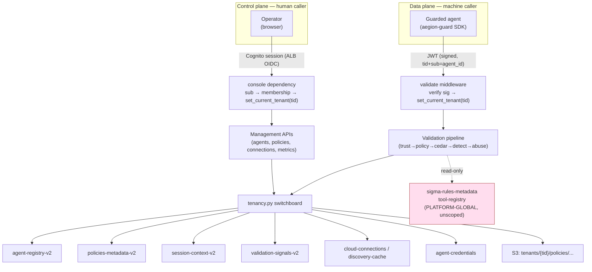
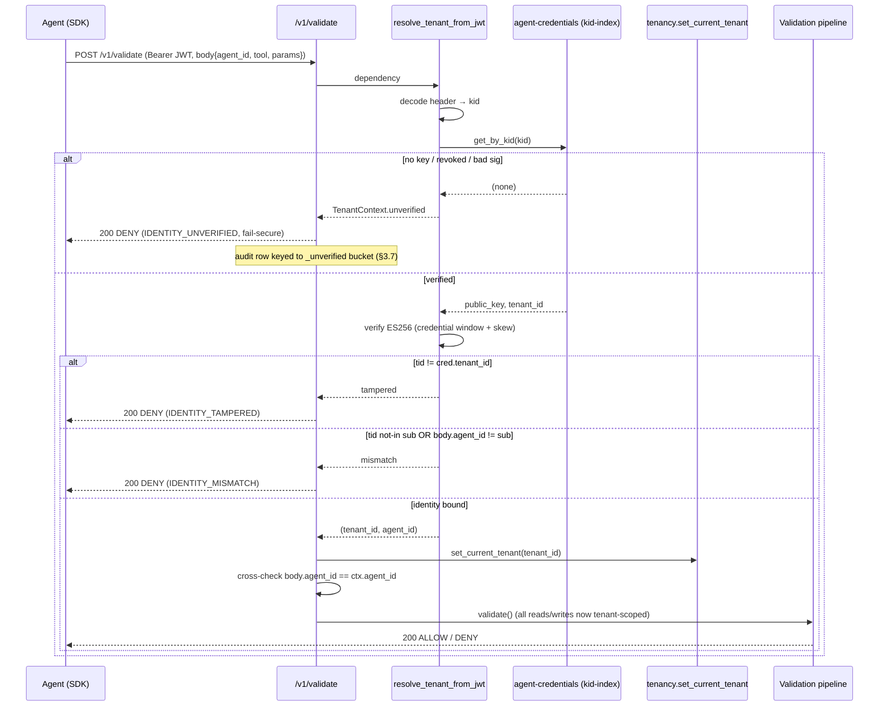
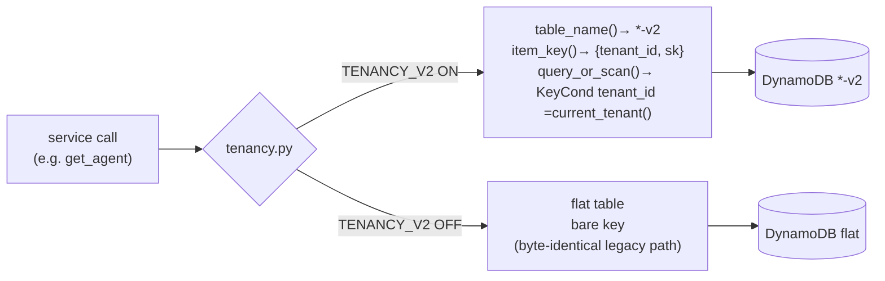
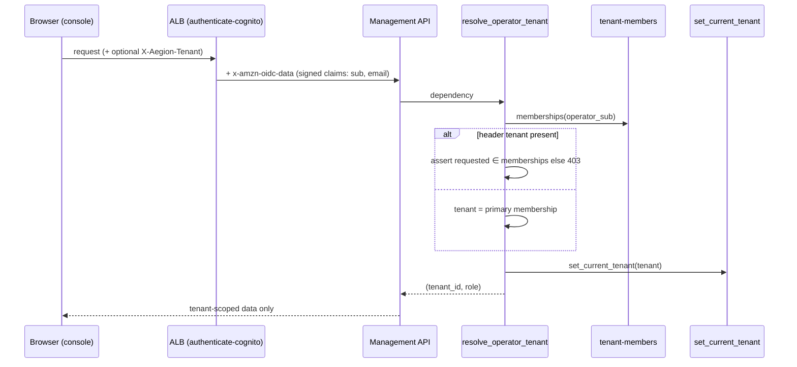
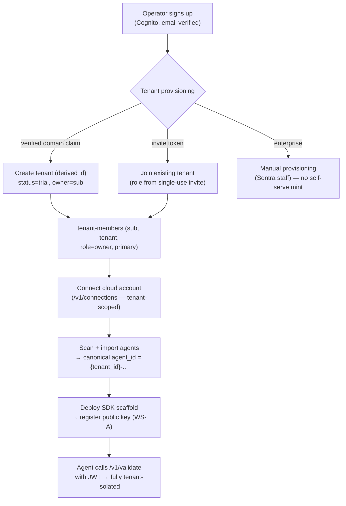
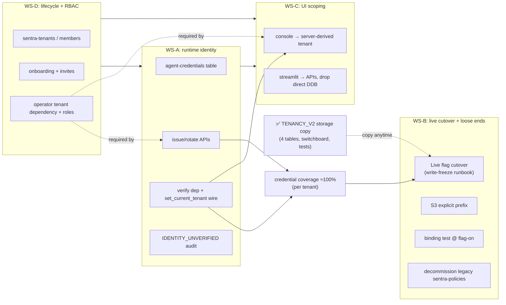

# LLD 26: Multi-Tenancy (Umbrella)

**Version**: 1.4
**Last Updated**: 2026-06-23
**Status**: Approved (design) — v1.4 kiro code-grounded review applied: brownfield `default` population resolved (§10), delimiter-safe `tid` prefix check (§3.3/§3.4), canonical-id `{…}-{hash}` format corrected, `verify_alb_oidc` + `GET /v1/me` flagged for LLD-08 sync (§11.2). v1.3: Streamlit decommission, role-conditional UI (§5.4) + platform-admin console (§5.5), §3.5 diagram + `status` enum fixes
**Prerequisites**: [06-data-model-v2.md](06-data-model-v2.md), [08-authentication-and-alb-architecture.md](08-authentication-and-alb-architecture.md), [17-validation-signal-store.md](17-validation-signal-store.md), [18-deterministic-enforcement.md](18-deterministic-enforcement.md), [23-sentra-guard-sdk.md](23-sentra-guard-sdk.md)
**Implements**: PRD FR-10.1, FR-10.2 ([PRD.md:299-300](../PRD.md))

## Table of Contents
1. Overview
2. Target Isolation Model
3. Runtime Tenant Identity (asymmetric JWT)
4. Data-Plane Tenant Scoping
5. Dashboard & Web-Console Scoping
6. Tenant Lifecycle, Onboarding & RBAC
7. Phased Rollout & Sequencing
8. Error Handling & Failure Modes
9. Monitoring & Observability
10. Open Questions
11. Cross-References & Sibling-Doc Sync

---

## 1. Overview

### 1.1 Purpose
This is the **canonical** design for making Sentra multi-tenant end to end. It consolidates the tenancy design that currently lives scattered across `features/multicloud-agent-import` (storage + identity) and pulls in the surfaces those docs explicitly deferred — runtime identity wiring, the dashboard/console, and tenant lifecycle/RBAC — into one implementable reference that workstreams are cut from.

### 1.2 The Central Thesis
**`tenant_id` in storage ≠ `tenant_id` proven at runtime.**

The storage migration (TENANCY_V2) is code-complete: every runtime table is partitioned by `tenant_id` and all DB access routes through one switchboard, [tenancy.py](../src/security-controller/app/utils/tenancy.py). But the value it partitions on is a process-wide constant: `current_tenant()` returns `"default"` ([tenancy.py:90-92](../src/security-controller/app/utils/tenancy.py)), and **nothing on the request path ever calls `set_current_tenant()`** — grep confirms its only callers are the module itself and tests. So today the system is *single-tenant with multi-tenant plumbing*: it can store rows for many tenants but cannot tell which tenant a request belongs to.

This LLD closes that gap. The load-bearing mechanism is a **per-agent asymmetric credential** presented on every `/v1/validate` call, from which the controller derives the authoritative `(tenant_id, agent_id)` — never from the request body. The same artifact fixes three linked problems at once: spoofing (anti-impersonation), canonicalization (stable id), and tenancy (carries `tid`). This is the mechanism named in [feature.md:36](../features/multicloud-agent-import/feature.md) §14; this doc makes it concrete and extends it to the console and lifecycle surfaces.

### 1.3 Scope
**In scope** (the five workstreams this doc seeds):
- **WS-A** Runtime tenant identity — `sentra-agent-credentials`, issuance/rotation, JWT verify + `set_current_tenant()` wiring on `/v1/validate`.
- **WS-B** Data-plane scoping — finalize the S3 prefix decision, policy-binding under v2, platform-global table policy; execute the live TENANCY_V2 cutover.
- **WS-C** Dashboard + web-console tenant scoping.
- **WS-D** Tenant lifecycle, onboarding & operator RBAC.
- **WS-E** Cross-cutting: tenant-aware metrics, quotas, audit of the unverified path.

**Out of scope (named, with pointers):** billing/metering rollup (depends on WS-E metrics; tracked separately in `pitch/share/STRATEGY.md` commercial model), and the in-VPC Dedicated/Self-Managed editions' single-tenant collapse (those editions pin `tenant_id` to one value and skip WS-A's multi-tenant resolution — see §3.6).

### 1.4 Surface Status at a Glance

| Surface | Tenant-scoped today? | Target | Workstream |
|---|---|---|---|
| 4 runtime DDB tables (registry, policies, sessions, signals) | **Yes** — v2 keys, behind flag (default off) | Live-cutover the flag | WS-B |
| Born-scoped tables (cloud-connections, discovery-cache) | **Yes** | — | done |
| Runtime identity (`current_tenant()`) | **No** — hardcoded `"default"`, nothing sets it | JWT `tid` claim | WS-A |
| `sentra-agent-credentials` (public keys) | **Table does not exist** | New table + verify step | WS-A |
| S3 policy artifacts | Implicit (agent_id is tenant-prefixed) | Explicit `tenants/{tid}/…` prefix | WS-B |
| Dashboard (Streamlit, `src/dashboard`) | **No** — reads global tables + legacy `sentra-policies` | **Decommissioned** — superseded by `web/console` as the product UI; code + CDK teardown is a follow-up infra PR (§5.3) | WS-C |
| Web console (`web/console`) — **the product UI** | **No** — `tenantOf()` cosmetic only | Server-derived tenant on every call + role-conditional rendering (§5.4) | WS-C |
| Operator auth (Cognito/ALB) | Authenticated, **not** tenant-bound | Operator↔tenant membership + roles | WS-D |
| Platform-global tables (sigma-rules, tool-registry) | **No** — intentional | Stays global (documented) | WS-B |
| Tenant lifecycle (signup, registry, RBAC) | **None** | New `sentra-tenants` + `sentra-tenant-members` | WS-D |

---

## 2. Target Isolation Model

### 2.1 The Invariant
> **Every read, write, and policy decision is scoped to a `tenant_id` that was resolved from a verified credential or an authenticated operator session — never from client-supplied input.**

Two distinct trust roots establish the tenant, one per plane:

| Plane | Caller | Tenant root | Set by |
|---|---|---|---|
| **Data plane** (`/v1/validate`, agent runtime) | The guarded agent (machine) | Verified **agent JWT** `tid` claim | WS-A middleware → `set_current_tenant()` |
| **Control plane** (console, management APIs, dashboard) | A human operator | Operator's **tenant membership** (from Cognito sub → `sentra-tenant-members`) | WS-D dependency → `set_current_tenant()` |

Both planes funnel into the *same* `set_current_tenant()` contextvar, so everything downstream of [tenancy.py](../src/security-controller/app/utils/tenancy.py) becomes per-tenant with zero further change — exactly as the module's own docstring anticipates ([tenancy.py:40-43](../src/security-controller/app/utils/tenancy.py)).

### 2.2 System Block Diagram



The only stores that are *not* tenant-keyed are the platform-global rule/tool catalogs (§4.4) — read-only reference data authored by Sentra, identical for all tenants.

---

## 3. Runtime Tenant Identity (asymmetric JWT) — WS-A

This is the largest new build and the one that converts the system from "default-tenant" to genuinely multi-tenant on the data path.

### 3.1 Trust Model
- **Asymmetric** keys: each agent holds a **private** signing key; Sentra stores only the **public** key. Sentra can verify but never mint an agent's token — a compromised controller DB cannot forge agent identity.
- **Two-phase** (per [feature.md:193](../features/multicloud-agent-import/feature.md) §14.1): the canonical `agent_id` is baked into the SDK scaffold **at import**; the keypair is generated and the public key registered **at deploy time**. This decouples "we decided your id" from "you proved you hold the key."
- The controller derives `(tenant_id, agent_id)` from the **verified** token, then **cross-checks** the body's self-asserted `agent_id` (mismatch ⇒ `IDENTITY_MISMATCH`, §8).

### 3.2 `sentra-agent-credentials` (new table)

| Attribute | Type | Notes |
|---|---|---|
| `tenant_id` (**PK**) | S | Owning customer |
| `key_id` (**SK**) | S | `{agent_id}#{kid}` — multiple active keys per agent for rotation |
| `kid` | S | Globally-unique UUID, stored as its **own attribute** (it is the `kid-index` GSI PK; not just embedded in `key_id`) |
| `agent_id` | S | Canonical, tenant-scoped |
| `public_key` | S | PEM/JWK, ES256 (P-256) |
| `alg` | S | `ES256` (fixed; reject others) |
| `status` | S | `active` \| `rotating` \| `revoked` |
| `not_before` / `not_after` | N | Validity window (epoch ms) |
| `created_at`, `created_by` | N/S | Audit |

**GSI `kid-index`**: PK `kid` → for O(1) lookup during verify when the token header carries only `kid` (the verify path must find the key before it trusts the body's `tenant_id`). `kid` is globally unique (UUID), so this GSI is intentionally **not** tenant-partitioned — it is the one pre-tenant lookup, and it returns the row that *establishes* the tenant.

### 3.3 The Agent JWT

```
header:  { "alg": "ES256", "kid": "<uuid>", "typ": "JWT" }
claims:  {
  "iss": "aegion-guard",
  "sub": "<canonical agent_id>",      # {tenant_id}-{cloud}-{slug}-{hash}  (canonical_agent_id appends an 8-char native-resource hash)
  "tid": "<tenant_id>",               # authoritative tenant
  "iat": ..., "exp": ...,             # short-lived, see 3.5
  "aud": "sentra-controller"
}
```

`tid` MUST equal the `tenant_id` on the credential row found by `kid`, and MUST be a **delimited** prefix of `sub` — `sub.startswith(tid + "-")`, never a bare `startswith(tid)` (a short tenant id `t_01` would otherwise falsely match `t_01hxyz-…`; this is a tenant-isolation check and must not lean on ULID collision-improbability). Either check failing ⇒ reject.

### 3.4 Verify + Wiring (the gap-closer)

A FastAPI dependency on `/v1/validate` (and any other agent-facing route) performs verify-then-set. **This is the code that today does not exist** — `set_current_tenant()` has no request-path caller.

```python
# app/api/deps.py  (new)  — conceptual
SKEW = 60  # seconds of allowed clock skew; matters with ≤15-min tokens (§3.6)

async def resolve_tenant_from_jwt(request) -> TenantContext:
    token = extract_bearer(request)                  # Authorization: Bearer <jwt>
    if not token:
        return TenantContext.unverified()            # → fail-secure, see §8 / 3.7
    kid = unverified_header(token)["kid"]
    cred = get_credential_cached(kid)                # in-proc LRU (§3.6) — NOT a per-call GSI hit
    if cred is None or cred.status != "active":
        return TenantContext.unverified()
    now = time.time()
    # Explicit rejects, never `assert` (stripped under python -O). Each → fail-secure DENY.
    if not (cred.not_before - SKEW <= now <= cred.not_after + SKEW):
        return TenantContext.unverified(claimed_tenant_id=cred.tenant_id)  # credential window (§3.2)
    try:
        claims = jwt.verify(token, cred.public_key, alg="ES256",
                            audience="sentra-controller", leeway=SKEW)
    except JWTError:
        return TenantContext.unverified(claimed_tenant_id=cred.tenant_id)  # bad sig/exp → §3.7
    if claims["tid"] != cred.tenant_id:              # bind token↔key
        return TenantContext.tampered(claimed_tenant_id=cred.tenant_id)    # §8 IDENTITY_TAMPERED
    if not claims["sub"].startswith(claims["tid"] + "-"):  # canonical-id prefix — DELIMITED (not a bare prefix)
        return TenantContext.mismatch()                                    # §8 IDENTITY_MISMATCH
    return TenantContext(tenant_id=claims["tid"], agent_id=claims["sub"])
```

```python
# app/api/routes.py  validate_tool_call — conceptual delta
async def validate_tool_call(req, ctx = Depends(resolve_tenant_from_jwt)):
    token = tenancy.set_current_tenant(ctx.tenant_id)   # ← THE missing wire
    try:
        if req.agent_id != ctx.agent_id:                 # cross-check body
            return deny(IDENTITY_MISMATCH)
        return await validation_service.validate(req)    # everything below now tenant-scoped
    finally:
        tenancy.reset_current_tenant(token)
```

### 3.5 Request-Path Identity Flow



### 3.6 Credential Issuance & Rotation APIs

| Method & path | Purpose | Auth |
|---|---|---|
| `POST /v1/agents/{agent_id}/credentials` | Register a public key for an agent (deploy-time, phase 2). Body: `{public_key, alg, not_after?}`. Returns `{kid}`. | Operator session (WS-D), tenant must own `agent_id` |
| `GET /v1/agents/{agent_id}/credentials` | List keys (status, kid, validity) — no private material. | Operator session |
| `POST /v1/agents/{agent_id}/credentials/{kid}/rotate` | Mark `rotating`; caller registers a new key, old stays valid until `not_after` (overlap window). | Operator session |
| `DELETE /v1/agents/{agent_id}/credentials/{kid}` | Revoke immediately (`status=revoked`). | Operator session |

**Rotation** is overlap-based: register new → both `active` → flip traffic → revoke old. No controller-side private keys ever exist. **Token lifetime**: short (≤15 min) with SDK-side silent refresh from the held private key, so revocation propagates fast without a per-request revocation list.

**Public-key cache (hot-path cost).** `resolve_tenant_from_jwt` (§3.4) must **not** hit the `kid`-index GSI on every `/v1/validate` — that is the highest-QPS path and a global GSI would funnel every tenant's traffic through one partition. Public keys are immutable per `kid`, so the controller keeps an **in-process LRU keyed by `kid`** (caching the resolved `{public_key, tenant_id, agent_id, status, not_before, not_after}`; `kid` misses are negatively cached briefly to blunt enumeration, §9.4). The cache reintroduces a **bounded** revocation lag — a revoked key stays honored until its entry expires — so the cache TTL is a *second* revocation budget alongside token lifetime: **TTL ≤ 60s**. **Across a fleet of N instances the honest revocation bound is that TTL.** The instance serving a `revoke`/`rotate` call can bust *its own* cache, but that is almost never the instance serving the agent's validate traffic, so a local bust does **not** tighten the fleet-wide bound and is **not load-bearing** — do not rely on it. To get below the TTL without a per-request DDB read, the verify path consults a cheap **`revoked-since` shared signal**: a single small DDB item per region carrying a monotonically-bumped revocation epoch (or an equivalent pub/sub fan-out), refreshed at most once per short interval (not per request); any cache entry created before the current epoch is invalidated. Net hot path stays ~zero per-request DDB reads; the effective bound becomes min(token TTL, cache TTL, refresh interval). Synchronous online revocation for `dedicated` plans (tighter still) is §10 Q1.

**Dedicated/Self-Managed editions** (out of multi-tenant scope): the controller runs with `TENANT_PIN=<single tenant_id>`; `resolve_tenant_from_jwt` still verifies the agent key for anti-spoofing but `set_current_tenant()` always receives the pinned value, and `tid`-mismatch is a hard error. One code path, two deployment modes.

### 3.7 The `IDENTITY_UNVERIFIED` Audit-Tenant Gap
A request with no/invalid credential has, by definition, no proven tenant — yet fail-secure still produces a DENY that **must be audited**. Writing it under `current_tenant()` (`"default"`) would leak failed-auth events into the default tenant's trail. Resolution:

- Audit rows for unverified requests are keyed to a **reserved system tenant `_unverified`** (never assignable to a customer; validated against at tenant-creation, §6).
- If a `kid` *was* found but verification failed afterward (bad sig, expired), the row is **dual-tagged**: stored under `_unverified` but annotated with `claimed_tenant_id` = the credential row's tenant, so a tenant's SOC can still see "someone tried to spoof one of your agents."

---

## 4. Data-Plane Tenant Scoping — WS-B

### 4.1 Store-by-Store Tenant Key (target end-state)

| Store | Tenant key | State | Action |
|---|---|---|---|
| `agent-registry-v2` | PK `tenant_id` / SK `agent_id` | built (flag off) | cutover |
| `policies-metadata-v2` | PK `tenant_id` / SK `policy_id`; GSI `agent-index` PK `tenant_agent_id` | built | cutover |
| `session-context-v2` | PK `tenant_id` / SK `session_id` | built | cutover |
| `validation-signals-v2` | PK **`tenant_session_id`** (composite) / SK `request_id#ts#source` | built | cutover |
| `sentra-cloud-connections` | PK `tenant_id` / SK `id` | born-scoped | none |
| `sentra-discovery-cache` | PK `tenant_id` / SK `native_resource_id` | born-scoped | none |
| `sentra-agent-credentials` | PK `tenant_id` / SK `key_id` | **new (WS-A)** | build |
| `sentra-tenants` | PK `tenant_id` | **new (WS-D)** | build |
| `sentra-tenant-members` | PK `operator_sub` / SK `tenant_id` | **new (WS-D)** | build |
| S3 policy artifacts | key prefix `tenants/{tenant_id}/…` | implicit only | **explicit prefix** |
| `sentra-sigma-rules-metadata` | none (global) | — | document as global |
| `sentra-tool-registry` | none (global) | — | document as global |
| legacy `sentra-policies` | none | dead on validate path | **decommission** (dashboard's last reader, §5) |

The `validation-signals-v2` composite PK (`{tenant}#{session_id}`) is a deliberate deviation from a bare `tenant_id` PK: `sk` already holds `request_id#ts#source`, so `session_id` cannot be the SK, and a bare `tenant_id` PK would create a tenant-wide hot partition. Documented at [tenancy.py:27-31](../src/security-controller/app/utils/tenancy.py).

### 4.2 Tenant-Scoped Read Path



Every reader/writer already routes through this switchboard (confirmed across `agent_service.py`, `policy_engine.py`, `connections_service.py`, `signal_store_writer.py`, `session_manager.py`). WS-B adds **no new call-site rewrites** for the four migrated tables — it flips the flag (§7).

### 4.3 S3 Prefix Decision (resolved)
**Decision: adopt an explicit `tenants/{tenant_id}/policies/agents/{agent_id}/v{n}.{yaml|cedar}` prefix.**

Rationale: the canonical id scheme `{tenant_id}-{cloud}-{slug}` ([feature.md:193](../features/multicloud-agent-import/feature.md)) already makes the *current* `agent_id`-only key collision-safe, so this is **not** a correctness fix. It is **application-layer defense-in-depth plus future IAM scopability** — and the distinction matters: a static bucket policy `s3:prefix = tenants/${tenant_id}/*` does **not** by itself enforce isolation, because the controller is a **single shared IAM role** serving all tenants, so there is no per-request `${tenant_id}` for a static policy to bind to. A genuine storage-layer guarantee requires **request-scoped session tags** (`aws:PrincipalTag/tenant_id` via `sts:AssumeRole`/`TagSession` per request) or per-tenant assumed-role sessions — a real mechanism with real cost (an STS round-trip or a session cache on the hot path). That is a deliberate **future** upgrade for Dedicated/regulated plans, **not** a property this design claims today. Until then isolation is enforced at the **application layer** (every S3 key is composed from `current_tenant()`); the explicit prefix exists so the IAM upgrade becomes a config change, not a re-keying migration. Migration: dual-read (new prefix, fall back to old) during a copy window, then cut writes to the new prefix. Tracked as a WS-B task.

### 4.4 Platform-Global Tables (documented, intentional)
`sentra-sigma-rules-metadata` and `sentra-tool-registry` are **Sentra-authored reference data**, identical for every tenant, read-only on the validate path. They stay unscoped. The contract: **no tenant-specific data may ever be written to a global table.** If a tenant ever needs custom Sigma rules, that becomes a *new* tenant-scoped `sentra-tenant-sigma-rules` table layered over the global set — not a mutation of the global one. Stated here so it is a decision, not an omission.

### 4.5 Policy-Binding Under v2 (loose end closed)
The agent↔policy binding model (`attached_policy_id` on the agent record, from `features/agent-policy-management`) was written against the flat-table assumption and never references `TENANCY_V2_ENABLED`. It is **correct as-is under v2** because the binding lives on the `agent-registry` item, which v2 partitions by `tenant_id` — attach/detach already go through `agent_service` (tenancy-aware). **Required WS-B task:** add a regression test that runs the agent-policy-management binding suite with `TENANCY_V2_ENABLED=true` (today those tests implicitly assume flat tables), so the cutover cannot silently break binding.

### 4.6 Contextvar Propagation Across the Sync/Async Boundary
The entire isolation guarantee rests on **one** `contextvars.ContextVar` ([tenancy.py:62](../src/security-controller/app/utils/tenancy.py)) set per request in a `try/finally`. That is correct for pure-async call chains — but boto3 is **synchronous**, and the controller offloads blocking DB work to worker threads. **`contextvars` do not cross a thread boundary unless the context is explicitly carried.** A tenancy-dependent call dispatched via a bare `loop.run_in_executor(...)` runs in the executor thread's *default* context, silently reverting `current_tenant()` to `"default"` and reading/writing the **wrong tenant's partition** — a cross-tenant leak that passes every happy-path test. This is the single failure mode most likely to ship green.

**Mandate (merge-gate rule):**
- All blocking, tenancy-dependent offload MUST use **`asyncio.to_thread(...)`** — which copies the calling context by construction — or `loop.run_in_executor(ctx.run, ...)` where `ctx = contextvars.copy_context()`. **Never** a bare `run_in_executor`. The codebase already follows this: [policy_engine.py:230-232](../src/security-controller/app/validators/policy_engine.py) offloads bundle resolution via `asyncio.to_thread` precisely so tenancy survives, with an inline comment to that effect. This section promotes the existing convention to a hard rule.
- `asyncio.create_task(...)` is safe (copies context); raw threads, `ProcessPoolExecutor`, and cross-thread `call_soon` are **not** and must not touch a tenant-scoped store without explicit context propagation.
- Enforced by the contextvar-survives-executor test in §4.7.

### 4.7 Tenant-Isolation Test Matrix (merge gate)
Isolation is a security boundary, so it gets an explicit **negative**-test suite that blocks merge — not just the single binding test in §4.5:

| Test class | Asserts |
|---|---|
| Cross-tenant read | With `current_tenant()=A`, every reader (agents, policies, sessions, signals, connections, discovery, credentials, S3) returns **zero** of tenant B's rows. |
| Cross-tenant write | A write under tenant A never mutates a B-keyed item; key composition is asserted on the persisted item. |
| Key-composition property test | For random `(tenant, id)` pairs, `item_key` / `signal_pk` / GSI keys round-trip and never collide across tenants (covers the composite `tenant_session_id`). |
| Contextvar-survives-executor | `current_tenant()` observed **inside** an `asyncio.to_thread` DB call equals the request's tenant (the §4.6 leak). |
| Unverified → `_unverified` | No-credential / bad-sig requests audit under `_unverified`, never the caller's claimed tenant or `default` (§3.7). |
| Binding under v2 | The agent-policy-management binding suite passes with `TENANCY_V2_ENABLED=true` (§4.5). |
| Tenant delete | Post-purge, no row keyed to the deleted tenant remains in any v2 store or S3 prefix (§6.4). |

---

## 5. Dashboard & Web-Console Scoping — WS-C

**Surface map (three UIs, only one is the product):** [`web/console`](../web/console/src) is the product SOC console (React/Vite SPA, API-backed via `/v1/*`, behind ALB Cognito) and the canonical operator UI this section scopes. [`src/dashboard`](../src/dashboard) is the legacy Streamlit internal/demo dashboard, now **decommissioned** in favour of `web/console` (§5.3). [`frontend`](../frontend) is the public marketing site (GoDaddy static) and is out of scope here — it has no tenant data path.

Today the console is tenant-blind: its `tenantOf()` only derives a **cosmetic** label from the email domain ([web/console/src/lib/auth.ts:53-58](../web/console/src/lib/auth.ts)); the (legacy) Streamlit dashboard read global tables directly, including `sentra-policies` via [dashboard/config/settings.py](../src/dashboard/config/settings.py).

### 5.1 Target
- **No UI reads DynamoDB directly.** Both consoles call the management APIs, which are tenant-scoped server-side via the WS-D operator dependency. This deletes the dashboard's direct-DDB client and its dependence on legacy `sentra-policies` (which is then decommissioned, §4.1).
- Tenant is **never** a client parameter. The console sends its Cognito session (ALB OIDC headers); the server resolves `operator_sub → membership → tenant_id → set_current_tenant()`. `tenantOf()` is downgraded to display-only and explicitly annotated as non-authoritative.
- **Multi-tenant operators** (a Sentra admin, or a partner managing several customers) get a tenant **switcher**: the API accepts an `X-Aegion-Tenant` header that the server validates against the operator's membership set before honoring (deny if not a member). Default = the operator's sole/primary tenant.

### 5.2 Console Request Flow



### 5.3 Streamlit Decommission
**Decision (v1.3):** the Streamlit app (`src/dashboard`) is retired in favour of `web/console`, which now covers every Streamlit tab (`overview, agents, threats, audit, policies, quarantine, topology, connect, discovery, import`) and is API-backed and tenant-scopable per §5.1–5.2. No tenancy work is invested in Streamlit.

Streamlit is currently wired into the deployment (its own ECR repo, `DashboardTaskRole`, the `dashboard_tg` target group, and — load-bearing — the **public ALB's default listener action**, with `web/console` layered on top as a host-based rule, [cdk/stacks/compute_stack.py:859-896](../cdk/stacks/compute_stack.py#L859-L896)). Removing it therefore requires **rewiring the ALB default action to `web/console`** and deleting the dashboard ECR repo, task role, target group, Cognito callback entries, and `docker/` build. Because that is a deploy-affecting infra change, the code + CDK teardown is tracked as a **separate follow-up infra PR**, not part of this docs change. Until that PR lands, Streamlit stays deployed behind Cognito as-is (no new tenancy features); `web/console` is the surface customers use.

### 5.4 Role-Conditional Console UI
Server-side `require_role` (§6.3) is the authority — but the console must also **render to the operator's role**, not just return 403s, so viewers never see actions they cannot take. WS-C task on `web/console`:
- The membership `role` resolved in §5.2 is returned to the client (e.g. on a `GET /v1/me` / session bootstrap) and held in app context.
- UI gates by role: `viewer` gets read-only views (no create/edit/delete/rotate controls, members screen hidden); `editor` sees import + policy CRUD but not member management or tenant delete; `admin`/`owner` see member management; only `owner` sees **Delete tenant**. This mirrors the RBAC matrix in §6.3.
- Client gating is **UX only, never the boundary** — every mutation is still authorized server-side by `require_role`, so a tampered client gains nothing. The multi-tenant **tenant switcher** (§5.1) renders only for operators with more than one membership.

### 5.5 Platform-Admin (Internal Ops) Console
Sentra staff need a cross-tenant operational view that no customer operator can see. This is a distinct surface gated by the reserved `_platform` capability (§6.3), **not** a tenant role:
- **Scope:** tenants onboarded (count, plan, status, created_at), per-tenant threats blocked / validate volume / DENY rate, quota headroom (§9.3), credential health (active/revoked keys, agents pending first `/v1/validate`), and onboarding funnel state.
- **Data path:** reads the same tenant-dimensioned CloudWatch metrics (§9.1 — every custom metric carries a `tenant_id` dimension) and the `sentra-tenants` / `sentra-tenant-members` registries; **aggregate, cross-tenant** queries are allowed *only* for `_platform` principals, and every cross-tenant read is audited under both `_platform` and the target tenant (§6.3).
- **Build:** a `_platform`-only section of `web/console` (preferred — one codebase, role-gated routes) rather than a separate app. Sequenced under WS-D/WS-E; not on the WS-A→D cutover critical path.

---

## 6. Tenant Lifecycle, Onboarding & RBAC — WS-D

Folded in at implementable depth (no separate LLD). Onboarding cannot work without a tenant registry and an operator↔tenant mapping, and the data-plane/console scoping in §3 and §5 both depend on the membership lookup defined here.

### 6.1 New Tables

**`sentra-tenants`**

| Attribute | Type | Notes |
|---|---|---|
| `tenant_id` (**PK**) | S | Immutable slug; reserved values rejected (`default` legacy-only, `_unverified` system) |
| `display_name` | S | Customer name |
| `status` | S | Lifecycle state: `active` \| `suspended` \| `deleting` (purge in progress, §6.4) \| `purged` (terminal tombstone — row retained so the immutable `tenant_id` can never be re-minted, §6.4) |
| `plan` | S | `trial` \| `dedicated` \| `enterprise` (informs quotas, §9.3) |
| `identity_mode` | S | Per-tenant rollout state `off` \| `shadow` \| `enforce` — the authoritative control the §7 per-tenant flip writes (env `TENANT_IDENTITY_MODE` is only a fleet-wide ceiling) |
| `created_at`, `created_by` | N/S | |
| `quota` | M | `{max_agents, max_validate_rps}` — enforced in §9.3 |

**`sentra-tenant-members`**

| Attribute | Type | Notes |
|---|---|---|
| `operator_sub` (**PK**) | S | Cognito `sub` |
| `tenant_id` (**SK**) | S | Membership = (sub, tenant) pair |
| `role` | S | `owner` \| `admin` \| `editor` \| `viewer` (§6.3) |
| `is_primary` | BOOL | Default tenant when no `X-Aegion-Tenant` header |
| `invited_by`, `created_at` | S/N | |

GSI `tenant-members-index`: PK `tenant_id` → list all operators in a tenant (for the members admin screen).

### 6.2 Onboarding & Org Identity (anti-takeover)
**How a tenant comes into existence is security-critical** — get it wrong and a stranger claims a customer's tenant before they arrive (domain squatting / takeover), or many customers collapse into one tenant. Org identity is therefore **never** inferred from a raw email domain. Tenant creation requires one of three paths:

- **Invite token** (default for additional operators) — an existing `owner`/`admin` invites by email; the invite carries `tenant_id` + role and is **single-use, time-boxed**.
- **Verified domain claim** — a first operator may create a tenant for a corporate domain only after **DNS-TXT or email-challenge domain verification**. Free-mail domains (gmail, etc.) are blocklisted from domain-claim and may only join via invite or manual provisioning — this closes both the squatting and the free-mail-collapse vectors.
- **Manual / sales-assisted provisioning** — design-partner and enterprise tenants (the regulated-buyer path) are provisioned by Sentra staff; no self-serve mint.

**`tenant_id` minting.** `tenant_id` is a Sentra-**derived**, immutable slug (e.g. `t_<short-ulid>` or a normalized verified-domain label) — **not customer-chosen free text**, which would invite squatting and collisions. The human-readable name lives in `display_name` (mutable). Reserved values (`default`, `_unverified`, `_platform`) are rejected at creation. Because `tenant_id` is baked into every `agent_id` (`{tenant_id}-{cloud}-{slug}`) and every store key, it is **immutable for the life of the tenant** — a rename touches `display_name` only.



The right half (S6–S9) already exists as code; WS-D builds the provisioning paths (S1–S5), domain verification, and the invite endpoints (`POST /v1/tenants/{id}/invites` mints a single-use token; `POST /v1/tenants/{id}/members` consumes it).

### 6.3 RBAC Model
Roles are **control-plane only** (the data plane is governed by policy, not operator roles):

| Role | Agents/connections | Policies | Members | Credentials |
|---|---|---|---|---|
| `owner` | CRUD | CRUD | CRUD + delete tenant | CRUD |
| `admin` | CRUD | CRUD | CRUD | CRUD |
| `editor` | read + import | CRUD | read | rotate |
| `viewer` | read | read | — | read |

Enforced as a second FastAPI dependency layered after tenant resolution: `require_role("editor")` reads the `role` from the membership row already loaded in §5.2. **Sentra platform admins** are a special membership on a reserved `_platform` capability, allowing cross-tenant support access — every such access is audited under both `_platform` and the target tenant.

### 6.4 Tenant Deletion & Data Erasure
Deletion is a compliance surface (GDPR/CCPA erasure, contractual data-return), so it is a **staged, resumable** process — not a single destructive call:

1. **`status=deleting`** — set first; control-plane writes for the tenant are refused and the data plane fail-secure-DENYs (no policy ⇒ deny), so nothing new accrues mid-purge.
2. **Credential revoke** — all `agent-credentials` rows for the tenant → `revoked`; no agent can authenticate during or after the purge.
3. **Live-store purge** — the `tenant_id` partition key makes each store a clean per-tenant scan-and-delete: the four v2 tables, `cloud-connections`, `discovery-cache`, `agent-credentials`, and the S3 prefix `tenants/{tenant_id}/` (recursive). The purge is **idempotent and resumable** — progress is checkpointed per store (`deletion_cursor` on the `sentra-tenants` row) so a crash resumes rather than restarts, and re-running an emptied store is a no-op.
4. **Audit archive — retained, not purged.** The tamper-evident long-term audit (CloudWatch / archive, LLD-17) is **deliberately retained** under a **legal-hold** tag for the contractual/regulatory window, then released by a scheduled lifecycle job. This is the one intentional exception to erasure and the customer agreement must state it; erasure requests that conflict with an active legal hold are queued, not executed.
5. **Completion** — the `sentra-tenants` row flips to `purged` (kept as a **tombstone** so the immutable `tenant_id` can never be re-minted), and a signed deletion certificate is emitted for the customer.

**Failure model:** any step failing leaves `status=deleting` with the checkpoint intact, fires an alarm, and resumes on re-run. The tenant is never partially usable — both `deleting` and `purged` fail-secure on the data plane.

---

## 7. Phased Rollout & Sequencing



### 7.1 Critical Path & Dependencies
1. **WS-D first (foundations).** `sentra-tenants` + `sentra-tenant-members` and the operator↔tenant membership lookup gate both WS-A credential issuance (which must check the operator owns the agent) and WS-C console scoping.
2. **WS-A issuance + shadow before the WS-B enforce flip.** This **resolves the bootstrap hazard** (was Open Q#1): the TENANCY_V2 storage *copy* can run any time (dual-readable), but **an agent's data is only flipped to its real `tid` once that agent has a registered credential.** Credentials must therefore exist *before* enforce. Sequence: ship `agent-credentials` + issuance APIs → customers onboard a credential per agent (deploy SDK keypair) → WS-A runs in shadow (§7.2) → flip enforce **per-tenant** only when that tenant's credential coverage ≈100%. Agents without a credential stay on the legacy flat/`default` path until they onboard — so a migrated agent never reads an empty partition (no brick) **and** an uncredentialed agent is never silently assigned a tenant (no cross-tenant exposure). **The residual tail:** enforce flips *per-tenant* but coverage is *per-agent*, so a flipped tenant can still contain a not-yet-credentialed agent. The behavior at flip is a deliberate choice, not left to chance — a tenant only flips once coverage crosses a high threshold, and each still-uncredentialed agent then enters a **time-boxed, alarmed per-agent legacy-fallback window** (self-asserted id, "no worse than today") that **expires to hard fail-secure DENY**; it never silently rides on `default`. Operators see the residual list in the console and must onboard or retire those agents before the window closes. (This closes the last-percent residual of the original bootstrap question, not just the bulk.)
3. **WS-B copy in parallel, enforce flip gated.** The bulk copy / write-freeze ([cutover-runbook.md](../features/multicloud-agent-import/cutover-runbook.md)) is independent; only the per-tenant **enforce** flip is gated on §7.1.2's credential coverage. Founder-gated.
4. **WS-C last** — UI scoping depends on both the server-side tenant resolution (WS-D) and the data-plane identity (WS-A) being real.

### 7.2 Rollout Safety
- WS-A ships in **shadow** first: verify the JWT and log the resolved `tid`, but do not yet route the request onto the verified tenant — an agent that has not onboarded a credential keeps reading the legacy flat/`default` path (its data has not been flipped, §7.1.2), so shadow neither bricks a migrated agent nor exposes a tenant to a self-asserted id. Watch credential coverage and resolved-`tid` correctness, then flip **per-tenant** to enforce. (Mirrors the Cedar shadow→enforce pattern already proven on dev — see [cedar-policy/feature.md](../features/cedar-policy/feature.md) and memory `cedar-cutover-in-flight`.)
- Rollout state is **per-tenant**, not fleet-wide: the authoritative control is the `identity_mode` field on the `sentra-tenants` row (`off|shadow|enforce`, §6.1) that the per-tenant flip writes. The env `TENANT_IDENTITY_MODE` is **only a fleet-wide ceiling/override** — a global `off` kill-switch, or a cap at `shadow` during an incident — and can never raise a tenant above its row's mode. **Effective mode = min(env ceiling, tenant.identity_mode)**, evaluated in `resolve_tenant_from_jwt` (§3.4). This is what makes the "flip per-tenant" rollout in §7.1 actually expressible.

---

## 8. Error Handling & Failure Modes

| Condition | Detection | Response |
|---|---|---|
| No `Authorization` token | `resolve_tenant_from_jwt` | `IDENTITY_UNVERIFIED` → fail-secure DENY; audit to `_unverified` (§3.7). In `shadow` mode: allow, log. |
| `kid` not found / revoked | credentials lookup | `IDENTITY_UNVERIFIED`, same as above |
| Bad signature / expired / wrong `aud` | JWT verify | DENY; audit `_unverified` + `claimed_tenant_id` |
| `tid` ≠ credential's `tenant_id` | post-verify check | DENY `IDENTITY_TAMPERED` (key reuse across tenants) — high-severity alert |
| `tid` not a prefix of `sub` | post-verify check | DENY `IDENTITY_MISMATCH` |
| body `agent_id` ≠ verified `agent_id` | route cross-check | DENY `IDENTITY_MISMATCH` — agent presenting another agent's id |
| Operator not a member of requested tenant | `X-Aegion-Tenant` validation | `403` |
| Operator lacks role | `require_role` | `403` |
| Reserved tenant id at creation (`default`,`_unverified`,`_platform`) | tenant-create validation | `400` |

**Fail-secure principle:** any ambiguity in tenant resolution on the data plane resolves to DENY (never to `"default"`), because a wrong tenant is a cross-tenant data leak — strictly worse than a blocked call.

---

## 9. Monitoring & Observability

### 9.1 Metrics (tenant-dimensioned)
All CloudWatch custom metrics gain a `tenant_id` dimension once §3 lands: `Decisions{tenant_id, verdict}`, `ValidateLatency{tenant_id}`, `IdentityUnverified{tenant_id|_unverified}`, `IdentityMismatch`. Per-tenant dashboards become a filter, not a new pipeline.

### 9.2 Cutover & Identity Health
- During WS-A shadow: `TenantResolvedVsDefaultMismatch` rate — must reach ~100% (every live agent has a credential) before enforce.
- `IDENTITY_TAMPERED` / `IDENTITY_MISMATCH` are **security alarms** (page), not just metrics — they indicate spoofing attempts.

### 9.3 Quota Enforcement
`sentra-tenants.quota` feeds two limits. `max_agents` is a point-in-time count checked at import. `max_validate_rps` extends rate limiting to a tenant dimension — but **state location matters**: the existing per-session limiter ([abuse_detector.py:57-64](../src/security-controller/app/validators/abuse_detector.py)) reads its counter off the **DynamoDB `session-context` record**, so it is already a *shared* store and correct across controller instances. A per-tenant RPS ceiling, however, **cannot** reuse that read-modify-write — across N concurrent tasks/instances it undercounts and the real ceiling becomes ~N×limit, making the number shown to the customer fiction. The tenant limiter MUST therefore use an **atomic** shared counter: a DDB atomic `ADD` on a `(tenant_id, window)` key (window as the sort key), incremented once per validate, or an equivalent atomic store. Over-quota ⇒ DENY `QUOTA_EXCEEDED`, surfaced in the console.

**Hot partition + throttle behavior (build-time, deliberate).** A single atomic item per `(tenant_id, window)` is itself a hot partition — a high-QPS tenant's once-per-validate `ADD` can hit DynamoDB's ~1k WCU/s single-item ceiling and incur contended-update latency, turning the quota mechanism into its own bottleneck. So the counter is **write-sharded**: key on `(tenant_id, window#shard)` over a small fixed shard set, `ADD` to a random shard, and **sum the shards on read** (the read itself cached for the window) — equivalently, local-aggregate-with-periodic-flush. **Throttle direction is an explicit decision and it intentionally differs from the security path:** the per-tenant quota is a *commercial* limit, not a tenant-isolation control, so if the counter write **throttles**, the validate **fails open** (allow) and emits a `QuotaCounterThrottle` alarm — the **opposite** of the identity/policy path's fail-closed. Self-inflicting a DoS to enforce a billing ceiling is the wrong trade; a tenant briefly exceeding RPS during a throttle is a billing/abuse event, never a cross-tenant breach.

### 9.4 Runtime Tripwires
- **Row-tenant canary (debug/canary builds).** A post-read assertion that every item returned from a tenant-scoped store carries `tenant_id == current_tenant()` (or the composite equivalent). A cheap tripwire for the entire §4.6 leak class — logged-and-alarmed in canary, hard-fail in non-prod.
- **Unverified-path rate limit.** The pre-auth `kid`-index lookup (§3.4) lets an unauthenticated caller drive one GSI query per bogus `kid`. Fail-secure already blocks the request, but to deny cost/DoS amplification the unverified path is rate-limited per source IP (cheap token bucket) **ahead** of the GSI hit, and `kid` cache-misses are negatively cached briefly (§3.6).

---

## 10. Open Questions

> **Resolved since v1.0:** the shadow-mode bootstrap hazard (was Q#1) is resolved in §7.1.2 — credentials must exist before an agent's data flips to its real tenant, and uncredentialed agents stay on the legacy path; no brick, no exposure. No longer open.
>
> **Resolved in v1.3 (was Q#2 — Streamlit's fate):** decommission in favour of `web/console`; the code + CDK teardown (incl. rewiring the ALB default action) is a follow-up infra PR (§5.3). No longer open.

1. **Token + cache revocation latency.** Token TTL (≤15 min) and key-cache TTL (≤60s, §3.6) together bound revocation lag. Is that acceptable for the regulated-buyer story, or do `dedicated` plans need a per-request online revocation check? *(Affects FR-10 compliance posture.)*
2. **Platform-admin cross-tenant access (§6.3, §5.5).** Confirm the audit/consent model for Sentra staff accessing a customer tenant (SOC2 / customer contract requirement).
3. **`default` tenant retirement.** Post-cutover, is any legitimate traffic still legitimately `"default"` (e.g., the demo orchestrator), or can `"default"` be frozen to read-only? *(Cleanup, not blocking.)*

> **Resolved (2026-06-23) — brownfield `default` population.** Every existing agent is `default-…` and `agent_id` is immutable (registry PK / binding key / S3 path / signal partition), so there is **no in-place migration** into a real tenant. Decision: the current `default` population is **disposable dev/demo data** — agents are **re-imported under their real tenant** (minting new canonical ids) and the `default` records are **frozen read-only then purged**; **no cascade re-key migration is built**. Tracked as a build task in [tasks/26-multi-tenancy/ws-b-data-plane-scoping.md](../tasks/26-multi-tenancy/ws-b-data-plane-scoping.md) (B9). The demo orchestrator must be re-pointed or retired before the freeze.

---

## 11. Cross-References & Sibling-Doc Sync

### 11.1 References
- **PRD** FR-10.1 (multi-tenant isolation), FR-10.2 (tenant-scoped APIs/stores/dashboards) — [PRD.md:299-300](../PRD.md). This LLD is the design that moves both from "in build / partial" to a buildable plan.
- **features/multicloud-agent-import** — source of the storage migration (TENANCY_V2), canonical-id scheme, §14.1 JWT design, and [cutover-runbook.md](../features/multicloud-agent-import/cutover-runbook.md). This LLD consolidates and supersedes its tenancy sections as the canonical reference.
- **features/cedar-policy** — Cedar principal `Agent::"{tenant_id}#{agent_id}"` consumes the `(tenant_id, agent_id)` this doc makes authoritative; shadow→enforce pattern reused in §7.2.
- **features/agent-policy-management** — binding model validated under v2 in §4.5.
- **LLD-06** (data model), **LLD-08** (auth/ALB), **LLD-17** (signal store), **LLD-18** (enforcement), **LLD-23** (SDK — carries the JWT).

### 11.2 Sibling Docs to Update (consistency checklist)
- [ ] [ARCHITECTURE.md](ARCHITECTURE.md) — add the tenant-boundary block diagram (§2.2) and the two trust roots (§2.1).
- [ ] [PRD.md](../PRD.md) — flip FR-10.1/10.2 status note to point at this LLD; add `sentra-agent-credentials`, `sentra-tenants`, `sentra-tenant-members` to the data-store list.
- [x] [06-data-model-v2.md](06-data-model-v2.md) — added the three new tables (§2.6), the `-v2` tenant keys note (§1.3), and the explicit S3 tenant-prefix decision (§1.4). *(v2.1, 2026-06-23)*
- [x] [08-authentication-and-alb-architecture.md](08-authentication-and-alb-architecture.md) — added §6.5 (operator↔tenant resolution §5.2, agent-JWT verify §3.4, **net-new `verify_alb_oidc` app-layer auth**, **`GET /v1/me`**), plus Non-Goals + §13.1 supersede notes. *(v2.1, 2026-06-23)*
- [ ] [17-validation-signal-store.md](17-validation-signal-store.md) — note the `_unverified` audit-tenant bucket (§3.7).
- [ ] [23-sentra-guard-sdk.md](23-sentra-guard-sdk.md) — SDK holds the private key, signs the JWT, silent refresh (§3.6).
- [ ] [features/multicloud-agent-import/feature.md](../features/multicloud-agent-import/feature.md) — add a pointer line: tenancy design is now canonical in LLD-26.

---

**Remember**: living document — keep ARCHITECTURE.md and the PRD FR-10 statuses in sync as workstreams land.
