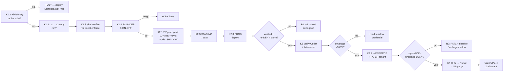
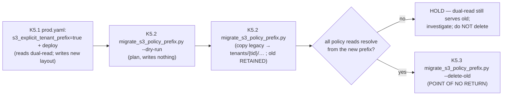
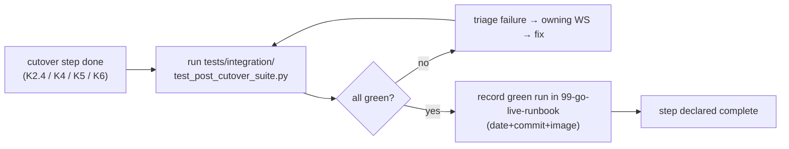
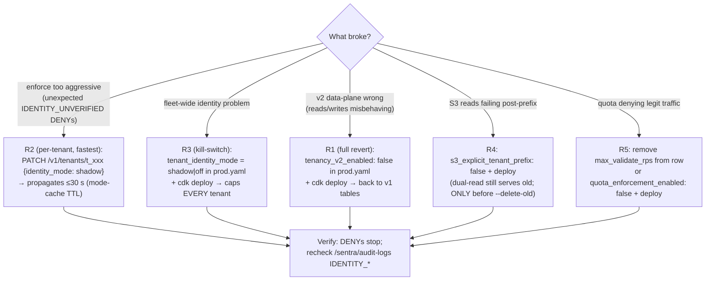

# LLD 27: Serverless Production Activation & Cutover (WS-K)

**Version**: 1.0
**Last Updated**: 2026-06-29
**Status**: Draft
**Prerequisites**: LLD [26-multi-tenancy.md](26-multi-tenancy.md) (DONE & enforcing on dev); HLD [hld/serverless-edition.md](../hld/serverless-edition.md) §8; workstream scope [tasks/serverless-edition/ws-k-production-activation.md](../tasks/serverless-edition/ws-k-production-activation.md); runbook of record [tasks/26-multi-tenancy/99-go-live-runbook.md](../tasks/26-multi-tenancy/99-go-live-runbook.md).

## Table of Contents
1. Overview (purpose, scope, prerequisites)
2. Cutover architecture (the activation surface + sequence)
3. The exact `prod.yaml` diff (config model)
4. Per-step verification queries/commands
5. Per-tenant enforce-flip gating
6. Tail tasks (K4 RPS ceiling, K5 S3 `--delete-old`, K6 brownfield purge, K7 acme-agent verify)
7. Post-cutover integration test suite (the "every API, all use-cases" suite — run after cutover, bugs→fix loop)
8. Error model
9. Monitoring & observability during cutover
10. Rollback drills
11. Cost
12. Cross-references

---

## 1. Overview

### 1.1 Purpose
This LLD elaborates the **one approved option** from HLD [serverless-edition.md](../hld/serverless-edition.md) §8 and sub-PRD FR-10.5: **activate TENANCY_V2 in prod/staging and finish the deferred tail**, with Cedar **already configured authoritative in prod** (verify-only). It does **not** re-open the design — TENANCY_V2 (tenant-scoped registry/policies/sessions/signals + signed-JWT per-agent identity + tenant-scoped console) is built, tested, and **enforcing on dev** (go-live 2026-06-24, tenant `acme`, 0 `_unverified`, commit `8902b4e`). This is **activation, not build**: the deliverable is a concrete cutover runbook (exact `prod.yaml` diff, ordered steps with a verification query after each, rollback drills) plus three tail-task specs.

> **The danger is in sequencing, not in lines of code.** Most "code" here is config keys + invoking already-tested migration scripts + verification queries. Every implementation decision honors the LLD-26 / HLD tenets carried below.

### 1.2 Tenets carried forward (from LLD-26 / HLD §8 — the tie-breakers)
1. **Fail-secure / deny-by-default.** A missing table or a tokenless agent under enforce → DENY, never a permissive fallthrough. *(Caveat — §7.1: a Cedar **abstain** is the one case that does NOT yet honor this; it currently falls back to the legacy engine. Closing that gap is K3.2's job and gates the FR-2.4 "legacy retired" claim.)*
2. **Conservative-off default + absent-key trap.** `config.py` defaults are conservative-off; a key **absent** from `prod.yaml` rides the off default. To activate, you **ADD the key** — you cannot edit a line that is not there.
3. **Two-latch enforce: `effective_mode = min(env ceiling, tenant.identity_mode)`** ([config.py:125](../src/security-controller/app/config.py), LLD-26 §7.2). Raising the env ceiling never forces a tenant whose row is still `shadow`/`off` into enforce.
4. **Per-tenant enforce gates on ≈100% per-agent credential coverage** (LLD-26 §7.1.2 bootstrap hazard). An uncredentialed agent in a flipped tenant gets a **time-boxed, alarmed legacy-fallback window** that **expires to hard DENY** — it never silently rides `default`.
5. **Irreversible tail items are sign-off-gated.** The `default` brownfield purge and the S3 `--delete-old` cut are point-of-no-return; both require a written, dated founder sign-off with an inventory/confirmation attached.
6. **Rollback is a flag flip at every step.** Per-tenant `PATCH identity_mode → shadow` (≤30 s mode-cache TTL); fleet ceiling `tenant_identity_mode = shadow|off` + redeploy; `tenancy_v2_enabled: false` + `cdk deploy` reverts to v1 tables.

### 1.3 Scope
**In scope:** prod/staging TENANCY_V2 flip (`tenancy_v2_enabled: false → true` + the absent identity/quota/consent keys added); shadow→enforce per-tenant gated rollout; Cedar **verify-only**; the three tail tasks.
**Out of scope (FOOTGUN guard):** **WS-K does NOT touch `cedar_enabled`/`cedar_shadow_mode`.** [prod.yaml:30-31](../cdk/config/prod.yaml) already carries `cedar_enabled: true` + `cedar_shadow_mode: false`. Any PR under WS-K that flips them is out of scope and must be rejected (Milestone K3.3). No new feature code; the TENANCY_V2 build itself (LLD-26 WS-A…WS-E) is done.

### 1.4 Implementation-status carry-forward (what is already built)
| Capability | Status | Evidence |
|---|---|---|
| Tenant-scoped registry/policies/sessions/signals (v2 tables) | **DONE, enforcing on dev** | [config.py:61-92](../src/security-controller/app/config.py); dev.yaml:25 |
| Per-agent signed-JWT identity (`resolve_tenant_from_jwt`, kid-index LRU) | **DONE, enforcing on dev** | LLD-26 §3.4/§3.6; dev.yaml:37 `enforce` |
| Two-latch effective-mode + per-tenant `identity_mode` | **DONE** | LLD-26 §7.2; [config.py:125-129](../src/security-controller/app/config.py) |
| Identity legacy-fallback window + table | **DONE (window=0/off on dev)** | [config.py:165-173](../src/security-controller/app/config.py); dev.yaml:42 |
| S3 explicit-tenant-prefix dual-read + `migrate_s3_policy_prefix.py` | **DONE (prefix=false on dev — legacy layout)** | [config.py:90](../src/security-controller/app/config.py); scripts/migrate_s3_policy_prefix.py |
| Per-tenant RPS quota (fail-open) | **DONE (enabled, inert on dev)** | [config.py:117](../src/security-controller/app/config.py); dev.yaml:51 |
| Platform cross-tenant read consent enforcement | **DONE (on, dev)** | [config.py:184](../src/security-controller/app/config.py); dev.yaml:57 |
| Brownfield inventory/purge engine | **DONE (0 default creds on dev)** | scripts/migrate_brownfield.py; runbook line 137 |
| Cedar authoritative cutover branch | **DONE (prod-config already set)** | [validation_service.py:301](../src/security-controller/app/services/validation_service.py); prod.yaml:30-31 |

**This LLD adds NO capability — it activates the above in the prod account** (profile `sentra`, `us-east-1`, account `531109575379`).

---

## 2. Cutover architecture

### 2.1 The activation surface (what changes)
Three files + the prod DynamoDB tables + three migration scripts:

| Surface | Role in this cutover | Change |
|---|---|---|
| [cdk/config/prod.yaml](../cdk/config/prod.yaml) | the prod flag set | flip `tenancy_v2_enabled`; ADD 5 absent keys; later flip `s3_explicit_tenant_prefix` |
| [cdk/config/dev.yaml](../cdk/config/dev.yaml) | **reference posture only** | none — copy its *shape*, not blindly its values |
| [src/security-controller/app/config.py](../src/security-controller/app/config.py) | flag schema + conservative-off defaults | none — read-only reference |
| prod DynamoDB v2 + identity tables | hard prerequisite | StorageStack deploy must precede the flip |
| `migrate_tenancy.py` / `migrate_s3_policy_prefix.py` / `migrate_brownfield.py` | data copies / tail cuts | invoked, not edited |

### 2.2 The cutover sequence (decision flow)



### 2.3 Hard ordering invariants
- **StorageStack before the flag** (K1.2). Flipping `tenancy_v2_enabled: true` before the v2 + identity tables exist → controller reads missing tables → fail-secure **DENY storm**.
- **v1→v2 data copy before the flag** (K2.1). The `prod.yaml:18-21` comment states the precondition: `migrate_tenancy.py` must have copied v1→v2 under `tenant=default` first, or there is nothing under v2 to read.
- **Shadow before enforce** (K2.3 before K2.4). First prod flip lands at `tenant_identity_mode: shadow` — enforce with 0 % coverage DENYs every prod agent.
- **Staging before prod** for K2.3 (soak the flag change in staging first).
- **Tail order: K4 → K5 → K6.** RPS ceiling and S3 cut are reversible-ish; the brownfield purge (K6) is the last, irreversible step.

---

## 3. The exact `prod.yaml` diff (config model)

### 3.1 K2.1 — flip the master flag (edit an existing line)
[prod.yaml:22](../cdk/config/prod.yaml) currently reads `tenancy_v2_enabled: false`. Change to `true` and update the precondition comment to record the prod go-live (mirroring dev.yaml:22-24's `# CUTOVER` note):

```yaml
# Tenancy v2 cutover flag (Multi-Cloud Agent Import — P0a, workstream §1.2).
# CUTOVER <YYYY-MM-DD>: migrate_tenancy.py copied v1→v2 under tenant=default in PROD
# (registry/policies/sessions/signals); StorageStack confirmed (K1.2). Founder go: <date>.
# Rollback: set false + cdk deploy <Compute+Storage stacks>.
tenancy_v2_enabled: true     # was: false
```

### 3.2 K2.2 — ADD the five absent keys (the absent-key trap)
These keys are **not present** in prod.yaml today — they ride the `config.py` off/default. **You must ADD them** (append after the `cedar_*` block, before the `vpc:` block). Values mirror dev.yaml shape with a **conservative ceiling** (`tenant_identity_mode: shadow`, NOT enforce):

```yaml
# ── TENANCY_V2 runtime identity (LLD-26 §7.2) — ADDED for WS-K prod activation ──
# Env ceiling. shadow → verify+log presented JWTs, do NOT route (no behavior change).
# Raise to enforce in K2.4 ONLY after the onboarded prod tenant's per-agent
# credential coverage ≈100% (bootstrap hazard, LLD-26 §7.1.2). effective_mode =
# min(this, tenant.identity_mode).
tenant_identity_mode: shadow                 # config.py:127 default "off"; dev.yaml:37 "enforce"

# 0 = tokenless validate under enforce DENYs immediately. Raise (e.g. 86400) only
# transiently during a per-tenant enforce flip if a not-yet-credentialed agent must
# be tolerated; drive back to 0 as coverage → 100%.
identity_fallback_window_seconds: 0          # config.py:165 default 0; dev.yaml:42

# false = legacy implicit S3 layout (reads dual-read both). The explicit-prefix flip
# + migrate_s3_policy_prefix.py --delete-old cut is Milestone K5.
s3_explicit_tenant_prefix: false             # config.py:90 default false; dev.yaml:45

# Inert until a tenant is in enforce with a registered credential AND a
# max_validate_rps quota; fails OPEN on counter-store errors regardless (K4).
quota_enforcement_enabled: true              # config.py:117 default false; dev.yaml:51

# Sentra-staff cross-tenant read DENIES (403) unless the target tenant consents;
# the immutable platform-audit ledger writes regardless. Grant consent before onboard.
platform_read_consent_enforced: true         # config.py:184 default false; dev.yaml:57
```

> **FOOTGUN restated:** an acceptance check that only greps for the *line* `tenant_identity_mode: enforce` would pass on dev and **silently fail on prod** if the key is absent — a "we flipped enforce" claim is false until the key physically exists in prod.yaml. K2 acceptance ([ws-k §5](../tasks/serverless-edition/ws-k-production-activation.md)) verifies the key is present, not just the default.

### 3.3 What WS-K does NOT add or change
- `cedar_enabled` / `cedar_shadow_mode` — **already `true`/`false` at [prod.yaml:30-31](../cdk/config/prod.yaml).** Verify-only (K3). No edit.
- Per-tenant `identity_mode` and `max_validate_rps` are **DynamoDB row fields in `sentra-tenants`**, not config keys — set via `PATCH /v1/tenants/{tid}`, not `prod.yaml` (K2.4, K4).

---

## 4. Per-step verification queries/commands

All commands run with `export AWS_PROFILE=sentra AWS_REGION=us-east-1` (account `531109575379`). **Production-safety:** read/describe/list only; never `cdk destroy`; the only writes are the gated flag deploys and the explicitly-confirmed migration scripts.

### 4.1 K1.2 — v2 + identity tables exist (hard prereq)
```bash
for T in sentra-tenants sentra-tenant-members sentra-agent-credentials \
         sentra-identity-fallback sentra-agent-registry-v2 \
         sentra-policies-metadata-v2 sentra-session-context-v2 \
         sentra-validation-signals-v2; do
  aws dynamodb describe-table --table-name "$T" \
    --query 'Table.{n:TableName,s:TableStatus}' --output text || echo "MISSING: $T"
done
# GSIs that MUST exist (kid-index on credentials, tenant-members-index on members):
aws dynamodb describe-table --table-name sentra-agent-credentials \
  --query 'Table.GlobalSecondaryIndexes[].IndexName'   # expect ["kid-index"]
aws dynamodb describe-table --table-name sentra-tenant-members \
  --query 'Table.GlobalSecondaryIndexes[].IndexName'   # expect ["tenant-members-index"]
```
**Gate:** every table `ACTIVE`, both GSIs present. Any `MISSING`/non-ACTIVE → **HALT**, deploy StorageStack (`cdk deploy <Sentra-PROD-Storage-Stack>`), re-run. Do not proceed.

### 4.2 K1.2b — v1→v2 copy under `tenant=default` ran
```bash
# A populated v2 registry under tenant=default proves the copy ran (else v2 is empty → reads miss).
aws dynamodb scan --table-name sentra-agent-registry-v2 \
  --filter-expression 'tenant_id = :t' \
  --expression-attribute-values '{":t":{"S":"default"}}' \
  --select COUNT --query 'Count'
# Expect > 0 and consistent with the v1 sentra-agent-registry item count:
aws dynamodb scan --table-name sentra-agent-registry --select COUNT --query 'Count'
```
**Gate:** v2 count ≈ v1 count under `default`. Zero v2 items → run `python scripts/migrate_tenancy.py` (per dev.yaml:22-24 history) before the flag flip.

### 4.3 K2.3 — deploy + verify shadow (post-flip, no behavior change)
```bash
cd cdk
cdk diff Sentra-PROD-Compute-Stack    # REVIEW: only the env-var flag change should appear
# Deploy staging first, soak, then prod:
cdk deploy Sentra-PROD-Storage-Stack Sentra-PROD-Compute-Stack
# (1) controller reads v2 tables + logs verified identity for signed prod agents:
aws logs filter-log-events --log-group-name /sentra/audit-logs \
  --start-time $(($(date +%s)*1000 - 600000)) \
  --filter-pattern '"identity_state=verified"' --query 'events[].message' --max-items 5
# (2) NO DENY storm — identity-gate DENYs SKIP the Decisions metric, so check AUDIT LOGS:
aws logs filter-log-events --log-group-name /sentra/audit-logs \
  --start-time $(($(date +%s)*1000 - 600000)) \
  --filter-pattern '?IDENTITY_UNVERIFIED ?IDENTITY_' --query 'length(events)'
```
**Gate (shadow):** `identity_state=verified` present for signed agents; the `IDENTITY_*` count is **0** (shadow observes, never routes — runbook line 87). A non-zero count under shadow indicates a config error → **Rollback R1**.

> **Memo (identity-deny-not-metered):** tenancy identity-gate DENYs do **not** increment `Decisions`/`ValidationsTotal`. A console "decisions" panel staying flat is **not** proof enforce is clean — the proof is the `/sentra/audit-logs` `IDENTITY_*` query above.

### 4.4 K2.4 — verify enforce (post-coverage-gate)
```bash
# Per-tenant flip (the row, not config) for the onboarded tenant t_xxx:
curl -sS -X PATCH "$SENTRA_API_BASE/v1/tenants/t_xxx" \
  -H "x-sentra-oidc-data: <operator token>" -d '{"identity_mode":"enforce"}'
# (1) signed calls route normally (verified tid in the validate trace);
# (2) an UNSIGNED call from t_xxx DENYs IDENTITY_UNVERIFIED, audited under _unverified:
aws logs filter-log-events --log-group-name /sentra/audit-logs \
  --start-time $(($(date +%s)*1000 - 300000)) \
  --filter-pattern '"IDENTITY_UNVERIFIED" "_unverified"' --query 'events[].message' --max-items 3
```
**Gate (enforce):** signed → route; unsigned from `t_xxx` → `IDENTITY_UNVERIFIED` under `_unverified`. **Other prod tenants stay capped by their own row** (effective = min(enforce ceiling, their `shadow`/`off`)) → unaffected.

---

## 5. Per-tenant enforce-flip gating (the bootstrap hazard)

Raising the **fleet ceiling** to `enforce` (K2.4) does not by itself enforce any tenant — `effective_mode = min(ceiling, tenant.identity_mode)`. A tenant only enforces when its `sentra-tenants` row also reads `enforce`. **Do not PATCH a tenant to enforce until its per-agent credential coverage ≈100%.**

### 5.1 Coverage check before the per-tenant PATCH
```bash
# Agents registered in the tenant's v2 registry:
REG=$(aws dynamodb scan --table-name sentra-agent-registry-v2 \
  --filter-expression 'tenant_id = :t' \
  --expression-attribute-values '{":t":{"S":"t_xxx"}}' --select COUNT --query 'Count' --output text)
# Agents that hold an ACTIVE credential (kid-index → agent_id):
CRED=$(aws dynamodb scan --table-name sentra-agent-credentials \
  --filter-expression 'tenant_id = :t AND #s = :a' \
  --expression-attribute-names '{"#s":"status"}' \
  --expression-attribute-values '{":t":{"S":"t_xxx"},":a":{"S":"active"}}' \
  --select COUNT --query 'Count' --output text)
echo "coverage: $CRED / $REG"   # gate: CRED == REG (≈100%) before PATCH enforce
# Residual (uncredentialed) agents the console would show:
curl -sS "$SENTRA_API_BASE/v1/identity/residual-agents" -H "x-sentra-oidc-data: <operator token>"
```
**Gate:** `CRED == REG`. If `CRED < REG`, EITHER hold the tenant at `shadow` and finish credentialing (`python demo-agents/registration/provision_acme_identity.py` pattern / `aegion_guard.provision`), OR — only if a residual agent must be tolerated during the flip — set `identity_fallback_window_seconds: 86400` transiently so the residual agent rides an **alarmed** (`IdentityFallback` metric) legacy-fallback window that **expires to DENY**, then drive the window back to `0` as coverage closes. The residual list (`GET /v1/identity/residual-agents`) is the ops worklist.

### 5.2 Why this is safe
A migrated agent never reads an empty partition (its data flips to its real `tid` only once it has a credential — LLD-26 §7.1.2), and an uncredentialed agent is never silently assigned a tenant. The fallback window is the only "no worse than today" tolerance, and it is time-boxed and alarmed — it **never** silently rides `default`.

---

## 6. Tail tasks

Run **after** K2.4 enforce verifies, in order **K4 → K5 → K6**. Each carries its irreversibility class and sign-off gate.

### 6.1 K4 — per-tenant RPS-quota ceiling raise (reversible)
`quota_enforcement_enabled: true` is already set (§3.2) but **inert** until a tenant is in `enforce` with a registered credential AND a `max_validate_rps` quota on its row.

```bash
# Set the provisioned ceiling on the tenant ROW (not a config key):
curl -sS -X PATCH "$SENTRA_API_BASE/v1/tenants/t_xxx" \
  -H "x-sentra-oidc-data: <operator token>" -d '{"max_validate_rps": <provisioned-ceiling>}'
```
**Verify:** a burst over `max_validate_rps` throttles (429 / quota DENY) for `t_xxx`; **and** a counter-store error **fails OPEN** — confirm a forced counter error does NOT DENY legitimate traffic (dev.yaml:50-51 "fails open on counter errors regardless"; [config.py:114-117](../src/security-controller/app/config.py)). **Rollback:** remove `max_validate_rps` from the row (or set `quota_enforcement_enabled: false` + redeploy) — the counter is inert again.

### 6.2 K5 — B3 S3 `--delete-old` prefix migration (point-of-no-return on the `--delete-old` step)
Dual-read → copy → confirm → `--delete-old`. The first two sub-steps are reversible; the `--delete-old` is the point of no return for the legacy layout.



- **K5.1** — set `s3_explicit_tenant_prefix: false → true` in prod.yaml + `cdk deploy`. New writes go to `tenants/{tenant_id}/policies/agents/{agent_id}/v{n}.{yaml|cedar}`; reads dual-read both layouts ([config.py:81-92](../src/security-controller/app/config.py)). **No old data deleted.**
- **K5.2** — `python scripts/migrate_s3_policy_prefix.py --dry-run` (prints the plan, writes nothing — script line 31), then `python scripts/migrate_s3_policy_prefix.py` (copies; old objects **retained by default** — script line 22). Verify reads resolve from the new prefix for every existing policy (dual-read makes this non-breaking).
- **K5.3** — only after confirming **all reads resolve from the new prefix**, run `python scripts/migrate_s3_policy_prefix.py --delete-old` (script lines 34, 147). **FOOTGUN:** `--delete-old` before confirming new-prefix reads → policies vanish → **deny-by-default DENY** (no policy = fail-secure DENY). **No automated `--delete-old`.** Sign-off gate: written confirmation that dual-read serves everything from the new layout.

### 6.3 K6 — `default` brownfield purge (IRREVERSIBLE, founder-sign-off-gated)
The existing `default-*` fleet cannot hold a real-tenant credential without a re-key (immutable `agent_id`); decision of record = re-import under real tenants, then purge `default`.

- **K6.1 — Inventory FIRST (read-only, safe):**
  ```bash
  python scripts/migrate_brownfield.py inventory --out default_inventory.json   # script lines 30-31
  ```
  On dev this showed **0 credentials under `default`** (runbook line 137). Re-run for prod; attach `default_inventory.json` to the sign-off packet.
- **K6.2 — Founder sign-off** (separate, explicit, dated, written) re-confirming **no real customer data under `default`** (runbook lines 153-158).
- **K6.3 — Purge (only on explicit go):**
  ```bash
  python scripts/migrate_brownfield.py purge --confirm-no-customer-data   # script line 32; IRREVERSIBLE
  ```
  The script **refuses** without `--confirm-no-customer-data` (script lines 130-133) and reuses the controller's tested resumable `tenant_purge.purge_tenant` engine (script line 140). **FOOTGUN:** never run as part of an automated rollout or "to clean up." **If inventory shows ANY credential under `default`, STOP** — re-import under a real tenant first; do not purge. There is **no rollback** for a purge — the inventory + sign-off ARE the safety.

> **Note (real-data state):** prod currently has **no real customer data** — the only seeded tenant is the `acme` demo tenant, and the dev `default` inventory already reads **0 credentials**. So K6's purge gate is *already satisfiable* and the master TENANCY_V2 flip (K2.1) is safe to schedule now — there is no customer fleet to break. (Re-run the prod inventory to confirm before the purge regardless.)

### 6.4 K7 — verify the `acme` agents sign under enforce (VERIFY-only, not a fix)
The three `acme-*` agents were brought to signing+verified under enforce in commit `dba8a79` (2026-06-25; Azure cold-start fixed via `alwaysOn=true` + `WEBSITE_CONTAINER_START_TIME_LIMIT=600`). **This step VERIFIES that fix still holds in prod — it does NOT re-task an agent fix.** The three agents (real IDs, [demo-agents/registration/provision_acme_identity.py:44](../demo-agents/registration/provision_acme_identity.py#L44)):

| agent_id | platform | check |
|---|---|---|
| `acme-payments-agent` | AWS (Bedrock Lambda) | credentialed + signing |
| `acme-identity-agent` | Azure (OpenAI Function App) | credentialed + signing (Always-On bicep) |
| `acme-telecom-agent` | Azure (OpenAI Function App) | credentialed + signing (Always-On bicep) |

- **K7.1 — coverage = 3/3:** `GET /v1/identity/residual-agents` for tenant `acme` MUST return `count: 0` (the §5.1 gate). If non-zero, an agent regressed — re-provision it ([demo-agents/registration/provision_acme_identity.py](../demo-agents/registration/provision_acme_identity.py)) before the per-tenant enforce PATCH.
- **K7.2 — Azure boot-under-enforce:** confirm both Azure functions have `alwaysOn=true` ([demo-agents/azure-identity-agent/infra/main.bicep](../demo-agents/azure-identity-agent/infra/main.bicep), `azure-telecom-agent/infra/main.bicep`) so the native-crypto import doesn't crash-loop the cold start (the original `dba8a79` regression). **FOOTGUN:** an Azure agent redeployed via `azd up` (not `azd deploy`) wipes the signing app-settings (`SENTRA_TENANT_ID`/`KID`/`PRIVATE_KEY`) and silently regresses to unsigned → `IDENTITY_UNVERIFIED` — deploy code-only with `azd deploy`.

---

## 7. Post-cutover integration test suite

**Why this section exists (owner directive p7):** there are **no real customers**, so a break won't announce itself as a complaint — we only find it by *testing every API across all use-cases ourselves*, immediately after the cutover. This suite is the post-cutover acceptance gate **and** the durable regression suite reused on every later PR (it feeds WS-J, the cross-cutting canary harness). **If it finds bugs, they are fixed before the cutover is declared done** — a red suite blocks "go-live complete."

### 7.1 Where it lives + how it runs
- **Location:** extend `tests/integration/` (existing markers `@pytest.mark.integration` / `@pytest.mark.requires_services`, fixtures `service_urls` / `api_headers` in [tests/integration/conftest.py](../tests/integration/conftest.py)). New file: `tests/integration/test_post_cutover_suite.py`.
- **Run:** `pytest tests/integration/ -m integration -v` against the **prod** ALB (profile `sentra`, `us-east-1`) with an operator OIDC token + a credentialed `acme` agent's signing key. Gate: **100% pass before K2.4 enforce is declared complete**; re-run after each tail task (K4/K5/K6).

### 7.2 Coverage matrix — every route, all use-cases
Enumerate **every** route in [src/security-controller/app/api/routes.py](../src/security-controller/app/api/routes.py) + [tenancy_routes.py](../src/security-controller/app/api/tenancy_routes.py) (~40 endpoints). For each: the happy path **and** the failure paths (401 no-auth, 403 wrong-tenant/role, 404 missing, 400 bad-input). The load-bearing groups:

| Group | Routes | Must assert |
|---|---|---|
| **Data plane** | `POST /v1/validate` | ALLOW + DENY round-trips; a **signed-JWT** call verifies (tenant resolved from credential, not self-asserted); an **unsigned** call under enforce → `IDENTITY_UNVERIFIED` DENY; a **cross-tenant agent_id spoof** → DENY tagged `_unverified` (NOT charged to the claimed tenant — §8 E-row / metering) |
| **Identity / credentials** | `POST /v1/agents/{id}/credentials`, `GET /v1/identity/residual-agents`, rotate/revoke | issue → sign → verify E2E **over HTTP** (the named gap); a revoked `kid` → DENY; tenant A **cannot** register/read/revoke tenant B's credential (403) |
| **Tenancy** | `POST /v1/tenants`, `/v1/me`, `/v1/invites*`, per-tenant `PATCH identity_mode` | tenant isolation; `require_role` enforced; `X-Aegion-Tenant` switch validated against membership (deny non-member) |
| **Policy CRUD** | `GET/POST/PUT/DELETE /v1/policies`, `PATCH /v1/policies/{id}/status`, `POST /v1/agents/{id}/policies` | author→bind→evaluate (Cedar authoritative); cross-tenant policy read/write denied |
| **Quarantine / rollback** | `POST /v1/quarantine/{session}`, `DELETE …`, `POST /v1/rollback`, `POST /v1/decisions/{id}/verdict` | quarantine blocks subsequent ops; rollback compensates a reversible action |
| **Query / SOC** | `GET /v1/logs`, `/v1/sessions*`, `/v1/decisions`, `/v1/metrics*`, `/v1/discovery/*`, `/v1/connections/*`, `/v1/sigma-rules*` | tenant-scoped reads only; the `IDENTITY_*` audit filter (§9) surfaces gate-DENYs the metric hides |

### 7.3 The two named coverage gaps to close (from the test grounding)
1. **Credential issuance → JWT signing → verify, end-to-end over HTTP** — today only unit-tested ([test_multitenancy_identity.py](../src/security-controller/tests/test_multitenancy_identity.py)); the new suite must drive the real `provision.py` → `POST /credentials` → signed `/v1/validate` chain.
2. **An "every route responds" enumeration test** — a parametrized test that hits each route once (auth'd) and asserts it is reachable (no 404/5xx-undefined-route — catches the apigw-per-resource missing-route footgun, [identity-deny + apigw memos]).

### 7.4 The bug-fix loop (owner directive)
A failure in 7.2/7.3 is a **cutover blocker**, not a backlog item. Loop: run suite → triage each failure to its owning workstream (by route → WS) → fix → re-run → repeat until green. Wire the suite into CI as a **required PR gate** (WS-J) so a later change can't silently regress a prod-cutover invariant. Record the green run (date + commit + image milestone) in [99-go-live-runbook.md](../tasks/serverless-edition/99-go-live-runbook.md).



---

## 8. Error model

| # | Condition | Detection | Response / mitigation |
|---|---|---|---|
| E1 | `tenancy_v2_enabled: true` deployed but v2 tables missing (K1.2 skipped) | controller fail-secure DENY storm; `describe-table` MISSING | **Prevent:** K1.2 hard prereq gate. **Recover:** Rollback R1 (`tenancy_v2_enabled: false` + `cdk deploy`). |
| E2 | Fleet ceiling raised to `enforce` before coverage ≈100% | tokenless agents DENY `IDENTITY_UNVERIFIED` (audited `_unverified`) | **Prevent:** §5 coverage gate. **Recover:** Rollback R2 (ceiling → `shadow`, ≤30 s TTL). |
| E3 | Identity-DENY storm invisible on the `Decisions` metric | metric flat but agents failing | **Detect via `/sentra/audit-logs` `IDENTITY_*` filter (§4.3), NOT the metric** (identity-deny-not-metered memo). |
| E4 | New MT route 403/404 at the edge (per-tenant PATCH unreachable) | 43-byte 403 in nginx + absent from controller logs = missing gateway route | Add explicit API GW route (`api_stack.py`) + private-ALB priority rule (`compute_stack.py`) — runbook lines 24-32 (apigw-per-resource memo). |
| E5 | `--delete-old` run before new-prefix reads confirmed (K5.3) | policies vanish → deny-by-default DENY | **Prevent:** confirm dual-read serves all from new layout first; no automated `--delete-old`. |
| E6 | `purge` run with non-empty `default` inventory (K6) | irreversible loss of real data | **Prevent:** inventory + dated sign-off hard gate; STOP-on-nonzero. No recover. |
| E7 | Cedar abstains in prod (missing `.cedar` co-artifact) | validate trace shows legacy as deciding source | **Today an abstain falls back to the legacy engine — a *permissive* verdict, NOT a fail-secure DENY** ([validation_service.py:305-311](../src/security-controller/app/services/validation_service.py)). The load-bearing mitigation is the **CT08 `.cedar` backfill** (prod.yaml:27-28 comment) so every prod policy carries the co-artifact and Cedar never abstains. Under "legacy retired" (FR-2.4) an abstain-where-Cedar-should-decide must instead fail secure — **K3.2 must WRITE that abstain → DENY test** (§7.1); it is not yet encoded. |
| E8 | Quota counter-store error | quota path errors | **Fails OPEN by design** ([config.py:114-117](../src/security-controller/app/config.py); dev.yaml:50-51) — must NOT DENY legitimate traffic. Verify K4. |

### 7.1 Fail-secure path (K3.2 — a test to WRITE, not yet encoded)
The cutover branch ([validation_service.py:301](../src/security-controller/app/services/validation_service.py)) evaluates `cutover = cedar is not None and settings.cedar_enabled and not settings.cedar_shadow_mode` → **True in prod**. Within that branch there are **two distinct Cedar-failure cases, and only one fails secure today**:

- **Cedar evaluator error → fail-secure DENY (already encoded).** A Cedar engine *error* routes through the controller's system-error path, which returns DENY ([validation_service.py:656-673](../src/security-controller/app/services/validation_service.py), `_create_error_response` → `decision: DENY`, `violation_type: SYSTEM_ERROR` / `POLICY_ERROR`). This is the case the existing tests cover.
- **Cedar ABSTAIN → permissive legacy fallback (NOT fail-secure today).** When Cedar *abstains* (the exact E7 trigger — an un-migrated policy missing its `.cedar` co-artifact), the live branch runs `policy_fallback = self.policy_engine.validate(request)` ([validation_service.py:305-311](../src/security-controller/app/services/validation_service.py)) and the **legacy engine's verdict becomes the decision** — explicitly "so there is never an un-enforced window during rollout." [test_cedar_cutover.py:96-108](../src/security-controller/tests/test_cedar_cutover.py) (`test_cutover_abstain_falls_back_to_legacy`) *pins this rollout-era behavior*: abstain → `policy_engine.validate` awaited → `result.should_deny is False`. **It encodes the permissive fallback and must NOT be cited as the fail-secure proof.** ([test_ws_b_cutover.py](../src/security-controller/tests/test_ws_b_cutover.py) covers S3-prefix dual-read (B3) and the IDENTITY fallback window (B1); it contains no Cedar-abstain assertion at all.)

So under FR-2.4 "legacy retired," an abstain-where-Cedar-should-decide currently resolves via the **unretired legacy engine** — a silent permissive permit, not the fail-secure DENY HLD §8 row (g) requires ("a reached-legacy path is a defect, not a silent permit"). **K3.2 is therefore work to do, not a proven invariant:** it must WRITE a new test asserting *abstain-where-Cedar-should-decide → DENY*. Until that test exists and passes, the **CT08 `.cedar` backfill (E7) is the load-bearing prerequisite** that keeps Cedar from abstaining in prod, and the "legacy retired" claim (FR-2.4) is gated on that new test going green.

---

## 9. Monitoring & observability during cutover

| Signal | Source | What it proves | Cutover use |
|---|---|---|---|
| `identity_state=verified` log lines | `/sentra/audit-logs` | signed agents resolve a verified tid | K2.3 shadow gate |
| `IDENTITY_*` reason count (esp. `IDENTITY_UNVERIFIED`) | `/sentra/audit-logs` (NOT the `Decisions` metric — E3) | enforce is biting / DENY storm | 0 under shadow (K2.3); expected only for *unsigned* calls under enforce (K2.4) |
| `_unverified` audit bucket | audit ledger | a tokenless call under enforce was denied & attributed | K2.4 enforce proof |
| `Decisions{tenant_id}` | CloudWatch (Sentra/SecurityController) | per-tenant policy verdicts flow; tenant attribution works | confirms TENANCY_V2 attribution post-flip |
| `CedarShadowDiscrepancy` | CloudWatch | N/A in prod (shadow off) — should be **silent** | K3 verify Cedar is authoritative, not shadow |
| `IdentityFallback` | CloudWatch | a residual uncredentialed agent is riding the grace window | watch during a coverage-gated flip with `identity_fallback_window_seconds > 0` |
| validate trace deciding source = Cedar | validate response / trace | Cedar is the authoritative policy decision | K3.1 |
| Platform cross-tenant read records | `sentra-platform-audit-records` | consent enforcement + immutable ledger live | post-flip (consent enforced = true) |

**Cutover dashboard:** for the soak window, watch (1) `IDENTITY_*` audit count = 0 under shadow, (2) `Decisions{tenant_id=t_xxx}` non-zero after the agent's traffic flows, (3) `CedarShadowDiscrepancy` silent, (4) no 5xx spike on `/v1/validate`. Existing alarms (prod.yaml:215-221: `api_5xx_threshold`, `api_latency_p99_ms`) backstop a regression.

---

## 10. Rollback drills

**Every milestone keeps a tested rollback; the rollback is a flag flip.** Test each at **staging** before the prod step.



| ID | Trigger | Action | Propagation | Caveat |
|---|---|---|---|---|
| R1 | v2 data-plane misbehaving / DENY storm from missing tables | `tenancy_v2_enabled: false` + `cdk deploy <Compute+Storage>` | redeploy time | reverts to v1 tables byte-identically |
| R2 | one tenant's enforce too aggressive | `PATCH /v1/tenants/t_xxx {identity_mode: shadow}` | ≤30 s (mode-cache TTL) | fastest; scoped to one tenant |
| R3 | fleet-wide identity issue | `tenant_identity_mode: shadow\|off` + `cdk deploy` | redeploy time | caps every tenant (effective = min) |
| R4 | S3 reads failing after prefix flip | `s3_explicit_tenant_prefix: false` + `cdk deploy` | redeploy time | **only valid BEFORE `--delete-old`** — after the cut there is nothing to dual-read back to |
| R5 | quota denying legit traffic | remove `max_validate_rps` / `quota_enforcement_enabled: false` + deploy | redeploy time | quota also fails open on counter errors (E8) |
| — | **K6 purge** | **NONE** | — | irreversible — inventory + sign-off ARE the safety |

---

## 11. Cost

This is an activation, not new infrastructure — the cost delta is small and bounded.

- **DynamoDB (PAY_PER_REQUEST, prod.yaml:83):** TENANCY_V2 adds reads on `sentra-agent-credentials` only on the **unverified** validate path; the verified hot path uses the in-process `kid` LRU (LLD-26 §3.6), so **~0 extra per-request DDB reads** at steady state. The `revoked-since` shared signal is one small `get_item` per refresh interval (≤10 s), not per request → negligible. v2 tables roughly double item-storage footprint during the `default` co-existence window; the K6 purge reclaims the `default` partition.
- **Migration scripts (one-time):** `migrate_s3_policy_prefix.py` copies each policy object once (S3 PUT + GET per object); `migrate_tenancy.py` already ran. One-time, bounded by policy count (tens–hundreds of small objects) → cents.
- **Compute:** no new ECS tasks; the flip is env-var-only on the existing controller image. `cdk deploy` is a rolling task replacement, no capacity change.
- **CloudWatch:** the cutover-window audit-log filters and the extra `IdentityFallback`/`CedarShadowDiscrepancy` metrics are within the existing `/sentra/audit-logs` 90-day retention (prod.yaml:75) — no new log group.
- **Dominant driver:** unchanged — `/v1/validate` request volume against API Gateway + the controller. **[ESTIMATE]** incremental monthly cost of the activation itself (extra DDB items + one-time copies) is **< $5/month** at current prod volume; the per-tenant RPS quota (K4) is a *ceiling*, not a cost line.

---

## 12. Cross-references

- **Implements:** FR-10.5 (prod/staging TENANCY_V2 activation — activation of FR-10.1/10.2/10.3). **Verifies (no flip):** FR-2.4 (Cedar authoritative) — with one open gap: the abstain→fail-secure-DENY invariant is NOT yet encoded (K3.2 writes it; §7.1/E7). ADRs touched: AD-7/FR-10.3 (verified agent identity), AD-2 (Cedar authoritative).
- **Shared contracts (canonical names — join keys):** `tenancy_v2_enabled`, `tenant_identity_mode`, `identity_fallback_window_seconds`, `s3_explicit_tenant_prefix`, `quota_enforcement_enabled`, `platform_read_consent_enforced` (config flags); `cedar_enabled`/`cedar_shadow_mode` (verify-only); `sentra-tenants`, `sentra-tenant-members` (+`tenant-members-index`), `sentra-agent-credentials` (+`kid-index`), `sentra-identity-fallback`, `sentra-agent-registry-v2`, `sentra-policies-metadata-v2`, `sentra-session-context-v2`, `sentra-validation-signals-v2` (tables); `PATCH /v1/tenants/{tid} {identity_mode,max_validate_rps}`, `GET /v1/identity/residual-agents` (APIs); `effective_mode = min(env ceiling, tenant.identity_mode)` (invariant); `migrate_tenancy.py`, `migrate_s3_policy_prefix.py [--dry-run|--delete-old]`, `migrate_brownfield.py [inventory|purge --confirm-no-customer-data]` (scripts).
- **Upstream:** HLD [serverless-edition.md](../hld/serverless-edition.md) §8 (FR-2.4 row + residual #2 prod-activation sequencing), §11.2; sub-PRD [prd/serverless-edition.md](../prd/serverless-edition.md) FR-10.5.
- **Workstream scope (input):** [tasks/serverless-edition/ws-k-production-activation.md](../tasks/serverless-edition/ws-k-production-activation.md).
- **Runbook of record (REUSE, do not duplicate):** [tasks/26-multi-tenancy/99-go-live-runbook.md](../tasks/26-multi-tenancy/99-go-live-runbook.md) (dev go-live; gated-cutover + rollback steps; brownfield/B3 tail).
- **Sibling LLD:** [lld/26-multi-tenancy.md](26-multi-tenancy.md) (§3.4/§3.6 identity + cache/revocation epoch, §7.1.2 bootstrap hazard, §7.2 rollout safety, §B9 brownfield).
- **Sibling refs (gated by this WS — build against the multi-tenant baseline WS-K turns on):** [tasks/serverless-edition/ws-a-local-floor-bundle.md](../tasks/serverless-edition/ws-a-local-floor-bundle.md), [ws-b-multiphase-contract.md](../tasks/serverless-edition/ws-b-multiphase-contract.md), [ws-d-decision-trail.md](../tasks/serverless-edition/ws-d-decision-trail.md), [ws-e-redaction.md](../tasks/serverless-edition/ws-e-redaction.md), [ws-f-prompt-signatures.md](../tasks/serverless-edition/ws-f-prompt-signatures.md).
- **Code anchors:** [cdk/config/prod.yaml](../cdk/config/prod.yaml), [cdk/config/dev.yaml](../cdk/config/dev.yaml), [src/security-controller/app/config.py](../src/security-controller/app/config.py), [src/security-controller/app/services/validation_service.py:301/305-311/656-673](../src/security-controller/app/services/validation_service.py), [scripts/migrate_s3_policy_prefix.py](../scripts/migrate_s3_policy_prefix.py), [scripts/migrate_brownfield.py](../scripts/migrate_brownfield.py), [scripts/migrate_tenancy.py](../scripts/migrate_tenancy.py).
- **Cutover invariant tests:** [src/security-controller/tests/test_cedar_cutover.py](../src/security-controller/tests/test_cedar_cutover.py), [src/security-controller/tests/test_ws_b_cutover.py](../src/security-controller/tests/test_ws_b_cutover.py).
- **Ops memos:** identity-DENYs-not-metered (check `/sentra/audit-logs` for `IDENTITY_*`, §4.3/E3); apigw-per-resource (new MT routes need explicit gateway + ALB rules, E4 / runbook lines 24-32).
