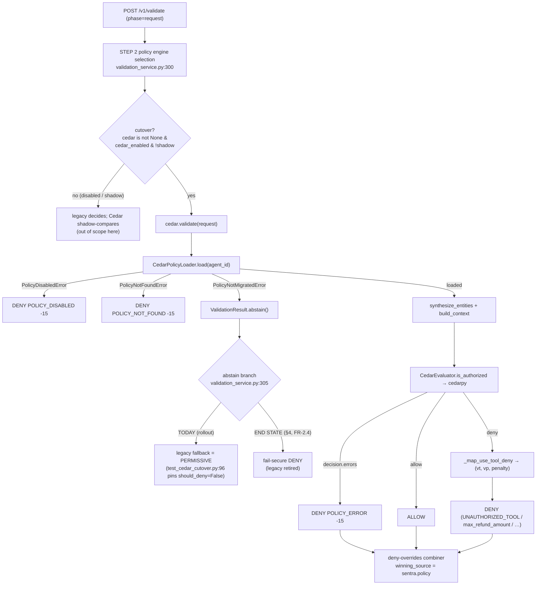
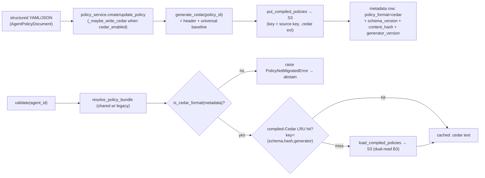
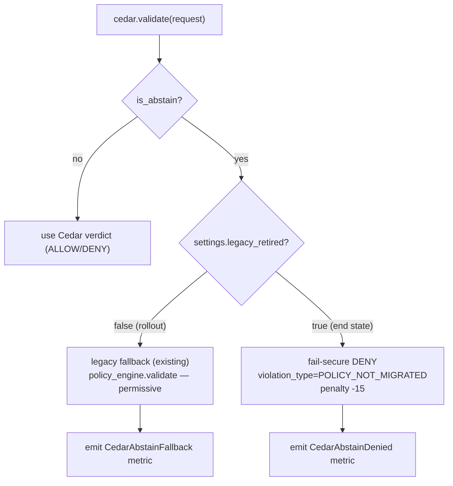
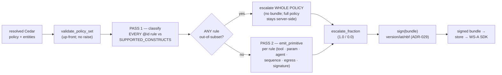
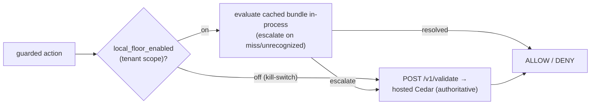
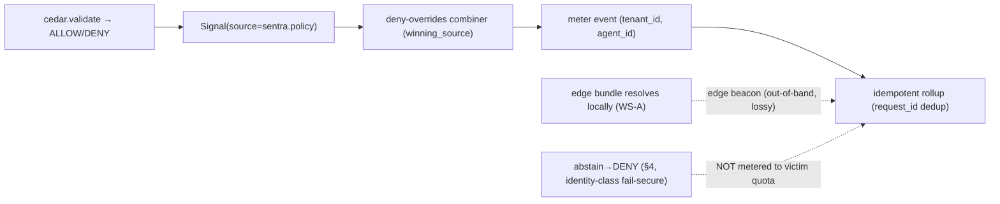

# LLD 28: Cedar Policy Engine — hosted authoritative engine + bundle-emit + differential conformance + abstain→DENY (WS-I)

**Version**: 1.0
**Last Updated**: 2026-06-29
**Status**: Draft
**Prerequisites**: AD-2 (Cedar is the policy engine — [ARCHITECTURE.md:327](ARCHITECTURE.md)); HLD [hld/serverless-edition.md](../hld/serverless-edition.md) §6.2(a)/(g) + Appendix C; workstream scope [tasks/serverless-edition/ws-i-cedar-engine.md](../tasks/serverless-edition/ws-i-cedar-engine.md); sibling LLD [27-serverless-production-activation.md](27-serverless-production-activation.md) §7.1 (the abstain gap this LLD designs the fix for). The Cedar engine, generator, evaluator, loader, baseline, and schema **already exist and are authoritative + enforcing on dev** — this LLD documents them as a first-class component and scopes the net-new emit/conformance/fail-secure work.

## Table of Contents
1. Overview (purpose, scope, status carry-forward, tenets)
2. Component architecture (the real files + validate→cutover→combiner flow)
3. Authoring → compile → load → cache pipeline (YAML/JSON → AgentPolicyDocument → `.cedar`)
4. The abstain→DENY fail-secure design (carried forward from LLD 27 §7.1) + CT08 backfill
5. The hosted-side bundle-emit step (closed-subset grammar, the allowlist compiler, signing/anti-rollback)
6. The interpreter↔`cedarpy` differential-conformance corpus
7. Security
8. Scaling
9. Networking
10. Database / storage (the `.cedar` co-artifact + the bundle artifact)
11. Cost
12. Metering & billing
13. Error model
14. Testing
15. Cross-references

---

## 1. Overview

### 1.1 Purpose
This LLD elaborates the **one approved option** from HLD §6.2(a) (Option A — JWT-signed bundle, in-process local floor) and §6.2(g) (Option A — Cedar authoritative in prod, legacy retired) plus **Appendix C** (the allowlist/closed-subset/fail-closed-escalate soundness argument). It does **not** re-open whether Cedar is the policy engine (AD-2, confirmed), whether the SDK embeds Cedar (it cannot — Appendix C), or whether prod runs Cedar authoritative (Option A, confirmed). It deepens three things into buildable detail:

1. **The Cedar policy engine as a first-class component** — the gap-filling per-component LLD that did not exist. `CedarPolicyEngine` ([engine.py:71](../src/security-controller/app/validators/cedar/engine.py#L71)) and the `evaluator`/`generator`/`loader`/`artifact`/`entities`/`context` modules are documented here; **LLD 19 stays ML-classifier-only** (Cedar is not folded into it).
2. **The hosted-side bundle-emit step** (net-new) — a control-plane compiler that emits the deterministic bundle WS-A's stdlib SDK interpreter reads, **from** the authoritative Cedar policy, as an **allowlist** (Appendix C).
3. **The interpreter↔`cedarpy` differential-conformance corpus** (net-new) — the proof that the edge interpreter and the hosted `cedarpy` engine agree on the closed subset, with the silent-fail-open (edge-ALLOW-where-server-DENY) divergence flagged CRITICAL.

Carried forward as a **must-design** item from [LLD 27 §7.1](27-serverless-production-activation.md): the **Cedar abstain→DENY fail-secure invariant** — today an abstain on the cutover branch falls back to the *legacy* engine (a permissive verdict, pinned by [test_cedar_cutover.py:96](../src/security-controller/tests/test_cedar_cutover.py#L96)); under "legacy retired" (FR-2.4) an abstain-where-Cedar-should-decide must instead fail secure to DENY. §4 designs that, the CT08 backfill that keeps Cedar from abstaining in prod, and the new test LLD 27 K3.2 said is "to write."

> **The component already runs; the danger is in the seams.** The engine, generator, evaluator, loader, baseline, and schema are DONE and enforcing on dev (§1.3). The net-new code is the **emit step** (§5), the **conformance corpus** (§6), and the **abstain→DENY** change (§4) — each is small and each has one load-bearing footgun (ALLOW-by-omission; silent divergence; permissive abstain). The rest of this LLD is documentation of shipped code so WS-A and the differential corpus have a contract to bind to.

> **Scope boundary — this LLD is the POLICY engine, NOT the ML stack.** It contains **no** ML model design: the **distilled local classifier**, the **server-side semantic-redaction model**, and the **offline heavy-duty reclassifier / retrain loop** are deliberately **out of scope here** — they live in **WS-E** ([ws-e-redaction.md](../tasks/serverless-edition/ws-e-redaction.md), the redaction LLD-to-come) and **LLD 19** (the ML threat classifier). Cedar decides *policy* (tool allow/deny, parameter bounds, sequence, egress) — deterministic, no model. The DAG scheduler (WS-C) is what places the ML tier *after* this deterministic tier; that ordering is WS-C's LLD, not this one. (Named so it's clear ML was excluded by design, not missed.)

### 1.2a Implementation-status carry-forward (verified against the code — what is DONE vs not-prod-enforced)
Per the sub-PRD §5 discipline (don't re-task DONE work) and the owner's ask to capture the done-but-not-prod-enforced split, verified this pass:

| Piece | Status | Evidence |
|---|---|---|
| Cedar engine + evaluator (`cedarpy==4.8.4`) | **DONE** | [engine.py:71](../src/security-controller/app/validators/cedar/engine.py#L71), [evaluator.py:27](../src/security-controller/app/validators/cedar/evaluator.py#L27) |
| YAML/JSON → Cedar compile + read-only `.cedar` artifact | **DONE** | [generator.py:20](../src/security-controller/app/validators/cedar/generator.py#L20), `policy_service._maybe_write_cedar` |
| Compiled-Cedar in-process LRU (the latency answer, §8) | **DONE** | [policy_loader.py:34](../src/security-controller/app/validators/cedar/policy_loader.py#L34) (`_compiled_cache`, 512, no-TTL) |
| Cedar authoritative + enforcing on **dev** | **DONE (dev)** | [cdk/config/dev.yaml:64/70](../cdk/config/dev.yaml#L64) `cedar_enabled:true`/`cedar_shadow_mode:false` |
| Cedar authoritative in **prod config** | **CONFIGURED, deploy-verify** | [cdk/config/prod.yaml:30/31](../cdk/config/prod.yaml#L30) already set — verified-not-reflipped (WS-K/LLD-27 owns the deploy-verify) |
| Bundle-emit step (§5) | **NOT-DONE** (net-new) | no emit code in `app/validators/cedar/` today |
| interpreter↔`cedarpy` differential corpus (§6) | **NOT-DONE** (net-new) | — |
| abstain→DENY under legacy-retired (§4) | **NOT-DONE** (today abstain→legacy fallback) | [validation_service.py:305-311](../src/security-controller/app/services/validation_service.py#L305); permissive behavior pinned by [test_cedar_cutover.py:96](../src/security-controller/tests/test_cedar_cutover.py#L96) |
| Cedar shadow metrics (`CedarShadowDiscrepancy/Evaluated`) | **DONE** | [metrics_publisher.py:176](../src/security-controller/app/utils/metrics_publisher.py#L176) |
| Bundle-emit / escalate / local-floor metrics (§5.6) | **NOT-DONE** (net-new) | — |

### 1.2 Tenets carried forward (from HLD §6.2 — the tie-breakers)
1. **Fail-secure / deny-by-default.** A missing `.cedar`, an evaluator error, an out-of-subset construct, an un-interpretable bundle rule, *and* (the §4 gap) a Cedar abstain in the retired-legacy end state → **DENY/escalate**, never a permissive fallthrough.
2. **The control plane is never on the action path** (tenet 1). The bundle-emit step runs in the control plane; the SDK refreshes out-of-band; emit never blocks `/v1/validate`.
3. **The emitter is an allowlist, not a denylist** (Appendix C — the load-bearing structural guarantee). An unanticipated construct is *not on the allowlist* → escalates deterministically, even if the differential corpus never contains it.
4. **Never silently DROP a `forbid`.** Escalating suppresses the **whole policy's edge bundle** (emit produces none), never a rule from the **server-enforced** policy; and the escalate unit is the **whole policy, not a single rule** — emitting a policy's allowlisted rules while holding back only its out-of-subset rule lets the edge resolve the request locally and never reach the server (§5.3). A dropped (or by-passed) `forbid` = ALLOW-by-omission = silent fail-open — the single worst bug in this WS.
5. **The deterministic floor is non-disableable** (ADR-034). Nothing here disables *enforcement*. The local-floor **kill-switch** (§5.6) disables only the *edge* evaluation location — it does **not** turn enforcement off; it routes every call back to the hosted PDP, which evaluates the same Cedar policy authoritatively. "Disable local enforcement" = "stop evaluating at the edge, evaluate on the server instead," never "stop evaluating." (Reconciles the operator kill-switch with the non-disableable-floor tenet.)

### 1.3 Implementation-status carry-forward (what is already built)
| Capability | Status | Evidence |
|---|---|---|
| `CedarPolicyEngine` (authorization step, drop-in for legacy) | **DONE, enforcing on dev** | [engine.py:71-89](../src/security-controller/app/validators/cedar/engine.py#L71) |
| `cedarpy==4.8.4` evaluator wrapper (`is_authorized`, `validate_policies`) | **DONE** | [evaluator.py:27/91/120](../src/security-controller/app/validators/cedar/evaluator.py#L27) |
| YAML/JSON → `.cedar` generator (universal baseline + provenance header) | **DONE** | [generator.py:33](../src/security-controller/app/validators/cedar/generator.py#L33) |
| `.cedar` co-artifact storage (CT06c convention, derived key) | **DONE** | [policy_artifact.py:59/76](../src/security-controller/app/validators/cedar/policy_artifact.py#L59) |
| Loader + compiled-Cedar LRU (schema+hash+generator cache key) | **DONE** | [policy_loader.py:66/87](../src/security-controller/app/validators/cedar/policy_loader.py#L66) |
| Cutover branch (`cedar_enabled & !shadow` → Cedar is the decision) | **DONE, dev-authoritative; prod-config set** | [validation_service.py:300-301](../src/security-controller/app/services/validation_service.py#L300); [prod.yaml:30-31](../cdk/config/prod.yaml) |
| Cedar evaluator-error → fail-secure DENY (`POLICY_ERROR`) | **DONE** | [engine.py:137/146-153](../src/security-controller/app/validators/cedar/engine.py#L137); [validation_service.py:656-673](../src/security-controller/app/services/validation_service.py#L656) |
| Cedar **abstain → permissive legacy fallback** | **DONE but NOT fail-secure** (the gap) | [validation_service.py:305-311](../src/security-controller/app/services/validation_service.py#L305); test pins permissive [test_cedar_cutover.py:96-108](../src/security-controller/tests/test_cedar_cutover.py#L96) |
| Hosted bundle-emit step (closed subset, allowlist) | **NOT-DONE** (this LLD §5) | — |
| Differential-conformance corpus + CI gate | **NOT-DONE** (this LLD §6) | — |
| Abstain→DENY invariant + new test (CT08 backfill prereq) | **NOT-DONE** (this LLD §4) | — |

**FR status (sub-PRD):** FR-2.4 (Cedar authoritative) **DONE**; FR-2.5 (versioned/signed bundle) **PARTIAL** — signing is P1; FR-2.9 (destination/egress primitive) **NOT-FOUND** — egress is the GROW branch of the closed subset; FR-8.3 (structured→Cedar, no raw-Cedar authoring) **by design**.

### 1.4 Scope
**In scope:** documenting the existing engine (§2–§3); the abstain→DENY fail-secure design + CT08 backfill + the new test (§4); the hosted bundle-emit allowlist compiler + wire schema + signing/anti-rollback (§5); the differential corpus + harness + CI gate (§6).
**Out of scope (FOOTGUN guards):** **(a)** rebuilding the Cedar engine — it is DONE; **(b)** flipping prod flags — `cedar_enabled: true`/`cedar_shadow_mode: false` are already set at [prod.yaml:30-31](../cdk/config/prod.yaml), verify-only (an out-of-band prod flip would violate production-safety); **(c)** the SDK interpreter itself — WS-A owns it (this LLD owns the bundle contract it consumes + the `cedarpy` side of the corpus); **(d)** the signing-key lifecycle — ADR-029/WS-A own key rotation; this LLD emits the signed bundle and names the anti-rollback fields; **(e)** a raw-Cedar authoring surface — FR-8.3 bars it by design; **(f)** changing the deny-overrides combiner or Cedar's `Source.SENTRA_POLICY` attribution ([sources.py:23](../src/security-controller/app/combiners/sources.py#L23)).

---

## 2. Component architecture

### 2.1 The two-evaluator model (one policy, two evaluators — HLD §6.2(a))
There are **two** places a policy is evaluated, deliberately:
- **Hosted, authoritative:** `CedarPolicyEngine` → `CedarEvaluator` → `cedarpy.is_authorized`. The full policy; the source of truth; the differential **oracle**.
- **Edge, derived:** WS-A's stdlib-only SDK interpreter reads the **bundle** — a data file *derived from* the authoritative Cedar policy. It is **a closed lookup table, not a second Cedar engine** (Appendix C). Anything outside its closed subset **escalates** to the hosted engine.

> **FOOTGUN (AD-2 boundary).** AD-2's "Cedar is embeddable" holds for the **server host only**. `cedarpy==4.8.4` is native-wheel-only — CPython×OS×arch-pinned wheels, **no `py3-none-any` fallback** [verified, pypi.org/project/cedarpy/4.8.4, 2026-06-29] — so it cannot ride the stdlib-only SDK (`dependencies = []`, LLD 23 §2). The edge interpreter executes *the decision Cedar already made, expressed as data*; it does not re-run the policy language. The corrected AD-2 join-key text ([ARCHITECTURE.md:327](ARCHITECTURE.md)) reads "embeddable on the server host; the SDK local tier interprets a derived signed bundle, not the native engine" — propagated in the WS-I `propagate-change` pass.

### 2.2 The real files (the component being documented)
| File | Symbol | Role |
|---|---|---|
| [engine.py:71](../src/security-controller/app/validators/cedar/engine.py#L71) | `CedarPolicyEngine` | hosted authoritative authorization validator; `async validate(request) -> ValidationResult` ([:89](../src/security-controller/app/validators/cedar/engine.py#L89)); `@stamps(Source.SENTRA_POLICY)` |
| [engine.py:155](../src/security-controller/app/validators/cedar/engine.py#L155) | `_validate_invoke_agent` | the one non-1:1 tool — TWO AND-ed `is_authorized` calls (UseTool on `Tool::"invoke_agent"`, then InvokeAgent on `Agent::target`) + a structural missing-target pre-check; call-1 wins |
| [engine.py:200](../src/security-controller/app/validators/cedar/engine.py#L200) | `_map_use_tool_deny` | collapses a UseTool DENY → singular `(violation_type, violated_policy, penalty)` by legacy check order (allow-list first, then `_FORBID_PRIORITY` [:64](../src/security-controller/app/validators/cedar/engine.py#L64)) |
| [evaluator.py:56](../src/security-controller/app/validators/cedar/evaluator.py#L56) | `CedarEvaluator` | the **only** binding to `cedarpy`; `is_authorized(...) -> CedarDecision`; wraps `cedarpy.is_authorized` ([:91](../src/security-controller/app/validators/cedar/evaluator.py#L91)), `result.decision == cedarpy.Decision.Allow` ([:108](../src/security-controller/app/validators/cedar/evaluator.py#L108)) |
| [evaluator.py:114](../src/security-controller/app/validators/cedar/evaluator.py#L114) | `validate_policy_set` | `cedarpy.validate_policies(policies, schema)` ([:120](../src/security-controller/app/validators/cedar/evaluator.py#L120)) — schema-validate, **not** on the hot path |
| [generator.py:33](../src/security-controller/app/validators/cedar/generator.py#L33) | `generate_cedar` | structured policy → `.cedar` text = provenance header + **universal baseline**; `GENERATOR_VERSION="v1"` ([:30](../src/security-controller/app/validators/cedar/generator.py#L30)) |
| [schema.py:39](../src/security-controller/app/validators/cedar/schema.py#L39) | `get_baseline_policies` / `get_schema_json` ([:27](../src/security-controller/app/validators/cedar/schema.py#L27)) | bundled `baseline-v1.cedar` + `agent-policy-v1.cedarschema.json`; `CEDAR_SCHEMA_VERSION="v1"` ([:19](../src/security-controller/app/validators/cedar/schema.py#L19)) |
| [policy_artifact.py:59/76](../src/security-controller/app/validators/cedar/policy_artifact.py#L59) | `load_compiled_policies` / `put_compiled_policies`; `cedar_key_for` ([:43](../src/security-controller/app/validators/cedar/policy_artifact.py#L43)); `CompiledPolicyNotFound` ([:38](../src/security-controller/app/validators/cedar/policy_artifact.py#L38)) | the `.cedar` co-artifact lives at the source key with the extension swapped (CT06c) |
| [policy_loader.py:57](../src/security-controller/app/validators/cedar/policy_loader.py#L57) | `CedarPolicyLoader` | `async load(agent_id) -> LoadedCedarPolicy` ([:66](../src/security-controller/app/validators/cedar/policy_loader.py#L66)); `PolicyNotMigratedError` ([:42](../src/security-controller/app/validators/cedar/policy_loader.py#L42)); `_load_compiled_cached` ([:87](../src/security-controller/app/validators/cedar/policy_loader.py#L87)) |
| [entities.py:79](../src/security-controller/app/validators/cedar/entities.py#L79) | `synthesize_entities` | per-request entity store; the merged principal carries `allowed_tools`/`allowed_agents`/`max_refund_amount` (Long cents, default $5000→500000 [:33](../src/security-controller/app/validators/cedar/entities.py#L33)) |
| [context.py:63](../src/security-controller/app/validators/cedar/context.py#L63) | `build_context` / `coerce_amount_to_cents` ([:45](../src/security-controller/app/validators/cedar/context.py#L45)) | assembles the Cedar `context`; **owns coercion** so a parity diff is a real policy diff, not a parsing diff; missing/non-coercible `amount` is **OMITTED** → deny-on-missing fires |
| [baseline-v1.cedar](../src/security-controller/app/validators/cedar/baseline-v1.cedar) | `@id` rules | `permit_use_tool`, `forbid_refund_over_cap`, `forbid_refund_missing_amount`, `forbid_high_fraud_identity`, `permit_invoke_agent` |

### 2.3 The validate → cutover → combiner flow



The cutover predicate is exactly `cutover = cedar is not None and settings.cedar_enabled and not settings.cedar_shadow_mode` ([validation_service.py:301](../src/security-controller/app/services/validation_service.py#L301)). The flag truth-table ([validation_service.py:295-301](../src/security-controller/app/services/validation_service.py#L295)):

| `cedar_enabled` | `cedar_shadow_mode` | Behavior |
|---|---|---|
| true | false | **cutover** — `CedarPolicyEngine` IS the decision; legacy not called on the success path |
| true | true | legacy decides; Cedar runs alongside, logs disagreement (`_cedar_shadow_compare`), no influence |
| false | — | legacy decides; Cedar never constructed/called |

**Production mode (FR-2.4 / §6.2(g) Option A, confirmed — no new ADR):** `cedar_enabled=true`, `cedar_shadow_mode=false`. Cedar is the decision; the legacy engine is retired and a *reached* legacy path is a **fail-secure DENY** (a defect, not a silent permit). Prod config already carries this posture ([prod.yaml:30-31](../cdk/config/prod.yaml)) — WS-K verifies it; this LLD does not re-flip it.

---

## 3. Authoring → compile → load → cache pipeline

### 3.1 The pipeline (FR-8.3 — structured authoring, no raw Cedar)
Customers author **structured YAML/JSON** validated as an `AgentPolicyDocument`; it compiles to a **generated, READ-ONLY `.cedar`** co-artifact. There is no Cedar→structured round-trip ([generator.py:20-22](../src/security-controller/app/validators/cedar/generator.py#L20)).



### 3.2 The universal-baseline + entity-borne-variance model
**The `.cedar` text is universal** — `generate_cedar` returns a provenance header + `get_baseline_policies()`, identical for every agent ([generator.py:33-45](../src/security-controller/app/validators/cedar/generator.py#L33)). **All per-agent variance is entity-borne**, synthesized at evaluation time (CT05b, [entities.py:79](../src/security-controller/app/validators/cedar/entities.py#L79)):
- `principal.allowed_tools` — `Set<Tool>`; `permit_use_tool` keys off `resource in principal.allowed_tools`.
- `principal.allowed_agents` — `Set<Agent>`; `permit_invoke_agent` keys off it.
- `principal.max_refund_amount` — **Long cents**, default $5000→500000 when omitted ([entities.py:33/56-63](../src/security-controller/app/validators/cedar/entities.py#L33)), so the attribute is always present (no `principal has max_refund_amount` fail-open).

The baseline `@id` rules and the Cedar-semantics invariant each protects ([baseline-v1.cedar:9-15](../src/security-controller/app/validators/cedar/baseline-v1.cedar#L9)):

| `@id` rule | Construct | Invariant protected |
|---|---|---|
| `permit_use_tool` | `permit … when { resource in principal.allowed_tools }` | literal tool allow-list (set membership) |
| `forbid_refund_over_cap` | `forbid … when { context has amount && principal has max_refund_amount && context.amount > principal.max_refund_amount }` | **has-guard** both optional accesses; **Long cents**; forbid-wins-over-permit |
| `forbid_refund_missing_amount` | `forbid … unless { context has amount }` | **deny-on-missing** — a refund with no coercible amount fails SECURE, not open |
| `forbid_high_fraud_identity` | `forbid … when { context has fraud_risk && context.fraud_risk == "high" }` | has-guard; identity gate |
| `permit_invoke_agent` | `permit (InvokeAgent) when { resource in principal.allowed_agents }` | the 2nd of the two AND-ed invoke_agent authorizations |

> **Three invariants the bundle-emit (§5) MUST preserve or it fails OPEN** ([baseline-v1.cedar:9-15](../src/security-controller/app/validators/cedar/baseline-v1.cedar#L9)): **(1) forbid wins over permit** — every dangerous tool is a `forbid`; the bundle dialect reproduces forbid-overrides-permit *for constructs it carries*, escalates what it can't. **(2) a `forbid` reading a MISSING attribute errors and is DROPPED → fails OPEN** — every optional access is `has`-guarded; the emitter carries the `has`-guard / deny-on-missing semantics (`param_bounds.deny_on_missing`) or escalates. **(3) money is Long CENTS** — `param_bounds.max_cents` is integer, never float.

### 3.3 The cache-key / backfill coupling (a footgun)
The compiled-Cedar LRU key is `(schema_version, content_hash, generator_version)` ([policy_loader.py:80-85](../src/security-controller/app/validators/cedar/policy_loader.py#L80)). Only the immutable S3 body is cached; the metadata row is read fresh every call (two-layer freshness).

> **FOOTGUN (`GENERATOR_VERSION`/`CEDAR_SCHEMA_VERSION` bump).** Bumping either **REQUIRES re-running the CT08 backfill** ([generator.py:27-30](../src/security-controller/app/validators/cedar/generator.py#L27)): the cache key includes `generator_version`, so a bump yields a new key and a fresh S3 read of a `.cedar` that may not have been regenerated — persisted `.cedar` goes stale even though the structured source is unchanged. A version bump and the backfill are one atomic operation, never two PRs.

> **FOOTGUN (`cedarpy` does not raise on malformed input).** [evaluator.py:37](../src/security-controller/app/validators/cedar/evaluator.py#L37): `cedarpy` does **not** raise for common malformed inputs — a malformed policy set or entity store returns `Decision.Deny` with the parse error in `diagnostics.errors` (fail-secure). The engine surfaces those via `CedarDecision.errors` and `_map`s them to `POLICY_ERROR` DENY ([engine.py:136-138](../src/security-controller/app/validators/cedar/engine.py#L136)). **Do not assume "no exception = valid"** — validate up front with `validate_policy_set` ([evaluator.py:114](../src/security-controller/app/validators/cedar/evaluator.py#L114)) and inspect `.errors` on every decision. The bundle-emit (§5) inherits this: it must validate the resolved policy before classifying constructs, never trust that a non-raising parse means a well-formed policy.

---

## 4. The abstain→DENY fail-secure design (carried forward from LLD 27 §7.1)

### 4.1 The gap, precisely
Within the cutover branch there are **two distinct Cedar-failure cases, and only one fails secure today**:
- **Cedar evaluator ERROR → fail-secure DENY (already encoded).** A Cedar engine error (`decision.errors` non-empty, or `CedarEvaluationError`) returns `POLICY_ERROR`/−15 DENY ([engine.py:137/146-153](../src/security-controller/app/validators/cedar/engine.py#L137)), and the pipeline's system-error path returns DENY ([validation_service.py:656-673](../src/security-controller/app/services/validation_service.py#L656), `_create_error_response`). Covered by existing tests.
- **Cedar ABSTAIN → permissive legacy fallback (NOT fail-secure today).** When Cedar abstains (`PolicyNotMigratedError` → `ValidationResult.abstain()`, [engine.py:108-113](../src/security-controller/app/validators/cedar/engine.py#L108)), the cutover branch runs `policy_result = self.policy_engine.validate(request)` ([validation_service.py:305-311](../src/security-controller/app/services/validation_service.py#L305)) and the **legacy engine's verdict becomes the decision** — "so there is never an un-enforced window during rollout." [test_cedar_cutover.py:96-108](../src/security-controller/tests/test_cedar_cutover.py#L96) (`test_cutover_abstain_falls_back_to_legacy`) **pins this rollout-era permissive behavior** (`should_deny is False`). That test encodes the permissive fallback and must **not** be cited as the fail-secure proof.

Under FR-2.4 "legacy retired," an abstain-where-Cedar-should-decide currently resolves via the **unretired legacy engine** — a silent permissive permit, not the fail-secure DENY HLD §6.2(g) requires.

### 4.2 The distinction that drives the design
Two situations look identical at the abstain point but must resolve differently:
- **Legitimate ABSTAIN (rollout era).** The agent genuinely isn't migrated yet (`policy_format != cedar`). During the dev/prod rollout window this is expected and the permissive legacy fallback is the "no un-enforced window" tolerance. This is the **transitional** state.
- **Abstain-where-Cedar-should-decide (retired-legacy end state).** Every prod policy is supposed to carry a `.cedar` co-artifact (the CT08 backfill, §4.4). If Cedar abstains *after* the end state is declared, that abstain is a **defect** — a missing co-artifact on a policy that should have one — and must **fail secure to DENY**, exactly as a reached-legacy path must.

The two are distinguished by a single flag, not by guessing: a `legacy_retired` config gate (conservative-off, mirroring LLD 27's absent-key trap). While `legacy_retired=false` (rollout), abstain → legacy fallback (existing behavior, unchanged). Once `legacy_retired=true` (end state, founder-gated alongside the prod activation), abstain → **fail-secure DENY**.

### 4.3 The invariant + the change



Pseudo-code (the change at [validation_service.py:303-311](../src/security-controller/app/services/validation_service.py#L303), real names):
```python
if cutover:
    policy_result = _capture(await _timed("policy", cedar.validate(request)))
    if policy_result.is_abstain:
        if settings.legacy_retired:
            # End state (FR-2.4): legacy is retired. An abstain here is a missing
            # .cedar co-artifact on a policy that should carry one — a DEFECT, not a
            # rollout state. Fail secure, mirroring a reached-legacy path.
            metrics.incr("CedarAbstainDenied", tags={"agent_id": request.agent_id})
            logger.error("Cedar abstained under legacy_retired for %s; fail-secure DENY",
                         request.agent_id)
            policy_result = _fail_secure_deny(
                violation_type="POLICY_NOT_MIGRATED", penalty=-15,
                reason="Policy not Cedar-migrated; legacy engine retired (fail-secure)")
        else:
            # Rollout era (legacy_retired=false): keep the existing permissive
            # fallback so there is no un-enforced window during migration.
            metrics.incr("CedarAbstainFallback", tags={"agent_id": request.agent_id})
            policy_result = _capture(await _timed("policy_fallback",
                                                  self.policy_engine.validate(request)))
```

`POLICY_NOT_MIGRATED` is a new fail-secure violation type (−15, the dangerous-tier penalty matching `POLICY_NOT_FOUND`/`POLICY_DISABLED`); it is **distinct** from `POLICY_ERROR` so the audit trail separates "Cedar errored" from "Cedar had no co-artifact under the retired-legacy end state." `_fail_secure_deny` reuses the engine's `_deny` shape ([engine.py:238](../src/security-controller/app/validators/cedar/engine.py#L238)).

### 4.4 The CT08 `.cedar` backfill — the load-bearing prerequisite
The abstain→DENY invariant is **safe to turn on only because** every prod policy carries a `.cedar` co-artifact, so Cedar never abstains in the steady state. That is the CT08 backfill (`scripts/translate_policies_to_cedar.py`, referenced [generator.py:6](../src/security-controller/app/validators/cedar/generator.py#L6)): for every structured policy, run `generate_cedar` → `put_compiled_policies` → flip the metadata row `policy_format` to `cedar`. **Sequence (forward-only, additive-first):**
1. Backfill writes the `.cedar` co-artifact for every prod policy (`put_compiled_policies` never touches the structured source — [policy_artifact.py:84](../src/security-controller/app/validators/cedar/policy_artifact.py#L84), so it is non-destructive and re-runnable).
2. Verify **0 policies with `policy_format != cedar`** (the residual-abstain count — §6.3 reuses the same query).
3. Only then flip `legacy_retired: true` (founder-gated, alongside/after the §6.2(g) prod activation).

> **FOOTGUN (order).** Flipping `legacy_retired: true` **before** the backfill completes turns every un-backfilled policy's abstain into a hard DENY — a self-inflicted DENY storm on real agents. The backfill + the `policy_format != cedar` count == 0 verification is a hard prerequisite gate on the flag flip, exactly as the v1→v2 copy gates `tenancy_v2_enabled` in LLD 27 §2.3.

> **FOOTGUN (`generator_version` bump re-opens the gap).** Because the compiled-Cedar cache key includes `generator_version` (§3.3), a `GENERATOR_VERSION` bump without re-running the backfill leaves stale `.cedar` whose `policy_format` is still `cedar` — Cedar won't abstain but evaluates **stale** rules. The backfill is part of any version bump; the `policy_format != cedar` count being 0 is necessary but not sufficient — the verify also asserts every co-artifact's `generator_version` matches the current `GENERATOR_VERSION`.

---

## 5. The hosted-side bundle-emit step (the allowlist compiler)

### 5.1 Where it lives + what it produces
A new control-plane module `app/validators/cedar/bundle_emit.py` compiles the **deterministic bundle** — the closed subset WS-A's stdlib interpreter reads — **from** the authoritative resolved Cedar policy + synthesized entities. It runs in the control plane (signing/distribution side), **never on the `/v1/validate` action path** (tenet 1): it is invoked on policy create/update (alongside `put_compiled_policies`) and writes the signed bundle to the bundle-distribution store (S3, multi-region CDN per Appendix H), where WS-A's SDK polls it out-of-band.

### 5.2 The bundle wire schema (the shared contract with WS-A)
The bundle is **data, not Cedar text** — a closed lookup table carrying ONLY the Appendix-C closed subset. This is the producer↔consumer contract; **WS-A cannot finalize its interpreter until this schema is fixed**, and every dialect change is coordinated across both or the differential test (§6) diverges.

```python
# Emitted bundle — a closed lookup table, NOT a policy language. The SDK
# (stdlib-only) interprets it; it carries ONLY the Appendix-C closed subset.
bundle = {
    "bundle_version": int,                # MONOTONIC anti-rollback (ADR-029); inside the signed payload
    "iat": int, "nbf": int,               # issued-at / not-before (anti-replay) — inside the signed payload
    "schema_version": str,                # == CEDAR_SCHEMA_VERSION (binds to the schema the policy compiled against)
    "generator_version": str,             # == GENERATOR_VERSION (binds to the .cedar that produced this)
    "tenant_id": str,                     # per-tenant scope (per-tenant signing key, Appendix D)
    "agent_id": str,
    "tool_allow": [ "<tool_name>", ... ],         # literal allow set (from permit_use_tool ∩ entity allowed_tools)
    "tool_deny":  [ "<tool_name>", ... ],         # literal forbid (dangerous tools)
    "param_bounds": [ {"tool": "process_refund", "field": "amount",
                       "max_cents": int, "deny_on_missing": True} ],   # INTEGER cents; deny_on_missing carried
    "agent_allow": [ "<agent_id>", ... ],         # from permit_invoke_agent ∩ entity allowed_agents
    "sequence": { "tool": "...", "requires_before": ["..."] } | None,  # single-session sequence rule
    "egress": [ {"host": "...", "path_prefix": "...", "port": int,
                 "verdict": "allow" | "deny"} ],  # GROW branch — finite match-table (FR-2.9)
    "prompt_signatures": [ {"id": "...", "pattern": "<stdlib-re>", "verdict": "deny"} ],  # WS-F closed dialect
    # NO arbitrary when/unless, NO unknowns, NO set/record ops beyond the above.
    # NOTE: there is NO escalate_fraction field in the bundle — under whole-policy
    # escalate a bundle exists only when nothing escalated (its fraction is always
    # 0.0). The escalate measure is a control-plane METRIC (CedarEscalateFraction,
    # §5.5), not a wire field; an escalated policy has no bundle to carry it.
}
# The whole object is serialized and JWT-signed (detached-signature manifest of
# per-file SHA-256). bundle_version/iat/nbf live INSIDE the signed payload.
```

> **FOOTGUN (`param_bounds` is integer `max_cents`, never float).** It mirrors `baseline-v1.cedar`'s Long-cents invariant (§3.2) and `entities._max_refund_cents` ([entities.py:56](../src/security-controller/app/validators/cedar/entities.py#L56)). A float bound diverges from `cedarpy` on rounding and **breaks the differential test** (§6). Emit `int(round(dollars*100))`, the exact coercion `coerce_amount_to_cents` uses ([context.py:60](../src/security-controller/app/validators/cedar/context.py#L60)).

> **FOOTGUN (`deny_on_missing` MUST be carried for dangerous-tool bounds).** It encodes `forbid_refund_missing_amount`'s deny-on-missing semantics. A `param_bounds` entry that silently passes a missing amount is fail-open at the edge — the exact case `forbid_refund_missing_amount` exists to close ([baseline-v1.cedar:33-36](../src/security-controller/app/validators/cedar/baseline-v1.cedar#L33)).

### 5.3 The allowlist compiler (Appendix C — the load-bearing structural guarantee)
The emit step is an **enumerated construct allowlist**, NOT a denylist. The unit of escalate is the **WHOLE POLICY, never a single rule** (Appendix C: "MUST refuse to compile / fail-closed-ESCALATE that **policy** … it stays server-side only"; WS-I I3.2: "mark the **whole policy** escalate-only"). The emit is therefore **two passes**: (1) classify *every* `@id` rule in the resolved policy against the allowlist; (2) emit the edge bundle **only if every rule classified on-allowlist** — if **any** rule is out-of-subset, emit **NO edge bundle for that policy** (it is server-side-only, evaluated in full by `cedarpy`). A construct the author never anticipated is *not on the allowlist* → the whole policy escalates deterministically.

> **Why whole-policy, not per-rule (the fail-open this closes).** A per-rule emit that shipped a policy's allowlisted rules and only held back the out-of-subset rule would **re-open ALLOW-by-omission**. Consider a policy = `permit_use_tool` (allowlisted → `tool_allow` for `process_refund`) **+** an out-of-subset `forbid` restricting that same `process_refund`. Per-rule emit puts `tool_allow:[process_refund]` in the bundle and "escalate-only"s just the forbid. The edge interpreter then receives a bundle containing **only constructs it recognizes** → it never meets an unrecognized construct → it **never escalates** → it ALLOWs `process_refund` locally. The request never reaches the server, so the escalate-only server-side `forbid` (correctly kept in the server policy) **never fires** — a silent fail-open, tenet 4's worst bug. "Server still enforces the escalate-only rule" protects only requests that *escalate*; per-rule emit makes the request locally resolvable so it never escalates. **Whole-policy escalate is what guarantees the request reaches the server** when any rule is out-of-subset.



Pseudo-code (real names):
```python
# The ALLOWLIST — an explicit, enumerated set. Adding a construct requires a
# passing differential corpus case for it (§6). Anything absent here is
# out-of-subset; one out-of-subset rule escalates the WHOLE policy (no bundle).
# This is the structural guarantee, not the test.
SUPPORTED_CONSTRUCTS = {
    "permit_use_tool":             _emit_tool_allow,        # → tool_allow
    "forbid_refund_over_cap":      _emit_param_bound,       # → param_bounds (max_cents)
    "forbid_refund_missing_amount":_emit_param_deny_missing,# → param_bounds.deny_on_missing
    "forbid_high_fraud_identity":  _emit_tool_deny_identity,# → tool_deny + identity gate
    "permit_invoke_agent":         _emit_agent_allow,       # → agent_allow
    # egress rules (GROW branch, FR-2.9) → _emit_egress
    # prompt-signature rules (WS-F closed dialect) → _emit_signature
}

def emit_bundle(resolved_cedar_policy, entities) -> dict | None:
    errors = validate_policy_set(resolved_cedar_policy)        # cedarpy doesn't raise — validate first
    if errors:
        raise BundleEmitError(errors)                          # refuse to emit a malformed policy

    # PASS 1 — classify EVERY rule. The escalate unit is the WHOLE POLICY
    # (Appendix C / WS-I I3.2), NOT a single rule: if ANY rule is out-of-subset,
    # the whole policy escalates and NO edge bundle is emitted. Per-rule emit
    # (ship the allowlisted rules, hold back only the out-of-subset rule) would
    # re-open ALLOW-by-omission — see the §5.3 "why whole-policy" footgun.
    rules = resolved_cedar_policy.rules                        # @id-annotated
    emit_fns = [SUPPORTED_CONSTRUCTS.get(classify_construct(r)) for r in rules]
    if any(fn is None for fn in emit_fns):                     # ANY out-of-subset (incl. unanticipated)
        # Whole policy stays server-side, enforced IN FULL by cedarpy. NO edge
        # bundle exists for it → every request for this agent escalates to the
        # hosted PDP, so the server-enforced rules (incl. forbids) always fire.
        record_escalate(resolved_cedar_policy, escalated=True) # CedarEscalateFraction = 1.0 for this policy
        return None                                            # NO bundle emitted

    # PASS 2 — every rule on the allowlist → safe to emit the edge bundle.
    bundle = _new_bundle(entities)
    for rule, emit_fn in zip(rules, emit_fns):
        emit_fn(bundle, rule, entities)
    record_escalate(resolved_cedar_policy, escalated=False)    # CedarEscalateFraction = 0.0 for this policy
    return sign(bundle)                                        # WS-A owns the signing-key lifecycle (ADR-029)
# escalate_fraction is now a POLICY-LEVEL 0/1; the §6.2(a)(ii) "fraction of
# policies that force escalate" is the FLEET aggregate of these (§5.5).
```

> **FOOTGUN (the single worst bug — escalate-only must NOT remove anything from the SERVER policy, and the unit is the WHOLE POLICY).** Escalating suppresses the **edge bundle** (emit returns `None` for that policy); the hosted PDP still enforces the full `.cedar` via `cedarpy`. Confusing "no bundle" with "not enforced" is the ALLOW-by-omission silent fail-open. The hosted policy the engine evaluates is the full resolved `.cedar`, untouched by emit; emit only *reads* it. **And the escalate decision is per-policy, never per-rule** — emitting the allowlisted rules of a partly-out-of-subset policy while suppressing only the out-of-subset rule lets the edge resolve the request locally and never reach the server, so the server-side forbid never fires (§5.3 "why whole-policy"). One out-of-subset rule ⇒ no bundle for the entire policy.

> **FOOTGUN (NEVER infer "probably allow").** An unrecognized construct ⇒ not in `SUPPORTED_CONSTRUCTS` ⇒ escalate-only. No best-effort interpretation, no "this looks like a permit so emit a tool_allow." A denylist (escalate known-bad, emit the rest) would silently pass an unanticipated construct — the exact divergence class that produces a dropped `forbid`. The allowlist makes "unanticipated" ≡ "not allowlisted" ≡ "escalate," which is what makes the proof's coverage gap closeable by structure rather than by hoping the corpus is complete.

### 5.4 Egress — the GROW branch (FR-2.9 / Appendix C)
The closed subset **includes** literal egress destination/host/path/port matching (a finite match-table, still non-Turing — not a general matcher). Sub-PRD FR-1.7 commits "tool allow/deny, parameter bounds, sequence, **egress**" to the local-floor scope and FR-2.9 owns destination-level egress, so the child LLD may **not** silently drop the parent's committed scope. `_emit_egress` emits `{host, path_prefix, port, verdict}` entries.

> **FOOTGUN (drop-branch requires a propagate, not a silent drift).** The LLD may route egress to the hosted deep tier **only** if WS-0's differential-test cost proves prohibitive (the spike-gated fallback) — **and in that case it MUST re-cut sub-PRD FR-1.7 to remove "egress"** (`propagate-change`, §8). Default = grow; fallback = drop + re-cut. Neither direction may drift silently.

### 5.5 The measured escalate-fraction (feeds the spike + the latency claim)
Because the escalate unit is the **whole policy** (§5.3), the per-policy value is **binary**: `1.0` if the policy escalated (any out-of-subset rule → no bundle), `0.0` if it emitted a bundle. The **shared hidden variable** §6.2(a)(ii) names — the one that caps both the latency win AND how much of NFR-1 the local floor closes — is therefore the **fleet aggregate**: the *fraction of policies that force escalate* = (count of escalated policies) / (total policies). The emitter surfaces the per-policy 0/1 as a metric (`CedarEscalateFraction`, tagged by policy/tenant) so WS-0 can aggregate it to fill the §6.4 GA-gate table. (This matches WS-I I3.2's "fraction of constructs that force escalate-only" reframed to the whole-policy escalate unit — a single out-of-subset construct escalates its whole policy.)

> **FOOTGUN (a high escalate-fraction is a finding, not a bug to hide).** If every interesting policy escalates, the local-floor win is small. Report it honestly. **Do not expand the allowlist to "look better" without a passing §6 differential case for each added construct** — an un-conformance-tested construct on the allowlist re-opens the silent-divergence hole.

### 5.6 Operational metrics + the local-enforcement kill-switch (owner ask)

**Metrics we emit (for our own dashboard — these are net-new; today only `CedarShadowDiscrepancy`/`CedarShadowEvaluated` exist, [metrics_publisher.py:176](../src/security-controller/app/utils/metrics_publisher.py#L176)).** Emitted **off the response path** (fire-and-forget like the existing publishers; a metric failure never blocks a verdict — and per the metering split, these are OPS/dashboard signals, *not* the billing ledger, which is WS-H's durable pipeline):

| Metric | Dimensions | Why (dashboard) |
|---|---|---|
| `BundleEmitTotal` / `BundleEmitFailures` | tenant_id, generator_version | emit health; an emit failure means a tenant has no fresh edge bundle |
| `CedarEscalateFraction` | tenant_id, policy_id | the §5.5 local-floor-coverage signal; the headline "how much resolves at the edge" |
| `EdgeResolveTotal` vs `EscalatedToHostedTotal` | tenant_id | the local-resolve-fraction the dashboard shows live (and feeds the §6.4 spike) |
| `CedarEvalLatencyMs` (hosted) | tenant_id, cache_hit | proves §8 — eval is ~1–5 ms on an LRU hit; a spike of `cache_hit=false` flags a cold/thrashing cache |
| `BundleStaleFailClosed` | tenant_id | counts agents that hit the max-staleness bound and fell to deny-by-default (a WS-A signal surfaced here) |

**The kill-switch — disable LOCAL enforcement, fall back to the hosted PDP (NOT a deny-all).** A new flag **`local_floor_enabled`** (default `true`; per-tenant override via the `sentra-tenants` row, so one bad bundle doesn't force a fleet-wide fallback — the granular option). When **off** for a scope:
- the SDK stops evaluating the cached bundle locally and **routes every call to the hosted `/v1/validate`** — the exact path in production today (guard.py network POST). **Enforcement is unbroken** — the same Cedar policy is evaluated authoritatively on the server; the only cost is the WAN round-trip (slower, NFR-1 latency regresses to today's ~0.6–1.2 s for that scope).
- This is the incident escape hatch ("a bad bundle is ALLOWing/over-DENYing at the edge — pull local eval, keep enforcing on the server while we fix the emit"). It does **not** violate the non-disableable-floor tenet (ADR-034): it changes *where* enforcement runs, never *whether* (§1.2 tenet 5).
- **FOOTGUN:** the kill-switch must **fail to the hosted path, never to allow-local-without-checking**. A bug that read `local_floor_enabled=false` as "skip validation" instead of "validate on the server" would be the catastrophe — the off-state MUST set the SDK to network-required (the existing `fail_secure=true` transport behavior, LLD 27 N2: money-movement tenants cannot themselves flip `fail_secure` off).



---

## 6. The interpreter↔`cedarpy` differential-conformance corpus

### 6.1 What it proves and why
A shared corpus of `(policy, input)` cases run through **both** evaluators — `cedarpy` (this WS, hosted, the **oracle**) and WS-A's stdlib interpreter (edge) — asserting **identical verdicts on the closed subset**. The proof strategy (Appendix C): the differential test proves *equivalence on the allowlisted subset* (a finite, enumerable space); the **allowlist + escalate-by-default** (§5.3) is what makes an *un*enumerated construct safe even when the corpus misses it. So the corpus does not have to chase an infinite Cedar input space — it covers the closed subset, and the structure covers the rest.

**This WS owns the corpus + the `cedarpy` side; WS-A owns running its interpreter against it.**

### 6.2 Corpus schema + cases
New fixtures under [src/security-controller/tests/](../src/security-controller/tests/), e.g. `corpus/cedar_differential.jsonl`. Each case:
```jsonl
{"id": "refund_at_cap", "policy_ref": "baseline-v1", "entities": {"allowed_tools": ["process_refund"], "max_refund_dollars": 5000},
 "request": {"tool_name": "process_refund", "tool_params": {"amount": 5000}},
 "expected": "ALLOW", "subset": "param_bounds"}
{"id": "refund_over_cap", ... "tool_params": {"amount": 5001}, "expected": "DENY", "subset": "param_bounds"}
{"id": "refund_missing_amount", ... "tool_params": {}, "expected": "DENY", "subset": "param_bounds_deny_on_missing"}
{"id": "out_of_subset_when_expr", ... "expected": "ESCALATE", "subset": "out_of_subset"}
{"id": "mixed_allowlisted_permit_plus_out_of_subset_forbid", "policy_ref": "mixed-permit-oos-forbid",
 "entities": {"allowed_tools": ["process_refund"]},
 "request": {"tool_name": "process_refund", "tool_params": {"amount": 100}},
 "expected": "ESCALATE", "server_expected": "DENY", "subset": "out_of_subset",
 "_note": "policy = permit_use_tool (allowlisted → tool_allow) + an out-of-subset forbid on the SAME process_refund. Whole-policy escalate (§5.3) MUST emit NO bundle → edge ESCALATEs → server forbid DENYs. A per-rule emit would ship tool_allow and ALLOW locally — the catastrophe."}
```
Cover **every closed-subset primitive**: tool allow/deny, param-bounds (**at / over / under the cap**, **missing-amount → DENY**), sequence, **egress host/path/port match cases** (GROW), prompt-signature. Plus out-of-subset cases whose expected interpreter verdict is **ESCALATE** — including the **mixed-policy case above** (an allowlisted `permit` + an out-of-subset `forbid` on the *same* tool), the one that proves whole-policy escalate (§5.3): a per-rule emit would leave the edge able to ALLOW locally (`server_expected: DENY` while edge ALLOWs) — the exact edge-ALLOW-where-server-DENY divergence E8 exists to catch. Without this mixed case the gate is blind to the §5.3 fail-open, because a single-rule out-of-subset policy emits an empty bundle and the edge already escalates.

> **FOOTGUN (the corpus MUST include the fail-secure edge cases the baseline bakes in).** Refund **exactly at cap** (`amount == max` → ALLOW; `>` is strict at [baseline-v1.cedar:30](../src/security-controller/app/validators/cedar/baseline-v1.cedar#L30)), refund **over cap** (DENY), refund with **NO amount** (DENY — deny-on-missing), a dangerous tool with a **missing principal attribute**. These are where a naive interpreter fails OPEN. A corpus of only happy-path allow/deny proves nothing about soundness. Reuse the exact coercion (`coerce_amount_to_cents`, [context.py:45](../src/security-controller/app/validators/cedar/context.py#L45)) so a parity diff is a real policy diff, not a parsing diff ([context.py:6-7](../src/security-controller/app/validators/cedar/context.py#L6)).

### 6.3 The differential runner + assertion direction
Run each case through `cedarpy` (oracle) via `CedarEvaluator.is_authorized` and through WS-A's interpreter; assert verdicts identical (for `subset != out_of_subset`) or that emit produced **NO bundle for the whole policy** (for `out_of_subset`), so the interpreter has nothing to resolve locally and escalates. For a mixed-policy case the assertion is specifically: `emit_bundle` returns `None` (no bundle) AND the server (`cedarpy`) verdict is the case's `server_expected` — an emit that instead shipped a partial bundle (per-rule) and let the edge resolve the request is the E8 CRITICAL divergence.

> **FOOTGUN (the asymmetry that matters is edge-ALLOW-where-server-DENY).** That is the silent fail-OPEN — the stale-ALLOW catastrophe. Both divergence directions fail, but the report MUST flag edge-fail-open as **CRITICAL**, distinct from edge-fail-closed (over-escalate — merely a latency loss). Do **not** collapse them into one pass/fail count.

> **FOOTGUN (out-of-subset expected verdict is ESCALATE, not a guessed allow/deny).** For an out-of-subset construct the test asserts the **emitter escalated it** (§5.3), which is what makes an unenumerated construct safe even when the corpus misses it — the Appendix-C allowlist guarantee, tested directly.

### 6.4 CI gate
Wire the differential test into the PR-gating scenario suite alongside the other Serverless build-requirements (HLD §6.4 / LLD 27 §7 reuses the same `tests/integration/` harness). **Hermetic** — run `cedarpy` + the interpreter over fixtures; **no live DDB/S3**. Gate: **0 divergences on the closed subset**; any **edge-fail-open** divergence **fails the PR** (CRITICAL).

| Gate | Threshold |
|---|---|
| edge-ALLOW where server-DENY (silent fail-open) | **0 — fails PR (CRITICAL)** |
| edge-DENY/escalate where server-ALLOW (over-block) | 0 — fails PR (flagged distinct, latency-loss class) |
| out-of-subset construct does NOT escalate its WHOLE policy (emit returns a bundle, incl. a partial/per-rule one) | fails PR (allowlist / whole-policy-escalate breach; mixed-policy case is mandatory) |
| `escalate_fraction` reported per policy | required (feeds WS-0; no threshold — honest measurement) |

---

## 7. Security
- **Trust boundary:** the hosted Cedar engine + the emit step run in the AegionAI control/hosted plane; the edge interpreter runs in the customer process. The bundle crosses the boundary **signed** (JWT manifest of per-file SHA-256) and the SDK verifies signature + per-file hashes before swapping it in — a tampered/unsigned bundle is rejected fail-secure (tenet 2; ADR-029, WS-A owns verify).
- **Anti-rollback / replay:** `bundle_version` (monotonic), `iat`, `nbf` live **inside the signed payload** (§5.2), not just the hash manifest — the SDK rejects any bundle whose version ≤ the highest seen, and `nbf`-in-future / too-old. This pairs with WS-A's keep-last-good (bounded by the monotonic version) and the fail-closed max-staleness bound. The staleness clock is monotonic (Appendix D), not wall-clock.
- **Per-tenant signing:** bundles are signed with per-tenant (or per-tenant-group) keys so a leaked key is contained (Appendix D); `tenant_id`/`agent_id` are in the bundle and the signing key is selected by tenant. The bundle-signing keypair is **distinct** from the per-agent-identity `kid`-LRU (LLD 26 §3.6) — do not conflate them.
- **Fail-secure on every Cedar path:** evaluator error → `POLICY_ERROR` DENY ([engine.py:137](../src/security-controller/app/validators/cedar/engine.py#L137)); missing co-artifact → `CompiledPolicyNotFound` → DENY; **abstain under `legacy_retired` → `POLICY_NOT_MIGRATED` DENY** (§4); any out-of-subset construct → **whole policy escalates, no edge bundle** (server still enforces the full policy via `cedarpy`); un-interpretable bundle rule at the edge → escalate (WS-A).
- **No self-asserted authz:** the principal `(tenant_id, agent_id)` comes from the verified identity ([engine.py:80-86](../src/security-controller/app/validators/cedar/engine.py#L80), `_principal_identity`), not a request field. The self-asserted-context caveat ([context.py:21-31](../src/security-controller/app/validators/cedar/context.py#L21)) stands: `amount`/`fraud_risk` are agent-supplied today (`AGENT_SUPPLIED_FIELDS`); Cedar fixing the *principal* does not fix self-asserted *context* — flagged, ships no-worse-than-today, hardening tracked separately.
- **No raw-Cedar authoring surface** (FR-8.3): generated `.cedar` is READ-ONLY; the only editor is the structured view. No attack surface from hand-written Cedar.

## 8. Scaling

> **Latency answer up front (owner ask): server-side Cedar does NOT read a high-latency DB on the hot path.** The compiled `.cedar` text is cached in a **process-local, in-memory `OrderedDict` LRU** — `_compiled_cache`, 512 entries, **no TTL** because the key `(schema_version, content_hash, generator_version)` is immutable for a given compiled body ([policy_loader.py:30-34](../src/security-controller/app/validators/cedar/policy_loader.py#L30)). So steady-state `validate` evaluates entirely **in process**: **zero S3, zero DynamoDB** read for the policy body. Only a **cold miss** (first use of a new policy version per controller instance) does one S3 GET, then it's hot. This is *exactly* the "don't always download policy from a high-latency DB → it would spike overall latency" concern — and it is already designed out. **FOOTGUN to preserve:** never move the compiled-text load onto the per-request path (e.g. a "always re-fetch latest" that defeats the immutable-key cache) — that would re-introduce the per-request S3 latency the LRU exists to avoid. The `CedarEvalLatencyMs{cache_hit}` metric (§5.6) makes a cache-thrash regression visible.

- **Hot path (hosted):** `validate` is one (or, for `invoke_agent`, two) `cedarpy.is_authorized` calls over the in-process compiled policy + a per-request synthesized entity store. `cedarpy` evaluation is ~1–5 ms (tier-0 deterministic, HLD §6.2(c)); the LRU miss adds one S3 GET on first load per cache key, never on a hot request.
- **Edge path (WS-A, derived):** the bundle interpreter is in-process, no network call — the locally-resolvable fraction. The **escalate_fraction** (§5.5) caps how much of the traffic stays local; the escalated fraction pays the full WAN round-trip to the hosted engine (HLD §6.4 — the two-numbers requirement).
- **Emit (control plane, off the hot path):** runs on policy create/update, not per request. Cost scales with policy count × policy-change rate, not request volume.
- **Ceiling:** at the hosted ceiling the engine is bound by `cedarpy` CPU + the entity-synthesis cost; horizontal scale is the stateless controller fleet (per LLD 27 §6.1). No per-request DDB/S3 at steady state means no hot-partition risk on the Cedar path.

## 9. Networking
- **PEP→PDP:** `POST /v1/validate` over TLS via API Gateway + ALB (CDK), the existing contract — Cedar is a pipeline step inside the controller, not a separate service.
- **SDK→bundle:** a **separate, out-of-band, cacheable** refresh channel (conditional GET / ETag → 304), deliberately not the `/v1/validate` hot path (tenet 1). The bundle is served multi-region behind a CDN (Appendix H); the emit step writes to the origin store.
- **Emit→distribution store:** S3 PUT of the signed bundle alongside `put_compiled_policies`' `.cedar` write — same bucket/prefix convention, internal control-plane traffic.
- No new ports/protocols; no service-to-service path added — Cedar evaluation is in-process, emit is a write to an existing store.

## 10. Database / storage
- **The `.cedar` co-artifact (CT06c, DONE):** stored in S3 at the **structured source key with the extension swapped to `.cedar`** ([policy_artifact.py:43-51](../src/security-controller/app/validators/cedar/policy_artifact.py#L43), `cedar_key_for`). The structured `…/v{n}.yaml` stays the source of truth; `s3_key` keeps pointing at it; the `.cedar` key is derived, never a second metadata field. `policy_format` on the metadata row (`yaml` | `cedar`, [policy_artifact.py:30-32](../src/security-controller/app/validators/cedar/policy_artifact.py#L30)) records which form is authoritative; the CT08 translator flips it to `cedar`. B3 dual-read ([policy_artifact.py:65-66](../src/security-controller/app/validators/cedar/policy_artifact.py#L65)) follows the source key through the per-tenant-prefix migration window (LLD 27 §6.2).
- **The bundle artifact (NET-NEW):** the signed bundle is written to the bundle-distribution store (S3), keyed by `(tenant_id, agent_id, bundle_version)`. It is **derived and regenerable** from the authoritative `.cedar` — never a source of truth. Versioned by the monotonic `bundle_version` inside the signed payload (§5.2).
- **Migration/versioning:** forward-only, additive. The CT08 backfill (§4.4) writes co-artifacts non-destructively (`put_compiled_policies` never overwrites the source — [policy_artifact.py:84](../src/security-controller/app/validators/cedar/policy_artifact.py#L84)) and is re-runnable. A `GENERATOR_VERSION`/`CEDAR_SCHEMA_VERSION` bump triggers a backfill re-run (§3.3).
- **Retention:** the bundle store keeps the current + a small window of prior versions for keep-last-good/rollback; no raw content, no PII.

## 11. Cost
This LLD documents shipped code (zero delta) + adds the emit step + the conformance corpus; the cost delta is small and bounded.
- **Cedar evaluation (hosted):** pure CPU on the existing controller fleet; no new infra. The compiled-Cedar LRU means **~0 extra S3 reads** at steady state (one GET per cache-key miss). **[ESTIMATE]** negligible incremental compute vs. the legacy engine it replaced (same one/two authorization calls).
- **Emit step (control plane):** runs on policy change, not per request. Per policy: a `validate_policy_set` call + one S3 PUT of the signed bundle. **[ESTIMATE]** bounded by policy count × change rate (tens–hundreds of small objects) → cents/month.
- **Bundle distribution (CDN):** the conditional-GET/304 refresh means an unchanged bundle costs almost nothing; CDN egress scales with agent count × refresh cadence, not request volume. The deep sizing is Appendix H (WS-A owns the distribution path).
- **Differential corpus (CI):** hermetic test run on every PR — CI minutes only, no AWS cost.
- **Dominant driver:** unchanged — `/v1/validate` request volume against API Gateway + the controller. The local floor (WS-A, fed by this WS's bundle) *reduces* hosted load for the locally-resolved fraction. **[ESTIMATE]** incremental monthly cost of the emit step + bundle storage itself is **< $5/month** at current volume.

## 12. Metering & billing
Cedar's verdict is on the metered action path, so this section pins exactly what is counted and where, and the failure modes.
- **What is measured:** each `/v1/validate` decision is a metered validation event; Cedar's ALLOW/DENY rides the same `Decisions`/`ValidationsTotal` counters as any policy verdict, attributed per `(tenant_id, agent_id)` resolved from the **verified** principal ([engine.py:80-86](../src/security-controller/app/validators/cedar/engine.py#L80)), not a self-asserted field.
- **Where the counter increments:** at the pipeline's decision emit (post-combiner), the same place every verdict is metered. Cedar does not add a meter point — it produces a `Signal(source=sentra.policy)` the combiner counts.



- **Attribution / exactly-once:** rollup dedups by `request_id` (recomputed-SUM), so a retry can't double-count.
- **The abstain→DENY interaction (footgun, mirrors LLD 27's identity-DENY-not-metered memo):** a §4 `POLICY_NOT_MIGRATED` DENY is a fail-secure system-defect DENY, not a normal policy verdict. Like identity-gate DENYs (LLD 27 §4.3/E3), it must **not** inflate the victim tenant's metered `Decisions`/quota series — it is surfaced in the **audit** view (so an operator sees the missing-co-artifact defect via `CedarAbstainDenied` + `/sentra/audit-logs`), not charged. A console "decisions" panel staying flat is therefore not proof Cedar is clean — the proof is the `CedarAbstainDenied` metric + the audit filter.
- **Edge-beacon loss (the local-floor fraction):** a bundle-resolved local decision produces no server-side meter event; its volume rides the lossy out-of-band edge beacon (Appendix H). Agent *existence* (the charged unit) is durable off the bundle-fetch/heartbeat path, so a lost beacon can't drop an agent from the bill; only coarse per-agent *volume* tier is beacon-fed, and single-digit-% loss stays inside a tier band. Total billing error stays within NFR-12 (≥99.9% metering integrity) — measured, not assumed.
- **Failure modes:** **under-count** — edge-beacon loss (bounded by tier bands, NFR-12); **over-count** — guarded by `request_id` dedup; **denials that escape metering** — the §4 abstain→DENY and identity DENYs are deliberately excluded from the quota series (audit-only), by design, so they cannot be used to exhaust a victim tenant's budget.

---

## 13. Error model

| # | Condition | Detection | Response |
|---|---|---|---|
| E1 | Cedar **abstains** (agent not Cedar-migrated), `legacy_retired=false` (rollout) | `policy_result.is_abstain` | Permissive legacy fallback ([validation_service.py:305-311](../src/security-controller/app/services/validation_service.py#L305)) — **unchanged**; emit `CedarAbstainFallback`. The rollout-era "no un-enforced window" tolerance. |
| E2 | Cedar **abstains**, `legacy_retired=true` (end state) | `is_abstain` + flag | **Fail-secure DENY** `POLICY_NOT_MIGRATED`/−15 (§4) — a missing co-artifact is now a defect, not a permit; emit `CedarAbstainDenied`; audit-only (not metered to quota). |
| E3 | `cedarpy.is_authorized` raises | `CedarEvaluationError` ([evaluator.py:92-94](../src/security-controller/app/validators/cedar/evaluator.py#L92)) | `POLICY_ERROR`/−15 DENY ([engine.py:146-149](../src/security-controller/app/validators/cedar/engine.py#L146)); pipeline error path DENY ([validation_service.py:656-673](../src/security-controller/app/services/validation_service.py#L656)). |
| E4 | `cedarpy` returns Deny with parse errors (does NOT raise) | `decision.errors` non-empty ([evaluator.py:97-100](../src/security-controller/app/validators/cedar/evaluator.py#L97)) | `POLICY_ERROR`/−15 DENY ([engine.py:136-138](../src/security-controller/app/validators/cedar/engine.py#L136)) — the "cedarpy doesn't raise" footgun handled. |
| E5 | Compiled `.cedar` not found in S3 | `CompiledPolicyNotFound` ([policy_artifact.py:38](../src/security-controller/app/validators/cedar/policy_artifact.py#L38)) | surfaces as load error → fail-secure DENY (not an abstain — the policy claims `cedar` format but the artifact is missing = defect). |
| E6 | Bundle-emit meets an **out-of-subset** Cedar construct in a policy | any rule's `classify_construct` ∉ `SUPPORTED_CONSTRUCTS` | **Escalate the WHOLE policy** — emit **NO bundle** (`emit_bundle` → `None`); the full policy stays server-side, enforced by `cedarpy`; **NEVER drop a rule**, **NEVER emit a partial bundle of the policy's allowlisted rules** (per-rule emit = the §5.3 fail-open); `CedarEscalateFraction=1.0` for the policy. |
| E7 | Bundle-emit cannot validate the resolved policy | `validate_policy_set` returns errors | **`BundleEmitError`** — refuse to emit; the policy is served server-side-only (no bundle) until fixed; alarm. Never emit a bundle from an unvalidated policy. |
| E8 | Differential test: **edge ALLOW where server DENY** | corpus runner | **CRITICAL — fail the PR** (silent fail-open). |
| E9 | Differential test: edge DENY/escalate where server ALLOW | corpus runner | Fail the PR (over-block/over-escalate — latency loss, flagged **distinct** from E8). |
| E10 | Out-of-subset construct does NOT escalate the whole policy (emit returns a bundle / a partial bundle) | corpus `out_of_subset` + mixed-policy case | Fail the PR — allowlist / whole-policy-escalate breach (the §5.3 guarantee is broken; the mixed case catches per-rule emit specifically). |
| E11 | `GENERATOR_VERSION`/`CEDAR_SCHEMA_VERSION` bump without backfill | co-artifact `generator_version` ≠ current | Stale `.cedar` (or stale bundle); the §4.4 backfill re-run is required — gate the bump on it. |
| E12 | `legacy_retired=true` flipped before backfill complete | `policy_format != cedar` count > 0 | **Self-inflicted DENY storm** — prevented by the §4.4 hard prerequisite gate (count == 0 before the flip). |

---

## 14. Testing

Extend the existing Cedar tests; add the differential corpus + the abstain→DENY test.

### 14.1 Existing tests (regression baseline — must keep passing)
- [test_cedar_evaluator.py](../src/security-controller/tests/test_cedar_evaluator.py) — the `cedarpy` wrapper (`is_authorized` allow/deny, `determining_policy_ids` resolution, `.errors` surfacing, `validate_policy_set`).
- [test_cedar_cutover.py](../src/security-controller/tests/test_cedar_cutover.py) — engine selection by flag (cutover uses Cedar/legacy-not-called; shadow uses legacy + compares; disabled never calls Cedar) + the **current** abstain→legacy fallback ([:96-108](../src/security-controller/tests/test_cedar_cutover.py#L96)).
- [test_combiner.py](../src/security-controller/tests/test_combiner.py) — deny-overrides + `winning_source` (Cedar's `Source.SENTRA_POLICY` attribution unchanged).

> **FOOTGUN (do not silently rewrite `test_cutover_abstain_falls_back_to_legacy` green).** That test pins the **rollout-era** permissive fallback (`should_deny is False`) and is **correct for `legacy_retired=false`**. The §4 change is gated by the new flag, so the existing test stays valid for the rollout path. **Add** the end-state test (§14.2); do not edit the existing one to assert DENY — that would conflate the two states.

### 14.2 New test — abstain→DENY under `legacy_retired` (the LLD 27 K3.2 "test to write")
In `test_cedar_cutover.py` (or a new `test_cedar_abstain_fail_secure.py`), mirroring the existing fixture shape ([test_cedar_cutover.py:39-60](../src/security-controller/tests/test_cedar_cutover.py#L39)):
```python
@pytest.mark.asyncio
async def test_cutover_abstain_denies_when_legacy_retired():
    session = _session()
    svc = _pipeline_service(session)
    svc.cedar_engine = Mock()
    svc.cedar_engine.validate = AsyncMock(return_value=ValidationResult.abstain("not migrated"))
    settings.cedar_enabled = True
    settings.cedar_shadow_mode = False
    settings.legacy_retired = True            # the end state

    result, _signals = await svc._run_validation_pipeline(_request(), session)

    svc.cedar_engine.validate.assert_awaited_once()
    svc.policy_engine.validate.assert_not_called()   # legacy is RETIRED — not consulted
    assert result.should_deny is True                # fail-secure, NOT permissive
    assert result.violation_type == "POLICY_NOT_MIGRATED"
```
Plus the inverse guard (`legacy_retired=False` still falls back permissively — the existing `test_cutover_abstain_falls_back_to_legacy` covers it; add an explicit `assert settings.legacy_retired is False` precondition there if needed). Extend the `_reset_flags` autouse fixture ([test_cedar_cutover.py:39-43](../src/security-controller/tests/test_cedar_cutover.py#L39)) to also save/restore `legacy_retired`.

### 14.3 New tests — bundle-emit (the allowlist)
- **Allowlist emits primitives:** each baseline `@id` rule maps to its bundle primitive (`permit_use_tool`→`tool_allow`; `forbid_refund_over_cap`→`param_bounds.max_cents`; `forbid_refund_missing_amount`→`deny_on_missing`; `permit_invoke_agent`→`agent_allow`; egress→`egress`).
- **`param_bounds` is integer cents:** assert `max_cents == int(round(dollars*100))`, never float (mirrors `_max_refund_cents`).
- **Out-of-subset → whole-policy escalate (the load-bearing test):** feed a policy carrying an **unanticipated construct** (an arbitrary `when` expr / an `unknown` / a set op outside the enumerated ones) and assert `emit_bundle` returns **`None`** (no edge bundle) and the **server-enforced policy still contains every rule** (NOT dropped). This is what makes an unenumerated construct safe even when the corpus misses it.
- **Mixed-policy → whole-policy escalate (the per-rule fail-open guard):** feed a policy = allowlisted `permit_use_tool` + an out-of-subset `forbid` on the **same** `process_refund`, and assert `emit_bundle` returns **`None`** — specifically NOT a partial bundle carrying `tool_allow:[process_refund]`. A partial bundle would let the edge ALLOW `process_refund` locally and never escalate, so the server-side forbid never fires (§5.3). This is the test that distinguishes whole-policy from per-rule emit.
- **Escalate suppresses the whole bundle, drops nothing from the server policy:** assert the resolved `.cedar` the engine evaluates is unchanged by emit, and that an escalated policy yields no bundle at all (not an empty/partial one consumed as ALLOW).
- **`CedarEscalateFraction` reported per policy:** assert it is `1.0` for an escalated policy and `0.0` for a fully-emitted one (binary per-policy; the fleet fraction is the aggregate, §5.5).
- **Refuse-to-emit on invalid policy:** a policy failing `validate_policy_set` raises `BundleEmitError`, emits no bundle.

### 14.4 New tests — differential conformance (§6)
- The corpus runner over `corpus/cedar_differential.jsonl`: every closed-subset primitive + the fail-secure edge cases (at/over/under cap, missing-amount→DENY, egress matches, prompt-signature) asserts `cedarpy` verdict == interpreter verdict.
- An **injected divergence** test: a deliberately-wrong interpreter stub that ALLOWs an over-cap refund must make the runner report a **CRITICAL edge-fail-open** (proves the runner catches the catastrophe, not a vacuous always-green test).
- **The mixed-policy whole-policy-escalate test (closes the §5.3 fail-open):** a policy = allowlisted `permit_use_tool` + an out-of-subset `forbid` on the **same** `process_refund` tool. Assert `emit_bundle` returns **`None`** (NO bundle — whole-policy escalate, not per-rule) and that a per-rule emit (which would ship `tool_allow:[process_refund]` and let the edge ALLOW locally) is rejected as a **CRITICAL edge-ALLOW-where-server-DENY** (`server_expected: DENY`). Without this case the differential gate never sees the divergence, since a single-rule out-of-subset policy emits an empty bundle that already escalates.
- Out-of-subset cases assert the interpreter **escalates** (not a guessed allow/deny).
- **Hermetic:** no live DDB/S3 (`cedarpy` + fixtures only); runs in the PR-gating scenario suite.

### 14.6 New — LIVE end-to-end integration test (not mocks/UTs — owner ask p15)
**The §14.1–14.4 tests are in-process unit/hermetic tests** (they construct the engine + fixtures in-memory; fast, run every PR). They prove the *logic* but not that the **deployed system** wires together. Per the owner ask, add a **live end-to-end Cedar integration test** under [tests/integration/](../tests/integration/) — the same harness LLD 27 §7 reuses — that exercises **real services, no mocks**:
- **Location:** `tests/integration/test_cedar_e2e.py`, marked `@pytest.mark.integration` + `@pytest.mark.requires_services` (the existing markers + `service_urls`/`api_headers` fixtures, [tests/integration/conftest.py](../tests/integration/conftest.py)); run against a deployed env (real **ALB → controller → DynamoDB policy metadata → S3 compiled `.cedar`**), profile `sentra`, `us-east-1`.
- **What it asserts end-to-end (real round-trips, the gap vs the UTs):**
  1. **Author → compile → evaluate:** `POST /v1/policies` a structured YAML policy → confirm the `.cedar` co-artifact is generated + stored in S3 (`policy_format=cedar`) → `POST /v1/validate` a matching action → **ALLOW**; an over-cap refund → **DENY** with `Source.SENTRA_POLICY` — proving Cedar is the *authoritative deciding source* on the live path (not legacy).
  2. **Cold-load then hot:** first validate after a policy change pays the S3 GET; a second is served from the in-process LRU (assert latency drop or a `CedarEvalLatencyMs{cache_hit=true}` data point) — proves §8's no-per-request-DDB claim on the *real* deployment.
  3. **Bundle-emit round-trip (once WS-A/§5 lands):** emit a signed bundle for a fully-allowlisted policy → fetch it via the refresh endpoint → run the **differential corpus against the LIVE-emitted bundle** (not just a fixture) so emit + interpret are proven on real artifacts; an escalated (out-of-subset) policy emits **no bundle** and the live validate **escalates to the hosted engine and still DENYs** the forbidden action.
  4. **abstain→DENY under `legacy_retired`** on the live controller (a deliberately un-migrated policy → `POLICY_NOT_MIGRATED` DENY), proving §4 holds in deployment, not just in the unit fixture.
- **CI placement:** runs in the **post-deploy / pre-promote** integration stage (with LLD 27 §7's post-cutover suite + WS-J), **not** the hermetic per-PR gate — it needs live infra. A failure blocks the promote. **FOOTGUN:** do not let this live test's infra-flakiness gate every PR — the hermetic §14.4 differential test is the per-PR gate; this is the deployment-truth gate.

### 14.7 Run
```bash
cd src/security-controller && source venv/bin/activate
pytest tests/test_cedar_cutover.py tests/test_cedar_evaluator.py tests/test_combiner.py -v
pytest tests/test_cedar_abstain_fail_secure.py -v          # new (§14.2)
pytest tests/test_bundle_emit.py -v                        # new (§14.3)
pytest tests/test_cedar_differential.py -v                 # new (§14.4) — hermetic, per-PR gate
# live, real services (post-deploy stage; needs a deployed env + sentra profile):
AWS_PROFILE=sentra pytest tests/integration/test_cedar_e2e.py -m "integration and requires_services" -v   # new (§14.6)
```

---

## 15. Cross-references
- **Implements:** FR-2.4 (Cedar authoritative — **DONE**; documented here as a first-class component + the abstain→DENY end-state) · FR-2.5 (versioned/signed bundle — PARTIAL, signing P1) · FR-2.9 (destination/egress primitive — NOT-FOUND; the GROW branch of the closed subset) · FR-8.3 (structured YAML/JSON → Cedar, no raw-Cedar authoring) · FR-1.7 (in-process local floor — this LLD owns the hosted-side bundle-emit it consumes).
- **Decisions:** **AD-2** (Cedar is the policy engine — confirmed, no new ADR; join-key tightened to "embeddable on the server host; the SDK local tier interprets a derived signed bundle, not the native engine" — [ARCHITECTURE.md:327](ARCHITECTURE.md)) · **ADR-029** (signed bundle + anti-rollback; this LLD owns the hosted *emit* + the anti-rollback fields, WS-A owns key lifecycle + interpret) · **ADR-034** (non-disableable deterministic floor) · **AD-3** (`/v1/validate` `phase` field — Cedar runs on `phase=request`).
- **Shared contracts (canonical names — join keys):** `bundle` wire schema `{bundle_version, iat, nbf, schema_version, generator_version, tenant_id, agent_id, tool_allow, tool_deny, param_bounds{tool,field,max_cents,deny_on_missing}, agent_allow, sequence, egress{host,path_prefix,port,verdict}, prompt_signatures}` (shared with **WS-A** — producer here, consumer there; **no `escalate_fraction` field** — under whole-policy escalate an emitted bundle's fraction is always 0.0, so the measure is a control-plane metric, not a wire field) · `emit_bundle → dict | None` (returns `None` = whole policy escalated, no edge bundle) · `SUPPORTED_CONSTRUCTS` allowlist · `escalate_fraction` (control-plane metric `CedarEscalateFraction`, policy-level 0/1 → WS-0 aggregates the fleet fraction) · `legacy_retired` (new config flag) · `POLICY_NOT_MIGRATED` (new violation_type) · `CedarAbstainDenied` / `CedarAbstainFallback` / `CedarEscalateFraction` (metrics) · `corpus/cedar_differential.jsonl` (co-owned with **WS-A**) · `CedarPolicyEngine.validate`, `CedarEvaluator.is_authorized`, `generate_cedar`, `put_compiled_policies`/`load_compiled_policies`, `cedar_key_for`, `CedarPolicyLoader.load`, `synthesize_entities`, `build_context`/`coerce_amount_to_cents`, `Source.SENTRA_POLICY` (existing, documented — unchanged) · `cutover = cedar is not None and cedar_enabled and not cedar_shadow_mode` (cutover predicate).
- **Upstream:** HLD [hld/serverless-edition.md](../hld/serverless-edition.md) §6.2(a) (two evaluators, one policy; bundle refresh), §6.2(g) (Cedar authoritative in prod), **Appendix C** (allowlist / closed-subset / fail-closed-escalate / egress-GROW soundness), §6.4 (the PR-gating scenario suite the differential gate joins; the escalate-fraction caps the local-floor win), Appendix D (signing-key lifecycle + anti-rollback this LLD's bundle fields pair with), Appendix H (control-plane availability + edge-beacon metering loss).
- **Sibling refs:** **WS-A** [tasks/serverless-edition/ws-a-local-floor-bundle.md](../tasks/serverless-edition/ws-a-local-floor-bundle.md) (consumes the `bundle`; co-owns `corpus/cedar_differential.jsonl` — interpreter side; owns the signing-key lifecycle) · **WS-0** [ws-0-measure-first-spike.md](../tasks/serverless-edition/ws-0-measure-first-spike.md) (gates §5/§6: the `escalate_fraction` + egress-subset differential cost; GROW-vs-DROP trigger) · **WS-F** [ws-f-prompt-signatures.md](../tasks/serverless-edition/ws-f-prompt-signatures.md) (its closed prompt-signature dialect is a bundle primitive — must be stdlib-`re`-expressible) · **LLD 27** [27-serverless-production-activation.md](27-serverless-production-activation.md) §7.1/E7 (the abstain gap this LLD designs the fix for; the CT08 backfill prerequisite) · **LLD 23** [23-sentra-guard-sdk.md](23-sentra-guard-sdk.md) (the stdlib-only SDK that interprets the bundle — must add no native dep) · **LLD 24** [24-latency-optimization.md](24-latency-optimization.md) (the escalate-fraction caps the local-floor latency win) · **LLD 19** [19-ml-threat-classifier.md](19-ml-threat-classifier.md) (explicitly NOT Cedar — stays ML-classifier-only).
- **Code anchors (the engine documented + extended):** [engine.py](../src/security-controller/app/validators/cedar/engine.py), [evaluator.py](../src/security-controller/app/validators/cedar/evaluator.py) (`cedarpy==4.8.4`, [requirements.txt:19](../src/security-controller/requirements.txt#L19)), [generator.py](../src/security-controller/app/validators/cedar/generator.py), [schema.py](../src/security-controller/app/validators/cedar/schema.py), [baseline-v1.cedar](../src/security-controller/app/validators/cedar/baseline-v1.cedar), [entities.py](../src/security-controller/app/validators/cedar/entities.py), [context.py](../src/security-controller/app/validators/cedar/context.py), [policy_artifact.py](../src/security-controller/app/validators/cedar/policy_artifact.py), [policy_loader.py](../src/security-controller/app/validators/cedar/policy_loader.py); the cutover branch [validation_service.py:300-311](../src/security-controller/app/services/validation_service.py#L300) + the error path [:656-673](../src/security-controller/app/services/validation_service.py#L656); config [dev.yaml:64/70](../cdk/config/dev.yaml), [prod.yaml:30-31](../cdk/config/prod.yaml). New: `app/validators/cedar/bundle_emit.py`, `tests/corpus/cedar_differential.jsonl`.
- **Skills:** `sentra:cedar-policy-patterns` (the real entity schema, forbid-wins / has-guard / deny-on-missing invariants, the DENY reason-code taxonomy, identity-gate-vs-policy-DENY split — the soundness rules the bundle-emit must preserve).
