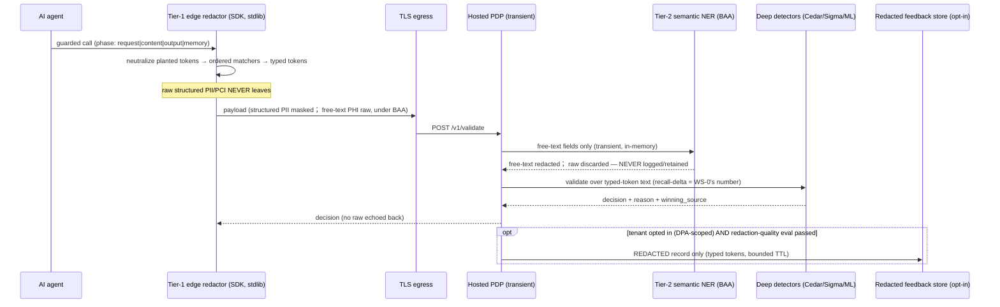
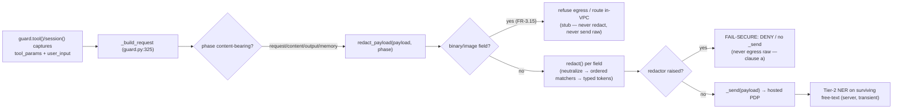
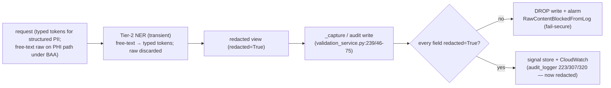
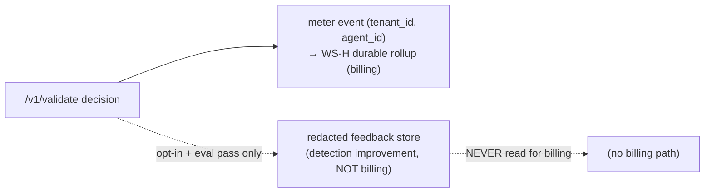

# LLD 29: Two-Tier Redaction + Opt-In Redacted Feedback Store (WS-E)

**Version**: 1.0
**Last Updated**: 2026-06-29
**Status**: Draft
**Prerequisites**: **ADR-032** (two-tier redactor + NFR-7 3-clause amendment — approved; this LLD elaborates it, does **not** re-open it); HLD [hld/serverless-edition.md](../hld/serverless-edition.md) §6.2(e) + Appendix F (data-class allowlist) + Appendix G (the gate's pass/fail rule) + Appendix I (PHI mechanism d / enclave hardening b); workstream scope [tasks/serverless-edition/ws-e-redaction.md](../tasks/serverless-edition/ws-e-redaction.md); sibling LLD [23-sentra-guard-sdk.md](23-sentra-guard-sdk.md) (the stdlib-only SDK Tier-1 ships in), [17-validation-signal-store.md](17-validation-signal-store.md) (the signal store the feedback store is **separate** from), [28-cedar-policy-engine.md](28-cedar-policy-engine.md) (the `phase` contract + bundle the redactor pairs with), [19-ml-threat-classifier.md](19-ml-threat-classifier.md) (the retrain target). **HARD GATE — WS-0:** the masked-vs-unmasked recall-delta (residual #5) is a precondition of **locking** the redaction GA gate (§14.5); the redactor design ships now, the gate-lock is WS-0-gated.

## Table of Contents
1. Overview (purpose, scope, status carry-forward, tenets)
2. The two-tier architecture (edge inline + server-side; the data flow + typed-token replacement)
3. Tier-1 — edge deterministic redactor (matchers · token grammar · where it hooks · per-phase coverage)
4. Tier-2 — server-side semantic PHI NER layer (placement · the transient invariant · BAA)
5. The NO-RAW-PHI invariant — the hard engineering invariant, proven not asserted
6. The opt-in redacted feedback store (schema · TTL · eval-gate · DSAR · retrain loop)
7. Standards mapping (HIPAA Safe Harbor 18 / PCI-DSS / GDPR pseudonymisation)
8. Security
9. Scaling
10. Networking
11. Database / storage
12. Cost
13. Metering & billing
14. Testing (UTs · recall-eval harness · the Appendix-G GA gate · the LIVE integration test)
15. Error model
16. Cross-references

---

## 1. Overview

### 1.1 Purpose
This LLD elaborates the **one approved decision — ADR-032** (HLD §6.2(e), Option A): a **two-tier redactor** + the **NFR-7 3-clause amendment** + an **opt-in redacted feedback store**. It does **not** re-open whether redaction happens at the edge (it does — Option A, raw never leaves for structured PII), whether the SDK stays stdlib-only (it must — §3.1), whether free-text PHI may transit under a BAA (it may — NFR-7 (c), mechanism d), or whether the Nitro Enclave ships now (it does **not** — mechanism b is a named later hardening, §4.5). It deepens four things into buildable detail:

1. **Tier 1 — the edge deterministic redactor in the SDK** (§3): the matcher set, the typed-token grammar with attacker-resistant namespacing/escape, where it hooks into `guard.py`, and the per-phase coverage that closes the live NOT-DONE bug.
2. **Tier 2 — the server-side free-text PHI semantic NER layer** (§4): P0 first-wave (owner decision 2026-06-29), its placement, and the transient/no-retain/no-log/no-human-access invariant.
3. **The NO-RAW-PHI invariant** (§5): under NFR-7 (c) a logging bug is a *reportable breach*, not a missed NFR — so raw never landing in logs / the signal store / the feedback store / crash dumps is a hard engineering invariant the LLD makes *testable*, against the **live raw-logging surface in `audit_logger.py`** that violates it today.
4. **The opt-in redacted feedback store** (§6): a separate tenant-scoped store of redacted-only records, eval-gated + DSAR-deletable, closing the FR-3.14 retrain loop.

> **No redaction code exists today (FR-3.13 NOT-DONE).** The SDK egresses `tool_params` + `user_input` **un-redacted** ([guard.py:371-389](../demo-agents/sdk/aegion-guard-python/src/aegion_guard/guard.py#L371), `safe_params` + `resolved_input` into the payload), and the hosted audit writer persists `user_input` (truncated 200) + full `tool_params` to **both** the DynamoDB signal store ([audit_logger.py:223](../src/security-controller/app/utils/audit_logger.py#L223)) and the CloudWatch event ([:307-308](../src/security-controller/app/utils/audit_logger.py#L307), [:320-321](../src/security-controller/app/utils/audit_logger.py#L320)). That dual surface is exactly what §5 must prove clean — it is the live clause-(a)/(c) violation this WS closes.

### 1.2 Tenets carried forward (from HLD §6.2 — the tie-breakers)
1. **Fail-secure / deny-by-default.** A redactor exception, an unparseable phase, a NER outage on free-text PHI, or a binary field the text redactor cannot scrub → **refuse egress / DENY**, never "send the raw value anyway." A redactor failure that falls through to `_send` with the raw payload is the single worst bug here.
2. **No raw retention, any edition (NFR-7 (a)).** Raw / un-redacted content is **NEVER persisted on ANY edition** — not in logs, the audit/signal store, the meter store, the feedback store, or crash dumps. The only thing that may outlive a transient evaluation is a **redacted** record in the opt-in store (NFR-7 (b)).
3. **The data boundary is the customer's to set (tenet 6).** Structured PII never leaves (edge); free-text PHI may transit under a BAA (NFR-7 (c)); air-gapped/no-egress mandates stay on in-VPC. The edition + BAA, not a hardcoded rule, sets the boundary.
4. **Structure preservation is the point (tenet 2 / M-5).** Tier-1 replaces the *value* but preserves *shape, position, and type* (typed tokens) so the deep detectors still get structural signal. Do not collapse all redactions to one opaque token — residual #5 measures the recall cost of even the typed-token masking; an opaque token would make it worse.
5. **Honest claim, not over-claim.** The claim is *"transient + not-retained + not-logged + no human access under a BAA"* — **NOT** "machine-unreadable by AegionAI" (our code reads the value to scrub it). GDPR: reversible masking is **pseudonymisation**, still personal data — never "anonymised" / "Safe-Harbor de-identified" for free-text we did not semantically scrub.

### 1.3 Scope
**In scope:** Tier-1 edge deterministic redactor (the matcher set, token grammar, per-phase wiring, fail-secure) — §3; Tier-2 server-side semantic PHI NER layer (placement + the transient invariant + BAA) — §4; the NO-RAW-PHI invariant made testable against the live `audit_logger` surface — §5; the opt-in redacted feedback store (schema, TTL, eval-gate, DSAR, retrain loop) — §6; the standards mapping — §7; the recall-eval harness + the Appendix-G GA gate + a LIVE integration test — §14.

**Out of scope (FOOTGUN guards — named, not silently dropped):**
- **(a) The Nitro Enclave (mechanism b, Appendix I).** A named *later* hardening that upgrades the claim to "never readable." Not this WS — this WS ships the BAA + no-retention posture (mechanism d), which is the HIPAA-valid GA bar.
- **(b) Edge native-NER (mechanism a, Appendix I).** A premium "strict-residency" tier (`onnxruntime` + distilled NER) that *breaks* stdlib-only. Not this WS.
- **(c) FR-3.15 image/binary content.** The text redactor cannot scrub images — image content is **refused from egress or routed to in-VPC** (§3.6); WS-E ships the **refusal stub**, never an image redactor.
- **(d) FR-3.7 server-side `REDACT`-verdict content-rewrite path.** Acting on a REDACT verdict requires the PEP to *rewrite* outgoing content; the decorator only ALLOWs/DENYs today. The rewrite path is a **separate named LLD deliverable** — explicitly out of scope here, not silently implemented or dropped.
- **(e) Re-deciding ADR-032.** Options A/B/C, the in-VPC-vs-BAA question, and the P0-vs-defer call for Tier 2 are decided. If implementation surfaces a genuinely new decision, it flags up to a new ADR — it does not re-litigate ADR-032 in prose.

### 1.4 Implementation-status carry-forward (verified against the code — what is NOT built)
Per the sub-PRD §5 discipline (don't re-task DONE work, don't claim un-built work) — verified this pass:

| Capability | Status | Evidence |
|---|---|---|
| Tier-1 edge deterministic redactor (any matcher) | **NOT-DONE** | no `redact`/Luhn/typed-token code in `aegion_guard/` (grep clean); FR-3.13 NOT-DONE (sub-PRD §5) |
| SDK egresses `tool_params` + `user_input` **un-redacted** | **LIVE BUG** | [guard.py:371-389](../demo-agents/sdk/aegion-guard-python/src/aegion_guard/guard.py#L371) (`safe_params`/`resolved_input` into payload) |
| `phase` field on the contract (redaction must run per-phase) | **NOT-DONE** | [models.py:17-39](../src/security-controller/app/api/models.py#L17) `ValidationRequest` has no `phase` field; default `request` |
| Tier-2 server-side semantic NER layer | **NOT-DONE** (P0, this WS) | no NER component server-side |
| Raw `user_input`/`tool_params` written to signal store + CloudWatch | **LIVE clause-(a) VIOLATION** | [audit_logger.py:223](../src/security-controller/app/utils/audit_logger.py#L223) (signal row), [:307-308](../src/security-controller/app/utils/audit_logger.py#L307)/[:320-321](../src/security-controller/app/utils/audit_logger.py#L320) (CW event) |
| Opt-in redacted feedback store | **NOT-DONE** (NET-NEW) | signal store ([signal_store_table_construct.py](../cdk/cdk_constructs/signal_store_table_construct.py)) is NOT it (no opt-in, no DPA TTL contract) |
| FR-3.14 retrain loop on a redacted corpus | **NOT-DONE** | LLD 19 retrain has no redacted-feedback source |
| Fail-secure transport default (Tier-1 leans on this) | **DONE** | [config.py:93/164-165](../demo-agents/sdk/aegion-guard-python/src/aegion_guard/config.py#L93); `_send` fail-secure DENY [guard.py:391-406](../demo-agents/sdk/aegion-guard-python/src/aegion_guard/guard.py#L391) |
| SDK is stdlib-only (`dependencies = []`) | **DONE — a constraint** | [pyproject.toml](../demo-agents/sdk/aegion-guard-python/pyproject.toml) (runtime deps `[]`); Tier-1 MUST preserve this |

> **`phase` is a shared prerequisite (E1.0), owned by WS-B, consumed here.** WS-B/LLD-28 add the additive, defaulted `phase` enum (`request|content|output|memory`, default `request`) to `ValidationRequest`. If WS-B has not landed it when WS-E builds, WS-E adds it as an explicit prerequisite task — **additive + defaulted + validated** (a required/breaking field re-cuts every SDK/connector); unknown phase → fail-secure DENY, never silent accept.

---

## 2. The two-tier architecture

### 2.1 Two tiers, two homes, one boundary (ADR-032 / M-1)
Redaction is split by *what can run where within the latency budget*, not by preference:

- **Tier 1 — edge deterministic redactor, IN the SDK.** Regex + Luhn + Shannon-entropy + format-anchored matchers. Replaces *values* with structure-preserving **typed tokens** (`<CARD>`, `<SSN>`, `<EMAIL>`, `<SECRET>`, …). Sub-millisecond, in-process, stdlib-only — so **raw structured PII/PCI never leaves the customer**. Runs **before egress on EVERY phase** (request/content/output/memory), not just `request`.
- **Tier 2 — server-side free-text PHI semantic NER, on the hosted PDP.** Catches the Safe-Harbor free-text identifiers (names, prose addresses, conditions, the catch-all) a deterministic matcher cannot. Too heavy for the stdlib edge (CPU spaCy ≈50 ms+, transformer ≈700 ms — blows the ≤500 ms floor, HLD §6.2(e) latency note). Processes raw free-text **transiently under a BAA**, redacts in place, **never retains, never logs, no human access** (mechanism d). **P0 — first-wave, ships with Tier 1.**

The boundary is set by edition + BAA (tenet 6): structured PII closes at the edge for *every* Serverless customer; free-text PHI closes server-side under a BAA for the HIPAA segment; air-gapped/no-egress mandates stay on in-VPC.

### 2.2 The data flow (typed-token replacement + the transient server tier)



### 2.3 The redaction sequence within a single egress



---

## 3. Tier-1 — the edge deterministic redactor in the SDK

### 3.1 Where it lives + the stdlib-only constraint
A new module **`demo-agents/sdk/aegion-guard-python/src/aegion_guard/redaction.py`** (NEW), **stdlib-only** — `re`, `math` (Shannon entropy), `unicodedata`. **No runtime dependency may be added to `pyproject.toml`** ([dependencies = []](../demo-agents/sdk/aegion-guard-python/pyproject.toml)); the same code vendors unchanged into a Lambda zip / Azure Function (LLD 23 §2). A regex/checksum/entropy redactor fits this; a semantic model does not (that is Tier 2, server-side). The native-NER edge tier (mechanism a) would break this constraint and is out of scope (§1.3 (b)).

### 3.2 The deterministic matcher set (E1.1)
Each matcher is `(detector → typed-token)`. Ordering is load-bearing — **highest-harm / most-specific first** (a bare numeric matcher running first mis-tokens a PAN and loses the PCI first6/last4 obligation):

| Class | Mechanism (stdlib) | Typed token | Standard | Note |
|---|---|---|---|---|
| PAN (card) | regex candidate → **Luhn** mod-10 check | `<CARD:6:4>` | PCI-DSS | mask to first-6/last-4; **never emit the full PAN even tokenized** |
| SAD (CVV/track/PIN) | format-anchored (label-adjacent) | `<SAD>` | PCI-DSS | **never-store / never-log** — drop the value entirely, no first/last retained |
| SSN (US) | regex + format-anchor | `<SSN>` | HIPAA SH | obfuscated/non-US forms → measured leak (Appendix G, §14.5) |
| email | regex | `<EMAIL>` | HIPAA SH | |
| phone / fax | regex | `<PHONE>` | HIPAA SH | |
| IP / URL | regex | `<IP>` / `<URL>` | HIPAA SH | |
| MRN / account / license / device no. | **format-anchored** (label-adjacent + shape) | `<MRN>` / `<ACCT>` / `<LICENSE>` / `<DEVICE>` | HIPAA SH | format-anchored, **not pure shape** — bounds false positives |
| explicit dates | regex | `<DATE>` | HIPAA SH | |
| high-entropy secret / API key | **Shannon entropy** ≥ threshold + charset heuristic | `<SECRET>` | — | entropy floor in §3.4; avoid scrubbing legitimate low-entropy IDs |

The matcher order is fixed in a module constant so it is not accidentally reordered:
```python
# redaction.py (NEW, stdlib-only) — order is a security control, not cosmetics.
_ORDERED_MATCHERS = (
    SADMatcher(),        # most-specific / highest-harm: drop entirely (PCI never-store)
    PANMatcher(),        # Luhn → <CARD:6:4>; MUST run before any bare-numeric matcher
    SSNMatcher(), MRNMatcher(), AccountMatcher(), LicenseMatcher(), DeviceMatcher(),
    EmailMatcher(), PhoneMatcher(), IPMatcher(), URLMatcher(), DateMatcher(),
    SecretMatcher(),     # entropy fallback last — broadest, lowest precedence
)
```

### 3.3 The typed-token grammar — namespacing / escape (E1.2, M-4)
A bare `<CARD>` is **spoofable**: an attacker puts the literal string `<CARD>` (or `<SAD>`) into a `tool_param`/`user_input` to forge a "redaction happened" signal or confuse the downstream detector. The grammar is therefore **namespaced with a reserved sentinel + per-call nonce**, and attacker-supplied token-looking strings are **neutralized before redaction**:

```
Real redaction marker:  ⟦AEGR:{nonce}:CARD:6:4⟧
                        └ sentinel ┘ └ per-call nonce ┘ └ type[:meta] ┘
```
- **`AEGR:`** is a reserved sentinel prefix; `{nonce}` is a per-call random hex (from `secrets.token_hex`, stdlib) bound to this single egress. A genuine marker carries the call's nonce; a planted one cannot (the attacker doesn't know the per-call nonce).
- **Neutralize first:** before any matcher runs, `_neutralize_planted_tokens` escapes any literal sentinel sequence the attacker supplied (e.g. encode raw `⟦`/`⟧` or a literal `AEGR:` in the input to a benign escaped form) so it cannot be read as a genuine marker downstream.
- The downstream PDP/detector treats only `⟦AEGR:{nonce}:…⟧` (with the call's nonce) as a redaction marker; everything else is plain text.

```python
def redact(value: str, *, nonce: str) -> str:
    escaped = _neutralize_planted_tokens(value)        # M-4: attacker can't forge a marker
    for matcher in _ORDERED_MATCHERS:                  # §3.2, highest-harm first
        escaped = matcher.sub_token(escaped, nonce=nonce)  # value → ⟦AEGR:{nonce}:TYPE[:meta]⟧
    return escaped
```

> **FOOTGUN (do NOT use a bare `<CARD>`).** The HLD's plain-language `<CARD>` illustration is *descriptive*, not the wire grammar. Shipping a bare `<CARD>` that any input can spoof re-opens M-4 — a forged marker either fools a detector or fakes a redaction-quality signal that feeds the feedback store. The sentinel+nonce grammar is the implemented form; the doc-facing UI may still *render* it as `<CARD>` for humans.

> **FOOTGUN (`<CARD:6:4>` carries first6/last4, NOT the full PAN).** The PCI obligation is mask-to-first6/last4 — the *meta* in the token is the unmasked prefix/suffix only, never the middle digits. `<SAD>` carries **no** meta (CVV/track/PIN are never-store).

### 3.4 Entropy floor for `<SECRET>`
The secret matcher uses Shannon entropy over the candidate token's charset; the floor is set to catch API keys / tokens (typically ≥ ~3.5 bits/char over a 32+ char base62/hex string) while **not** scrubbing legitimate low-entropy identifiers (a UUID, an order number). The exact floor + min-length is a tuned constant validated by the recall-eval harness (§14.4) — set conservatively (favor a false-negative on a benign ID over a false-positive that destroys a legitimate value), and the residual leak is what the Appendix-G corpus (§14.5) measures.

### 3.5 Run on EVERY egressing phase (E1.3) — the live bug
Today only the `request` payload is assembled, un-redacted ([guard.py:371-389](../demo-agents/sdk/aegion-guard-python/src/aegion_guard/guard.py#L371)). The redactor wires into the payload build so **every content-bearing field is redacted before `_send`**, keyed on `phase`:

```python
# In _build_request (guard.py:325) — after safe_params is built, before return.
nonce = secrets.token_hex(8)                       # per-call; binds genuine markers (§3.3)
phase = active.phase if active else "request"
payload["tool_params"] = redact_fields(safe_params, nonce=nonce)   # request phase
payload["user_input"]  = redact(resolved_input, nonce=nonce)
# content/output/memory phases (paired with WS-B) carry their content in the
# phase-specific field — redact each the same way before egress:
if phase in ("content", "output", "memory"):
    payload[_CONTENT_FIELD[phase]] = redact(payload[_CONTENT_FIELD[phase]], nonce=nonce)
payload["redaction_nonce"] = nonce                 # PDP uses it to recognize genuine markers
```

> **FOOTGUN (do NOT redact only the `request` branch).** `content` (retrieved docs, tool output, web text) is often the **richest** PII surface — leaving it raw is the live NOT-DONE bug. The acceptance test (§14.1) sends PII in a `content` field and asserts the egressed payload carries the typed token, not the raw value.

### 3.6 Image/binary refusal stub (E1.5 — FR-3.15 out of scope, named)
A field detected as binary/image (non-text bytes / a base64 blob over a size+entropy threshold) is **refused from egress or routed to in-VPC** — never redacted, never sent raw. A named stub (`refuse_binary_egress(field) -> RedactionRefusal`), not an image redactor. It fails toward refusal (tenet 1).

### 3.7 Fail-secure on redactor error (E1.4)
If `redact()` raises on any field, the SDK MUST NOT egress the raw value. It aligns with the existing fail-secure default ([config.py:93/164-165](../demo-agents/sdk/aegion-guard-python/src/aegion_guard/config.py#L93)) and the unknown→DENY transport path ([guard.py:391-406](../demo-agents/sdk/aegion-guard-python/src/aegion_guard/guard.py#L391)): a redactor exception short-circuits to a **DENY Decision** (reason `redaction_failed`), never a `_send` of the raw payload. Tested by forcing the exception (§14.1).

---

## 4. Tier-2 — the server-side free-text PHI semantic NER layer

### 4.1 Placement + model choice (E2.1) — P0
A NEW server-side component **`src/security-controller/app/redaction/phi_ner.py`** runs on the hosted PDP, on the **free-text fields that survive Tier 1** (the typed tokens are already structural; NER targets the prose the deterministic matchers cannot — names, prose addresses, conditions, profession, the Safe-Harbor catch-all). It runs **off the blocking path where possible** (it does not gate the deterministic floor's verdict — the deny-overrides verdict can resolve on the deterministic tier; NER scrubs before any retained/forwarded write).

**Model choice is an LLD decision gated on the Appendix-G recall target (§14.5), named not assumed.** The candidate set, with the tradeoff that decides it:

| Option | Latency (CPU) | Recall posture | Fit |
|---|---|---|---|
| **Presidio (regex + spaCy NER)** — *default candidate* | ≈50 ms+ | hybrid; tunable; HIPAA-reference pattern | runs in-controller; no extra network hop; first-wave default |
| Transformer NER (e.g. distilled clinical model) | ≈700 ms | higher recall on narrative PHI | heaviest; only if Presidio misses the §14.5 target |
| Managed API (Comprehend Medical / Google Cloud SDP) | + a network round-trip | ML; HHS notes entities don't map 1:1 to Safe Harbor → needs review | a network hop *off* the blocking path; vendor-coupling |

Default = **Presidio-style hybrid in-controller**; escalate to a heavier model **only** if it misses the §14.5 recall target. Whatever is chosen, the layer's recall is **measured** against the obfuscated/non-US/narrative corpus before it can carry a HIPAA GA claim — never asserted.

### 4.2 The transient-processing invariant (E2.2, mechanism d)
Raw free-text PHI is processed **transiently**: held in memory only for the duration of the NER pass, redacted in place to typed tokens (`<NAME>`, `<ADDRESS>`, `<CONDITION>`, …), and the **raw discarded immediately**. The contract:
- **never written** to any log, the signal store, the meter store, the feedback store, or a crash dump (§5 proves this);
- **no human access** — there is no operator path that reads the raw free-text; only the redacted output proceeds;
- **under a BAA** — counsel confirms the 45 CFR 164.308/164.314 safeguards before the HIPAA GA claim ships (release gate, §14.5).

The honest claim is **"transient + not-retained + not-logged + no human access under a BAA"** — not "machine-unreadable" (the NER code reads the value to scrub it; provable unreadability is the enclave, §4.5).

### 4.3 Data-class allowlist enforcement (E2.3, Appendix F)
A field *label* is a schema-level control only — it cannot stop a disallowed-class PII string embedded in a free-text field. Enforced two ways:
1. **STRUCTURED fields** — class-enforced at the schema/contract layer: a field declared a disallowed class is **blocked or routed to in-VPC**.
2. **FREE-TEXT fields** — **not** class-trustable from the label. The residual is owned, not assumed away: the Tier-1 edge redactor catches structured-token PII even embedded in prose; the un-catchable free-text-PII residual (names/addresses/conditions) is **either redacted by Tier-2 under the BAA/DPA, or the customer is on in-VPC, or the data is held until Tier 2 ships**. Not a blanket "free-text is fine."

> **FOOTGUN.** Do NOT treat a label-"allowed" free-text field as safe to egress raw. The label constrains a *structured* field's declared class; a free-text field's contents are not bounded by its label.

### 4.4 Why Tier 2 is server-side, not edge (carried from HLD, not re-decided)
The deterministic edge stays deterministic-only because semantic NER blows the ≤500 ms floor in-process (§4.1 latency column). This is ADR-032's recommendation — restated, not re-opened. The edge native-NER tier (mechanism a) that *would* run NER at the edge breaks stdlib-only and is the premium strict-residency option (out of scope, §1.3 (b)).

### 4.5 The enclave is a named LATER hardening (mechanism b) — NOT this WS
To upgrade the claim from "we don't retain/log/view" to "we provably **cannot** read," process the raw value inside an **AWS Nitro Enclave** (a TEE whose memory the parent-instance operator cannot read; KMS attestation bound to the enclave's PCR measurements). It is AWS-Nitro-specific (Azure CVM / GCP CVM need parallel builds — cuts against the neutral-cross-vendor moat), and a later hardening, **not a GA dependency**. Named here so the roadmap owns it; it is **not built in WS-E**.

---

## 5. The NO-RAW-PHI invariant — proven, not asserted

### 5.1 Why this is a hard invariant, not a soft NFR
Under NFR-7 (c), any path that logs/persists raw PHI is a **reportable breach** (HIPAA breach-notification), not merely a missed NFR. So "raw never lands in logs / the signal store / the feedback store / crash dumps" (invariant **I-1**) is a hard engineering invariant the LLD makes **testable** — and there is a **live violation today** to close.

### 5.2 The live violation surface (what §5 must clean)
The hosted audit writer persists request content **un-redacted** on two paths:

| Surface | What it writes raw | Anchor |
|---|---|---|
| DynamoDB signal store (per-signal shared attrs) | `tool_params` (full) + `user_input` (truncated 200) | [audit_logger.py:223](../src/security-controller/app/utils/audit_logger.py#L223) (`_shared_attrs_from_request`) |
| CloudWatch combined event | `user_input` (truncated 200) | [audit_logger.py:307-308](../src/security-controller/app/utils/audit_logger.py#L307) (`_build_log_event`) |
| CloudWatch combined event (rollback support) | `tool_params` (full) | [audit_logger.py:320-321](../src/security-controller/app/utils/audit_logger.py#L320) |

Truncation-to-200 is **not** redaction — a card number or a name fits in 200 chars. These three writes carry raw values into durable stores → clause-(a) violation today.

### 5.3 The fix + how it is enforced
**The audit/signal writer is fed the redacted payload, never the raw request.** Concretely:
1. The Tier-1 edge already replaces structured PII with typed tokens *before egress*, so `tool_params`/`user_input` arriving at the PDP carry typed tokens for structured PII (not raw). Tier-2 redacts the surviving free-text PHI **before** the audit/signal write runs.
2. `_capture(result)` ([validation_service.py:239](../src/security-controller/app/services/validation_service.py#L239)) and the fire-and-forget audit write ([validation_service.py:46-75](../src/security-controller/app/services/validation_service.py#L46), background tasks) read from a **post-redaction view** of the request, not the original. `_shared_attrs_from_request` and `_build_log_event` are changed to take the redacted fields.
3. **A redaction-state assertion guards the writer:** the audit writer refuses to write any field not marked redacted (a `redacted=True` provenance flag set by the redaction pass). A field reaching the writer without that flag → the write is dropped + alarmed (`RawContentBlockedFromLog` metric), fail-secure — better a missing audit row than a raw-PHI breach.



> **FOOTGUN (structured logging of the request body).** A common debug aid — `logger.info("request: %s", request)` or an exception handler that dumps the body — re-introduces the breach. The redaction-state guard covers the *audit* writer; the LLD additionally bans raw-body logging in the request path and exception handlers (§14.2 proves it with a forced exception). Crash dumps: the controller runs with body-logging disabled in prod and no raw field is held past the NER pass.

### 5.4 The crash-dump / exception path
An exception during validation must not serialize the raw request into a stack-trace log. The error path ([validation_service.py:206/213](../src/security-controller/app/services/validation_service.py#L206)) logs the exception **without** the request body; any field referenced in an error message is the redacted view. Tested by raising mid-pipeline and asserting no raw value appears in the captured logs (§14.2).

---

## 6. The opt-in redacted feedback store (E3) — NFR-7 (b) + FR-3.14

### 6.1 What it is (and what it is NOT)
A **separate, tenant-scoped** DynamoDB store of **REDACTED records only**, bounded TTL, **opt-in per DPA**, that feeds the offline re-score + retrain loop. It is **NOT** the signal store (LLD 17 — that is the audit/decision trail) and **NOT** the meter store (WS-H — the billing ledger). Conflating them is a clause-(b) consent breach (the feedback store needs opt-in; the others don't).

### 6.2 Schema (E3.1)
A NEW CDK construct (do **not** reuse the signal store as-is). Anchored against [signal_store_table_construct.py](../cdk/cdk_constructs/signal_store_table_construct.py) for shape, with the differences that matter:

| Attr | Type | Notes |
|---|---|---|
| `tenant_id` | S (PK) | tenant-scoped isolation — never cross-tenant readable (NFR-6) |
| `record_id` | S (SK) | `{ms}#{uuid}` — also the DSAR locator key (§6.4) |
| `subject_locator` | S (GSI PK) | per-subject pseudonymous id for GDPR DSAR targeted deletion (§6.4) |
| `redacted_payload` | M | **REDACTED only** (typed tokens) — invariant **I-1**; **no raw value ever** |
| `phase` | S | `request\|content\|output\|memory` |
| `decision` / `reason` / `winning_source` | S | from the combiner ([deny_overrides.py:51](../src/security-controller/app/combiners/deny_overrides.py#L51), `metadata["winning_source"]`) |
| `detector_outcomes` | M | per-detector verdicts (for FP/FN labeling) — redacted |
| `ttl` | N | DynamoDB TTL attribute — record **must** expire (bounded, DPA-scoped) |
| `opt_in` | BOOL | written only when the tenant opted in (DPA) — default OFF |
| `redaction_eval_pass` | BOOL | the §6.3 gate result at write time — no record written if false |

**CDK deltas from the signal store:** **enable DynamoDB TTL** (`time_to_live_attribute="ttl"` — the signal store sets `expires_at`; this store must set its own bounded TTL); decide **PITR explicitly** (the signal store has `point_in_time_recovery=False` at [:81](../cdk/cdk_constructs/signal_store_table_construct.py#L81) — for a store holding redacted-but-still-personal data (GDPR pseudonymisation), PITR is a deliberate decision, not a default-inherit, because PITR snapshots would outlive a DSAR deletion); `RemovalPolicy.RETAIN` semantics kept deliberate.

> **FOOTGUN (PITR vs DSAR).** If PITR is on, a continuous backup retains a deleted subject's record past the DSAR deletion — undermining §6.4. Default this store to **PITR off** (or scope the DSAR procedure to also handle the PITR window), and document the choice — do not silently inherit the signal store's setting.

### 6.3 The redaction-quality eval gate (E3.4) — gated BEFORE any write
**No record is written if redaction recall is below threshold.** Before a record is persisted, it passes the redaction-quality eval (the same identifier-false-negative measure as the Appendix-G gate, §14.5, re-run on the record): if the record's redaction quality fails (an identifier the matchers should have caught is detectable in the would-be-stored payload), the write is **skipped + alarmed** (`FeedbackRedactionGateFail`), never stored. This is the second line behind the redaction-state guard (§5.3): the guard blocks un-redacted fields; this gate blocks *poorly*-redacted fields from a store that outlives the transient evaluation.

### 6.4 DSAR / deletion API + record locator (E3.3, GDPR Recital 26)
Pseudonymized data is **still personal data**, so it must be locatable and deletable:
- **`DELETE /v1/feedback/subjects/{subject_locator}`** (operator-auth, tenant-scoped) — deletes every record for a subject via the `subject_locator` GSI. Tenant A cannot delete tenant B's records (403, tenant-scoped).
- **Per-tenant record locator** — the `subject_locator` GSI is the join key that makes targeted deletion possible without scanning. The store cannot claim feedback-store GA until DSAR deletion is implemented + tested (§14.3).

### 6.5 Opt-in write path (E3.2)
Records are written **only** when the tenant's `sentra-tenants` row carries the DPA-scoped opt-in flag (default **OFF**). The write is **off the response path** (after the verdict, fire-and-forget like the existing telemetry, [validation_service.py:46-75](../src/security-controller/app/services/validation_service.py#L46)) and writes the **redacted** record only.

> **FOOTGUN (default OFF).** An accidental default-ON is a clause-(b) violation **and** a consent breach. The flag defaults OFF (conservative-off, mirroring LLD 27's absent-key trap); a non-opted-in tenant produces **no** record (§14.3 asserts it).

### 6.6 The retrain loop (E3.5, FR-3.14)


An **offline, batch** job (never on the `/v1/validate` hot path) re-scores stored redacted records when signatures/models update, produces FP/FN metrics, and retrains the edge deterministic floor / prompt-signatures (extends LLD 19 retrain + the WS-F prompt-signature corpus). Gated on the redaction-quality eval (§6.3) — no retrain on a corpus whose redaction quality is unmeasured.

---

## 7. Standards mapping (what's deterministic vs needs the model)

| Standard | Obligation | Tier-1 (edge, deterministic) | Tier-2 (server, semantic) |
|---|---|---|---|
| **HIPAA Safe Harbor — 45 CFR 164.514(b)(2)** (18 identifiers) | de-identify the 18 categories | **structured**: SSN, MRN/account/license/device no., phone/fax, email, IP/URL, explicit dates | **free-text**: names, prose addresses, conditions, profession, the catch-all ("any other identifying characteristic") |
| **PCI-DSS** | PAN mask first6/last4; SAD never-store/never-log | PAN → `<CARD:6:4>` (Luhn); SAD (CVV/track/PIN) → `<SAD>`, value **dropped** | — (PCI is fully deterministic; matters most for the fintech beachhead) |
| **GDPR Recital 26** | reversible masking = pseudonymisation, still personal data | typed tokens are **pseudonymisation** — locatable + deletable via the feedback store DSAR (§6.4) | same; **never** call free-text we didn't semantically scrub "anonymised" / "Safe-Harbor de-identified" |

> **The honest line (Appendix I):** structured = deterministic; free-text Safe-Harbor compliance = a model + human-review problem, never a 100% guarantee. The reference de-id tools are all hybrid for exactly this reason (Presidio = regex + NER; Comprehend Medical; Google Cloud SDP). The wording discipline (pseudonymisation, never "anonymised" for un-scrubbed free-text) is a doc + UI copy check (§14.6 acceptance).

---

## 8. Security
- **Trust boundary:** Tier-1 runs **in the customer process** (the SDK) — raw structured PII never crosses the boundary. Tier-2 runs **in the AegionAI hosted plane** — raw free-text PHI crosses, encrypted in transit (TLS), processed transiently under a BAA, discarded (§4.2). The boundary the customer accepts is set by edition + BAA (tenet 6), not hardcoded.
- **Token-spoofing (M-4):** the sentinel+nonce grammar (§3.3) makes an attacker-supplied token string distinguishable from a genuine marker — a planted `⟦AEGR:…⟧` lacks the per-call nonce and is neutralized before redaction. A forged marker must not fake a redaction-quality signal that feeds the feedback store, nor mislead a downstream detector.
- **Fail-secure on every redaction path (tenet 1):** redactor exception → DENY/refuse egress (§3.7); binary/image → refuse (§3.6); Tier-2 NER unavailable on a free-text-PHI field → **do not egress raw downstream and do not persist; fail the validate closed** rather than process PHI un-redacted; unknown `phase` → DENY.
- **No-raw-in-logs (I-1):** the redaction-state guard (§5.3) + the no-raw-body-logging ban (§5.3 footgun) + the crash-dump path (§5.4) — proven, not asserted (§14.2). A logging bug here is a reportable breach.
- **Feedback-store access control:** tenant-scoped (PK = `tenant_id`); no cross-tenant read; opt-in default OFF; DSAR-deletable; bounded TTL; redacted-only (I-1). No human access to raw at any point.
- **No secrets in the redactor:** the redactor reads content to scrub it; it holds no keys. The per-call nonce is ephemeral (not a secret to protect, just an unforgeable per-call tag).

## 9. Scaling
- **Tier-1 edge (hot path):** sub-millisecond per field — regex + Luhn + entropy over the captured `tool_params`/`user_input`, in-process, no network call. It adds to the SDK's local cost, **not** the hosted PDP's. Cost scales with payload size × field count, bounded by the SDK's existing request-build cost. **p99 budget:** the redactor must stay within the FR-1.7 low-tens-of-ms local-floor budget (it is single-digit-ms; the dominant local cost is the bundle eval, LLD 28).
- **Tier-2 server (off the blocking path):** the NER pass is the heavy item — Presidio-style ≈50 ms+ CPU per free-text field (§4.1). It runs **only on the PHI path** (free-text fields on a BAA tenant), **off the deny-overrides blocking verdict** where possible, so the deterministic floor's p99 is unaffected. At the ceiling, NER is bound by controller CPU; horizontal scale is the stateless controller fleet (LLD 27 §6.1). A transformer model (≈700 ms) would need a separate inference tier — a reason the default is the lighter in-controller hybrid.
- **Backpressure:** if NER capacity is saturated, the PHI path **fails closed** (deny rather than forward un-redacted free-text PHI) — it does not degrade to sending raw. Non-PHI tenants are unaffected (NER doesn't run for them).
- **Feedback store (off-path, batch):** writes are fire-and-forget (no verdict impact); the retrain re-score is a batch job, not request-coupled — scales with stored-record count × retrain cadence, not request volume.

## 10. Networking
- **Tier-1:** no network — in-process, before the existing `POST /v1/validate` egress ([guard.py:391](../demo-agents/sdk/aegion-guard-python/src/aegion_guard/guard.py#L391)). No new port/protocol.
- **PEP→PDP:** the existing `POST /v1/validate` over TLS via API Gateway + ALB (CDK). The redacted payload (typed tokens for structured PII; raw free-text on the PHI path) rides the same contract — the only contract addition is the additive `phase` field (WS-B) + a `redaction_nonce` field (§3.5).
- **Tier-2:** in-controller by default (no extra hop). If a managed de-id API is chosen (§4.1), it adds one egress to that API **off the blocking path** — a vendor-coupling tradeoff flagged, not the default.
- **Feedback store:** internal control-plane DynamoDB writes (off-path); DSAR delete via the existing operator-auth API surface. No new external path.

## 11. Database / storage
- **The signal store / CloudWatch (existing, NFR-7 (a) cleaned):** after §5.3, `tool_params`/`user_input` written there carry typed tokens, not raw. No schema change — the *content* of those fields is now redacted.
- **The feedback store (NET-NEW, §6.2):** a separate tenant-scoped DynamoDB table, PK `tenant_id` / SK `record_id`, GSI on `subject_locator` (DSAR), bounded TTL, redacted-only payload, opt-in flag. PITR decided explicitly (default off — §6.2 footgun). Derived/regenerable is **not** a property here (it holds labeled traffic) — so retention is bounded by TTL + DSAR, never indefinite.
- **No raw store anywhere (I-1):** there is **no** table or log that holds raw content post-redaction. The transient NER buffer is in-memory only, discarded after the pass (§4.2).
- **Migration/versioning:** the `phase` field is additive+defaulted (WS-B). The redaction-state provenance flag is an additive field on the internal request view, not a stored schema change. The feedback table is new (CDK construct add).

## 12. Cost
This LLD adds the edge redactor (CPU on the customer's side, not ours), the server-side NER layer, and the feedback store. Drivers + envelope:
- **Tier-1 edge:** runs in the **customer's** process — **$0 to AegionAI** infra. Negligible customer-side CPU (single-digit-ms).
- **Tier-2 NER (the dominant new cost):** CPU inference on the controller fleet, **only on the free-text-PHI path** (BAA tenants). A Presidio-style in-controller hybrid adds ≈50 ms+ CPU per free-text field — bounded by PHI-tenant free-text volume. **[ESTIMATE]** at the in-controller default it is incremental controller CPU (no separate inference tier) — bounded by the PHI-path request share; a heavier transformer or a managed API (Comprehend Medical ~$0.0001/unit class, Google SDP per-API-call) would add a per-call line **only if** the §14.5 recall target forces the upgrade. The default is chosen to avoid a new cost tier.
- **Feedback store (DynamoDB PAY_PER_REQUEST):** opt-in only → writes scale with the *opted-in* tenant subset, not the fleet; bounded TTL caps storage. **[ESTIMATE]** small — redacted records, expiring, for the opt-in subset → low single-digit $/month at current volume.
- **Retrain (offline, batch):** the heavy reclassifier re-score is a periodic batch job (not request-coupled). **[ESTIMATE]** bounded by stored-record count × retrain cadence → batch compute, not a hot-path cost.
- **Dominant driver:** unchanged at the platform level — `/v1/validate` request volume; the new marginal cost is **Tier-2 NER on the PHI path**, and it is contained to BAA tenants and kept in-controller by default. **[ESTIMATE]** incremental monthly cost of the redaction stack itself (NER CPU + feedback store) is modest and scales with the *regulated* segment, which is the segment that funds it.

## 13. Metering & billing
Redaction is on the action path but is **not itself a metered event** — the `/v1/validate` decision it rides is. What this section pins is the **separation** of the feedback store from the meter store, and the no-double-count / no-raw guarantees.
- **What is measured:** the `/v1/validate` decision is the metered validation event (per `(tenant_id, agent_id)` from the verified principal) — unchanged by redaction. Redaction adds **no** meter point.
- **The feedback store is NOT the meter store (the load-bearing split, mirrors WS-H):** the redacted feedback store (§6) is a *detection-improvement* store, opt-in, DPA-scoped, TTL-bounded — it is **never** read for billing. The meter/billing ledger is WS-H's durable pipeline (`request_id`-dedup, recomputed-SUM rollup, NFR-12 ≥99.9% integrity). Conflating them would both over-retain (billing needs durability the feedback store deliberately bounds with TTL) and breach consent (billing isn't opt-in; the feedback store is).



- **No raw on the meter path either (I-1):** the meter event carries `(tenant_id, agent_id, decision)` counts, never content — so redaction does not interact with the billing payload. A redaction failure that fails the verdict closed (§3.7/§4.2) still meters a DENY decision normally (a denied call is a metered call).
- **Failure modes:** **feedback-store write fail** — off-path, swallow + alarm, MUST NOT block the verdict and MUST NOT fall back to writing raw; **NER fail on a metered call** — the call DENYs (metered as a DENY), no raw forwarded; **double-count** — N/A for the feedback store (it is not billed); billing dedup is WS-H's `request_id` concern.

---

## 14. Testing

UTs for the matchers + a redaction-recall **eval harness on a real corpus** + the **Appendix-G GA gate** as a gated precondition + a **LIVE integration test** that no raw value/PHI crosses un-redacted and none lands in logs.

### 14.1 Tier-1 unit tests (the matchers + grammar + per-phase + fail-secure)
In `demo-agents/sdk/aegion-guard-python/tests/test_redaction.py` (NEW; `asyncio_mode=auto`, `testpaths=tests` per the SDK pyproject):
- **Per-matcher:** PAN passes Luhn → `<CARD:6:4>` with only first6/last4 in meta (assert the middle digits are gone); a Luhn-failing 16-digit number is **not** tokened as a card; SAD (CVV/track/PIN) → `<SAD>` with **no** value retained; SSN/email/phone/IP/URL/MRN/account/license/device/date each → their typed token; a high-entropy key → `<SECRET>`; a low-entropy UUID/order-number is **not** scrubbed (§3.4 false-positive guard).
- **Ordering (the footgun):** a PAN must token as `<CARD:6:4>`, **not** a bare `<NUMBER>`/`<SECRET>` — proves SAD/PAN run before generic matchers.
- **Token grammar / namespacing (M-4):** plant a literal `⟦AEGR:…⟧` and a bare `<CARD>` in raw input → assert neither reads as a genuine marker (the planted sentinel is neutralized; the genuine marker carries the per-call nonce, the planted one cannot).
- **Per-phase coverage (the live bug):** send PII in a **`content`** field and assert the egressed payload carries the typed token, not the raw value; repeat for `output`, `memory`, `request`.
- **Fail-secure:** force `redact()` to raise → assert the SDK returns a DENY Decision and **never** `_send`s the raw payload (monkeypatch `_send` to record what it would send; assert it was not called with raw).
- **Image/binary stub:** a binary field → `RedactionRefusal` (refuse/route), never redacted, never sent raw.
- **Stdlib-only guard:** a test asserts `aegion_guard.redaction` imports with no third-party dependency (and `pyproject.toml` runtime `dependencies == []` unchanged).

### 14.2 The NO-RAW-PHI invariant tests (I-1 — proven, not asserted)
In `src/security-controller/tests/test_redaction_no_raw_logging.py` (NEW):
- **Audit/signal writer carries no raw:** drive a request whose raw `user_input`/`tool_params` contain a known PII string through the pipeline; assert the DynamoDB signal row ([audit_logger.py:223](../src/security-controller/app/utils/audit_logger.py#L223)) and the CloudWatch event ([:307-308](../src/security-controller/app/utils/audit_logger.py#L307)/[:320-321](../src/security-controller/app/utils/audit_logger.py#L320)) contain the **typed token**, never the raw PII string (assert the raw substring is absent from the serialized row/event).
- **Redaction-state guard:** feed the audit writer a field **without** the `redacted=True` provenance flag → assert the write is dropped + `RawContentBlockedFromLog` emitted (fail-secure), not written raw.
- **Crash-dump path:** raise mid-pipeline ([validation_service.py:206/213](../src/security-controller/app/services/validation_service.py#L206)) with raw PII in the request → assert the captured exception log contains **no** raw PII substring (no body dump).
- **Negative control (proves the test isn't vacuous):** a deliberately-broken writer that logs the raw body must make this test **FAIL** — so the test catches the catastrophe, not an always-green assertion.

### 14.3 Feedback-store unit tests
In `src/security-controller/tests/test_feedback_store.py` (NEW):
- **Redacted-only:** assert a raw value **cannot** be written (the write rejects an un-redacted/`redacted!=True` payload).
- **Opt-in default OFF:** a non-opted-in tenant produces **no** record; an opted-in tenant produces a redacted record.
- **Eval gate (§6.3):** a record failing the redaction-quality eval is **not** written (+ `FeedbackRedactionGateFail`).
- **TTL set:** the written record carries a bounded `ttl`.
- **DSAR deletion:** `DELETE /v1/feedback/subjects/{locator}` removes a subject's records; tenant A cannot delete tenant B's (403).
- **Tenant isolation:** a tenant-A query cannot read tenant-B records.

### 14.4 The redaction-recall eval harness (on a real corpus)
A harness (`src/security-controller/tests/corpus/redaction_recall.jsonl` + `test_redaction_recall.py`) measures **identifier false-negative rate** per class against a **labeled corpus** — each case is `(text, [{class, span}])`; the harness runs Tier-1 (and Tier-2 for free-text) and computes recall per class (caught / total). The corpus composition is **not canonical-only** (which would pass vacuously): it includes **canonical + obfuscated/encoded + non-US variants + narrative-embedded PHI** (Appendix G (ii)). This harness produces the number the §14.5 gate reads, and the §6.3 feedback-store eval reuses the same measure.

### 14.5 The recall GA gate (Appendix G) — a gated precondition, design ships now
**The redactor design ships at GA; locking it as the GA gate is WS-0-gated.** Per HLD Appendix G + the MEASURE-FIRST GATE, the LLD sets up front:
1. **(i) the identifier-recall target** — a concrete per-class false-negative ceiling for the structured-token redactor (set in the harness config; the exact number is the gate's threshold).
2. **(ii) the leak corpus composition** — canonical + obfuscated/encoded + non-US (§14.4), so the target isn't met vacuously.
3. **(iii) the decision rule if the deterministic P0 redactor misses the target** — GA for *structured-data* customers slips to where **either** (a) the deterministic redactor is hardened to pass on the obfuscated corpus **or** (b) the server-side semantic layer ships and becomes part of the gate. GA does **not** weaken the gate to ship a redactor that fails its own corpus.

**The WS-0 recall-delta (residual #5) is a precondition of locking the gate** — the masked-vs-unmasked detection-recall delta (exfiltration + indirect-injection, on the obfuscated/non-US corpus) measures the cost of masking to the deep detectors. The redactor *ships*; what is forbidden is **declaring the deep-tier depth claim met on masked content before that delta is on paper**. So:

| Gate | Status |
|---|---|
| Tier-1 redactor design + Tier-2 layer **ship** at GA | now (this LLD) |
| Structured-token redactor **locked as the GA gate** | **GATED on WS-0 recall-delta + §14.5 (i)-(iii) on paper** |
| HIPAA GA claim | **GATED on** Tier-2 recall target (§14.5) + counsel BAA sign-off + I-1 proven (§14.2) |

> **The kill/pivot branch (worst quadrant: high masking-cost AND low masked-recall) is decided in WS-0, not here.** This LLD designs the redactor and makes the measurement testable; the go/no-go on locking the gate is WS-0's signed packet.

### 14.6 The LIVE end-to-end integration test (not mocks/UTs)
§14.1–14.4 are in-process/hermetic. Add a **live** test under [tests/integration/](../tests/integration/) (markers `@pytest.mark.integration` + `requires_services`, fixtures `service_urls`/`api_headers` from [tests/integration/conftest.py](../tests/integration/conftest.py)), run against a deployed env (real **SDK → ALB → controller → DynamoDB signal store + CloudWatch + feedback store**), profile `sentra`, `us-east-1`:
1. **No raw crosses un-redacted (the headline):** a guarded call whose `tool_params`/`user_input`/`content` carry a known card number + SSN + email + a free-text name → assert the **on-the-wire payload** (captured at the SDK egress) carries typed tokens for the structured PII (raw card/SSN/email **absent**); after the round-trip, query the **live signal store + CloudWatch log** and assert the raw card/SSN/email/name strings are **absent** from every persisted row/event (I-1, proven on the real deployment, not a mock).
2. **Per-phase:** repeat with PII in a `content` field — assert the same (the live proof of the §3.5 fix).
3. **Tier-2 PHI path:** a free-text PHI field (a name in prose) on a BAA-flagged tenant → assert the persisted record carries `<NAME>`, raw absent; assert no raw appears in any log (I-1 on the free-text path).
4. **Feedback store opt-in:** an opted-in tenant → a redacted record appears (typed tokens only); a non-opted-in tenant → no record. DSAR delete removes it.
5. **Fail-secure:** a forced redactor error → the call DENYs (metered as DENY), no raw on the wire, no raw persisted.

> **CI placement:** the hermetic §14.1–14.4 tests are the **per-PR gate**; the live §14.6 test runs **post-deploy / pre-promote** (with LLD 27 §7's post-cutover suite + WS-J) — it needs live infra. The no-raw-in-logs assertion (I-1) is a **release-blocking** check: a raw value found in a live log fails the promote.

### 14.7 Run
```bash
# Tier-1 SDK (stdlib-only):
cd demo-agents/sdk/aegion-guard-python && pip install -e ".[dev]" && pytest tests/test_redaction.py -v
# Server-side invariant + feedback store + recall harness:
cd src/security-controller && source venv/bin/activate
pytest tests/test_redaction_no_raw_logging.py tests/test_feedback_store.py tests/test_redaction_recall.py -v
# Live, real services (post-deploy stage; needs a deployed env + sentra profile):
AWS_PROFILE=sentra pytest tests/integration/test_redaction_e2e.py -m "integration and requires_services" -v
```

---

## 15. Error model

| # | Condition | Detection | Response |
|---|---|---|---|
| E1 | Tier-1 redactor raises on a field | exception in `redact()` | **Fail-secure**: DENY Decision (`redaction_failed`); **never** `_send` raw ([guard.py:391](../demo-agents/sdk/aegion-guard-python/src/aegion_guard/guard.py#L391); respect `fail_secure` [config.py:93](../demo-agents/sdk/aegion-guard-python/src/aegion_guard/config.py#L93)). |
| E2 | Binary/image field (FR-3.15, out of scope) | non-text bytes / blob heuristic | Refuse egress or route in-VPC (§3.6); never send raw, never attempt text redaction. |
| E3 | Tier-2 NER unavailable / errors on a free-text-PHI field | NER call error | **Do NOT egress raw downstream and do NOT persist; fail the validate CLOSED (deny)** rather than process/forward PHI un-redacted. |
| E4 | `phase` unknown / unparseable | phase enum validation | Fail-secure DENY (E1.0); never default to "send everything". |
| E5 | A field reaches the audit/signal writer **without** `redacted=True` | redaction-state guard (§5.3) | **DROP the write + alarm** (`RawContentBlockedFromLog`) — never write raw (I-1 fail-secure). |
| E6 | Raw request body logged (debug/exception path) | §14.2 negative-control test | **Banned** — no raw-body logging; exception path logs without the body (§5.4). A leak here is a reportable breach. |
| E7 | Feedback-store write fails | DynamoDB error (off-path) | Swallow + alarm; MUST NOT block the verdict and MUST NOT fall back to writing raw. |
| E8 | Tenant not opted-in | opt-in flag OFF (default) | No feedback-store write at all. |
| E9 | Feedback record fails the redaction-quality eval | §6.3 gate | Skip the write + `FeedbackRedactionGateFail`; never store a poorly-redacted record. |
| E10 | Planted token string in input (`⟦AEGR:…⟧` / `<CARD>`) | `_neutralize_planted_tokens` (§3.3) | Neutralize/escape; never let it read as a genuine marker (M-4). |
| E11 | PITR retains a DSAR-deleted feedback record | §6.2 footgun | PITR default OFF (or the DSAR procedure scopes the PITR window); a deleted subject must not survive in a backup. |
| E12 | Recall harness passes only on canonical inputs | §14.4 corpus composition | The corpus MUST include obfuscated/non-US/narrative cases (Appendix G (ii)); a canonical-only pass is vacuous and does not lock the gate. |

---

## 16. Cross-references
- **Implements:** **FR-3.13** (input-side PII/credential redaction on **every** egressing phase — NOT-DONE → designed here) · **FR-3.14** (continuous improvement: redacted feedback store → offline re-score + retrain — NOT-DONE → designed here) · **NFR-7** (Serverless data-boundary trust model, **3-clause amended**: (a) no raw retention any edition, (b) opt-in DPA-scoped redacted feedback store, (c) PHI-transit-under-BAA). **Scoped OUT (named):** FR-3.15 (image/binary — refusal stub) · FR-3.7 (server-side REDACT-verdict content-rewrite — separate later LLD).
- **Decisions:** **ADR-032** (two-tier redactor + NFR-7 (c) PHI-transit amendment — approved; **elaborated here, not re-opened**; **to be recorded in [adr.md](../adr.md)** — currently absent, a release-gate item) · **AD-6** (data-boundary lever per edition) · **AD-3** (the `phase` field redaction runs per-phase on).
- **Shared contracts (canonical names — join keys):** `redact(value, *, nonce) -> str` · the typed-token grammar `⟦AEGR:{nonce}:TYPE[:meta]⟧` (tokens: `CARD:6:4`, `SAD`, `SSN`, `EMAIL`, `PHONE`, `IP`, `URL`, `MRN`, `ACCT`, `LICENSE`, `DEVICE`, `DATE`, `SECRET`, `NAME`, `ADDRESS`, `CONDITION`) · `redaction_nonce` (additive payload field) · `phase` enum `request|content|output|memory` (shared with **WS-B**) · `redacted=True` provenance flag + the redaction-state guard · the **feedback store** table `{tenant_id, record_id, subject_locator, redacted_payload, phase, decision, reason, winning_source, detector_outcomes, ttl, opt_in, redaction_eval_pass}` (NET-NEW; **NOT** the signal store, **NOT** the meter store) · `DELETE /v1/feedback/subjects/{subject_locator}` (DSAR) · metrics `RawContentBlockedFromLog`, `FeedbackRedactionGateFail` · `RedactionRefusal` (image/binary stub) · the recall harness `corpus/redaction_recall.jsonl` (shared with the §6.3 eval gate + WS-0).
- **Upstream:** HLD [hld/serverless-edition.md](../hld/serverless-edition.md) §6.2(e) (the two-tier recommendation + NFR-7 3-clause), Appendix F (data-class allowlist enforcement on free-text), Appendix G (the recall gate's pass/fail rule), Appendix I (mechanism d / enclave b / edge-NER a), §8 hand-off row 5 (`FR-3.13 boundary`) + ADR-032 row, residual #5 (recall-delta) + #7 (Serverless = PHI revenue under BAA), MEASURE-FIRST GATE.
- **Sibling refs:** **WS-0** [ws-0-measure-first-spike.md](../tasks/serverless-edition/ws-0-measure-first-spike.md) (the recall-delta that **gates locking** the GA gate; the kill/pivot branch) · **WS-B** [ws-b-multiphase-contract.md](../tasks/serverless-edition/ws-b-multiphase-contract.md) (owns the `phase` field; redaction runs per-phase) · **WS-H** (the **meter store** — the feedback store is NOT it; the §13 split) · **WS-F** [ws-f-prompt-signatures.md](../tasks/serverless-edition/ws-f-prompt-signatures.md) (shares the FR-3.14 retrain corpus / prompt-signature loop) · **LLD 23** [23-sentra-guard-sdk.md](23-sentra-guard-sdk.md) (the stdlib-only SDK Tier-1 ships in — MUST add no native runtime dep) · **LLD 17** [17-validation-signal-store.md](17-validation-signal-store.md) (the signal store the feedback store is separate from; cleaned of raw by §5) · **LLD 19** [19-ml-threat-classifier.md](19-ml-threat-classifier.md) (the retrain target the feedback loop feeds) · **LLD 28** [28-cedar-policy-engine.md](28-cedar-policy-engine.md) (the bundle/`phase`; Cedar decides policy, redaction scrubs content — distinct).
- **Code anchors:** [guard.py:325](../demo-agents/sdk/aegion-guard-python/src/aegion_guard/guard.py#L325) (`_build_request`) / [:371-389](../demo-agents/sdk/aegion-guard-python/src/aegion_guard/guard.py#L371) (the un-redacted payload — the live bug) / [:391-406](../demo-agents/sdk/aegion-guard-python/src/aegion_guard/guard.py#L391) (`_send` fail-secure); [config.py:93/164-165](../demo-agents/sdk/aegion-guard-python/src/aegion_guard/config.py#L93) (fail-secure default); [pyproject.toml](../demo-agents/sdk/aegion-guard-python/pyproject.toml) (`dependencies = []` — stdlib-only constraint); [models.py:17-39](../src/security-controller/app/api/models.py#L17) (`ValidationRequest` — add `phase`); [audit_logger.py:223](../src/security-controller/app/utils/audit_logger.py#L223)/[:307-308](../src/security-controller/app/utils/audit_logger.py#L307)/[:320-321](../src/security-controller/app/utils/audit_logger.py#L320) (the live raw-logging surface §5 cleans); [validation_service.py:46-75](../src/security-controller/app/services/validation_service.py#L46) (off-path telemetry) / [:239](../src/security-controller/app/services/validation_service.py#L239) (`_capture`) / [:206/213](../src/security-controller/app/services/validation_service.py#L206) (error path); [deny_overrides.py:51](../src/security-controller/app/combiners/deny_overrides.py#L51) (`winning_source`); [signal_store_table_construct.py:80-81](../cdk/cdk_constructs/signal_store_table_construct.py#L80) (the feedback-store CDK basis — TTL + PITR deltas). New: `aegion_guard/redaction.py`, `app/redaction/phi_ner.py`, the feedback-store CDK construct, `tests/corpus/redaction_recall.jsonl`.
- **Skills:** `sentra:threat-taxonomy` (the detector contract the redacted typed-token text still feeds); `sentra:cedar-policy-patterns` (policy vs content — Cedar decides policy, redaction scrubs content).
