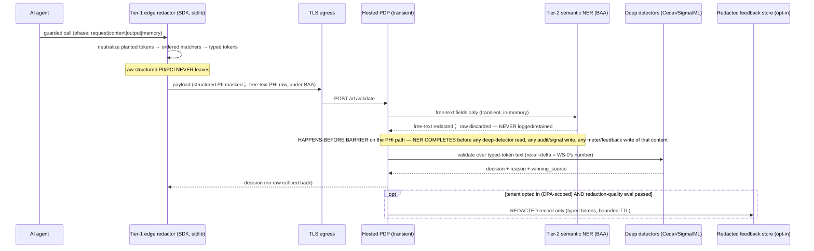
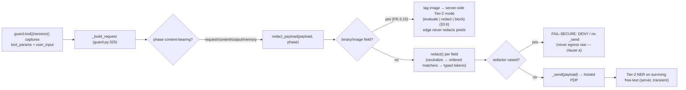
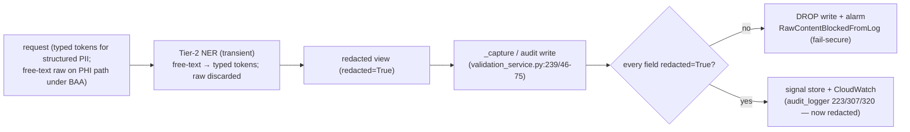
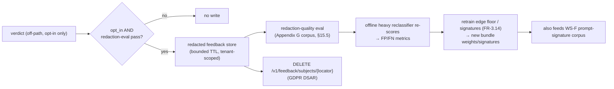
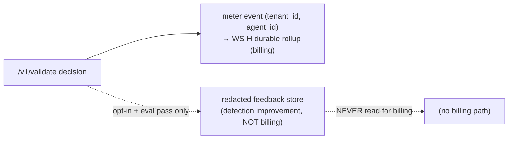

# LLD 29: Two-Tier Redaction + Opt-In Redacted Feedback Store (WS-E)

**Version**: 1.0
**Last Updated**: 2026-06-29
**Status**: Draft
**Prerequisites**: **ADR-032** (two-tier redactor + NFR-7 3-clause amendment — approved; this LLD elaborates it, does **not** re-open it); HLD [hld/serverless-edition.md](../hld/serverless-edition.md) §6.2(e) + Appendix F (data-class allowlist) + Appendix G (the gate's pass/fail rule) + Appendix I (PHI mechanism d / enclave hardening b); workstream scope [tasks/serverless-edition/ws-e-redaction.md](../tasks/serverless-edition/ws-e-redaction.md); sibling LLD [23-sentra-guard-sdk.md](23-sentra-guard-sdk.md) (the stdlib-only SDK Tier-1 ships in), [17-validation-signal-store.md](17-validation-signal-store.md) (the signal store the feedback store is **separate** from), [28-cedar-policy-engine.md](28-cedar-policy-engine.md) (the `phase` contract + bundle the redactor pairs with), [19-ml-threat-classifier.md](19-ml-threat-classifier.md) (the retrain target). **HARD GATE — WS-0:** the masked-vs-unmasked recall-delta (residual #5) is a precondition of **locking** the redaction GA gate (§15.5); the redactor design ships now, the gate-lock is WS-0-gated.

## Table of Contents
1. Overview (purpose, scope, status carry-forward, tenets)
2. The two-tier architecture (edge inline + server-side; the data flow + typed-token replacement)
3. Tier-1 — edge deterministic redactor (matchers · token grammar · where it hooks · per-phase coverage)
4. Tier-2 — server-side semantic PHI NER layer (placement · the transient invariant · BAA)
5. The NO-RAW-PHI invariant — the hard engineering invariant, proven not asserted
6. The opt-in redacted feedback store (schema · TTL · eval-gate · DSAR · retrain loop)
7. Standards mapping (HIPAA Safe Harbor 18 / PCI-DSS / GDPR pseudonymisation)
8. Security
9. Latency (the 4 levers · 3 ranked options · envelopes · redaction latency + failure metrics)
10. Scaling
11. Networking
12. Database / storage
13. Cost
14. Metering & billing
15. Testing (UTs · recall-eval harness · the Appendix-G GA gate · the LIVE integration test)
16. Error model
17. Cross-references

---

## 1. Overview

### 1.1 Purpose

> **P0, first wave — stated up front (owner decision 2026-06-29).** **Both tiers ship in the first wave: Tier-1 edge structured-PII/PCI redaction AND Tier-2 server-side free-text PHI redaction are P0 requirements**, not a "Tier-1 now / Tier-2 later" split. The HIPAA-segment GA claim rests on Tier-2 being present — a Serverless offering that egresses free-text PHI with no server-side PHI redactor is not shippable to the regulated beachhead. Tier-2 is off the *blocking* verdict path (§4.1) but is on the *first-wave build* path.

This LLD elaborates the **one approved decision — ADR-032** (HLD §6.2(e), Option A): a **two-tier redactor** + the **NFR-7 3-clause amendment** + an **opt-in redacted feedback store**. It does **not** re-open whether redaction happens at the edge (it does — Option A, raw never leaves for structured PII), whether the SDK stays stdlib-only (it must — §3.1), whether free-text PHI may transit under a BAA (it may — NFR-7 (c), mechanism d), or whether the Nitro Enclave ships now (it does **not** — mechanism b is a named later hardening, §4.5). It deepens four things into buildable detail:

1. **Tier 1 — the edge deterministic redactor in the SDK** (§3): the matcher set, the typed-token grammar with attacker-resistant namespacing/escape, where it hooks into `guard.py`, and the per-phase coverage that closes the live NOT-DONE bug.
2. **Tier 2 — the server-side free-text PHI semantic NER layer** (§4): P0 first-wave (owner decision 2026-06-29), its placement, and the transient/no-retain/no-log/no-human-access invariant.
3. **The NO-RAW-PHI invariant** (§5): under NFR-7 (c) a logging bug is a *reportable breach*, not a missed NFR — so raw never landing in logs / the signal store / the feedback store / crash dumps is a hard engineering invariant the LLD makes *testable*, against the **live raw-logging surface in `audit_logger.py`** that violates it today.
4. **The opt-in redacted feedback store** (§6): a separate tenant-scoped store of redacted-only records, eval-gated + DSAR-deletable, closing the FR-3.14 retrain loop.

> **No redaction code exists today (FR-3.13 NOT-DONE).** The SDK egresses `tool_params` + `user_input` **un-redacted** ([guard.py:371-389](../demo-agents/sdk/aegion-guard-python/src/aegion_guard/guard.py#L371), `safe_params` + `resolved_input` into the payload), and the hosted audit writer persists `user_input` (truncated 200) + full `tool_params` to **both** the DynamoDB signal store ([audit_logger.py:223](../src/security-controller/app/utils/audit_logger.py#L223)) and the CloudWatch event ([:307-308](../src/security-controller/app/utils/audit_logger.py#L307), [:320-321](../src/security-controller/app/utils/audit_logger.py#L320)). That dual surface is exactly what §5 must prove clean — it is the live clause-(a)/(c) violation this WS closes.

### 1.2 Tenets carried forward (from HLD §6.2 — the tie-breakers)
1. **Fail-secure / deny-by-default — but the two tiers hold at different points (F6).** **Tier-1 is a real EDGE-hold:** a structured-PII/PCI redactor exception (or an unparseable phase) fails **before any egress — the raw never leaves the customer** → hard DENY (E1/E4). **Tier-2 is a server-side hold-AFTER-receipt:** it runs on the hosted PDP, *after* the SDK has already egressed the raw free-text into the AegionAI plane under the BAA, so it cannot "hold at egress" the way Tier-1 does. Its control is **"do-not-forward-onward / do-not-persist the unredactable content"** — the raw already transited into our plane under the BAA; the control prevents the **onward forwarding + the retention/disclosure** that would make a miss reportable (§7.2). It holds/drops the unredactable content, processes what is safe, and does **not** blanket-DENY the whole action where avoidable (E3). A binary/image field → mode-routed, default `block` (E2). The single non-negotiable across all of them: **never "forward/persist the raw value anyway"** — a Tier-1 fall-through to `_send` with raw, or a Tier-2 "skip-store but forward raw onward," is the single worst bug here (the path that actually breaches, §7.2).
2. **No raw retention, any edition (NFR-7 (a)).** Raw / un-redacted content is **NEVER persisted on ANY edition** — not in logs, the audit/signal store, the meter store, the feedback store, or crash dumps. The only thing that may outlive a transient evaluation is a **redacted** record in the opt-in store (NFR-7 (b)).
3. **The data boundary is the customer's to set (tenet 6).** Structured PII never leaves (edge); free-text PHI may transit under a BAA (NFR-7 (c)); air-gapped/no-egress mandates stay on in-VPC. The edition + BAA, not a hardcoded rule, sets the boundary.
4. **Structure preservation is the point (tenet 2 / M-5).** Tier-1 replaces the *value* but preserves *shape, position, and type* (typed tokens) so the deep detectors still get structural signal. Do not collapse all redactions to one opaque token — residual #5 measures the recall cost of even the typed-token masking; an opaque token would make it worse.
5. **Honest claim, not over-claim.** The claim is *"transient + not-retained + not-logged + no human access under a BAA"* — **NOT** "machine-unreadable by AegionAI" (our code reads the value to scrub it). GDPR: reversible masking is **pseudonymisation**, still personal data — never "anonymised" / "Safe-Harbor de-identified" for free-text we did not semantically scrub.

### 1.3 Scope
**In scope:** Tier-1 edge deterministic redactor (the matcher set, token grammar, per-phase wiring, fail-secure) — §3; Tier-2 server-side semantic PHI NER layer (placement + the transient invariant + BAA) — §4; the NO-RAW-PHI invariant made testable against the live `audit_logger` surface — §5; the opt-in redacted feedback store (schema, TTL, eval-gate, DSAR, retrain loop) — §6; the standards mapping — §7; the latency design + metrics — §9; the recall-eval harness + the Appendix-G GA gate + a LIVE integration test — §15.

**Out of scope (FOOTGUN guards — named, not silently dropped):**
- **(a) The Nitro Enclave (mechanism b, Appendix I).** A named *later* hardening that upgrades the claim to "never readable." Not this WS — this WS ships the BAA + no-retention posture (mechanism d), which is the HIPAA-valid GA bar.
- **(b) Edge native-NER (mechanism a, Appendix I).** A premium "strict-residency" tier (`onnxruntime` + distilled NER) that *breaks* stdlib-only. Not this WS.
- **(c) FR-3.15 image/binary content — server-side Tier-2 only, per-tool MODE (NOT a blanket refusal).** The edge text redactor cannot scrub images (a Tesseract binary + an OCR/vision model can't vendor into a stdlib zip — §3.1), so image handling is **server-side Tier-2 only**. It is a **per-tool/per-customer mode `{redact | evaluate | block}`** (§3.6), **not** "refuse every image": the **`evaluate` path is REQUIRED for the B2C-fraud beachhead** (damaged-goods / insurance photos must reach the fraud evaluator intact). Out of scope for WS-E is the *self-host image-redactor build* itself (the `redact` mode's Tesseract+Presidio pipeline, faces, DICOM) — the mode contract and the `evaluate`/`block` paths are in scope; the image-*redaction* engine is the named later build.
- **(d) FR-3.7 server-side `REDACT`-verdict content-rewrite path.** This needs explaining, because it is easy to assume Tier-2 already does it. A server-side **`REDACT` verdict is a third outcome distinct from ALLOW/DENY**: instead of "let the action through" or "stop the action," it says "let the action through *but with a value masked in place*." **Acting on a REDACT verdict requires the PEP to *rewrite* the outgoing content** — take the value the PDP flagged, replace it in the payload, and continue — a control-flow the SDK decorator does **not** have today (it can only ALLOW or DENY the call, it cannot hand back a modified payload for the agent to send). Tier-1 edge redaction (this WS) rewrites *before* egress in the SDK's own build step, so it needs no verdict-driven rewrite. What is out of scope is the **PDP → PEP rewrite loop** (PDP returns a masked payload, PEP substitutes it), which is a **separate named LLD deliverable** — explicitly out of scope here, not silently implemented or dropped. (Cross-ref §2.1 and the §17 shared-contract note.)
- **(e) Re-deciding ADR-032.** Options A/B/C, the in-VPC-vs-BAA question, and the P0-vs-defer call for Tier 2 are decided. If implementation surfaces a genuinely new decision, it flags up to a new ADR — it does not re-litigate ADR-032 in prose.

### 1.4 Implementation-status carry-forward (verified against the code — what is NOT built)
Per the sub-PRD §5 discipline (don't re-task DONE work, don't claim un-built work) — verified this pass:

| Capability | Status | Evidence |
|---|---|---|
| Tier-1 edge deterministic redactor (any matcher) | **NOT-DONE** | no `redact`/Luhn/typed-token code in `aegion_guard/` (grep clean); FR-3.13 NOT-DONE (sub-PRD §5) |
| SDK egresses `tool_params` + `user_input` **un-redacted** | **LIVE BUG** | [guard.py:371-389](../demo-agents/sdk/aegion-guard-python/src/aegion_guard/guard.py#L371) (`safe_params`/`resolved_input` into payload) |
| `phase` field on the contract (redaction must run per-phase) | **NOT-DONE** | [models.py:17-39](../src/security-controller/app/api/models.py#L17) `ValidationRequest` has no `phase` field; default `request` |
| Tier-2 server-side semantic NER layer | **NOT-DONE** (P0, this WS) | no NER component server-side |
| Raw `user_input`/`tool_params` written to signal store + CloudWatch | **LIVE clause-(a) VIOLATION** | [audit_logger.py:223](../src/security-controller/app/utils/audit_logger.py#L223) (signal row), [:307-308](../src/security-controller/app/utils/audit_logger.py#L307)/[:320-321](../src/security-controller/app/utils/audit_logger.py#L320) (CW event) |
| Opt-in redacted feedback store | **NOT-DONE** (NET-NEW) | signal store ([signal_store_table_construct.py](../cdk/cdk_constructs/signal_store_table_construct.py)) is NOT it (no opt-in, no DPA TTL contract) |
| FR-3.14 retrain loop on a redacted corpus | **NOT-DONE** | LLD 19 retrain has no redacted-feedback source |
| Fail-secure transport default (Tier-1 leans on this) | **DONE** | [config.py:93/164-165](../demo-agents/sdk/aegion-guard-python/src/aegion_guard/config.py#L93); `_send` fail-secure DENY [guard.py:391-406](../demo-agents/sdk/aegion-guard-python/src/aegion_guard/guard.py#L391) |
| SDK is stdlib-only (`dependencies = []`) | **DONE — a constraint** | [pyproject.toml](../demo-agents/sdk/aegion-guard-python/pyproject.toml) (runtime deps `[]`); Tier-1 MUST preserve this |

> **`phase` is a shared prerequisite (E1.0), owned by WS-B, consumed here.** WS-B/lld/30 add the additive, defaulted `phase` enum (`request|content|output|memory`, default `request`) to `ValidationRequest`. If WS-B has not landed it when WS-E builds, WS-E adds it as an explicit prerequisite task — **additive + defaulted + validated** (a required/breaking field re-cuts every SDK/connector); unknown/typo phase → **422** (validation error, not a deny, per lld/30 §3.1); known-but-unbuilt phase → **fail-secure DENY**, never silent accept.

---

## 2. The two-tier architecture

### 2.1 Two tiers, two homes, one boundary (ADR-032 / M-1)
Redaction is split by *what can run where within the latency budget*, not by preference:

- **Tier 1 — edge deterministic redactor, IN the SDK.** Regex + Luhn + Shannon-entropy + format-anchored matchers. Replaces *values* with structure-preserving **typed tokens** (`<CARD>`, `<SSN>`, `<EMAIL>`, `<SECRET>`, …). Sub-millisecond, in-process, stdlib-only — so **raw structured PII/PCI never leaves the customer**. Runs **before egress on EVERY phase** (request/content/output/memory), not just `request`.
- **Tier 2 — server-side free-text PHI semantic NER, on the hosted PDP.** Catches the Safe-Harbor free-text identifiers (names, prose addresses, conditions, the catch-all) a deterministic matcher cannot. Too heavy for the stdlib edge (CPU spaCy ≈50 ms+, transformer ≈700 ms — blows the ≤500 ms floor, HLD §6.2(e) latency note). Processes raw free-text **transiently under a BAA**, redacts in place, **never retains, never logs, no human access** (mechanism d). **P0 — first-wave, ships with Tier 1.**

The boundary is set by edition + BAA (tenet 6): structured PII closes at the edge for *every* Serverless customer; free-text PHI closes server-side under a BAA for the HIPAA segment; air-gapped/no-egress mandates stay on in-VPC.

### 2.2 The data flow (typed-token replacement + the transient server tier)



> **The ordering is a happens-before contract, not a concurrency optimization (F1 / owner ordering-refinement, recorded in ADR-032 consequences — the two-tier DECISION is unchanged; only the execution ordering is pinned).** On a **PHI-bearing free-text field**, Tier-2 NER is a **barrier**: `NER → (redacted view) → { deep detectors (ML/Cedar/Sigma) read · audit/signal write · meter/feedback write }`. None of the three consuming paths may read or persist that field's content **concurrently with** NER — each reads the **post-NER redacted view** only. The "hides behind the floor / parallel overlap" latency claim (§9.2 lever 3) applies **only to the verdict-return path for NON-PHI-bearing calls**; it does **not** apply to the PHI content path, where the barrier is on the critical path.

### 2.3 The redaction sequence within a single egress



---

## 3. Tier-1 — the edge deterministic redactor in the SDK

### 3.1 Where it lives + the stdlib-only constraint
A new module **`demo-agents/sdk/aegion-guard-python/src/aegion_guard/redaction.py`** (NEW), **stdlib-only** — `re`, `math` (Shannon entropy), `unicodedata`. **No runtime dependency may be added to `pyproject.toml`** ([dependencies = []](../demo-agents/sdk/aegion-guard-python/pyproject.toml)); the same code vendors unchanged into a Lambda zip / Azure Function (LLD 23 §2). A regex/checksum/entropy redactor fits this; a semantic model does not (that is Tier 2, server-side). The native-NER edge tier (mechanism a) would break this constraint and is out of scope (§1.3 (b)).

### 3.2 The deterministic matcher set (E1.1)
Each matcher is `(detector → typed-token)`. Ordering is load-bearing — **highest-harm / most-specific first** (a bare numeric matcher running first mis-tokens a PAN and loses the PCI first6/last4 obligation):

| Class | Mechanism (stdlib) | Typed token | Standard | Note |
|---|---|---|---|---|
| PAN (card) | regex candidate → **Luhn** mod-10 check | `<CARD:6:4>` | PCI-DSS | mask to first-6/last-4; **never emit the full PAN even tokenized** |
| SAD (CVV/track/PIN) | format-anchored (label-adjacent) | `<SAD>` | PCI-DSS | **never-store / never-log** — drop the value entirely, no first/last retained |
| SSN (US) | regex + format-anchor | `<SSN>` | HIPAA SH | obfuscated/non-US forms → measured leak (Appendix G, §15.5) |
| email | regex | `<EMAIL>` | HIPAA SH | |
| phone / fax | regex | `<PHONE>` | HIPAA SH | |
| IP / URL | regex | `<IP>` / `<URL>` | HIPAA SH | |
| MRN / account / license / device no. | **format-anchored** (label-adjacent + shape) | `<MRN>` / `<ACCT>` / `<LICENSE>` / `<DEVICE>` | HIPAA SH | format-anchored, **not pure shape** — bounds false positives |
| explicit dates | regex | `<DATE>` | HIPAA SH | |
| high-entropy secret / API key | **Shannon entropy** ≥ threshold + charset heuristic | `<SECRET>` | — | entropy floor in §3.4; avoid scrubbing legitimate low-entropy IDs |

The matcher order is fixed in a module constant so it is not accidentally reordered:
```python
# redaction.py (NEW, stdlib-only) — order is a security control, not cosmetics.
_ORDERED_MATCHERS = (
    SADMatcher(),        # most-specific / highest-harm: drop entirely (PCI never-store)
    PANMatcher(),        # Luhn → <CARD:6:4>; MUST run before any bare-numeric matcher
    SSNMatcher(), MRNMatcher(), AccountMatcher(), LicenseMatcher(), DeviceMatcher(),
    EmailMatcher(), PhoneMatcher(), IPMatcher(), URLMatcher(), DateMatcher(),
    SecretMatcher(),     # entropy fallback last — broadest, lowest precedence
)
```

> **PCI SAD/PAN is a HARD deterministic ceiling, held SEPARATELY from the fuzzy Tier-2 free-text target.** PAN (Luhn mod-10) and SAD (CVV/track/PIN, never-store) are deterministic, not probabilistic — so they carry their **own must-not-miss recall ceiling: a hard 0-miss on the dedicated deterministic PCI corpus**, with a **dedicated test** (§14, §15.5), release-blocking. A Luhn-valid PAN or a label-anchored SAD that egresses un-masked is a gate failure. This ceiling is **not** blended into the WS-0-gated fuzzy Tier-2 free-text PHI target (§15.5 (i)) — different corpus, different (stricter) bar.

### 3.3 The typed-token grammar — namespacing / escape (E1.2, M-4)
A bare `<CARD>` is **spoofable**: an attacker puts the literal string `<CARD>` (or `<SAD>`) into a `tool_param`/`user_input` to forge a "redaction happened" signal or confuse the downstream detector. The grammar is therefore **namespaced with a reserved sentinel + per-call nonce**, and attacker-supplied token-looking strings are **neutralized before redaction**:

```
Real redaction marker:  ⟦AEGR:{nonce}:CARD:6:4⟧
                        └ sentinel ┘ └ per-call nonce ┘ └ type[:meta] ┘
```
- **`AEGR:`** is a reserved sentinel prefix; `{nonce}` is a per-call random hex (from `secrets.token_hex`, stdlib) bound to this single egress. A genuine marker carries the call's nonce; a planted one cannot (the attacker doesn't know the per-call nonce).
- **Neutralize first:** before any matcher runs, `_neutralize_planted_tokens` escapes any literal sentinel sequence the attacker supplied (e.g. encode raw `⟦`/`⟧` or a literal `AEGR:` in the input to a benign escaped form) so it cannot be read as a genuine marker downstream.
- The downstream PDP/detector treats only `⟦AEGR:{nonce}:…⟧` (with the call's nonce) as a redaction marker; everything else is plain text.

```python
def redact(value: str, *, nonce: str) -> str:
    escaped = _neutralize_planted_tokens(value)        # M-4: attacker can't forge a marker
    for matcher in _ORDERED_MATCHERS:                  # §3.2, highest-harm first
        escaped = matcher.sub_token(escaped, nonce=nonce)  # value → ⟦AEGR:{nonce}:TYPE[:meta]⟧
    return escaped
```

> **FOOTGUN (do NOT use a bare `<CARD>`).** The HLD's plain-language `<CARD>` illustration is *descriptive*, not the wire grammar. Shipping a bare `<CARD>` that any input can spoof re-opens M-4 — a forged marker either fools a detector or fakes a redaction-quality signal that feeds the feedback store. The sentinel+nonce grammar is the implemented form; the doc-facing UI may still *render* it as `<CARD>` for humans.

> **FOOTGUN (`<CARD:6:4>` carries first6/last4, NOT the full PAN).** The PCI obligation is mask-to-first6/last4 — the *meta* in the token is the unmasked prefix/suffix only, never the middle digits. `<SAD>` carries **no** meta (CVV/track/PIN are never-store).

### 3.4 Entropy floor for `<SECRET>`
The secret matcher uses Shannon entropy over the candidate token's charset; the floor is set to catch API keys / tokens (typically ≥ ~3.5 bits/char over a 32+ char base62/hex string) while **not** scrubbing legitimate low-entropy identifiers (a UUID, an order number). The exact floor + min-length is a tuned constant validated by the recall-eval harness (§15.4) — set conservatively (favor a false-negative on a benign ID over a false-positive that destroys a legitimate value), and the residual leak is what the Appendix-G corpus (§15.5) measures.

### 3.5 Run on EVERY egressing phase (E1.3) — the live bug
Today only the `request` payload is assembled, un-redacted ([guard.py:371-389](../demo-agents/sdk/aegion-guard-python/src/aegion_guard/guard.py#L371)). The redactor wires into the payload build so **every content-bearing field is redacted before `_send`**, keyed on `phase`:

```python
# In _build_request (guard.py:325) — after safe_params is built, before return.
nonce = secrets.token_hex(8)                       # per-call; binds genuine markers (§3.3)
phase = active.phase if active else "request"
payload["tool_params"] = redact_fields(safe_params, nonce=nonce)   # request phase
payload["user_input"]  = redact(resolved_input, nonce=nonce)
# content/output/memory phases (paired with WS-B) carry their content in the
# phase-specific field — redact each the same way before egress:
if phase in ("content", "output", "memory"):
    payload[_CONTENT_FIELD[phase]] = redact(payload[_CONTENT_FIELD[phase]], nonce=nonce)
payload["redaction_nonce"] = nonce                 # PDP uses it to recognize genuine markers
```

> **FOOTGUN (do NOT redact only the `request` branch).** `content` (retrieved docs, tool output, web text) is often the **richest** PII surface — leaving it raw is the live NOT-DONE bug. The acceptance test (§15.1) sends PII in a `content` field and asserts the egressed payload carries the typed token, not the raw value.

### 3.6 Image/binary content — per-tool MODE, server-side Tier-2 only (E1.5, FR-3.15)
Image content is **NOT** handled at the edge (a Tesseract binary + an OCR/vision model cannot vendor into the stdlib-only SDK zip, §3.1) and is **NOT** a blanket "refuse every image." A field detected as binary/image at the edge (non-text bytes / a base64 blob over a size+entropy threshold) is **tagged** and routed to a **server-side Tier-2 image handler** whose behavior is a **per-tool / per-customer mode**, resolved from policy (see below):

| Mode | Behavior | Primary use |
|---|---|---|
| **`evaluate`** (**REQUIRED — B2C-fraud beachhead**) | pass the image through to the fraud/threat evaluator **intact, un-redacted** — the evaluator must see the pixels (damaged-goods / insurance-claim / return photos). Prior art: Verisk image forensics, Hertz AI damage scanners. | fraud-detection agents (the beachhead) |
| **`redact`** | self-host image PII redaction (see below) before the image is forwarded/retained | PHI/PII-bearing document images on a BAA tenant |
| **`block`** / pass-through | refuse egress (fail-secure, tenet 1) or pass through per policy | tenants that neither evaluate nor redact images |

**Server-side self-host `redact` pipeline (the named later build, not WS-E's engine):** **Tesseract + Presidio image-redactor** (MIT) [github.com/microsoft/presidio/tree/main/presidio-image-redactor] as the primary. **Two named separate steps it does NOT cover** (call them out so they aren't assumed done): (1) **faces** — Presidio image-redactor is text-only; face redaction needs a separate detector (Rekognition bounding boxes / Google DLP); (2) **DICOM metadata PHI** — the image-redactor does **not** scrub embedded DICOM tags; that is a distinct metadata pass. WS-E ships the **mode contract + the `evaluate`/`block` routing**; the `redact`-mode image engine (Tesseract+Presidio + faces + DICOM) is the named later build.

**Wiring `{mode}` into the policy model:** the mode is a **tool-registry field** (`image_mode` per tool, resolved server-side) — or, where the decision is policy-conditional, a **Cedar attribute** on the tool/resource read by the bundle (LLD 28). It defaults to `block` (fail-secure) for a tool with no explicit image mode. It fails toward `block`/refusal on an unresolvable mode (tenet 1).

### 3.7 URL / egress-destination handling — REUSE the egress policy, do not build a new subsystem (E1.6)
A URL in a `tool_param`/`user_input` is two separate concerns, and neither needs a new URL subsystem:
1. **Where the request may go (SSRF / destination control)** — this is **already** the egress-destination policy **FR-2.9**. Reuse it: an **OWASP positive ALLOW-LIST** (validate scheme/host/port against an approved list) is the **primary** control, plus explicit denial of the cloud-metadata endpoint **169.254.169.254** and RFC-1918 private ranges. Per OWASP SSRF guidance, an allow-list is required because **deny-lists get bypassed** (encodings, DNS-rebinding, redirects). This lives in the egress policy (Cedar / the destination policy of FR-2.9), **not** a redaction-specific URL parser.
2. **Secrets embedded in the URL (tokens/keys in query strings)** — a **Tier-1 regex query-secret strip** as a *supplement*: the `<SECRET>`/entropy matcher (§3.2) and a URL-query matcher scrub `?token=…` / `?api_key=…` style secrets in the query component before egress, emitting `<URL>` with the secret-bearing query masked.

The two overlap deliberately: destination-safety is the egress policy's job (reused, not rebuilt); Tier-1 only strips **secrets carried inside** a URL value. Do **not** stand up a parallel URL-validation subsystem in the redactor.

### 3.8 Fail-secure on redactor error (E1.4)
If `redact()` raises on any field, the SDK MUST NOT egress the raw value. It aligns with the existing fail-secure default ([config.py:93/164-165](../demo-agents/sdk/aegion-guard-python/src/aegion_guard/config.py#L93)) and the unknown→DENY transport path ([guard.py:391-406](../demo-agents/sdk/aegion-guard-python/src/aegion_guard/guard.py#L391)): a redactor exception short-circuits to a **DENY Decision** (reason `redaction_failed`), never a `_send` of the raw payload. Tested by forcing the exception (§15.1).

---

## 4. Tier-2 — the server-side free-text PHI semantic NER layer

### 4.1 Placement + model choice (E2.1) — P0
A NEW server-side component **`src/security-controller/app/redaction/phi_ner.py`** runs on the hosted PDP, on the **free-text fields that survive Tier 1** (the typed tokens are already structural; NER targets the prose the deterministic matchers cannot — names, prose addresses, conditions, profession, the Safe-Harbor catch-all).

**On a PHI-bearing free-text field, Tier-2 NER is a happens-before BARRIER, not an off-path pass (F1).** The NER redaction **completes before** (a) any deep-detector (ML/Cedar/Sigma) read of that content, (b) any audit/signal write of that content, and (c) any meter/feedback write of that content — each of those consumers reads only the **post-NER redacted view**. The "off the blocking path / parallel-overlap" property applies **only** to the *verdict-return* latency for **non-PHI-bearing calls** (a DENY/ALLOW the deterministic tier can already resolve is not delayed by NER); it does **NOT** apply to the PHI content path. Concretely: a non-PHI call's verdict can return while NER (if any) still runs, but a PHI-bearing field's content is never read or persisted concurrently with its NER pass — the barrier holds.

**BUILD (self-host), do not buy — the load-bearing reason is the subprocessor boundary, not cost.** We self-host the PHI redactor because self-hosting adds **no new subprocessor**: raw free-text PHI stays inside AegionAI's own controller, under AegionAI's own BAA (we are the processing business associate — 45 CFR 160.103). Every managed de-id API (AWS Comprehend Medical, Google Cloud DLP, Nightfall, Skyflow) makes a **third party a subprocessor of ours** and pushes raw PHI out of our controller to that vendor — the exact friction a regulated buyer resists, and self-defeating for a company that *is* the compliance vendor (we would be reselling someone else's compliance). The whole self-host stack is permissively licensed and embeddable in a commercial multi-tenant hosted service with no run-as-a-service restriction: **Presidio = MIT** [github.com/microsoft/presidio/blob/main/LICENSE], the default clinical NER **blaze999/Medical-NER = MIT**, and its base **microsoft/deberta-v3-base = MIT** — so the whole self-host path is MIT.

**The scary "~700 ms transformer" is the UN-optimized form.** The production form is a **distilled PHI-NER model exported to ONNX-Runtime with int8 quantization on a warm, always-on service** — not a fresh HuggingFace transformer loaded per call. Envelope (all **TO-BE-BENCHMARKED — EXTRAPOLATION, not our model on our fields**): **~35–70 ms p50 / ~90–150 ms p99 per free-text field** warm. These are extrapolated from the HuggingFace Optimum benchmark (RoBERTa-base on m5.xlarge: 117.61 ms → 64.94 ms with ONNX+int8, ≈2× speedup, 473 MB → 291 MB) [huggingface.co/blog/optimum-inference] and spaCy pipeline throughput (en_core_web_lg 10,014 WPS CPU vs en_core_web_trf 684 WPS CPU) [spacy.io/usage/facts-figures]. They are **not** measured on our model or our fields — the real numbers come from the §15.4 harness and are gated by §15.5.

**Model choice is an LLD decision gated on the Appendix-G recall target (§15.5), named not assumed.** The candidate set, with the tradeoff that decides it:

| Option | Latency (per free-text field) | Subprocessor / boundary | Recall posture | Fit |
|---|---|---|---|---|
| **Self-host: distilled PHI-NER → ONNX-Runtime + int8, warm service** — *PRIMARY* | ~35–70 ms p50 / ~90–150 ms p99 **(TO-BE-BENCHMARKED — extrapolation)** | **none** — raw PHI stays in our controller/BAA | distilled clinical NER (Medical-NER, MIT) + regex (Presidio, MIT); tunable; measured vs §15.5 | no new vendor; embeddable in hosted multi-tenant; the compliant default |
| Self-host: Presidio (regex + spaCy-lg CPU) | ~50 ms+ CPU | none | hybrid; HIPAA-reference pattern | the pre-GA in-controller start (Latency Option B, §9); no idle premium but shares controller CPU |
| **Fallback ONLY (validation): AWS Comprehend Medical** | + a network round-trip, unbounded p99 tail | **makes AWS a subprocessor** (HIPAA-eligible under the AWS BAA we'd hold) — pushes raw PHI out | ML; **HHS notes its entities don't map 1:1 to Safe Harbor + recommends human review** [docs.aws.amazon.com/comprehend-medical] | used **only** if self-host recall fails the §15.5 eval; a hop off the blocking path + vendor-coupling |

**Rejected outright: AWS Macie** — it is S3-batch PII *discovery*, not an inline redaction API — the wrong shape for a per-request path. **Not confirmed (do not rely on):** Private AI / Protecto BAA+SOC2 claims are unverified from primary sources.

Default = **self-host distilled ONNX-int8 (PRIMARY)**, starting pre-GA as the in-controller Presidio hybrid (Latency Option B) and graduating to the warm ONNX microservice (Latency Option A, §9); escalate to Comprehend Medical **only** as a validation fallback if self-host misses the §15.5 recall target. Whatever is chosen, the layer's recall is **measured** against the obfuscated/non-US/narrative corpus before it can carry a HIPAA GA claim — never asserted.

**Tenant isolation of the shared model-resident service (F4) — this is where raw PHI actually lives.** Because the warm NER service (Option A) is model-resident and multi-tenant, it carries an explicit isolation contract (full statement in §9.6 / §8): per-request raw-buffer lifecycle with **zeroing after redaction**; NER-framework input-logging **disabled** (no spaCy/transformers/ONNX debug logging of inputs); no shared crash dump exposes tenant raw; warm-pool sharing is **process-level today**, and the **provable** cross-tenant boundary for raw PHI is the **deferred enclave (§4.5)** — a named residual, not claimed present.

### 4.2 The transient-processing invariant (E2.2, mechanism d)
Raw free-text PHI is processed **transiently**: held in memory only for the duration of the NER pass, redacted in place to typed tokens (`<NAME>`, `<ADDRESS>`, `<CONDITION>`, …), and the **raw discarded immediately**. The contract:
- **never written** to any log, the signal store, the meter store, the feedback store, or a crash dump (§5 proves this);
- **no human access** — there is no operator path that reads the raw free-text; only the redacted output proceeds;
- **under a BAA** — counsel confirms the 45 CFR 164.308/164.314 safeguards before the HIPAA GA claim ships (release gate, §15.5).

The honest claim is **"transient + not-retained + not-logged + no human access under a BAA"** — not "machine-unreadable" (the NER code reads the value to scrub it; provable unreadability is the enclave, §4.5).

### 4.3 Data-class allowlist enforcement (E2.3, Appendix F)
A field *label* is a schema-level control only — it cannot stop a disallowed-class PII string embedded in a free-text field. Enforced two ways:
1. **STRUCTURED fields** — class-enforced at the schema/contract layer: a field declared a disallowed class is **blocked or routed to in-VPC**.
2. **FREE-TEXT fields** — **not** class-trustable from the label. **A field LABEL does not classify free-text content** (owner p6): Tier-1 catches structured-PII even inside prose (a card number / SSN embedded in a sentence), and **Tier-2 NER owns the free-text PHI** (names/addresses/conditions) that no label or deterministic matcher bounds. The un-catchable residual is **either redacted by Tier-2 under the BAA/DPA, or the customer is on in-VPC, or — if Tier-2 cannot handle a field — the content is HELD (not egressed), per E3.** Not a blanket "free-text is fine."

> **What "block" means here (owner p6) — it is NOT "reject the user's request".** When this section or E2/E3 says a field is "blocked" or "held", it means **that field's content does not egress raw** (it is held/dropped/routed), while the safe portion of the action proceeds where possible (E3 egress-fail-closed). A free-text field that Tier-2 cannot handle routes to the fallback (**hold / don't-egress-that-content**) — **not** a bad-UX rejection of the whole user request. The only *hard* action-DENY is the deterministic Tier-1 structured-PII / PCI-SAD failure (E1).

> **FOOTGUN.** Do NOT treat a label-"allowed" free-text field as safe to egress raw. The label constrains a *structured* field's declared class; a free-text field's contents are not bounded by its label.

### 4.4 Why Tier 2 is server-side, not edge (carried from HLD, not re-decided)
The deterministic edge stays deterministic-only because semantic NER blows the ≤500 ms floor in-process (§4.1 latency column). This is ADR-032's recommendation — restated, not re-opened. The edge native-NER tier (mechanism a) that *would* run NER at the edge breaks stdlib-only and is the premium strict-residency option (out of scope, §1.3 (b)).

### 4.5 Enclave hardening — a one-line roadmap note (NOT this WS)
> **Roadmap note (mechanism b, not built in WS-E, not a GA dependency):** a TEE (AWS Nitro Enclave / Azure CVM / GCP CVM) could later upgrade the claim from "we don't retain/log/view" to "we provably **cannot** read." **The GA claim does not rest on it** — it rests on the CONTAINMENT posture (§7): transient processing + no-retention + no-log + no-human-access under a BAA, which is the industry norm (no hyperscaler claims a TEE for prompt-PII; §7). The primary design is how redaction runs in our **hosted serverless controller**, not in an enclave.

---

## 5. The NO-RAW-PHI invariant — proven, not asserted

### 5.1 Why this is a hard invariant, not a soft NFR
Under NFR-7 (c), any path that logs/persists raw PHI is a **reportable breach** (HIPAA breach-notification), not merely a missed NFR. So "raw never lands in logs / the signal store / the feedback store / crash dumps" (invariant **I-1**) is a hard engineering invariant the LLD makes **testable** — and there is a **live violation today** to close.

### 5.2 The live violation surface (what §5 must clean)
The hosted audit writer persists request content **un-redacted** on two paths:

| Surface | What it writes raw | Anchor |
|---|---|---|
| DynamoDB signal store (per-signal shared attrs) | `tool_params` (full) + `user_input` (truncated 200) | [audit_logger.py:223](../src/security-controller/app/utils/audit_logger.py#L223) (`_shared_attrs_from_request`) |
| CloudWatch combined event | `user_input` (truncated 200) | [audit_logger.py:307-308](../src/security-controller/app/utils/audit_logger.py#L307) (`_build_log_event`) |
| CloudWatch combined event (rollback support) | `tool_params` (full) | [audit_logger.py:320-321](../src/security-controller/app/utils/audit_logger.py#L320) |

Truncation-to-200 is **not** redaction — a card number or a name fits in 200 chars. These three writes carry raw values into durable stores → clause-(a) violation today.

**Scope of the "I-1 proven" claim (F5).** The three writes above are the **application audit writer + the persist path** — that is what §15.2 **test-proves** raw-free. Raw free-text also transits **before** the Tier-2 barrier and **upstream of the redaction-state guard** through transport/ingress sinks the guard does not cover. So the claim is precise: **the persist path is test-proven raw-free; the ingress/transport sinks are config-controlled per the inventory below** — we do **not** claim "every surface proven."

**Log-sink inventory (each marked config-control vs test-asserted):**

| Sink | Raw exposure risk | Control that keeps it raw-free | Kind |
|---|---|---|---|
| App audit writer (`audit_logger.py` 223/307/320) | raw in signal store + CW event (the live bug) | fed the post-NER redacted view + redaction-state guard + content re-scan (§5.3/§5.3.3) | **test-asserted** (§15.2) |
| App request/exception logs (`validation_service.py`) | body dump on debug/error | no-raw-body-logging ban + redacted view in error messages (§5.3 footgun, §5.4) | **test-asserted** (§15.2) |
| ALB access logs | request line/headers (not body by default; query string can carry secrets) | ALB access logging logs request line only; Tier-1 strips URL-query secrets pre-egress (§3.7); no PII in path/query on the `/v1/validate` POST body | **config-control** |
| API-Gateway execution / access logs | can log request/response body if body-logging enabled | data-tracing / full-request-body logging **disabled** in the API-GW stage config; access log format excludes body | **config-control** |
| X-Ray / OTel spans (sampling) | annotations/metadata could carry field values | no raw field placed in span annotations/metadata; body not captured; sampling emits metadata only | **config-control** |
| boto3 / botocore debug logging | DEBUG logs full request/response to DynamoDB/CW | botocore log level ≥ INFO in prod (no `DEBUG` wire logging) | **config-control** |
| APM frame-local capture (Sentry/Datadog) | captures `repr(request)` / frame locals on exception | disable APM local-variable capture in prod + strip raw before throwable code (§5.4, F7) | **config-control** |

The config-control rows are **deployment controls, not code the guard enforces** — they are asserted by configuration and the deployment runbook, not by a per-request assertion. The persist-path rows are the ones §15.2 tests.

### 5.3 The fix + how it is enforced
**The audit/signal writer is fed the redacted payload, never the raw request.** The ordering is a **happens-before contract** (F1): `NER → (redacted view) → audit + detectors + persist`. Nothing reads or persists a PHI-bearing field concurrently with its NER pass — every downstream consumer reads the post-NER redacted view. Concretely:
1. The Tier-1 edge already replaces structured PII with typed tokens *before egress*, so `tool_params`/`user_input` arriving at the PDP carry typed tokens for structured PII (not raw). Tier-2 NER redacts the surviving free-text PHI, and its completion is a **barrier the audit/signal write happens-after** — the write never runs against the pre-NER (raw) view.
2. `_capture(result)` ([validation_service.py:239](../src/security-controller/app/services/validation_service.py#L239)) and the fire-and-forget audit write ([validation_service.py:46-75](../src/security-controller/app/services/validation_service.py#L46), background tasks) read from a **post-redaction view** of the request, not the original. `_shared_attrs_from_request` and `_build_log_event` are changed to take the redacted fields.
3. **A redaction-state assertion guards the writer (flag check — the first, cheap line):** the audit writer refuses to write any field not marked redacted (a `redacted=True` provenance flag set by the redaction pass). A field reaching the writer without that flag → the write is dropped + alarmed (`RawContentBlockedFromLog` metric), fail-secure — better a missing audit row than a raw-PHI breach.

#### 5.3.3 The flag is NOT sufficient for a PERSISTING store — content re-scan required (F2)
A provenance flag proves *a redaction pass ran*, **not** that it *caught everything*. Under Tier-2's <100% recall a **NER miss is un-tokenized raw content that still carries `redacted=True`** — the flag check (point 3) admits it. Trusting the flag alone would let a Tier-2 miss land in the signal store and (opt-in) feedback store at the bounded TTL, voiding §7.2's no-raw-retained argument. Therefore:
- **The guard that admits a record to ANY persisting store (the signal store, the feedback store) must run a content re-scan — NOT trust the provenance flag.** That re-scan is the **stronger, independent detector of §6.3** (the heavy offline reclassifier or Comprehend-Medical gate-only mode — independent of / stronger than the Tier-2 primary). A field passes to persistence only if the re-scan finds **no residual identifier**.
- The cheap flag check (point 3) still runs first as fail-secure short-circuit; the content re-scan is the authoritative admission gate for anything that persists.



> **FOOTGUN (structured logging of the request body).** A common debug aid — `logger.info("request: %s", request)` or an exception handler that dumps the body — re-introduces the breach. The redaction-state guard covers the *audit* writer; the LLD additionally bans raw-body logging in the request path and exception handlers (§15.2 proves it with a forced exception). Crash dumps: the controller runs with body-logging disabled in prod and no raw field is held past the NER pass.

### 5.4 The crash-dump / exception path
An exception during validation must not serialize the raw request into a stack-trace log. The error path ([validation_service.py:206/213](../src/security-controller/app/services/validation_service.py#L206)) logs the exception **without** the request body; any field referenced in an error message is the redacted view. Tested by raising mid-pipeline and asserting no raw value appears in the captured logs (§15.2).

**The frame-locals / APM trap (F7) — the log MESSAGE being clean is not enough.** An uncaught exception thrown **before** the NER barrier leaves the raw `ValidationRequest` live in the frame's locals. `logger.exception` prints the traceback, and — worse — **APM agents (Sentry, Datadog) capture frame locals / `repr(request)` by default**, exfiltrating the raw object even when the log *message* carries no body. §15.2 today asserts only the log message. Three controls, at least one of which MUST hold and be asserted:
1. **Strip raw fields from the request object before any code that can throw** — replace raw content with the redacted view (or drop it) as early as possible, so a later exception has no raw in the frame; and
2. **Add an APM/frame-local-capture assertion to §15.2** (assert the captured frame locals / event payload carry no raw substring); and/or
3. **Name "disable APM local-variable capture in prod config" as a deployment control** (Sentry `include_local_variables=False` / Datadog equivalent) — a config-control row in the §5.2 inventory.

Note the **F1 barrier widens the raw-live window** (a PHI-bearing field's raw content is live until NER completes on the critical path). Keep the raw object's lifetime **minimal** — redact/zero the buffer as soon as the NER pass returns (§9.6), and prefer control 1 so the raw is gone before most throwable code runs.

---

## 6. The opt-in redacted feedback store (E3) — NFR-7 (b) + FR-3.14

### 6.1 What it is (and what it is NOT)
A **separate, tenant-scoped** DynamoDB store of **REDACTED records only**, bounded TTL, **opt-in per DPA**, that feeds the offline re-score + retrain loop. It is **NOT** the signal store (LLD 17 — that is the audit/decision trail) and **NOT** the meter store (WS-H — the billing ledger). Conflating them is a clause-(b) consent breach (the feedback store needs opt-in; the others don't).

### 6.2 Schema (E3.1)
A NEW CDK construct (do **not** reuse the signal store as-is). Anchored against [signal_store_table_construct.py](../cdk/cdk_constructs/signal_store_table_construct.py) for shape, with the differences that matter:

| Attr | Type | Notes |
|---|---|---|
| `tenant_id` | S (PK) | tenant-scoped isolation — never cross-tenant readable (NFR-6) |
| `record_id` | S (SK) | `{ms}#{uuid}` — also the DSAR locator key (§6.4) |
| `subject_locator` | S (GSI PK) | per-subject pseudonymous id for GDPR DSAR targeted deletion — **salted keyed hash `HMAC(per-tenant-salt, subject_key)` computed at write time before masking** where a stable subject key exists; **null/absent → the record is TTL-only-deletable, not subject-targeted** (§6.4) |
| `redacted_payload` | M | **REDACTED only** (typed tokens) — invariant **I-1**; **no raw value ever** |
| `phase` | S | `request\|content\|output\|memory` |
| `decision` / `reason` / `winning_source` | S | from the combiner ([deny_overrides.py:51](../src/security-controller/app/combiners/deny_overrides.py#L51), `metadata["winning_source"]`) |
| `detector_outcomes` | M | per-detector verdicts (for FP/FN labeling) — redacted |
| `ttl` | N | DynamoDB TTL attribute — record **must** expire. Bounded, DPA-scoped; **default 90 days** *(placeholder — DPA-scoped, owner/counsel to set the final value)*. DSAR-deletable before expiry (§6.4). |
| `opt_in` | BOOL | written only when the tenant opted in (DPA) — default OFF |
| `redaction_eval_pass` | BOOL | the §6.3 gate result at write time — no record written if false |

**CDK deltas from the signal store:** **enable DynamoDB TTL** (`time_to_live_attribute="ttl"` — the signal store sets `expires_at`; this store sets its own bounded TTL, **default 90 days, DPA-scoped placeholder — owner/counsel to set**); **PITR default OFF** (the signal store has `point_in_time_recovery=False` at [:81](../cdk/cdk_constructs/signal_store_table_construct.py#L81) — for a store holding redacted-but-still-personal data (GDPR pseudonymisation), **PITR must be OFF or DSAR-scoped** because a PITR snapshot would **outlive a DSAR deletion**, §6.4); `RemovalPolicy.RETAIN` semantics kept deliberate.

> **FOOTGUN (PITR vs DSAR).** If PITR is on, a continuous backup retains a deleted subject's record past the DSAR deletion — undermining §6.4. Default this store to **PITR off** (or scope the DSAR procedure to also handle the PITR window), and document the choice — do not silently inherit the signal store's setting.

> **FOOTGUN (metadata carries raw fragments too).** The redaction pass MUST apply to **`reason`, `winning_source`/matched-rule, and `detector_outcomes`** — not just `redacted_payload`. A DENY `reason` or a matched-rule string that **quotes the offending free-text** ("blocked: message contains 'John Smith SSN …'") persists a raw fragment through the metadata columns, past the payload guard. The §5.3.3 content re-scan runs over the **whole would-be-persisted record** (payload + reason + detector_outcomes), not the payload alone; the same applies to the signal-store metadata.

### 6.3 The redaction-quality eval gate (E3.4) — gated BEFORE any write, by a STRONGER independent detector
**No record is written if a residual identifier is found by an INDEPENDENT, STRONGER detector than the Tier-2 primary.** A gate that re-runs the same redactor that produced the record is circular — it makes the same miss and returns false assurance (F3), and the Appendix-G recall *measure* additionally needs ground-truth labels a live record does not carry. So the persist-gate does **not** re-run the primary redactor and does **not** compute the Appendix-G recall metric on the live record. Instead:

- **The gate detector is a different, stronger content re-scan run on the would-be-persisted payload** — the **heavy offline reclassifier** already in the §6.6 retrain loop, or **AWS Comprehend Medical in gate-only mode** (used here as an independent check, not as the primary Tier-2 path). It **must be independent of, and at least as sensitive as, the Tier-2 primary** — a gate whose detector is the primary redactor is not a gate.
- The record passes **only if that stronger re-scan finds no residual identifier** in the would-be-stored payload. If it finds one, the write is **skipped + alarmed** (`FeedbackRedactionGateFail`), never stored.

This is the second line behind the redaction-state guard (§5.3): the guard blocks fields not marked redacted; this gate — via a stronger independent detector — blocks *poorly*-redacted fields (including a Tier-2 miss that carries a `redacted=True` flag) from a store that outlives the transient evaluation. It is a **content re-scan, not a flag check** (see §5.3.3 / §6.3 in F2).

### 6.4 DSAR / deletion API + record locator (E3.3, GDPR Recital 26)
Pseudonymized data is **still personal data**, so it must be locatable and deletable:
- **`DELETE /v1/feedback/subjects/{subject_locator}`** (operator-auth, tenant-scoped) — deletes every record for a subject via the `subject_locator` GSI. Tenant A cannot delete tenant B's records (403, tenant-scoped).
- **Per-tenant record locator** — the `subject_locator` GSI is the join key that makes targeted deletion possible without scanning. The store cannot claim feedback-store GA until DSAR deletion is implemented + tested (§15.3).
- **How `subject_locator` is derived when the identifiers were tokenized before the write (the gap):** a free-text record's raw identifiers are gone by write time, so a subject-targeted `subject_locator` cannot be re-derived from stored content. Two honest options, pick per record type:
  - **Where a stable subject key exists at request time** (e.g. an authenticated `subject_id` / account handle the tenant supplies out-of-band, or a structured PII value present *before* Tier-1 masks it), derive `subject_locator` as a **salted keyed hash** `HMAC(per-tenant-salt, subject_key)` computed **at write time before masking** — a per-tenant salt so it is not cross-tenant-linkable and not reversible to the raw identifier. This backs a true subject-targeted DSAR.
  - **Where no stable subject key is available** (a free-text record with no out-of-band subject id), **concede the record is TTL-only-deletable, not subject-targeted** — its `subject_locator` is null/absent and it ages out on the bounded TTL (§6.2). Do **not** claim GDPR subject-targeted deletability for these; the honest claim is "deletable by expiry (TTL) + by subject where a subject key exists."
  This keeps the GDPR "deletable" claim **backed** — either targeted (salted-hash locator) or TTL-only (conceded), never an unbacked blanket "deletable."

### 6.5 Opt-in write path (E3.2) — and WHY only the store is opt-in
Records are written **only** when the tenant's `sentra-tenants` row carries the DPA-scoped opt-in flag (default **OFF**). The write is **off the response path** (after the verdict, fire-and-forget like the existing telemetry, [validation_service.py:46-75](../src/security-controller/app/services/validation_service.py#L46)) and writes the **redacted** record only.

**The opt-in gate is SPLIT deliberately (owner decision):**
- **The redacted feedback store is OPT-IN (default OFF, per DPA)** — because it is **the only thing that PERSISTS**. Even redacted, a GDPR-pseudonymised record is **still personal data** (§7 GDPR row), so persisting it beyond the transient evaluation needs consent + a DPA scope. It is a *detection-improvement* store, not a control the customer must accept to be protected.
- **Transient PHI processing for redaction itself is ALWAYS-ON under the BAA — no consent gate.** It is the **containment control** (§4.2, §7.1), not an optional extra: the redaction pass reads the value, scrubs it, and **persists nothing**. Gating the redaction itself on opt-in would be nonsensical — a tenant cannot "opt out" of being protected while still sending PHI. So the always-on part persists nothing; the opt-in part is the only part that outlives the request.

> **FOOTGUN (default OFF).** An accidental default-ON is a clause-(b) violation **and** a consent breach. The flag defaults OFF (conservative-off, mirroring LLD 27's absent-key trap); a non-opted-in tenant produces **no** record (§15.3 asserts it).

### 6.6 The retrain loop (E3.5, FR-3.14)



An **offline, batch** job (never on the `/v1/validate` hot path) re-scores stored redacted records when signatures/models update, produces FP/FN metrics, and retrains the edge deterministic floor / prompt-signatures (extends LLD 19 retrain + the WS-F prompt-signature corpus). Gated on the redaction-quality eval (§6.3) — no retrain on a corpus whose redaction quality is unmeasured.

**Ownership of the offline batch job (cross-ref).** This LLD owns only the *feedback-store contract* the job reads (what is stored — redacted records only §6.2, the content-aware eval-gate §6.3, TTL/DSAR §6.4). The offline reclassify/retrain **batch job itself is FR-3.14 (P2, NOT-DONE — sub-PRD §5)**: its cold-path batch compute extends **LLD 19 §4.3/§13.3** (the Opus-in-batch eval/label/re-score infra) and its corpus loop is **WS-F** (prompt-signature corpus, F5). There is **no dedicated FR-3.14 retrain LLD yet — it is a named gap to create when P2 is scheduled.** lld/29 neither designs nor blocks on that job; it only guarantees the store it will consume is redaction-gated.

---

## 7. Standards mapping (what's deterministic vs needs the model)

| Standard | Obligation | Tier-1 (edge, deterministic) | Tier-2 (server, semantic) |
|---|---|---|---|
| **HIPAA Safe Harbor — 45 CFR 164.514(b)(2)** (18 identifiers) | de-identify the 18 categories | **structured**: SSN, MRN/account/license/device no., phone/fax, email, IP/URL, explicit dates | **free-text**: names, prose addresses, conditions, profession, the catch-all ("any other identifying characteristic") |
| **PCI-DSS** | PAN mask first6/last4; SAD never-store/never-log | PAN → `<CARD:6:4>` (Luhn); SAD (CVV/track/PIN) → `<SAD>`, value **dropped** | — (PCI is fully deterministic; matters most for the fintech beachhead) |
| **GDPR Recital 26** | reversible masking = pseudonymisation, still personal data | typed tokens are **pseudonymisation** — locatable + deletable via the feedback store DSAR (§6.4) | same; **never** call free-text we didn't semantically scrub "anonymised" / "Safe-Harbor de-identified" |

> **The honest line (Appendix I):** structured = deterministic; free-text Safe-Harbor compliance = a model + human-review problem, never a 100% guarantee. The reference de-id tools are all hybrid for exactly this reason (Presidio = regex + NER; Comprehend Medical; Google Cloud SDP). The wording discipline (pseudonymisation, never "anonymised" for un-scrubbed free-text) is a doc + UI copy check (§15.6 acceptance).

### 7.1 The compliance basis is CONTAINMENT; redaction is DEFENSE-IN-DEPTH
This is the load-bearing framing, and it is deliberately **not** "our redactor is the compliance guarantee":

- **CONTAINMENT is the basis.** Our HIPAA/GDPR posture rests on the same substrate every hyperscaler rests on: raw content is processed **transiently under a BAA, never retained, never logged, no human access, encrypted in transit** (§4.2, §5, proven in §15.2). **No hyperscaler claims to redact prompt PII** — AWS Bedrock (Zero-Operator-Access + Zero-Data-Retention), OpenAI, Anthropic, Google Vertex, and Azure OpenAI all rest their compliance on **no-training + zero/short retention + access-control + encryption + BAA/DPA**, not on scrubbing the prompt. Our containment posture is the industry norm; the Bedrock ZOA/ZDR model is the direct parallel.
- **REDACTION is defense-in-depth**, not the guarantee. Tier-1/Tier-2 shrink the PHI that transits and get scrubbed content into any retained/forwarded write — a strong control, but the *legal* basis is containment. **A redaction-SLA claim would be OUT of step with the industry and self-harming**: it would reframe every recall miss as a breach, which is exactly the trap §7.2 avoids.

### 7.2 "If redaction isn't 100%, is that a compliance problem?" — answered directly: NO
The owner's question, answered with the primary law:

- **The basis is BAA-permitted use + risk-based breach analysis, NOT Expert Determination (F8 — do not conflate them).** Expert Determination (45 CFR 164.514(b)(1)) is a **de-identification** standard: it concludes the data is *no longer PHI*. That is a **category error** for our free-text path — §7.1/§4.2 correctly hold that raw free-text **IS PHI processed under a BAA**, i.e. we handle it *as* PHI as the processing business associate. We cannot simultaneously claim the data is de-identified (ED) and that we handle it as PHI under a BAA. So the argument rests on:
  - **BAA-permitted use/disclosure — 45 CFR 164.502 + 164.504(e)** [law.cornell.edu/cfr/text/45/164.504]: a business associate may use/disclose PHI as permitted by the BAA to perform its services (here: running the security-control redaction/validation). Processing PHI to redact it is a permitted use, not an unauthorized disclosure.
  - **The 164.402 four-factor "low probability of compromise" rebuttal** (below) plus **no-retention/containment** (§4.2, §5) — a transiently-processed, discarded, un-retained miss is not a reportable acquisition/use/disclosure.
  - The **risk-based-not-zero PRINCIPLE** that ED and GDPR Recital 26 embody — cited **as a principle**, not as ED-status for knowingly-processed PHI: the law's own de-id bar is "very small" risk, not zero, which shows a sub-100%-recall control is not per se unlawful. We do **not** claim ED status for this data.
- **GDPR Recital 26** [gdpr-info.eu/recitals/no-26/] uses **"means reasonably likely to be used"** — cited as the same risk-based (not zero-risk) principle; our masking remains **pseudonymisation** (still personal data), never "anonymised."
- **A miss is NOT a per-miss reportable breach *absent retention or disclosure*.** The breach-notification presumption (**45 CFR 164.402**) is rebutted by a "low probability of compromise". Because our containment posture means **no raw PHI is retained, logged, or disclosed beyond the bounded residual the content-gate's recall ceiling admits** (§5, I-1, §5.3.3), a Tier-2 free-text miss that is processed transiently and discarded is not a reportable event. This rests on the §5.3.3 **content-aware admission gate** holding: the persist gate re-scans with a stronger independent detector (§6.3), so the un-tokenized-raw-but-flagged case cannot silently persist. **Honest bound (F2):** we do **not** claim "no raw retained" as an absolute for the free-text-miss case — a Tier-2 miss that *also* evades the stronger gate detector is a **bounded residual** (the gate's own recall ceiling bounds it, it does not eliminate it). The claim is **"no raw retained beyond the residual the content-gate's recall bounds."** **[INFERENCE — MUST be counsel-confirmed before it appears in customer collateral.]** The single path that WOULD breach outright is "skip-store but send the raw content anyway" — which is why the egress-fail-closed rule (§15 E3) forbids exactly that.
- **This applies ONLY to Tier-2 free-text PHI. PCI SAD/PAN has its OWN hard Tier-1 ceiling, NOT blended with the probabilistic PHI number.** SAD (CVV/track/PIN) is never-store and PAN masks to first6/last4 — both **deterministic** (PAN via **Luhn mod-10**; SAD is format-anchored and **never-store**), so they are a **hard must-not-miss Tier-1 gate** [pcisecuritystandards.org glossary], **not** a probabilistic recall target and **not** the fuzzy WS-0-gated Tier-2 free-text threshold. They get their **own stated must-not-miss recall ceiling and a dedicated test** (§3.2, §14, §15.5): the SAD/PAN gate target is a **hard 0-miss on the deterministic PCI corpus** — a Luhn-valid PAN or a label-anchored SAD token that egresses un-masked is a **release-blocking gate failure**, distinct from and stricter than the §15.5 (i) fuzzy Tier-2 free-text target. The "is it 100%?" question does not touch PCI — PCI's answer is a hard deterministic ceiling, measured separately.

### 7.3 The residual-risk artifact (a GA deliverable)
Because the basis is **containment + BAA-permitted use + risk-based breach analysis** (not de-identification and not a 100% SLA), GA carries a **documented residual-risk artifact**: (a) the containment controls (§4.2/§5), (b) the measured Tier-2 recall against the obfuscated/non-US/narrative corpus (§15.4), and (c) a **recall TARGET** (§15.5 (i)) framed as a "very small residual risk" input — cited as the risk-based *principle* ED/Recital-26 embody, **not** as an Expert-Determination that re-classifies the data as non-PHI (F8). Two distinct sign-offs, not one conflated role: a **qualified expert (a statistician, per 45 CFR 164.514(b)(1))** would attest a re-identification-risk analysis *if* we pursued a de-id posture — which we do **not** for this path; what GA actually requires is **counsel (an attorney)** confirming the BAA-permitted-use + 164.402 low-probability-of-compromise breach analysis. The HIPAA GA claim is gated on this artifact + the counsel BAA sign-off (§15.5).

---

## 8. Security
- **Trust boundary:** Tier-1 runs **in the customer process** (the SDK) — raw structured PII never crosses the boundary. Tier-2 runs **in the AegionAI hosted plane** — raw free-text PHI crosses, encrypted in transit (TLS), processed transiently under a BAA, discarded (§4.2). The boundary the customer accepts is set by edition + BAA (tenet 6), not hardcoded.
- **Token-spoofing (M-4):** the sentinel+nonce grammar (§3.3) makes an attacker-supplied token string distinguishable from a genuine marker — a planted `⟦AEGR:…⟧` lacks the per-call nonce and is neutralized before redaction. A forged marker must not fake a redaction-quality signal that feeds the feedback store, nor mislead a downstream detector. **Scope of the `redaction_nonce` guarantee:** the nonce defends against the **AGENT-side author** (untrusted input into the SDK cannot forge a marker without the per-call nonce). It is **NOT** a defense against the hosted plane — a server-side reader of the payload sees the nonce and could mint a genuine-looking marker; that reader is inside the trust boundary (the PDP) and is not the threat this control addresses.
- **Fail-secure on every redaction path (tenet 1):** Tier-1 structured-PII/PCI redactor exception → hard DENY (§3.8, E1); binary/image → mode-routed, defaults to `block`/refuse (§3.6); URL destination → egress allow-list (FR-2.9, §3.7); Tier-2 NER unavailable on a free-text-PHI field → **fail-closed ON EGRESS** (hold/drop the unredactable content, process what is safe; never egress raw and never persist raw — E3), not a blanket action-DENY; **unknown/typo `phase` → 422 (a validation error, not a verdict — nothing to permit/deny, not metered; lld/30 §3.1)**; **known-but-unbuilt `phase` → fail-secure DENY** (E4). The invariant across all: raw never egresses/persists.
- **No-raw-in-logs (I-1):** the redaction-state guard (§5.3) + the no-raw-body-logging ban (§5.3 footgun) + the crash-dump path (§5.4) — proven, not asserted (§15.2). A logging bug here is a reportable breach.
- **Tier-2 NER service tenant isolation (F4 — where raw PHI transits):** the shared model-resident NER service processes every BAA tenant's raw PHI, so it carries an isolation contract (§9.6): per-request raw-buffer lifecycle + **zeroing after redaction**; NER-framework input-logging **DISABLED** (spaCy/transformers/ONNX debug logging of inputs off in prod); the shared warm-pool is **process-level isolation today** (per-request buffers, no cross-request/cross-tenant buffer reuse); no shared crash dump exposes a tenant's raw buffer (§5.4). **Named residual:** within-plane isolation is process-level; the **provable** cross-tenant boundary for raw PHI is the **deferred enclave (§4.5)**, accepted as a named residual — not claimed present today.
- **Feedback-store access control:** tenant-scoped (PK = `tenant_id`); no cross-tenant read; opt-in default OFF; DSAR-deletable; bounded TTL; redacted-only (I-1). No human access to raw at any point.
- **No secrets in the redactor:** the redactor reads content to scrub it; it holds no keys. The per-call nonce is ephemeral (not a secret to protect, just an unforgeable per-call tag).

## 9. Latency

> **All p50/p99 figures here are TO-BE-BENCHMARKED — extrapolations, not our model on our fields.** They set the *design envelope* the §15.4 harness must confirm.

### 9.1 Why the "~700 ms" fear is the wrong number
The scary number is an **un-optimized** transformer loaded fresh per call. The production form is different in four evidenced ways (the levers below), landing at **~35–70 ms p50 / ~90–150 ms p99 per free-text field** on a warm service (extrapolated — §4.1: HuggingFace Optimum RoBERTa 117.61→64.94 ms ONNX+int8 ≈2× [huggingface.co/blog/optimum-inference]; spaCy en_core_web_lg 10,014 WPS CPU [spacy.io/usage/facts-figures]).

### 9.2 The four latency levers (all evidenced)
1. **Regex-first (Tier-1 shrinks the model's input).** Tier-1 already masks all structured PII, so the model only sees the **free-text minority** of the payload — less text in, less inference time.
2. **Distill + ONNX-Runtime + int8 (the biggest per-inference win).** A distilled clinical NER exported to ONNX with int8 quantization: ≈2× faster + ≈40% smaller (473→291 MB) on the Optimum bench — the single largest lever.
3. **PARALLEL OVERLAP (the architectural lever) — VERDICT-RETURN path for NON-PHI-bearing calls ONLY.** For a call whose fields carry no free-text PHI (or whose verdict the deterministic tier can resolve without reading NER-gated content), the deterministic floor (Cedar/Sigma) and any NER pass are **independent** — issue them concurrently, so the *verdict return* adds **`max(floor, redaction)`, not the sum**; a ~50–70 ms NER **hides behind** the ~400 ms floor. The repo already runs blocking work off-thread with `to_thread` (LLD 24:51), so the overlap primitive exists. **This overlap does NOT apply to the PHI content path (F1):** on a PHI-bearing free-text field, NER is a happens-before **barrier** — the deep detectors, audit write, and meter/feedback write all read the *post*-NER redacted view, so that field's content is not processed concurrently with its NER pass. The overlap buys verdict latency, not a licence to read raw PHI in parallel.
4. **Warm, always-on service.** A resident model beats a serverless function that reloads hundreds of MB per cold start — no per-call model load, no cold-start tail.

### 9.3 The three ranked options (A > B > C)

| Rank | Option | Envelope (per free-text field, **TO-BE-BENCHMARKED**) | Cost | Cold-start | When |
|---|---|---|---|---|---|
| **A — PRIMARY** | **Warm ECS/Fargate microservice**, distilled ONNX-int8, model-resident; called **only** for free-text fields on BAA tenants surviving Tier-1; issued **in parallel** with the Cedar/Sigma floor | ~35–70 ms p50 / ~90–150 ms p99 | **~$71/mo per warm 2 vCPU / 4 GB task** (stateless fleet, scales like the controller — LLD 27) | none (always warm) | before free-text volume contends with the floor |
| **B — start / pre-GA** | **In-controller hybrid** (Presidio spaCy-lg CPU), regex-first, model-only-on-suspect | ~50 ms+ CPU | no idle premium | shares controller CPU | ship first; a free-text burst can steal CPU from the blocking path (§4.1 draft note) |
| **C — fallback / validation only** | **Managed Comprehend Medical**, async/parallel | + a network hop, **unbounded p99 tail** | per-call | n/a | only if self-host misses §15.5; pushes raw PHI to a 3rd-party subprocessor (§4.1) |

**Progression: ship B pre-GA, graduate to A** before free-text volume contends with the floor. This decouples NER CPU from the verdict path and lets it scale as a stateless fleet like the controller (LLD 27).

### 9.4 Fit to the latency budget
The budget fit has two cases, because Tier-2 is a **barrier on the PHI content path** (F1), not a hidden-behind-the-floor pass there:
- **Non-PHI-bearing call:** the deterministic floor stays within **≤500 ms** and the verdict returns on it; any NER overlaps (lever 3) and does not add to the verdict-return latency.
- **Free-text-PHI-bearing call:** the call **additionally pays the Tier-2 NER on the critical path** — because NER is a happens-before barrier the detectors/audit/persist all wait on (§4.1, §5.3), the field's content cannot be consumed until NER completes. This must fit within the **≤900 ms ML-hot budget** (LLD 24) — **pending the §15.4 benchmark** (the p50/p99 envelope is TO-BE-BENCHMARKED, not measured on our model/fields). Do **not** state this as "hidden behind the floor": on the PHI path the NER latency is paid, not overlapped.

Because a *non-PHI* verdict is off the blocking path (§4.1), a slow NER does not delay a DENY/ALLOW the deterministic tier can already decide; but a PHI-bearing field's downstream reads happen-after its NER barrier and pay its latency.

### 9.6 Tenant isolation of the shared warm NER service (F4)
The warm ONNX/Presidio NER (Latency Option A, model-resident, multi-tenant) is **where every tenant's raw PHI actually lives, transiently** — so it carries its own isolation contract (also stated in §8):
- **Per-request raw-buffer lifecycle + zeroing:** each request's raw free-text is held in a per-request buffer, redacted, and the buffer **zeroed/dropped immediately** after the pass — no cross-request accumulation, no reuse of a buffer across tenants.
- **NER-framework input-logging DISABLED:** spaCy / transformers / ONNX-Runtime **debug/verbose input logging is OFF in prod** — the framework must never log the raw input it processes.
- **No shared crash dump exposes tenant raw:** the service runs with body/input capture disabled (§5.4); a crash must not serialize a live tenant's raw buffer.
- **Warm-pool sharing decision for BAA tenants (owner to confirm):** the warm model pool is **shared across tenants at process level** today; the raw-buffer isolation above is **process-level, not a provable boundary**. If a BAA tenant requires a provable boundary, that is the **deferred enclave** (§4.5), not a within-plane control.

**Named residual (F4):** within-plane isolation of the shared NER service is **process-level today** (per-request buffers + zeroing + logging-off + no shared dump). A **provable** cross-tenant boundary for raw PHI is the **deferred Nitro/CVM enclave (§4.5)** — accepted as a named residual, not claimed as present.

### 9.5 Redaction latency + failure metrics (owner p8)
Publish, per tier, to CloudWatch (the existing `metrics_publisher` surface):
- **Latency:** `RedactionTier1LatencyMs` (edge, reported by the SDK if telemetry is on), `RedactionTier2NerLatencyMs` (p50/p99 dimensions), `RedactionOverlapSlackMs` (floor − NER, to confirm the overlap is real).
- **Failure-scenario counters:** `RedactionFailCount` (a field the redactor could not handle), `EgressHeldCount` (Tier-2 held/dropped an unredactable free-text field, §15 E3), `NerUnavailableCount` (Tier-2 NER outage), alongside the invariant metrics `RawContentBlockedFromLog` (§5.3) and `FeedbackRedactionGateFail` (§6.3).

## 10. Scaling
- **Tier-1 edge (hot path):** sub-millisecond per field — regex + Luhn + entropy over the captured `tool_params`/`user_input`, in-process, no network call. It adds to the SDK's local cost, **not** the hosted PDP's. Cost scales with payload size × field count, bounded by the SDK's existing request-build cost. **p99 budget:** the redactor must stay within the FR-1.7 low-tens-of-ms local-floor budget (it is single-digit-ms; the dominant local cost is the bundle eval, LLD 28).
- **Tier-2 server (off the blocking path):** the NER pass is the heavy item — the warm ONNX-int8 form is ~35–70 ms p50 (§9, TO-BE-BENCHMARKED); the pre-GA in-controller Presidio hybrid is ≈50 ms+ CPU (§4.1). It runs **only on the PHI path** (free-text fields on a BAA tenant), **off the deny-overrides blocking verdict** and **in parallel with the floor** (§9.2 lever 3), so the deterministic floor's p99 is unaffected. Horizontal scale: the warm ONNX microservice (Latency Option A) is a **stateless fleet** scaling like the controller (LLD 27 §6.1); the pre-GA in-controller form (Option B) is bound by controller CPU — which is why we graduate B→A before free-text volume contends with the floor.
- **Backpressure:** if NER capacity is saturated, the PHI path **fails closed ON EGRESS** — the unredactable free-text content is **held/dropped, not forwarded raw**, and the safe portion of the action proceeds (§15 E3); it never degrades to sending raw and does not blanket-DENY the whole action where the rest is safe. Non-PHI tenants are unaffected (NER doesn't run for them).
- **Feedback store (off-path, batch):** writes are fire-and-forget (no verdict impact); the retrain re-score is a batch job, not request-coupled — scales with stored-record count × retrain cadence, not request volume.

## 11. Networking
- **Tier-1:** no network — in-process, before the existing `POST /v1/validate` egress ([guard.py:391](../demo-agents/sdk/aegion-guard-python/src/aegion_guard/guard.py#L391)). No new port/protocol.
- **PEP→PDP:** the existing `POST /v1/validate` over TLS via API Gateway + ALB (CDK). The redacted payload (typed tokens for structured PII; raw free-text on the PHI path) rides the same contract — the only contract addition is the additive `phase` field (WS-B) + a `redaction_nonce` field (§3.5).
- **Tier-2:** in-controller by default (no extra hop). If a managed de-id API is chosen (§4.1), it adds one egress to that API **off the blocking path** — a vendor-coupling tradeoff flagged, not the default.
- **Feedback store:** internal control-plane DynamoDB writes (off-path); DSAR delete via the existing operator-auth API surface. No new external path.

## 12. Database / storage
- **The signal store / CloudWatch (existing, NFR-7 (a) cleaned):** after §5.3, `tool_params`/`user_input` written there carry typed tokens, not raw. No schema change — the *content* of those fields is now redacted.
- **The feedback store (NET-NEW, §6.2):** a separate tenant-scoped DynamoDB table, PK `tenant_id` / SK `record_id`, GSI on `subject_locator` (DSAR), bounded TTL, redacted-only payload, opt-in flag. PITR decided explicitly (default off — §6.2 footgun). Derived/regenerable is **not** a property here (it holds labeled traffic) — so retention is bounded by TTL + DSAR, never indefinite.
- **No raw store anywhere (I-1):** there is **no** table or log that holds raw content post-redaction. The transient NER buffer is in-memory only, discarded after the pass (§4.2).
- **Migration/versioning:** the `phase` field is additive+defaulted (WS-B). The redaction-state provenance flag is an additive field on the internal request view, not a stored schema change. The feedback table is new (CDK construct add).

## 13. Cost
This LLD adds the edge redactor (CPU on the customer's side, not ours), the server-side NER layer, and the feedback store. Drivers + envelope:
- **Tier-1 edge:** runs in the **customer's** process — **$0 to AegionAI** infra. Negligible customer-side CPU (single-digit-ms).
- **Tier-2 NER (the dominant new cost):** self-host CPU inference on the **free-text-PHI path** (BAA tenants) only. Pre-GA (Latency Option B, in-controller Presidio hybrid) adds ≈50 ms+ CPU per free-text field — incremental controller CPU, no separate tier. At scale (Option A, warm ONNX microservice) it is **~$71/mo per warm 2 vCPU / 4 GB Fargate task** as a stateless fleet (§9.3) — the cost of decoupling NER from the verdict path. **[ESTIMATE]** the managed fallback (Comprehend Medical) would add a per-call line **only if** self-host misses the §15.5 target — and it also adds a subprocessor (§4.1), so it is validation-only, not the cost baseline.
- **Feedback store (DynamoDB PAY_PER_REQUEST):** opt-in only → writes scale with the *opted-in* tenant subset, not the fleet; bounded TTL caps storage. **[ESTIMATE]** small — redacted records, expiring, for the opt-in subset → low single-digit $/month at current volume.
- **Retrain (offline, batch):** the heavy reclassifier re-score is a periodic batch job (not request-coupled). **[ESTIMATE]** bounded by stored-record count × retrain cadence → batch compute, not a hot-path cost.
- **Dominant driver:** unchanged at the platform level — `/v1/validate` request volume; the new marginal cost is **Tier-2 NER on the PHI path**, and it is contained to BAA tenants and kept in-controller by default. **[ESTIMATE]** incremental monthly cost of the redaction stack itself (NER CPU + feedback store) is modest and scales with the *regulated* segment, which is the segment that funds it.

## 14. Metering & billing
Redaction is on the action path but is **not itself a metered event** — the `/v1/validate` decision it rides is. What this section pins is the **separation** of the feedback store from the meter store, and the no-double-count / no-raw guarantees.
- **What is measured:** the `/v1/validate` decision is the metered validation event (per `(tenant_id, agent_id)` from the verified principal) — unchanged by redaction. Redaction adds **no** meter point.
- **The feedback store is NOT the meter store (the load-bearing split, mirrors WS-H):** the redacted feedback store (§6) is a *detection-improvement* store, opt-in, DPA-scoped, TTL-bounded — it is **never** read for billing. The meter/billing ledger is WS-H's durable pipeline (`request_id`-dedup, recomputed-SUM rollup, NFR-12 ≥99.9% integrity). Conflating them would both over-retain (billing needs durability the feedback store deliberately bounds with TTL) and breach consent (billing isn't opt-in; the feedback store is).



- **No raw on the meter path either (I-1):** the meter event carries `(tenant_id, agent_id, decision)` counts, never content — so redaction does not interact with the billing payload. A Tier-1 redaction failure that fails the verdict closed (§3.8) still meters a DENY decision normally (a denied call is a metered call).
- **Failure modes:** **feedback-store write fail** — off-path, swallow + alarm, MUST NOT block the verdict and MUST NOT fall back to writing raw; **Tier-2 NER fail on a free-text-PHI field** — egress-fail-closed (the unredactable field is held/dropped, `EgressHeldCount`); the metered decision reflects what actually happened (an ALLOW on the safe portion is metered as an ALLOW; a Tier-1 hard-fail DENY is metered as a DENY) — no raw forwarded either way; **double-count** — N/A for the feedback store (it is not billed); billing dedup is WS-H's `request_id` concern.

---

## 15. Testing

UTs for the matchers + a redaction-recall **eval harness on a real corpus** + the **Appendix-G GA gate** as a gated precondition + a **LIVE integration test** that no raw value/PHI crosses un-redacted and none lands in logs.

### 15.1 Tier-1 unit tests (the matchers + grammar + per-phase + fail-secure)
In `demo-agents/sdk/aegion-guard-python/tests/test_redaction.py` (NEW; `asyncio_mode=auto`, `testpaths=tests` per the SDK pyproject):
- **Per-matcher:** PAN passes Luhn → `<CARD:6:4>` with only first6/last4 in meta (assert the middle digits are gone); a Luhn-failing 16-digit number is **not** tokened as a card; SAD (CVV/track/PIN) → `<SAD>` with **no** value retained; SSN/email/phone/IP/URL/MRN/account/license/device/date each → their typed token; a high-entropy key → `<SECRET>`; a low-entropy UUID/order-number is **not** scrubbed (§3.4 false-positive guard).
- **Ordering (the footgun):** a PAN must token as `<CARD:6:4>`, **not** a bare `<NUMBER>`/`<SECRET>` — proves SAD/PAN run before generic matchers.
- **Token grammar / namespacing (M-4):** plant a literal `⟦AEGR:…⟧` and a bare `<CARD>` in raw input → assert neither reads as a genuine marker (the planted sentinel is neutralized; the genuine marker carries the per-call nonce, the planted one cannot).
- **Per-phase coverage (the live bug):** send PII in a **`content`** field and assert the egressed payload carries the typed token, not the raw value; repeat for `output`, `memory`, `request`.
- **Fail-secure:** force `redact()` to raise → assert the SDK returns a DENY Decision and **never** `_send`s the raw payload (monkeypatch `_send` to record what it would send; assert it was not called with raw).
- **Image/binary mode routing:** a binary field with mode `block` → refused (never sent raw); mode `evaluate` → tagged pass-through to the evaluator (pixels intact); mode `redact` → routed to the server-side image handler; a tool with no image mode defaults to `block` (§3.6). Edge never redacts pixels.
- **Stdlib-only guard:** a test asserts `aegion_guard.redaction` imports with no third-party dependency (and `pyproject.toml` runtime `dependencies == []` unchanged).

### 15.2 The NO-RAW-PHI invariant tests (I-1 — proven, not asserted)
In `src/security-controller/tests/test_redaction_no_raw_logging.py` (NEW):
- **Audit/signal writer carries no raw:** drive a request whose raw `user_input`/`tool_params` contain a known PII string through the pipeline; assert the DynamoDB signal row ([audit_logger.py:223](../src/security-controller/app/utils/audit_logger.py#L223)) and the CloudWatch event ([:307-308](../src/security-controller/app/utils/audit_logger.py#L307)/[:320-321](../src/security-controller/app/utils/audit_logger.py#L320)) contain the **typed token**, never the raw PII string (assert the raw substring is absent from the serialized row/event).
- **Redaction-state guard:** feed the audit writer a field **without** the `redacted=True` provenance flag → assert the write is dropped + `RawContentBlockedFromLog` emitted (fail-secure), not written raw.
- **Crash-dump path:** raise mid-pipeline ([validation_service.py:206/213](../src/security-controller/app/services/validation_service.py#L206)) with raw PII in the request → assert the captured exception log contains **no** raw PII substring (no body dump).
- **Frame-locals / APM capture (F7):** raise an exception **before** the NER barrier with raw PII in the request, then assert **no raw substring appears in the captured frame locals / `repr(request)`** (simulate the APM agent's default frame-local capture over the raised traceback) — the log *message* being clean is insufficient. The complementary deployment control (disable APM local-variable capture in prod) is a config-control row in §5.2; this test proves control 1 (raw stripped before throwable code) holds.
- **Tier-2 egress-fail-closed (E3):** force the `phi_ner` pass to raise / return unavailable on a free-text-PHI field → assert the unredactable content is **held/dropped** (absent from the forwarded payload and absent from every persisted store), the safe fields still process, the action is **not** blanket-DENYed, and `EgressHeldCount`/`NerUnavailableCount` are emitted. **Negative control:** a variant that "skips the store but forwards the raw anyway" must make this test **FAIL** (that path is the actual breach, §7.2).
- **Negative control (proves the test isn't vacuous):** a deliberately-broken writer that logs the raw body must make this test **FAIL** — so the test catches the catastrophe, not an always-green assertion.

### 15.3 Feedback-store unit tests
In `src/security-controller/tests/test_feedback_store.py` (NEW):
- **Redacted-only:** assert a raw value **cannot** be written (the write rejects an un-redacted/`redacted!=True` payload).
- **Opt-in default OFF:** a non-opted-in tenant produces **no** record; an opted-in tenant produces a redacted record.
- **Eval gate (§6.3):** a record failing the redaction-quality eval is **not** written (+ `FeedbackRedactionGateFail`).
- **TTL set:** the written record carries a bounded `ttl`.
- **DSAR deletion:** `DELETE /v1/feedback/subjects/{locator}` removes a subject's records; tenant A cannot delete tenant B's (403).
- **Tenant isolation:** a tenant-A query cannot read tenant-B records.

### 15.4 The redaction-recall eval harness (on a real corpus)
A harness (`src/security-controller/tests/corpus/redaction_recall.jsonl` + `test_redaction_recall.py`) measures **identifier false-negative rate** per class against a **labeled corpus** — each case is `(text, [{class, span}])`; the harness runs Tier-1 (and Tier-2 for free-text) and computes recall per class (caught / total). The corpus composition is **not canonical-only** (which would pass vacuously): it includes **canonical + obfuscated/encoded + non-US variants + narrative-embedded PHI** (Appendix G (ii)). This harness produces the fuzzy-Tier-2 number the §15.5 gate reads, and the §6.3 feedback-store eval reuses the same measure.

**Dedicated PCI SAD/PAN deterministic corpus + test (SEPARATE from the fuzzy PHI target).** A distinct corpus `corpus/pci_sad_pan.jsonl` + `test_pci_deterministic.py` covers Luhn-valid PANs (canonical + spaced/dashed + embedded-in-prose) and label-anchored SAD (CVV/track/PIN). Because PAN (Luhn) and SAD (never-store) are deterministic, the target is a **hard 0-miss** — every Luhn-valid PAN must emit `<CARD:6:4>` (middle digits gone) and every SAD must be dropped (no value retained). A single miss **fails** the test and is **release-blocking**. This is held apart from `redaction_recall.jsonl`'s probabilistic per-class recall so the deterministic PCI ceiling is never averaged into the fuzzy PHI number.

### 15.5 The recall GA gate (Appendix G) — a gated precondition, design ships now
**The redactor design ships at GA; locking it as the GA gate is WS-0-gated.** Per HLD Appendix G + the MEASURE-FIRST GATE, the LLD sets up front:
1. **(i) the identifier-recall target** — a concrete per-class false-negative ceiling for the structured-token redactor (set in the harness config; the exact number is the gate's threshold).
2. **(ii) the leak corpus composition** — canonical + obfuscated/encoded + non-US (§15.4), so the target isn't met vacuously.
3. **(iii) the decision rule if the deterministic P0 redactor misses the target** — GA for *structured-data* customers slips to where **either** (a) the deterministic redactor is hardened to pass on the obfuscated corpus **or** (b) the server-side semantic layer ships and becomes part of the gate. GA does **not** weaken the gate to ship a redactor that fails its own corpus.

**The WS-0 recall-delta (residual #5) is a precondition of locking the gate** — the masked-vs-unmasked detection-recall delta (exfiltration + indirect-injection, on the obfuscated/non-US corpus) measures the cost of masking to the deep detectors. The redactor *ships*; what is forbidden is **declaring the deep-tier depth claim met on masked content before that delta is on paper**. So:

| Gate | Status |
|---|---|
| Tier-1 redactor design + Tier-2 layer **ship** at GA | now (this LLD) |
| Structured-token redactor **locked as the GA gate** | **GATED on WS-0 recall-delta + §15.5 (i)-(iii) on paper** |
| **PCI SAD/PAN deterministic gate — hard 0-miss on `corpus/pci_sad_pan.jsonl`** | **release-blocking, SEPARATE from the fuzzy Tier-2 target (§15.4, `test_pci_deterministic.py`)** |
| HIPAA GA claim | **GATED on** Tier-2 recall target (§15.5) + counsel BAA sign-off + I-1 proven (§15.2) |

> **PCI is a hard ceiling, not a fuzzy target (owner decision).** The §15.5 (i) per-class false-negative *ceiling* is the **probabilistic Tier-2 free-text** bar (WS-0-gated). PCI SAD/PAN is **deterministic** (Luhn / never-store) and gets its **own 0-miss ceiling + dedicated test** — a Luhn-valid PAN or label-anchored SAD egressing un-masked fails the promote. It is never blended into the fuzzy PHI number.

> **The kill/pivot branch (worst quadrant: high masking-cost AND low masked-recall) is decided in WS-0, not here.** This LLD designs the redactor and makes the measurement testable; the go/no-go on locking the gate is WS-0's signed packet.

### 15.6 The LIVE end-to-end integration test (not mocks/UTs)
§15.1–14.4 are in-process/hermetic. Add a **live** test under [tests/integration/](../tests/integration/) (markers `@pytest.mark.integration` + `requires_services`, fixtures `service_urls`/`api_headers` from [tests/integration/conftest.py](../tests/integration/conftest.py)), run against a deployed env (real **SDK → ALB → controller → DynamoDB signal store + CloudWatch + feedback store**), profile `sentra`, `us-east-1`:
1. **No raw crosses un-redacted (the headline):** a guarded call whose `tool_params`/`user_input`/`content` carry a known card number + SSN + email + a free-text name → assert the **on-the-wire payload** (captured at the SDK egress) carries typed tokens for the structured PII (raw card/SSN/email **absent**); after the round-trip, query the **live signal store + CloudWatch log** and assert the raw card/SSN/email/name strings are **absent** from every persisted row/event (I-1, proven on the real deployment, not a mock).
2. **Per-phase:** repeat with PII in a `content` field — assert the same (the live proof of the §3.5 fix).
3. **Tier-2 PHI path:** a free-text PHI field (a name in prose) on a BAA-flagged tenant → assert the persisted record carries `<NAME>`, raw absent; assert no raw appears in any log (I-1 on the free-text path).
4. **Feedback store opt-in:** an opted-in tenant → a redacted record appears (typed tokens only); a non-opted-in tenant → no record. DSAR delete removes it.
5. **Fail-secure (both paths):** a forced **Tier-1** redactor error → the call **hard-DENYs** (metered as DENY), no raw on the wire, no raw persisted (E1); a **Tier-2** NER outage on a free-text-PHI field → the unredactable content is **held/dropped (egress-fail-closed, E3)**, the safe portion proceeds, and — critically — assert the raw free-text is **absent** from the wire AND from every persisted store (the "skip-store but send raw anyway" path must never occur; `EgressHeldCount` emitted).
6. **Phase-unknown:** an unrecognized/typo `phase` → assert a **422** validation-error response, that it is **not a verdict** (nothing permitted or denied) and is **not metered** as a Decision (E4, lld/30 §3.1). *(A known-but-unbuilt phase — the fail-secure DENY case — is exercised in lld/30's own suite, not here.)*

> **CI placement:** the hermetic §15.1–14.4 tests are the **per-PR gate**; the live §15.6 test runs **post-deploy / pre-promote** (with LLD 27 §7's post-cutover suite + WS-J) — it needs live infra. The no-raw-in-logs assertion (I-1) is a **release-blocking** check: a raw value found in a live log fails the promote.

### 15.7 Run
```bash
# Tier-1 SDK (stdlib-only):
cd demo-agents/sdk/aegion-guard-python && pip install -e ".[dev]" && pytest tests/test_redaction.py -v
# Server-side invariant + feedback store + recall harness:
cd src/security-controller && source venv/bin/activate
pytest tests/test_redaction_no_raw_logging.py tests/test_feedback_store.py tests/test_redaction_recall.py -v
# Live, real services (post-deploy stage; needs a deployed env + sentra profile):
AWS_PROFILE=sentra pytest tests/integration/test_redaction_e2e.py -m "integration and requires_services" -v
```

---

## 16. Error model

| # | Condition | Detection | Response |
|---|---|---|---|
| E1 | **Tier-1 structured-PII / PCI-SAD** redactor raises on a field | exception in `redact()` | **HARD fail-secure**: DENY Decision (`redaction_failed`); **never** `_send` raw ([guard.py:391](../demo-agents/sdk/aegion-guard-python/src/aegion_guard/guard.py#L391); respect `fail_secure` [config.py:93](../demo-agents/sdk/aegion-guard-python/src/aegion_guard/config.py#L93)). Structured-PII/PCI failure is deterministic and non-negotiable → hard-DENY the whole action (this is NOT the E3 egress-hold path). |
| E2 | Binary/image field (FR-3.15) | non-text bytes / blob heuristic | Route to the server-side Tier-2 **mode** `{evaluate | redact | block}` (§3.6); defaults to `block`/refuse (fail-secure). `evaluate` passes pixels intact to the fraud evaluator (B2C beachhead); edge never redacts pixels, never sends raw on `block`. |
| E3 | **Tier-2 free-text PHI** NER unavailable / errors / cannot redact a field | NER call error / recall-fail on a field | **DO-NOT-FORWARD-ONWARD / DO-NOT-PERSIST the unredactable content, not a blanket action-DENY (F6).** Tier-2 runs server-side, *after* the SDK egressed the raw into the AegionAI plane under the BAA — so this is a **hold-after-receipt**, not an edge egress-hold (contrast E1, a real EDGE-hold where raw never leaves the customer). The control: the unredactable free-text content **must NOT be forwarded onward** (to deep detectors' retained outputs, downstream services, or any persisted store) and **must NOT be persisted raw** — **hold/drop that content**, process the fields that are safe, let the action proceed where possible. Do **NOT** hard-DENY the whole action where avoidable. **Forbidden: "skip-store but forward the raw onward anyway"** — onward forwarding/retention is the reportable event (§7.2), so that one path is prohibited. Emits `EgressHeldCount` / `NerUnavailableCount` (§9.5). |
| E4 | `phase` unknown / typo / unparseable | phase enum validation (Pydantic `Literal`) | **422, not a verdict, not metered (lld/30 §3.1).** An unknown/typo phase is a **malformed request → 422 validation error** at the edge — there is *nothing to permit or deny* (no verdict rendered) and it is **NOT counted as a Decision/DENY** (must not pollute the deny metric). Never default to "send everything". *(Distinct: a **known-but-unbuilt** phase — a recognized enum value with no handler yet — IS a **fail-secure DENY**, owned by lld/30 §3.2; and this LLD's Tier-1 redactor-error case (E1) is its own genuinely-different fail-secure hard-DENY. Neither is the unknown-phase case.)* |
| E5 | A field reaches the audit/signal writer **without** `redacted=True` | redaction-state guard (§5.3) | **DROP the write + alarm** (`RawContentBlockedFromLog`) — never write raw (I-1 fail-secure). |
| E6 | Raw request body logged (debug/exception path) | §15.2 negative-control test | **"Banned" = the raw request/response body must NEVER be written to logs** (it is *not* "reject the call") — the exception path logs without the body (§5.4); a **negative-control test proves it** (a writer that logs the raw body must make §15.2 FAIL). Raw-in-logs IS the actual reportable breach. |
| E7 | Feedback-store write fails | DynamoDB error (off-path) | Swallow + alarm; MUST NOT block the verdict and MUST NOT fall back to writing raw. |
| E8 | Tenant not opted-in to the **feedback store** | opt-in flag OFF (default) | No feedback-store **write** at all. **SPLIT (§6.5 / §4.2):** the opt-in gate is ONLY on the *persisted* redacted feedback store (default OFF, per-DPA — it is the only thing that PERSISTS, and GDPR pseudonymised data is still personal). **Transient PHI processing for redaction itself is ALWAYS-ON under the BAA** (no consent gate — it is the containment control and persists nothing). |
| E9 | Feedback record fails the redaction-quality eval | §6.3 gate | Skip the write + `FeedbackRedactionGateFail`; never store a poorly-redacted record. |
| E10 | Planted token string in input (`⟦AEGR:…⟧` / `<CARD>`) | `_neutralize_planted_tokens` (§3.3) | Neutralize/escape; never let it read as a genuine marker (M-4). |
| E11 | PITR retains a DSAR-deleted feedback record | §6.2 footgun | PITR default OFF (or the DSAR procedure scopes the PITR window); a deleted subject must not survive in a backup. |
| E12 | Recall harness passes only on canonical inputs | §15.4 corpus composition | The corpus MUST include obfuscated/non-US/narrative cases (Appendix G (ii)); a canonical-only pass is vacuous and does not lock the gate. |

---

## 17. Cross-references
- **Implements:** **FR-3.13** (input-side PII/credential redaction on **every** egressing phase — NOT-DONE → designed here) · **FR-3.14** (continuous improvement: redacted feedback store → offline re-score + retrain — NOT-DONE → designed here) · **NFR-7** (Serverless data-boundary trust model, **3-clause amended**: (a) no raw retention any edition, (b) opt-in DPA-scoped redacted feedback store, (c) PHI-transit-under-BAA) · **FR-2.9** (egress-destination policy — **reused** for URL/SSRF, §3.7, not rebuilt). **Scoped OUT (named):** FR-3.15 (image/binary — **per-tool `{redact|evaluate|block}` mode contract in scope; the `redact`-mode image engine (Tesseract+Presidio+faces+DICOM) is the named later build**) · FR-3.7 (server-side **REDACT verdict → PDP→PEP content-rewrite loop**: a third outcome distinct from ALLOW/DENY requiring the PEP to rewrite outgoing content — the decorator can't today — separate later LLD, §1.3(d)).
- **Decisions:** **ADR-032** (two-tier redactor + NFR-7 (c) PHI-transit amendment — approved; **elaborated here, not re-opened**; records the **BUILD-self-host over buy** call, the **Latency Option-A warm-ONNX-int8 microservice** as the graduation target, the **§4.5 Nitro-enclave demotion to a roadmap note**, and — new in this pass — the **F1 execution-ordering refinement: Tier-2 NER is a happens-before BARRIER on the PHI content path** (detectors/audit/persist read the post-NER redacted view; the two-tier DECISION is unchanged, only the ordering is pinned, recorded in ADR-032 consequences); **to be recorded in [adr.md](../adr.md)** — currently absent, a release-gate item) · **AD-6** (data-boundary lever per edition) · **AD-3** (the `phase` field redaction runs per-phase on).
- **Shared contracts (canonical names — join keys):** `redact(value, *, nonce) -> str` · the typed-token grammar `⟦AEGR:{nonce}:TYPE[:meta]⟧` (tokens: `CARD:6:4`, `SAD`, `SSN`, `EMAIL`, `PHONE`, `IP`, `URL`, `MRN`, `ACCT`, `LICENSE`, `DEVICE`, `DATE`, `SECRET`, `NAME`, `ADDRESS`, `CONDITION`) · `redaction_nonce` (additive payload field) · `phase` enum `request|content|output|memory` (shared with **WS-B**) · `redacted=True` provenance flag + the redaction-state guard · the per-tool **`image_mode` enum `{redact|evaluate|block}`** (tool-registry field / Cedar attribute, §3.6; default `block`) · the **feedback store** table `{tenant_id, record_id, subject_locator, redacted_payload, phase, decision, reason, winning_source, detector_outcomes, ttl, opt_in, redaction_eval_pass}` (NET-NEW; **NOT** the signal store, **NOT** the meter store; TTL default 90d DPA-scoped, PITR off) · `DELETE /v1/feedback/subjects/{subject_locator}` (DSAR) · metrics `RawContentBlockedFromLog`, `FeedbackRedactionGateFail`, `RedactionTier1LatencyMs`, `RedactionTier2NerLatencyMs`, `RedactionOverlapSlackMs`, `RedactionFailCount`, `EgressHeldCount`, `NerUnavailableCount` (§9.5) · the recall harness `corpus/redaction_recall.jsonl` (shared with the §6.3 eval gate + WS-0).
- **Build-vs-buy / licensing (research-grounded, 2026-07-01):** **BUILD self-host, not buy** — self-hosting adds **no new subprocessor** (raw PHI stays in AegionAI's controller under our own BAA, 45 CFR 160.103); every managed de-id API (Comprehend Medical, Google Cloud DLP, Nightfall, Skyflow) makes a **third party our subprocessor** and pushes raw PHI out — self-defeating for the compliance vendor itself. The self-host stack is **all MIT** (Presidio [github.com/microsoft/presidio], Medical-NER blaze999 [huggingface.co/blaze999/Medical-NER], DeBERTa-v3-base [huggingface.co/microsoft/deberta-v3-base]) — embeddable in a commercial multi-tenant hosted service, no run-as-a-service restriction. Comprehend Medical is **fallback-only** (validation) [docs.aws.amazon.com/comprehend-medical]; AWS Macie rejected (batch discovery, wrong shape); Private AI/Protecto unverified.
- **Upstream:** HLD [hld/serverless-edition.md](../hld/serverless-edition.md) §6.2(e) (the two-tier recommendation + NFR-7 3-clause), Appendix F (data-class allowlist enforcement on free-text), Appendix G (the recall gate's pass/fail rule), Appendix I (mechanism d / enclave b / edge-NER a), §8 hand-off row 5 (`FR-3.13 boundary`) + ADR-032 row, residual #5 (recall-delta) + #7 (Serverless = PHI revenue under BAA), MEASURE-FIRST GATE.
- **Sibling refs:** **WS-0** [ws-0-measure-first-spike.md](../tasks/serverless-edition/ws-0-measure-first-spike.md) (the recall-delta that **gates locking** the GA gate; the kill/pivot branch) · **WS-B** [ws-b-multiphase-contract.md](../tasks/serverless-edition/ws-b-multiphase-contract.md) (owns the `phase` field; redaction runs per-phase) · **WS-H** (the **meter store** — the feedback store is NOT it; the §14 split) · **WS-F** [ws-f-prompt-signatures.md](../tasks/serverless-edition/ws-f-prompt-signatures.md) (shares the FR-3.14 retrain corpus / prompt-signature loop) · **LLD 23** [23-sentra-guard-sdk.md](23-sentra-guard-sdk.md) (the stdlib-only SDK Tier-1 ships in — MUST add no native runtime dep) · **LLD 17** [17-validation-signal-store.md](17-validation-signal-store.md) (the signal store the feedback store is separate from; cleaned of raw by §5) · **LLD 19** [19-ml-threat-classifier.md](19-ml-threat-classifier.md) (the retrain target the feedback loop feeds) · **LLD 28** [28-cedar-policy-engine.md](28-cedar-policy-engine.md) (the bundle/`phase`; Cedar decides policy, redaction scrubs content — distinct).
- **Code anchors:** [guard.py:325](../demo-agents/sdk/aegion-guard-python/src/aegion_guard/guard.py#L325) (`_build_request`) / [:371-389](../demo-agents/sdk/aegion-guard-python/src/aegion_guard/guard.py#L371) (the un-redacted payload — the live bug) / [:391-406](../demo-agents/sdk/aegion-guard-python/src/aegion_guard/guard.py#L391) (`_send` fail-secure); [config.py:93/164-165](../demo-agents/sdk/aegion-guard-python/src/aegion_guard/config.py#L93) (fail-secure default); [pyproject.toml](../demo-agents/sdk/aegion-guard-python/pyproject.toml) (`dependencies = []` — stdlib-only constraint); [models.py:17-39](../src/security-controller/app/api/models.py#L17) (`ValidationRequest` — add `phase`); [audit_logger.py:223](../src/security-controller/app/utils/audit_logger.py#L223)/[:307-308](../src/security-controller/app/utils/audit_logger.py#L307)/[:320-321](../src/security-controller/app/utils/audit_logger.py#L320) (the live raw-logging surface §5 cleans); [validation_service.py:46-75](../src/security-controller/app/services/validation_service.py#L46) (off-path telemetry) / [:239](../src/security-controller/app/services/validation_service.py#L239) (`_capture`) / [:206/213](../src/security-controller/app/services/validation_service.py#L206) (error path); [deny_overrides.py:51](../src/security-controller/app/combiners/deny_overrides.py#L51) (`winning_source`); [signal_store_table_construct.py:80-81](../cdk/cdk_constructs/signal_store_table_construct.py#L80) (the feedback-store CDK basis — TTL + PITR deltas). New: `aegion_guard/redaction.py`, `app/redaction/phi_ner.py`, the feedback-store CDK construct, `tests/corpus/redaction_recall.jsonl`.
- **Skills:** `sentra:threat-taxonomy` (the detector contract the redacted typed-token text still feeds); `sentra:cedar-policy-patterns` (policy vs content — Cedar decides policy, redaction scrubs content).
