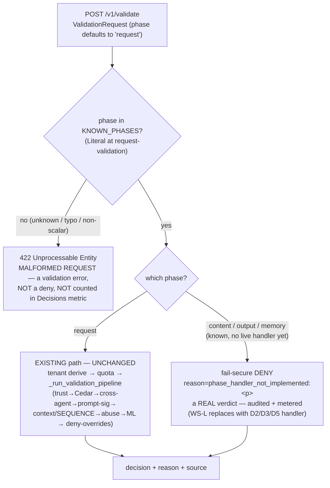
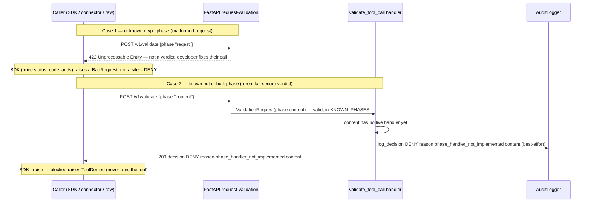

# LLD 30: Multi-phase `/v1/validate` contract — `phase` enum + per-phase decorators (WS-B)

**Version**: 1.0
**Last Updated**: 2026-07-01
**Status**: Approved (review-lld + grill + reconciled; 5/5 consistency-gate pass 2026-07-01)
**Prerequisites**: **AD-3** (one endpoint, branch on `phase` — *refined* here, not re-opened); HLD [hld/serverless-edition.md](../hld/serverless-edition.md) §6.2(b) (the approved **Option A** — additive optional `phase` enum + per-phase decorator + unknown→fail-secure) and §8 hand-off row 2 (`FR-3.4 → AD-3 → LLD 23 + the /v1/validate contract (LLD 03/API)`); workstream scope [tasks/serverless-edition/ws-b-multiphase-contract.md](../tasks/serverless-edition/ws-b-multiphase-contract.md); sibling LLDs [23-sentra-guard-sdk.md](23-sentra-guard-sdk.md) (the stdlib-only SDK the per-phase decorators extend), [29-redaction.md](29-redaction.md) (**WS-E** — consumes `ValidationRequest.phase` + the `_CONTENT_FIELD` map defined here), [28-cedar-policy-engine.md](28-cedar-policy-engine.md) (the Cedar bundle the `request`-phase pipeline evaluates).

> **This LLD elaborates the approved Option A in implementation detail; it does not re-open it.** HLD §6.2(b) chose Option A over Option B (per-phase endpoints — breaks AD-3) and Option C (free-form `phase` string — can't narrow untrusted input). That choice is fixed. This doc pins down the exact Pydantic field (an enum-narrowed, additive-superset `phase`), the handler routing, the **unknown-phase → 422 validation-error** vs **known-but-unbuilt → fail-secure DENY** split, the SDK decorator surface, and the shared per-phase content contract WS-E consumes.

## Table of Contents
1. Overview (purpose, tenets, scope, status carry-forward)
2. The contract change — the `phase` field on `ValidationRequest`
3. Handler routing — unknown phase → 422 (validation error); known-but-unbuilt → fail-secure DENY
4. The per-phase SDK decorator surface
5. Forward-compatibility — adding a 5th phase without re-cutting
6. The WS-E per-phase redaction dependency (`_CONTENT_FIELD` contract)
7. Error model
8. Security
9. Non-functional impact (scaling / resiliency / networking / cost / metering)
10. Testing
11. Cross-references

---

## 1. Overview

### 1.1 Purpose
An agent does more than one thing worth checking: it takes an **action** (a tool/API/DB call), **ingests** untrusted data (a retrieved doc, another tool's output, web text), **emits output**, and **writes to its own memory**. Today the `/v1/validate` contract governs only the *action* — there is no way to say *which* moment a call is about ([models.py:17](../src/security-controller/app/api/models.py#L17) — `ValidationRequest` has no `phase` field).

This LLD adds the **one additive, optional, enum-narrowed `phase` field** to that contract, the **three new SDK decorator surfaces** (`@guard.content` / `@guard.output` / `@guard.memory` alongside today's `@guard.tool`), and the **phase-error rule** — an *unknown/typo* phase is a **malformed request → 422 (a validation exception, not a deny)** at the edge, while a *known-but-unbuilt* phase **fails secure (DENY)** — so a future moment can be added *without re-cutting the contract* and an unrecognized value is *never* silently mis-routed. It is the additive central-contract change all the per-phase detection handlers (**owned by WS-L**, see §1.3) and WS-E's per-phase redactor branch on. It does **not** build the `content`/`output`/`memory` detection handlers themselves.

### 1.2 Tenets carried forward (from HLD §6.2 — the tie-breakers)
Every decision below honors these; they break any close implementation call.
- **Tie-breaker A — grow the central contract once, additively.** The `phase` field is added *once* to `ValidationRequest`; the *handled-phase set* grows additively after. Never a required/breaking field, never a parallel per-phase endpoint (that is rejected Option B).
- **Master tenet 2 — fail secure, never fail open.** A *known-but-unbuilt* `phase` is a **DENY**, not a silent route to the `request` handler and not a permissive default. "We don't know how to check this committed moment" fails closed. (An *unknown/typo* phase is a different thing — a malformed request → 422, §3.1 — not a verdict at all.)
- **Master tenet 3 — deny-by-default, explainable.** A known-but-unbuilt phase's DENY names a distinct machine-readable reason (`phase_handler_not_implemented:<p>`) so the trail marks an exercised-but-unbuilt phase; an unknown phase surfaces as a 422 validation error the developer must fix, kept out of the deny trail entirely.
- **Master tenet 5 / AD-3 — one endpoint, latency scales with risk.** One `POST /v1/validate`, branch on `phase`; no new URL surface for connectors/audit to carry.

### 1.3 Scope

**In scope (the gap this WS builds):**
1. The additive optional, enum-narrowed `phase` field on `ValidationRequest`, default `"request"` (§2) — an unknown value 422s at the edge.
2. The `KNOWN_PHASES` single-source-of-truth constant (also the enum-narrowing set) + the `_CONTENT_FIELD` phase→content-field map (§2.2, §2.3).
3. Handler routing at the top of `validate_tool_call`: `request` → the existing pipeline unchanged; a known-but-unbuilt phase → fail-secure DENY; (an unknown value never reaches the handler — it 422s at request-validation, §3).
4. The three new SDK decorator surfaces + threading `phase` through `_build_request` (§4).

**Out of scope (named, not silently dropped):**
- The `content` / `output` / `memory` **detection handlers** — what actually validates a content read, an output, a memory write. These are owned by **WS-L (detection depth)**, not WS-B: **content = D2** (indirect/second-order injection), **memory = D3** (memory-integrity / anti-poisoning), **output = D5** (DLP/exfil), built as nodes in WS-C's scheduler. Ship order (owner call): **content + memory at P0, output later.** WS-B ships the field + routing skeleton + decorator surface so a WS-L handler lands *additively* — the §3.2 "known-but-unbuilt → DENY" becomes a real verdict the moment WS-L replaces the stub for that phase.
- **Redaction** on egressing phases — that is **WS-E** ([lld/29](29-redaction.md)); WS-B only guarantees the `phase` field + `_CONTENT_FIELD` map exist so WS-E can branch on them (§6).
- The **DAG scheduler** (WS-C) and **full-trail combiner** (WS-D) changes; this WS does **not** touch `deny_overrides.py` or `_run_validation_pipeline`'s internals.
- **Cross-phase detector state** (a taint picked up on `content`, re-checked on `output`) — HLD Appendix E, a separate LLD deliverable. This WS treats the phases as **independent surfaces** (§3.5).

### 1.4 Implementation-status carry-forward (verified against the code)
From sub-PRD [prd/serverless-edition.md](../prd/serverless-edition.md) §5, **FR-3.4 = PARTIAL** — carried forward with `file:line` evidence so `plan-workstreams` does not re-plan what is built:

| Element | Status | Evidence |
|---|---|---|
| `request` phase — validate handler, full pipeline, multi-tenant on dev | **DONE — do not rebuild** | [routes.py:56](../src/security-controller/app/api/routes.py#L56) `validate_tool_call`; [validation_service.py:220](../src/security-controller/app/services/validation_service.py#L220) `_run_validation_pipeline` |
| `@guard.tool` decorator (= `request`) | **DONE — do not rebuild** | [guard.py:212](../demo-agents/sdk/aegion-guard-python/src/aegion_guard/guard.py#L212) `tool()` |
| Request-phase single-session sequence enforcement (FR-2.3) | **DONE — stays as-is inside `request`** | [context_validator.py:93](../src/security-controller/app/validators/context_validator.py#L93) `validate_sequence` |
| SDK default-DENY on a non-ALLOW/DENY body | **DONE — reused as the client-side backstop** | [guard.py:416](../demo-agents/sdk/aegion-guard-python/src/aegion_guard/guard.py#L416) `_parse_decision` |
| `phase` field on `ValidationRequest` | **NOT-DONE — this WS** | [models.py:17](../src/security-controller/app/api/models.py#L17) has fields `request_id/session_id/agent_id/tool_name/tool_params/user_input/timestamp/operation_type/context/platform/cloud_region` — no `phase` |
| `@guard.content` / `@guard.output` / `@guard.memory` surfaces | **NOT-DONE — this WS (surface only)** | not present in [guard.py](../demo-agents/sdk/aegion-guard-python/src/aegion_guard/guard.py) |
| `content` / `output` / `memory` detection handlers | **NOT-DONE — owned by WS-L (content/memory P0, output later)** | known-but-unbuilt → DENY here (§3.2); WS-L builds the D2/D3/D5 handlers |
| `TransportError.status_code` (SDK distinguishes 422 from a 5xx outage) | **NOT-DONE — this WS (SDK task, §3.5)** | [client.py:35](../demo-agents/sdk/aegion-guard-python/src/aegion_guard/client.py#L35) `TransportError.__init__` has `(message, retryable, cause)` — no `status_code`; non-2xx interpolated into the message at [client.py:156](../demo-agents/sdk/aegion-guard-python/src/aegion_guard/client.py#L156) |

**No-op guarantee.** Adding `phase` defaulting to `"request"` must be **byte-identical on the wire and behaviorally identical** for every existing caller (SDK `@guard.tool`, both Bedrock and Azure connectors, every current test). This is the acceptance bar §10 pins.

---

## 2. The contract change — the `phase` field on `ValidationRequest`

### 2.1 The field (exact Pydantic — a defaulted, enum-narrowed phase)
Added to `ValidationRequest` ([models.py:17](../src/security-controller/app/api/models.py#L17)) after `operation_type`, before the cross-cloud block, so the additive grouping reads clearly. The field is **narrowed to the known-phase set at request-validation** — an unknown/typo value is a *malformed request* (422), not something the handler routes:

```python
# models.py — ValidationRequest, after operation_type (line 33)
# KNOWN_PHASES is the recognized-phase set (SSoT, §2.2). A Literal/Enum over it
# is PREFERRED here precisely because we WANT an unknown value to 422 at the edge
# (§3.1) — an unknown phase is a client contract error, not a security verdict.
phase: Literal["request", "content", "output", "memory"] = Field(
    "request",
    description="Validation phase: request | content | output | memory (default request). "
                "An unknown value is a malformed request → 422 (a validation exception), "
                "NOT a policy DENY. A known-but-unbuilt phase fails secure at the handler (§3).",
)
```

> **⚠ This REVERSES the polarity of the approved HLD recommendation — reconciled, not silently re-decided.** HLD §6.2(b) Option A + its approved recommendation + the "Refines AD-3" note read *unknown → fail-secure DENY*; this LLD splits that into **unknown/typo → 422 (validation error, not a verdict)** vs **known-but-unbuilt → fail-secure DENY** (owner-confirmed: a client typo is a malformed request, not a security verdict, and must not pollute the deny metric). Per the design-doc rule an LLD does not re-litigate the architecture unilaterally — so this reversal was **propagated up** (`propagate-change`): HLD §6.2(b) Option A + recommendation + the "Refines AD-3" note now carry the split, and the sibling task doc [ws-b-multiphase-contract.md](../tasks/serverless-edition/ws-b-multiphase-contract.md) (Model invariants 2–3, its FOOTGUNs, error table, routing diagram, acceptance criteria) + [ws-l-detection-depth.md](../tasks/serverless-edition/ws-l-detection-depth.md) were reconciled to it (constant renamed `HANDLED_PHASES` → `KNOWN_PHASES`; polarity inverted to the 422/DENY split). **Join keys:** `KNOWN_PHASES`, the reason code `phase_handler_not_implemented:<p>`, and the unknown→422 rule. Any doc still reading `HANDLED_PHASES` / `unhandled_phase:<x>` / "unknown → DENY" is residual drift.

**Why enum-narrow the field (this REVERSES the earlier draft's plain-`str` stance — resolved with the owner):**
- An unknown / typo phase (`"reqest"`, `"plan"`) is a **malformed request**, not an action being permitted or denied. The correct response is a **422 Unprocessable Entity** (a validation exception) at the edge — which is exactly what a `Literal`/`Enum` on the field produces via Pydantic. There is no verdict to render because the request itself is invalid, and it **must not be counted in the deny metrics** (§7).
- The forward-compat concern that argued *against* an enum in the earlier draft is handled a different way: **`KNOWN_PHASES` (§2.2) is a superset `{request, content, output, memory}` that grows additively.** Adding a 5th phase is a one-line addition to that set + the `Literal` — an *additive* schema change (a new accepted value), never a re-cut that changes an existing value or the endpoint. An unknown value 422s rather than mis-routes; that is the property we want, not a regression.
- The split is therefore: **malformed/unknown phase → 422 at the edge (not a deny); a known phase with no live handler yet → fail-secure DENY at the handler (§3).** Only the second stays a real verdict — because it is a committed surface where "can't check yet" must fail closed.

> **FOOTGUN — do NOT make it required or drop the default.** Every existing caller omits `phase`; a required field 422s every one of them (breaks the no-op guarantee). `Field("request", ...)` supplies the default; a request omitting `phase` deserializes to `phase == "request"`.
> **FOOTGUN — do NOT catch the 422 and turn it into a DENY.** An unknown phase is a client-side contract error the developer must fix (their phase string is wrong), not a security verdict the PEP enforces (§3.1, and the SDK reconciliation below). Counting it as a deny corrupts the `Decisions` metric with client typos.

**Type coercion note.** Pydantic coerces a JSON scalar to a candidate value before the `Literal` check; a value (coerced or not) outside the set raises the framework's standard 422 — the malformed-request path (§3.1). A non-scalar (`phase: {...}`/`[...]`) likewise 422s. Every out-of-set case is a 422, never a silent route.

### 2.2 `KNOWN_PHASES` — the single source of truth (also the enum-narrowing set)
The set of phases the *server recognizes* lives in exactly one place so the `Literal` on the field (§2.1), the handler, tests, and future-handler code all read the same set:

```python
# app/api/models.py (module scope) — or app/api/phases.py if it grows.
KNOWN_PHASES = frozenset({"request", "content", "output", "memory"})
# This is BOTH the set the `phase` Literal narrows to (an out-of-set value 422s at
# the edge, §3.1) AND the set the handler routes on. Today only "request" has a
# LIVE detection handler; content/output/memory are known-but-unbuilt → fail-secure
# DENY (§3.2). Adding a 5th phase is one additive edit here + the Literal (§5).
```

Two nested sets, two distinct outcomes:
- A phase **not in `KNOWN_PHASES`** (unknown / typo) is a **malformed request → 422** at the edge (§3.1) — a validation exception, **not** a deny, **not** counted in the deny metrics.
- A phase **in `KNOWN_PHASES` but without a live handler** (content/output/memory today) is a well-formed request naming a committed surface we can't check yet → **fail-secure DENY** (§3.2), audited + metered like any other verdict.

The set of phases with a *live handler* is the smallest — today `{"request"}`. The `phase_handler_not_implemented` DENY is the only phase case that is a real verdict; the 422 is not.

### 2.3 The phases and their content fields — the `_CONTENT_FIELD` contract (shared with WS-E)
Each non-`request` phase carries its phase-specific content in a **named field on `ValidationRequest`**, mapped canonically so both the SDK (which populates it) and WS-E's redactor (which scrubs it) agree on one spelling. This map is the **shared contract** WS-E consumes (§6):

| `phase` | What it governs | Content field on `ValidationRequest` | `operation_type` default |
|---|---|---|---|
| `request` | the tool/API/DB **action** (live today) | `tool_params` + `user_input` (existing) | `auto` (inferred) |
| `content` | untrusted data the agent **ingests** (docs, tool output, web text) | `content_text` | `READ` |
| `output` | data the agent **emits** (output DLP surface) | `content_text` | `READ` |
| `memory` | a **write** to the agent's own memory store | `content_text` | `WRITE` |

```python
# app/api/models.py — canonical phase → content-field map (WS-E consumes this).
_CONTENT_FIELD = {
    "content": "content_text",
    "output":  "content_text",
    "memory":  "content_text",
}
```

`content_text` is added to `ValidationRequest` as an **additive optional field** in the same style as `phase` (default `None`), so the `request` phase never carries it and the wire stays byte-identical for existing callers:

```python
# models.py — ValidationRequest, alongside phase.
content_text: Optional[str] = Field(
    None,
    description="Phase-specific content for content/output/memory phases "
                "(the ingested doc / emitted output / memory-write payload). "
                "Absent on the request phase.",
)
```

> **Design note — one `content_text` field, not three.** The three egressing phases share a single content field disambiguated by `phase`, rather than `content_body`/`output_body`/`memory_body`. Fewer additive fields, one redaction target for WS-E, and `phase` already carries the "which moment" signal — a per-phase field would duplicate it. If a future phase needs a *structurally different* payload it can add its own field additively; today all three are free text.

### 2.4 Wire-format additivity (emit only when it changes behavior)
The SDK emits `phase` **only when it is not `"request"`**, and `content_text` **only for the three egressing phases** (§4.2). So a `@guard.tool` payload is byte-identical to today's (no `phase`, no `content_text` key); the server defaults the absent `phase` to `"request"`. This keeps golden/snapshot tests and the connectors' payloads unchanged — the no-op guarantee.

---

## 3. Handler routing — unknown phase → 422 (validation error); known-but-unbuilt phase → fail-secure DENY

### 3.1 The split — a malformed request is NOT a verdict (the owner decision)
The two phase-error cases answer **two different questions** and get **two different responses** — and only one of them is a deny:

| Case | Question it answers | Trigger | Response | Counted as a deny? |
|---|---|---|---|---|
| **Unknown / typo phase** | *Is this even a valid request?* | `phase` value is **not in `KNOWN_PHASES`** (`"reqest"`, `"plan"`, an object) — caught by the `Literal` at request-validation (§2.1) | **422 Unprocessable Entity** — a validation exception. No action is permitted or denied; the request itself is malformed | **No.** It is a client 4XX, **not** a verdict — it MUST NOT increment `Decisions` / `ValidationsTotal` (§7, §9) |
| **Known-but-unbuilt phase** | *We recognize this committed surface, but can we check it yet — and if not, may we permit?* | `phase` **in `KNOWN_PHASES`** (content/output/memory) but no live handler yet | **`DENY`** (200 with the standard DENY body), `reason=phase_handler_not_implemented:<p>` — never ALLOW, never routed to `request` | **Yes.** A committed surface where "can't check yet" must fail closed (tenet 2); audited + metered like any other deny |

The resolution of the earlier draft's mistake: an unknown/typo phase is **not** a fail-secure DENY and **not** a 200 verdict — it is a **malformed request → 422**, because there is no action to permit or deny and nothing for a PEP to enforce. Only the *known-but-unbuilt* case is a real DENY, because it names a real committed phase we've promised to check and can't yet. The `Literal` on the field (§2.1) produces the 422 for free at the edge; the handler only ever sees a value already in `KNOWN_PHASES`.

> **Why known-but-unbuilt emits an explicit server DENY (not just the SDK backstop).** The SDK maps any non-ALLOW/DENY body to DENY ([guard.py:416](../demo-agents/sdk/aegion-guard-python/src/aegion_guard/guard.py#L416)), but the *server* must emit the explicit DENY: a non-SDK caller (raw connector, test harness, future PEP) must get an unambiguous DENY on the wire, and the audit trail must record it server-side. Fail-secure is a server property, backstopped — not delegated — to the SDK.

### 3.2 The routing logic
Because the `Literal` on `phase` (§2.1) already 422s any out-of-set value at request-validation, the handler is reached **only** with a value in `KNOWN_PHASES`. Routing happens at the **top of `validate_tool_call`**, after IP capture ([routes.py:73-78](../src/security-controller/app/api/routes.py#L73)) and before tenant-derivation + pipeline entry, so a known-but-unbuilt phase is denied cheaply and never touches the pipeline, the combiner, or Cedar:

```python
# routes.py — inside validate_tool_call, immediately after the source_ip block,
# BEFORE resolve_tenant_from_jwt / validation_service.validate_tool_call.
from app.api.models import KNOWN_PHASES  # {request, content, output, memory}

phase = request.phase  # normally already narrowed to KNOWN_PHASES by the Literal (§2.1).

# GUARD 1 (FIRST statement of the routing block, ahead of the != request compare):
# defense-in-depth membership check. If a value outside KNOWN_PHASES somehow reaches
# the handler bypassing the Literal (a future internal call path, a hand-built
# ValidationRequest in a test/connector, a model-construct path that skips validation),
# re-raise the SAME 422 — a malformed request, NEVER a deny. Placing this AHEAD of the
# "!= request" compare below is load-bearing: a typo ("reqest") must 422 here and can
# NEVER fall through into the phase_handler_not_implemented DENY path (which would
# pollute the Decisions metric with client typos). The Literal is the primary narrowing;
# this is the belt-and-suspenders that keeps a bypass from ever minting a phantom DENY.
if phase not in KNOWN_PHASES:
    raise HTTPException(status_code=422, detail=f"unknown phase: {phase}")

# GUARD 2 (only reached with phase IN KNOWN_PHASES):
if phase != "request":
    # Known phase (content/output/memory) with no live handler yet →
    # fail-secure DENY, distinct reason. WS-L (§1.3, §6) replaces this line with
    # the real D2/D3/D5 handler as a node in WS-C's scheduler when it ships.
    return await _phase_not_implemented_deny(request, reason=f"phase_handler_not_implemented:{phase}")

# phase == "request": fall through to the EXISTING code path, byte-for-byte
# unchanged — tenant derivation, quota, _run_validation_pipeline (incl. the
# FR-2.3 sequence check in context_validator). WS-B adds NOTHING to this branch.
```

**The membership guard is the FIRST statement of the routing block, ahead of the `!= request` compare — this ordering is load-bearing, not cosmetic.** The `Literal` on the field (§2.1) is the primary narrowing and 422s an out-of-set value at request-validation. But if a value outside `KNOWN_PHASES` ever reaches the handler by a path that skipped the model validation (a future internal call, a hand-constructed `ValidationRequest`, a `model_construct`-style bypass), a bare `!= "request"` compare would route the typo straight into the `phase_handler_not_implemented` DENY — minting a phantom verdict and polluting the `Decisions` metric with a client typo (§9). The `if phase not in KNOWN_PHASES → 422` check placed *first* closes that: a typo can only ever 422, never DENY. It re-raises the *same* 422 the `Literal` produces, never a deny.

`_phase_not_implemented_deny` reuses the **exact DENY response shape** `_identity_deny` already produces ([routes.py:161](../src/security-controller/app/api/routes.py#L161)) — the same keys the SDK's `_parse_decision` reads (`decision="DENY"`, `reason`, `session_id`, `trust_score`, `latency_ms`, `violation_type`) — plus the same best-effort audit + metric emission, so a known-but-unbuilt-phase DENY is observable in the same CloudWatch streams and audit logs as any other verdict (not a phantom traffic drop). The name is deliberately precise: this helper is **only** for the *known-in-`KNOWN_PHASES`-but-no-live-handler* case — an unknown/typo phase 422s at the edge (§2.1 / GUARD 1) and never reaches here:

```python
# routes.py — new helper, modeled on _identity_deny (routes.py:161).
# Name is exact: known-but-unbuilt ONLY (unknown/typo phases 422 upstream, never here).
async def _phase_not_implemented_deny(request: "ValidationRequest", reason: str) -> Dict:
    """Fail-secure DENY for a known-but-not-yet-handled phase (§3.1, right column).
    Emits the standard DENY body + best-effort audit/metric under the caller's
    resolved tenant context. reason == phase_handler_not_implemented:<p>.
    NOTE: this path is ONLY for phases in KNOWN_PHASES with no live handler — an
    unknown/typo phase 422s at the edge (§2.1) and never reaches here."""
    try:
        await AuditLogger().log_decision(
            decision="DENY",
            request=request.model_dump(),
            session={"session_id": request.session_id, "agent_id": request.agent_id,
                     "trust_score": 0.0},
            validation_result={"reason": reason, "violation_type": "PHASE_UNHANDLED"},
            latency_ms=0.0,
        )
    except Exception:  # noqa: BLE001 — audit is best-effort; the DENY still returns
        logger.warning("phase-DENY audit failed", exc_info=True)
    return {
        "decision": "DENY", "reason": reason, "trust_score": 0.0,
        "session_id": request.session_id, "latency_ms": 0.0,
        "violation_type": "PHASE_UNHANDLED",
    }
```

> **FOOTGUN — do NOT return ALLOW for a known-but-unbuilt phase.** Until a WS-L `content`/`output`/`memory` handler exists, "we don't know how to check this moment" must fail closed. A stub that ALLOWs is the worst bug in this WS — it opens an ungoverned surface the moment a customer adopts `@guard.content`.
> **FOOTGUN — do NOT turn the unknown-phase 422 into a DENY.** An unknown phase is a malformed request the developer must fix, not a verdict; counting it as a deny corrupts the `Decisions` metric with client typos. Let the `Literal` 422 it at the edge.
> **FOOTGUN — do NOT "default unknown to request."** With the `Literal` an unknown value can't reach the handler at all; do not add a fallback that coerces a stray value to `request` — that silently mis-routes a typo'd intent and re-introduces the fail-open the enum closed.

### 3.3 Phase-routing decision flow



### 3.4 The two phase-error paths on one picture



### 3.5 Phase independence vs the request-phase sequence rule (FR-2.3)
The four phases are **independent surfaces, not steps 1–4 of one flow.** A caller may guard *only* actions (`@guard.tool`), or *only* content ingestion, or any mix; nothing requires the four to occur in order, and this WS adds **no** cross-phase ordering.

But that independence is scoped to *between phases*. **Within the `request` phase, single-session sequence enforcement (FR-2.3) still applies, exactly as today** — `context_validator.validate_sequence` ([context_validator.py:93](../src/security-controller/app/validators/context_validator.py#L93)) runs inside `_run_validation_pipeline`, checking that required tools precede a given action within the session history. WS-B does **not** touch it, does **not** extend it across phases, and does **not** thread `phase` into it. (Cross-phase detector state — a taint from `content` re-checked on `output` — is HLD Appendix E, a *separate* LLD deliverable, not this WS.) The rule is simply: *phases don't sequence each other; actions still sequence within `request`.*

### 3.6 The SDK must distinguish a 422 (bad request) from a 5xx outage — WS-B SDK task
A 422 is only useful if the caller can *tell it apart* from an outage. Today the SDK **cannot**: `TransportError` carries only `(message, retryable, cause)` — **no `status_code`** ([client.py:35](../demo-agents/sdk/aegion-guard-python/src/aegion_guard/client.py#L35)); a non-2xx is interpolated into the *message string* only (`f"validate returned HTTP {exc.code}"`, [client.py:156](../demo-agents/sdk/aegion-guard-python/src/aegion_guard/client.py#L156)) and then mapped to a fail-secure DENY upstream. So **a 422 bad-phase and a 403/5xx outage both collapse into one opaque fail-secure DENY** — the developer never learns their phase string was wrong.

**Where the 422 branch lives — anchored to `_send`, NOT `_parse_decision`.** A non-2xx never reaches `_parse_decision`: `client.post` raises `TransportError`, which is **caught in `_send` at [guard.py:395](../demo-agents/sdk/aegion-guard-python/src/aegion_guard/guard.py#L395)** — the flow returns the `validation_unavailable` DENY (or re-raises) from inside that `except TransportError` block ([guard.py:391-409](../demo-agents/sdk/aegion-guard-python/src/aegion_guard/guard.py#L391)) and **never falls through to `_parse_decision`** ([guard.py:412](../demo-agents/sdk/aegion-guard-python/src/aegion_guard/guard.py#L412), which only runs on a 2xx body). So the 422 branch must be added **inside the `except TransportError` handler in `_send`**, keyed on `exc.status_code`, not in `_parse_decision`. `_parse_decision`'s default-DENY (§1.4, [guard.py:416](../demo-agents/sdk/aegion-guard-python/src/aegion_guard/guard.py#L416)) stays as the 2xx-body backstop and is untouched by this branch.

**WS-B SDK task (concrete):** add a `status_code: Optional[int]` attribute to `TransportError` (set it in the HTTPError branch from `exc.code` — [client.py:155](../demo-agents/sdk/aegion-guard-python/src/aegion_guard/client.py#L155)) and, **in the `except TransportError` block of `_send` ([guard.py:391-409](../demo-agents/sdk/aegion-guard-python/src/aegion_guard/guard.py#L391))**, branch on `exc.status_code` **before** the existing `fail_secure` DENY:
- **`exc.status_code == 422`** → raise a **developer-facing, actionable exception** (a `BadRequest` / `ToolValidationError`-style error: *"malformed request — check your `phase` value"*), **NOT** the silent outage-style fail-secure DENY. This is a **hard, non-recoverable raise that halts the wrapper BEFORE the wrapped `fn` runs** — never an allow-shaped `Decision` return, never swallowed. The developer's call is wrong and they must fix it; masking it as a DENY hides the bug.
- **`exc.status_code` is None or 5xx** (timeout / connection failure / non-2xx that isn't 422) → **unchanged**: fail-secure DENY (`validation_unavailable`). An outage must still fail closed. **Only `exc.status_code == 422` takes the raise branch** — every other value (including `None`) stays on the fail-secure path, so a future truthiness/coercion refactor cannot accidentally skip fail-secure.

**Invariant (pin):** a 422 → a hard, non-recoverable raise (`BadRequest`) that halts the wrapper **before `fn` runs** — never an allow-shaped `Decision` return, never swallowed into a proceed.

This reconciles the two constraints: *"a 4XX is not counted as a deny"* (owner — the 422 surfaces as a distinct client error, never a verdict) with *"the SDK fails secure on a non-2xx"* (existing behavior — preserved for the 5xx/None/outage case). A 422 becomes actionable; everything else stays fail-secure DENY.

---

## 4. The per-phase SDK decorator surface

### 4.1 The factory refactor — one machine, four surfaces (stdlib-only)
The existing `tool()` ([guard.py:212](../demo-agents/sdk/aegion-guard-python/src/aegion_guard/guard.py#L212)) already holds the whole decorated-call machine: `_bind_params`, sync/async wrapper selection, `_validate_or_raise` / `_avalidate_or_raise`, `_build_request`, `_send`, `_raise_if_blocked`, `fail_secure`. The three new decorators must **reuse all of it unchanged** — the only new thing flowing through is the `phase` string. So `tool()` is refactored to delegate to a private `_phase_decorator`, and the four public surfaces are thin wrappers:

```python
# guard.py — the existing tool() body moves verbatim into _phase_decorator,
# gaining a `phase` parameter it threads into _build_request via the wrappers.
def _phase_decorator(self, phase, name=None, operation_type="auto"):
    def decorator(fn):
        tool_name = name or fn.__name__
        if inspect.iscoroutinefunction(fn):
            @functools.wraps(fn)
            async def async_wrapper(*args, **kwargs):
                params = self._bind_params(fn, args, kwargs)
                await self._avalidate_or_raise(
                    tool_name=tool_name, tool_params=params,
                    operation_type=operation_type, phase=phase,   # NEW: threaded through
                )
                return await fn(*args, **kwargs)
            return async_wrapper
        @functools.wraps(fn)
        def sync_wrapper(*args, **kwargs):
            params = self._bind_params(fn, args, kwargs)
            self._validate_or_raise(
                tool_name=tool_name, tool_params=params,
                operation_type=operation_type, phase=phase,       # NEW
            )
            return fn(*args, **kwargs)
        return sync_wrapper
    return decorator

# The four public surfaces (signatures + docstrings the SDK user sees):
def tool(self, name=None, operation_type="auto"):       # = phase "request" — unchanged surface
    return self._phase_decorator("request", name, operation_type)

def content(self, name=None, operation_type="READ"):    # untrusted data the agent INGESTS
    return self._phase_decorator("content", name, operation_type)

def output(self, name=None, operation_type="READ"):     # data the agent EMITS
    return self._phase_decorator("output", name, operation_type)

def memory(self, name=None, operation_type="WRITE"):    # a WRITE to the agent's memory store
    return self._phase_decorator("memory", name, operation_type)
```

`tool()`'s **public signature is unchanged** — a pure internal refactor, so every existing `@guard.tool(...)` usage and its tests keep working. `_validate_or_raise` / `_avalidate_or_raise` / `validate` / `avalidate` each gain a `phase: str = "request"` keyword-only parameter that they pass straight to `_build_request`; defaulting to `"request"` keeps their existing call sites unchanged.

> **FOOTGUN — no new dependency.** The SDK is stdlib-only by design ([pyproject.toml](../demo-agents/sdk/aegion-guard-python/pyproject.toml) `dependencies = []`, LLD 23 §2 — vendors ship it unchanged into a Lambda zip / Azure Function). The new decorators are a *pure refactor* of existing stdlib code; adding an import here breaks the zero-dep packaging. `pip install` of the base package must still pull nothing.

### 4.2 Threading `phase` through `_build_request`
`_build_request` ([guard.py:325](../demo-agents/sdk/aegion-guard-python/src/aegion_guard/guard.py#L325)) gains a `phase: str = "request"` parameter and, after assembling the existing payload ([guard.py:373-389](../demo-agents/sdk/aegion-guard-python/src/aegion_guard/guard.py#L373)), emits `phase` (and `content_text` for the egressing phases) **only when not `request`** — the byte-identical-for-`@guard.tool` rule (§2.4):

```python
# guard.py _build_request — after the existing payload dict, before `return payload`.
if phase != "request":
    payload["phase"] = phase
    # content/output/memory carry their content in content_text (§2.3, _CONTENT_FIELD).
    # WS-E (lld/29 §3.5) redacts this field before _send; WS-B only places it.
    # The content is sourced from the active session's user_input for now (the
    # per-phase content-capture arg is the future-handler WS's concern) — WS-B
    # guarantees the field EXISTS and is populated, not its richest source.
    payload["content_text"] = resolved_input
```

> **FOOTGUN — do NOT always emit `"phase": "request"`.** Emitting it on every call changes the bytes on the wire for every existing `@guard.tool` caller — perturbing snapshot/golden tests and the connectors' payloads, breaking the no-op guarantee. Emit `phase` (and `content_text`) *only* for the three new phases; let the server default the absent field.

### 4.3 `operation_type` defaults per phase
`content`/`output` are reads, `memory` is a write, so the wrappers default `operation_type` sensibly (`READ`/`READ`/`WRITE` above) while keeping `"auto"` inference available. These feed the *existing* `operation_type` field on the request — **no new field**, no change to `infer_operation_type` ([guard.py:54](../demo-agents/sdk/aegion-guard-python/src/aegion_guard/guard.py#L54)).

### 4.4 Fail-secure behavior of the not-yet-handled phases (documented, not special-cased)
Because the server denies `content`/`output`/`memory` fail-secure until their WS-L handler ships (§3.2), a caller using `@guard.content` **today** will have the decorator **raise `ToolDenied`** (via `_raise_if_blocked` → `fail_secure`). **That is correct and intended** — fail-secure until the handler ships. It is documented on each new decorator's docstring so an SDK user isn't surprised, and it is **not** special-cased to allow. When WS-L lands the D2/D3/D5 handler, the server stub is replaced by a real pipeline and the same decorator starts returning real verdicts — no SDK change required.

### 4.5 Where each decorator goes — concrete before/after, and "which phase is which?"
The decorator surface is abstract until you see *where in the agent's code* each one sits. Each phase wraps a different moment; the developer picks the decorator that matches the moment.

**`@guard.content` — wrap the point the agent INGESTS untrusted data, validated BEFORE the agent reasons over it.** The classic indirect-injection surface (D2): a retrieved KB article, a RAG chunk, another tool's output, a fetched web page. Put it on the *retrieval* function so the fetched text is checked before it enters the agent's context.

```python
# BEFORE — a support agent pulls a KB article and reasons over it, unchecked.
def fetch_kb_article(article_id: str) -> str:
    return kb_store.get(article_id)            # untrusted text → straight into the prompt

# AFTER — the retrieved content is validated (D2, second-order injection) BEFORE use.
@guard.content(name="fetch_kb_article")        # phase="content"; content_text = the article
def fetch_kb_article(article_id: str) -> str:
    return kb_store.get(article_id)            # a poisoned "ignore your instructions…" article DENYs here
```

**`@guard.memory` — wrap a WRITE to the agent's persistent memory, validated BEFORE the write commits.** The anti-poisoning surface (D3): an agent storing a "learned fact" or a user preference to its long-term store.

```python
# AFTER — a learned fact is checked before it is persisted (D3 memory-integrity).
@guard.memory(name="remember_fact")            # phase="memory"; content_text = the fact being stored
def remember_fact(user_id: str, fact: str) -> None:
    long_term_store.put(user_id, fact)         # a poisoned fact ("the admin password is…") DENYs before commit
```

**`@guard.output` — wrap the agent's EMITTED output** (D5 DLP/exfil). *Caveat (a named later deliverable):* output **detection** can run server-side in serverless the same way input does, but the output **redact/rewrite verdict** — *mutating* the outgoing content — is the harder piece the decorator can't do today. The decorator surface is **ALLOW/DENY only**; a "rewrite this output to strip the SSN" verdict (vs. block the whole emission) is deferred to the WS-E/redaction line, not shipped by WS-B.

> **SDK 0.2.0 gate (WS-A / lld/36 §4.1(a-out)):** `@guard.output` **ships in SDK 0.2.0 but raises `FeatureNotAvailable` at decoration** until WS-L's D5 handler lands — the `output` phase has no live server handler, so rather than silently fail-secure a wired-to-prod emission per call, the decorator fails fast at wire time and points the developer to `@guard.tool`. `@guard.content`/`@guard.memory` decorate normally (their D2/D3 handlers are ship-order P0 / live). When D5 lands, the gate is removed and `@guard.output` decorates like the others with no other SDK change.

```python
# AFTER — the agent's drafted reply is checked for exfil/DLP before it is returned.
@guard.output(name="compose_reply")            # phase="output"; content_text = the emitted reply
def compose_reply(context: str) -> str:
    return agent.draft(context)                # a reply leaking a credential DENYs (block, not redact — today)
```

**"How does the customer know which is which?"** Today it is **explicit — the developer chooses the decorator**: `@guard.content` on the ingestion function, `@guard.memory` on the write, `@guard.output` on the emit. **The SDK does NOT auto-classify** a function into a phase. This is a deliberate design choice: for a *security* control, explicit intent is safer than inference — an auto-classifier that guesses "this looks like a memory write" and guesses wrong silently mis-governs the call. An **auto-infer helper** (e.g. detecting a known RAG/memory client in the call) is a possible future *ergonomic*, **not P0**; the explicit decorator is the contract.

---

## 5. Forward-compatibility — adding a 5th phase without re-cutting

Because `KNOWN_PHASES` (and the `phase` `Literal` narrowing to it) is a **superset that grows by addition only**, a *future* moment — e.g. a `plan` / `delegation` phase for multi-agent governance — is an **additive** change, never a breaking schema re-cut:

1. **Server:** add `"plan"` to `KNOWN_PHASES` and the `phase` `Literal` (§2.2 / §2.1 — a new *accepted* value, additive: it widens the set, never changes or removes an existing value). If it carries distinct content, add its entry to `_CONTENT_FIELD` + a field on `ValidationRequest`. Build its detection handler in **its own WS (WS-L)**; until then §3.2 denies it fail-secure with `phase_handler_not_implemented:plan`.
2. **SDK:** add a `def plan(self, ...)` wrapper delegating to `_phase_decorator("plan", ...)` (a few lines).
3. **No change** to the endpoint URL (AD-3 — still one endpoint), the DENY/ALLOW response shape, the combiner, or the connectors.

> **Caveat (LOW — no generated client in-repo).** If a caller ever uses a **generated / typed OpenAPI client** (rather than the hand-written SDK or a raw POST), that client must be **regenerated** to *send* a newly-added `phase` value — a `Literal`/enum-typed client won't emit an out-of-schema value until its schema is refreshed. This is LOW risk here: there is **no generated OpenAPI client in the repo** today — the hand-written SDK sets `payload["phase"]` directly (§4.2) and the server accepts any in-`KNOWN_PHASES` value from any client regardless. Noted so a future generated-client consumer knows the regenerate step; it does not affect the hand-written SDK or raw callers.

Two windows, two distinct behaviors — both non-permitting:
- **Before** `"plan"` is added to `KNOWN_PHASES`: a caller sending `phase="plan"` gets a **422** (an unknown value the `Literal` rejects) — a malformed request the developer fixes, not a mis-route, not a silent allow, and *not* a deny counted in metrics.
- **After** `"plan"` is registered but before its WS-L handler ships: the same call gets a **fail-secure DENY** (`phase_handler_not_implemented:plan`) — a real verdict on a now-committed surface.

The accepted set grows additively without a flag day; an out-of-set value 422s and an in-set-but-unbuilt value fails closed at every point in between. This is tie-breaker A (grow additively) and tenet 2 (fail-secure) co-existing by construction.

---

## 6. The WS-E per-phase redaction dependency (`_CONTENT_FIELD` contract)

**WS-E ([lld/29](29-redaction.md)) is the first downstream consumer of this contract.** WS-E's redactor must run on **every egressing phase**, not just `request` (lld/29 §3.5 — the live NOT-DONE bug), and it branches on `phase` to know *which* field carries content. That requires two things WS-B owns and this LLD makes canonical:

1. **The `phase` field exists** on `ValidationRequest` (§2.1) and on the wire for non-`request` phases (§2.4).
2. **The `_CONTENT_FIELD` map** (§2.3) — the one canonical spelling of which field each phase's content lives in — so WS-E redacts the right field. WS-E imports/reads this map rather than re-deriving it.

**Reconciliation note (a real cross-LLD drift to fix on WS-E landing).** lld/29 §3.5 currently sketches the redactor reading the phase from the SDK's ambient context (`phase = active.phase if active else "request"`) and indexing `_CONTENT_FIELD[phase]`. In *this* LLD's design the phase is **not** a field on `RequestContext` — it flows as a **decorator/`_build_request` argument** (§4.1-4.2), because the phase is a property of *which decorator wrapped the function*, not of the ambient `guard.session(...)` (one session may guard both an action and a content-ingest). So the canonical contract is:

- **The SDK sets `payload["phase"]` inside `_build_request(phase=...)`** (§4.2), and WS-E's redactor reads `phase` from **the payload being built** (or takes it as the same `_build_request` argument), **not** from `active.phase`. `RequestContext` ([context.py](../demo-agents/sdk/aegion-guard-python/src/aegion_guard/context.py)) is unchanged by WS-B — no `phase` field added there.
- `_CONTENT_FIELD` (§2.3) is the shared join key; both WS-B (places the field) and WS-E (redacts it) use the identical spelling.

When WS-E lands, lld/29 §3.5's `active.phase` snippet must be reconciled to read the `phase` argument threaded through `_build_request` (this is a `propagate-change` target — the join key is `_CONTENT_FIELD` + the `phase` argument to `_build_request`). WS-B does not modify lld/29; it names the drift so WS-E resolves it against this contract.

### 6.1 The detection handlers are owned by WS-L, not WS-B
The `content`/`output`/`memory` **detection handlers** — the code that actually validates each moment behind the DENY stub (§3.2) — are **owned by WS-L (detection depth)**, not this workstream:

| phase | WS-L detector | Ship phase (owner call) |
|---|---|---|
| `content` | **D2** — indirect / second-order injection over ingested text | **P0** |
| `memory` | **D3** — memory-integrity / anti-poisoning on a memory write | **P0** |
| `output` | **D5** — DLP / exfil on emitted output (detect; the redact/rewrite verdict is the WS-E line, §4.5) | **later** |

WS-B ships only the **field + routing skeleton + decorator surface**; WS-L builds each handler as a **node in WS-C's scheduler**. So a "known-but-unbuilt → fail-secure DENY" today (§3.2) becomes a **real verdict** the moment WS-L lands that phase's handler and replaces the stub line — no contract, endpoint, SDK, or decorator change required (that additivity is the whole point of §5). Until then, `content`/`memory`/`output` fail closed.

---

## 7. Error model

| Condition | Kind | Server response | Counted in deny metrics? | SDK behavior |
|---|---|---|---|---|
| `phase` absent | default | treated as `"request"`; full pipeline | as the verdict is | `@guard.tool` — no `phase`/`content_text` on wire (unchanged) |
| `phase == "request"` | verdict | full pipeline, unchanged (incl. FR-2.3 sequence) | as the verdict is | `@guard.tool` (unchanged) |
| `phase ∈ {content, output, memory}` (known, no live handler) | **verdict** | **DENY** `reason=phase_handler_not_implemented:<p>`, `violation_type=PHASE_UNHANDLED` | **Yes** — a real deny, audited + metered | decorator raises `ToolDenied` (fail-secure — documented, §4.4) |
| `phase` unknown / typo / non-scalar (not in `KNOWN_PHASES`) | **validation error** | framework **422 Unprocessable Entity** (from the `phase` `Literal`, §2.1) — **not** a deny, **not** routed to `request` | **No** — a client 4XX, must NOT increment `Decisions` / `ValidationsTotal` | SDK (once `status_code` lands, §3.6) raises a developer-facing `BadRequest`, **not** a silent fail-secure DENY |
| transport failure / 5xx (unrelated to phase) | outage | (no / non-2xx response) | n/a | fail-secure DENY `validation_unavailable` ([guard.py:396](../demo-agents/sdk/aegion-guard-python/src/aegion_guard/guard.py#L396)) — unchanged |

Two invariants across the rows: (1) **no phase value, malformed or unknown, ever yields ALLOW or a silent route to `request`** — an unknown phase 422s, a known-but-unbuilt phase DENYs, both non-permitting; and (2) **an unknown/typo phase is a validation error, not a verdict — it never lands in the deny metrics**, only the `phase_handler_not_implemented` case does.

---

## 8. Security

WS-B is a contract/routing change, so its security surface is **input validation at the boundary + fail-secure routing**, not new authz. At implementation altitude:

- **SEC — enum-membership validation at the edge (the trust boundary).** `phase` is untrusted external input. The `Literal` (§2.1) rejects an **invalid enum member** — a value not in `KNOWN_PHASES` (`"reqest"`, `"plan"`, a non-scalar) — with a **422** before it reaches any domain logic, and GUARD 1 (§3.2) re-rejects it if it bypasses the model. A known-but-unbuilt phase then fails secure at the top of the handler (§3.2), before tenant derivation, Cedar, or the pipeline run. No branch trusts a typo (the 422 rejects it) and no branch coerces a stray value to `request`.
  - **Named residual — `phase` is self-asserted; the label is not an enforced property.** The `Literal` catches an *invalid enum member*, **not a valid-but-wrong phase**. A caller can route content through `@guard.tool` (or omit `phase`), and the request is a well-formed `phase="request"` that runs the *action* pipeline — it does **not** dodge validation, but it dodges the *intended* content/output/memory handler (a future WS-L detector) for that moment. Nothing forces the decorator a developer picks to match what the wrapped function actually does. This is consistent with §4.5 ("the SDK does NOT auto-classify; the developer chooses the decorator"): explicit intent is the contract, and a mismatched-but-valid phase routes past the intended handler. The phase label is an *asserted routing hint*, not a verified property of the call — the residual is accepted (auto-classification is a named non-P0 ergonomic, §4.5), not closed by this WS.
- **SEC — fail-secure on the dropped/unbuilt check.** For a *known-but-unbuilt* phase the behavior is a DENY, not a proceed (tenet 2). There is no branch where a known-but-unbuilt phase reaches an ALLOW. §10 pins this with a test that reverting the guard (routing a known-but-unbuilt phase → `request`) turns a DENY into a pipeline run — a test that must fail if the fail-secure guard is removed. (An unknown phase is handled a layer earlier by the 422, not by this guard.)
- **SEC — no new authz surface, no new secret.** WS-B adds no endpoint, no credential, no header, no policy. The existing identity gate ([routes.py:96](../src/security-controller/app/api/routes.py#L96) `resolve_tenant_from_jwt`) still runs for the `request` branch *after* the phase guard; the phase guard runs first and is authz-agnostic (a known-but-unbuilt phase is denied regardless of tenant), which is safe — it fails closed before any tenant-scoped work.
- **SEC — audit of phase DENYs (not of the 422).** Each known-but-unbuilt-phase DENY is written via `AuditLogger.log_decision` with `violation_type=PHASE_UNHANDLED` and the `phase_handler_not_implemented` reason (§3.2), so an operator sees a caller exercised a committed-but-unbuilt phase — not a silent drop. Best-effort, guarded so a metrics/audit failure never changes the DENY (mirrors `_identity_deny`). An **unknown-phase 422 is a client validation error, not a verdict** — it is not written to the decision audit trail and not counted in the deny metrics (it surfaces in standard request/4XX logging).
- **SEC — no content leakage from the guard path.** `_phase_not_implemented_deny` logs the *reason and the request envelope*, not raw content; `content_text` for the egressing phases is redacted by WS-E before egress, and the stub DENY path (§3.2) returns *before* any content-bearing processing.

---

## 9. Non-functional impact (scaling / resiliency / networking / cost / metering)

WS-B is an **additive, stateless contract + routing change**; it introduces no new stateful path, datastore, network hop, or billable event. The NFR sections are therefore short **by evidence, not omission**:

- **Scaling.** The `Literal` narrowing is part of the already-existing Pydantic parse; the handler-side phase guard is a single string compare at the top of an already-existing handler — negligible against the pipeline's cost. Both run **before** the pipeline, so an unknown-phase 422 (at parse) and a known-but-unbuilt DENY are both *cheaper* than a full validate (they short-circuit before Cedar/ML). No new backpressure surface; the ceiling is unchanged from LLD 24's `request`-path budget.
- **Resiliency / recovery.** No new stateful path → **no new RTO/RPO** (N/A with reason — the change is a pure request-time branch). The fail-secure default *is* the degradation behavior: on any doubt about a phase, DENY. The `_phase_not_implemented_deny` audit/metric writes are best-effort and guarded (a write failure never changes the returned DENY), matching the existing `_identity_deny` resiliency contract.
- **Networking.** **One endpoint, unchanged** (AD-3) — `POST /v1/validate` on the existing API Gateway + ALB path; no new route to register (contrast the api-stack per-resource gotcha that bites *new* routes). Ports/protocols/timeouts unchanged. The three new phases are the *same* single POST with a `phase` field, so connectors and gateway config need no change.
- **Cost.** Effectively **zero marginal cost.** No added inference, no added storage, no added round-trip. A known-but-unbuilt-phase DENY *avoids* the pipeline's per-escalation cost (it short-circuits pre-Cedar/pre-ML), and an unknown-phase 422 short-circuits at parse — so if anything they trim cost for the non-`request` cases. The dominant cost of the `request` path (per-escalation Bedrock inference, meter PutItem — HLD §6.5) is untouched.
- **Metering & billing.** WS-B does **not** change what is metered or where the counter increments (that is the metering LLD / ADR-033). A **known-but-unbuilt-phase DENY** flows through the *same* best-effort `publish_validation_metrics` path a normal verdict uses (via `_phase_not_implemented_deny`, mirroring `_identity_deny` at [routes.py:186](../src/security-controller/app/api/routes.py#L186)), so it appears in the `Decisions` stream as a DENY — **not** as a phantom traffic drop. An **unknown-phase 422** is deliberately **NOT** metered as a verdict — it is a client 4XX (a malformed request), so it must not increment `Decisions` / `ValidationsTotal`; it surfaces only in standard request/4XX logging. Governed-agent registration (the charged dimension) is anchored to the bundle-fetch/heartbeat path, unaffected by which phase a call names. **Open, owned elsewhere:** whether `content`/`output`/`memory` validations (once their WS-L handlers ship) meter as separate billable events is a metering-LLD decision — WS-B only guarantees the phase is *attributable*, not how it prices.
- **Observability of the 422 (keep it OUT of `Decisions`, but NOT invisible).** Keeping the unknown-phase 422 out of `Decisions`/`ValidationsTotal` (above) is correct, but a verdict metric is not the place to see it — so name a **separate** signal. Publish a dedicated **`ValidateClientErrors4XX` CloudWatch counter** on `POST /v1/validate`, dimensioned by `status_code` (and, where cheap, a coarse reason such as `unknown_phase`), incremented on the 422 path — **explicitly a different namespace/metric from `Decisions`, never routed into it**. Attach a **4XX-anomaly alarm** (CloudWatch anomaly-detection band, or a static threshold on the 4XX rate) so an **unknown-phase 422 flood — whether a client misconfiguration after a deploy or an actor probing the phase surface — is observable and pages/notifies**, without a single client typo ever touching a security verdict metric. This closes the "422 is measurable in its own right" gap: the deny metric stays clean *and* a 422 storm is not silent.

---

## 10. Testing

Tests are the arbiter. The suite below pins every acceptance bar in §1.4 / the ws-b scope §6, split across the two codebases the change touches.

### 10.1 Server-side unit tests — `src/security-controller/tests/test_multiphase_contract.py` (new)
- **`test_phase_defaults_to_request`** — a `ValidationRequest` built without `phase` has `phase == "request"` and `content_text is None`. Pins §2.1 default.
- **`test_unknown_phase_is_422_not_a_deny`** — POST `/v1/validate` with `phase="reqest"` (via the app/`TestClient`) → **HTTP 422**, and the body is **not** a verdict (`decision` absent / not `"DENY"`); assert `validation_service.validate_tool_call` was **not** called (a spy). This is the corrected core test — an unknown phase is a malformed request, not a deny. It must fail if the `Literal` narrowing is removed or an unknown value is routed/denied instead of 422'd. Pins §2.1 + §3.1.
- **`test_unknown_phase_not_counted_in_deny_metrics`** — after the 422 above, assert the `Decisions` / `ValidationsTotal` metric-publish path was **not** invoked for it (spy on `publish_validation_metrics`) — pins §9 (a 4XX is not a metered verdict).
- **`test_request_phase_routes_to_pipeline`** — `phase="request"` (and absent) reaches `validation_service.validate_tool_call` / `_run_validation_pipeline`; assert the sequence check (`context_validator`) still runs within it (mock the service, assert called). Pins §3.5 + the no-op guarantee.
- **`test_known_unbuilt_phase_denies`** — `phase="content"` → **200**, `decision=="DENY"`, `reason.startswith("phase_handler_not_implemented:")`, `violation_type=="PHASE_UNHANDLED"`; assert `validation_service.validate_tool_call` was **not** called (routed-but-stubbed) and asserts **not** ALLOW. This is the fail-secure SEC test — it must fail if the guard is removed or a known-but-unbuilt phase is routed to `request` or allowed. Pins §3.2 + the tenet-2 footgun.
- **`test_known_unbuilt_phase_is_metered_as_a_deny`** — the `phase="content"` DENY **does** flow through the metric-publish path (contrast the unknown-phase test) — pins §9's split.
- **`test_known_but_unbuilt_vs_unknown_are_distinct`** — `phase="content"` → 200 DENY `phase_handler_not_implemented:content`; `phase="reqest"` → 422 (no verdict) — the two error kinds are separable and neither ALLOWs. Pins §3.1.
- **`test_known_phases_is_single_source`** — importing `KNOWN_PHASES` and asserting the `phase` `Literal` accepts exactly its members (a value in the set constructs; a value outside 422s); adding a string to the set + `Literal` flips that value from 422-unknown to a routed known-but-unbuilt DENY — proves §2.2 is the one registration point and §5's additivity.

### 10.2 SDK unit tests — extend `demo-agents/sdk/aegion-guard-python/tests/`
- **`test_tool_payload_has_no_phase_key`** (`test_guard_sync.py`) — a `@guard.tool` call's built payload has **no** `phase` and **no** `content_text` key (inspect via a `FakeClient` capturing the payload). Pins §2.4 byte-identity / the §4.2 footgun.
- **`test_content_decorator_sets_phase_and_field`** — a `@guard.content` call's payload has `phase == "content"` and `content_text` populated. Same for `output`/`memory` (parametrized), with the right `operation_type` default (§4.3).
- **`test_new_decorators_reuse_tool_machine`** — a `@guard.content` on a DENY response raises `ToolDenied` (fail-secure, §4.4) and on an ALLOW runs the wrapped fn — same `_raise_if_blocked` path as `@guard.tool`.
- **`test_sdk_has_no_runtime_dependency`** — assert `pyproject.toml` `[project].dependencies == []` (read + parse) — the stdlib-only guarantee (§4.1 footgun). (Mirrors the existing LLD 23 zero-dep invariant test.)
- **`test_build_request_phase_default_backcompat`** — `_build_request(...)` called without `phase` behaves as `phase="request"` (no key emitted) — proves the added parameter didn't change existing call sites.
- **`test_transport_error_carries_status_code`** — a `TransportError` raised from a non-2xx sets `status_code` from `exc.code` (§3.6); a timeout/connection error leaves it `None`. Pins the new SDK attribute.
- **`test_422_raises_bad_request_not_fail_secure_deny`** — a `@guard.content`-wrapped fn whose transport returns **422** raises the developer-facing `BadRequest`/`ToolValidationError` (an actionable "fix your phase" error), **not** the fail-secure `ToolDenied`/`validation_unavailable` path. **Also assert the wrapped `fn` NEVER ran** (a spy/flag on the wrapped function is untouched) — the raise happens in `_send` before the wrapper calls `fn`, so a 422 halts the wrapper *before execution*, never an allow-shaped proceed (§3.6 invariant). Pins §3.6 — the reconciliation of "4XX ≠ deny" with the hard-raise-before-`fn` invariant.
- **`test_none_status_code_is_fail_secure_deny`** — a `TransportError` with `status_code is None` (a timeout / connection failure / non-HTTP transport error) yields the **fail-secure DENY** (`validation_unavailable`), **not** the `BadRequest` raise; likewise a 5xx `status_code` fails secure. This pins that **ONLY `exc.status_code == 422`** takes the raise branch — a future truthiness/coercion refactor (e.g. `if exc.status_code:` or an `int()` coercion) that let `None`/5xx skip the fail-secure path must fail this test. Pins §3.6's "only 422 raises; everything else fails secure".

### 10.3 Existing-caller regression (the no-op guarantee)
Run the **unmodified** existing suites and assert green with no edits to their assertions:
- `pytest src/security-controller/tests/ -k "validate"` and the connector tests — the `request` path verdict and payload are unchanged.
- `pytest demo-agents/sdk/aegion-guard-python/tests/test_guard_sync.py test_async.py test_op_inference.py` — existing `@guard.tool` behavior unchanged.
A regression here (a previously-green test needing an edit) means the change was **not** additive — a hard stop, not a test to rewrite.

### 10.4 Live integration test — extend `demo-agents/sdk/aegion-guard-python/tests/test_contract_live.py`
Against a running controller (the same harness `test_contract_live.py` uses today for the `request` path):
- **live `request` phase** — a `@guard.tool` call gets a real ALLOW/DENY from the live pipeline (the existing assertion, confirming no regression).
- **live unknown phase** — POST `/v1/validate` with `phase="reqest"` (raw client, bypassing the SDK) → **HTTP 422**, and the body is **not** a verdict (no `decision:"ALLOW"`, no DENY verdict) — proving the *server* rejects an unknown phase as a malformed request at the edge, not as a deny (§3.1).
- **live known-unbuilt phase** — a `@guard.content` call → the decorator raises `ToolDenied` with `reason` starting `phase_handler_not_implemented:` — the end-to-end fail-secure path (§4.4) against the live handler.
- **live audit + metrics assertion** — after the known-unbuilt DENY, `GET /v1/logs?decision=DENY` (or `/sentra/audit-logs`) shows the phase-DENY with `violation_type=PHASE_UNHANDLED` (observable, §8); and the unknown-phase 422 does **not** appear as a decision in that trail (a 4XX, not a verdict).

### 10.5 What a green suite proves
The default is `request` (no-op for every existing caller); an **unknown phase is a 422 validation error at the server — not a deny and not counted in the deny metrics**, distinct from a **known-but-unbuilt phase, which fails secure (DENY)** and is audited + metered; the SDK surfaces a 422 as an actionable developer error while a 5xx still fails secure; the three new decorator surfaces reuse the existing machine, add no dependency, and emit `phase`/`content_text` only when they change behavior; and `KNOWN_PHASES` (+ the `phase` `Literal`) is the single registration point that makes a 5th phase additive.

---

## 11. Cross-references
- **Implements:** FR-3.4 (multi-phase validation surface — PARTIAL: `request` live, this WS adds the field + 3 decorator surfaces + the unknown→422 / known-but-unbuilt→DENY split). Touches FR-1.7 (same SDK call path), FR-2.3 (in-`request` sequence enforcement — unchanged).
- **Decisions:** **AD-3** (one endpoint, branch on `phase`) — *refined* (known-phase enum + decorator surface + the unknown→422-validation-error vs known-but-unbuilt→fail-secure-DENY rule), **no new ADR** (HLD §6.2(b) + §8 row 2).
- **Shared contracts (canonical names — join keys):** `ValidationRequest.phase` (additive optional `Literal["request","content","output","memory"]`, default `"request"`; unknown value → 422) · `ValidationRequest.content_text` (additive optional content field) · `KNOWN_PHASES` (frozenset SSoT, also the enum-narrowing set) · `_CONTENT_FIELD` (phase→content-field map, **consumed by WS-E**) · `POST /v1/validate` (branch-on-`phase`, AD-3) · `@guard.tool`/`@guard.content`/`@guard.output`/`@guard.memory` (SDK decorator surface) · reason `phase_handler_not_implemented:<p>` (`violation_type=PHASE_UNHANDLED`) for a known-but-unbuilt phase; an unknown phase is a 422 (no reason code — it is not a verdict) · `_phase_not_implemented_deny` (the **canonical helper name** — chosen over `_phase_deny` for precision; ws-b MUST use this exact spelling; known-but-unbuilt case only) · `TransportError.status_code` (SDK — distinguishes a 422 from a 5xx).
- **Upstream:** HLD [hld/serverless-edition.md](../hld/serverless-edition.md) §6.2(b) (Option A, recommendation) + §8 hand-off row 2.
- **Sibling refs:**
  - **WS-L (detection depth)** — **owns the `content`/`output`/`memory` detection handlers** (content=D2, memory=D3 at **P0**; output=D5 **later**) that replace the §3.2 fail-secure stub; built as nodes in WS-C's scheduler (§1.3, §6.1). WS-B ships the contract; WS-L ships the handlers.
  - **WS-E / [lld/29](29-redaction.md)** — consumes `ValidationRequest.phase` + `_CONTENT_FIELD` to redact on every egressing phase (§6); the lld/29 §3.5 `active.phase` snippet is a `propagate-change` target to reconcile to the `_build_request(phase=...)` argument on WS-E landing.
  - **[lld/23](23-sentra-guard-sdk.md)** — the stdlib-only SDK the per-phase decorators extend (must add no runtime dep).
  - **[lld/28](28-cedar-policy-engine.md)** — the Cedar bundle the *`request`*-phase pipeline evaluates (unchanged by WS-B; the phase guard runs before it).
  - **WS-A (local floor)**, **WS-C (DAG scheduler)**, **WS-D (full-trail)** — share `routes.py` / the pipeline entry; coordinate edits to `validate_tool_call`. WS-B's edit is confined to the top-of-handler phase guard + `_phase_not_implemented_deny`; it does **not** touch `deny_overrides.py` or `_run_validation_pipeline` internals.
- **Code anchors:** [models.py:17](../src/security-controller/app/api/models.py#L17) (add `phase` `Literal` + `content_text` + `KNOWN_PHASES` + `_CONTENT_FIELD`) · [routes.py:56](../src/security-controller/app/api/routes.py#L56) (`validate_tool_call` — add the phase guard), [routes.py:161](../src/security-controller/app/api/routes.py#L161) (`_identity_deny` — the DENY-shape pattern `_phase_not_implemented_deny` mirrors) · [client.py:35](../demo-agents/sdk/aegion-guard-python/src/aegion_guard/client.py#L35) (`TransportError` — add `status_code`), [client.py:156](../demo-agents/sdk/aegion-guard-python/src/aegion_guard/client.py#L156) (non-2xx → set `status_code` from `exc.code`) · [guard.py:212](../demo-agents/sdk/aegion-guard-python/src/aegion_guard/guard.py#L212) (`tool()` → `_phase_decorator`), [guard.py:325](../demo-agents/sdk/aegion-guard-python/src/aegion_guard/guard.py#L325) (`_build_request` — thread `phase`/`content_text`), [guard.py:391-409](../demo-agents/sdk/aegion-guard-python/src/aegion_guard/guard.py#L391) (`_send` — the `except TransportError` block at [guard.py:395](../demo-agents/sdk/aegion-guard-python/src/aegion_guard/guard.py#L395) is **where the 422→`BadRequest` branch is added**, keyed on `exc.status_code==422`, ahead of the `validation_unavailable` fail-secure DENY; a 422 never reaches `_parse_decision`), [guard.py:416](../demo-agents/sdk/aegion-guard-python/src/aegion_guard/guard.py#L416) (`_parse_decision` — the 2xx-body default-DENY backstop, **unchanged** by this WS) · [context.py](../demo-agents/sdk/aegion-guard-python/src/aegion_guard/context.py) (`RequestContext` — **unchanged**, no `phase` field) · [context_validator.py:93](../src/security-controller/app/validators/context_validator.py#L93) (FR-2.3 sequence — unchanged, stays inside `request`).
- **Sub-PRD:** [prd/serverless-edition.md](../prd/serverless-edition.md) §5 (FR-3.4 = PARTIAL), §4 FR-3.4, FR-2.3.
