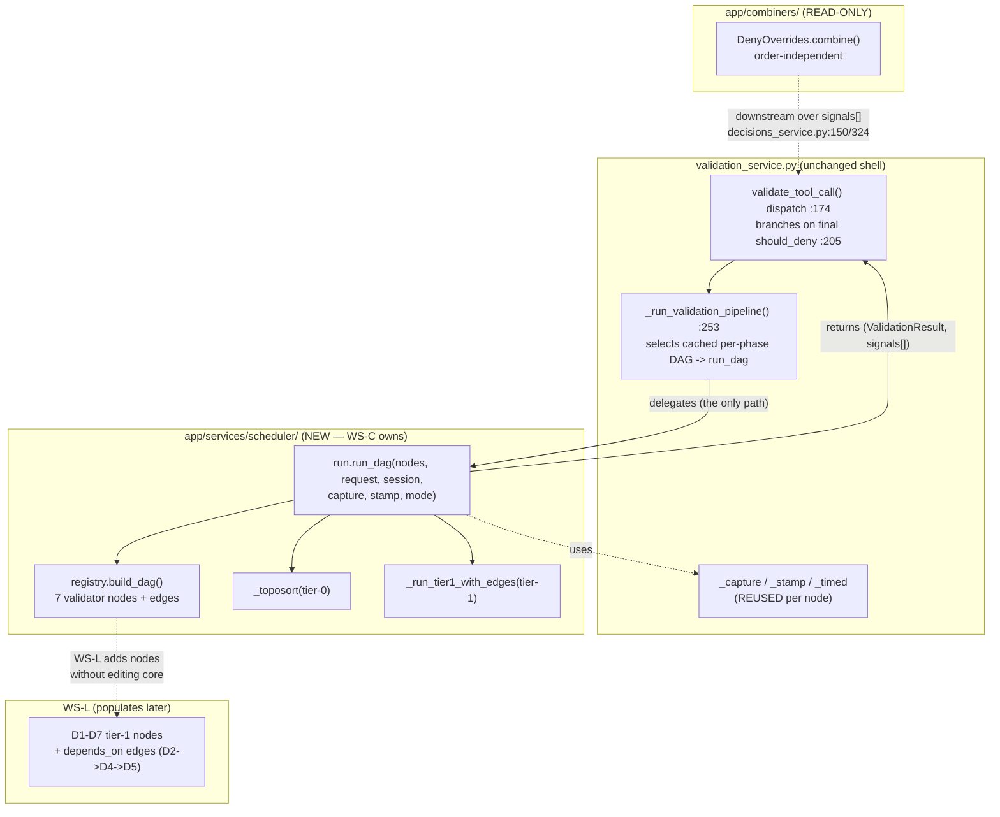
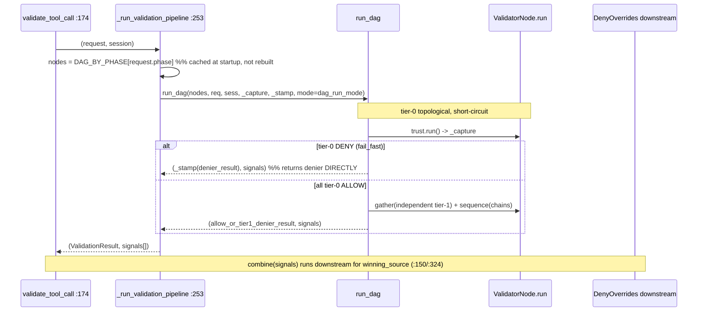
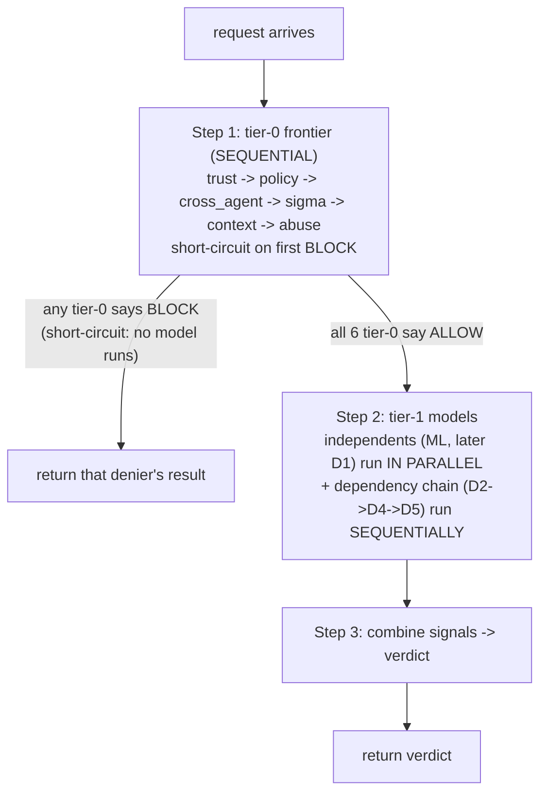
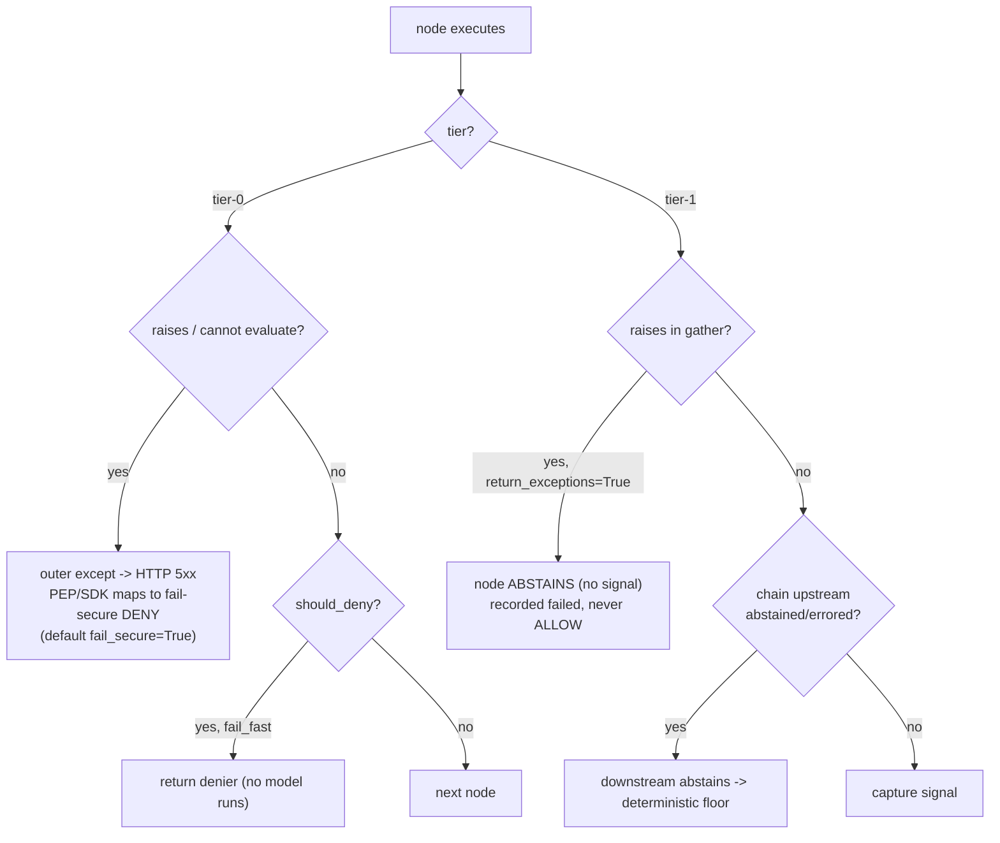
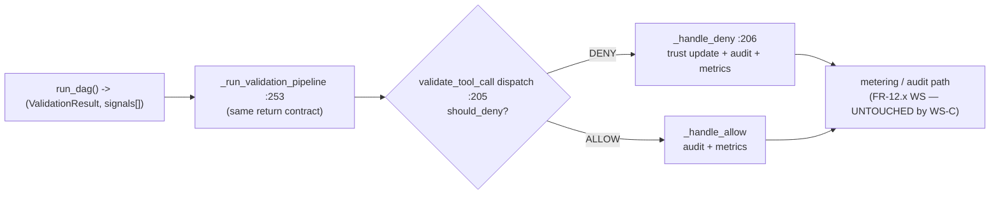

# LLD 31: Cost-Annotated DAG Scheduler (WS-C)

**Version**: 1.0
**Last Updated**: 2026-07-01
**Status**: Draft
**Prerequisites**: [HLD serverless-edition §6.2(c)](../hld/serverless-edition.md) (approved Option A), [LLD 20 §3.4](20-defense-in-depth-layers.md) (the DAG node model this deepens), [LLD 03](03-security-controller.md) (the controller pipeline this rewrites), [LLD 24](24-latency-optimization.md) (the ML-last interim this generalizes), [ADR-030](../adr.md).

> **Scope (one workstream = one LLD).** This LLD is the implementation-grade design for **WS-C — the cost-annotated DAG scheduler** ([tasks/serverless-edition/ws-c-dag-scheduler.md](../tasks/serverless-edition/ws-c-dag-scheduler.md)). It does **not** re-pick an architecture — the HLD already chose Option A (cost-annotated DAG, tier-0 short-circuit then tier-1 parallel-gather; ADR-030). It also does **not** invent a new DAG — [LLD 20 §3.4](20-defense-in-depth-layers.md) already specifies the node model, the two run modes, and the cost tiers. This doc **productionizes** that design into the real `_run_validation_pipeline`, publishes the `ValidatorNode` contract WS-L populates, and proves the refactor is verdict-equivalent to today's pipeline.

## Table of Contents

1. Context
2. Tenets carried from the HLD
3. The verdict-equivalence contract (the acceptance bar)
4. Component architecture
5. Data model — `ValidatorNode`, `CostTier`, the node registry
6. The scheduler algorithm
7. Security (SEC-1..5)
8. Resiliency & recovery (RES-1..7)
9. Scaling
10. Networking
11. Database
12. Cost
13. Metering & billing
14. Rollout & run-mode plan
15. Test plan
16. Cross-references

---

## 1. Context

This LLD elaborates the **approved** HLD recommendation ([hld/serverless-edition.md §6.2(c)](../hld/serverless-edition.md), line 329, "Option A — cost-annotated DAG, tier-0 short-circuit then tier-1 parallel-gather"; **ADR-030**, accepted). It deepens the choice in implementation detail; it does not re-argue it.

**What is built today (the baseline this refactors).** The validation pipeline is a **fixed sequential chain** that short-circuits on the first DENY — `SecurityValidationService._run_validation_pipeline` at [validation_service.py:253](../src/security-controller/app/services/validation_service.py#L253) (`def`; line anchors here are current as of 2026-07-01 — method/symbol names are the stable join key, numbers are secondary and re-verified by the propagate pass when the source shifts), docstring literally "Short-circuits on first DENY." The order is: STEP 1 trust → STEP 2 policy/Cedar → STEP 2.5 cross-agent → STEP 3 sigma (prompt-signature) → STEP 4 context → STEP 5 abuse → **STEP 6 ML classifier last** ([validation_service.py:431](../src/security-controller/app/services/validation_service.py#L431), moved last in WS24 M4.1). The ML-last placement is the **partial form** this WS generalizes — it is *placement*, not a scheduler.

**Implementation-status of the requirement this LLD realizes** (carried from the sub-PRD §5 gap analysis, [prd/serverless-edition.md:274](../prd/serverless-edition.md)):

| Requirement | Status | Evidence |
|---|---|---|
| **FR-2.8** parallel-gather scheduler over a cost-annotated dependency graph | **NOT-DONE** | Fixed sequential 6-deterministic-steps-then-ML pipeline; no cost-graph scheduler — [validation_service.py:253](../src/security-controller/app/services/validation_service.py#L253) |

> The stale "5-step" count in the code and the sub-PRD **omits the cross-agent validator (STEP 2.5)**; the real deterministic frontier is **6 steps** (trust, policy, cross-agent, sigma, context, abuse) + ML-last. This LLD counts 6; the propagate pass reconciles every stale occurrence:
> - **Code (4 occurrences, all "5-step"):** module docstring [validation_service.py:4](../src/security-controller/app/services/validation_service.py#L4), class docstring [:100](../src/security-controller/app/services/validation_service.py#L100), the caller's inline comment [:195](../src/security-controller/app/services/validation_service.py#L195) ("Run 5-step validation pipeline"), and the `_run_validation_pipeline` docstring [:259](../src/security-controller/app/services/validation_service.py#L259) ("Execute 5-step validation pipeline").
> - **Sub-PRD (2 occurrences, both "fixed sequential 5-step pipeline"):** [prd/serverless-edition.md:128](../prd/serverless-edition.md) (the FR-2.8 requirement body) and [:274](../prd/serverless-edition.md) (the §5 gap-analysis row). *(Verified 2026-07-01: the FR-3.4 row at :88 does **not** say "5-step" — it reads "multi-phase contract" — so it is NOT a target; only these two PRD lines carry the stale count.)*

This LLD's job: turn the sequential chain into the static cost-annotated DAG — **the DAG becomes THE pipeline; there is no feature flag and no retained legacy branch.** Before the fixed-sequential body is deleted, its `(decision, should_deny, winning_source)` over the full corpus is captured **once** as a frozen **golden baseline**, and `run_dag` is proven to reproduce that baseline (§3). Rollback, if ever needed pre-launch, is **git-revert + redeploy** — prod is **pre-launch (dev IS prod, no customer traffic yet)** so there is no live customer traffic that needs an instant config-flip, and a retained dead legacy branch on the safety-critical path is complexity, not safety.

> **ONE deliberate behavior change rides on top of this refactor — the ML classifier comes out of shadow.** The DAG rewrite is verdict-equivalent (§3), but this workstream *also* removes `ml_classifier_shadow_mode` entirely (comment #1): the `sentra.ml_classifier` node now **always enforces** — an ML DENY decides the verdict like any other tier-1 node's verdict. The two are kept cleanly separated so the refactor's faithfulness stays provable: (a) the golden baseline is captured with **ML enforcing** (so T-EQUIV proves the DAG reproduces the sequential pipeline *at the enforcing-ML config* — the refactor itself changes nothing), and (b) a separate, explicitly-labeled test (**T-ML-ENFORCE**, §15) asserts the intended new behavior. This is the doc's only intentional verdict change; everything else is equivalence-preserving. See §6.5 for the mechanism, §3 for how the equivalence bar is reconciled, and §14.2 for the residual dependency on WS-F (the benign-FP graduation gate that does not yet exist). *(The separate `ml_classifier_enabled` on/off flag — whether the ML detector runs at all — is untouched and legitimate; only the shadow/non-blocking flag is removed.)*

---

## 2. Tenets carried from the HLD

Every decision below honors the HLD §4 Tenets (they are the tie-breaker for any close implementation call). Carried, in priority order:

- **Tenet 5 — latency scales with risk (PRIMARY).** The tier-0 cheap-deterministic frontier runs first with short-circuit; the ~600 ms ML + D1–D7 model cost is paid **only** for tier-0 survivors. *Implementation obligation:* a cheap DENY must skip every model invocation — asserted by a spy in T-DAG-01 (§15).
- **Tenet 4 — defense in depth.** Independent tier-1 layers gather in parallel; a failed node **abstains**, it does not disable the graph. *Obligation:* `asyncio.gather(..., return_exceptions=True)` so one node's failure doesn't discard every peer's verdict (§6.3); not `asyncio.TaskGroup`, which cancels peers on failure.
- **Tenet 3 — deny-by-default, explainable.** Every verdict still names its deciding source (`winning_source` preserved). *Obligation:* the scheduler must not blur attribution — the combiner is READ-ONLY and its priorities are byte-for-byte unchanged (§3, §7).
- **Tenet 2 — fail secure, never fail open.** A required tier-0 node raising (a genuine *inability to evaluate*) returns an HTTP **5xx processing error** — NOT a fabricated 200-with-`decision=DENY` — and the **PEP/SDK converts that 5xx to a fail-secure DENY by default** (`fail_secure=True`, the default), so the end-to-end outcome is still block; the deny decision is simply made at the client boundary where it already lives (§4, §8). A tier-1 (model) node error **abstains** (emits no signal) and — because the deterministic floor can still produce a verdict — the floor decides; on a dependency chain a missing upstream fails the downstream to the floor. Never a silent ALLOW.
- **Tie-breaker B — record what ran, force nothing extra.** `fail_fast` is the default (run as little as possible); `evaluate_all` is the opt-in high-assurance/shadow mode. Producing the WS-D decision trail must **not** force the scheduler to run layers it would skip (the trail records what ran; it does not command extra runs — ADR-031).

**LLD-local invariant (the correctness proof).** The combiner (`app/combiners/{deny_overrides,signal,sources}.py`) is **READ-ONLY and order-independent**. `DenyOverrides.combine(signals)` ([deny_overrides.py:28](../src/security-controller/app/combiners/deny_overrides.py#L28)) ranks the *entire* `Signal[]` set by `(priority, confidence, _neg_source)` and the winner is deterministic **regardless of append order**. That order-independence is precisely what makes parallel-gather safe: running tier-1 nodes concurrently and appending their signals in completion order cannot change the verdict. Changing combiner priorities or introducing arrival-order sensitivity is **out of scope** and enforced by a `git diff` gate (§15).

---

## 3. The verdict-equivalence contract (the acceptance bar)

The scheduler is a **refactor with a behavior-equivalence guarantee** — proven against a **recorded golden baseline**, not against a live retained legacy path. Before the fixed-sequential body is deleted, we capture its `(decision, should_deny, winning_source)` over the full corpus (S1–S4 + `tests/`, **ML enforcing** — see the note below) **once** and freeze it as golden fixtures. `run_dag` must then reproduce those fixtures. This is the sanctioned method from **[LLD 24 §9:227](24-latency-optimization.md#L227)** ("final-verdict parity vs. a recorded baseline set") — it proves equivalence **without** keeping a live dual code path, and it removes the "flag-OFF path bit-rots after the flip" objection entirely (there is no flag and no second path to rot). The bar is:

> **The refactor is verdict-equivalent; bringing ML out of shadow is a DELIBERATE verdict change — the two are separated so the refactor stays provable.** T-EQUIV proves the DAG faithfully reproduces the SEQUENTIAL pipeline **at the enforcing-ML configuration** — i.e. the baseline is recorded with the ML classifier enforcing (shadow removed), so the DAG-vs-sequential comparison holds ML's behavior fixed and the refactor changes nothing. The intended new behavior (an ML-DENY on an all-tier-0-ALLOW request now BLOCKS and surfaces `winning_source='sentra.ml_classifier'`) is asserted by a **separate, explicitly-labeled test — T-ML-ENFORCE (§15)** — not folded into the equivalence corpus. So the equivalence bar proves "the DAG == the sequential pipeline"; T-ML-ENFORCE proves "and ML now enforces". This workstream therefore carries exactly ONE deliberate behavior change on top of an otherwise equivalence-preserving refactor (§1, §14.2).


> For every request in the corpus, `DAG(request, mode=fail_fast)` produces the **same final verdict** as the frozen golden baseline, where "same verdict" = the tuple **`(decision, should_deny, winning_source)`** is identical.

### 3.1 What is asserted — and what is NOT

**Asserted (the three fields):**
- `ValidationResult.decision` (`"ALLOW"` / `"DENY"`)
- `ValidationResult.should_deny` (`bool`)
- `metadata["winning_source"]` — the deciding source name.

**NOT asserted: full `signals[]` / audit-set equality.** This is deliberate and follows the guard already established in **[LLD 24 §9:227](24-latency-optimization.md#L227)**: because a cheap-DENY (tier-0 short-circuit) legitimately never invokes ML, the `sentra.ml_classifier` signal **legitimately disappears** from that request's captured set. A signal-set-equality assertion would throw false diffs on the exact ML-last behavior LLD 24 shipped. The differential test therefore compares only the final `decision` + `should_deny` + `winning_source`, over a baseline corpus that **must include ML-on traffic** (per LLD 24 §9:227).

**Also NOT asserted (with a bounded, characterized divergence): `ValidationResult.reason` string equality.** `reason` **is** human-facing — it surfaces in the SOC console, the audit log, and the operator/agent-visible block message — so this is a *characterized accepted divergence*, not a "nobody reads it" hand-wave. Two facts bound it:
> - **Same request, same mode, across the refactor → identical `reason`.** The tier-0 short-circuit returns the first denier's own result, and the tie-break is pinned to the recorded baseline's step order (§6.2), so `DAG(fail_fast)` returns the **same denier's `ValidationResult` object** the baseline recorded — same `reason`. T-EQUIV's two-simultaneous-DENY case asserts this object identity (source + `reason`), not just the tuple.
> - **`fail_fast` vs `evaluate_all` on the same request → the returned verdict tuple `(decision, should_deny, winning_source)` is identical, but `reason` MAY differ** because `evaluate_all` captures a superset of signals and the returned result may be composed from a different (still top-priority-equivalent) denier. This is the one mode-dependent `reason`, and it is the mode that runs during a shadow rollout — so it is called out, not buried. No *decision-load-bearing* consumer keys on `reason` (metering/audit/trust-update key on `should_deny` + `winning_source`); the divergence is confined to attribution prose shown to a human, who also sees `winning_source` (which is identical). The differential test asserts the tuple; T-DAG-02 characterizes the `evaluate_all`-vs-`fail_fast` reason divergence as a **known** contract, so it is not a latent surprise.

> **Citation discipline.** Two distinct LLD 24 notes are often conflated — this LLD cites them correctly:
> - **[LLD 24 §1.2.1:37](24-latency-optimization.md#L37)** — the `asyncio.gather`-across-validators *prohibition* (about the mechanism). This LLD **lifts** it *inside the scheduler* (§14).
> - **[LLD 24 §9:227](24-latency-optimization.md#L227)** — the equivalence *guard* (about the assertion): asserts the final ALLOW/DENY only, **excludes signal-set equality**. It does **not** exclude `winning_source`.

### 3.2 Why `winning_source` is safe to assert (and *how* it is computed)

`winning_source` is **combiner-attribution metadata that is order-invariant**, so it is safe to add to the equivalence tuple even though the raw signal set is not:

1. Priorities are **fixed** and pinned by test: trust 90 > policy 80 > sigma 70 > **ml 65** > context 60 > abuse 50 = cross_agent 50 ([sources.py:43-56](../src/security-controller/app/combiners/sources.py#L43); the ml=65 gap is pinned specifically so `sigma > ml` when both fire — [test_combiner.py:183](../src/security-controller/tests/test_combiner.py#L183)). A dropped ML signal is an **ALLOW** signal or a lower-priority DENY; under these fixed priorities it can **never** have been the DENY winner. So dropping it on the cheap-DENY path cannot change `winning_source`.
2. The tie-break chain `(priority → confidence → alphabetical source)` is deterministic ([deny_overrides.py:38-39](../src/security-controller/app/combiners/deny_overrides.py#L38)), so the winner is a pure function of the *set*, not the order.

**The return contract, in plain terms.** On a block, the scheduler returns **that detector's own result object, unchanged** — exactly as today's pipeline does. It never re-computes or synthesizes a verdict. The "who decided" label (`winning_source`) is still computed **later and downstream** (in the decisions/audit path), same as today — the scheduler does not compute it. So the caller gets back the **exact same `(result, signals)` shape** it gets today.[^wsrc]

Therefore the equivalence assertion phrases `winning_source` as **"the combiner output over the run's captured `signals[]`"**: the test captures each run's `signals[]`, feeds them through the *same untouched* `DenyOverrides.combine()`, and asserts the value matches the golden baseline. See §6.4 for how the tier-1 branch keeps this true.

[^wsrc]: Concretely, `_run_validation_pipeline` never calls `combine()` — it returns the denier's `ValidationResult` directly on a short-circuit and a synthetic ALLOW on the all-ALLOW path; `DenyOverrides.combine(signals)` runs downstream in `decisions_service.py` and surfaces `metadata["winning_source"]`. `run_dag` preserves this exactly — no `combine()` on the hot path.

---

## 4. Component architecture

### 4.1 New modules

```
src/security-controller/app/services/scheduler/
├── __init__.py
├── node.py        # ValidatorNode descriptor + CostTier enum (the DAG data model)
├── registry.py    # build_dag() — registers the 7 existing validators as nodes
└── run.py         # run_dag() entry + _toposort + _run_tier1_with_edges
```

`validation_service.py` keeps its existing structure; the **body** of `_run_validation_pipeline` ([validation_service.py:253](../src/security-controller/app/services/validation_service.py#L253)) is **replaced** — it selects the cached per-phase DAG and delegates to `run_dag(...)`. **`run_dag` IS the pipeline; the old fixed-sequential body is deleted, not retained behind a flag** (§14). The outer `validate_tool_call()` dispatch ([validation_service.py:174](../src/security-controller/app/services/validation_service.py#L174), pipeline call at :200, `should_deny` branch at :205) and the `validation.timing` log ([:227](../src/security-controller/app/services/validation_service.py#L227)) are **unchanged** — the scheduler returns the same `(ValidationResult, list[Signal])` tuple the caller already expects.

**The DAG is built once at startup, not per request (comment #3).** The request-phase graph is **static and tenant-independent**: `ValidatorNode` is `frozen=True`, and per-tenant differences are policy **data** evaluated *inside* the `sentra.policy` node (§5.3), not differences in graph shape. So `build_dag(phase)` runs **once at module load**, and its result is cached as a **per-phase module constant** — keyed by `phase`, never rebuilt per request and never per tenant. *(Future extension, not needed today: if a tenant is ever allowed to enable/disable a detector, the cache key becomes `(phase, tenant-detector-config)`. Today no such toggle exists, so a per-phase constant is exact.)*

### 4.2 Component block diagram



### 4.3 Delegation flow



---

## 5. Data model — `ValidatorNode`, `CostTier`, the node registry

> **Naming convention (standing, going-forward).** No new `sentra`-prefixed identifier in any enum, file, class, or resource name. **WS-C introduces ZERO new `sentra`-named identifiers** — its new surface (`ValidatorNode`, `CostTier`, `pick_top_denier`, `dag_run_mode`, the `scheduler/` modules) is all clean. The existing `Source.SENTRA_*` enum and its `sentra.*` string **values** are (a) **READ-ONLY to WS-C** — they live in the `combiners/` module WS-C must not change (§2 LLD-local invariant) — and (b) **persisted in DynamoDB audit records and read by the SOC console** (`decisions_service.py` `winning_source`; `audit_logger.py` `'sentra.combined'`). Renaming them is therefore a **separate cross-cutting data-migration workstream** (audit-record backfill + console change): it cannot happen inside this verdict-equivalent refactor without breaking the equivalence bar. **This LLD does NOT rename `Source.SENTRA_*`** — the rename is flagged as its own tracked backlog/sweep item (§16).

### 5.1 The node descriptor (`scheduler/node.py`)

```python
# Cost tiers — LLD 20 §3.4. tier-0 = short-circuit frontier; tier-1 = parallel models.
class CostTier(str, Enum):
    DETERMINISTIC = "tier-0"    # ~1-5ms: trust, policy, cross_agent, sigma, context, abuse
    EXPENSIVE_MODEL = "tier-1"  # ~600ms ML; D1-D7 (added by WS-L)

@dataclass(frozen=True)
class ValidatorNode:
    source: str          # canonical Source.SENTRA_* name (combiners/sources.py) — the join key
    cost_tier: CostTier
    run: Callable[[ValidationRequest, dict], Awaitable[ValidationResult]]  # awaitable
    depends_on: tuple[str, ...] = ()   # source names that MUST complete (ALLOW) before this node runs
```

- **`source` MUST be the exact `Source.SENTRA_*` string** from [combiners/sources.py:22-28](../src/security-controller/app/combiners/sources.py#L22) (`sentra.trust`, `sentra.policy`, `sentra.sigma`, `sentra.ml_classifier`, `sentra.context`, `sentra.abuse`, `sentra.cross_agent`). The combiner's `_neg_source` tie-break and the WS-D trail keying both join on it — a new node name breaks the audit join and the priority lookup (`default_priority` returns 0 for an unknown source, [sources.py:64](../src/security-controller/app/combiners/sources.py#L64), silently losing tie-breaks). `ValidatorNode` is `frozen=True` so the static graph cannot be mutated per-request.
- **`run` is the callable, not the validator object.** It wraps the exact call the sequential step makes today (e.g. the trust node's `run` is `lambda req, sess: self.trust_checker.check(sess, req)`). The Cedar branch (cutover/shadow/legacy selection) is encapsulated **inside the `sentra.policy` node's `run`** — see §5.3 — so the DAG stays policy-engine-agnostic.
- **`depends_on`** are *source-name* edges. A tier-0 node's `depends_on` orders the topological run; a tier-1 node's `depends_on` on **another tier-1 node** declares a sequential chain (§6.3). `depends_on` on a tier-0 node from a tier-1 node (e.g. every tier-1 node depends on `sentra.policy`) means "tier-1 only runs if the frontier all-ALLOWed" — which is already guaranteed because tier-1 runs only for survivors, so it is documentary for tier-1→tier-0 edges and load-bearing only for tier-1→tier-1 edges.

### 5.2 The registry — mapping the 7 existing validators to nodes (`scheduler/registry.py`)

`build_dag(phase)` returns the node set for a phase; it runs **once at startup per phase** and the result is cached as a module constant (§4.1), not rebuilt per request. For `phase="request"` (the only phase WS-C ships; WS-B adds the rest — [lld/30](30-multiphase-contract.md), approved):

| Node `source` | Cost tier | `depends_on` | Maps to today (sequential step) |
|---|---|---|---|
| `sentra.trust` | tier-0 | `()` | STEP 1 ([:306](../src/security-controller/app/services/validation_service.py#L306)) |
| `sentra.policy` | tier-0 | `(sentra.trust,)` | STEP 2 Cedar/legacy ([:337](../src/security-controller/app/services/validation_service.py#L337)) |
| `sentra.cross_agent` | tier-0 | `(sentra.policy,)` | STEP 2.5 ([:392](../src/security-controller/app/services/validation_service.py#L392)) |
| `sentra.sigma` | tier-0 | `(sentra.policy,)` | STEP 3 ([:399](../src/security-controller/app/services/validation_service.py#L399)) |
| `sentra.context` | tier-0 | `(sentra.policy,)` | STEP 4 ([:406](../src/security-controller/app/services/validation_service.py#L406)) |
| `sentra.abuse` | tier-0 | `(sentra.policy,)` | STEP 5 ([:415](../src/security-controller/app/services/validation_service.py#L415)) |
| `sentra.ml_classifier` | tier-1 | `(sentra.policy,)` | STEP 6 ML-last ([:431](../src/security-controller/app/services/validation_service.py#L431)) |

The `trust → policy → {cross_agent, sigma, context, abuse}` edges reproduce today's step order exactly (trust before policy; everything else after policy because `_stamp` needs `policy_result.platform`/`cloud_region` — §6.6). The four tier-0 nodes after policy are mutually **independent** (no edges between them) — but in `fail_fast` mode the topological run still visits them one at a time and short-circuits (§6.2), so ordering among them is a deterministic tie-break, not parallelism (they are ~1–5 ms each; parallelizing them buys nothing and would complicate the short-circuit). **Tier-1 is where parallelism lives.**

**The shared contract WS-L populates.** WS-L adds D1–D7 as **tier-1 nodes** with their own `depends_on` edges **without editing the scheduler core** — it appends `ValidatorNode(...)` entries to `build_dag()` and declares the D2→D4→D5 chain edges. The `depends_on` / `cost_tier` vocabulary is the shared contract: **WS-C owns the runner** (`_run_tier1_with_edges`, the chain-aware executor); **WS-L owns the edge *declarations*** (which D-node depends on which). WS-C ships **only** the `sentra.ml_classifier` tier-1 node; D1–D7 nodes are WS-L's deliverable.

### 5.3 The `sentra.policy` node encapsulates the Cedar branch (do NOT flatten)

Today STEP 2 ([validation_service.py:333-369](../src/security-controller/app/services/validation_service.py#L333)) selects the engine:
- **cutover** (`cedar_enabled` & not `cedar_shadow_mode`) → `cedar.validate(request)`; on Cedar abstain, fail-secure DENY if `legacy_retired` else legacy fallback;
- **shadow** → legacy decides, Cedar runs alongside via `_cedar_shadow_compare` (side-effect only);
- **disabled** → legacy `policy_engine.validate(request)`.

The `sentra.policy` node's `run` callable is **this exact block, lifted verbatim** — the scheduler never sees Cedar. WS-K already has `cedar_enabled=true`/`cedar_shadow_mode=false` in prod ([cdk/config/prod.yaml:30-31](../cdk/config/prod.yaml)); WS-C does not touch it. Flattening the Cedar selection into the scheduler is explicitly rejected (it would couple the run model to the policy engine).

### 5.4 Per-phase node selection (WS-B prerequisite; degrade, do not block)

`_run_validation_pipeline` selects a **pre-built cached** node set by **`request.phase`** (the graphs are built once at startup, §4.1; selection is a dict lookup, not a rebuild). Today **`phase` does not exist on `ValidationRequest`** ([api/models.py](../src/security-controller/app/api/models.py) — no `phase` field); it is added by **WS-B** ([lld/30](30-multiphase-contract.md), FR-3.4, approved — the multi-phase `/v1/validate` contract owns `ValidationRequest.phase` + `KNOWN_PHASES` + `_CONTENT_FIELD`), default `"request"`. Per-phase node sets (from [LLD 20 §3.4](20-defense-in-depth-layers.md), lines 150-165):

| `phase` | tier-0 nodes | tier-1 nodes |
|---|---|---|
| `request` (WS-C ships this) | trust, policy, cross_agent, sigma, context, abuse | ml_classifier (+ D1 when WS-L lands) |
| `content` (WS-B/WS-L) | — | sigma(content), ml_classifier(content), **D2 indirect-injection** |
| `output` (WS-B/WS-L) | — | **D5 DLP/PII, D5 exfil, D6 egress** |
| `memory` (WS-B/WS-L) | — | **D3 memory-write** |

**Degrade rule:** the phase lookup uses `getattr(request, "phase", "request")` and indexes the startup-built cache (`DAG_BY_PHASE[...]`, falling back to the `"request"` graph for an absent/unknown phase); if WS-B's `phase` field has not landed, every request is treated as `phase="request"` (request-side nodes only). **WS-C does not block on WS-B** — it ships the request phase and reads the field defensively. *(Cross-ref flag: this is a documented WS-B dependency ([lld/30](30-multiphase-contract.md)), degrade-to-request-only.)*

> **Consistency-sweep note (mis-citation to reconcile).** The WS-C scope/task doc ([tasks/serverless-edition/ws-c-dag-scheduler.md:146](../tasks/serverless-edition/ws-c-dag-scheduler.md)) still attributes the `phase` field to **WS-A ("the FR-3.4 contract WS")** — the same mis-citation this LLD inherited and corrects here. The `phase` field is owned by **WS-B** ([lld/30](30-multiphase-contract.md); the 00-index lists FR-3.4 under WS-B, WS-A owns FR-1.7 local-floor bundle). The consistency sweep must re-point that task-doc line WS-A → WS-B; the same scope doc also calls the D1–D7 node registrant "WS-D" (pre-split) which the sweep must reconcile to "WS-L" (00-index lists D1–D7 detection-depth under WS-L).

---

## 6. The scheduler algorithm

**In plain terms — what one request does, in three steps:**

1. **Step 1 — run the 6 cheap deterministic checks one after another** (`trust → policy → cross_agent, sigma, context, abuse`). The **first one that says BLOCK stops everything** — no model runs (this is the cost/latency lever, tenet 5).
2. **Step 2 — only if all 6 said ALLOW — run the expensive model checks.** Independent ones (ML today; D1 later) run **in parallel, at the same time**; a dependency chain (`D2 → D4 → D5`) runs **one after another**, because each node needs the previous one's result.
3. **Step 3 — combine and return** the verdict.



### 6.1 Entry point (`scheduler/run.py`)

```python
async def run_dag(nodes, request, session, capture, stamp, *, mode):
    """Verdict-equivalent DAG execution. Returns (ValidationResult, list[Signal])
    — the SAME contract _run_validation_pipeline returns today. mode in
    {fail_fast, evaluate_all}. Never calls combine() (that stays downstream)."""
    signals = []                              # capture() appends into this (reused list)
    tier0 = [n for n in nodes if n.cost_tier == CostTier.DETERMINISTIC]
    tier1 = [n for n in nodes if n.cost_tier == CostTier.EXPENSIVE_MODEL]

    # --- tier-0: cheap deterministic frontier, topological, short-circuit ---
    first_deny = None
    for node in _toposort(tier0):
        result = capture(await _timed(_step(node), node.run(request, session)))
        result = stamp(result)                # cross-cloud fields (§6.6); NO-OP until
                                              # sentra.policy has populated platform/
                                              # cloud_region — trust runs FIRST and self-
                                              # stamps its own DENY path (:318-321), matching
                                              # today (stamp is only defined post-policy, §6.6)
        if result.should_deny:
            if mode == "fail_fast":
                return result, signals        # short-circuit BEFORE any model (tenet 5)
            first_deny = first_deny or result # evaluate_all: remember, keep going

    # --- tier-1: parallel-gather survivors, respecting dependency chains ---
    if first_deny is None or mode == "evaluate_all":
        tier1_results = await _run_tier1_with_edges(tier1, request, session, stamp)
        for r in tier1_results:
            capture(r)                        # already _stamp'd inside the runner
            # Capture a HARD tier-1 DENY regardless of mode — verdict-neutrality
            # (§6.7): evaluate_all must return the SAME denier fail_fast returns.
            # _is_hard_deny excludes any tier-1 DENY that did not assert
            # enforce-mode (§6.5) — the generic per-detector enforce gate WS-L
            # uses to graduate each D-layer individually. ML always sets
            # enforce=True now (it has graduated out of shadow), so an ML DENY
            # sets first_deny; a future D-node still in shadow would not.
            # (fail_fast additionally never reaches tier-1 when a tier-0 DENY
            # already short-circuited.)
            if r.should_deny and _is_hard_deny(r):
                first_deny = first_deny or r

    if first_deny is not None:
        return first_deny, signals            # verdict = the denier (no combine() on hot path)
    return _all_allow_result(stamp), signals
```

*(Pseudo-code — real error handling in §8. `_all_allow_result` reproduces the synthetic ALLOW at [validation_service.py:442](../src/security-controller/app/services/validation_service.py#L442), carrying `platform`/`cloud_region` from the policy result.)*

### 6.2 Tier-0: Kahn topological sort + short-circuit

`_toposort(tier0)` is a standard **Kahn topological sort** (industry-standard DAG linearization — remove zero-in-degree nodes, break ties by a stable order so the run is deterministic). It yields `trust → policy → {cross_agent, sigma, context, abuse}` for the request phase. Each node is `await`ed in order, wrapped in `_timed(...)` so the `validation.timing` per-step breakdown ([:227-235](../src/security-controller/app/services/validation_service.py#L227)) still emits per-validator ms (LLD 24 M1 — losing this blinds the re-baseline).

- **`fail_fast` (default):** the first `should_deny` returns immediately — no tier-1 node is awaited. This reproduces today's STEP-1..5 short-circuit **exactly** (tenet 5): a Cedar policy DENY returns before `ml_classifier.run` is ever awaited.
- **A tie-break, not a cycle — pinned to reproduce today's exact step order.** The four post-policy tier-0 nodes (`cross_agent`, `sigma`, `context`, `abuse`) are declared with no edges between them, so `_toposort` alone would leave their relative order to the sort's tie-break. On a **fail_fast** multi-tier-0-DENY the returned `ValidationResult` is the **first denier's OWN result object** (its `reason` string is operator/SOC-console-facing, §3.1) — so the tie-break must reproduce today's fixed step order **`trust → policy → cross_agent → sigma → context → abuse`** ([validation_service.py:306/337/392/399/406/415](../src/security-controller/app/services/validation_service.py#L306)), **NOT** an alphabetical order (which would return `abuse` before `cross_agent` and flip the operator-facing reason on a two-way tie). The tie-break is therefore a **fixed `order_key` per node (the legacy step index), not alphabetical** — pinned here, not left to the sort's default. `winning_source` is combiner-computed downstream and would be tie-broken identically either way, but the **returned result object + its reason** is only reproducible if the tie-break matches the legacy step order. `build_dag` asserts the graph is acyclic at construction (a cycle is a programming error → raise at startup, not at request time). T-EQUIV (§15) includes a two-simultaneous-tier-0-DENY case (`cross_agent` + `abuse`) asserting the DAG returns the **same denier's `ValidationResult` object (source + reason)** as the legacy chain, not merely the same `winning_source`.

### 6.3 Tier-1: `_run_tier1_with_edges` — gather independents, sequence chains

This is the milestone that distinguishes the DAG from a flat two-phase split (HLD §6.2(c) rejected Option B precisely because it cannot carry D1–D7 dependencies).

```python
async def _run_tier1_with_edges(tier1, request, session, stamp):
    t1_names = {n.source for n in tier1}
    independent = [n for n in tier1 if not (set(n.depends_on) & t1_names)]
    chains      = _build_chains([n for n in tier1 if set(n.depends_on) & t1_names])

    async def run_independent(node):
        return stamp(await _timed(_step(node), node.run(request, session)))

    async def run_chain(chain):                # e.g. D2 -> D4 -> D5, SEQUENTIAL
        ctx = {}                               # chain-LOCAL; not shared across the gather
        for node in chain:                     # ordered by depends_on
            # {**session, **ctx} is a FRESH TOP-LEVEL dict per node — no shared
            # mutable alias at the top level, so a node that REBINDS a top-level
            # key (e.g. session["abuse_counters"] = {...}, the ONE in-place
            # session writer today, abuse_detector.py:99 — but abuse is tier-0,
            # runs SEQUENTIALLY, never under this gather) cannot leak across
            # gather'd coroutines. LIMIT (belt-and-suspenders caveat): a shallow
            # copy shares NESTED objects by reference — a node that mutated a
            # nested value in place (session["agent"][...] = x) WOULD still race
            # a peer. Verified 2026-07-01: NO tier-1/gathered validator mutates
            # session, nested or otherwise (the only writer is tier-0 abuse, and
            # it rebinds a TOP-LEVEL key), so today the shallow copy is
            # sufficient and belt-and-suspenders. CONTRACT for WS-L: tier-1
            # (gathered) nodes are READ-ONLY on session; a node that needs to
            # mutate a nested session subtree must deep-copy that subtree first
            # (enforced by T-CTX-ISO's nested-mutation assertion). ctx keys are
            # the upstream source names (never real session keys), so the merge
            # cannot shadow a session field a node depends on.
            r = stamp(await _timed(_step(node), node.run(request, {**session, **ctx})))
            if r.is_abstain:                   # upstream missed -> downstream fails to floor
                return _abstain_chain_remainder(chain, node)
            ctx[node.source] = r               # write-once per source: thread upstream result forward (D4 reads D2 taint)
        return r

    coros = [run_independent(n) for n in independent] + [run_chain(c) for c in chains]
    settled = await asyncio.gather(*coros, return_exceptions=True)   # return_exceptions=True: harvest peers' results (default discards the array on first exc)
    return _flatten_and_isolate_failures(settled)   # exception -> abstain (no signal), never ALLOW
```

- **Independent tier-1 nodes gather in parallel** → wall-time = `max(node latencies)`, not sum. For the request phase today the only tier-1 node is `sentra.ml_classifier`, so tier-1 is a single `await`; the machinery pays off when WS-L adds D1 (trajectory ~40 ms) alongside ML.
- **Chains run sequentially and SUM.** The real chain is **D2 taint → D4 information-flow-control → D5 output-DLP** (HLD Appendix E:808): D4 reads the per-session **taint label** D2 sets; D5 consumes D4's IFC verdict. `run_chain` threads the upstream result into `ctx` so the downstream node sees it. **Gathering D4 before D2 makes D4 read a stale/missing label → it abstains and fails to the deterministic floor** (HLD §A invariant 2) — a silent detection weakening, so the chain MUST be sequential. **The D2/D4/D5 node definitions and their edge declarations are WS-L's deliverable**; WS-C ships the chain-aware runner and the `depends_on` contract only.
- **`asyncio.gather(..., return_exceptions=True)` is mandatory.** Without it (default `return_exceptions=False`) the first node's exception **propagates out of `gather()` to the awaiter**, discarding the entire results array — the peers still *run to completion* (a bare `gather` does **not** cancel pending peers; peers are only cancelled if `gather()` itself is cancelled), but their return values are lost and no survivor yields a signal. With `return_exceptions=True`, each exception is aggregated into the results list, so the survivors' verdicts are harvested and the failed node is isolated to an abstain (no signal, recorded failed), never a silent ALLOW (§8). **`asyncio.TaskGroup` is NOT a substitute** — it *does* cancel sibling tasks on the first failure, which would defeat this isolate-and-abstain requirement. (Source: docs.python.org/3/library/asyncio-task.html — `gather` `return_exceptions`.)

### 6.4 The return contract — `run_dag` never calls `combine()`

Critical for verdict-equivalence (§3.2): `run_dag` returns the **denier's `ValidationResult` directly** — on tier-0 short-circuit (the denier itself), and on a tier-1 hard DENY (the tier-1 denier). It **never** invokes `DenyOverrides.combine()`. `combine()` stays exactly where it is today — **downstream**, over the returned `signals[]`, in `decisions_service.py:150/:324`, producing `winning_source`. This preserves the legacy return contract byte-for-byte: the caller at [validation_service.py:200](../src/security-controller/app/services/validation_service.py#L200) receives the same `(ValidationResult, list[Signal])` shape.

> **Why a tier-1 "denier" is unambiguous — and why the scheduler does NOT fork the ranking.** In the request phase the only tier-1 DENY is ML (live mode). If WS-L later has multiple simultaneous tier-1 DENYs in one run, `run_dag` must pick which denier's `ValidationResult` to return. It does **not** re-implement a local `max` over `default_priority` — that would be a second copy of the combiner's ranking that is only *asserted* to agree, and it would silently drift the day someone changes a priority or tie-break in the READ-ONLY `combiners/`. Instead it calls a **shared ranking helper imported from `combiners/`** — `pick_top_denier(signals) -> Source`. **This helper REUSES `combine()`'s exact ranking, it does NOT re-sort alphabetically:** it picks `max(denies, key=lambda s: (s.priority, s.confidence or 0.0, _neg_source(s.source)))` — the **verbatim key from [deny_overrides.py:38-41](../src/security-controller/app/combiners/deny_overrides.py#L38)**, including the `confidence or 0.0` coalescing (a `None` confidence must coalesce to `0.0`, not raise or sort as absent) and the **same `_neg_source`** ([deny_overrides.py:63](../src/security-controller/app/combiners/deny_overrides.py#L63)) that inverts the codepoints so the alphabetically-smaller source wins the tie. A fresh alphabetical `sorted()` (or omitting the `confidence or 0.0` coalesce) would **silently diverge from `combine()` on the source/confidence tie-break** — the exact bug this shared-helper factoring exists to prevent. Factored so there is **one** source of truth, it returns that source's captured `ValidationResult`. The "never call `combine()` on the hot path" constraint (§3.2) is about not introducing the *combining/synthesis* step on the ALLOW/short-circuit path; **reusing the ranking order is required, not prohibited** — it is what keeps the returned-result source == the downstream `combine()`'s `winning_source` by construction rather than by coincidence. If `combiners/` does not already expose such a helper, WS-C adds it there (inside the READ-ONLY module's public surface, priorities unchanged), not in the scheduler. T-MULTI-DENY (§15) feeds ≥2 tier-1 DENYs and asserts the scheduler's returned-result source equals the downstream `combine()`'s `winning_source`.

### 6.5 The ML node is a tier-1 node that always enforces (shadow removed)

**In plain terms.** The ML classifier **always enforces** now: it runs, and its DENY decides the verdict exactly like any other tier-1 node's DENY. There is no shadow/non-blocking mode any more — comment #1 removes `ml_classifier_shadow_mode` from the design entirely. So the `sentra.ml_classifier` node is captured into `signals[]` and combined like any node; on an all-tier-0-ALLOW request an ML DENY now BLOCKS and surfaces `winning_source='sentra.ml_classifier'`. *(This does not remove the separate `ml_classifier_enabled` flag, which controls whether the ML detector runs at all — that on/off is legitimate and stays; only the shadow flag is gone. ML must be **enabled** in the environment to enforce — see §14.2, and note it currently defaults off.)*

**What is deleted vs kept.** The old design relocated the `not settings.ml_classifier_shadow_mode` guard ([validation_service.py:436](../src/security-controller/app/services/validation_service.py#L436)) into a node wrapper that set `should_deny=False` in shadow and rewrote the captured result's `decision` to `"ALLOW"`. **That shadow wrapper and its decision-rewrite are DELETED** — they existed only to keep shadow non-blocking, and with shadow gone they are dead code. What is **kept** is the generic **`_is_hard_deny` / `metadata["enforce"]` gate**: this is the **per-detector enforce contract WS-L uses** to graduate each future D-layer from shadow to enforce individually. The ML node has graduated, so it **always sets `metadata["enforce"]=True`**; it is the first tier-1 node permanently enforcing. The classifier itself is unchanged — `_to_validation_result` ([ml_classifier.py:336-347](../src/security-controller/app/validators/ml_classifier.py#L336)) still returns `should_deny=is_deny` with `decision="DENY"` and `model_used`/`model_id` metadata. The ML node's `run` wrapper simply stamps `metadata["enforce"]=True` unconditionally.

**`_is_hard_deny(r)` — the concrete definition (a WS-C helper), the generic tier-1 enforce gate, fail-safe to advisory.** It answers one question: *is this tier-1 DENY allowed to decide the verdict, or is it advisory-only for this run?* A tier-1 DENY decides **only if the node explicitly asserted enforce-mode** — a node that says nothing under-blocks (missed detection, the safe direction), never over-blocks. ML now always asserts it; a future D-layer still in shadow does not:

```python
def _is_hard_deny(r: ValidationResult) -> bool:
    # A tier-1 DENY decides the verdict ONLY if the node explicitly asserts
    # enforce-mode (metadata["enforce"] is True). Absent/None metadata, or a
    # node that forgot the flag, defaults to ADVISORY (non-deciding) — a
    # forgotten flag under-blocks (missed detection), never becomes a surprise
    # HARD DENY / false-positive-blocking outage. metadata may be None
    # (models.py:150 Optional[Dict]) so guard the .get. Deterministic (tier-0)
    # DENYs are always hard — this helper is tier-1-only.
    return r.should_deny and bool((r.metadata or {}).get("enforce", False))
```

The mechanism, with shadow removed: the ML node's **`run` wrapper always sets `metadata["enforce"]=True`**, so `_is_hard_deny` is true for an ML DENY and it decides the verdict (subject only to the generic gate above) in **either** run mode (§6.1). An ML DENY carries `decision="DENY"` and, being priority 65, out-ranks the lower-priority tier-0 DENYs (context 60, abuse/cross_agent 50) but never sigma (70) / policy (80) / trust (90) — so on an all-tier-0-ALLOW request it is the winner and blocks, while on a request where a higher-priority tier-0 node also denies, that node still wins. There is no `should_deny=False` rewrite and no `decision→"ALLOW"` rewrite any more — those were the shadow-only machinery, now deleted. The ML signal is captured into `signals[]` (WS-D's trail and the metrics still see it) and combined like any node.

**Downstream benignness of `metadata["enforce"]` (verified).** The key flows through `to_signal()` ([models.py:198-203](../src/security-controller/app/api/models.py#L198)) into `Signal.metadata` and thence the audit/dashboard metadata bag. A `grep` of the metadata consumers (`audit_logger.py`, `decisions_service.py`) at 2026-07-01 found **no consumer that reads an arbitrary/unknown metadata key as decision-load-bearing** — the only keys read downstream are `winning_source` (combiner output), `model_used`/`model_id` (ML display), and `abstain` (skip-signal). `enforce` rides along as an inert display/audit extra; it is **read only by the scheduler's `_is_hard_deny` on the hot path**, not by any downstream consumer. **Confirmed-benign** — no collision, no downstream behavior change from adding it. *(If a future audit/dashboard consumer starts keying on unknown metadata, that is a sweep item; today none does.)*

**For WS-L:** each D1–D7 node's wrapper asserts `metadata["enforce"]` from its **own** shadow/enforce flag (the shadow→enforce graduation is per-detector), so `_is_hard_deny` is the single generic gate that **fails safe** — a D-node that forgets the flag, or is still in shadow, is captured-but-non-deciding (a missed detection, caught by shadow metrics), never a silent HARD blocking DENY. **`_is_hard_deny` is the GENERIC tier-1 enforce contract; ML is simply the first node permanently enforcing** (it has graduated; each D-layer graduates individually later). `enforce` is result metadata the node owns; the scheduler only reads it. T-ML-ENFORCE (§15) pins that a LIVE ML DENY on an all-tier-0-ALLOW request now BLOCKS and surfaces `winning_source='sentra.ml_classifier'`; the same test's fail-safe variant pins that a tier-1 DENY with no `enforce` metadata defaults to advisory (the WS-L graduation gate).

> **Residual risk — enforcing ML with no benign-FP graduation gate (dependency on WS-F).** Removing shadow means ML false-positives now **block real actions** — there is no benign-FP corpus / shadow→enforce CI gate built yet (WS-F is scope-only today). This is a **named residual risk, not a blocker**, and it is safe **today** because this environment is **pre-launch — prod IS dev (acct 531109575379, §14.2) with no customer traffic onboarded yet**. **With the WS-0 code-merge gate now OVERRIDDEN for WS-C (founder decision 2026-07-01, mirroring the WS-E override), WS-C code can actually ship with ML enforcing — so WS-F is now the PRIMARY safeguard against ML false-positives blocking real actions, no longer backed up by the WS-0 merge gate.** Before ML faces real customer traffic, the real graduation gate — a benign-FP corpus measured in CI — **must** exist; that is **WS-F**. Carried as an explicit dependency on WS-F (§14.2, §16).

### 6.6 Reused helpers — `_capture`, `_stamp`, `_timed` (NOT replaced)

- **`_capture(result)`** ([validation_service.py:272](../src/security-controller/app/services/validation_service.py#L272)) — appends the node's `Signal` to `signals[]`; **abstain → no signal** (the combiner treats absence as "not on path"; the ML classifier abstains on Bedrock outage/disabled/low-confidence — the abstain-handling comment is in `_capture`'s docstring at [:273-279](../src/security-controller/app/services/validation_service.py#L273)). Reused per node, not reimplemented. Deleting its abstain handling would break the Bedrock-outage fallback.
- **`_stamp(result)`** ([validation_service.py:380](../src/security-controller/app/services/validation_service.py#L380)) — attaches `platform`/`cloud_region` (captured from the policy result) onto results that don't natively carry them (sigma, context, abuse, cross_agent, ML, D1–D7). Every tier-0-after-policy and tier-1 result is `_stamp`'d before the combiner, exactly as the sequential code does at :394/:401/:408/:417 (and `_stamp` is only *defined* at :380, **after** the policy step captures `platform_from_policy`/`cloud_region_from_policy` at :377-378). This is **why `sentra.policy` precedes the other tier-0 nodes** in `depends_on`.
- **`_timed("<step>", coro)`** — per-node wrapping so `validation.timing` still emits the per-validator ms breakdown.

### 6.7 `fail_fast` vs `evaluate_all` — the mode contract

| Mode | Tier-0 | Tier-1 | Returned verdict |
|---|---|---|---|
| **`fail_fast`** (default) | stop at first DENY | gathered only for survivors | the denier (or all-ALLOW) |
| **`evaluate_all`** | run the WHOLE frontier despite an early DENY | gather ALL tier-1 nodes | **identical to `fail_fast` on the same request** |

**Clarification — `evaluate_all` is NOT ML-specific.** It is the "run every detector even after a block, so the trail sees all of them" mode. It is used during **any** detector's shadow rollout (each D-layer later under WS-L graduates shadow→enforce individually; ML has already graduated out of shadow — §6.5) **and** for the per-tenant full-trail mode (WS-D) — not just for one classifier. The default is `fail_fast` (stop at the first block).

**`evaluate_all` is verdict-NEUTRAL** (D7 in the plan): it runs every node and emits every signal (enriching `signals[]` for the WS-D trail — ADR-031 "record what ran"), but the **returned `(decision, should_deny, winning_source)` is unchanged** versus `fail_fast` on the same request. It only *adds* signals; the deny-overrides winner over a superset that includes the same top-priority DENY is the same winner. `evaluate_all` costs more (every model runs even after a DENY) so it is opt-in for production and **mandatory during a layer's shadow rollout** (LLD 20 §3.4; you cannot measure a layer's incremental value if a prior DENY hides it). Default is `fail_fast` (tie-breaker B — force nothing extra).

---

## 7. Security (SEC-1..5)

The scheduler runs **inside the trust boundary** — it is server-side code in the hosted multi-tenant PDP (`security-controller`), reached only via the already-authenticated `POST /v1/validate` path. It introduces **no new authn/authz surface, no new network endpoint, no new secret, no new datastore**. The security posture is therefore "preserve every existing invariant across a refactor," and the SEC domains apply as *implementation obligations on the refactor*, not new controls.

| Domain | Where it runs / mechanism | Fail-secure behavior |
|---|---|---|
| **SEC-1 authn** | No change. Caller authn (API key / tenant identity) is upstream of `_run_validation_pipeline`; the scheduler receives an already-authenticated `ValidationRequest`. No new surface. | N/A (inherited) |
| **SEC-2 authz** | No change. Cedar policy authorization stays **inside the `sentra.policy` node's `run`** (§5.3) — the scheduler is policy-engine-agnostic and never makes an authz decision itself. | A Cedar evaluator error returns a `POLICY_ERROR` DENY **as a verdict inside the node** (the policy engine's own designed fail-secure decision — READ-ONLY to WS-C, unchanged); this is a node *verdict*, not a scheduler *processing failure*, so it stays a 200-DENY, not a 5xx. |
| **SEC-3 secret handling** | No change. No secret is read by the scheduler; Bedrock creds for ML live in the ML classifier (a tier-1 node's callable), unchanged. | N/A (inherited) |
| **SEC-4 trust-boundary / input validation** | The scheduler consumes an already-validated `ValidationRequest`; `request.phase` is read defensively via `getattr(request, "phase", "request")` (§5.4) so a missing/unknown phase degrades to the request node-set, never crashes or ALLOWs. `build_dag` validates the graph is acyclic at construction. | Unknown phase → request-only node set (deny-by-default posture: fewer nodes = the request-side floor still runs; never "no checks"). |
| **SEC-5 audit** | No change to what is audited. `signals[]` (via `_capture`) is the seed for the WS-D trail; WS-C only guarantees `signals[]` contains every node that **actually ran**. The trail itself (not-run markers) is **WS-D's** deliverable (FR-6.8 / ADR-031). | Abstain → no signal (combiner sees absence); the trail records the run faithfully. |

**Fail-secure summary (the load-bearing security property).** The error model distinguishes a **verdict** ("we evaluated and decided DENY") from a **processing failure** ("we could not evaluate at all"). Conflating the two — returning a fabricated 200-with-`decision=DENY` on a crash — loses that information and masks outages, so a genuine inability to evaluate now surfaces as a **5xx**, and the **PEP/SDK turns that 5xx into the block** (fail-secure default). The guaranteed default end-to-end outcome is still **block** — it is simply sourced at the client boundary, where it already lives:
- **Required tier-0 node raises / cannot evaluate at all** → `_run_validation_pipeline` has **no local try/except**, so the exception bubbles to `validate_tool_call`'s outer handlers — the `except Exception` ([validation_service.py:245](../src/security-controller/app/services/validation_service.py#L245)) **and** the `except SessionUpdateError` ([:238](../src/security-controller/app/services/validation_service.py#L238)) (a session-management failure is equally an inability-to-evaluate). Both now surface an **HTTP 5xx processing error** (NOT a fabricated 200-DENY — the old `_create_error_response`-as-200-DENY is retired for the validate path). **The PEP/SDK then fail-secures:** `client.py`/`guard.py` map a non-2xx status to a **fail-secure DENY when `fail_secure=True` (the default)**, or raise **`SentraUnavailable`** when `fail_secure=False` so the client decides ([guard.py:503-514](../../demo-agents/sdk/aegion-guard-python/src/aegion_guard/guard.py#L503); default `True` at [config.py:167](../../demo-agents/sdk/aegion-guard-python/src/aegion_guard/config.py#L167)). We **relocate** where the deny is made (to the client boundary), we do not abandon fail-secure.
- **Tier-1 (model) node raises** (inside `gather`) → **NOT a 5xx, NOT a DENY** — the node **abstains** (no signal), recorded failed, and the **deterministic floor still decides** (we can still produce a verdict). A failed ML node abstains exactly as today's Bedrock-outage abstain ([:228](../src/security-controller/app/services/validation_service.py#L228)). Only a genuine inability to produce **any** verdict is a 5xx.
- **Chain-upstream abstain/error** (D2 label missing) → downstream chain node (D4/D5) **abstains and fails to the deterministic floor** — never treats missing taint as "clean" (HLD §A invariant 2).
- **Combiner READ-ONLY invariant** — enforced by T-COMBINER-CLEAN (§15), which asserts `DEFAULT_PRIORITIES` is byte-for-byte unchanged **and** the rank tuple/tie-break order `(priority, confidence or 0.0, _neg_source(source))` is unchanged (NOT a literal `git diff --exit-code` on the directory — the additive `pick_top_denier` extraction of §6.4 legitimately edits `combiners/`, so a zero-diff gate would false-fail). Changing combiner priorities or introducing arrival-order sensitivity is out of scope; the gate makes a silent change to the numbers or the ordering fail the build.



---

## 8. Resiliency & recovery (RES-1..7)

The scheduler is **stateless per request** on the compute path — it holds no durable state of its own (per-request `signals[]` and node results are in-memory and discarded after the response). So **RTO/RPO are N/A for the scheduler itself**: there is no scheduler state to restore. The stateful substrates it reads (DynamoDB session table, signal store) are owned by their own LLDs (LLD 17/26) with their own RTO/RPO; WS-C does not change their recovery model. This is stated, not omitted (a stateless read-path N/A is acceptable per the LLD gate).

| # | Failure mode | Response | Value / mechanism |
|---|---|---|---|
| **RES-1** | A required tier-0 node raises / cannot evaluate at all | Bubble → outer `except` → **HTTP 5xx processing error** (NOT a fabricated 200-DENY) → **PEP/SDK maps to a fail-secure DENY** (`fail_secure=True` default) or raises `SentraUnavailable` (`fail_secure=False`) | deny-by-default preserved, sourced at the client boundary ([guard.py:503-514](../../demo-agents/sdk/aegion-guard-python/src/aegion_guard/guard.py#L503)); **do not swallow, do not fabricate a verdict** |
| **RES-2** | A tier-1 (model) node raises | `gather(..., return_exceptions=True)` → exception aggregated into the results array, node **abstains** (no signal), recorded failed; the deterministic floor still decides | NOT a 5xx and NOT a DENY — a verdict is still producible; peers' verdicts harvested (default would discard the array; TaskGroup would cancel peers); never silent ALLOW |
| **RES-3** | Chain upstream miss (D2 taint label absent) | downstream (D4/D5) abstains → deterministic floor | HLD §A invariant 2; missing taint ≠ clean |
| **RES-4** | ML/Bedrock outage | ML node abstains (no signal); the tier-0 floor decides | unchanged vs today (`_capture` abstain handling, [:273](../src/security-controller/app/services/validation_service.py#L273)); an outage is an abstain, **not** a 5xx (the floor can still decide) |
| **RES-5** | Unknown request `phase` | degrade to the request-only node set | `getattr(request, "phase", "request")` → `DAG_BY_PHASE["request"]` (§5.4); never crashes, never no-checks |
| **RES-6** | `dag_run_mode` unset/invalid | default `fail_fast` | LLD 20 §3.4 production default; the `@field_validator` coerces unknown → `fail_fast` (§14) |
| **RES-7** | Per-node timeout exceeded | inherited from LLD 24 per-validator timeouts (not re-invented here); a tier-1 timeout is an **abstain** (RES-2), a tier-0 timeout is an inability-to-evaluate → 5xx (RES-1) | timeouts live in each validator's `run`; the scheduler does not add a second timeout layer |

- **Timeouts / retries / circuit-breakers** are **inherited, not re-invented.** Each validator's `run` already carries its own timeout (e.g. the ML classifier's Bedrock timeout, LLD 19/24); the scheduler wraps `run` in `_timed` (instrumentation) but does not add a competing timeout that would double-count or fight the validator's own. Bounded, backoff-with-jitter retries (where a validator has them, e.g. Bedrock) stay inside the validator.
- **Blast-radius / fault isolation** — a single tier-1 node failure is isolated to that node's abstain (RES-2); it cannot cancel peers or fail the whole graph. A required tier-0 node's inability to evaluate fails the request secure (5xx → PEP fail-secure DENY, RES-1), not the whole service.
- **Rollback path — git-revert, not a config flip.** There is **no `dag_scheduler_enabled` flag and no retained legacy branch** (§14): the DAG is the only pipeline. Because prod is **pre-launch (dev IS prod, no customer traffic yet)** — no live customer traffic — there is nothing that needs an instant config-flip rollback. If a regression is found, rollback is **git-revert the WS-C commit + redeploy**, and equivalence is re-proven against the recorded golden baseline (§3) before re-landing. A retained dead legacy branch on the safety-critical enforcement path is dead-weight, not safety.

---

## 9. Scaling

The hosted PDP is **horizontal and stateless on the decision path** (NFR-5); the scheduler inherits that (no in-instance state). The scheduler's scaling contribution is the **latency law**:

> **tier-1 wall-time = `max(independent parallel nodes, longest dependency chain)` — NOT a flat `max` of all detectors** (HLD §6.3:550).

- **Independent tier-1 nodes** parallel-gather → their contribution is `max(node latencies)`. Adding an *independent* detector is **near-free** (it slots into the gather; wall-time grows only if it is the new slowest node).
- **A dependency chain** (D2→D4→D5) runs **sequentially and its members SUM**. Depth that *extends a chain* still adds its own latency — the scheduler removes the all-sequential cost, not the cost of genuine data dependencies.
- **Tier-0** is the cheap frontier (~1–5 ms each, 6 nodes ≈ ≤30 ms summed); it runs sequentially with short-circuit and is a small fixed cost. A cheap DENY pays for **none** of tier-1.

**Hot-path budget** (against NFR-1/NFR-2, from [LLD 24 §1.4](24-latency-optimization.md)). **What the scheduler actually controls:** it orders the **server-side pipeline** term only. On Serverless the observed p99 is ~0.6–1.2 s (CLAUDE.md constraint #1), of which the **WAN round-trip to the hosted PDP + Bedrock inference dominate** and are **out of scope** here (ADR-030 consequence); the deterministic-floor p99 budget is met/missed by the network + the in-VPC local-floor edition (roadmap), not by this scheduler. So the column below is **"how the scheduler keeps the server-side term inside the budget's server-side share"**, not a claim that the scheduler alone meets end-to-end p99:

| Path | Budget (end-to-end target) | Scheduler's server-side contribution |
|---|---|---|
| Deterministic only (tier-0 DENY or ML off) | **≤ 500 ms p99** (NFR-1) | tier-0 short-circuit; **no model invoked** — server-side term is the ~≤30 ms tier-0 CPU, leaving the budget to WAN |
| ML-hot (all tier-0 ALLOW, ML runs) | **≤ 900 ms p99** (NFR-2) | tier-1 = `max` of independents; ML ~600 ms is the dominant *server-side* node (WAN is additive on top) |
| ML + Sonnet escalation | ≤ 2.5 s ceiling | bounded inside the ML node; the scheduler bounds server-side ordering, **not** the WAN leg (ADR-030 consequence) |

The scheduler's genuine latency value is **"enables adding deep detectors (WS-L) WITHOUT growing the server-side term"** (independent depth is `max`, not `sum`) — the real end-to-end p99 win lands with the in-VPC local-floor path where the WAN leg disappears, not with this refactor.

**Ceiling behavior.** WS-L adds D1–D7 nodes. If they are **independent**, p99 grows only if a new node exceeds the current slowest (ML ~600 ms) — near-free. If they **extend the D2→D4→D5 chain**, the chain sum grows and can push the escalated-path p99 — which is exactly the number the **WS-0 measure-first gate** owns (residual #6, HLD §8). The scheduler makes the *independent-depth* case free and the *chain-depth* case explicit, so the cost is visible, not hidden.

---

## 10. Networking

**No change to network topology.** The scheduler is in-process code inside the `security-controller` service; it adds **no new ports, no new protocols, no new service-to-service path**. The single `POST /v1/validate` contract (via API Gateway + ALB, CDK) is unchanged; the scheduler runs entirely between the request's arrival at `validate()` and its response. The one network call on the hot path — the ML classifier's Bedrock inference — is made **inside the `sentra.ml_classifier` node's `run`**, exactly as today; the scheduler does not add or move any network hop. Per-hop timeouts/retries for that Bedrock call are the ML validator's (LLD 19/24), inherited unchanged (§8, RES-7). **N/A for new networking** — stated explicitly.

---

## 11. Database

**No schema change, no new table, no new access pattern.** The scheduler reads the same per-request inputs the sequential pipeline reads and writes nothing durable itself:

- **Reads** — the loaded session `Dict` (already fetched upstream of `_run_validation_pipeline`) and the agent policy. **The policy reload is already eliminated — by the existing F3 policy cache, not by any new per-request threading.** Today STEP 5's `get_agent_policy` ([:414](../src/security-controller/app/services/validation_service.py#L414)) resolves through `resolve_policy_bundle` ([policy_engine.py:209-246](../src/security-controller/app/validators/policy_engine.py#L209)), which caches the loaded `(policy_data, metadata, agent)` bundle per `(tenant, agent)` for `policy_cache_ttl_seconds` (the WS24 M3.5 fix — LLD 24 chose *one cache, not call-site surgery*, [LLD 24 §5:164](24-latency-optimization.md#L164)). So the `sentra.abuse` node simply keeps calling `get_agent_policy` today's way; the second (and Cedar's) resolution is a cache hit — the 2 DDB reads + 1 S3 GET run once per request, and the R4 "3× policy reload" cost is **already** gone. **The scheduler therefore threads NO policy through a new per-request context object** — that would be unnecessary new complexity, and it is not even implementable on the live cutover path, where `sentra.policy` runs `cedar.validate(request)` ([:337](../src/security-controller/app/services/validation_service.py#L337)) and returns a `ValidationResult`, never the structured `get_agent_policy` dict (`allowed_tools`/`max_calls_per_minute`/…) that `abuse_detector.check_rate_limit` consumes — `get_agent_policy` documents that dict as a distinct return type the Cedar surface never swaps ([policy_engine.py:271-290](../src/security-controller/app/validators/policy_engine.py#L271)). The refactor is **DB-neutral by reusing the cache**, with no shared-writer surface to reason about. *(A future threading optimization, if wanted, must first reconcile the cutover-path shape mismatch and add an abuse-DENY case to the differential corpus — the current equivalence tuple, keyed on `winning_source`, would not catch a broken rate-limit-policy load.)*
- **Writes** — none by the scheduler. The `signals[]` list is in-memory; its durable persistence (the signal store, DynamoDB `sentra-validation-signals`) is owned by LLD 17 / the audit path, unchanged.
- **Isolation / retention / migration** — unchanged (tenant isolation, RLS-equivalent scoping, and retention all live in the substrate LLDs; the scheduler is tenant-agnostic in-memory compute). **N/A for DB changes** — stated.

---

## 12. Cost

**Compute-only; no new AWS cost line.** The scheduler is in-process Python on the existing controller compute — it adds **no new service, no new datastore, no new network egress**, so it introduces no new billable AWS resource. Its cost impact is entirely on the **dominant existing cost driver: model invocations.**

- **Dominant cost driver = model inference** (Bedrock ML classifier ~600 ms + token cost per invocation; D1–D7 models when WS-L lands). Everything in tier-0 is ~1–5 ms of CPU — negligible cost.
- **The tier-0 short-circuit IS the cost lever.** A cheap DENY (tier-0) returns **before any model is invoked**, skipping the Bedrock spend entirely (tenet 5). The fraction of traffic denied at tier-0 directly reduces model-invocation cost versus a naive all-detectors-run model.
- **`evaluate_all` costs more** (every model runs even after a DENY) — hence opt-in and used only for shadow rollouts, so the routine cost envelope stays on `fail_fast`.
- **$ envelope vs today: unchanged.** Because the request-phase tier-1 set is *just ML* (same as today's ML-last), the DAG on the request phase invokes the same model set as the current pipeline for the same traffic — the cost envelope is **flat vs the ML-last baseline**. WS-L's depth adds model invocations, but the DAG makes *independent* depth near-free in **latency**; its **cost** still scales with each model invoked (a parallel model still costs its own inference). *Estimate — the exact per-detector cost is a WS-L concern; WS-C's contribution is neutral-to-favorable (short-circuit skips spend).*

---

## 13. Metering & billing

**N/A for metering — with justification and a stated boundary.** WS-C does **not** touch metering; metering is a separate workstream (FR-12.x). The obligation WS-C carries is a **negative one**: the refactor must **not make any verdict unmetered** (tie-breaker D — a denial that escapes metering is a billing/audit hole).

**Why it is safe (the boundary):**
- `run_dag` returns the **same `(ValidationResult, list[Signal])` contract** to the caller at [validation_service.py:200](../src/security-controller/app/services/validation_service.py#L200). The metering/audit increment happens **downstream of `_run_validation_pipeline`** — in the `_handle_deny`/`_handle_allow` dispatch ([:205-222](../src/security-controller/app/services/validation_service.py#L205)) and the decisions/audit path — over that returned result. Because the return contract is byte-for-byte preserved, **every verdict the DAG produces flows through the exact same metering path the sequential pipeline used.** A DENY produced by the DAG is metered identically to a DENY produced by the sequential pipeline; there is no path where a DAG verdict skips the counter.
- The scheduler adds **no new billable event** and **no new counter** — so there is no new under-count/over-count/exactly-once concern to design. The idempotency and durable-before-ack properties of metering live in the metering WS, untouched.



The metering path is downstream and unchanged; the scheduler's only duty is to hand it a faithfully-produced verdict, which the preserved return contract guarantees.

---

## 14. Rollout & run-mode plan

### 14.1 The one config Field (WS-C DECLARES; WS-K SETS the value)

**There is no `dag_scheduler_enabled` flag** — the DAG is the only pipeline, so there is no on/off toggle to declare (see §14.2 for why: prod is pre-launch — dev IS prod, no customer traffic yet — so rollback is git-revert). WS-C declares **only** `dag_run_mode`, which is a genuine **runtime mode** (not a rollback flag): `evaluate_all` is used for a detector's shadow rollout / the full-trail mode, `fail_fast` is the production default. It is co-located with the existing config-Field precedent — `Field(default=..., validation_alias=...)`: `tenancy_v2_enabled` ([config.py:61](../src/security-controller/app/config.py#L61)), `ml_classifier_enabled` ([:229](../src/security-controller/app/config.py#L229)), `cedar_enabled` ([:244](../src/security-controller/app/config.py#L244)), `local_floor_enabled` ([:262](../src/security-controller/app/config.py#L262)):

```python
dag_run_mode: str = Field(
    default="fail_fast", validation_alias="DAG_RUN_MODE"
)  # {fail_fast, evaluate_all} — a runtime mode, NOT a DAG-vs-legacy rollback flag

@field_validator("dag_run_mode")
@classmethod
def _coerce_dag_run_mode(cls, v: str) -> str:
    # A bare str Field does NOT enforce set-membership — none of the existing
    # config Fields do. RES-6 (unknown -> fail_fast) therefore needs this
    # explicit validator; without it an unknown value would pass through.
    return v if v in {"fail_fast", "evaluate_all"} else "fail_fast"
```

The `@field_validator` is what gives `dag_run_mode` its RES-6 guarantee — it coerces any value outside `{fail_fast, evaluate_all}` to `fail_fast` at load (a bare `str` Field alone would **not** validate against the set; the existing config Fields are plain `bool`/`str`/`int` with no set-membership check, so this validator is net-new WS-C code, not an inherited behavior).

> **CROSS-REF — RECONCILED (2026-07-01 Phase-3 sweep).** The original WS-C scope doc ([ws-c-dag-scheduler.md:24](../tasks/serverless-edition/ws-c-dag-scheduler.md)) referred to a flag "set by WS-K." That flag (`dag_scheduler_enabled`) is now **removed** (this LLD's decision); only `dag_run_mode` remains. **Resolution: WS-C owns both the declaration AND the value-setting** — it declares `dag_run_mode` in `config.py` (mechanism owner) and sets its value (plus `ml_classifier_enabled: true`) in the yamls as part of its own activation (§14, tasks C7). This is **not** deferred to WS-K: LLD 27 is shipped/verified-live and explicitly does not touch feature flags beyond TENANCY_V2/Cedar ([lld/27:41](27-serverless-production-activation.md) footgun guard), so retrofitting the DAG keys into it is out of scope. Residual sweep item: the scope doc's original `dag_scheduler_enabled`/WS-K-owns wording is superseded by the C7 tasks (kept for provenance, not a live contract).
>
> **Also for the consistency sweep — the stale "5-step" count.** The propagate pass must reconcile the **6** stale-count occurrences enumerated in §1: **4 in code** (`validation_service.py` :4, :100, :195, :259) and **2 in the sub-PRD** ([prd/serverless-edition.md:128](../prd/serverless-edition.md), [:274](../prd/serverless-edition.md)) — all say "5-step"/"fixed sequential 5-step pipeline"; the real frontier is **6 steps** (STEP 2.5 cross-agent omitted from the count). The PRD FR-3.4 row (:88) is **not** a target (verified — no "5-step" there).
>
> **Also for the consistency sweep — stale line anchors in the WS-C task doc.** This LLD's `validation_service.py` anchors (`_run_validation_pipeline` :253, ML :431, the ML-shadow guard :436 that WS-C **deletes** with the pipeline body, `_capture` :272, `_stamp` :380, outer `except` :245, `_create_error_response` :714, …) are verified against the **live** file at 2026-07-01. The WS-C task doc ([ws-c-dag-scheduler.md](../tasks/serverless-edition/ws-c-dag-scheduler.md)) still cites the **pre-refactor** numbers (:220 pipeline, :368 ML, :381 ML-shadow, :239 `_capture`, :329 `_stamp`, :215 `except`, :667 error-response) — the file shifted ~33–47 lines since. Symbol names are the stable join key, but the task-doc numbers will mislead a builder; the sweep should reconcile the task doc to the live file (this LLD is already correct).

### 14.2 The rollout sequence

1. **WS-0 code-merge gate OVERRIDDEN for WS-C (founder decision 2026-07-01, mirroring the WS-E override).** WS-C builds and merges now; it is **not** blocked on the signed WS-0 spike packet. Accepted residual: the C3 chain-runner (`_run_tier1_with_edges`/ctx-threading) has no live consumer until WS-L's D1–D7 land, and WS-L is still WS-0-gated — so IF WS-0 later concludes the deep tier isn't worth its latency/cost, C3 was built for nothing (bounded dead-code waste, NOT a safety risk; the refactor + ML-enforce value stands regardless). The WS-0 measure-first spike (HLD §8; the tier-1 parallel-gather only pays off if the escalated-path p99 / escalation-rate numbers justify running the deep tier) still exists and still gates WS-L/A/D/E — only WS-C's code-merge gate is lifted.
2. **Capture the golden baseline BEFORE deleting the sequential body.** Run the current fixed-sequential pipeline over the full corpus (S1–S4 + `tests/`) with the ML classifier **enforcing** (shadow removed — §6.5) and record each request's `(decision, should_deny, winning_source)` (and, for the two-simultaneous-DENY case, the returned result object's source + `reason`). Freeze these as golden fixtures (§3). Capturing at the enforcing-ML config is what keeps T-EQUIV a pure refactor proof (§3).
3. **Replace the body and prove equivalence.** Merge `scheduler/{node,registry,run}.py` + the `_run_validation_pipeline` replacement (the old body is **deleted**, not flagged off); assert `run_dag(mode=fail_fast)` reproduces the frozen golden baseline (T-EQUIV, §15) and that T-ML-ENFORCE (§15) passes (ML now blocks).
4. **Deploy to the environment** once T-EQUIV + T-ML-ENFORCE are green over the enforcing-ML golden baseline and soak is clean; `dag_run_mode=fail_fast`. **There is no separate prod: the `Sentra-DEV-*` stacks ARE production (AWS acct 531109575379)** — so this is a normal deploy to that one environment, not a promotion across a dev→prod ladder. It stays safe because that environment is **pre-launch — dev IS prod with no customer traffic onboarded yet**. *(The WS-0 code-merge gate that used to also apply here is OVERRIDDEN for WS-C per the founder decision 2026-07-01, mirroring the WS-E override; the safety basis is now pre-launch/prod=dev, not the WS-0 gate.)*
5. **Rollback, if ever needed, is git-revert + redeploy** (there is no flag and no retained legacy branch to fall back to) — prod is **pre-launch (dev IS prod, no customer traffic yet)** so there is no live customer traffic that needs an instant config-flip; re-prove against the golden baseline before re-landing.

> **ML out of shadow — the deliberate verdict change, its config prerequisite, and its residual risk (comment #1).** This workstream removes `ml_classifier_shadow_mode`; the ML node always enforces (§6.5). Two consequences the founder must see:
> - **Config prerequisite (WS-K / yaml).** ML must be **enabled** to run at all, and enabling it is an environment config value, not a code default. `ml_classifier_enabled` **currently defaults to `False`** ([config.py:229](../src/security-controller/app/config.py#L229)) and **neither `dev.yaml` nor `prod.yaml` sets it today** (verified 2026-07-01) — so **ML must be turned on in the environment (WS-K/yaml) before it can actually enforce**. `ml_classifier_shadow_mode` is removed from `config.py` (WS-C's change — §16); the propagation sweep must reconcile any yaml/sibling that references ML shadow.
> - **Residual risk — no benign-FP graduation gate yet (dependency on WS-F).** With shadow gone, an ML **false positive now BLOCKS a real action**. The proper safeguard — a benign-FP corpus + a shadow→enforce CI gate — is **WS-F, which is scope-only (not built)**. This is a **named residual risk / dependency, not a blocker**: it is safe **today** because this environment is **pre-launch — prod IS dev (below) with no customer traffic onboarded yet**. **With the WS-0 code-merge gate now OVERRIDDEN for WS-C (founder decision 2026-07-01, mirroring the WS-E override) AND ML brought out of shadow, WS-C code can actually ship with ML enforcing — so WS-F is now the PRIMARY safeguard against ML false-positives, no longer backed up by the WS-0 merge gate.** WS-F is the main graduation gate that MUST exist before real customer traffic arrives.

> **Standalone-value / risk posture (stated honestly — and a FOUNDER DECISION, not a buried note).** On the request phase WS-C ships, this refactor is **verdict-neutral, latency-flat, and cost-flat** (§3, §9, §12) — it carries **no standalone buyer-visible benefit**; its value is **infrastructure-enabling for WS-L** (the `ValidatorNode`/`depends_on`/chain-runner contract D1–D7 populate) and the fact that today's request-phase tier-1 is a **single node** (`ml_classifier`) means the parallel-gather/chain machinery has **no live consumer until WS-L lands** (§5.2, §6.3). WS-L is itself gated behind the **unsigned WS-0 measure-first spike**, which could conclude the deep tier does not justify its latency/cost (HLD §8 residual #6) — in which case the chain-runner would have been built for nothing. So the risk/reward is asymmetric: real near-term downside (a refactor bug flipping a prod verdict on the **safety-critical enforcement path**) against speculative, WS-0-contingent upside.
>
> **The two options that were on the table (recorded for provenance):**
> - **(A) Ship the full runner now** (the founder's chosen path): land the tier-0 short-circuit + single tier-1 node **and** `_run_tier1_with_edges`/`_build_chains`/ctx-threading, so WS-L later adds *only* edge declarations. The dead-code-on-the-safety-path risk is mitigated by **git-revert rollback (no live customer traffic — the environment is pre-launch, dev IS prod, no customers onboarded yet; the DAG is the only path)**, the **recorded-baseline equivalence proof** (§3), and the **fail-safe `_is_hard_deny` default** (§6.5).
> - **(B) Co-sequence with WS-L:** ship only the tier-0 short-circuit + single-tier-1 path now, and land the chain-runner with WS-L once WS-0 has cleared and the machinery has a live consumer.
>
> **Decision: the founder chose (A) — full runner now, with no rollback flag.** This LLD specifies (A) as the path. The `dag_scheduler_enabled` flag-and-retained-legacy rollback an earlier draft proposed is **removed**: rollback is git-revert, equivalence is proven against the recorded golden baseline, and the safety-critical default is preserved at the PEP boundary (fail-secure DENY) plus the fail-safe `_is_hard_deny` default. This pass additionally applies two founder PDF comments: **ML out of shadow** (comment #1 — `ml_classifier_shadow_mode` removed, ML always enforces, §6.5, the deliberate verdict change separated from the refactor per §3) and **prod IS dev** (comment #2 — there is no separate production environment; the `Sentra-DEV-*` stacks are production, so step 4 is a single-environment deploy, not a dev→prod promotion).

### 14.3 Amend LLD 24 §1.2.1 (the gather prohibition — lifted inside the scheduler only)

When WS-C lands, **[LLD 24 §1.2.1:37](24-latency-optimization.md#L37)** ("`asyncio.gather` prohibited across validators in the decision pipeline — deferred to the WS20.0 DAG") is amended to record: **the cross-validator gather prohibition is LIFTED *inside `_run_tier1_with_edges`***. Ad-hoc gathers in individual validators remain **banned** (a validator that gathers internally re-introduces the sum-of-latencies and bypasses the run-mode flag); the within-a-step fan-out-I/O allowance (parallel S3 GETs) is unchanged. This is a Cross-references amendment, carried to the propagate pass (§16).

---

## 15. Test plan

The **verdict-equivalence differential test is the acceptance bar** (§3). All tests live in `src/security-controller/tests/` and gate the PR.

| ID | Test | Asserts |
|---|---|---|
| **T-EQUIV** | **Golden-baseline verdict-equivalence (the REFACTOR proof)** — capture the CURRENT fixed-sequential pipeline's `(decision, should_deny, winning_source)` over the full scenario corpus (S1–S4 + `tests/`) with the ML classifier **enforcing** (shadow removed — §3, §6.5), **once**, and freeze as golden fixtures; then assert `run_dag(mode=fail_fast)` reproduces them (LLD 24 §9:227 "recorded baseline set" — no live legacy path retained). This proves the DAG == the sequential pipeline **at the enforcing-ML config**; it holds ML's behavior fixed, so it is a pure refactor proof. The intended ML-shadow→enforce verdict change is asserted **separately** by T-ML-ENFORCE. | `(decision, should_deny, winning_source)` identical to the frozen baseline for every request; `winning_source` = `DenyOverrides.combine(captured_signals)` (same untouched combiner). **Does NOT assert full `signals[]` equality** (LLD 24 §9:227). **Includes a two-simultaneous-tier-0-DENY case** (`cross_agent` + `abuse`): asserts the DAG returns the **same denier's `ValidationResult` object — source AND `reason`** — the baseline recorded (pins the §6.2 step-order tie-break, not just `winning_source`; worked trace below the table). A divergence fails the build. **REQUIRED corpus cases — the real-code seams the fuzz test steps over (T-EQUIV-FUZZ exercises fabricated verdicts, not real validators):** the baseline MUST enumerate, with real validators, (1) a **Cedar-cutover DENY** (`cedar_enabled` & not shadow → `cedar.validate` denies), (2) a **Cedar abstain → legacy fallback** (Cedar abstains, `legacy_retired=false`), (3) a **shadow-Cedar compare** (`cedar_shadow_mode=true` → legacy decides, `_cedar_shadow_compare` runs side-effect-only), (4) a **Bedrock-outage ML abstain** (ML node abstains, no signal, tier-0 floor decides — enforcing ML changes the DENY behavior, NOT the abstain-on-error behavior), and (5) a **rate-limit `sentra.abuse` DENY** (`check_rate_limit` over-limit). These are the seams equivalence actually depends on; the fuzz test cannot reach them. |
| **T-DAG-01** | Tier-0 DENY skips the model | inject a Cedar policy DENY; a spy/mock on `ml_classifier.validate` asserts it was **never awaited** (reproduces LLD 20 T-DAG-01) |
| **T-DAG-02** | `evaluate_all` vs `fail_fast` (+ characterize reason) | `evaluate_all`: every tier-0 node ran despite an early DENY (all signals present); `fail_fast`: stopped at the first DENY. **Returned verdict tuple `(decision, should_deny, winning_source)` identical in both modes** (D7 verdict-neutrality). **Characterizes the accepted `reason` divergence (§3.1):** on a request where the two modes compose the returned result from different top-priority-equivalent deniers, the test records that `reason` may differ while the tuple does not — pinning it as a **known** contract, not a latent surprise. **Includes the tier-1-only-DENY case:** tier-0 all-ALLOW + an enforcing `ml_classifier` DENY → `evaluate_all` returns **DENY** (not ALLOW), matching `fail_fast` — pins the §6.1 mode-independent hard-DENY capture |
| **T-CHAIN** | Dependency chain order | inject a tainted `content` event; assert D4 **sees** D2's taint label (chain sequential); with the label absent, D4 **abstains/escalates to floor**, does NOT ALLOW (HLD §A inv 2). *(D2/D4/D5 nodes are WS-L's; this test lands with WS-L, but the chain-runner + `depends_on` contract is exercised by a WS-C fixture chain)* |
| **T-ML-ENFORCE** | ML out of shadow (the deliberate verdict change) + generic fail-safe default | **The intended new behavior (comment #1):** tier-0 all-ALLOW + an `ml_classifier` DENY → `run_dag` returns **DENY** and surfaces `winning_source='sentra.ml_classifier'` (the ML node always sets `metadata["enforce"]=True`; there is no `ml_classifier_shadow_mode` any more — §6.5). Replaces the retired T-SHADOW (shadow no longer exists to test). **Generic fail-safe variant (the WS-L graduation gate):** a tier-1 node returning `should_deny=True` with **no `enforce` metadata** (and with `metadata=None`) is treated as **advisory / non-deciding** — asserts a D-layer still in shadow / a forgotten flag under-blocks (missed detection), never becomes a hard blocking DENY (§6.5). **Also asserts** an ML node that ERRORS (Bedrock outage) still **abstains** and the tier-0 floor decides — enforcing ML changes the DENY behavior, not the abstain-on-error behavior. |
| **T-MULTI-DENY** | Tier-1 multi-DENY uses ONE ranking | feed ≥2 simultaneous **live** tier-1 DENYs; assert `run_dag`'s returned-result source == the downstream `DenyOverrides.combine()` `winning_source` (scheduler reuses the shared `combiners/` ranking helper, does **not** fork a local `max` — §6.4). Part of the priority-change blast radius. |
| **T-COMBINER-CLEAN** | Combiner priorities + tie-break order unchanged (NOT literal zero-diff) | The additive `pick_top_denier` extraction (§6.4) **will modify** `combiners/` files, so a literal `git diff --exit-code` on the directory would false-fail. The test therefore asserts the two things that must NOT change: (1) **`DEFAULT_PRIORITIES` is byte-for-byte unchanged** (the priority numbers), and (2) **the rank tuple / tie-break ORDER `(priority, confidence or 0.0, _neg_source(source))` is unchanged** ([deny_overrides.py:38-41](../src/security-controller/app/combiners/deny_overrides.py#L38)) — same three components in the same order, same `confidence or 0.0` coalescing, same `_neg_source`. It does **not** gate on zero textual diff (the additive extraction is permitted); it gates on the priority table and the ordering algebra. |
| **T-ISOLATE** | Tier-1 exception isolation | a tier-1 node that raises → isolated via `return_exceptions=True`, abstains (no signal), peers still produce verdicts; never silent ALLOW. *(Required tier-0 raise → 5xx / PEP fail-secure DENY is covered by T-ERRORMODEL.)* |
| **T-ERRORMODEL** | Error model: 5xx-not-fabricated-DENY, model-abstain kept | a **required tier-0 node raising** (genuine inability to evaluate) → `validate_tool_call` surfaces an **HTTP 5xx**, NOT a 200-with-`decision=DENY`; a corresponding SDK-side assertion confirms the **PEP maps that 5xx to a fail-secure DENY when `fail_secure=True`** (default) and raises **`SentraUnavailable`** when `fail_secure=False` ([guard.py:503-514](../../demo-agents/sdk/aegion-guard-python/src/aegion_guard/guard.py#L503)). A **tier-1/model node raising** → **abstain (no signal), the tier-0 floor decides** — asserts NOT a 5xx and NOT a DENY. Unknown `phase` → degrades to request-only (RES-5), unchanged. |
| **T-TIMING** | Instrumentation preserved | `validation.timing` still emits per-node ms; `_capture` abstain→no-signal and `_stamp` cross-cloud fields both preserved |
| **T-PARALLEL** | `max` not `sum` | all-tier-0-ALLOW with ≥2 independent tier-1 nodes → measured tier-1 wall-time ≈ `max(node latencies)`, not the sum (reproduces LLD 20 §3.4:178) |
| **T-EQUIV-FUZZ** | **Property-based equivalence over the verdict SPACE — combiner-order algebra ONLY** | property/fuzz test: generate random per-node verdicts (each node ALLOW / DENY / abstain, incl. **two equal-priority tier-0 DENYs** `abuse`+`cross_agent` at 50 whose confidence/alphabetical tie-break decides, and **multi-simultaneous-DENY** cases) and assert `DAG(fail_fast) ≡ DAG(evaluate_all) ≡ golden baseline` on `(decision, should_deny, winning_source)`. **Scope caveat (explicit): this proves ONLY the combiner-order algebra — the ranking is already order-invariant, so the fuzz test exercises fabricated node verdicts, not real validator code.** It does **not** touch the real-code seams (Cedar selection, ML enforce/abstain, Bedrock abstain, rate-limit load). The **real-validator equivalence rests on T-EQUIV** (the S1–S4 corpus replay with real validators, ML enforcing). This fuzz test proves **order-independence over the product space** — the multi-DENY / tie cases the scenario corpus is least likely to contain, where a Kahn tie-break could otherwise diverge from the hand-coded order |
| **T-CTX-ISO** | Chain ctx / session isolation (incl. NESTED mutation) | two independent tier-1 nodes run concurrently under `gather`; one node mutates a **NESTED session value** (e.g. `session["agent"]["x"]=...`) **and** rebinds a top-level key; assert the peer observes **neither** (the top-level rebind is isolated by the fresh-dict-per-node merge; the nested-mutation case pins the WS-L read-only-on-session contract / deep-copy requirement, §6.3). *(Verified today: the only in-place session writer is tier-0 `abuse_detector.py:99` rebinding a top-level `abuse_counters` key — it runs sequentially, not under this gather — so no shared per-request tier-1 writer exists yet; this test guards the WS-L contract before a D-node introduces one. No policy-reuse context object exists — the abuse-node policy load is absorbed by the F3 cache, §11.)* |

**Worked trace — the two-simultaneous-tier-0-DENY case (what T-EQUIV actually asserts, and why per-field).** Take `abuse` (priority 50) and `cross_agent` (priority 50) both DENYing the same request, equal confidence. There are **two distinct "source" values** in play and they legitimately differ:

| Value | Golden baseline (recorded from the legacy pipeline) | DAG pipeline |
|---|---|---|
| (a) **returned-object `.source`** (the `ValidationResult` the pipeline returns) | **`sentra.cross_agent`** — by **STEP ORDER**: cross_agent runs at [:392](../src/security-controller/app/services/validation_service.py#L392) and returns before abuse at [:415](../src/security-controller/app/services/validation_service.py#L415), and the sequential chain short-circuits on the first DENY | (c) **`sentra.cross_agent`** — the §6.2 tie-break is pinned to the **legacy step index** (not alphabetical), so the toposort visits cross_agent before abuse and `fail_fast` returns it → **(c) == (a) by construction** |
| (b) **`winning_source`** (`DenyOverrides.combine()` over the captured `signals[]`) | **`sentra.abuse`** — `combine()`'s tie-break is `(priority, confidence or 0.0, _neg_source(source))` ([deny_overrides.py:38-41](../src/security-controller/app/combiners/deny_overrides.py#L38)); at equal priority+confidence, `_neg_source` makes the **alphabetically-smaller** source win, and `'sentra.abuse' < 'sentra.cross_agent'` | (d) **`sentra.abuse`** — same untouched `combine()` over the same signal set → **(d) == (b)** |

So **within a single pipeline, the returned-object `.source` (cross_agent, by step order) and `winning_source` (abuse, by combiner tie-break) CAN legitimately differ** on equal-priority DENYs — this is a property of today's code, not a DAG artifact. T-EQUIV therefore asserts equivalence **PER FIELD against the recorded baseline**, never that the two fields agree within one pipeline:

> **`DAG.returned-obj.source == baseline.returned-obj.source`** (both `sentra.cross_agent`) **AND** **`DAG.winning_source == baseline.winning_source`** (both `sentra.abuse`).

The DAG's toposort tie-break is pinned to the recorded baseline's step order (§6.2) **precisely** to make (c) == (a); the shared untouched `combine()` makes (d) == (b). Asserting `returned-obj.source == winning_source` within a pipeline would be wrong (it fails on this exact case in *both* the baseline and the DAG).

**WS-0 code-merge gate OVERRIDDEN for WS-C (founder decision 2026-07-01, mirroring the WS-E override):** WS-C code builds and merges now; it is **not** blocked on the signed WS-0 spike packet, so the old D9 merge-gate acceptance item no longer applies. Accepted residual: the C3 chain-runner has no live consumer until WS-L's D1–D7 land (WS-L is still WS-0-gated) — bounded dead-code waste if WS-0 later drops the deep tier, NOT a safety risk. The WS-0 measure-first spike still gates WS-L/A/D/E.

---

## 16. Cross-references

- **Implements:** FR-2.8 (parallel-gather scheduler over a cost-annotated dependency graph). Realizes **AD-4** (deterministic-first, parallel models).
- **Decisions:** **ADR-030** (cost-annotated DAG scheduler). *This LLD folds two consequences into ADR-030's Consequences: (1) the verdict-equivalence acceptance definition = `(decision, should_deny, winning_source)` identical to a **recorded golden baseline** (LLD 24 §9:227), NOT full signal-set equality and NOT a live retained legacy path; (2) **no feature flag / no retained legacy branch** — the DAG is the only pipeline, rollback is git-revert (prod is pre-launch — dev IS prod, no customer traffic yet). Option to split into a new ADR later if the founder prefers — flagged, not minted.* Related: **ADR-031** (record-what-ran trail — `evaluate_all` is the mode it consumes).
- **Shared contracts (canonical names — the join keys):**
  - `ValidatorNode{source, cost_tier, run, depends_on}` — the node descriptor WS-L populates.
  - `CostTier{DETERMINISTIC="tier-0", EXPENSIVE_MODEL="tier-1"}`.
  - `build_dag(phase) -> tuple[ValidatorNode, ...]` — the registry/registration point (returns an immutable tuple; cached once as the `DAG_BY_PHASE` per-phase constant, §5.2).
  - `run_dag(nodes, request, session, capture, stamp, *, mode) -> (ValidationResult, list[Signal])` — the scheduler entry.
  - `dag_run_mode: str{fail_fast, evaluate_all}` — the **one** config Field **WS-C declares** in `config.py` (a runtime mode, not a rollback flag); **WS-C also sets its value** (`fail_fast`) in the yamls as part of its own activation (C7 — not deferred to WS-K, whose LLD-27 is shipped and does not carry it). *(There is no `dag_scheduler_enabled` flag — removed; the DAG is the only pipeline, rollback is git-revert — §14.)*
  - `Source.SENTRA_*` node names (`sentra.trust|policy|cross_agent|sigma|context|abuse|ml_classifier`) — join key for the combiner tie-break and the WS-D trail.
  - `pick_top_denier(signals) -> Source` — shared ranking helper in `combiners/` (the `(priority, confidence, _neg_source)` order factored out of `DenyOverrides.combine()` so the scheduler's tier-1 multi-DENY pick and the downstream combine share **one** ranking source of truth; §6.4). Additive extraction only — priorities unchanged.
  - `ValidationResult.metadata["enforce"]: bool` — NEW reserved metadata key a tier-1 node's `run` wrapper sets to assert enforce-mode; absent/None ⇒ advisory (non-deciding), the fail-safe default `_is_hard_deny` reads (§6.5). WS-L D-nodes set it from their own shadow/enforce flag; must not collide with existing metadata keys (`model_used`/`model_id`/`violation_type`/`violated_policy` merged via `to_signal`, [models.py:198-203](../src/security-controller/app/api/models.py#L198)).
  - **REMOVED config: `ml_classifier_shadow_mode`** ([config.py:235](../src/security-controller/app/config.py#L235)) — deleted as part of WS-C (comment #1); the `sentra.ml_classifier` node always enforces (§6.5). **Propagation flag for the sweep:** any yaml/sibling that references ML shadow must be reconciled (verified 2026-07-01: neither `dev.yaml` nor `prod.yaml` sets it, so no yaml edit is needed today; the `validation_service.py:436` guard that read it is deleted with the pipeline body). The separate `ml_classifier_enabled` ([config.py:229](../src/security-controller/app/config.py#L229)) is **kept** (run-at-all on/off) but **currently defaults `False` and is unset in both yamls** — WS-K must set it true in the environment for ML to enforce (§14.2).
  - READ-ONLY (owned elsewhere, must not change): `DenyOverrides.combine()`, `Signal`, `DEFAULT_PRIORITIES` in `app/combiners/{deny_overrides,signal,sources}.py` (the only permitted diff is the additive `pick_top_denier` extraction above).
- **Upstream:** [HLD serverless-edition §6.2(c)](../hld/serverless-edition.md) (Option A, ADR-030), §6.3 scaling (`max(parallel, chain)`, :550), §8 hand-off row "FR-2.8 scheduler" (:673) + MEASURE-FIRST GATE (WS-0, :683), Appendix E D2→D4→D5 seam (:808).
- **Deepens:** [LLD 20 §3.4](20-defense-in-depth-layers.md) (the DAG node model, `fail_fast`/`evaluate_all`, tests T-DAG-01/02 — **do not invent a new DAG; this is the production landing**), [LLD 03](03-security-controller.md) (the controller pipeline this rewrites).
- **Amends:** [LLD 24 §1.2.1:37](24-latency-optimization.md#L37) — the cross-validator `asyncio.gather` prohibition is **LIFTED inside the scheduler** (ad-hoc validator gathers still banned; within-a-step fan-out-I/O unchanged). Cites [LLD 24 §9:227](24-latency-optimization.md#L227) for the equivalence-guard definition (final verdict, not signal-set).
- **Sibling refs (LLDs/WS sharing a contract with this one):**
  - **WS-0** — measure-first spike. **Its code-merge gate is OVERRIDDEN for WS-C (founder decision 2026-07-01, mirroring the WS-E override)** — WS-C builds and merges now, not blocked on the signed spike packet. The spike still exists and still gates WS-L/A/D/E; only WS-C's merge gate is lifted.
  - **WS-L** — D1–D7 detection-depth layers; registers tier-1 nodes into `build_dag()` + declares the D2→D4→D5 edges without editing the scheduler core (shared `ValidatorNode`/`depends_on`/`cost_tier` contract).
  - **WS-B** — FR-3.4 `phase` field on `ValidationRequest` ([lld/30](30-multiphase-contract.md), approved — owns `ValidationRequest.phase` + `KNOWN_PHASES` + `_CONTENT_FIELD`); this LLD reads `request.phase` for per-phase node selection and **degrades to `phase="request"`** if the field hasn't landed (does not block). *(The WS-C scope doc's WS-A attribution is a mis-citation to reconcile in the sweep — §5.4.)*
  - **WS-D** — FR-6.8 decision trail (ADR-031); consumes `evaluate_all` mode + the `signals[]` run record (the not-run markers are WS-D's, not WS-C's).
  - **WS-F** — the benign-FP corpus + shadow→enforce graduation CI gate (scope-only, NOT built). **Named dependency of the ML-out-of-shadow change (comment #1), now the PRIMARY safeguard:** with `ml_classifier_shadow_mode` removed, an ML false positive now blocks a real action. **With the WS-0 code-merge gate now OVERRIDDEN for WS-C (founder 2026-07-01, mirroring the WS-E override), WS-C code can ship with ML enforcing — so WS-F is the main graduation gate against ML false-positives, no longer backed up by the WS-0 merge gate; it MUST exist before real customer traffic arrives.** Safe today because the environment is pre-launch (prod IS dev, no customer traffic onboarded yet) — a named residual risk / dependency, not a blocker for the pre-launch environment (§6.5, §14.2).
  - **SDK / PEP** ([demo-agents/sdk/aegion-guard-python/src/aegion_guard/guard.py:503-514](../../demo-agents/sdk/aegion-guard-python/src/aegion_guard/guard.py#L503), [config.py:167](../../demo-agents/sdk/aegion-guard-python/src/aegion_guard/config.py#L167)) — the fail-secure boundary the §8 error model relies on: a controller 5xx maps to a **fail-secure DENY when `fail_secure=True` (default)**, or raises `SentraUnavailable` when `fail_secure=False`. WS-C does **not** change the SDK; it relies on this existing contract. *(WS-B / LLD 30 §3.6 owns the 422-vs-5xx status branch in the guard.)*
  - **BACKLOG (separate cross-cutting workstream, NOT WS-C):** renaming the existing `Source.SENTRA_*` enum + its persisted `sentra.*` string values to drop the `sentra` prefix (per the §5 naming convention). These strings are **persisted in DynamoDB audit records and read by the console**, so the rename requires an **audit-record backfill + console change** and would break the verdict-equivalence bar if done inside this refactor. Tracked as its own item; **out of scope for WS-C** (which introduces zero new `sentra`-named identifiers).
  - **WS-K** — activation config; **sets** `dag_run_mode` in the YAMLs (the `dag_scheduler_enabled` flag is removed — §14) **and must set `ml_classifier_enabled: true`** so the now-always-enforcing ML node actually runs (defaults `False`, unset in both yamls today — §14.2). **OPEN: LLD 27 does not yet mention `dag_run_mode` — WS-K must propagate it, and the sweep must drop any `dag_scheduler_enabled` reference from the WS-C scope/task doc** (§14.1).
- **Code touch-points:** `src/security-controller/app/services/validation_service.py` (`_run_validation_pipeline` :253 — body **replaced** by `run_dag` delegation, old fixed-sequential body **deleted**, no flag; the `not ml_classifier_shadow_mode` ML guard :436 is **deleted with the body** — ML always enforces; the outer-`except` path :245 now returns a **5xx processing error** instead of a fabricated 200-DENY for a required-node inability-to-evaluate; outer `validate_tool_call()` :174 + `validation.timing` :227 otherwise unchanged); **new** `app/services/scheduler/{node,registry,run}.py` (the ML node's `run` wrapper stamps `metadata["enforce"]=True` unconditionally — §6.5); `app/config.py` (**one** new Field `dag_run_mode` + its `@field_validator`; **`ml_classifier_shadow_mode` :235 REMOVED** — comment #1). **READ-ONLY:** `app/combiners/{deny_overrides,signal,sources}.py`. *(validation_service.py line anchors verified against the file at 2026-07-01; symbol names are the stable join key — the propagate pass re-verifies numbers when the source shifts.)*
