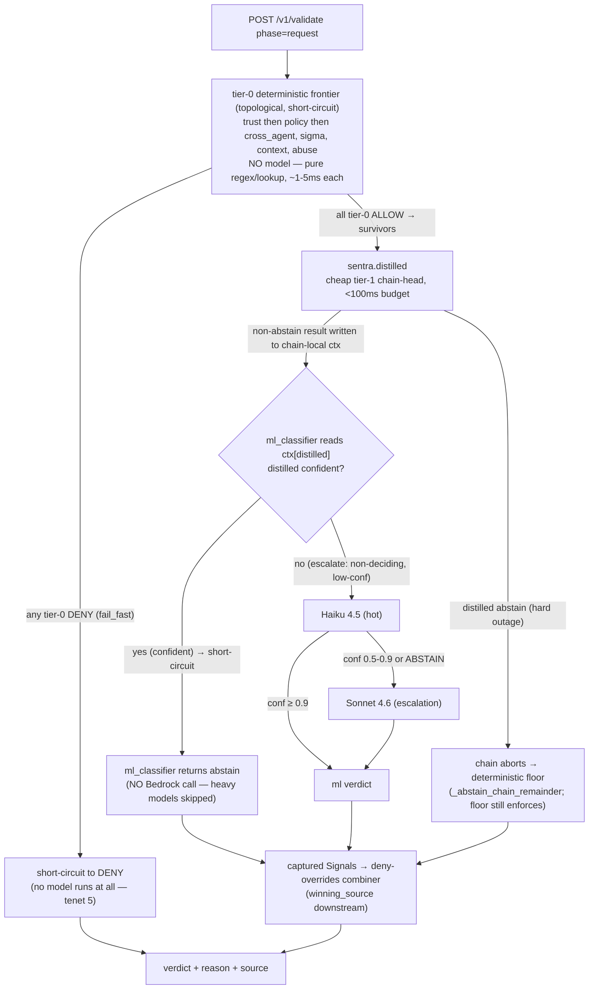
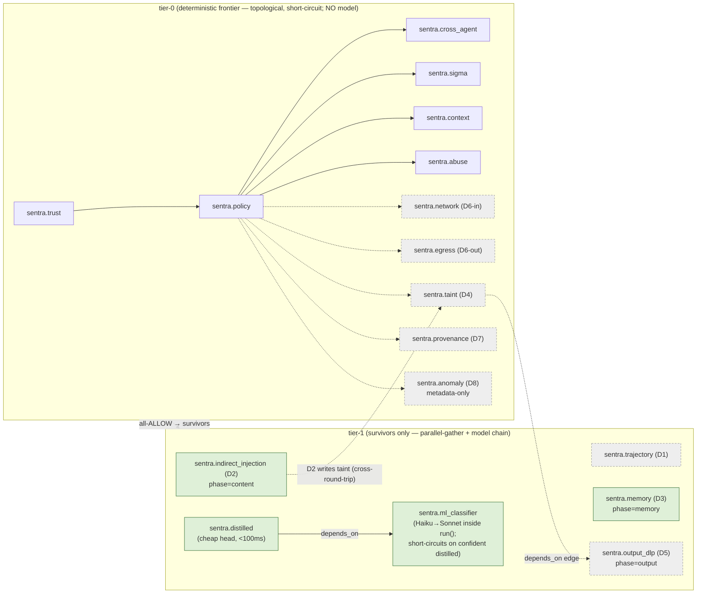
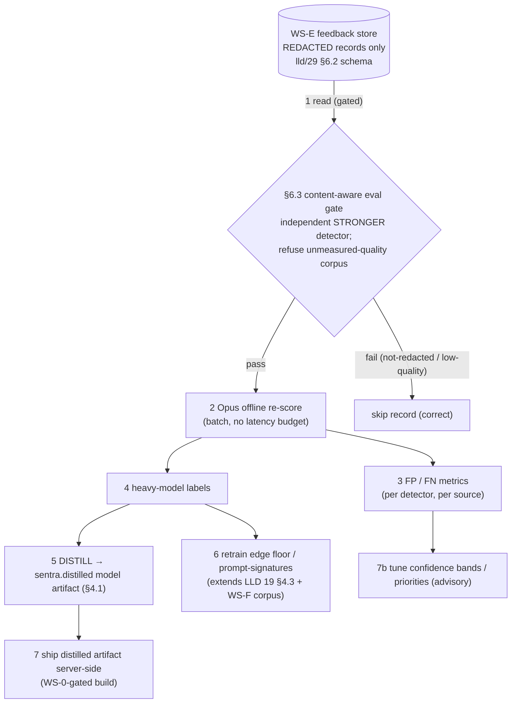

# LLD 32: Detection Depth (WS-L) — Serverless Build-of-Record

**Version**: 1.0
**Last Updated**: 2026-07-02
**Status**: Draft — for review
**Owner**: Founder
**Workstream**: WS-L (Serverless edition) — Detection Depth, consolidated

**Prerequisites (contracts this LLD consumes, does NOT re-cut):**
- [LLD 31: DAG Scheduler](31-dag-scheduler.md) (WS-C) — the `ValidatorNode` / `CostTier` / `depends_on` node vocabulary + `run_dag` execution. WS-C owns the *mechanism*; this LLD registers *nodes*.
- [LLD 30: Multi-phase Contract](30-multiphase-contract.md) (WS-B) — the `phase` field, `KNOWN_PHASES`, the `_CONTENT_FIELD` → `content_text` map, and the `phase_handler_not_implemented:<p>` fail-secure stub the three phase handlers replace.
- [LLD 29: Redaction](29-redaction.md) (WS-E) — the Tier-2 `redaction.ner` barrier + the redacted feedback-store schema (§6.2) + the §6.3 content-aware eval gate the offline loop reads through.

**Consolidates (superseded-for-Serverless, retained as origin design):**
- [LLD 19: ML Threat Classifier](19-ml-threat-classifier.md) — tiered Haiku/Sonnet/Opus models.
- [LLD 20: Defense-in-Depth Layers](20-defense-in-depth-layers.md) — the seven D1–D7 layers. This LLD adds an eighth layer, **D8 (behavioural-anomaly, metadata-only)**, designed here for FR-3.11.

**Elaborates HLD:** [hld/serverless-edition.md](../hld/serverless-edition.md) §6.2(c) (the cost-annotated DAG, ADR-030), §6.2(h) (all-detectors-on, ADR-034), §6.2(b) (the phase contract), §6.2(e) (the edge-is-deterministic-only / models-are-server-side note), §3 (the "deep enough to catch real attacks" thesis).

## Table of Contents
1. [Context](#1-context)
2. [Scope & consolidation map](#2-scope--consolidation-map)
3. [Tenets carried forward](#3-tenets-carried-forward)
4. [Architecture: the tiered detection model (distilled → heavy → offline)](#4-architecture-the-tiered-detection-model-distilled--heavy--offline)
5. [Architecture: D1–D8 as DAG nodes](#5-architecture-d1d8-as-dag-nodes)
6. [Architecture: the three per-phase handlers (WS-B stub replacements)](#6-architecture-the-three-per-phase-handlers-ws-b-stub-replacements)
7. [Architecture: multimodal / image threat (FR-3.15)](#7-architecture-multimodal--image-threat-fr-315)
8. [Architecture: offline reclassify + retrain loop (FR-3.14)](#8-architecture-offline-reclassify--retrain-loop-fr-314)
9. [Signal taxonomy & priority additions](#9-signal-taxonomy--priority-additions)
10. [Cross-workstream seams & honest gaps](#10-cross-workstream-seams--honest-gaps)
11. [Security (SEC-1..n)](#11-security-sec-1n)
12. [Scaling & latency budget](#12-scaling--latency-budget)
13. [Resiliency & recovery (RES-1..n)](#13-resiliency--recovery-res-1n)
14. [Sequencing & rollout (honest phasing)](#14-sequencing--rollout-honest-phasing)
15. [Cross-references](#15-cross-references)

---

## 1. Context

**In plain terms.** WS-C already built the scheduler — the thing that runs the checks. WS-B already built the `phase` field — the thing that says whether a call is checking a tool request, ingested content, an output, or a memory write. This doc does not re-decide either. It fills the *depth* those two left empty: a cheap distilled classifier that heads the model chain and answers the common case fast, the escalation chain behind it, the eight deep detection layers (D1–D8) as new scheduler nodes, and the three per-phase handlers that replace WS-B's "not implemented yet → deny" stubs with real detectors. Each thing this LLD adds is registered into the *existing* `run_dag` as an ordinary `ValidatorNode` — no new subsystem, no new combiner, no new endpoint.

This LLD deepens the **one approved HLD option** — [hld/serverless-edition.md](../hld/serverless-edition.md) §6.2(c) **Option A, the cost-annotated DAG** (tier-0 short-circuit, then tier-1 parallel-gather; ADR-030), operating on §6.2(b)'s phase contract, feeding §6.2(e)'s redacted store, under §6.2(h)'s all-detectors-on posture (ADR-034). It does **not** re-litigate those choices. It is the **Serverless build-of-record for all detection depth**, consolidating [LLD 19](19-ml-threat-classifier.md) (tiered models) and [LLD 20](20-defense-in-depth-layers.md) (D1–D7, extended here with the new D8 behavioural-anomaly layer for FR-3.11), both of which get a `superseded-for-Serverless by lld/32` forward pointer and are retained as origin design (propagate-change discipline — not deleted, not forked).

**Doc-number correction.** This document is **`lld/32-detection-depth.md`**. The WS-L scope doc ([tasks/serverless-edition/ws-l-detection-depth.md](../tasks/serverless-edition/ws-l-detection-depth.md)) refers to `lld/31` — that reference is **stale**; `lld/31` is WS-C's DAG scheduler ([lld/31-dag-scheduler.md](31-dag-scheduler.md)). The authoritative slot for WS-L is `lld/32` per [tasks/serverless-edition/00-index.md:16,38](../tasks/serverless-edition/00-index.md). The scope doc's cross-references should be reconciled to `lld/32` (§10).

---

## 2. Scope & consolidation map

**In plain terms.** The "depth" pieces had no build owner: the distilled model, the heavy-tier chain, the offline retrain loop, the eight D-layers (D1–D7 from LLD 20 plus the new metadata-only D8), multimodal, and the three phase handlers. This section is the one table that names each piece, its requirement ID (fixed against the PRD — see below), its origin design, its honest priority, and whether it's in the first build wave or later. It also states what is explicitly *not* this LLD's job.

### 2.1 The pieces

The requirement→layer map below is verified verbatim against [prd/serverless-edition.md:142-152](../prd/serverless-edition.md). Two IDs the round-1 draft swapped are fixed here: **FR-3.8 = D4 taint** (not memory), **FR-3.9 = D3 memory** (not taint); **FR-3.10 covers D6 *and* D7 together** (one PRD requirement — "Network / egress validation + provenance (D6 / D7)"); and **FR-3.11 = D8 behavioural-anomaly**, a new layer designed in §5.8.

| Piece | Implements | Origin design (consolidated) | Priority (honest) | This LLD's status |
|---|---|---|---|---|
| **Distilled local model** (server-side cheap tier-1 chain-head) | FR-3.12 (elevated to P0) | LLD 19 tiered strategy (no prior LLD) | P0 build-wave | **SLOT designed (§4.1); BUILD gated on WS-0 escalation-rate number** |
| **Heavy-tier escalation** (Haiku 4.5 → Sonnet 4.6 → Opus offline) | FR-3.2 | LLD 19 §3–4, §4.4 bands | P0 build-wave | Designed §4.2; already live as the tier-1 `sentra.ml_classifier` node — see §4.1 for why it is NOT a cheap front-tier today |
| **Offline reclassify + retrain loop** | FR-3.14 | LLD 19 §4.3/§13.3 + LLD 29 §6.6 gap | P0 (cold-path) | **CONTRACT designed §8; BUILD after WS-E ships the feedback store + eval gate** |
| **D1 Trajectory** | FR-3.5 | LLD 20 §4 | PRD P1 | Designed §5.1; **LATER** (§14) |
| **D2 Indirect / second-order injection** | FR-3.6 | LLD 20 §5 | PRD P1 → **P0** (owner build-wave call) | Designed §5.2 + §6.2; **FIRST WAVE**, standalone (no taint-thread) |
| **D3 Memory integrity** | **FR-3.9** | LLD 20 §6 | PRD P2 → **P0** (owner build-wave call) | Designed §5.3 + §6.3; **FIRST WAVE** |
| **D4 Taint / information-flow control** | **FR-3.8** | LLD 20 §7 | PRD P2 | Designed §5.4; **LATER** — the D2→D4→D5 chain extension |
| **D5 Output DLP** | FR-3.7 | LLD 20 §8 | PRD P1 → later (owner call) | Designed §5.5 + §6.4; **routed-but-stubbed → fail-secure DENY** until the PDP→PEP rewrite loop exists |
| **D6 Network / egress** | **FR-3.10** (with D7) | LLD 20 §9 | PRD P2 | Designed §5.6; **LATER** |
| **D7 Supply-chain / inter-agent** | **FR-3.10** (with D6) | LLD 20 §10 | PRD P2 | Designed §5.7; **LATER** |
| **D8 Behavioural anomaly** (metadata-only, per-deployment baseline) | **FR-3.11** | **NEW — extends LLD 20** | sub-PRD P2 (design-complete only) | Designed §5.8; **LATER** — metadata-only moat layer, tier-0, no model call |
| **Multimodal / image threat** | FR-3.15 | named-not-designed | P1/P2 | **SCOPE-ONLY §7** — the E6 image router is the current surface; a real evaluator is a later tier-1 node |

### 2.2 Explicit non-goals (owned elsewhere — do NOT re-cut here)

- **The DAG mechanism** — `run_dag`, `_toposort`, `_build_chains`, the tier-0/tier-1 split, `fail_fast`/`evaluate_all`. Owned by WS-C ([lld/31](31-dag-scheduler.md)). This LLD *registers nodes into* it; it changes no scheduler-core file.
- **The `phase` field / `KNOWN_PHASES` / `_CONTENT_FIELD`** — owned by WS-B ([lld/30](30-multiphase-contract.md)). This LLD *consumes* the contract additively; it does not add a phase, rename `content_text`, or add per-phase `*_body` fields.
- **The redacted feedback-store schema + the §6.3 eval gate** — owned by WS-E ([lld/29](29-redaction.md)). This LLD's offline loop is a *reader* of that store; it does not design the store.
- **The `coverage_sources(phase)` accessor** — WS-C owes it to WS-D ([lld/33](33-decision-trail.md)). This LLD only *registers its new sources* into the fallback tables so the trail joins on them (§9, §10).
- **The deny-overrides combiner algorithm** — unchanged (LLD 17 substrate). This LLD adds *producers* (Signal-emitting nodes), not a new combine algorithm.

---

## 3. Tenets carried forward

The **8 HLD master tenets** ([hld/serverless-edition.md](../hld/serverless-edition.md) §4, ARCHITECTURE §1.4 verbatim) and tie-breakers **A** (grow additively) and **B** (record what ran) govern every implementation call below. Restated for this LLD's context, most-important-first:

1. **Enforcement is local; the control plane is never on the action path** — the distilled model + D-nodes run in the PDP on the action path; the offline retrain loop (§8) is control-plane / cold-path, NEVER on `/v1/validate`.
2. **Fail secure, never fail open** — a dropped/errored D-layer abstains to the deterministic floor or re-raises to a fail-secure DENY; a stub replacement never opens a fail-open hole; abstain is never treated as "clean".
3. **Deny-by-default, explainable** — every D-node names its deciding `Source`; its `Signal` is captured into WS-D's decision trail; a new `Source` must be registered so the trail joins on it.
4. **Defense in depth** — D1–D8 are independent layers, each ABSTAINs on error/disable and is never a sole defense; evading one is caught by another.
5. **Latency scales with risk, not volume** — the distilled model classifies the common case cheaply so the heavy tier + D-nodes (tier-1) run only on tier-0 survivors / edge cases; no summed latency (parallel-gather + chains).
6. **The data boundary is the customer's to set** — D-nodes read the post-NER-barrier redacted view; no raw PHI retained by the reclassify loop (redacted records only).
7. **Honest staging** — ship deterministic floors first; each D-layer + the ML tiers graduate shadow→enforce via `metadata['enforce']`, NOT simultaneous ship; sub-PRD P1/P2 marks are honored with per-layer sequencing.
8. **Tie-breaker A — grow the contract additively** — new `Source.*` constants, D-nodes, and phase handlers are additive; no re-cut of the `phase` field, the `_CONTENT_FIELD` map, the `ValidatorNode` vocabulary, or the existing `DEFAULT_PRIORITIES` / tie-break.
9. **Tie-breaker B — record what ran; force nothing extra** — D-nodes register into the DAG so WS-D records what actually executed; producing the trail must not force layers to run that risk didn't warrant (`evaluate_all` is the opt-in high-assurance mode, not the default).

> Load-bearing consequences threaded through this doc: **tenet 4** — every D-node ABSTAINs on error/disable and is never a sole defense (§5, §13). **tenet 5** — the distilled node resolves the common case so the heavy tier runs only on survivors (§4, §12). **tenet 2** — the phase-handler stub replacement (§6) never fails open; on abstain the deterministic floor decides. **tenet 8** — each layer + tier graduates shadow→enforce via `metadata['enforce']` (`run.py:69-80` `_is_hard_deny`), not a simultaneous 8-layer flip (§14).

---

## 4. Architecture: the tiered detection model (distilled → heavy → offline)

**In plain terms.** Today exactly one model node runs, and it is NOT cheap: `sentra.ml_classifier` is a Haiku call registered as **tier-1** (`CostTier.EXPENSIVE_MODEL`, [registry.py:326-331](../src/security-controller/app/services/scheduler/registry.py)), ~600 ms, gathered on *every* request that clears the deterministic floor. There is **no cheap MODEL front-tier today** — the only cheap frontier is the deterministic floor (trust/policy/sigma/context/abuse/cross_agent, all tier-0, ~1–5 ms each). This section adds a *smaller, faster, server-side* classifier — the **distilled model** — as the **head of the tier-1 model chain**: it answers the easy common case in under 100 ms, and the heavy Haiku→Sonnet nodes behind it **short-circuit to abstain** when the distilled verdict is high-confidence, so the heavy models only run on the genuinely ambiguous minority. The distilled model is *trained by* the offline loop in §8 (it distills the big models' labels into a small fast one). "Cheap" here means the small model's **hard sub-100 ms budget**, NOT a new cost tier — a node that calls a model is tier-1 by the WS-C contract, so the distilled node is a cheap tier-1 node, not a re-cut of the tier split.

### 4.1 The distilled model as the cheap tier-1 chain-head (Q1)

**What it is.** A small server-side classifier (`sentra.distilled` node) placed at the **head of the tier-1 model chain**, in front of the Haiku hot node. It resolves the common case in **< 100 ms**; the heavy Haiku→Sonnet nodes behind it **short-circuit to abstain** on a high-confidence distilled verdict, so the heavy models run only on the low-confidence / ABSTAIN minority. It is **produced by the FR-3.14 offline distill/retrain loop** (§8) — distilling Opus/Sonnet labels into a small fast model — which is precisely why FR-3.12 (the model) and FR-3.14 (the loop that makes it) are designed together in this one LLD.

**Where it runs — server-side in the PDP, NOT the SDK edge.** The Serverless SDK edge is stdlib-only and hosts no model ([hld/serverless-edition.md](../hld/serverless-edition.md) §6.2(e); [lld/29](29-redaction.md) §4). The distilled model runs **server-side in the PDP**, as a `ValidatorNode`. (The at-edge distilled variant is the in-VPC / sidecar story, out of this slice — WS-L task doc read-before-coding #2.)

**The `CostTier` decision (resolved cleanly, not hand-waved) — the distilled node is tier-1, NOT a new tier.** `CostTier` has exactly two members ([node.py:20-28](../src/security-controller/app/services/scheduler/node.py)): `DETERMINISTIC = "tier-0"` (the cheap short-circuit frontier — pure regex/lookup, no model call) and `EXPENSIVE_MODEL = "tier-1"` (the parallel-gathered / chained model nodes, run only for tier-0 survivors). A node that calls a *model* is **tier-1 by definition of this contract** — tier-0 means *no model*. So:

- **Decision: `sentra.distilled` is `CostTier.EXPENSIVE_MODEL` (tier-1), the chain-head of the model chain. It does NOT ride tier-0, and NO new `CostTier` enum member is added.** Adding a third `CostTier` would touch the scheduler core (`run_dag` branches on exactly `DETERMINISTIC` vs `EXPENSIVE_MODEL` when it splits the frontier from the survivors) — a re-cut of WS-C's contract, forbidden by tenet 8, and it would break the additive tie-breaker A. "Cheap" is expressed by a **hard sub-100 ms budget** inside the node's own `run()`, not by a tier label: the same-tier `sentra.ml_classifier` Haiku node runs ~600 ms, so the distilled node's ~<100 ms is "cheap relative to the heavy nodes it heads," while still being a model → still tier-1.
- **How "cheap head + short-circuit" is expressed in the real scheduler — the `depends_on` chain + chain-local `ctx`.** The model chain is a tier-1 `depends_on` chain: **`sentra.ml_classifier` (Haiku) `depends_on=(Source.SENTRA_DISTILLED,)`**, and Sonnet's escalation stays inside the Haiku node's `run()` (as today). `run_dag` groups this into a chain (`_build_chains`) and runs it via `run_chain` ([run.py:299](../src/security-controller/app/services/scheduler/run.py)), which threads the distilled result forward in a **chain-local `ctx`** (`{**session, **ctx}`, [run.py:316](../src/security-controller/app/services/scheduler/run.py)) — the *same* threading D4 uses to read D2's taint. **The load-bearing constraint from `run_chain`'s abort-on-upstream-*abstain* semantics ([run.py:336-338](../src/security-controller/app/services/scheduler/run.py)): a chain aborts and every downstream node fails to the deterministic floor when an upstream node returns `is_abstain` — the downstream node does NOT run. So the distilled node must NEVER return `abstain` for the escalation (low-confidence) case, or the Haiku node would be skipped exactly when the heavy tier is most needed. Instead the distilled node returns a *concrete, non-deciding* verdict on the escalate case (`ValidationResult.allow(...)` carrying `metadata["escalate"]=True`), which threads into `ctx` and lets the chain continue; `abstain` is reserved strictly for a hard distilled outage, where dropping to the floor IS the intended behavior.** The Haiku node reads `ctx[Source.SENTRA_DISTILLED]`:
  - **high-confidence distilled verdict** (`confidence ≥ ML_CONFIDENCE_TRUST_THRESHOLD`) → the Haiku node **returns `ValidationResult.abstain(...)` immediately** (it short-circuits — no Bedrock call), so the heavy model never runs and the distilled `Signal` decides;
  - **distilled non-deciding-with-`escalate`** (low-confidence, threaded into `ctx`) → the Haiku node runs Haiku (→ Sonnet) as normal — the heavy tier evaluates precisely the ambiguous minority;
  - **distilled `abstain`** (hard outage only) → the chain aborts, the Haiku node fails to the deterministic floor via `_abstain_chain_remainder` (a distilled *outage* correctly drops the heavy tier for that call rather than fabricating a verdict — the floor still enforces; see the outage note in RES-3).

  The expected hot-path cost for the common case is therefore ~distilled latency (<100 ms), vs today's flat ~600 ms Haiku-always — that IS FR-3.12's latency win.
- **Why this composes safely (no in-node gather, abstain-not-clean).** The distilled node's `run()` is ONE `Awaitable[ValidationResult]` per the `ValidatorNode.run` signature ([node.py:62](../src/security-controller/app/services/scheduler/node.py)); it does **NOT** `asyncio.gather` internally — the sole gather in the system is `_run_tier1_with_edges` ([run.py:256](../src/security-controller/app/services/scheduler/run.py)); a self-gathering node re-introduces summed latency and bypasses the run-mode flag (WS-L task doc footgun #1). The distilled node **catches its own inference failures and RETURNS `ValidationResult.abstain(...)`** (never raises), exactly as the ML classifier does on a Bedrock outage ([models.py:236-253](../src/security-controller/app/api/models.py) `abstain`); a hard 100 ms wall (`asyncio.wait_for` inside its `run`) → returned abstain on timeout. As stated above, this abstain is reserved for the **hard-outage** path only — it aborts the chain to the deterministic floor (the floor still enforces; abstain is never treated as "clean"; RES-3). The **low-confidence escalate** path is NOT an abstain — it is a concrete non-deciding verdict carrying `metadata["escalate"]=True` that threads into `ctx`, so the heavy Haiku→Sonnet tier evaluates it. This split is the whole reason the mechanism composes: `run_chain` *structurally cannot* express "distilled-abstain → still run heavy" (abstain aborts), so escalation MUST ride a non-abstain verdict.

**Interim (until the distilled model is trained + shipped) — the honest first-wave latency story.** There is **no cheap model front-tier today**: `sentra.ml_classifier` (Haiku) is tier-1 and runs on every floor-survivor (~600 ms). **First-wave latency is UNIMPROVED by this LLD** — and that is acceptable, because the ~600 ms Haiku-always survivor path already sits inside the **ML-hot ≤900 ms target** (CLAUDE.md constraint 1; LLD 24). The distilled model is a p99 *tightener*, not the thing that first meets the target. Two things already cap the common case *without* the distilled model: (a) the **tier-0 deterministic floor short-circuits obvious cases before any model call** (a tier-0 DENY, or a clean fast-path where policy/sigma resolve, never pays the Haiku tax); (b) only floor-*survivors* reach Haiku at all. The distilled *slot* is designed now; its *build* is **triple-gated and sequenced** — WS-0's escalation-rate number (§14.3) → the §8 offline distill/retrain loop → WS-E's feedback store (§8.3, G2) — a dependency-ordered critical path, not a single unbuilt jump. If WS-0's measured escalation rate is high enough that a distilled chain-head meaningfully cuts p99, it is built along that path; if the common case is already cheaply resolved at the deterministic floor, distillation is deferred with no latency regret (the target is already met). Until then, the cheap frontier is the deterministic floor alone, and Haiku is the only (tier-1) classifier — a p99 within target, awaiting the distilled tightener, not a broken budget.

### 4.2 Heavy-tier escalation (Haiku 4.5 → Sonnet 4.6 → Opus offline)

Consolidated from [LLD 19 §3–4](19-ml-threat-classifier.md). The heavy tier is a **tier-1** `EXPENSIVE_MODEL` chain, reached only when the distilled node emits a non-deciding `escalate` verdict (low-confidence; §4.1) — or, interim, on every floor-survivor while the distilled model is unbuilt:

- **Haiku 4.5 (hot)** — the first heavy model; emits `confidence ∈ [0.0, 1.0]` alongside its decision.
- **Sonnet 4.6 (escalation)** — reached on the confidence band (LLD 19 §4.4):

| Haiku output | Action |
|---|---|
| `decision=ALLOW/DENY, confidence ≥ 0.9` | Trust Haiku. Skip escalation. |
| `confidence ∈ [0.5, 0.9]` | Escalate to Sonnet. Use Sonnet's verdict. |
| `confidence < 0.5` | Escalate to Sonnet AND emit ABSTAIN (Haiku effectively didn't decide) |
| Haiku ABSTAINs | Escalate to Sonnet |
| Both ABSTAIN | No `sentra.ml_classifier` signal — the distilled verdict (if confident) or the deterministic floor decides |
| Distilled **confident** (chain-head, §4.1) | Haiku node short-circuits to abstain — heavy models skipped; distilled `Signal` decides |
| Distilled **non-deciding-with-`escalate`** (low-confidence; §4.1) | Haiku node runs Haiku (→ Sonnet) as normal — the concrete escalate verdict threaded into `ctx` triggers evaluation |
| Distilled **`abstain`** (hard outage only; §4.1) | chain aborts → Haiku node fails to the deterministic floor (`_abstain_chain_remainder`); the floor still enforces |

Thresholds are env-vars (`ML_CONFIDENCE_TRUST_THRESHOLD=0.9`, `ML_CONFIDENCE_ABSTAIN_THRESHOLD=0.5` — the pydantic `validation_alias` names, no `SENTRA_` prefix; [config.py:336-345](../src/security-controller/app/config.py)) — tune without redeploy.

- **Opus** is **offline-only** (LLD 19 §4.3) — never on the request path (its ~5s would compound; §4.2 of LLD 19). Opus's role is the batch reclassify + label-generation of §8.

The whole heavy chain — Haiku, its Sonnet escalation — lives inside the `sentra.ml_classifier` node's `run()` as one awaitable, wrapped by `_apply_ml_enforce_wrapper` ([registry.py:402-425](../src/security-controller/app/services/scheduler/registry.py)) which stamps `metadata["enforce"]=True` so a live ML DENY can decide (`_is_hard_deny`). This is unchanged from WS-C. The only WS-L change is additive: the `sentra.ml_classifier` node gains a `depends_on=(Source.SENTRA_DISTILLED,)` edge so it becomes the tail of the distilled→Haiku chain (§4.1) and reads the distilled verdict from the chain-local `ctx` to decide whether to short-circuit — it does NOT change the Haiku→Sonnet internals.

### 4.3 How distilled + heavy compose as DAG nodes

The distilled model and the heavy classifier are **two tier-1 nodes in one `depends_on` chain**: `sentra.distilled` → `sentra.ml_classifier`. The deterministic floor still short-circuits *before* the chain runs at all (tenet 5); the cheap distilled head then lets the heavy Haiku→Sonnet tail short-circuit on the confident common case.



The distilled→ml_classifier pair is ONE tier-1 `run_chain` chain (both `EXPENSIVE_MODEL`); the Haiku→Sonnet escalation is a within-node awaitable inside `sentra.ml_classifier.run()`.

Key: **both** `sentra.distilled` and `sentra.ml_classifier` are `cost_tier=CostTier.EXPENSIVE_MODEL` (tier-1) — no new tier, no tier-0 model. `sentra.distilled` has `depends_on=(Source.SENTRA_POLICY,)` (documentary — it runs after policy resolves, like the other survivors); `sentra.ml_classifier`'s `depends_on` changes from `(Source.SENTRA_POLICY,)` to `(Source.SENTRA_DISTILLED,)` — no loss of ordering, since the distilled node itself `depends_on` policy, so `run_chain` still runs the whole chain after the tier-0 policy resolves (transitivity). That edge is what makes `_build_chains`/`run_chain` sequence distilled→ml and thread the distilled verdict forward in the chain-local `ctx` ([run.py:299,316](../src/security-controller/app/services/scheduler/run.py)). The Sonnet escalation stays a within-node awaitable inside the Haiku node's `run()`; the distilled→Haiku short-circuit is a `depends_on` chain edge, never an in-node `gather`.

---

## 5. Architecture: D1–D8 as DAG nodes

**In plain terms.** Each of the eight deep layers becomes one new `ValidatorNode` — D1–D7 consolidated from LLD 20, plus the new metadata-only D8 (§5.8). The ones that call a model or state-lookup for content are tier-1 (D1, D2, D3, D5); the cheap deterministic ones sit on tier-0 (D4 taint, D6 network/egress, D7 provenance, D8 anomaly). Three of them form a *chain* — D2 tags content as untrusted, D4 reads that taint to block privileged actions, D5 checks the output — expressed by `depends_on` edges (D4 depends on D2, D5 depends on D4) that `_build_chains` ([run.py:207-242](../src/security-controller/app/services/scheduler/run.py)) sequences. Each layer names a new `Source.*`, ABSTAINs on error/disable, and is never a sole defense. This section designs **all eight** (consolidating LLD 20 + the new D8); §14 sequences which ship first. Requirement IDs use the corrected PRD map (§2): D1=FR-3.5, D2=FR-3.6, D5=FR-3.7, **D4=FR-3.8, D3=FR-3.9, D6+D7=FR-3.10, D8=FR-3.11**.

### 5.1 D1 — Conversation Trajectory (`Source.SENTRA_TRAJECTORY`) — FR-3.5

- **Catches:** Crescendo / many-shot / slow-build intent drift — malice distributed across turns (LLD 20 §4). OWASP LLM01.
- **Mechanism:** a per-session GRU state head folds each turn's Bedrock embedding into an accumulated-risk hidden state persisted on the session item (`trajectory_state`, `trajectory_risk`, `trajectory_turn_count` in the `sentra-session-context` DDB table); a DENY when accumulated risk crosses threshold even though the current turn is individually benign. Encoder = frozen Bedrock embedding (`amazon.titan-embed-text-v2`); state head = in-process GRU (~KB weights).
- **Node:** `cost_tier=EXPENSIVE_MODEL` (tier-1; the ~20–50 ms embedding RTT), `depends_on=(Source.SENTRA_POLICY,)`, `phase=request`. Standalone (no `depends_on` onto another tier-1 node).
- **ABSTAIN:** on embedding-model outage or `D1_ENABLED=false` → `ValidationResult.abstain(...)` → no signal → floor decides.
- **`trajectory_state` integrity (server-side-write-only).** `trajectory_state` / `trajectory_risk` are durable cross-session security-decision state read on LATER calls to DENY. They are **written ONLY by the D1 node server-side** — never accepted from a client-asserted field (the SEC-3 rule: the server never trusts a client-supplied trust/taint/risk level). This closes the tampering path where a compromised session-writer lowers accumulated `trajectory_risk` to evade the crescendo DENY. Whether the state needs the same KMS tamper-evidence as D3's memory record (§5.3) or is acceptably in-boundary DDB-only is a **D1-build decision** (LATER); stated here so it is not silently omitted.

### 5.2 D2 — Indirect / Second-Order Injection (`Source.SENTRA_INDIRECT`) — FR-3.6

- **Catches:** ASI01 Goal Hijack, EchoLeak, RAG-poisoning — injection riding in content the agent *ingests* (LLD 20 §5). The single largest current coverage gap.
- **Mechanism:** reuse the sigma + ML detection stack pointed at `content_text` (content-framed ML prompt: "is this untrusted data carrying instructions to an agent?"), plus two indirect-specific detectors — instruction-density heuristic (imperative ratio, second-person directives) and encoding/obfuscation scan (base64, homoglyphs, zero-width chars). Verdicts: ALLOW / DENY / (SANITIZE — see §6.2 scoping).
- **Node:** `cost_tier=EXPENSIVE_MODEL` (tier-1; content-framed ML), `depends_on=(Source.SENTRA_POLICY,)`, `phase=content`.
- **First-wave scope (Q2):** D2 ships **STANDALONE** — it DENYs/ABSTAINs on ingested untrusted content in `content_text` **WITHOUT** taint-threading into D4. The taint-descriptor output (LLD 20 §5.4) that D4 would read is a **future chain extension** (§5.4), not first-wave. See §6.2.

### 5.3 D3 — Memory Integrity (`Source.SENTRA_MEMORY`) — FR-3.9

- **Catches:** ASI06 Memory & Context Poisoning — a durable false "fact" planted in one session biasing future unrelated sessions (LLD 20 §6).
- **Mechanism:** a `MemoryWriteValidator` at the memory chokepoint enforces the integrity guards (LLD 20 §6.4): provenance mandatory; untrusted memory cannot promote itself (`trust_weight ≤ 0.3` cap); **memory tightens, never loosens security** (the policy engine ignores any memory that would expand `allowed_tools` / raise a limit / skip a check); signed + tamper-evident via KMS `GenerateMac`/`VerifyMac` over immutable birth facts; decay-bounded per-kind (short TTL on `AGENT_INFERENCE`, long/no TTL on authenticated `OPERATOR_DIRECTIVE`). Verdicts: ALLOW / DENY (`MEMORY_POISONING`).
- **Node:** `cost_tier=EXPENSIVE_MODEL` (tier-1 — it may run a content-framed classify over the memory candidate), `depends_on=(Source.SENTRA_POLICY,)`, `phase=memory`.
- **Model A (default):** Sentra stores a governance record only (provenance + content hash + signature in `sentra-agent-memory`); the memory *content* lives in the customer store (§3.7 data-residency). D3 is **depth, not the floor** — even with no D3, a poisoned memory can't bypass request-time enforcement when the agent *acts* on it.

### 5.4 D4 — Taint / Information-Flow Control (`Source.SENTRA_TAINT`) — FR-3.8

- **Catches:** ASI02 Tool Misuse, ASI05 Code Exec, bulk-exfil — the structural endgame (LLD 20 §7; CaMeL, arXiv:2503.18813).
- **Mechanism:** a per-session `taint_ledger` (value-fingerprint → taint level) written by D2 on content ingest, read at `phase=request`: for each value in `tool_params`, if its fingerprint matches a known-`untrusted` value and the tool's `action_class` is `PRIVILEGED`/`IRREVERSIBLE` (declared in policy `tool_controls`), DENY `TAINTED_PRIVILEGED_ACTION`.
- **OPEN DESIGN QUESTION for the D4 build — fingerprint canonicalization + redaction-stability (do NOT claim "bypass-proof" until resolved).** Two evasion classes the D4 build MUST resolve, both fail-*open* if left to a naïve exact-value hash:
  - **(a) Redaction round-trip mismatch.** D2 fingerprints the **post-NER-redacted** `content_text` (SEC-4, §6.1), but request-phase D4 matches fingerprints of `tool_params` values which may carry the **pre-redaction** original bytes. If NER changed the bytes D2 fingerprinted, an exact-hash match silently misses → the tainted param passes. The fingerprint scheme must be **redaction-stable** — e.g. fingerprint the redaction sentinel/placeholder identity, or fingerprint pre-redaction under a keyed hash retained as metadata-only — and a test MUST show a value ingested-then-used matches across the content→request round-trip after NER.
  - **(b) Mutation evasion (TAMPERING/EoP).** If the agent re-encodes, trims, base64-wraps, or paraphrases the tainted value before the request call, an exact-value hash misses and D4 ALLOWs the tainted privileged action — a silent fail-open on the exact ASI02/bulk-exfil endgame D4 sells against. Match semantics must be **normalized substring / n-gram / semantic**, not exact-value; the residual evasion (a fully re-authored value) must be stated honestly, not papered over. This is the taint analog of Cedar invariant 3 (deny-on-missing): a value that *should* be tainted but whose fingerprint doesn't match must **not** be treated as clean. Because D4 is **LATER**, this is flagged as an open question the D4 build resolves — not a solved property; the earlier "bypass-proof" phrasing is downgraded accordingly.
- **Node:** `cost_tier=DETERMINISTIC` (tier-0 — pure in-memory ledger lookup, ~2–5 ms; LLD 20 §13), `phase=request`, and — the load-bearing edge — **`depends_on=(Source.SENTRA_POLICY, Source.SENTRA_INDIRECT)`**: D4 reads the taint D2 wrote. Because D2 is a *different-phase* call (`content`) that persisted taint to the session, the within-call edge to `SENTRA_INDIRECT` is documentary; the real ordering is across round-trips.
- **First-wave scope (Q2):** D4 is a **LATER** chain extension. It ships when D2 is extended to emit the taint descriptor. Until then D2 is standalone (§5.2).

### 5.5 D5 — Output DLP (`Source.SENTRA_OUTPUT_DLP`) — FR-3.7

- **Catches:** LLM02 Sensitive Disclosure, EchoLeak exfil — what the agent is about to *emit* (LLD 20 §8).
- **Mechanism:** DLP/PII detectors + exfil-channel detection (secret-looking token adjacent to an external URL) + volume anomaly + destination check over `content_text` at `phase=output`. Useful verdict is **REDACT** (masked payload) or **HOLD** (human-in-the-loop for `requires_human_approval` tools), not just ALLOW/DENY.
- **Node:** `cost_tier=EXPENSIVE_MODEL` (tier-1; reuses ML + DLP), `phase=output`, **`depends_on=(Source.SENTRA_TAINT,)`** — completing the D2→D4→D5 chain.
- **First-wave scope (Q2 / default):** **routed-but-stubbed → fail-secure DENY** (§6.4). A DENY-only output handler is low value; the REDACT/rewrite verdict needs the **PDP→PEP rewrite loop** the SDK decorator does not have today ([lld/30](30-multiphase-contract.md) out-of-scope; [lld/29](29-redaction.md) §2.1(d)). Designing that loop is a separate future deliverable — **NOT** in scope here.

### 5.6 D6 — Network & Egress (`Source.SENTRA_NETWORK` inbound, `Source.SENTRA_EGRESS` outbound) — FR-3.10 (with D7)

- **Catches:** ASI03 Identity/Privilege Abuse, exfil destinations, anomalous callers (LLD 20 §9).
- **Mechanism (two halves):** *inbound* `network_validator` profiles the caller (IP threat-intel, velocity anomaly, impossible-travel) — DENY `MALICIOUS_SOURCE_IP` / `VELOCITY_ANOMALY` / `CREDENTIAL_ANOMALY`; *outbound* egress allow-list (default deny-all) checks any destination in `tool_params` / output — DENY if not in `egress_allowlist`.
- **Nodes:** both `cost_tier=DETERMINISTIC` (tier-0 — ~1–3 ms cached lookup; runs before any model). Inbound `phase=request`; egress on `phase=request` (params) and `phase=output` (destinations).
- **LATER** (§14).

### 5.7 D7 — Supply-Chain / Inter-Agent Integrity (`Source.SENTRA_PROVENANCE`) — FR-3.10 (with D6)

- **Catches:** ASI04 Supply Chain, ASI07 Insecure Inter-Agent Comms (LLD 20 §10).
- **Mechanism:** tool-manifest pin+hash (silently-mutated tool def fails the hash check); `provenance_validator` verifies the calling agent's **signed identity token** (not just a claimed `agent_id`) — DENY `AGENT_SPOOFING`. Pairs with the existing `cross_agent_validator` (STEP 2.5, *is agent X allowed*) by adding authenticity (*is this really agent X*).
- **Node:** `cost_tier=DETERMINISTIC` (tier-0 — signature verify ~5–10 ms, inter-agent calls only; ABSTAINs on non-inter-agent calls), `depends_on=(Source.SENTRA_POLICY,)`, `phase=request`.
- **LATER** (§14).

### 5.8 D8 — Behavioural Anomaly (metadata-only) (`Source.SENTRA_ANOMALY`) — FR-3.11 [NEW]

**New layer, designed here** (founder directive 2026-07-02). D8 extends LLD 20's D1–D7 with an eighth layer that PRD FR-3.11 calls for: **behavioural anomaly detection over a per-deployment baseline, metadata-only**.

- **Catches:** slow behavioural drift and volumetric/timing abuse that no single-call check sees — an agent whose call rate, inter-call timing, tool-mix distribution, or per-window volume deviates from its own learned normal (e.g. a compromised agent that starts calling `transfer_funds` 40× the baseline rate, each call individually policy-clean). It is the statistical complement to the trajectory layer (D1, per-conversation intent) at the **fleet/deployment** grain.
- **Distinct from the two existing rate/trust layers — do NOT conflate:**
  - `abuse_detector` (`sentra.abuse`) enforces **fixed, configured** rate limits (a static threshold). D8 flags a deviation from a **learned baseline** — it catches abuse *below* the fixed limit but *above* this agent's normal.
  - `trust_checker` (`sentra.trust`) is a **trust score**; D8 is a **behavioural-distribution model** (rates/timing/mix), not a score.
- **Metadata-only — the load-bearing property.** D8 reads **counts, timing, rates, and tool-name frequencies only — NEVER content**. It never inspects `content_text`, `tool_params` values, or `user_input`. This is why it can run **even when content is fully redacted or never leaves the customer boundary** — it is a **moat contributor for the regulated / in-VPC editions**, where content-fed detection is unavailable but de-identified behavioural metadata still flows (CLAUDE.md moat-1 "behavioural" track). It reads the same counts already emitted for metering/audit, plus a per-deployment rolling baseline.
- **Mechanism:** a per-deployment statistical baseline (rolling means + variance / EWMA over call-rate, inter-arrival timing, tool-mix histogram, per-window volume; a simple z-score / Mahalanobis-distance flag, no LLM call). On a call whose feature vector exceeds the baseline deviation threshold → emit an **advisory** `SENTRA_ANOMALY` signal (ALLOW-with-warning in shadow; DENY `BEHAVIORAL_ANOMALY` only after enforce-graduation). It is **depth, not the floor** — deny-by-default request enforcement (policy/taint) already stops the individual harmful action; D8 adds the fleet-level "this agent is behaving abnormally" signal.
- **Baseline integrity — the static `abuse_detector` limit stays authoritative above D8 (anti-poisoning).** A learned EWMA baseline is itself a tampering target: a patient attacker who ramps malicious volume slowly trains the baseline *up* to accept the abusive rate (boiling-frog / baseline-poisoning) so the deviation flag never fires. The named mitigation for the **self-history** baseline: (a) the **fixed `abuse_detector` (`sentra.abuse`) limit remains the hard ceiling UNDER which D8 operates** — D8 catches abuse *below* that fixed limit but NEVER replaces it, so a poisoned baseline can at worst blind the sub-limit deviation signal, not lift the absolute cap; (b) **cap the baseline's drift rate** (bound how fast the EWMA can move per window) and/or anchor to an absolute ceiling; (c) optionally **seed the baseline from a fleet/peer-group prior** rather than pure self-history, so a single agent can't train its own normal from zero. D8 is explicitly a *deviation-from-normal complement*, not a rate authority.
- **Shared cross-tenant prior — a DISTINCT tampering surface the self-history mitigation does NOT cover (design-note, P2).** Seeding from a fleet/peer-group prior (above (c)) and feeding the cross-vendor behavioural flywheel (next bullet) means one tenant's de-identified aggregates can shift the *shared* prior for OTHER tenants — a data-poisoning path the drift-cap (which guards only local EWMA) does not close, and the §8 retrain loop distilling labels from a poisoned corpus would propagate it to the shipped model. Named controls for the D8/flywheel build: (a) **contribution weighting / outlier-rejection** on per-tenant aggregates before they enter a shared prior (no single tenant can dominate the peer-group prior); (b) the **§8 eval gate must additionally validate label/contributor provenance** — reject statistically anomalous contributor slices, not just check redaction quality; (c) **a shared prior is used shadow/advisory ONLY until this poisoning control is built** — D8 self-history + the static `abuse_detector` ceiling remain authoritative. This is design-complete-only (P2), so it is a design-note, not a build gate.
- **Moat framing — honest.** D8's structural value in regulated/in-VPC is **not** the z-score itself (a generic z-score / Mahalanobis over call-rate/tool-mix is table-stakes — any UEBA vendor or a CloudWatch anomaly detector does that). The differentiated moat contribution is that D8's de-identified behavioural aggregates feed the **cross-vendor behavioural flywheel** (CLAUDE.md moat-1 "behavioural" track) from *every* edition including air-gapped, where content-fed detection can't reach — a cross-tenant/cross-vendor prior no single-cloud UEBA has. Where that flywheel effect is not yet built, the in-VPC moat rests on the **structural pillar** (neutrality, audit system-of-record, on-prem permanence — CLAUDE.md moat-2), NOT on this unbuilt z-score. Do not sell D8's local statistics as the moat.
- **Node:** `cost_tier=CostTier.DETERMINISTIC` (**tier-0** — pure statistical/metadata compute, NO model call, like `abuse_detector`; ~1–3 ms baseline lookup + z-score), `depends_on=(Source.SENTRA_POLICY,)`, `phase=request`. New source **`Source.SENTRA_ANOMALY = "sentra.anomaly"`**, priority **55** (§9 — a metadata-only *advisory* signal slots below memory 58 and above abuse/cross_agent 50; below the deterministic-infra denials D6/D7).
- **ABSTAIN:** on a cold baseline (insufficient history for this deployment), a stats-store read failure, or `D8_ENABLED=false` → `ValidationResult.abstain(...)` → no signal → floor decides. A not-yet-warm baseline is never treated as "everything is anomalous" **or** "everything is clean" — it abstains (tenet 2).
- **Baseline stats store (dependency, not over-designed here).** D8 needs a **per-deployment behavioural-baseline store** — the rolling feature aggregates keyed by `(tenant_id, agent_id)` and window. This **likely reuses the signal store / a metering rollup** rather than a new table; it is named here as a **dependency** for the build to resolve (a candidate is a `sentra-behavioral-baseline` DDB rollup fed off the existing metering counters). Do NOT design the store schema in this LLD — it is flagged for the build/WS-owner to pin against the metering rollup that already exists.
- **§14 phasing: LATER.** FR-3.11 is **sub-PRD P2 ("design-complete" only)** — designed now, not first-wave. It graduates shadow→enforce like the other layers.

### 5.9 Node graph with dependency edges



Dashed = LATER (§14); solid = first-wave or already-built. There are **two real `depends_on` chains**: (1) the **distilled→ml_classifier model chain** (§4.1, first-wave — the cheap head lets the heavy tail short-circuit); (2) the **D2→D4→D5 chain** (LATER). `_build_chains` groups each and `run_chain` ([run.py:299-340](../src/security-controller/app/services/scheduler/run.py)) runs it sequentially, threading the upstream result forward in the chain-local `ctx` — an upstream *abstain* aborts the chain to the deterministic floor (`_abstain_chain_remainder`, [run.py:245-253](../src/security-controller/app/services/scheduler/run.py)), never treating a missing label as "clean". D8 (tier-0, metadata-only) is standalone — no chain.

### 5.10 Per-layer phasing table (honoring Q2)

| Layer | FR | Node source | cost_tier | phase | depends_on | First-wave? |
|---|---|---|---|---|---|---|
| D1 trajectory | FR-3.5 | `sentra.trajectory` | tier-1 | request | policy | LATER (P2) |
| D2 indirect | FR-3.6 | `sentra.indirect_injection` | tier-1 | content | policy | **FIRST (P0), standalone** |
| D3 memory | FR-3.9 | `sentra.memory` | tier-1 | memory | policy | **FIRST (P0)** |
| D4 taint | FR-3.8 | `sentra.taint` | tier-0 | request | policy, indirect | LATER (chain extension) |
| D5 output-DLP | FR-3.7 | `sentra.output_dlp` | tier-1 | output | taint | LATER (needs rewrite loop; stub→DENY) |
| D6-in network | FR-3.10 | `sentra.network` | tier-0 | request | policy | LATER (P1/P2) |
| D6-out egress | FR-3.10 | `sentra.egress` | tier-0 | request+output | policy | LATER (P1/P2) |
| D7 provenance | FR-3.10 | `sentra.provenance` | tier-0 | request | policy | LATER (P2) |
| D8 anomaly | FR-3.11 | `sentra.anomaly` | tier-0 | request | policy | LATER (P2, metadata-only) |

> **Barrier note (do NOT reuse for D-nodes).** The `redaction.ner` node is a *pre-DAG barrier* (`_is_barrier`, [run.py:55-66](../src/security-controller/app/services/scheduler/run.py)) — it mutates `content_text` in place and is lifted out of the tier split. D-nodes are **ordinary tier-0/tier-1 graph nodes**, NOT barriers; they must not reuse `_is_barrier` / the `REDACTION_NER` pattern (§9).

---

## 6. Architecture: the three per-phase handlers (WS-B stub replacements)

**In plain terms.** WS-B routes any non-`request` phase to a fail-secure DENY today ([routes.py:97-103](../src/security-controller/app/api/routes.py)): `content`, `output`, and `memory` all hit `_phase_not_implemented_deny`. This section replaces that early-return with a real path: send the content/memory phases **into `run_dag(phase)`** so the phase-specific D-nodes (D2 for content, D3 for memory) run as first-class scheduler nodes — not a bypass path around the DAG. Output stays stubbed → DENY until the rewrite loop exists.

### 6.1 The integration seam DECISION — route INTO `run_dag(phase)`, do not bypass it

The current guard ([routes.py:96-103](../src/security-controller/app/api/routes.py)):

```python
# GUARD 2 (only reached with phase IN KNOWN_PHASES):
if phase != "request":
    # content/output/memory: known phase, no live handler yet → fail-secure DENY.
    # WS-L replaces this line with the real D2/D3/D5 handler when it ships.
    return await _phase_not_implemented_deny(
        request, reason=f"phase_handler_not_implemented:{phase}"
    )
```

**Decision:** WS-L replaces this early-return **for `content` and `memory`** with a route into the *same* `validate_tool_call` → `run_dag(phase)` path, where `build_dag(service, phase, stamp_ctx)` ([registry.py:72](../src/security-controller/app/services/scheduler/registry.py)) returns a **phase-specific node set that is NOT the request-phase floor**. This is the locked node-set contract (founder Q2 2026-07-02):

- **`phase=request`** → the full frontier + tier-1 chain, **unchanged**: `[trust, policy, cross_agent, sigma, context, abuse, distilled→ml_classifier, + any request-phase D-nodes]`.
- **`phase=content`** → **`[redaction.ner barrier, sentra.trust (caller-scoped gate), sentra.abuse (rate/cost cap — see below), D2 (sentra.indirect_injection) + D2's own tier]` ONLY.** It does **NOT** run the request **action-authorization** floor — `policy` / `cross_agent` / `context`. Those layers authorize a **tool-call action** — they answer "is *this agent* allowed to call *this tool* with *these params*". An ingested-content check has **no action to authorize** (there is no tool call — it is content being scanned before the agent acts on it). Running them would emit **meaningless signals** (a policy ALLOW on a nonexistent action) that pollute WS-D's "what actually ran" trail (tenet B — record what ran, force nothing extra). **Two floor nodes ARE kept because they are *caller-scoped*, not action-scoped** (the caller-vs-action test — see the next bullet): `sentra.trust` and `sentra.abuse`.
- **`phase=memory`** → `[redaction.ner barrier, sentra.trust (caller-scoped gate), sentra.abuse (rate/cost cap), D3 (sentra.memory) + D3's own tier]` ONLY — same reasoning: a memory-write integrity check authorizes no tool-call action, so the *action*-authorization floor (policy/cross_agent/context) does not run, but the two caller-scoped gates (trust, abuse) do.
- **Keep the caller-scoped gates (trust + abuse) on content/memory — the caller-vs-action test.** Dropping the *action-authorization* floor (policy/cross_agent/context) is correct — those authorize a nonexistent action and would emit meaningless signals. But `sentra.trust` and `sentra.abuse` are **caller-scoped**, not action-scoped, so the same test that drops policy KEEPS them:
  - **`sentra.trust` (`trust_checker`)** gates on the *caller's accumulated session trust* — a quarantined / low-trust agent is exactly the caller you want to stop from pushing content through the ingest scanner or writing to memory, regardless of whether a tool action is being authorized. Dropping trust would let a quarantined agent freely feed the content/memory path with only the rate cap as a backstop. Trust is a **tier-0** node (~1–5 ms, no model), runs before the tier-1 detector, and its DENY (`QUARANTINE_*` / low-trust) is meaningful here because it is about *this caller*, not *this action*. **(This is the caller-scoped floor these phases fall back to on a D2/D3 abstain — see RES-2.)**
  - **`sentra.abuse` (`abuse_detector`)** gates on *this caller making this many content-scan / memory-write calls* — a per-phase rate + cost cap. It carries meaning because a content/memory call still fires a tier-1 model (D2/D3 run a content-framed ML call per §5.2/§5.3) over a payload up to 1 MiB (SEC-3); un-rate-limited, an attacker can drive high-volume content-phase calls as an **unmetered model-cost amplification / DoS surface** distinct from the request path (SEC-3 bounds size, not rate).

  The set is thus `[redaction.ner barrier, sentra.trust, sentra.abuse, the one detector]`. These two caller-scoped floor nodes carry meaning on a non-request phase; the action-authorization nodes (policy/cross_agent/context) stay dropped per the no-action rationale.
- **Two distinct edit sites, in order — do NOT assume editing `build_dag` alone suffices.** Today the request never reaches `build_dag`/`run_dag` on a non-`request` phase at all: **`routes.py` GUARD 2 ([routes.py:97-103](../src/security-controller/app/api/routes.py)) returns `_phase_not_implemented_deny` BEFORE `validation_service.validate_tool_call` is ever called** for content/memory. So WS-L's FIRST required edit is to **replace that GUARD-2 early-return** for `content`/`memory` with a route into the pipeline (output stays on the early-return, §6.4). Only THEN does the SECOND edit matter: `build_dag(service, phase, stamp_ctx)` ([registry.py:72](../src/security-controller/app/services/scheduler/registry.py)) — which today builds the **request nodes for every phase** and only *appends* the NER barrier for content-bearing phases ([registry.py:326-359](../src/security-controller/app/services/scheduler/registry.py)), degrading a non-`request` phase to the request floor via `if phase != "request": pass` ([registry.py:85-88](../src/security-controller/app/services/scheduler/registry.py)) — must instead, for a **non-request** phase, **replace** the request-node list with the phase's D-node set (barrier + the one detector), rather than appending onto the request floor. Editing `build_dag` alone would be dead code, because GUARD 2 still denies before the pipeline runs. This is additive to the WS-C contract (a new per-phase node list; the request-phase list is byte-for-byte unchanged, so WS-C's T-EQUIV request-phase golden baseline is untouched — tenet 8).

This means:

- The content/memory detectors run as **first-class scheduler nodes** — they inherit tenet-5 tiering (the NER barrier still runs first & alone; D2/D3 tier as declared), the run-mode flag (`fail_fast`/`evaluate_all`), the parallel-gather / chain machinery (no summed latency), and the WS-D decision-trail capture. This is the correct honoring of the no-in-layer-gather footgun (WS-L task doc #1).
- It is **NOT** a bypass path around the DAG (a hand-rolled `if phase=="content": run_d2()` beside `run_dag` would fork the scheduler, lose the trail, and re-open the fail-open surface).
- It **consumes** WS-B's contract read-only: `phase` selects the node set; `_CONTENT_FIELD[phase]` → `content_text` ([models.py:34-38,87](../src/security-controller/app/api/models.py)) is where the D-node reads the egressing content. WS-L re-cuts none of it (tenet 8).
- The **NER barrier already runs first** on content-bearing phases ([registry.py:350-359](../src/security-controller/app/services/scheduler/registry.py)) — so D2/D3 read the **post-redaction** `content_text` view (§11 SEC no-raw-PHI). This ordering is free: the barrier is the first entry in the phase's node set, before the detector.

```mermaid
sequenceDiagram
  participant AG as Agent interceptor
  participant RT as routes.py validate()
  participant VS as validation_service.validate_tool_call
  participant DAG as run_dag(phase)
  participant BAR as redaction.ner (barrier)
  participant TR as sentra.trust (tier-0 caller gate)
  participant AB as sentra.abuse (tier-0 rate/cost cap)
  participant DN as D-node (D2 content / D3 memory)
  AG->>RT: POST /v1/validate {phase=content, content_text}
  RT->>RT: GUARD 1: phase in KNOWN_PHASES? (422 if not)
  RT->>RT: GUARD 2: phase != request → route INTO pipeline (WS-L; was DENY-stub)
  RT->>VS: validate_tool_call(request)
  VS->>DAG: run_dag(build_dag(service, "content", ctx), ...)
  DAG->>BAR: barrier FIRST & ALONE — redact content_text in place
  BAR-->>DAG: ALLOW/ABSTAIN (content_text now redacted view)
  DAG->>TR: tier-0 caller-scoped trust gate (quarantine/low-trust)
  TR-->>DAG: ALLOW / DENY (QUARANTINE_* / low-trust)
  DAG->>AB: tier-0 rate/cost cap on caller (before the model)
  AB-->>DAG: ALLOW / DENY (RATE_LIMIT_EXCEEDED)
  DAG->>DN: tier-1 D2 node reads redacted content_text
  DN-->>DAG: ALLOW / DENY (SENTRA_INDIRECT)
  DAG-->>VS: (ValidationResult, signals[])
  VS-->>RT: verdict + reason + source
  RT-->>AG: 200 ALLOW / 200 DENY (honest status; §11)
```

### 6.2 content → D2 (P0, standalone injection detector — Q2)

`phase=content` routes into `run_dag("content")`. `build_dag(service, "content", …)` returns **`[redaction.ner barrier, sentra.trust (caller-scoped), sentra.abuse (rate/cost cap), sentra.indirect_injection (§5.2)]` only** (§6.1 — the barrier + the two caller-scoped gates + the detector, NOT the action-authorization floor policy/cross_agent/context). D2 reads the redacted `content_text`, runs sigma-over-content + content-framed ML + the two indirect heuristics, and returns ALLOW / DENY (`SENTRA_INDIRECT`). The caller-scoped `sentra.trust` node can DENY a quarantined/low-trust caller before the detector even runs. **Because this phase has no *content-detection* fallback beyond D2 itself, a D2 ABSTAIN (model outage / disabled flag) resolves to a fail-secure DENY of the content-ingest, never an implicit ALLOW** (RES-2, tenet 2) — a trust ALLOW does not clear a D2 abstain (trust gates the caller, not the content). **Standalone:** it does NOT thread a taint descriptor to D4 in the first wave — D4 (§5.4) and the taint-write are the LATER chain extension. The **SANITIZE** verdict (spotlighting, LLD 20 §5.3) is **deferred with D5's rewrite loop** — first-wave D2 is ALLOW/DENY only, because returning a spotlighted `sanitized_content` payload needs the same PDP→PEP rewrite path D5 lacks.

### 6.3 memory → D3 (P0)

`phase=memory` routes into `run_dag("memory")`; `build_dag(service, "memory", …)` returns **`[redaction.ner barrier, sentra.trust (caller-scoped), sentra.abuse (rate/cost cap), sentra.memory (§5.3)]` only** (§6.1 — the barrier + the two caller-scoped gates + the detector, NOT the action-authorization floor). D3 validates the memory-write candidate carried in `content_text` against the integrity guards (LLD 20 §6.4) and returns ALLOW / DENY (`SENTRA_MEMORY`, `MEMORY_POISONING`); `sentra.trust` can DENY a quarantined/low-trust caller before D3 runs. As with content, this phase has no *content-detection* fallback beyond D3, so a **D3 ABSTAIN resolves to a fail-secure DENY of the memory-write**, never an implicit ALLOW (RES-2, tenet 2) — a trust ALLOW does not clear a D3 abstain. The read-path consumers (D1 cross-session, policy hints) stay off (`AGENT_MEMORY_READ_ENABLED=false`) until the write-path guards are enforce-graduated — the non-negotiable D3 sequencing rule (LLD 20 §6).

### 6.4 output → D5 (LATER per default — routed-but-stubbed → fail-secure DENY)

`phase=output` **stays** on the `_phase_not_implemented_deny` early-return (fail-secure DENY, `phase_handler_not_implemented:output`) until the PDP→PEP rewrite loop exists. WS-L does **not** design that loop (a separate future deliverable spanning [lld/30](30-multiphase-contract.md) SDK decorator + [lld/29](29-redaction.md)). The `sentra.output_dlp` node (§5.5) is designed and registered *conceptually* into the graph (its `depends_on` on `SENTRA_TAINT` is declared) but its `build_dag` append is gated on the rewrite loop — until then the phase never reaches `run_dag`. This is tenet 2: an unbuilt handler denies, it never opens.

---

## 7. Architecture: multimodal / image threat (FR-3.15)

**SCOPE-ONLY** (per approved default). The **current surface** is the existing **E6 image router** ([registry.py:207-230](../src/security-controller/app/services/scheduler/registry.py) — `content_has_image`, `resolve_tool_image_mode`, `route_image_content` from `app.redaction.image_mode`): when the Tier-1 edge tagged a whole-value image blob into `content_text` as an `⟦AEGR:{nonce}:IMAGE⟧` marker, the NER barrier routes it per-tool **fail-secure** (default / unresolvable → `block`; `evaluate` forwards intact; `redact` replaces with a pending sentinel). A **real image-threat evaluator** (fraud/threat classification of forwarded-intact images) is a **later tier-1 content-path node** that would consume the `evaluate` route's forwarded image. **No full design here** — this LLD only names the surface and the seam so the later node has a defined attach point (the `evaluate` branch of `route_image_content`).

---

## 8. Architecture: offline reclassify + retrain loop (FR-3.14)

**In plain terms.** This is the *cold-path* loop that makes the distilled model (§4.1) and improves the floor. It runs on a schedule (never on `/v1/validate`), re-scores stored **redacted** records from WS-E's feedback store using a stronger detector, measures false-positive / false-negative rates, distills the heavy models' labels into the small distilled model, and retrains the edge floor / signatures. It is **HARD-dependent** on WS-E: the feedback store, the eval gate, and this loop are **NOT built** — this section is the *contract*, sequenced to build **after WS-E ships the store**.

### 8.1 Cold-path only — never on the action path (tenet 1)

The loop is control-plane / batch (LLD 19 §4.3). It never touches `run_dag` or `/v1/validate`. Its inputs are stored records; its outputs are model artifacts + metrics. A failure of the loop has **no action-path RTO/RPO** — the read path (`/v1/validate`) is stateless w.r.t. this loop; a stalled retrain just means the distilled model isn't refreshed, and the interim Haiku tier keeps running (§4.1).

### 8.2 What it reads (gated) and produces



- **Reads REDACTED records** from the WS-E store ([lld/29](29-redaction.md) §6.2) — never raw PHI (tenet 6). The §6.3 eval gate refuses to retrain on an unmeasured-quality / not-redacted corpus (fail-secure: no retrain rather than a bad retrain).
- **Opus** does the batch re-score (its latency is fine off the request path; §4.2).
- **Distills** heavy-model labels into `sentra.distilled` (§4.1) — the FR-3.12↔FR-3.14 coupling.
- **Retrains** the edge floor / signatures (extends LLD 19 §4.3/§13.3 Opus-batch + the WS-F prompt-signature corpus).

### 8.3 Hard dependencies (state plainly)

The feedback store + the §6.3 eval gate + this retrain loop are **NOT built** — WS-E promoted only the edge redactor + the Tier-2 NER barrier ([lld/29](29-redaction.md) §6.6 explicitly names the FR-3.14 retrain job as a WS-L-ownable gap: "no dedicated FR-3.14 retrain LLD yet"). **Sequence this loop AFTER WS-E builds the store** (§10, §14). The distilled-model build (§4.1) additionally waits on WS-0's escalation-rate number (§14).

---

## 9. Signal taxonomy & priority additions

**In plain terms.** Every new node needs a name (`Source.*`) and a strength (priority) so the deny-overrides combiner can rank it and the WS-D decision trail can join on it. This section adds ten new source constants — additively — using LLD 20's higher=stronger numbers (NOT LLD 19's stale inverted numbers), and registers each into the two WS-D trail-join tables. It does not touch any existing entry or the tie-break order. All ten use `SENTRA_*` member names to match the existing `Source.SENTRA_*` enum (founder Q3) — with the explicit divergence note below: they consciously add to the `Source.SENTRA_*` family that [lld/31 §5](31-dag-scheduler.md) put under a going-forward "no new `sentra`-prefixed identifier" rule, so they **join lld/31's tracked rename backlog**.

### 9.1 New `Source.*` constants (additive to [combiners/sources.py](../src/security-controller/app/combiners/sources.py))

Confirmed against the code: **only 7 sentra *validator/producer* sources (`SENTRA_TRUST`, `SENTRA_POLICY`, `SENTRA_SIGMA`, `SENTRA_ML_CLASSIFIER`, `SENTRA_CONTEXT`, `SENTRA_ABUSE`, `SENTRA_CROSS_AGENT`) + `redaction.ner` + 2 edge sources exist today** ([sources.py:22-45](../src/security-controller/app/combiners/sources.py)) — excluding the `SENTRA_COMBINED` ([sources.py:29](../src/security-controller/app/combiners/sources.py)) and `DASHBOARD_COMBINED` ([sources.py:45](../src/security-controller/app/combiners/sources.py)) *aggregates*, which are roll-ups, not verdict-producing validators. The D1–D7 constants do NOT exist. Add:

```python
# Detection-depth layers — LLD 32 (consolidates LLD 20 §11 + new D8). ADDITIVE.
SENTRA_NETWORK:    Final[str] = "sentra.network"            # D6 inbound  (FR-3.10)
SENTRA_EGRESS:     Final[str] = "sentra.egress"             # D6 outbound (FR-3.10)
SENTRA_TAINT:      Final[str] = "sentra.taint"              # D4 (FR-3.8)
SENTRA_PROVENANCE: Final[str] = "sentra.provenance"         # D7 (FR-3.10)
SENTRA_TRAJECTORY: Final[str] = "sentra.trajectory"         # D1 (FR-3.5)
SENTRA_INDIRECT:   Final[str] = "sentra.indirect_injection" # D2 (FR-3.6, phase=content)
SENTRA_OUTPUT_DLP: Final[str] = "sentra.output_dlp"         # D5 (FR-3.7, phase=output)
SENTRA_MEMORY:     Final[str] = "sentra.memory"             # D3 (FR-3.9, phase=memory)
SENTRA_ANOMALY:    Final[str] = "sentra.anomaly"            # D8 (FR-3.11, metadata-only) [NEW]
SENTRA_DISTILLED:  Final[str] = "sentra.distilled"          # distilled chain-head (FR-3.12)
```

(The distilled node reuses `Source.SENTRA_ML_CLASSIFIER`? **No** — it is a distinct producer, so it carries its own `SENTRA_DISTILLED` source at priority 66, one above ML at 65 and below sigma at 70, so a distilled DENY is explainable and unambiguous when both the distilled head and the heavy tail fire. This keeps the deterministic-first ordering: sigma 70 > distilled 66 > ml 65.)

**C5 — naming divergence, explicitly noted (must reconcile in lld/31's backlog, do NOT rename here).** All ten members above use the `SENTRA_*` prefix to stay uniform with today's `Source.SENTRA_*` enum. This consciously **diverges from [lld/31 §5](31-dag-scheduler.md)'s going-forward rule** ("no new `sentra`-prefixed identifier in any enum, file, class, or resource name"). The divergence is deliberate and safe *because* these values are (a) **persisted in DynamoDB audit records** and (b) **read by the SOC console** (`decisions_service.py` `winning_source`) — so a piecemeal rename would break verdict-equivalence and the audit join key. The correct place to rename them is the **single cross-cutting data-migration sweep** lld/31 already tracks in its §16 backlog (rename *all* `Source.SENTRA_*` together, with audit-record backfill + console change). These ten new members therefore **join that lld/31 rename backlog** — they are not renamed in this LLD. (Cross-ref: §10 gap G7.)

### 9.2 Priorities (higher = stronger; slotted additively into `DEFAULT_PRIORITIES`)

Using the **LLD 20 §11 table (higher=stronger)** — **NOT** LLD 19 §6.1's stale inverted (lower=higher) numbers. **Reconcile:** LLD 19 §6.1's priority convention is **superseded by LLD 20 §11** (and by the live `sources.py:55-62` comment, which confirms higher=stronger). The additive entries:

| New source | Priority | Rationale (LLD 20 §11) |
|---|---|---|
| `SENTRA_NETWORK` | 85 | malicious IP / leaked-key — strong, explainable infra denial |
| `SENTRA_TAINT` | 78 | structural IFC denial — strong, below policy authorization |
| `SENTRA_EGRESS` | 77 | destination block — deterministic |
| `SENTRA_PROVENANCE` | 75 | agent-spoofing denial |
| `SENTRA_TRAJECTORY` | 68 | multi-turn — below sigma, above ML |
| `SENTRA_DISTILLED` | 66 | cheap-model semantic — above ML, below sigma (see §9.2.1 for why the cheap head outranks the heavy tail) |
| `SENTRA_OUTPUT_DLP` | 63 | output-side — below request-side semantic |
| `SENTRA_INDIRECT` | 62 | content-surface semantic |
| `SENTRA_MEMORY` | 58 | write-path poisoning guard |
| `SENTRA_ANOMALY` | 55 | D8 metadata-only *advisory* — below memory 58, above abuse/cross_agent 50 |

These slot **between** the existing entries (trust 90, policy 80, sigma 70, ml 65, context 60, abuse/cross_agent 50, edge 40) — no existing value moves.

### 9.2.1 Why `SENTRA_DISTILLED` (66) outranks `SENTRA_ML_CLASSIFIER` (65) — and why that is not "the weak model wins"

A reviewer will (correctly) notice the *cheap* distilled source ranks one above the *heavier* Haiku→Sonnet source in the deny-overrides tie-break, and object that this lets the weaker model's reason win. It does not, because the two are a **short-circuit chain, not concurrent voters** (§4.1): on a **high-confidence (confident) distilled verdict the Haiku node returns `abstain` and emits NO `sentra.ml_classifier` Signal** — so on the common path only ONE of the two ever produces a DENY, and the tie-break between them never fires. Note the two never-confident outcomes do NOT reach this branch as a DENY at all: a distilled *hard-outage* `abstain` aborts the chain (Haiku fails to the floor), and a *low-confidence escalate* is a **non-deciding** verdict — neither is a distilled DENY — so the only way a distilled DENY exists is the confident path, where Haiku is suppressed to abstain and does not co-fire.

**Why the priority ordering is a belt-and-suspenders backstop, not the load-bearing guarantee.** The no-double-fire property rests primarily on the **Haiku node's own `run()` logic** (it returns abstain when `ctx[SENTRA_DISTILLED]` is confident), NOT on the scheduler. If that in-node branch had a bug (or a confidence-band edge where distilled is "confident DENY" but the Haiku read disagreed), the two Signals *could* co-fire — and it is precisely then that 66 > 65 matters: the distilled Signal (whose confidence gated the short-circuit decision) is named `winning_source`, the honest deciding source, rather than the priority table silently handing the tie to the weaker reason. So the ordering is defence-in-depth for a Haiku-node-logic bug; it is not the reason double-fire is normally impossible. **The heavy tier is never suppressed on a confident-DENY-to-block direction**: a distilled ALLOW does not block, and a distilled DENY that short-circuits Haiku is a *block*, not a clear — the cheap head can only escalate-to-DENY or defer to the heavy tail, never unilaterally overrule a heavy-tier DENY.

The residual recall cost of short-circuiting the heavy model on a confident-CLEAN distilled verdict is a **separate, measured** concern, bounded by `ML_CONFIDENCE_TRUST_THRESHOLD` tied to WS-0's recall-delta number (§4.1, §14.3) — not a priority-table question.

**Two tests pin this, and they test different things (do not collapse them):**
1. **`test_confident_distilled_suppresses_haiku` — the primary invariant:** on a high-confidence distilled verdict (ALLOW *or* DENY), the Haiku node produces **NO `sentra.ml_classifier` Signal** at all (assert the signal list contains `SENTRA_DISTILLED` and does NOT contain `SENTRA_ML_CLASSIFIER`). This proves double-fire is not reachable on the common path — the primary guarantee.
2. **`test_distilled_wins_priority_on_double_fire` — the backstop:** when both sources DENY (the constructed off-common-path double-fire), `winning_source == SENTRA_DISTILLED`. This exercises the 66 > 65 ordering deliberately as the backstop for a Haiku-node-logic bug — it does NOT imply the common path double-fires (test 1 proves it does not).

### 9.3 The T-COMBINER-CLEAN coordination (with WS-C)

WS-C's `T-COMBINER-CLEAN` gate requires that **existing `DEFAULT_PRIORITIES` entries + the tie-break order do NOT change**; new entries are **additive-only**. All ten additions above are new keys — no existing key is edited, and the tie-break (`(priority, confidence, _neg_source)`, [run.py:83-115](../src/security-controller/app/services/scheduler/run.py) `_top_tier1_denier` / `pick_top_denier`) is untouched. An unknown source falls through `default_priority` → 0 ([sources.py:76-82](../src/security-controller/app/combiners/sources.py)) — so a node whose source is registered here ranks correctly, and a typo silently loses tie-breaks (the reason every node MUST pass `Source.SENTRA_*`, never a literal — [node.py:36-41](../src/security-controller/app/services/scheduler/node.py)).

**Boot-time registration-completeness invariant (audit-integrity, not just a display nit).** A D-node whose `source` is NOT in `DEFAULT_PRIORITIES` ranks at priority 0 and silently loses every tie-break — so a genuine DENY from that node can be out-ranked and NOT named as `winning_source`, and its verdict is mis-attributed in the DDB audit record + SOC console (a **repudiation / audit-integrity defect** — the trail attributes the block to the wrong layer, or a real detection loses the tie and the trail reads "clean-ish"; SEC-5). Because these sources are the join key for WS-D's tamper-evident trail, a forgotten registration is security-relevant, not cosmetic. **Mitigation (testable, fail-fast at boot):** a startup assertion (and a unit test — `test_all_registered_sources_have_priority_and_labels`) asserts that **every registered `ValidatorNode.source` is present in `DEFAULT_PRIORITIES`, `STATIC_FALLBACK_ORDER`, and `SOURCE_DISPLAY_NAMES`** — a missing registration fails fast at boot, never a priority-0-silently-loses at runtime. See SEC-5.

### 9.4 Register each new source in the WS-D trail-join tables

Each new source's **display name** is added to `SOURCE_DISPLAY_NAMES` ([sources.py:130](../src/security-controller/app/combiners/sources.py)) unconditionally (a source with no label renders as its raw string in the trail — always safe to register). The **`STATIC_FALLBACK_ORDER` registration is phase-scoped, and this is load-bearing:** `coverage_set(phase)` ([trail_builder.py:64](../src/security-controller/app/services/trail_builder.py), called from [validation_service.py:356](../src/security-controller/app/services/validation_service.py)) **ignores its `phase` argument today** and returns the flat `STATIC_FALLBACK_ORDER` for *every* phase (the docstring says so — it awaits WS-C's phase-aware `coverage_sources(phase)`). So a **content/memory/output-only** source added to that flat list would be **over-counted into the request-phase coverage set** — every `phase=request` trail would list D2/D3/D5 as "expected-but-not-run", a WS-D trail-integrity distortion (a not-run marker for a layer that structurally never runs on `request`). **Therefore only *request-phase* new sources (D4 taint, D6 network/egress, D7 provenance, D8 anomaly, `distilled`) are registered into `STATIC_FALLBACK_ORDER` now; the phase-specific sources (D2 content, D3 memory, D5 output) are held OUT of the flat list and join the coverage set only when WS-C's phase-aware `coverage_sources(phase)` lands** (at which point `coverage_set` switches to it with no further WS-L change and the phase-specific sources appear only under their own phase). Until then, D2/D3/D5 still render correctly in a *content/memory/output* trail via their `SOURCE_DISPLAY_NAMES` label + their captured `Signal`; they are simply not enumerated in the request-phase not-run set. (G1.) So the new sources reach WS-D's trail through `coverage_set` now and the phase-aware accessor later; the not-yet-built `coverage_sources` symbol (G1) is the *future* seam, not the live one. The live comment at `sources.py:128-129` already anticipates this ("a future WS-L D-layer renders as its raw name until its label is added here"). Without the display-name registration, a D-node renders as its raw source string in the trail; without the fallback-order registration, WS-D's coverage set under-counts it (§10). **D-nodes are ORDINARY graph nodes** — they do NOT reuse `_is_barrier` / the `REDACTION_NER` pattern ([run.py:55-66](../src/security-controller/app/services/scheduler/run.py)); only the pre-DAG NER redactor is a barrier.

---

## 10. Cross-workstream seams & honest gaps

**In plain terms.** This LLD depends on things other workstreams own or haven't built. This is the honest list of every seam — what's missing, who owns it, and how WS-L mitigates in the meantime — so a reviewer can see exactly what "designed but not fully wired" means here.

| # | Gap / seam | Owner | Status | WS-L mitigation |
|---|---|---|---|---|
| G1 | **`coverage_sources(phase)` accessor + phase-flat over-count** — WS-D's trail records the *expected* source set per phase to mark "not-run" layers ([lld/33](33-decision-trail.md) §13). The LIVE accessor today is `coverage_set(phase)` ([trail_builder.py:64](../src/security-controller/app/services/trail_builder.py), called from [validation_service.py:356](../src/security-controller/app/services/validation_service.py)), which **ignores `phase` and returns the flat `STATIC_FALLBACK_ORDER` for every phase**; the pure phase-aware `coverage_sources(phase)` symbol WS-C owes ([lld/33](33-decision-trail.md)) is NOT built. **Two effects:** (a) request-phase D-nodes under-populate WS-D's coverage set until they are registered; (b) **a *content/memory/output-only* source added to the flat list would be OVER-counted into the request-phase not-run set** (a distortion). | **WS-C** owes the phase-aware accessor mechanism | Not built | WS-L registers only the **request-phase** sources (D4, D6, D7, D8, `distilled`) into `STATIC_FALLBACK_ORDER`; **D2/D3/D5 (phase-specific) are held OUT** and join coverage only via the phase-aware accessor when WS-C lands it (§9.4). All ten get a `SOURCE_DISPLAY_NAMES` label unconditionally. WS-L owns *registering the sources with correct phase scope*; WS-C owns the *accessor*. |
| G2 | **WS-E feedback store + §6.3 eval gate** — the offline loop (§8) reads them. | **WS-E** | **NOT built** (only edge redactor + NER barrier promoted) | Sequence the §8 loop AFTER WS-E ships the store; the §8 contract is authored now against the [lld/29](29-redaction.md) §6.2 schema. |
| G3 | **WS-F prompt-signature corpus** — the retrain loop (§8.2 step 6) also feeds it. | **WS-F** | Separate WS | §8 declares the feed; no build coupling until WS-F's corpus exists. |
| G4 | **WS-0 spike gate** — the escalation-rate + recall-delta numbers that justify the distilled build and the D1–D8 "deep tier". | **WS-0** | packet unsigned | §14 frames the build as spike-gated but override-eligible; the distilled build specifically waits on WS-0's escalation-rate number even under override. |
| G5 | **Docstring drift** — [registry.py:26-28](../src/security-controller/app/services/scheduler/registry.py) says *"WS-D adds D1–D7 as additional tier-1 nodes here"*; the owner directive + [00-index.md](../tasks/serverless-edition/00-index.md) assign **D1–D7 to WS-L**. | doc | drift | **Reconcile:** the registry.py docstring should read "**WS-L** adds D1–D7"; WS-D owns the decision-trail, not the D-layers. Fix when WS-L's first D-node lands. |
| G6 | **Scope-doc drift** — [ws-l-detection-depth.md](../tasks/serverless-edition/ws-l-detection-depth.md) (a) refers to `lld/31` for WS-L's LLD (the real slot is `lld/32`, §1); (b) maps the memory handler (D3) to **FR-3.8** ([line 25](../tasks/serverless-edition/ws-l-detection-depth.md)); and (c) maps the content handler (D2) to **FR-3.5/3.6** ([line 24](../tasks/serverless-edition/ws-l-detection-depth.md)) — all stale against the PRD-verified map ([prd/serverless-edition.md:142-146](../prd/serverless-edition.md): **FR-3.5 = D1 trajectory, FR-3.6 = D2 indirect, FR-3.8 = D4 taint, FR-3.9 = D3 memory**), which §2.1 already corrects in this LLD. | doc | stale | Reconcile the scope-doc cross-references to `lld/32` **and** correct its full FR map on [lines 24-25](../tasks/serverless-edition/ws-l-detection-depth.md): content handler **D2 → FR-3.6 only** (FR-3.5 is D1 trajectory, not the content handler), memory handler **D3 → FR-3.9** (not FR-3.8) — matching §2.1 + [prd/serverless-edition.md:142-146](../prd/serverless-edition.md). |
| G7 | **`SENTRA_*` naming divergence** — the ten new `Source.SENTRA_*` members (§9.1) add to the `sentra`-prefixed family that [lld/31 §5](31-dag-scheduler.md) put under a going-forward "no new `sentra`-prefixed identifier" rule. | **lld/31 §16 rename backlog** | tracked divergence | Deliberate: the members are persisted in DDB audit records + read by the console, so renaming piecemeal breaks verdict-equivalence + the join key. They **join lld/31's §16 cross-cutting rename sweep** (rename all `Source.SENTRA_*` together with audit backfill). NOT renamed here (§9.1 C5 note). |

---

## 11. Security (SEC-1..n)

**In plain terms.** Every deep detector runs server-side in the PDP, reads only the redacted view of content, fails secure on error, and gets its verdict recorded in the audit trail. Nothing a D-node adds can turn the engine off or leak raw sensitive data.

- **SEC-1 — Where each node runs (trust boundary).** All D-nodes + the distilled model run **server-side in the PDP** ([hld/serverless-edition.md](../hld/serverless-edition.md) §6.2(e); the stdlib SDK edge hosts no model). No detection depth runs customer-side; the edge is deterministic-only. The action-path enforcement is local (tenet 1); the retrain loop (§8) is control-plane, off the action path.
- **SEC-2 — Fail-secure on a dropped/errored layer (tenet 2).** Two honest paths, both fail-secure: (a) a D-node that *returns* `ValidationResult.abstain(...)` (its own handled model/lookup outage) → the deterministic tier-0 floor decides (`run.py` docstring RES-4); (b) a D-node that *raises* an unexpected exception → tier-1 raise is harvested via `gather(return_exceptions=True)` then **RE-RAISED** ([run.py:345-390](../src/security-controller/app/services/scheduler/run.py)) → the outer handler returns a fail-secure error→DENY; a tier-0 raise bubbles straight to the outer handler. A real crash **never** becomes a silent ALLOW. A stub replacement (§6) never opens a fail-open hole — an unbuilt handler DENYs.
- **SEC-3 — Input validation at the `content_text` boundary.** `content_text` is bounded at **1 MiB** (`CONTENT_TEXT_MAX_LEN = 1_048_576`, [models.py:51,87-94](../src/security-controller/app/api/models.py)); an oversized body is a **422 at the edge**, before any handler runs — the D-nodes never absorb an unbounded parse. An unknown `phase` is a **422**, never a DENY ([routes.py:93-94](../src/security-controller/app/api/routes.py)). The server never trusts a client-asserted trust/taint level (D2/D4 derive trust server-side; LLD 20 §3.5/§5.4).
- **SEC-4 — No-raw-PHI invariant (tenet 6).** The `redaction.ner` barrier runs FIRST and ALONE on content-bearing phases ([registry.py:335-359](../src/security-controller/app/services/scheduler/registry.py)) and mutates `content_text` in place; every D-node on `content`/`output`/`memory` therefore reads the **post-NER redacted view**. The §8 reclassify loop reads only **redacted** records from the WS-E store. No D-node retains raw content. **D8 (behavioural-anomaly, §5.8) is the strongest form of this invariant — it reads *no content at all*** (only counts/timing/rates), which is exactly why it can run in the regulated / in-VPC editions where content never leaves the boundary. Caveat (not "content" ≠ exempt): tool-name frequencies and per-window volume are themselves low-cardinality behavioural metadata that can leak a customer's operational fingerprint (which tools, how often, when). D8's aggregates leaving the boundary are therefore **still governed by the edition's data-boundary contract** (Dedicated = metadata-only leaves; Self-Managed = nothing leaves), not exempt because they are "not content".
- **SEC-5 — Audit (deny-by-default, explainable; tenet 3).** Each D-node emits a `Signal` (via `ValidationResult.to_signal()`, [models.py:260-299](../src/security-controller/app/api/models.py)) captured into `signals[]` and stamped with `default_priority(source)` — the same list the WS-D decision trail joins on. A new source registered in `SOURCE_DISPLAY_NAMES` (§9.4) renders with a human label; every verdict names its deciding source. **Audit-integrity threat (repudiation) — a D-node whose new `Source.SENTRA_*` is left unregistered ranks at priority 0 and can be silently out-ranked in the trail, mis-attributing the block (or losing a real detection).** The mitigation is the **boot-time registration-completeness invariant** (§9.3): a startup assertion + unit test that every registered node source appears in `DEFAULT_PRIORITIES`, `STATIC_FALLBACK_ORDER`, and `SOURCE_DISPLAY_NAMES` — fail-fast at boot, so a forgotten registration cannot become a runtime audit-integrity defect. Threat reasoning follows `sentra:threat-taxonomy` (the 8-value `threat_type` enum + ABSTAIN discipline — a D-node that can't decide ABSTAINs, it does not guess) and `sentra:cedar-policy-patterns` (forbid-wins, deny-on-missing for dangerous tools — D4's `action_class` gate is the taint analog).
- **SEC-6 — Honest error status (engineering.md).** A D-node DENY returns a real verdict body with a customer-safe reason + correlation id (`request_id`); an inability-to-evaluate surfaces as a 5xx that the PEP maps to a fail-secure DENY — never a `200 OK` wrapping an internal error, never a leaked exception/stack/host.
- **SEC-7 — The distilled confident-CLEAN short-circuit is an adversary-controlled boundary (spoofing the cheap head to suppress the heavy tier).** The Haiku node skips the heavy Haiku→Sonnet tier (no Bedrock call) whenever `sentra.distilled` returns a **high-confidence ALLOW** (§4.1). The distilled model is the *weakest* detector in the chain (a small offline-distilled classifier, §8), so a confident-CLEAN distilled verdict is what suppresses the *strongest* tier on the common path. An adversary who crafts an input the small model scores confident-clean — the exact class GCG-style adversarial suffixes / distillation-gap inputs target — gets the heavy tier skipped and reaches only the deterministic floor. This is not merely an accuracy metric; it is an attack surface. **Mitigations (build MUST honor):** (a) **corroborated short-circuit** — a confident-CLEAN distilled verdict may suppress the heavy tier **only when the surrounding context is also low-risk** (high session trust AND no tier-0 signal fired AND `phase != content`); a confident-CLEAN distilled verdict alone never suppresses the heavy tier when any corroborating risk signal is present. (A confident-DENY short-circuit is a *block* and needs no corroboration.) (b) **Adversarial-robustness acceptance criterion on the WS-0 gate** — the recall-delta measurement (§14.3) must specifically report the **distilled-clean-but-heavy-would-DENY disagreement rate on the obfuscated / GCG-style corpus** (WS-0 M-3 §7 corpus), not just aggregate recall; a high disagreement rate blocks or reshapes the short-circuit. (c) **Shadow-sample of confident-clean short-circuits** — a configurable fraction of confident-CLEAN short-circuits are still evaluated by the heavy tier in shadow to detect distillation drift over time. The short-circuit gate is marked here as an **adversary-controlled boundary**, not a trusted fast path.

---

## 12. Scaling & latency budget

**In plain terms.** Because the scheduler gathers tier-1 nodes in parallel, adding tier-1 D-nodes does not add their latencies — the tier-1 cost is `max(independent nodes, longest chain)`, not the sum. The distilled model is the lever that keeps the common case cheap: as the head of the model chain it lets the heavy Haiku→Sonnet tail short-circuit, so most calls never pay the ~600 ms heavy tax. The tier-0 D-nodes (D4, D6, D7, D8) are cheap (~1–10 ms) and short-circuit before any model runs.

- **Tier-0 frontier (every `phase=request`):** trust → policy → {cross_agent, sigma, context, abuse} + the tier-0 D-nodes (D4 taint ~2–5 ms, D6 network/egress ~1–3 ms, D7 provenance ~5–10 ms, **D8 anomaly ~1–3 ms metadata-only**; LLD 20 §13). **No model runs on tier-0** — the distilled model is tier-1 (§4.1), not here. A tier-0 DENY short-circuits **before** any tier-1 model ([run.py:473-477](../src/security-controller/app/services/scheduler/run.py)) — tenet 5.
- **Tier-1 (survivors only, parallel-gather + chains):** the **distilled→ml_classifier model chain** runs in `run_chain` (§4.1): the ~<100 ms distilled head, then Haiku (~600 ms) → Sonnet only when the distilled head is not confident — so the common-case wall-time is ~distilled-latency, not ~600 ms. In parallel, independents gather: `sentra.trajectory` (~40 ms). The **D2→D4→D5 chain** (LATER) runs sequentially inside its own `run_chain`. Total tier-1 = `max(independents, longest chain)` ([run.py:10-16](../src/security-controller/app/services/scheduler/run.py) docstring) — adding chains and independents never sums their latencies.
- **Per-phase separation:** D2 (content), D3 (memory), D5 (output) run on **different phases** than the per-turn `request` path — they are separate round-trips and never compound the request budget (LLD 20 §13).
- **The distilled model as the lever:** if WS-0 measures a low escalation rate, most `request` calls resolve at the distilled node in <100 ms and never pay the ~600 ms heavy tax. This is FR-3.12's whole job (WS-L task doc #2).
- **Budget fit:** request-side p99 stays inside the ML-hot ≤900 ms / deterministic-floor ≤500 ms targets (CLAUDE.md constraint 1; LLD 24). Verdict-equivalence: adding nodes does not change the returned verdict for a given request (the deny-overrides ranking is order-independent; `_top_tier1_denier` uses the shared `pick_top_denier`, [run.py:83-115](../src/security-controller/app/services/scheduler/run.py)) — WS-C's T-EQUIV golden baseline for `phase=request` is untouched because WS-L adds no request-phase node that DENYs by default (new request-phase nodes D4/D6/D7/D8 are LATER and ABSTAIN when disabled; the distilled chain-head ships advisory-first per §RES-5).
- **Tier-1 ceiling:** if a tier-1 model saturates, its node ABSTAINs (its own handled timeout) → floor decides; it does not block peers (`return_exceptions=True` harvests peers, [run.py:345](../src/security-controller/app/services/scheduler/run.py)).

---

## 13. Resiliency & recovery (RES-1..n)

**In plain terms.** Every failure mode of a deep layer ends in a safe state: either the deterministic floor decides, or the request fails secure to a DENY. Nothing degrades to a silent ALLOW. The offline loop is stateless read-path, so it has no action-path recovery objective.

- **RES-1 — a D-node exception (tier-1).** Harvested via `gather(return_exceptions=True)`, then **re-raised** → `validate_tool_call`'s outer handler → fail-secure error→DENY ([run.py:345-390](../src/security-controller/app/services/scheduler/run.py)). Fail-secure. A tier-0 D-node exception bubbles directly to the outer handler (same DENY).
- **RES-2 — a D-node returned abstain.** Resolution differs by phase, because content/memory phases run the two **caller-scoped** floor gates (trust, abuse) but **no *content-detection* fallback beyond the single D-node** (§6.1 — their node set is `[ner barrier, sentra.trust, sentra.abuse, one detector]`):
  - **`phase=request`:** the node's own handled outage / disabled-flag path (`ValidationResult.abstain`) → no signal → the deterministic tier-0 floor (trust/policy/…) decides the verdict (RES-4 in the `run.py` docstring). The layer is never a sole defense (tenet 4).
  - **`phase=content` / `phase=memory`:** the caller-scoped `sentra.trust` / `sentra.abuse` gates can DENY the caller, but there is **no *content-detection* fallback** — so an abstaining D2/D3 (model outage, `D2_ENABLED=false`) has nothing that can clear the ingest/write on the content itself. A **trust/abuse ALLOW does not clear a D-node abstain** (they gate the caller, not the content). So a D2/D3 abstain resolves to a **fail-secure DENY of the content-ingest / memory-write** (`phase_handler_abstain:<phase>`), NOT an implicit ALLOW — tenet 2, matching the pre-WS-L `_phase_not_implemented_deny` posture. §6.2's "DENY/ABSTAIN" path routes ABSTAIN to this fail-secure DENY; a content/memory abstain is never treated as clean.
- **RES-3 — a chain-upstream abstain.** In the D2→D4→D5 chain, an upstream abstain aborts the chain — every downstream node fails to the deterministic floor via `_abstain_chain_remainder` ([run.py:245-253,319-340](../src/security-controller/app/services/scheduler/run.py)); a missing taint label is **never** treated as "clean" (HLD §A invariant 2). **The distilled→ml_classifier chain (§4.1) obeys the same rule, and this is why the distilled node distinguishes two non-confident outcomes:** (a) a **hard distilled outage** returns `abstain` → the chain aborts → the Haiku node fails to the deterministic floor (a distilled *outage* correctly drops the heavy tier for that call — the floor still enforces, it is not a fail-open); (b) a **low-confidence escalate** returns a *concrete, non-deciding* verdict carrying `metadata["escalate"]=True` (NOT an abstain) → the chain does not abort → the Haiku (→ Sonnet) tier evaluates the ambiguous case. Modelling low-confidence as an abstain would abort the chain and silently skip the heavy tier on exactly the inputs escalation exists to catch — the split prevents that.
- **RES-4 — the offline retrain loop failure (§8).** Cold-path, stateless read of the WS-E store — **no action-path RTO/RPO** (say so explicitly: the `/v1/validate` read path does not depend on the loop's state). A stalled retrain means the distilled artifact isn't refreshed; the interim Haiku tier keeps serving (§4.1). Recovery = re-run the batch job; no live traffic is affected. RPO is bounded by the last-shipped distilled artifact (no data loss — the WS-E store is the durable source).
- **RES-5 — shadow→enforce graduation as the safe rollout (tenet 8).** Each new D-node ships **advisory** (`metadata['enforce']` absent → `_is_hard_deny` returns False → the DENY is non-deciding, [run.py:69-80](../src/security-controller/app/services/scheduler/run.py)); it records its opinion into the trail (shadow metrics) but cannot block. A forgotten flag **under-blocks** (a missed detection, caught by shadow metrics), never a surprise false-positive outage. A node graduates to enforce by stamping `metadata['enforce']=True` in its wrapper (the pattern `_apply_ml_enforce_wrapper` uses, [registry.py:402-425](../src/security-controller/app/services/scheduler/registry.py)) — a per-layer flip, NOT a simultaneous 8-layer ship.
- **RES-6 — timeouts.** The distilled node's hard 100 ms wall (§4.1) and each model node's own timeout → returned abstain → floor. Bounded; no unbounded wait on the action path.

---

## 14. Sequencing & rollout (honest phasing)

**In plain terms.** Not all eight layers ship at once — the honest first wave is the distilled slot + the heavy tier + the reclassify *contract* + the two P0 phase handlers (D2 content, D3 memory). The rest come as they graduate shadow→enforce. The whole build is spike-gated on WS-0, but a founder override is anticipated (as with WS-C and WS-D); the distilled *build* specifically still waits on WS-0's escalation-rate number even under override.

### 14.1 First wave (P0 build-wave)

> **Net-new enforcing code shipped this wave (read this first — the honest one-line status).** The first wave's net-new *enforcing* (blocking) delivery is **thin and mostly plumbing**: the phase-routing that sends `content`/`memory` into `run_dag` (a real behavior change — an un-graduated D2/D3 abstain now DENYs the ingest via the phase's fail-secure path, which is a *block*, though not a *detection*-driven one), plus the two caller-scoped gates (trust/abuse) now enforcing on those phases. The two headline detectors **D2 and D3 ship in SHADOW** (`metadata['enforce']` absent → non-deciding — they observe, they do not block on day one), and the **distilled model is unbuilt** (triple-gated; first-wave latency is unimproved). So the honest net-new split is: **(enforcing, net-new)** = phase-routing + trust/abuse-on-content/memory + the phase-stub fail-secure DENY reaching `run_dag`; **(net-new, shadow)** = D2, D3, the `sentra.distilled` SLOT, ten source constants; **(already-live, documented-here)** = the Haiku heavy tier, the NER barrier, the combiner, the DAG mechanism. Enforcing *detection* arrives per-layer as D2/D3 graduate shadow→enforce (criterion below), not at GA. This is stated up front deliberately — do not reconstruct it from the fine print.

1. **Distilled-node SLOT** (§4.1) — the cheap tier-1 model chain-head registered (`sentra.distilled`, `depends_on` head of `sentra.ml_classifier`); interim = no cheap model front-tier, Haiku (tier-1) runs on every floor-survivor until the distilled model is trained.
2. **Heavy-tier escalation** (§4.2) — already live as `sentra.ml_classifier`; documented here.
3. **Reclassify/retrain-loop CONTRACT** (§8) — authored against the WS-E schema; build sequenced after WS-E.
4. **Content-phase handler D2** (§6.2) — standalone indirect/second-order injection detector on `phase=content`; DENY/ABSTAIN, no taint-thread. Replaces the `phase_handler_not_implemented:content` stub.
5. **Memory-phase handler D3** (§6.3) — memory-integrity write-path guard on `phase=memory`. Replaces the `phase_handler_not_implemented:memory` stub.

**What actually ENFORCES (blocks) at first-wave GA vs shadow — stated plainly.** Per RES-5, D2 and D3 ship **advisory / shadow** (`metadata['enforce']` absent → non-deciding) — on day one they record their opinion into the WS-D trail but do NOT block; the enforcing protection at first-wave GA is the **existing deterministic floor + the phase-stub → fail-secure DENY** (an un-graduated content/memory abstain still DENYs the ingest, §6.2/§6.3/RES-2 — that is a real block, just not a *detection*-driven one). The **shadow→enforce graduation criterion** that flips `metadata['enforce']=True` for a D-layer (the pattern `_apply_ml_enforce_wrapper` uses, [registry.py:402-425](../src/security-controller/app/services/scheduler/registry.py)): the layer's shadow metrics over the graduation window must show its **false-positive rate at the enforce threshold ≤ the accepted budget** measured on the WS-0 / WS-F corpus, with the founder as graduation owner (mirroring the ML shadow→enforce cutover, MEMORY: ml-brought-out-of-shadow). So "detection depth" at first-wave GA = the floor still blocks + two detectors observing in shadow; enforcing detection arrives per-layer as each graduates, never as a simultaneous flip.

### 14.2 Later (mature as they graduate shadow→enforce)

- **D4 taint / IFC** (§5.4) — extends D2 into the D2→D4→D5 chain (adds the taint-write to D2 + the taint-gate node).
- **D5 output-DLP** (§5.5, §6.4) — needs the PDP→PEP rewrite loop; stays routed-but-stubbed → fail-secure DENY on `phase=output` until then.
- **D1 trajectory** (§5.1), **D6 network/egress** (§5.6), **D7 supply-chain / inter-agent** (§5.7).
- **D8 behavioural-anomaly** (§5.8) — the new metadata-only layer (FR-3.11, P2 design-complete); designed now, built later; needs the per-deployment baseline stats store named in §5.8.
- **Multimodal FR-3.15** (§7) — a real image-threat evaluator as a later tier-1 content-path node.

Each ships **shadow→enforce** per §RES-5 — never a simultaneous 8-layer flip.

### 14.3 The WS-0 build gate (Q3 — authored now, override anticipated)

- **Authoring is NOT gated** ([00-index.md:82](../tasks/serverless-edition/00-index.md): "P0 = build-wave priority, not authoring-order"). This LLD + its tasks are authored now.
- **The code-loop BUILD is spike-gated on the WS-0 packet BUT override-eligible** — a founder override is **anticipated**, mirroring the WS-C (2026-07-01) and WS-D (2026-07-02) overrides.
- **The honest risk (stated plainly):** WS-L's D1–D8 are the **"deep tier"** that WS-0's escalation-rate + recall-delta measurements are meant to validate. Building before WS-0 signs carries the exact thesis-risk the spike guards — if WS-0 later shows a bad recall-delta or a low escalation rate, the deep-tier value proposition weakens and the distilled-model lever may not pay off. The founder accepts this as with WS-C/D.
- **The distilled-model BUILD specifically still waits on WS-0's escalation-rate number even under the override** (§4.1) — that number is what justifies distillation. The distilled *slot* is designed now; the *model* is built when WS-0 confirms the escalation rate is high enough that a distilled front-tier meaningfully cuts p99.

---

## 15. Cross-references

- **Implements:** FR-3.2 (heavy-tier escalation), FR-3.5 (D1 trajectory), FR-3.6 (D2 indirect), FR-3.7 (D5 output-DLP), FR-3.8 (D4 taint), FR-3.9 (D3 memory), FR-3.10 (D6 network/egress **and** D7 provenance — one PRD req covers both), FR-3.11 (D8 behavioural-anomaly, metadata-only), FR-3.12 (distilled model, elevated to P0), FR-3.14 (offline reclassify/retrain loop), FR-3.15 (multimodal, scope-only). *(Verified against [prd/serverless-edition.md:142-152](../prd/serverless-edition.md); the round-1 FR-3.8/FR-3.9 swap and the D7→FR-3.11 mis-trace are corrected.)*
- **Consolidates (superseded-for-Serverless):** [LLD 19](19-ml-threat-classifier.md) (tiered Haiku/Sonnet/Opus models), [LLD 20](20-defense-in-depth-layers.md) (D1–D7 layers). Both retained as origin design with a forward pointer.
- **Shared contracts OWNED here:** the ten new `Source.SENTRA_*` constants (`SENTRA_TRAJECTORY`, `SENTRA_INDIRECT`, `SENTRA_MEMORY`, `SENTRA_TAINT`, `SENTRA_OUTPUT_DLP`, `SENTRA_NETWORK`, `SENTRA_EGRESS`, `SENTRA_PROVENANCE`, `SENTRA_ANOMALY`, `SENTRA_DISTILLED`) + their `DEFAULT_PRIORITIES` entries + `SOURCE_DISPLAY_NAMES` labels (all ten) + `STATIC_FALLBACK_ORDER` registration (request-phase sources only — D2/D3/D5 held out until WS-C's phase-aware accessor, §9.4/G1) (§9) — these **join the [lld/31 §16](31-dag-scheduler.md) `Source.SENTRA_*` rename backlog** (C5, §9.1, G7); the D1–D8 `ValidatorNode` set + `depends_on` edges (`ml_classifier` depends_on `distilled`; D4 depends_on D2; D5 depends_on D4); the per-phase `build_dag` node-set contract (request=full floor; content=`[ner, trust, abuse, D2]`; memory=`[ner, trust, abuse, D3]` — the two caller-scoped gates kept, action-authorization floor policy/cross_agent/context dropped; output=D5 gated).
- **Shared contracts USED (not re-cut):** `ValidatorNode` / `CostTier` / `depends_on` / `run_dag` (WS-C [lld/31](31-dag-scheduler.md)); `phase` / `KNOWN_PHASES` / `_CONTENT_FIELD` / `content_text` (WS-B [lld/30](30-multiphase-contract.md)); the redacted feedback-store schema + §6.3 eval gate + the `redaction.ner` barrier (WS-E [lld/29](29-redaction.md)); the `coverage_sources(phase)` seam (WS-D [lld/33](33-decision-trail.md)).
- **Upstream:** [hld/serverless-edition.md](../hld/serverless-edition.md) §6.2(c) (cost-annotated DAG, ADR-030), §6.2(h) (all-detectors-on, ADR-034), §6.2(b) (phase contract), §6.2(e) (edge-deterministic-only / server-side models), §3 (deep-enough thesis), §4 (tenets).
- **Decisions:** ADR-030 (DAG scheduler; owned by WS-C), ADR-034 (all-detectors-on, non-disableable floor); no new ADR introduced by this LLD (it deepens approved decisions). If the distilled-node-as-tier-1-chain-head + short-circuit-via-`depends_on` composition (§4.1) is judged a new decision at review, log it as an ADR then.
- **Sibling refs:** [lld/19](19-ml-threat-classifier.md) (consumes the tiered-model design), [lld/20](20-defense-in-depth-layers.md) (consumes D1–D7), [lld/29](29-redaction.md) (consumes the feedback store + NER barrier + image router), [lld/30](30-multiphase-contract.md) (consumes the phase contract + replaces its stubs), [lld/31](31-dag-scheduler.md) (registers nodes into the scheduler; coordinates T-COMBINER-CLEAN + T-EQUIV), [lld/33](33-decision-trail.md) (the coverage-sources seam); WS-F (prompt-signature corpus), WS-0 (measure-first spike / build gate).
- **Tasks:** [tasks/serverless-edition/ws-l-detection-depth.md](../tasks/serverless-edition/ws-l-detection-depth.md) (the scope doc — reconcile its `lld/31` reference to `lld/32`, §10 G6).
