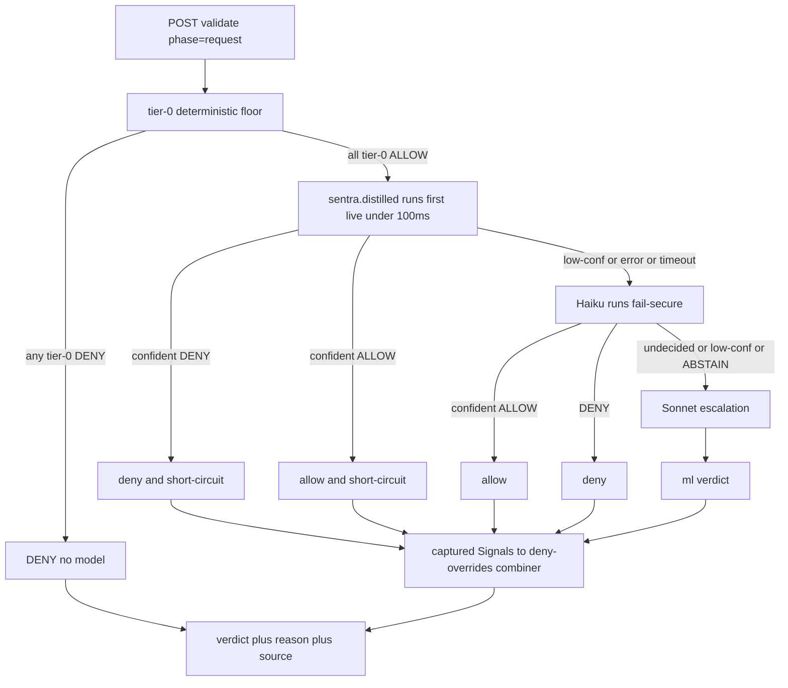
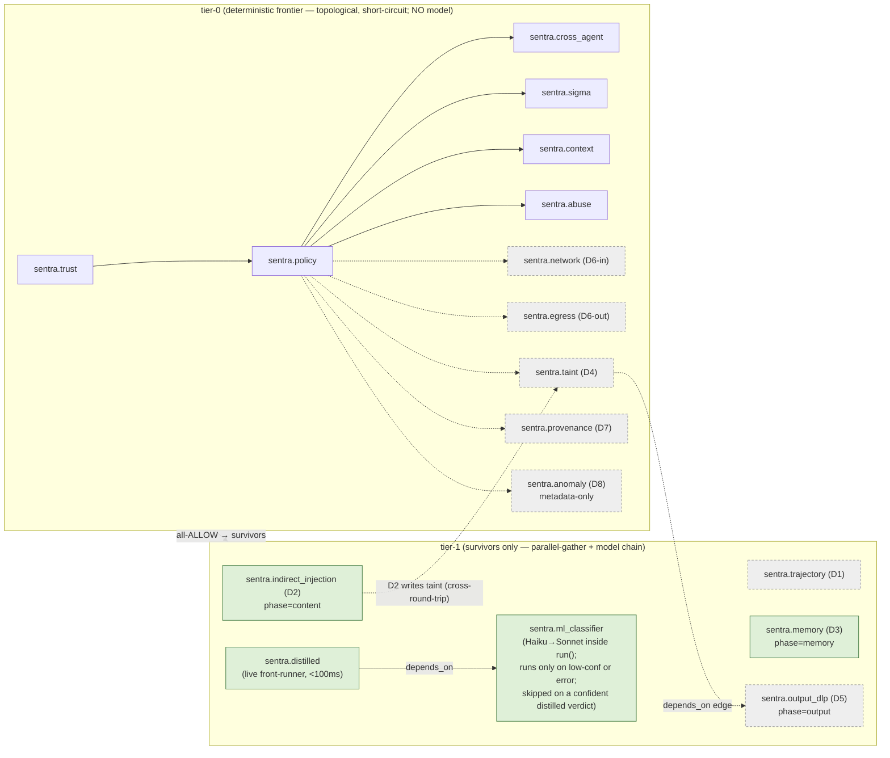
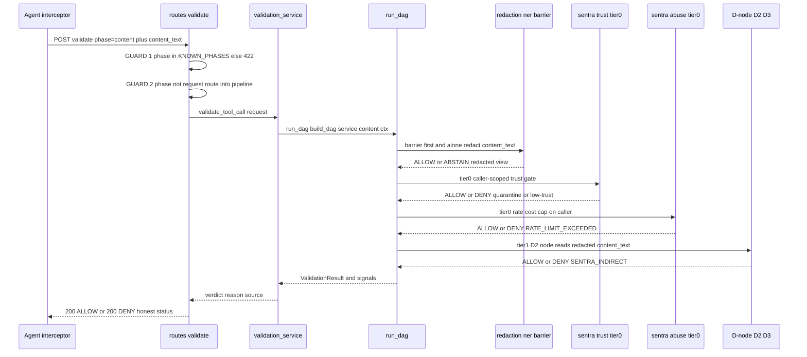
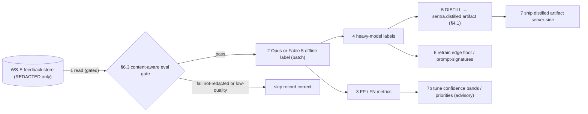

# LLD 32: Detection Depth (WS-L) — Serverless Build-of-Record

**Version**: 1.0
**Last Updated**: 2026-07-02
**Status**: Draft — for review
**Owner**: Founder
**Workstream**: WS-L (Serverless edition) — Detection Depth, consolidated

**Prerequisites (contracts this LLD consumes, does NOT re-cut):**
- [LLD 31: DAG Scheduler](31-dag-scheduler.md) (WS-C) — the `ValidatorNode` / `CostTier` / `depends_on` node vocabulary + `run_dag` execution. WS-C owns the *mechanism*; this LLD registers *nodes*.
- [LLD 30: Multi-phase Contract](30-multiphase-contract.md) (WS-B) — the `phase` field, `KNOWN_PHASES`, the `_CONTENT_FIELD` → `content_text` map, and the `phase_handler_not_implemented:<p>` fail-secure stub the three phase handlers replace.
- [LLD 29: Redaction](29-redaction.md) (WS-E) — the Tier-2 `redaction.ner` barrier + the redacted feedback-store schema (§6.2) + the §6.3 content-aware eval gate the offline loop reads through.

**Consolidates (superseded-for-Serverless, retained as origin design):**
- [LLD 19: ML Threat Classifier](19-ml-threat-classifier.md) — tiered Haiku/Sonnet/Opus models.
- [LLD 20: Defense-in-Depth Layers](20-defense-in-depth-layers.md) — the seven D1–D7 layers. This LLD adds an eighth layer, **D8 (behavioural-anomaly, metadata-only)**, designed here for FR-3.11.

**Elaborates HLD:** [hld/serverless-edition.md](../hld/serverless-edition.md) §6.2(c) (the cost-annotated DAG, ADR-030), §6.2(h) (all-detectors-on, ADR-034), §6.2(b) (the phase contract), §6.2(e) (the edge-is-deterministic-only / models-are-server-side note), §3 (the "deep enough to catch real attacks" thesis).

## Table of Contents
1. [Context](#1-context)
2. [Scope & consolidation map](#2-scope--consolidation-map)
3. [Tenets carried forward](#3-tenets-carried-forward)
4. [Architecture: the tiered detection model (distilled → heavy → offline)](#4-architecture-the-tiered-detection-model-distilled--heavy--offline)
5. [Architecture: D1–D8 as DAG nodes](#5-architecture-d1d8-as-dag-nodes)
6. [Architecture: the three per-phase handlers (WS-B stub replacements)](#6-architecture-the-three-per-phase-handlers-ws-b-stub-replacements)
7. [Architecture: multimodal / image threat (FR-3.15)](#7-architecture-multimodal--image-threat-fr-315)
8. [Architecture: offline reclassify + retrain loop (FR-3.14)](#8-architecture-offline-reclassify--retrain-loop-fr-314)
9. [Signal taxonomy & priority additions](#9-signal-taxonomy--priority-additions)
10. [Cross-workstream seams & honest gaps](#10-cross-workstream-seams--honest-gaps)
11. [Security (SEC-1..n)](#11-security-sec-1n)
12. [Scaling & latency budget](#12-scaling--latency-budget)
13. [Resiliency & recovery (RES-1..n)](#13-resiliency--recovery-res-1n)
14. [Observability & metrics (per-detector)](#14-observability--metrics-per-detector)
15. [Sequencing & rollout (honest phasing)](#15-sequencing--rollout-honest-phasing)
- [FAQ](#faq) — FAQ-1 (distilled 66 vs ML 65) · FAQ-2 (keep trust+abuse) · FAQ-3 (abuse vs dropped policy node) · FAQ-4 (distilled latency win) · FAQ-5 (D2 57-60% recall) · FAQ-6 (content/memory fail-open) · FAQ-7 (D3 enforce residual) · FAQ-8 (confident-CLEAN adversary)
16. [Cross-references](#16-cross-references)

---

## 1. Context

**In plain terms.** WS-C already built the scheduler — the thing that runs the checks. WS-B already built the `phase` field — the thing that says whether a call is checking a tool request, ingested content, an output, or a memory write. This doc does not re-decide either. It fills the *depth* those two left empty: a cheap distilled classifier that heads the model chain and answers the common case fast, the escalation chain behind it, the eight deep detection layers (D1–D8) as new scheduler nodes, and the three per-phase handlers that replace WS-B's "not implemented yet → deny" stubs with real detectors. Each thing this LLD adds is registered into the *existing* `run_dag` as an ordinary `ValidatorNode` — no new subsystem, no new combiner, no new endpoint.

This LLD deepens the **one approved HLD option** — [hld/serverless-edition.md](../hld/serverless-edition.md) §6.2(c) **Option A, the cost-annotated DAG** (tier-0 short-circuit, then tier-1 parallel-gather; ADR-030), operating on §6.2(b)'s phase contract, feeding §6.2(e)'s redacted store, under §6.2(h)'s all-detectors-on posture (ADR-034). It does **not** re-litigate those choices. It is the **Serverless build-of-record for all detection depth**, consolidating [LLD 19](19-ml-threat-classifier.md) (tiered models) and [LLD 20](20-defense-in-depth-layers.md) (D1–D7, extended here with the new D8 behavioural-anomaly layer for FR-3.11), both of which get a `superseded-for-Serverless by lld/32` forward pointer and are retained as origin design (propagate-change discipline — not deleted, not forked).

**Doc-number correction.** This document is **`lld/32-detection-depth.md`**. The WS-L scope doc ([tasks/serverless-edition/ws-l-detection-depth.md](../tasks/serverless-edition/ws-l-detection-depth.md)) refers to `lld/31` — that reference is **stale**; `lld/31` is WS-C's DAG scheduler ([lld/31-dag-scheduler.md](31-dag-scheduler.md)). The authoritative slot for WS-L is `lld/32` per [tasks/serverless-edition/00-index.md:16,38](../tasks/serverless-edition/00-index.md). The scope doc's cross-references should be reconciled to `lld/32` (§10).

---

## 2. Scope & consolidation map

**In plain terms.** The "depth" pieces had no build owner: the distilled model, the heavy-tier chain, the offline retrain loop, the eight D-layers (D1–D7 from LLD 20 plus the new metadata-only D8), multimodal, and the three phase handlers. This section is the one table that names each piece, its requirement ID (fixed against the PRD — see below), its origin design, its honest priority, and whether it's in the first build wave or later. It also states what is explicitly *not* this LLD's job.

### 2.1 The pieces

The requirement→layer map below is verified verbatim against [prd/serverless-edition.md:142-152](../prd/serverless-edition.md). Two IDs the round-1 draft swapped are fixed here: **FR-3.8 = D4 taint** (not memory), **FR-3.9 = D3 memory** (not taint); **FR-3.10 covers D6 *and* D7 together** (one PRD requirement — "Network / egress validation + provenance (D6 / D7)"); and **FR-3.11 = D8 behavioural-anomaly**, a new layer designed in §5.8.

| Piece | Implements | Origin design (consolidated) | Priority (honest) | This LLD's status |
|---|---|---|---|---|
| **Distilled local model** (server-side cheap tier-1 chain-head) | FR-3.12 (elevated to P0) | LLD 19 tiered strategy (no prior LLD) | P0 build-wave | **Designed §4.1; BUILD AUTHORIZED — WS-0 signed 2026-07-02, so the distilled model is in the first build wave (§15). It runs LIVE as the front-runner of the model chain from day one — NO shadow: a confident distilled verdict decides and short-circuits, and low-confidence/error/timeout falls to Haiku fail-secure (§4.1, R5-B).** |
| **Heavy-tier escalation** (Haiku 4.5 → Sonnet 4.6 → Opus offline) | FR-3.2 | LLD 19 §3–4, §4.4 bands | P0 build-wave | Designed §4.2; already live as the tier-1 `sentra.ml_classifier` node — it is the SECOND tier behind the live distilled front-runner (§4.1) |
| **Offline reclassify + retrain loop** | FR-3.14 | LLD 19 §4.3/§13.3 + LLD 29 §6.6 gap | P0 (cold-path) | **CONTRACT designed §8; BUILD after WS-E ships the feedback store + eval gate** |
| **D1 Trajectory** | FR-3.5 | LLD 20 §4 | PRD P1 | Designed §5.1; **LATER** (§15) |
| **D2 Indirect / second-order injection** | FR-3.6 | LLD 20 §5 | PRD P1 → **P0** (owner build-wave call) | Designed §5.2 + §6.2; **FIRST WAVE — built to LIVE-ENFORCE** (gated on an FP/precision budget, floor as backstop), standalone (no taint-thread) |
| **D3 Memory integrity** | **FR-3.9** | LLD 20 §6 | PRD P2 → **P0** (owner build-wave call) | Designed §5.3 + §6.3; **FIRST WAVE — built to LIVE-ENFORCE** (gated on an FP/precision budget, floor as backstop) |
| **D4 Taint / information-flow control** | **FR-3.8** | LLD 20 §7 | PRD P2 | Designed §5.4; **LATER** — the D2→D4→D5 chain extension |
| **D5 Output DLP** | FR-3.7 | LLD 20 §8 | PRD P1 → later (owner call) | Designed §5.5 + §6.4; **routed-but-stubbed → fail-secure DENY** until the PDP→PEP rewrite loop exists. **First-class caveat: output-side DLP is NOT available in the SDK-decorator deployment today** — D5 appearing in this layer list does NOT mean output DLP works. The useful REDACT/HOLD verdict needs the PDP→PEP rewrite loop (a separate future deliverable, no owner/date here); until then the `output` phase can only DENY-all, which is why it stays stubbed (§15). |
| **D6 Network / egress** | **FR-3.10** (with D7) | LLD 20 §9 | PRD P2 | Designed §5.6; **LATER** |
| **D7 Supply-chain / inter-agent** | **FR-3.10** (with D6) | LLD 20 §10 | PRD P2 | Designed §5.7; **LATER** |
| **D8 Behavioural anomaly** (metadata-only, per-deployment baseline) | **FR-3.11** | **NEW — extends LLD 20** | sub-PRD P2 (design-complete only) | Designed §5.8; **LATER** — metadata-only moat layer, tier-0, no model call |
| **Multimodal / image threat** | FR-3.15 | named-not-designed | P1/P2 | **SCOPE-ONLY §7** — the E6 image router is the current surface; a real evaluator is a later tier-1 node |

### 2.2 Explicit non-goals (owned elsewhere — do NOT re-cut here)

- **The DAG mechanism** — `run_dag`, `_toposort`, `_build_chains`, the tier-0/tier-1 split, `fail_fast`/`evaluate_all`. Owned by WS-C ([lld/31](31-dag-scheduler.md)). This LLD *registers nodes into* it; it changes no scheduler-core file.
- **The `phase` field / `KNOWN_PHASES` / `_CONTENT_FIELD`** — owned by WS-B ([lld/30](30-multiphase-contract.md)). This LLD *consumes* the contract additively; it does not add a phase, rename `content_text`, or add per-phase `*_body` fields.
- **The redacted feedback-store schema + the §6.3 eval gate** — owned by WS-E ([lld/29](29-redaction.md)). This LLD's offline loop is a *reader* of that store; it does not design the store.
- **The `coverage_sources(phase)` accessor** — WS-C owes it to WS-D ([lld/33](33-decision-trail.md)). This LLD only *registers its new sources* into the fallback tables so the trail joins on them (§9, §10).
- **The deny-overrides combiner algorithm** — unchanged (LLD 17 substrate). This LLD adds *producers* (Signal-emitting nodes), not a new combine algorithm.

---

## 3. Tenets carried forward

The **8 HLD master tenets** ([hld/serverless-edition.md](../hld/serverless-edition.md) §4, ARCHITECTURE §1.4 verbatim) and tie-breakers **A** (grow additively) and **B** (record what ran) govern every implementation call below. Restated for this LLD's context, most-important-first:

1. **Enforcement is local; the control plane is never on the action path** — the distilled model + D-nodes run in the PDP on the action path; the offline retrain loop (§8) is control-plane / cold-path, NEVER on `/v1/validate`.
2. **Fail secure, never fail open** — a dropped/errored D-layer abstains to the deterministic floor or re-raises to a fail-secure DENY; a stub replacement never opens a fail-open hole; abstain is never treated as "clean".
3. **Deny-by-default, explainable** — every D-node names its deciding `Source`; its `Signal` is captured into WS-D's decision trail; a new `Source` must be registered so the trail joins on it.
4. **Defense in depth** — D1–D8 are independent layers, each ABSTAINs on error/disable and is never a sole defense; evading one is caught by another.
5. **Latency scales with risk, not volume** — the distilled model classifies the common case cheaply so the heavy tier + D-nodes (tier-1) run only on tier-0 survivors / edge cases; no summed latency (parallel-gather + chains).
6. **The data boundary is the customer's to set** — D-nodes read the post-NER-barrier redacted view; no raw PHI retained by the reclassify loop (redacted records only).
7. **Honest staging** — ship deterministic floors first; the deep detectors ship in build waves (first-wave D2/D3 + the live distilled front-runner; later D1/D4/D6/D7/D8), NOT a simultaneous 8-layer flip; sub-PRD P1/P2 marks are honored with per-layer sequencing. A LATER layer that isn't built/enabled yet simply does not run (its node abstains under a disabled flag) — there is **no observe-in-shadow phase**; when a layer is built and enabled it enforces live, gated on a measured FP/precision budget so it doesn't cause false-positive outages (§14, §15).
8. **Tie-breaker A — grow the contract additively** — new `Source.*` constants, D-nodes, and phase handlers are additive; no re-cut of the `phase` field, the `_CONTENT_FIELD` map, the `ValidatorNode` vocabulary, or the existing `DEFAULT_PRIORITIES` / tie-break.
9. **Tie-breaker B — record what ran; force nothing extra** — D-nodes register into the DAG so WS-D records what actually executed; producing the trail must not force layers to run that risk didn't warrant (`evaluate_all` is the opt-in high-assurance mode, not the default).

> Load-bearing consequences threaded through this doc: **tenet 4** — every D-node ABSTAINs on error/disable and is never a sole defense (§5, §13). **tenet 5** — the distilled node resolves the common case so the heavy tier runs only on survivors (§4, §12). **tenet 2** — the phase-handler stub replacement (§6) never fails open; on abstain the deterministic floor decides. **tenet 7** — the distilled front-runner and D2/D3 enforce LIVE gated on a measured FP/precision budget; a not-yet-built LATER layer's node abstains under a disabled flag (not observe-in-shadow), not a simultaneous 8-layer flip (§14, §15).

---

## 4. Architecture: the tiered detection model (distilled → heavy → offline)

**In plain terms.** Today exactly one model node runs, and it is NOT cheap: `sentra.ml_classifier` is a Haiku call registered as **tier-1** (`CostTier.EXPENSIVE_MODEL`, [registry.py:326-331](../src/security-controller/app/services/scheduler/registry.py)), ~600 ms, gathered on *every* request that clears the deterministic floor. There is **no cheap MODEL front-tier today** — the only cheap frontier is the deterministic floor (trust/policy/sigma/context/abuse/cross_agent, all tier-0, ~1–5 ms each). This section adds a *smaller, faster, server-side* classifier — the **distilled model** — as the **live front-runner of the tier-1 model chain**: it runs FIRST on every floor-survivor, answers the easy common case in under 100 ms, and its verdict DECIDES — a confident verdict blocks or allows and short-circuits (the heavy Haiku→Sonnet tier never runs), and only a low-confidence / errored / timed-out distilled call falls through to Haiku. The distilled model is *trained by* the offline loop in §8 (it distills the big models' labels into a small fast one). "Cheap" here means the small model's **hard sub-100 ms budget**, NOT a new cost tier — a node that calls a model is tier-1 by the WS-C contract, so the distilled node is a cheap tier-1 node, not a re-cut of the tier split.

**The one rule that governs the whole chain — the distilled front-runner runs LIVE and its verdict decides; there is NO shadow (R5-B).** The distilled node is not watch-only and there is no graduation gate on its short-circuit. For every floor-survivor: the distilled node runs FIRST; a **confident DENY** blocks and short-circuits (Haiku does not run), a **confident ALLOW** allows and short-circuits (Haiku does not run — this is FR-3.12's latency win on the common path), and a **low-confidence / can't-decide OR error (4XX/5XX) / timeout (>100 ms wall)** falls through to Haiku (**fail-secure fallback** — an errored distilled call is never treated as ALLOW). If there are bugs, we fix them — there is no shadow observation window. The residual adversarial-clean concern (a confident-clean short-circuit skips the strong Haiku→Sonnet tier) is a founder-accepted live risk with mitigations, held in core as **SEC-7** (§11); it is measured offline by the §8 reclassify loop and monitored online by the distilled-vs-heavy disagreement rate (§14), not by a live shadow. See [FAQ-1 — Why distilled (66) outranks ML (65)](#faq-1--why-distilled-priority-66-outranks-ml-65) for why the priority ordering is not "the weak model wins".

### 4.1 The distilled model as the cheap tier-1 chain-head (Q1)

**What it is — a small TEXT classifier, made concrete (R5-F).** The distilled model is a **small text classifier** (`sentra.distilled` node) that scores the request/content text for injection/threat, distilled from the heavy models' labels by the §8 offline distill loop (Sonnet 5 / Opus 4.8 label a large corpus → train a small fast classifier to reproduce those labels). It runs **server-side in the PDP** at the **head of the tier-1 model chain**, in front of the Haiku hot node, under a hard **< 100 ms** budget. It is the live front-runner: its verdict decides, and the heavy Haiku→Sonnet nodes behind it run only when the distilled node cannot confidently decide (low-confidence) or errors/times out (§4.3 decision flow). It is **produced by the FR-3.14 offline distill/retrain loop** (§8) — which is precisely why FR-3.12 (the model) and FR-3.14 (the loop that makes it) are designed together in this one LLD.

- **Not Google TabFM (founder asked).** TabFM is a foundation model for **tabular** data classification; the detection input here is unstructured **text** (prompts, tool params, ingested content) — a different modality. The distilled model is a small text classifier, not a tabular model.
- **Not Fable 5 on the hot path (founder asked "would Fable 5 be more meaningful here?").** Fable 5 is Anthropic's most capable + most expensive model ($10/$50 per 1M tok — ~10× Haiku 4.5's $1/$5) with always-on thinking → minutes-long turns; it is the OPPOSITE of a sub-100 ms cheap classifier and would blow both the NFR-2 latency budget and the cost model. Where Fable 5 *could* fit WS-L is the **§8 OFFLINE labeler** (generating the high-quality training labels the small model distills from) — a higher-cost, higher-quality alternative to the Opus offline labeler §8 already names, with no latency constraint on the cold path. (Current lineup for reference, from the claude-api skill: Haiku 4.5 $1/$5, Sonnet 5 $3/$15, Opus 4.8 $5/$25, Fable 5 $10/$50 per 1M tok.) Hot-path distilled = small text classifier; offline labeler = Opus today, Fable 5 an option (§8).

**Where it runs — server-side in the PDP, NOT the SDK edge.** The Serverless SDK edge is stdlib-only and hosts no model ([hld/serverless-edition.md](../hld/serverless-edition.md) §6.2(e); [lld/29](29-redaction.md) §4). The distilled model runs **server-side in the PDP**, as a `ValidatorNode`. The server-side distilled classifier IS the Serverless FR-3.12 — the p99 tightener on the common path. (An in-process / CPU edge distilled variant is the in-VPC / sidecar story for a non-Serverless edition, simply out of scope for this LLD — no escalation ceremony.)

**The `CostTier` decision (resolved cleanly, not hand-waved) — the distilled node is tier-1, NOT a new tier.** `CostTier` has exactly two members ([node.py:20-28](../src/security-controller/app/services/scheduler/node.py)): `DETERMINISTIC = "tier-0"` (the cheap short-circuit frontier — pure regex/lookup, no model call) and `EXPENSIVE_MODEL = "tier-1"` (the parallel-gathered / chained model nodes, run only for tier-0 survivors). A node that calls a *model* is **tier-1 by definition of this contract** — tier-0 means *no model*. So:

- **Decision: `sentra.distilled` is `CostTier.EXPENSIVE_MODEL` (tier-1), the chain-head of the model chain. It does NOT ride tier-0, and NO new `CostTier` enum member is added.** Adding a third `CostTier` would touch the scheduler core (`run_dag` branches on exactly `DETERMINISTIC` vs `EXPENSIVE_MODEL` when it splits the frontier from the survivors) — a re-cut of WS-C's contract, forbidden by tenet 8, and it would break the additive tie-breaker A. "Cheap" is expressed by a **hard sub-100 ms budget** inside the node's own `run()`, not by a tier label: the same-tier `sentra.ml_classifier` Haiku node runs ~600 ms, so the distilled node's ~<100 ms is "cheap relative to the heavy nodes it heads," while still being a model → still tier-1.
- **How "live front-runner + short-circuit" is expressed in the real scheduler — the `depends_on` chain + chain-local `ctx`.** The model chain is a tier-1 `depends_on` chain: **`sentra.ml_classifier` (Haiku) `depends_on=(Source.SENTRA_DISTILLED,)`**, and Sonnet's escalation stays inside the Haiku node's `run()` (as today). `run_dag` groups this into a chain (`_build_chains`) and runs it via `run_chain` ([run.py:299](../src/security-controller/app/services/scheduler/run.py)), which threads the distilled result forward in a **chain-local `ctx`** (`{**session, **ctx}`, [run.py:316](../src/security-controller/app/services/scheduler/run.py)) — the *same* threading D4 uses to read D2's taint. **The load-bearing constraint from `run_chain`'s abort-on-upstream-*abstain* semantics ([run.py:336-338](../src/security-controller/app/services/scheduler/run.py)): a chain aborts and every downstream node fails to the deterministic floor when an upstream node returns `is_abstain` — the downstream node does NOT run. So the distilled node must NEVER return `abstain` for the escalation (low-confidence / error / timeout) case, or the Haiku node would be skipped exactly when the heavy tier is most needed. Instead the distilled node returns a *concrete, non-deciding* verdict on the escalate case (`ValidationResult.allow(...)` carrying `metadata["escalate"]=True`), which threads into `ctx` and lets the chain continue to Haiku. In practice the distilled node NEVER abstains: confident → decide + short-circuit; everything else (low-confidence OR error OR timeout) → concrete escalate verdict → Haiku runs (fail-secure). `abstain` is reserved only for a case where even Haiku cannot help — and there is none here, so the distilled node does not use it.** The Haiku node reads `ctx[Source.SENTRA_DISTILLED]` and branches on the live verdict:
  - **confident distilled verdict** (`confidence ≥ DISTILLED_CONFIDENCE_TRUST_THRESHOLD`) → the Haiku node **returns `ValidationResult.abstain(...)` immediately** (it short-circuits — no Bedrock call), so the heavy model never runs and the distilled `Signal` decides. Confident DENY blocks; confident ALLOW allows (the common-path latency win). This is the branch that suppresses the heavy tier.
  - **low-confidence / error / timeout (non-deciding-with-`escalate`)** → the distilled node emitted a concrete escalate verdict threaded into `ctx`, so the Haiku node runs Haiku (→ Sonnet) as normal — the heavy tier evaluates precisely the ambiguous / errored minority (fail-secure — an errored distilled call falls to Haiku, never to ALLOW).

  The expected hot-path cost for the common (confident) case is therefore ~distilled latency (<100 ms), vs today's flat ~600 ms Haiku-always; that IS FR-3.12's latency win, and it lands the moment the distilled artifact ships from §8. Until that artifact ships, the chain-head slot is simply absent and Haiku is the front of the chain (honest interim, below).
- **Why this composes safely (no in-node gather, escalate-is-not-abstain, no shadow leg).** The distilled node's `run()` is ONE `Awaitable[ValidationResult]` per the `ValidatorNode.run` signature ([node.py:62](../src/security-controller/app/services/scheduler/node.py)); it does **NOT** `asyncio.gather` internally — the sole gather in the system is `_run_tier1_with_edges` ([run.py:256](../src/security-controller/app/services/scheduler/run.py)); a self-gathering node re-introduces summed latency and bypasses the run-mode flag (WS-L task doc footgun #1). On an inference failure or a breach of the hard 100 ms wall (`asyncio.wait_for` inside its `run`), the distilled node **catches the error and returns the concrete non-deciding escalate verdict** (`ValidationResult.allow(...)` + `metadata['escalate']=True`) so the chain continues to Haiku — the fail-secure fallback. It does NOT return `abstain` on error/timeout (that would abort the chain and skip Haiku), and it does NOT treat an errored call as ALLOW. This is the whole reason the mechanism composes: `run_chain` *structurally cannot* express "distilled-abstain → still run heavy" (abstain aborts), so escalation MUST ride a non-abstain verdict. There is no `enforce`-gate leg and no shadow leg — the distilled verdict decides live.

**FIX-A3 (build-time, config hygiene) — the distilled node needs its OWN confident-verdict threshold, NOT a shared `ML_CONFIDENCE_TRUST_THRESHOLD`.** The confident-vs-escalate gate for the distilled node (§4.2 table, "`confidence ≥ DISTILLED_CONFIDENCE_TRUST_THRESHOLD`") must NOT reuse the **Haiku** trust threshold (`ML_CONFIDENCE_TRUST_THRESHOLD=0.9`, [config.py:336-339](../src/security-controller/app/config.py)). That threshold is **co-calibrated for Haiku's confidence scale**, and a small offline-distilled model's confidence is a *different, un-co-calibrated* scale — a `0.9` on the distilled model does not mean what a `0.9` on Haiku means. So the distilled node MUST get its **own** confidence threshold env var (`DISTILLED_CONFIDENCE_TRUST_THRESHOLD`, a new pydantic `Field`), NOT reuse `ML_CONFIDENCE_TRUST_THRESHOLD`, so the two models' confidence bands are tuned independently. This threshold is load-bearing because it decides the confident-ALLOW short-circuit that skips the heavy tier (SEC-7): set it HIGH so only genuinely-easy verdicts short-circuit, and the §14 online distilled-vs-heavy disagreement monitor surfaces a mis-set threshold as a rising disagreement rate that auto-reverts the short-circuit. Where §4.2/§4.1 write a distilled confidence gate, read `DISTILLED_CONFIDENCE_TRUST_THRESHOLD`.

**The honest first-wave latency story — WS-0 is signed, the distilled model builds this wave, and the latency win lands when the §8 artifact ships.** WS-0 signed off 2026-07-02 (founder), so the distilled model is **built in the first wave** (§15), no longer a slot held on an unsigned packet. Two honest facts hold about *when* the latency improves: (1) There is **no cheap model front-tier today**: `sentra.ml_classifier` (Haiku) is tier-1 and runs on every floor-survivor (~600 ms). (2) The latency win lands when the **§8-distilled artifact ships into the `sentra.distilled` node** and starts confidently resolving the common path in <100 ms; until then, the chain-head slot is absent and Haiku is the front tier (no latency change yet, but no shadow either). The non-escalating survivor path is **Haiku-only server-side ~600 ms**, which sits inside the **ML-hot ≤900 ms target** (CLAUDE.md constraint 1; LLD 24). It is NOT the escalated path — WS-0 measured the **escalated Haiku→Sonnet e2e p99 at ~3.0–3.5s** ([ws-0-result-packet.md](../tasks/serverless-edition/ws-0-result-packet.md) §1(b)), which **blows NFR-2** on the 55–67% of money-movement traffic that escalates. WS-0's GA-shaping call routes money-movement to the **in-VPC edition** (fallback (ii)) rather than promising Serverless fits the target for escalating traffic (§12 Budget fit). The distilled short-circuit is a p99 *tightener* for the non-escalating common case — bounded by the a2=55% escalation ceiling, so at most ~45% of calls resolve locally (§5.2, FAQ-4). Two things already cap the common case: (a) the **tier-0 deterministic floor short-circuits obvious cases before any model call** (a tier-0 DENY, or a clean fast-path where policy/sigma resolve, never pays the Haiku tax); (b) only floor-*survivors* reach the model chain at all. The build sequencing that remains: the distilled *artifact* is produced by the §8 offline distill/retrain loop, which depends on WS-E's feedback store (§8.3, G2) — so the artifact-build critical path is WS-E-gated even though the *node/slot* ships this wave.

**Honest interim: until the §8 artifact ships, Haiku is the front tier.** With no shadow window, there is no "stand-in for measurement" — the distilled model is BUILT by the §8 offline loop and shipped when ready. Until it ships, the chain-head slot is simply absent and `sentra.ml_classifier` (Haiku) is the front of the chain (no latency change yet); when the artifact ships, it becomes the live front-runner and the FR-3.12 latency win lands. See [FAQ-4 — Will the distilled model cut latency, and when?](#faq-4--will-the-distilled-model-cut-latency-and-when).

### 4.2 Heavy-tier escalation (Haiku 4.5 → Sonnet 4.6 → Opus offline)

Consolidated from [LLD 19 §3–4](19-ml-threat-classifier.md). The heavy tier is a **tier-1** `EXPENSIVE_MODEL` chain, reached only when the distilled node emits a non-deciding `escalate` verdict (low-confidence, error, or timeout; §4.1) — or, until the §8 distilled artifact ships and the chain-head slot is still absent, on **every** floor-survivor (Haiku is the front tier during the interim):

- **Haiku 4.5 (hot)** — the first heavy model; emits `confidence ∈ [0.0, 1.0]` alongside its decision.
- **Sonnet 4.6 (escalation)** — reached on the confidence band (LLD 19 §4.4):

| Haiku output | Action |
|---|---|
| `decision=ALLOW/DENY, confidence ≥ 0.9` | Trust Haiku. Skip escalation. |
| `confidence ∈ [0.5, 0.9]` | Escalate to Sonnet. Use Sonnet's verdict. |
| `confidence < 0.5` | Escalate to Sonnet AND emit ABSTAIN (Haiku effectively didn't decide) |
| Haiku ABSTAINs | Escalate to Sonnet |
| Both ABSTAIN | No `sentra.ml_classifier` signal — the confident distilled verdict (if the artifact has shipped) or the deterministic floor decides |
| Distilled **confident** (live front-runner, §4.1) | Haiku node short-circuits to abstain — heavy models skipped; distilled `Signal` decides (confident DENY blocks, confident ALLOW allows). The branch that suppresses the heavy tier. |
| Distilled **non-deciding-with-`escalate`** (low-confidence OR error OR timeout; §4.1) | Haiku node runs Haiku (→ Sonnet) as normal — the concrete escalate verdict threaded into `ctx` triggers evaluation (fail-secure: an errored distilled call falls here, never to ALLOW) |
| Distilled artifact **not yet shipped** (interim; §4.1) | chain-head slot absent — Haiku is the front tier and runs on every floor-survivor |

Thresholds are env-vars (`ML_CONFIDENCE_TRUST_THRESHOLD=0.9`, `ML_CONFIDENCE_ABSTAIN_THRESHOLD=0.5` — the pydantic `validation_alias` names, no `SENTRA_` prefix; [config.py:336-345](../src/security-controller/app/config.py)) — tune without redeploy.

- **Opus** is **offline-only** (LLD 19 §4.3) — never on the request path (its ~5s would compound; §4.2 of LLD 19). Opus's role is the batch reclassify + label-generation of §8.

The whole heavy chain — Haiku, its Sonnet escalation — lives inside the `sentra.ml_classifier` node's `run()` as one awaitable, wrapped by `_apply_ml_enforce_wrapper` ([registry.py:402-425](../src/security-controller/app/services/scheduler/registry.py)) which stamps `metadata["enforce"]=True` so a live ML DENY can decide (`_is_hard_deny`). This is unchanged from WS-C. The only WS-L change is additive: the `sentra.ml_classifier` node gains a `depends_on=(Source.SENTRA_DISTILLED,)` edge so it becomes the tail of the distilled→Haiku chain (§4.1) and reads the distilled verdict from the chain-local `ctx` to decide whether to short-circuit — it does NOT change the Haiku→Sonnet internals.

### 4.3 How distilled + heavy compose as DAG nodes

The distilled model and the heavy classifier are **two tier-1 nodes in one `depends_on` chain**: `sentra.distilled` → `sentra.ml_classifier`. The deterministic floor still short-circuits *before* the chain runs at all (tenet 5); the live distilled head then decides the confident common case and lets the heavy Haiku→Sonnet tail run only on the low-confidence / errored minority.

The decision flow (labels kept plain per the mermaid-safety rules — no slashes, brackets, or quotes inside message text):



The distilled→ml_classifier pair is ONE tier-1 `run_chain` chain (both `EXPENSIVE_MODEL`); the Haiku→Sonnet escalation is a within-node awaitable inside `sentra.ml_classifier.run()`. Opus stays offline-only (§8), never on the request path.

Key: **both** `sentra.distilled` and `sentra.ml_classifier` are `cost_tier=CostTier.EXPENSIVE_MODEL` (tier-1) — no new tier, no tier-0 model. `sentra.distilled` has `depends_on=(Source.SENTRA_POLICY,)` (documentary — it runs after policy resolves, like the other survivors); `sentra.ml_classifier`'s `depends_on` changes from `(Source.SENTRA_POLICY,)` to `(Source.SENTRA_DISTILLED,)` — no loss of ordering, since the distilled node itself `depends_on` policy, so `run_chain` still runs the whole chain after the tier-0 policy resolves (transitivity). That edge is what makes `_build_chains`/`run_chain` sequence distilled→ml and thread the distilled verdict forward in the chain-local `ctx` ([run.py:299,316](../src/security-controller/app/services/scheduler/run.py)). The Sonnet escalation stays a within-node awaitable inside the Haiku node's `run()`; the distilled→Haiku short-circuit is a `depends_on` chain edge, never an in-node `gather`.

---

## 5. Architecture: D1–D8 as DAG nodes

**In plain terms.** Each of the eight deep layers becomes one new `ValidatorNode` — D1–D7 consolidated from LLD 20, plus the new metadata-only D8 (§5.8). The ones that call a model or state-lookup for content are tier-1 (D1, D2, D3, D5); the cheap deterministic ones sit on tier-0 (D4 taint, D6 network/egress, D7 provenance, D8 anomaly). Three of them form a *chain* — D2 tags content as untrusted, D4 reads that taint to block privileged actions, D5 checks the output — expressed by `depends_on` edges (D4 depends on D2, D5 depends on D4) that `_build_chains` ([run.py:207-242](../src/security-controller/app/services/scheduler/run.py)) sequences. Each layer names a new `Source.*`, ABSTAINs on error/disable, and is never a sole defense. This section designs **all eight** (consolidating LLD 20 + the new D8); §15 sequences which ship first. Requirement IDs use the corrected PRD map (§2): D1=FR-3.5, D2=FR-3.6, D5=FR-3.7, **D4=FR-3.8, D3=FR-3.9, D6+D7=FR-3.10, D8=FR-3.11**.

**Each layer's design below opens with a one-line OUTCOME contract** — *emits · verdict · deciding reason-code · fires-when · tier · phase · feeds* — so the expectation from every depth, and where one depth's output feeds another, is legible at a glance (comment ②). How each layer is measured (latency + FP/FN/precision/recall/F1, and how its coverage gap is known) is the uniform per-node metrics contract in **§14 Observability** — every layer below is measured the same way (comment ①); the per-layer OUTCOME names *what* it emits, §14 names *how well* it does so.

**Layers are phase-specific, and the DAG already handles that (comment ③).** `build_dag(service, phase, stamp_ctx)` ([registry.py:72](../src/security-controller/app/services/scheduler/registry.py)) returns a **different node set per phase** — a layer only runs on the phase(s) it applies to; it is simply absent from the node set on other phases (no wasted run, no need for the node to self-guard the phase). The map:

| Phase | Layers that run (beyond the floor / barrier) | Notes |
|---|---|---|
| `request` | D1 trajectory, D4 taint, D6 network+egress, D7 provenance, D8 anomaly (+ the tier-0 floor: trust/policy/sigma/context/abuse/cross_agent, + distilled→ml chain) | the action-authorization phase; the full frontier |
| `content` | **D2** indirect-injection (+ NER barrier, trust, abuse) | ingested untrusted data; NO action floor (§6.1) |
| `memory` | **D3** memory-integrity (+ NER barrier, trust, abuse) | memory-write candidate |
| `output` | D5 output-DLP (+ egress) | agent's emitted content — LATER (§5.5) |

So D2 runs **only on `phase=content`**, D3 **only on `phase=memory`**, D5 **only on `phase=output`** — they are never in the request-phase node set. D1/D4/D6/D7/D8 run on `phase=request`. The cross-phase *feeds* (D2's taint → D4, D4 → D5) are documentary `depends_on` edges across round-trips, not same-request chain edges (§5.4, §5.5).

### 5.1 D1 — Conversation Trajectory (`Source.SENTRA_TRAJECTORY`) — FR-3.5

- **OUTCOME:** emits `Source.SENTRA_TRAJECTORY` · verdict ALLOW / DENY / ABSTAIN · reason `TRAJECTORY_ESCALATION` · **fires when** accumulated per-session risk crosses threshold though the current turn is individually benign · **tier-1**, `phase=request` · **feeds** nothing (standalone) · measured per §14. *Expectation:* catches the slow-build attack a single-turn check passes; on a normal session it stays silent (ABSTAIN/ALLOW).
- **Catches:** Crescendo / many-shot / slow-build intent drift — malice distributed across turns (LLD 20 §4). OWASP LLM01.
- **Mechanism:** a per-session GRU state head folds each turn's Bedrock embedding into an accumulated-risk hidden state persisted on the session item (`trajectory_state`, `trajectory_risk`, `trajectory_turn_count` in the `sentra-session-context` DDB table); a DENY when accumulated risk crosses threshold even though the current turn is individually benign. Encoder = frozen Bedrock embedding (`amazon.titan-embed-text-v2`); state head = in-process GRU (~KB weights).
- **Node:** `cost_tier=EXPENSIVE_MODEL` (tier-1; the ~20–50 ms embedding RTT), `depends_on=(Source.SENTRA_POLICY,)`, `phase=request`. Standalone (no `depends_on` onto another tier-1 node). **LATER** (§15).
- **ABSTAIN:** on embedding-model outage or `D1_ENABLED=false` → `ValidationResult.abstain(...)` → no signal → floor decides.
- **`trajectory_state` integrity (server-side-write-only).** `trajectory_state` / `trajectory_risk` are durable cross-session security-decision state read on LATER calls to DENY. They are **written ONLY by the D1 node server-side** — never accepted from a client-asserted field (the SEC-3 rule: the server never trusts a client-supplied trust/taint/risk level). This closes the tampering path where a compromised session-writer lowers accumulated `trajectory_risk` to evade the crescendo DENY. Whether the state needs the same KMS tamper-evidence as D3's memory record (§5.3) or is acceptably in-boundary DDB-only is a **D1-build decision** (LATER); stated here so it is not silently omitted. (Read-path cold-vs-corrupt handling for `trajectory_state` is covered by SEC-11, §11.)

### 5.2 D2 — Indirect / Second-Order Injection (`Source.SENTRA_INDIRECT`) — FR-3.6

- **OUTCOME:** emits `Source.SENTRA_INDIRECT` · verdict ALLOW / DENY / ABSTAIN (SANITIZE later, §6.2) · reason `INDIRECT_INJECTION` · **fires when** ingested untrusted content in `content_text` carries agent-directed instructions · **tier-1** (`EXPENSIVE_MODEL` — it runs a content-framed ML call; comment ⑤), **only on `phase=content`** (comment ③) · **feeds D4** (writes the taint ledger D4 reads at `phase=request` — LATER, §5.4) · measured per §14. *Expectation:* blocks injection riding in retrieved docs / tool output / web text before the agent acts on it.
- **Catches:** ASI01 Goal Hijack, EchoLeak, RAG-poisoning — injection riding in content the agent *ingests* (LLD 20 §5). The single largest current coverage gap.
- **Mechanism:** three passes over the **redacted** `content_text` (post-NER barrier, §6.1): (1) a **sigma pass** — cheap deterministic regex over *known* indirect-injection signatures, run first because it is ~free and catches the known-pattern subset before any model call (**why sigma here, comment ③:** it is the fast known-signature floor of D2, not a duplicate of the request-phase sigma — and it MUST be a **`content_text`-pointed sigma call, NOT the request-phase `_run_sigma` closure, which reads `req.user_input`** and would scan an empty field on a content call; see §6.2); (2) the **content-framed ML prompt** ("is this untrusted data carrying instructions to an agent?") for the novel/unseen subset sigma misses; (3) two **indirect-specific heuristics** — instruction-density (imperative ratio, second-person directives) and encoding/obfuscation scan (base64, homoglyphs, zero-width chars). Verdicts: ALLOW / DENY / (SANITIZE — see §6.2 scoping).
- **Node:** `cost_tier=EXPENSIVE_MODEL` (**tier-1** — the content-framed ML call dominates; the sigma sub-pass is cheap but the node is tier-1 because it invokes a model; comment ⑤), `depends_on=(Source.SENTRA_POLICY,)`, `phase=content`.
- **First-wave scope (Q2):** D2 ships **STANDALONE** — it DENYs/ABSTAINs on ingested untrusted content in `content_text` **WITHOUT** taint-threading into D4. The taint-descriptor output (LLD 20 §5.4) that D4 would read is a **future chain extension** (§5.4), not first-wave. See §6.2.
- **Finding-1 — the WS-0 measured recall on THIS threat class is low, and D2 reuses the stack that scored it (detector quality, not architecture, is the blocker).** WS-0 measured indirect-injection recall at **unmasked 0.565 / masked 0.601 (Δ −0.036, CIs overlap)** on the **same sigma + ML detection stack D2 reuses** ([ws-0-result-packet.md](../tasks/serverless-edition/ws-0-result-packet.md) §1(c), §4 M0-6.1). So D2 inherits a **~57–60% recall on its headline attack class** — it misses ~40% of indirect-injection regardless of redaction (the low number is a **detector-coverage gap, not a masking effect** — masking Δ≈0). This is the load-bearing honest caveat: the DAG plumbing here does not fix a 57% recall, and the ~40% miss is backstopped by the deterministic floor + trust/abuse. **D2 detector-quality improvement plan (comment ④ — build ALL of these; each targets a named failure mode, but the recall lift is UNMEASURED until run against the corpus — no fabricated % here):** (i) a **content-framed ML prompt** tuned for "untrusted data carrying instructions to an agent" — targets the *framing gap* (the WS-0 stack scored the *generic* injection prompt, not a content-framed one), **lift unmeasured**; (ii) the **two indirect-specific heuristics** (instruction-density + encoding/obfuscation scan) — target *obfuscated/encoded* payloads a generic prompt misses, **lift-over-ML-only unmeasured**; (iii) an **indirect-specific classifier** as the mature step — targets the residual, **lift unmeasured**. **We do not yet know how far these move recall from ~0.60 toward the 0.85 bar** — WS-0 measured only the *baseline*, not the improvement items; anyone quoting a specific "+X%" now would be guessing. The lift is **quantified by the §14 offline eval-harness against the WS-0/WS-F indirect corpus** before D2 enforce-graduates.
- **MEASUREMENT TASK (comment ④ — the number gets produced, not invented) — MEAS-D2-RECALL:** run each improvement item (i)/(ii)/(iii) — individually and stacked — against the WS-0/WS-F indirect corpus via the §14 eval-harness; **report the measured recall (and its CI-lower-bound) per item and stacked**, against the ~0.57–0.60 baseline; the enforce/FP-budget rollout gate is **measured recall ≥ 0.85 (CI-lower-bound)**. This is a named acceptance item for the ws-l tasks (carried into `plan-workstreams`), so the "by what %?" question is answered with a corpus number when the task runs, not asserted here.
- **D2 is built to LIVE-ENFORCE, gated on an FP/precision budget (not a shadow window; R5-C).** D2 blocks indirect injection live from the first wave; the deterministic floor + trust/abuse remain the backstop for the ~40% it misses. The rollout is gated on a **measured false-positive / precision budget** so enforcement does not cause false-positive outages — not on an observe-in-shadow phase; bugs are fixed as found. The **≥0.85 recall on the WS-0/WS-F indirect corpus (CI-lower-bound, same pre-registration discipline as the WS-0 thresholds, against the ~0.57–0.60 baseline)** is kept as the **QUALITY BAR the improvement plan targets** — a pre-registered number a coder/founder can grade — not as an enforce-graduation gate. Whether the plan can move recall from ~0.60 toward 0.85 is treated honestly in [FAQ-5 — D2 ships at ~57-60% recall — is that real protection?](#faq-5--d2-ships-at-57-60-recall--is-that-real-protection).
- **The a2=55% escalation ceiling caps the distilled latency win** — WS-0 measured escalation at 55% (a2), so even a perfect short-circuit resolves at most ~45% of calls locally (a1). Detail in [FAQ-4](#faq-4--will-the-distilled-model-cut-latency-and-when).

### 5.3 D3 — Memory Integrity (`Source.SENTRA_MEMORY`) — FR-3.9

- **OUTCOME:** emits `Source.SENTRA_MEMORY` · verdict ALLOW / DENY / ABSTAIN · reason `MEMORY_POISONING` · **fires when** a memory-write candidate fails an integrity guard (missing provenance, self-promotion attempt, would-loosen-security) · **tier-1**, **only on `phase=memory`** (comment ③) · **feeds** nothing (write-path guard) · measured per §14. *Expectation:* blocks a poisoning write before it becomes a durable "fact"; a legitimate write passes.
- **Reads the REDACTED memory candidate (comment ⑥ — confirmed).** D3, like every content-inspecting layer, runs **after the NER barrier** on `phase=memory`, so it inspects the **post-redaction view** of `content_text` (PII/PHI masked; §6.1, SEC-4) — never raw content. This is why memory-integrity governance is compatible with the redacted-content data boundary. *Caveat (folded from the §5.3 memory-write research, comment ⑧): integrity/provenance/self-promotion checks operate on structure + metadata + the redacted text, so they survive redaction; a check that needed the raw PII value would not — D3's guards are deliberately structural, not value-dependent.*
- **Catches:** ASI06 Memory & Context Poisoning — a durable false "fact" planted in one session biasing future unrelated sessions (LLD 20 §6).
- **Mechanism:** a `MemoryWriteValidator` at the memory chokepoint enforces the integrity guards (LLD 20 §6.4): provenance mandatory; untrusted memory cannot promote itself (`trust_weight ≤ 0.3` cap); **memory tightens, never loosens security** (the policy engine ignores any memory that would expand `allowed_tools` / raise a limit / skip a check); signed + tamper-evident via KMS `GenerateMac`/`VerifyMac` over immutable birth facts; decay-bounded per-kind (short TTL on `AGENT_INFERENCE`, long/no TTL on authenticated `OPERATOR_DIRECTIVE`). Verdicts: ALLOW / DENY (`MEMORY_POISONING`). **STATUS: design-only** — the `MemoryWriteValidator`, the KMS-MAC signing, and the `sentra-agent-memory` record are **not built yet** (no code exists; this is the D3 build spec, not a description of shipped code).
- **Is `(provenance + content hash + signature)` always deterministic? (comment ⑦) — YES, by construction, IF the content is canonicalized first.** The content-hash (SHA-256 over the exact bytes) and the KMS MAC (`GenerateMac`/`VerifyMac` over the immutable birth facts) are deterministic functions — the same input always yields the same hash + MAC, and `VerifyMac` is a deterministic check; provenance is a recorded fact, not a computed value. **The one footgun the build MUST honor:** the memory content and birth facts must be **canonicalized before hashing/MAC-ing** (a stable byte encoding — normalize Unicode form, whitespace, and JSON key order) — otherwise the *same logical memory* serialized two ways hashes/MACs differently and a legitimate re-verify would spuriously fail (or, worse, two different canonicalizations of a poisoned value both verify). Determinism holds over the **redacted** view (comment ⑥): D3 hashes what it inspects (the post-NER bytes), so the hash is stable across re-verification of the same redacted record. Canonicalization is a named D3-build requirement.
- **Node:** `cost_tier=EXPENSIVE_MODEL` (tier-1 — it may run a content-framed classify over the memory candidate), `depends_on=(Source.SENTRA_POLICY,)`, `phase=memory`. **Built to LIVE-ENFORCE** in the first wave, gated on an FP/precision budget (R5-C) — a detected `MEMORY_POISONING` write is blocked live, not observed in shadow.
- **How the write is intercepted (comment ⑧ — is the write actually gate-able pre-commit?).** D3 runs on `phase=memory`, which the PEP reaches at the **memory-write chokepoint in the customer's agent framework** — and *how* it reaches it depends on the framework, in two distinct seams (verified against framework primary docs/source 2026-07-03):
  - **Seam 1 — gate the model tool call (the founder's literal model holds here):** for **Anthropic's memory tool** and **Letta**, the write IS a model-emitted tool call the customer's handler executes, so the PEP denies it **pre-commit** by returning an error `tool_result` — DENY → no write, exactly as the founder described. This is the cleanest, most defensible case (the write is a client-executed tool call on the customer's own store by design). Lead demos here.
  - **Seam 2 — wrap the store object (the more common case):** for **LangGraph** (`BaseStore.batch`/`abatch`), **mem0-OSS** (`Memory.add`), **CrewAI** (`Memory.remember`), **LlamaIndex** (`Memory.put` + per-block long-term writes), the write is NOT a model tool call — it is a library method the framework runtime calls. The PEP seam is a **wrapped/subclassed store object the customer hands the framework**, gated inside that method before it commits. Same pre-commit DENY, different integration ("hand us the wrapped store," not "decorate your call site"). *Build caveat: LangGraph's checkpointer write is two paths (`put` + `put_writes`) and LlamaIndex long-term is a per-block fan-out — the D3 wrapper must cover ALL write paths or a write leaks.*
  - **Realistic customer control? YES for self-hosted, egress-only for managed.** Both seams require the write to happen **inside the customer's boundary** (self-hosted framework). For **managed/hosted memory** (mem0 Platform, Zep Cloud, Letta Cloud, OpenAI Responses/Conversations state) the commit is **server-side outside the customer boundary** — a customer-side DENY collapses to an **egress choke** (block the outbound API call = no write, but you cannot gate the vendor's derived server-side commit); OpenAI has no discrete memory-write event to intercept at all. This maps onto the edition ladder: **Serverless/SDK-edge = egress choke; in-VPC / Self-Managed = true pre-commit gate.** This is a genuine white space — **no competitor governs the memory write today** (Zenity/Lakera/CalypsoAI *detect* poisoning on the recall path; none inline-block the write) — the wedge, stated without overclaiming it as an established category (it is forming; OWASP ASI06, MITRE ATLAS AML.T0080.000). **[Full framework verdict table + sourcing: FAQ-7.]**
- **Model A (default):** Sentra stores a governance record only (provenance + content hash + signature in `sentra-agent-memory`); the memory *content* lives in the customer store (§3.7 data-residency). D3 is **depth, not the floor** — even with no D3, a poisoned memory can't bypass request-time enforcement when the agent *acts* on it.
- **Enforce residual (Model A):** because Model A leaves the memory *content* in the customer store, a write D3 blocks the *governance record* for still leaves the raw content the customer wrote — the request-time memory-never-loosens floor is the backstop that keeps a poisoned memory from expanding authorization; see [FAQ-7 — What does a D3 DENY actually stop under Model A?](#faq-7--what-does-a-d3-deny-actually-stop-under-model-a).

### 5.4 D4 — Taint / Information-Flow Control (`Source.SENTRA_TAINT`) — FR-3.8

- **OUTCOME:** emits `Source.SENTRA_TAINT` · verdict ALLOW / DENY / ABSTAIN · reason `TAINTED_PRIVILEGED_ACTION` · **fires when** a `tool_params` value at `phase=request` fingerprint-matches content D2 marked untrusted AND the tool is `PRIVILEGED`/`IRREVERSIBLE` · **tier-0**, `phase=request` · **reads D2's output** (the taint ledger) and **feeds D5** · **LATER** · measured per §14. *Expectation:* blocks the tainted-data→privileged-action exfil path; raises attacker cost (not bypass-proof — see open questions).
- **Catches:** ASI02 Tool Misuse, ASI05 Code Exec, bulk-exfil — the structural endgame (LLD 20 §7; CaMeL, arXiv:2503.18813).
- **Mechanism — LABEL-PROPAGATION, not value re-matching (comment ①; how industry actually does it, research-grounded 2026-07-03).** The design question was "how do we fingerprint-match a tainted value across the content→request round-trip when **both sides are redacted** (comment ②)?" The researched answer is that mature taint systems **do not re-match the value** — they **tag the data at ingest and carry the tag to the sink** (classic dynamic taint analysis: a label carried with the data, "a conservative approximation of non-interference" `[FACT, taint-checking literature]`; and CaMeL, the influential recent LLM-agent design — arXiv:2503.18813, 2025 — propagates capability/provenance metadata rather than re-matching bytes `[FACT: 77% of AgentDojo tasks solved with the defense vs 84% undefended; it cannot stop text-to-text attacks with no dataflow consequence]`). So D4's mechanism:
  - **PRIMARY — label-propagation via the `taint_ledger`.** When D2 marks a content field untrusted (`phase=content`), it writes a **taint label keyed on the redaction token's structural identity** (typed token + session-scoped ordinal — e.g. "the 2nd `<CREDIT_CARD>` token this session") into the per-session `taint_ledger`. At `phase=request`, D4 checks whether a `tool_param`'s **token label** is in the ledger — it matches **tags, not bytes**, so it is immune to the redaction round-trip *for any value that stays a redacted token on both sides*. This is why the mechanism works under double-redaction: D4 never needs the raw value, only the label.
  - **SECONDARY (narrow) — keyed HMAC over the normalized value, emitted by the redactor.** To catch the case where the agent copies the *cleartext* into a tool_param and it gets re-redacted under a **different per-call nonce** (so the token labels don't line up), the redactor — which already holds the plaintext — attaches `HMAC(session_key, normalized_value)` as metadata; D4 compares HMACs. Exact-equality-on-normalized-form only.
- **Yes, `tool_params` are redacted too (comment ② — confirmed against WS-E).** The SDK redacts `tool_params` on egress with the same typed-token + nonce grammar as content (`redact_fields(tool_params, nonce=…)`, [lld/29:204](29-redaction.md)). So D4 sees **redacted-vs-redacted** on both sides — which is exactly why label/HMAC matching (not raw-byte matching) is mandatory, and why the **per-call-nonce mismatch** is the crux (the same card yields a different sentinel token on the content side vs. the tool_params side).
- **Honest framing (one line, first-class — FIX-G):** D4 is **defense-in-depth that raises the attacker's cost, NOT a bypass-proof exfil stop** — no tag/hash mechanism catches semantic re-authoring, laundering through a benign intermediate, or data-flow-becomes-control-flow (untrusted data selecting *which* tool rather than *being* the param); D4 catches essentially the **verbatim / lightly-mutated copy** case. Sobering calibration `[INFERENCE from the research]`: even CaMeL — which *owns its substrate* — pays a ~7-point utility tax (77 vs 84) and can't stop text-to-text; a **bolted-on, stateless, non-substrate-owning** approximation like D4 should be expected to do worse on both axes, so it is scoped as a low-cost verbatim-flow backstop, never a completeness claim. It complements, never replaces, the deny-by-default policy floor + Cedar param-bounds.
- **BUILD KILL-CONDITION (comment ① — the honest gate, not a footnote).** D4-as-a-matcher is **not buildable on today's redactor**: the per-call nonce defeats token-label matching, and there is no HMAC fingerprint emitted. Building D4 requires a **`redact_fields(nonce=…)` contract change in the redactor** (WS-E-owned, `src/security-controller/`) to (a) emit a **session-deterministic token id** for taint tokens and/or (b) attach the HMAC `taint_fingerprint`. **If the redactor can be made neither session-deterministic nor fingerprint-emitting, D4-as-a-separate-matcher collapses → fall back to the contrarian option:** let content-phase D2 + Cedar param-bounds gate "a tainted token appeared in a tool_param" directly (there may be little a separate D4 adds once the token id is session-stable). This is a LATER-wave decision gated on the redactor contract.
- **Residuals the D4 build MUST own before shipping (all currently unspecified — do not hand-wave):** (1) **false-DENY rate on a blocking financial path** — exact-match-on-normalized-form will DENY a legitimate action whose value happens to equal a tainted one (e.g. the customer's *own* card that also appeared in tainted content); this is the dominant production risk on a fail-secure agent and is unquantified — a MEAS item for the D4 build. (2) **`taint_ledger` session lifecycle** — boundary/TTL/eviction; a tainted value reused in a later session escapes (the ledger is session-scoped) — the hard part of doing IFC over a stateless `/v1/validate`. (3) **key + normalizer identity across the content→request hop** — the ledger digest and the tool_param digest must be under the *same* session-scoped key and *same* normalizer; the HMAC key must never leave the redactor. (4) **Serverless boundary exposure** — the HMAC digest is a **brute-forceable commitment to a low-entropy PAN/SSN** and, in multi-tenant Serverless, it *crosses the customer boundary to the engine*; acceptable only under stated key custody — not "zero exposure." *(Sourcing note: crypto equality-leak / brute-force / byte-identical properties are `[INFERENCE]` from crypto first-principles — cite NIST SP 800-38G / an HMAC spec in the build, not secondary encyclopedias.)*
- **Node:** `cost_tier=DETERMINISTIC` (tier-0 — pure in-memory ledger lookup, ~2–5 ms; LLD 20 §13), `phase=request`, and — the load-bearing edge — **`depends_on=(Source.SENTRA_POLICY, Source.SENTRA_INDIRECT)`**: D4 reads the taint D2 wrote. Because D2 is a *different-phase* call (`content`) that persisted taint to the session, the within-call edge to `SENTRA_INDIRECT` is documentary; the real ordering is across round-trips. **LATER** (the D2→D4→D5 chain extension).
- **Enabled-flag rollout (tier-0, so via a disabled flag → abstain, NOT `metadata['enforce']`; FIX-B, RES-5).** D4 is tier-0, and a tier-0 `should_deny=True` decides immediately (tier-0 DENYs are always hard, [run.py:69-80](../src/security-controller/app/services/scheduler/run.py)). So while it is not-yet-enabled it ships behind a `D4_ENABLED` flag: while off, its `run` returns `ValidationResult.abstain(...)` (the node simply does not run / does not decide) — mirroring `ml_classifier_enabled=False` ([registry.py:402-411](../src/security-controller/app/services/scheduler/registry.py)); when `D4_ENABLED` is turned on it enforces live and returns a concrete `TAINTED_PRIVILEGED_ACTION` tier-0 DENY. There is no observe-in-shadow phase — a not-yet-enabled tier-0 layer abstains, and an enabled one enforces.
- **First-wave scope (Q2):** D4 is a **LATER** chain extension. It ships when D2 is extended to emit the taint descriptor. Until then D2 is standalone (§5.2). (Read-path cold-vs-corrupt handling for `taint_ledger` is covered by SEC-11, §11.)

### 5.5 D5 — Output DLP (`Source.SENTRA_OUTPUT_DLP`) — FR-3.7

- **OUTCOME:** emits `Source.SENTRA_OUTPUT_DLP` · verdict (target) ALLOW / DENY / **REDACT** / **HOLD** · reason `OUTPUT_DLP` / `EXFIL_CHANNEL` · **fires when** the agent's emitted `content_text` at `phase=output` carries sensitive data / an exfil channel / anomalous volume · **tier-1**, `phase=output` · **reads D4's taint output** · **LATER**, and first-wave the phase is routed-but-stubbed→fail-secure DENY (the useful REDACT/HOLD verdict needs the PDP→PEP rewrite loop the SDK decorator lacks) · measured per §14. *Expectation (when built):* redacts/holds an outbound leak; today `phase=output` DENYs (see first-wave scope below).
- **Catches:** LLM02 Sensitive Disclosure, EchoLeak exfil — what the agent is about to *emit* (LLD 20 §8).
- **What D5 actually inspects, and the redaction ordering (comment ③ — yes, this is the layer you described, with one honest limit).** Your read is right: D5 acts on the agent's **outbound** content, and — like every content layer — it runs **after the NER barrier** on `phase=output`, so it reasons over the **post-redaction view**: the redaction *tags* are the primary exfil signal. Concretely D5 fires on **structural patterns over the redacted tags + surrounding structure**, not on raw secret values: e.g. a `<CREDIT_CARD>` / `<SSN>` token appearing in an outbound payload **adjacent to an external URL/destination** = an exfil-channel signal; an unusual *count* of sensitive tokens = a volume-anomaly signal; a destination not in the egress allow-list (shares the D6 egress check). So D5 detects "the agent is about to send sensitive-tagged data to an external sink" by reading which redaction tags are present and where — exactly the "understand critical info via redacted tags" model. **The honest limit (ties to the redaction boundary):** because D5 sees the *redacted* view, it reasons over **tag presence/structure, not the raw value** — it cannot re-inspect the masked value itself (a value-level check would need the pre-redaction bytes, which are gone), so a leak that survives redaction only as an un-tagged value is out of D5's reach on the redacted path. This is why value-level exfiltration is a *pre-redaction or structural-metadata* concern (mirrors the D4 §5.4 residual), not something D5-on-redacted-content closes.
- **Mechanism:** DLP/PII detectors over the redacted tags + exfil-channel detection (a sensitive-tagged token adjacent to an external URL) + volume anomaly + destination check over `content_text` at `phase=output`. Useful verdict is **REDACT** (masked payload) or **HOLD** (human-in-the-loop for `requires_human_approval` tools), not just ALLOW/DENY.
- **Node:** `cost_tier=EXPENSIVE_MODEL` (tier-1; reuses ML + DLP), `phase=output`, **`depends_on=(Source.SENTRA_TAINT,)`** — completing the D2→D4→D5 chain. **This edge is a LATER-wave DESIGN DECLARATION only** — `SENTRA_TAINT` (D4) is itself LATER and not a registered running node in any shippable wave here, so the D5→D4 edge is not a first-wave-live contract; it wires up only when D4 and D5 build. **Cross-phase, NOT a same-request `run_chain` edge (mirror of §5.4's D2→D4 clarification).** D5 runs on `phase=output` and D4 (taint) reads at `phase=request` — different phases, different round-trips. So the `SENTRA_TAINT` `depends_on` is **documentary / cross-round-trip**: the LATER D5 build reads persisted taint state from the per-session `taint_ledger` (§5.4), it does NOT sit in one in-request `run_chain` with D4 (a `depends_on` chain edge that `_build_chains`/`run_chain` would sequence expresses SAME-request ordering only, [run.py:207-242](../src/security-controller/app/services/scheduler/run.py)). The §5.9 diagram's dashed TAINT→DLP edge and the Cross-references "D5 depends_on D4" contract are this cross-phase, state-backed relationship — the same as D2→D4 already is — not a live same-request chain edge.
- **First-wave scope (Q2 / default):** **routed-but-stubbed → fail-secure DENY** (§6.4). A DENY-only output handler is low value; the useful REDACT/HOLD verdict needs the PDP→PEP rewrite loop the SDK decorator lacks — a separate future deliverable, out of scope here (see §15.2 + the §16 FR-3.7 DESIGN-ONLY caveat).

### 5.6 D6 — Network & Egress (`Source.SENTRA_NETWORK` inbound, `Source.SENTRA_EGRESS` outbound) — FR-3.10 (with D7)

- **OUTCOME:** emits `Source.SENTRA_NETWORK` (inbound) / `Source.SENTRA_EGRESS` (outbound) · verdict ALLOW / DENY / ABSTAIN · reasons `MALICIOUS_SOURCE_IP` / `VELOCITY_ANOMALY` / `CREDENTIAL_ANOMALY` (inbound), egress-block (outbound) · **fires when** the caller looks malicious (inbound) or a destination is not in `egress_allowlist` (outbound) · **two tier-0 nodes**, `phase=request` (+ `output` for egress destinations) · **feeds** nothing · **LATER** · measured per §14. *Expectation:* stops known-bad callers and off-allowlist exfil destinations.
- **Catches:** ASI03 Identity/Privilege Abuse, exfil destinations, anomalous callers (LLD 20 §9).
- **Positioning (comment ④, research-grounded 2026-07-03): D6 is an ACTION-LAYER COMPLEMENT to the customer's network firewall, not a replacement.** The industry pattern for egress is a **stateful firewall keyed on domain (SNI/Host), default-deny** — matching hostname, *not* IP (IPs churn behind CDNs) `[FACT, AWS Network Firewall stateful-domain rules, retrieved 2026-07-03]`. The cloud-agent products **delegate** network-destination control to that layer — AgentCore VPC mode "does not have internet access by default" and pushes egress to the customer's NAT/VPC controls `[FACT, AWS AgentCore VPC docs, 2026-07-03]` — and the agent-security products (Zenity, Prompt Security) don't foreground an outbound-destination allow-list `[INFERENCE, absence-from-public-product-pages — not an audited absence]`. So D6's genuine niche is **action-layer destination control that reads the hostname out of a `tool_param`/output string** — a complement the network firewall (which sees the resolved socket IP) cannot do at the action grain, and vice-versa.
- **Egress mechanism (outbound):** default-deny **per-tool / per-agent FQDN allow-list** (payments-agent → `api.stripe.com`, `*.plaid.com`; a research agent → a broader wildcard category), canonicalized hostname, **raw-IP-literal URLs blocked**, wildcard-suffix match, **alert-first → enforce** (the list is learned from real traffic, human-approved, never a deny-list of bad URLs). Reason `EGRESS_NOT_ALLOWLISTED`. **Structural limit stated honestly:** because D6 parses the hostname from a string and does **not** see the resolved socket IP, it **cannot defend DNS-rebinding / TOCTOU** (host resolves to an allowed name at check time, a malicious IP at connect time) — that is precisely why it is a complement to the customer's network firewall, not a substitute.
- **Inbound reputation + velocity mechanism, and how the data is stored/matched (comment ④):**
  - **`MALICIOUS_SOURCE_IP`** — a tier-0 **cached in-memory membership test** (bloom filter / CIDR-radix trie) over a downloaded, **decaying, confidence-thresholded** blocklist (`[FACT]` AbuseIPDB recommends a 75–100 confidence band and warns imported lists must be continually refreshed as scores decay; tightening to e.g. ≥90 for an inline DENY is *our* precision-over-recall choice, not the vendor's). Refreshed on feed cadence, **no per-request write**. **Fail mode (the one place D6 does NOT fail-secure — stated explicitly):** on a stale/empty/failed feed the reputation check **fails OPEN** (skip the DENY, emit a degraded-signal audit event) — deny-all-on-missing-feed would be a self-DoS; we choose availability of a legitimate-caller path over a community-reported, game-able signal.
  - **`VELOCITY_ANOMALY` / `CREDENTIAL_ANOMALY`** — require stored per-identity history, and are **FP-prone** (VPN, corporate egress, carrier NAT, legitimate travel; cf. `[FACT]` Entra ID Protection's atypical-travel runs offline over a 14-day/10-login learning window). So they default to a **scored / quarantine signal, with a hard inline DENY gated behind a high-confidence threshold + an established learned baseline (no cold-start DENY).**
- **PRIVACY — the IP-is-personal-data question (comment ④, the founder's explicit concern), and where the data lives:**
  - **Yes, treat a caller IP as personal data.** `[FACT]` A dynamic IP is personal data where a party has "means reasonably likely" to identify the person — *Breyer* CJEU C-582/14; GDPR Recital 30 lists IP as an online identifier; **HIPAA Safe Harbor lists IP address as an identifier (45 CFR 164.514(b)(2)(i)(O))**. The lawful basis for using it in security is **GDPR Recital 49** (security processing as a recognized legitimate interest) — cite Recital 49 for the basis, not Breyer (Breyer left the balancing to the national court, it did not bless storage per se).
  - **What we store, how, where.** Minimize on ingest: the **reputation match consumes the raw IP transiently** (membership test, **not persisted**); only the **history** store persists, and it persists **geo/ASN + coarse timestamp, NOT raw IP**. Where raw IP is unavoidable, salted/keyed **HMAC with a per-tenant secret** (a bare IPv4 hash is brute-forceable across ~4.3B inputs), short TTL (GDPR Art. 5(1)(e)). **IPv6 caveat:** /24-style truncation doesn't map to IPv6 — define the velocity key as /64 with an explicit accuracy caveat, not the IPv4 rule.
  - **Edition-dependent residency (maps to AD-6 / the data boundary):** in-VPC / air-gapped → the raw IP, the reputation match, and the history **stay inside the customer boundary**; only the de-identified boolean verdict leaves (this is also the HIPAA-clean posture — the Safe-Harbor-identifier IP never exits the BAA boundary). Serverless → minimize-on-ingest + short TTL.
  - **OPEN LEGAL QUESTION — do NOT assert compliance.** Recital 49 legitimizes security processing for *the controller's own* network; using tenant A's IP-derived signals to protect tenant B (the behavioural flywheel, D8) is a **secondary purpose** Recital 49 does not obviously cover, and a salted-HMAC IP is likely **still personal data** if AegionAI holds the salt. This is the "surveillance-grade dataset" risk — flagged as an **open question for counsel + a data-minimization design constraint**, not a solved claim. If velocity's detection lift proves marginal, make it **in-VPC-only** and ship only the boolean verdict up.
- **Nodes:** both `cost_tier=DETERMINISTIC` (tier-0 — the membership test is sub-µs; the "~1–3 ms" is a **target** covering deserialization + tenant-set selection, not a benchmark — per the CLAUDE.md latency-honesty rule). Inbound `phase=request`; egress on `phase=request` (params) and `phase=output` (destinations). **LATER** (§15).
- **Enabled-flag rollout (tier-0, via a `D6_ENABLED` flag → abstain, NOT `metadata['enforce']`; FIX-B, RES-5):** while off, both nodes return `ValidationResult.abstain(...)` (the node does not run / does not decide) — a tier-0 DENY is always hard, so `metadata['enforce']` cannot gate a tier-0 node; turning on `D6_ENABLED` makes them enforce live and return concrete `MALICIOUS_SOURCE_IP` / egress-block DENYs. No observe-in-shadow phase. (Reputation still fails-open on a stale feed, per the mechanism above — that is a deliberate exception to fail-secure, not the enabled-flag behavior.)

### 5.7 D7 — Supply-Chain / Inter-Agent Integrity (`Source.SENTRA_PROVENANCE`) — FR-3.10 (with D6)

- **OUTCOME:** emits `Source.SENTRA_PROVENANCE` · verdict ALLOW / DENY / ABSTAIN · reason `AGENT_SPOOFING` · **fires when** an inter-agent call's signed identity token fails to verify, or a tool manifest fails its pin+hash · **tier-0**, `phase=request` (inter-agent calls only; ABSTAINs otherwise) · **feeds** nothing · **LATER** · measured per §14. *Expectation:* adds authenticity (*is this really agent X*) over `cross_agent_validator`'s *is X allowed*; an unverifiable token is a fail-secure DENY (SEC-8).
- **Catches:** ASI04 Supply Chain, ASI07 Insecure Inter-Agent Comms (LLD 20 §10).
- **Mechanism:** tool-manifest pin+hash (silently-mutated tool def fails the hash check); `provenance_validator` verifies the calling agent's **signed identity token** (not just a claimed `agent_id`) — DENY `AGENT_SPOOFING`. Pairs with the existing `cross_agent_validator` (STEP 2.5, *is agent X allowed*) by adding authenticity (*is this really agent X*).
- **OPEN DESIGN QUESTION for the D7 build — reconcile with the EXISTING identity-gate ES256 trust anchor, do NOT invent a parallel signing scheme (SEC-8; do NOT claim anti-spoofing until resolved).** The controller **already** has an inter-agent authenticity verifier: the **identity-gate verifies the agent's ES256 JWT and derives tenant/agent** (`api/deps.py`; `sentra:cedar-policy-patterns`). D7 MUST reuse that trust anchor (same signing key source, rotation, and revocation/expiry behavior) rather than stand up a second verifier — two divergent identity verifiers is itself a spoofing gap (an attacker targets the weaker one). **The build MUST name:** the key source, the rotation policy, and the revocation/expiry behavior — and MUST make explicit that an **unverifiable / expired inter-agent token is a fail-secure DENY (`AGENT_SPOOFING`), NOT an abstain-to-floor.** An abstain here would fail **open on authenticity**, because the deterministic floor's `cross_agent_validator` checks only *is X allowed*, never *is this really X* (this section's own framing) — so a token that fails to verify must DENY, not defer to a floor that cannot re-check authenticity. Because D7 is LATER, this is a build-gate open question (like §5.4's for D4), flagged so it is not silently omitted. SEC-8 (§11) holds the core-retained form of this identity-anchor reconciliation.
- **Node:** `cost_tier=DETERMINISTIC` (tier-0 — signature verify ~5–10 ms, inter-agent calls only; ABSTAINs on non-inter-agent calls), `depends_on=(Source.SENTRA_POLICY,)`, `phase=request`. **LATER** (§15).
- **Enabled-flag rollout (tier-0, via a `D7_ENABLED` flag → abstain, NOT `metadata['enforce']`; FIX-B, RES-5):** while off, `run` returns `ValidationResult.abstain(...)` (does not run / does not decide); turning on `D7_ENABLED` makes it enforce live and return a concrete `AGENT_SPOOFING` tier-0 DENY. (Note the two abstains are distinct: the always-on "not an inter-agent call → abstain" is scope; the "flag off → abstain" is not-yet-enabled — there is no observe-in-shadow phase.)

### 5.8 D8 — Behavioural Anomaly (metadata-only) (`Source.SENTRA_ANOMALY`) — FR-3.11 [NEW]

- **OUTCOME:** emits `Source.SENTRA_ANOMALY` · verdict ALLOW-with-warning (advisory) / DENY (post-graduation) / ABSTAIN (cold baseline) · reason `BEHAVIORAL_ANOMALY` · **fires when** an agent's call-rate / timing / tool-mix / volume deviates from its learned per-deployment baseline · **tier-0** (metadata-only, no model, no content read), `phase=request` · **feeds** the cross-vendor behavioural flywheel (de-identified aggregates) · **LATER** (P2) · measured per §14. *Expectation:* the fleet-grain "this agent is behaving abnormally" signal that single-call checks miss; reads counts/timing only, never content.
- New layer designed here (founder directive 2026-07-02): metadata-only behavioural-anomaly detection over a per-deployment baseline. D8 extends LLD 20's D1–D7 with an eighth layer that PRD FR-3.11 calls for: **behavioural anomaly detection over a per-deployment baseline, metadata-only**.

- **Catches:** slow behavioural drift and volumetric/timing abuse that no single-call check sees — an agent whose call rate, inter-call timing, tool-mix distribution, or per-window volume deviates from its own learned normal (e.g. a compromised agent that starts calling `transfer_funds` 40× the baseline rate, each call individually policy-clean). It is the statistical complement to the trajectory layer (D1, per-conversation intent) at the **fleet/deployment** grain.
- **Distinct from the two existing rate/trust layers — do NOT conflate:**
  - `abuse_detector` (`sentra.abuse`) enforces **fixed, configured** rate limits (a static threshold). D8 flags a deviation from a **learned baseline** — it catches abuse *below* the fixed limit but *above* this agent's normal.
  - `trust_checker` (`sentra.trust`) is a **trust score**; D8 is a **behavioural-distribution model** (rates/timing/mix), not a score.
- **Metadata-only — the load-bearing property.** D8 reads **counts, timing, rates, and tool-name frequencies only — NEVER content**. It never inspects `content_text`, `tool_params` values, or `user_input`. This is why it can run **even when content is fully redacted or never leaves the customer boundary** — it is a **moat contributor for the regulated / in-VPC editions**, where content-fed detection is unavailable but de-identified behavioural metadata still flows (CLAUDE.md moat-1 "behavioural" track). It reads the same counts already emitted for metering/audit, plus a per-deployment rolling baseline.
- **Mechanism:** a per-deployment statistical baseline (rolling means + variance / EWMA over call-rate, inter-arrival timing, tool-mix histogram, per-window volume; a simple z-score / Mahalanobis-distance flag, no LLM call). On a call whose feature vector exceeds the baseline deviation threshold → emit an `SENTRA_ANOMALY` signal (advisory ALLOW-with-warning while not-yet-enabled; DENY `BEHAVIORAL_ANOMALY` once enabled). It is **depth, not the floor** — deny-by-default request enforcement (policy/taint) already stops the individual harmful action; D8 adds the fleet-level "this agent is behaving abnormally" signal.
- **Baseline integrity — the static `abuse_detector` limit stays authoritative above D8 (anti-poisoning).** A learned EWMA baseline is itself a tampering target: a patient attacker who ramps malicious volume slowly trains the baseline *up* to accept the abusive rate (boiling-frog / baseline-poisoning) so the deviation flag never fires. The named mitigation for the **self-history** baseline: (a) the **fixed `abuse_detector` (`sentra.abuse`) limit remains the hard ceiling UNDER which D8 operates** — D8 catches abuse *below* that fixed limit but NEVER replaces it, so a poisoned baseline can at worst blind the sub-limit deviation signal, not lift the absolute cap; (b) **an EWMA drift-rate cap is a MANDATORY precondition of D8 enabling to enforce (not optional)** — bound how fast the baseline can move per window, anchored to an absolute sub-ceiling, so a patient attacker who ramps volume slowly *under* the fixed `abuse_detector` limit cannot train the baseline up to accept the abusive rate (boiling-frog). This is load-bearing because the **sub-limit deviation signal IS D8's entire marginal value over `abuse_detector`** (the distinct-from bullet above): without the drift-cap a slow ramp defeats D8 completely while leaving the absolute cap intact, so **D8 provides no security over `abuse_detector` and MUST stay advisory (never enforce) until the drift-cap is built.** (c) optionally **seed the baseline from a fleet/peer-group prior** rather than pure self-history, so a single agent can't train its own normal from zero. D8 is explicitly a *deviation-from-normal complement*, not a rate authority.
- **Shared cross-tenant prior — a DISTINCT tampering surface the self-history mitigation does NOT cover (design-note, P2).** Seeding from a fleet/peer-group prior (above (c)) and feeding the cross-vendor behavioural flywheel (next bullet) means one tenant's de-identified aggregates can shift the *shared* prior for OTHER tenants — a data-poisoning path the drift-cap (which guards only local EWMA) does not close, and the §8 retrain loop distilling labels from a poisoned corpus would propagate it to the shipped model. Named controls for the D8/flywheel build: (a) **contribution weighting / outlier-rejection** on per-tenant aggregates before they enter a shared prior (no single tenant can dominate the peer-group prior); (b) the **§8 eval gate must additionally validate label/contributor provenance** — reject statistically anomalous contributor slices, not just check redaction quality; (c) **a shared prior is used advisory ONLY until this poisoning control is built** — D8 self-history + the static `abuse_detector` ceiling remain authoritative. This is design-complete-only (P2), so it is a design-note, not a build gate. (The cross-tenant retrain-loop poisoning path is enforced as the SEC-9 sequencing gate, §8.2.1 / §11.)
- **Moat framing — honest.** D8's structural value in regulated/in-VPC is **not** the z-score itself (a generic z-score / Mahalanobis over call-rate/tool-mix is table-stakes — any UEBA vendor or a CloudWatch anomaly detector does that). The differentiated moat contribution is that D8's de-identified behavioural aggregates feed the **cross-vendor behavioural flywheel** (CLAUDE.md moat-1 "behavioural" track) from *every* edition including air-gapped, where content-fed detection can't reach — a cross-tenant/cross-vendor prior no single-cloud UEBA has. Where that flywheel effect is not yet built, the in-VPC moat rests on the **structural pillar** (neutrality, audit system-of-record, on-prem permanence — CLAUDE.md moat-2), NOT on this unbuilt z-score. Do not sell D8's local statistics as the moat. **GTM directive (explicit, not just prose — so it is not oversold in a deck): a regulated / in-VPC pitch MUST NOT lead on D8 behavioural-anomaly as a differentiator.** D8's local z-score/Mahalanobis is table-stakes (any UEBA vendor does it), its cross-vendor flywheel differentiation is **unbuilt**, and it carries an open shared-prior poisoning surface (above) — so leading regulated GTM on D8 leads on an unbuilt differentiator. Rest the in-VPC story on the **structural moat** (neutrality / audit / on-prem permanence). D8 may be mentioned as a metadata-only depth layer, never as the moat.
- **Node:** `cost_tier=CostTier.DETERMINISTIC` (**tier-0** — pure statistical/metadata compute, NO model call, like `abuse_detector`; ~1–3 ms baseline lookup + z-score), `depends_on=(Source.SENTRA_POLICY,)`, `phase=request`. New source **`Source.SENTRA_ANOMALY = "sentra.anomaly"`**, priority **55** (§9 — a metadata-only *advisory* signal slots below memory 58 and above abuse/cross_agent 50; below the deterministic-infra denials D6/D7). **LATER** (P2, design-complete).
- **ABSTAIN + enabled-flag rollout (tier-0, via the enabled flag → abstain, NOT `metadata['enforce']` — FIX-B, RES-5):** on a cold baseline (insufficient history for this deployment), a stats-store read failure, or `D8_ENABLED=false` → `ValidationResult.abstain(...)` → no signal → floor decides. A not-yet-warm baseline is never treated as "everything is anomalous" **or** "everything is clean" — it abstains (tenet 2). Because D8 is tier-0, a `should_deny=True` decides immediately (tier-0 DENYs are always hard, [run.py:69-80](../src/security-controller/app/services/scheduler/run.py)), so it ships not-yet-enabled by the `D8_ENABLED=false` → abstain path (the node does not run / does not decide), mirroring `ml_classifier_enabled=False` ([registry.py:402-411](../src/security-controller/app/services/scheduler/registry.py)) — NOT via `metadata['enforce']`; only when the flag is on does it enforce and return a concrete `BEHAVIORAL_ANOMALY` DENY. No observe-in-shadow phase.
- **Baseline stats store (dependency, not over-designed here).** D8 needs a **per-deployment behavioural-baseline store** — the rolling feature aggregates keyed by `(tenant_id, agent_id)` and window. This **likely reuses the signal store / a metering rollup** rather than a new table; it is named here as a **dependency** for the build to resolve (a candidate is a `sentra-behavioral-baseline` DDB rollup fed off the existing metering counters). Do NOT design the store schema in this LLD — it is flagged for the build/WS-owner to pin against the metering rollup that already exists.
- **§15 phasing: LATER.** FR-3.11 is **sub-PRD P2 ("design-complete" only)** — designed now, built later. The EWMA drift-rate cap is a MANDATORY precondition of enabling D8 to enforce; a regulated GTM pitch MUST NOT lead on D8 as a differentiator (above). SEC-11 (state-read cold-vs-corrupt) stays in core §11.

### 5.9 Node graph with dependency edges



Dashed = LATER (§14); solid = first-wave or already-built. There are **two real `depends_on` chains**: (1) the **distilled→ml_classifier model chain** (§4.1, first-wave — the cheap head lets the heavy tail short-circuit); (2) the **D2→D4→D5 chain** (LATER). `_build_chains` groups each and `run_chain` ([run.py:299-340](../src/security-controller/app/services/scheduler/run.py)) runs it sequentially, threading the upstream result forward in the chain-local `ctx` — an upstream *abstain* aborts the chain to the deterministic floor (`_abstain_chain_remainder`, [run.py:245-253](../src/security-controller/app/services/scheduler/run.py)), never treating a missing label as "clean". D8 (tier-0, metadata-only) is standalone — no chain.

### 5.10 Per-layer phasing table (honoring Q2)

| Layer | FR | Node source | cost_tier | phase | depends_on | First-wave? | Coder-ready from THIS doc? (blocking open Qs) |
|---|---|---|---|---|---|---|---|
| D1 trajectory | FR-3.5 | `sentra.trajectory` | tier-1 | request | policy | LATER (P2) | **NO** — `trajectory_state` KMS-vs-DDB decision open (§5.1) |
| D2 indirect | FR-3.6 | `sentra.indirect_injection` | tier-1 | content | policy | **FIRST (P0), standalone** | **YES (live-enforce, FP/precision-budget-gated)** — the ≥0.85 recall bar is a quality target the improvement plan pursues, not an enforce gate (§5.2, R5-C) |
| D3 memory | FR-3.9 | `sentra.memory` | tier-1 | memory | policy | **FIRST (P0)** | **YES (live-enforce, FP/precision-budget-gated)** — read-path stays off (§6.3) |
| D4 taint | FR-3.8 | `sentra.taint` | tier-0 | request | policy, indirect | LATER (chain extension) | **NO** — fingerprint canonicalization + redaction-stability + mutation-evasion open (§5.4) |
| D5 output-DLP | FR-3.7 | `sentra.output_dlp` | tier-1 | output | taint | LATER (needs rewrite loop; stub→DENY) | **NO** — PDP→PEP rewrite loop unowned/undated (§5.5, §15) |
| D6-in network | FR-3.10 | `sentra.network` | tier-0 | request | policy | LATER (P1/P2) | **NO** — threat-intel/velocity sources to pin at build |
| D6-out egress | FR-3.10 | `sentra.egress` | tier-0 | request+output | policy | LATER (P1/P2) | **NO** — egress-allowlist authoring to pin at build |
| D7 provenance | FR-3.10 | `sentra.provenance` | tier-0 | request | policy | LATER (P2) | **NO** — signing-key trust anchor / rotation / revocation open; reconcile with identity-gate ES256 (§5.7, SEC-8) |
| D8 anomaly | FR-3.11 | `sentra.anomaly` | tier-0 | request | policy | LATER (P2, metadata-only) | **NO** — baseline drift-cap MANDATORY, shared-prior poisoning open, stats store to pin (§5.8) |

> **Coder-ready reading (technical HIGH — this doc is a first-wave build spec for D2/D3 + the distilled node + phase routing + sources, and a DESIGN INVENTORY for the rest).** Only the rows marked **YES** in the last column are to be built from this LLD as-is; every **NO** row is a design-sketch with a build-time open question that must be resolved (in its own build task, when it graduates from LATER) before a coder touches it. Do not hand D4/D5/D6/D7/D8 to a code-loop from this doc — they are inventory, not coder-ready specs.

> **Barrier note (do NOT reuse for D-nodes).** The `redaction.ner` node is a *pre-DAG barrier* (`_is_barrier`, [run.py:55-66](../src/security-controller/app/services/scheduler/run.py)) — it mutates `content_text` in place and is lifted out of the tier split. D-nodes are **ordinary tier-0/tier-1 graph nodes**, NOT barriers; they must not reuse `_is_barrier` / the `REDACTION_NER` pattern (§9).

---

## 6. Architecture: the three per-phase handlers (WS-B stub replacements)

**In plain terms.** WS-B routes any non-`request` phase to a fail-secure DENY today ([routes.py:97-103](../src/security-controller/app/api/routes.py)): `content`, `output`, and `memory` all hit `_phase_not_implemented_deny`. This section replaces that early-return with a real path: send the content/memory phases **into `run_dag(phase)`** so the phase-specific D-nodes (D2 for content, D3 for memory) run as first-class scheduler nodes — not a bypass path around the DAG. Output stays stubbed → DENY until the rewrite loop exists.

### 6.1 The integration seam DECISION — route INTO `run_dag(phase)`, do not bypass it

The current guard ([routes.py:96-103](../src/security-controller/app/api/routes.py)):

```python
# GUARD 2 (only reached with phase IN KNOWN_PHASES):
if phase != "request":
    # content/output/memory: known phase, no live handler yet → fail-secure DENY.
    # WS-L replaces this line with the real D2/D3/D5 handler when it ships.
    return await _phase_not_implemented_deny(
        request, reason=f"phase_handler_not_implemented:{phase}"
    )
```

**Decision:** WS-L replaces this early-return **for `content` and `memory`** with a route into the *same* `validate_tool_call` → `run_dag(phase)` path, where `build_dag(service, phase, stamp_ctx)` ([registry.py:72](../src/security-controller/app/services/scheduler/registry.py)) returns a **phase-specific node set that is NOT the request-phase floor**. This is the locked node-set contract (founder Q2 2026-07-02):

- **`phase=request`** → the full frontier + tier-1 chain, **unchanged**: `[trust, policy, cross_agent, sigma, context, abuse, distilled→ml_classifier, + any request-phase D-nodes]`.
- **`phase=content`** → **`[redaction.ner barrier, sentra.trust (caller-scoped gate), sentra.abuse (rate/cost cap — see below), D2 (sentra.indirect_injection) + D2's own tier]` ONLY.** It does **NOT** run the request **action-authorization** floor — `policy` / `cross_agent` / `context`. Those layers authorize a **tool-call action** — they answer "is *this agent* allowed to call *this tool* with *these params*". An ingested-content check has **no action to authorize** (there is no tool call — it is content being scanned before the agent acts on it). Running them would emit **meaningless signals** (a policy ALLOW on a nonexistent action) that pollute WS-D's "what actually ran" trail (tenet B — record what ran, force nothing extra). **Two floor nodes ARE kept because they are *caller-scoped*, not action-scoped** (the caller-vs-action test — see the next bullet): `sentra.trust` and `sentra.abuse`.
- **`phase=memory`** → `[redaction.ner barrier, sentra.trust (caller-scoped gate), sentra.abuse (rate/cost cap), D3 (sentra.memory) + D3's own tier]` ONLY — same reasoning: a memory-write integrity check authorizes no tool-call action, so the *action*-authorization floor (policy/cross_agent/context) does not run, but the two caller-scoped gates (trust, abuse) do.
- **Keep the caller-scoped gates (trust + abuse) on content/memory — the caller-vs-action test.** `sentra.trust` and `sentra.abuse` are **caller-scoped**, not action-scoped, so the same test that drops the action-authorization floor (policy/cross_agent/context) KEEPS them: trust gates the caller's accumulated session trust (a quarantined agent stopped from feeding ingest/memory — this is the caller-scoped floor these phases fall back to on a D2/D3 abstain, RES-2); abuse gates the per-agent rate/cost cap. The full caller-vs-action justification is in [FAQ-2 — Why keep trust + abuse when the policy floor is dropped?](#faq-2--why-keep-trust--abuse-on-contentmemory-when-the-policy-floor-is-dropped). **`sentra.abuse` is self-contained (FIX-F) and runs correctly even though the `sentra.policy` node is dropped** — see [FAQ-3 — Does sentra.abuse need the dropped sentra.policy node?](#faq-3--does-sentraabuse-need-the-dropped-sentrapolicy-node). **The abuse budget MUST be accounted per-agent-AGGREGATE across phases, NOT an independent per-phase bucket (build MUST honor)** — otherwise one caller drives request+content+memory concurrently to ~3× the intended per-agent model-cost ceiling; testable: N calls split across request/content/memory hit the same aggregate `RATE_LIMIT_EXCEEDED` as N request-phase calls.

  The set is thus `[redaction.ner barrier, sentra.trust, sentra.abuse, the one detector]`.
- **Two distinct edit sites, in order — do NOT assume editing `build_dag` alone suffices.** Today the request never reaches `build_dag`/`run_dag` on a non-`request` phase at all: **`routes.py` GUARD 2 ([routes.py:97-103](../src/security-controller/app/api/routes.py)) returns `_phase_not_implemented_deny` BEFORE `validation_service.validate_tool_call` is ever called** for content/memory. So WS-L's FIRST required edit is to **replace that GUARD-2 early-return** for `content`/`memory` with a route into the pipeline (output stays on the early-return, §6.4). **FIX-I — placement is load-bearing, not just the replacement (SEC-13): route content/memory into `validate_tool_call` AFTER the identity-gate block (`resolve_tenant_from_jwt` → `_identity_deny`, [routes.py:122-178](../src/security-controller/app/api/routes.py)), NOT literally in-place of the GUARD-2 return.** GUARD 2 physically returns *before* the identity gate today, so a naive in-place swap would route content/memory into `run_dag` **before** tenant/agent identity is resolved — exactly the EoP SEC-13 warns of (a spoofed `agent_id` planting durable D3 memory / D1 trajectory / D8 baseline state). The correct edit either moves the content/memory routing below the identity block or hoists the identity block above GUARD 2; the acceptance test is `test_content_memory_phase_requires_identity_gate` (SEC-13) — a request with an invalid/absent JWT on `phase=content`/`memory` must `_identity_deny` before any D-node runs. Only THEN does the SECOND edit matter: `build_dag(service, phase, stamp_ctx)` ([registry.py:72](../src/security-controller/app/services/scheduler/registry.py)) — which today builds the **request nodes for every phase** and only *appends* the NER barrier for content-bearing phases ([registry.py:326-359](../src/security-controller/app/services/scheduler/registry.py)), degrading a non-`request` phase to the request floor via `if phase != "request": pass` ([registry.py:85-88](../src/security-controller/app/services/scheduler/registry.py)) — must instead, for a **non-request** phase, **replace** the request-node list with the phase's D-node set (barrier + the one detector), rather than appending onto the request floor. Editing `build_dag` alone would be dead code, because GUARD 2 still denies before the pipeline runs. This is additive to the WS-C contract (a new per-phase node list; the request-phase list is byte-for-byte unchanged, so WS-C's T-EQUIV request-phase golden baseline is untouched — tenet 8). **A THIRD edit is required for the fail-secure-on-abstain guarantee (RES-2 FIX-H): pass a phase-aware `all_allow` into `run_dag` so a no-denier content/memory run terminates in a DENY, not the synthetic ALLOW ([run.py:534](../src/security-controller/app/services/scheduler/run.py)) — otherwise an all-abstain D2/D3 over an all-ALLOW tier-0 returns ALLOW (fail-open). `run_dag` already takes `all_allow` as a parameter ([run.py:402](../src/security-controller/app/services/scheduler/run.py)), so this is a call-site argument change, not a scheduler-core edit. **FIX-J — scope note for the coder: the phase-aware branch must read `request.phase` at a point where it is in scope.** `_all_allow` is defined inside `_run_validation_pipeline` at [validation_service.py:597](../src/security-controller/app/services/validation_service.py), but `phase = getattr(request, "phase", "request")` is resolved later ([validation_service.py:613](../src/security-controller/app/services/validation_service.py)) — *after* the closure definition. So the edit must EITHER hoist the `phase` resolution above the `_all_allow` def OR have the closure read `request.phase` directly (the request is captured in scope); a literal "`_all_allow` gains a `phase` branch" that references the not-yet-bound `phase` local hits an `UnboundLocalError`.**

**Coder-facing invariant (FIX-E — a named acceptance criterion for the tasks phase): the `phase == "request"` branch of `build_dag` stays BYTE-FOR-BYTE identical.** The request branch's node list, each node's `order_key`, and every `depends_on` tuple must be **unchanged** by this WS-L edit (the one exception is the additive `sentra.ml_classifier.depends_on` edge to `SENTRA_DISTILLED` in §4.1, which is itself part of the request-phase chain design and covered by its own §9.2.1 tests) — this preserves WS-C's **T-EQUIV** golden baseline for `phase=request`. The **non-request** branches (`content`/`memory`) **REPLACE** the node list with the phase's D-node set (`[redaction.ner, sentra.trust, sentra.abuse, D-detector]`) — they do **not** append onto the request floor. The coder MUST NOT refactor the shared node-construction closures (the `_run_*` factories in `build_dag`, [registry.py:100-360](../src/security-controller/app/services/scheduler/registry.py)) in any way that perturbs the request-phase list. **Pin this with a named test — `test_request_phase_dag_unchanged` (the T-EQUIV assertion):** given identical input, `build_dag(service, "request", ctx)` returns the exact same ordered node-source list + `order_key` + `depends_on` set before and after the WS-L change (golden-list assertion), and a paired `run_dag` verdict-equivalence check on the request-phase corpus.

This means:

- The content/memory detectors run as **first-class scheduler nodes** — they inherit tenet-5 tiering (the NER barrier still runs first & alone; D2/D3 tier as declared), the run-mode flag (`fail_fast`/`evaluate_all`), the parallel-gather / chain machinery (no summed latency), and the WS-D decision-trail capture. This is the correct honoring of the no-in-layer-gather footgun (WS-L task doc #1).
- It is **NOT** a bypass path around the DAG (a hand-rolled `if phase=="content": run_d2()` beside `run_dag` would fork the scheduler, lose the trail, and re-open the fail-open surface).
- It **consumes** WS-B's contract read-only: `phase` selects the node set; `_CONTENT_FIELD[phase]` → `content_text` ([models.py:34-38,87](../src/security-controller/app/api/models.py)) is where the D-node reads the egressing content. WS-L re-cuts none of it (tenet 8).
- The **NER barrier already runs first** on content-bearing phases ([registry.py:350-359](../src/security-controller/app/services/scheduler/registry.py)) — so D2/D3 read the **post-redaction** `content_text` view (§11 SEC no-raw-PHI). This ordering is free: the barrier is the first entry in the phase's node set, before the detector.



### 6.2 content → D2 (P0, standalone injection detector — Q2)

`phase=content` routes into `run_dag("content")`. `build_dag(service, "content", …)` returns **`[redaction.ner barrier, sentra.trust (caller-scoped), sentra.abuse (rate/cost cap), sentra.indirect_injection (§5.2)]` only** (§6.1 — the barrier + the two caller-scoped gates + the detector, NOT the action-authorization floor policy/cross_agent/context). D2 reads the redacted `content_text`, runs sigma-over-content + content-framed ML + the two indirect heuristics, and returns ALLOW / DENY (`SENTRA_INDIRECT`). **Mechanism-vs-honesty seam — do NOT reuse the request-phase `_run_sigma` closure verbatim (it reads the WRONG field).** The existing sigma node's factory `_run_sigma` ([registry.py:122-123](../src/security-controller/app/services/scheduler/registry.py)) calls `service.sigma_engine.match_rules(req.user_input)` — it scans **`user_input`, NOT `content_text`**. On a `phase=content` call `user_input` is empty, so a coder who reuses `_run_sigma` as-is would scan nothing and D2's sigma layer would silently detect zero. D2 MUST call `service.sigma_engine.match_rules(<content_text for this phase>)` — i.e. `match_rules(req.content_text)` (the `_CONTENT_FIELD[phase]`-resolved field), a **content_text-pointed sigma invocation**, distinct from `_run_sigma`. Name this explicitly in the D2 build task. The caller-scoped `sentra.trust` node can DENY a quarantined/low-trust caller before the detector even runs. **D2's `depends_on=(Source.SENTRA_POLICY,)` edge is DROPPED cleanly on the content phase** — the `_toposort` in-degree rule ignores an edge to the absent `sentra.policy` node, so D2 runs as an INDEPENDENT tier-1 node (no chain, no phantom dependency); the coder MUST NOT add a `sentra.policy` node back to the content set to satisfy that edge (same holds for D3 on memory). Mechanism in [FAQ-3](#faq-3--does-sentraabuse-need-the-dropped-sentrapolicy-node). **Because this phase has no *content-detection* fallback beyond D2 itself, a D2 ABSTAIN (model outage / disabled flag) resolves to a fail-secure DENY of the content-ingest, never an implicit ALLOW** (RES-2, tenet 2) — a trust ALLOW does not clear a D2 abstain (trust gates the caller, not the content). This is delivered by the **phase-aware `all_allow` seam** (RES-2 FIX-H) — `run_dag`'s no-denier terminal ALLOW ([run.py:534](../src/security-controller/app/services/scheduler/run.py)) is flipped to a `phase_handler_abstain:content` DENY on `content`/`memory` via the injected `all_allow` callable, NOT by node-registration alone (an abstaining D2 emits no signal, so without this seam the synthetic ALLOW would fire — a fail-open). **Standalone:** it does NOT thread a taint descriptor to D4 in the first wave — D4 (§5.4) and the taint-write are the LATER chain extension. The **SANITIZE** verdict (spotlighting, LLD 20 §5.3) is **deferred with D5's rewrite loop** — first-wave D2 is ALLOW/DENY only, because returning a spotlighted `sanitized_content` payload needs the same PDP→PEP rewrite path D5 lacks.

### 6.3 memory → D3 (P0)

`phase=memory` routes into `run_dag("memory")`; `build_dag(service, "memory", …)` returns **`[redaction.ner barrier, sentra.trust (caller-scoped), sentra.abuse (rate/cost cap), sentra.memory (§5.3)]` only** (§6.1 — the barrier + the two caller-scoped gates + the detector, NOT the action-authorization floor). D3 validates the memory-write candidate carried in `content_text` against the integrity guards (LLD 20 §6.4) and returns ALLOW / DENY (`SENTRA_MEMORY`, `MEMORY_POISONING`); `sentra.trust` can DENY a quarantined/low-trust caller before D3 runs. As with content, this phase has no *content-detection* fallback beyond D3, so a **D3 ABSTAIN resolves to a fail-secure DENY of the memory-write**, never an implicit ALLOW (RES-2, tenet 2) — a trust ALLOW does not clear a D3 abstain. Same seam: the phase-aware `all_allow` (RES-2 FIX-H) flips `run_dag`'s no-denier terminal ALLOW to `phase_handler_abstain:memory`, not node-registration alone. The read-path consumers (D1 cross-session, policy hints) stay off (`AGENT_MEMORY_READ_ENABLED=false`) until the write-path guards are live-enforcing and clearing their FP/precision budget — the non-negotiable D3 sequencing rule (LLD 20 §6).

**Cross-agent memory-write scoping — accepted residual, request-time backstop named.** Dropping the action-authorization floor (§6.1) removes `sentra.cross_agent` (the "is caller X allowed to act-as/invoke target" layer) from the memory phase. For a **cross-agent memory write** (agent A writing into a namespace read by agent B), that cross-agent authorization dimension is not covered by the two caller-scoped gates (trust = own-session, abuse = rate). This is an **accepted residual** because D3's own integrity guards partly cover it (**provenance-mandatory** + the `trust_weight ≤ 0.3` untrusted-memory cap + memory-tightens-never-loosens, §5.3) and the **request-time enforcement floor is the backstop**: a poisoned memory cannot expand authorization when agent B later *acts* on it (Model A, §5.3 — request-time policy/taint re-checks the action, memory never loosens security). If a future memory data-model adds explicit cross-agent readership scoping, D3's integrity guards are where write-scoping belongs; recorded here as a named residual, not a silent drop.

### 6.4 output → D5 (LATER per default — routed-but-stubbed → fail-secure DENY)

`phase=output` **stays** on the `_phase_not_implemented_deny` early-return (fail-secure DENY, `phase_handler_not_implemented:output`) until the PDP→PEP rewrite loop exists. WS-L does **not** design that loop (a separate future deliverable spanning [lld/30](30-multiphase-contract.md) SDK decorator + [lld/29](29-redaction.md)). The `sentra.output_dlp` node (§5.5) is designed and registered *conceptually* into the graph (its `depends_on` on `SENTRA_TAINT` is declared) but its `build_dag` append is gated on the rewrite loop — until then the phase never reaches `run_dag`. This is tenet 2: an unbuilt handler denies, it never opens.

---

## 7. Architecture: multimodal / image threat (FR-3.15)

**SCOPE-ONLY** (per approved default). The **current surface** is the existing **E6 image router** ([registry.py:207-230](../src/security-controller/app/services/scheduler/registry.py) — `content_has_image`, `resolve_tool_image_mode`, `route_image_content` from `app.redaction.image_mode`): when the Tier-1 edge tagged a whole-value image blob into `content_text` as an `⟦AEGR:{nonce}:IMAGE⟧` marker, the NER barrier routes it per-tool **fail-secure** (default / unresolvable → `block`; `evaluate` forwards intact; `redact` replaces with a pending sentinel). A **real image-threat evaluator** (fraud/threat classification of forwarded-intact images) is a **later tier-1 content-path node** that would consume the `evaluate` route's forwarded image — attaching at the `evaluate` branch of `route_image_content`. **No full design here** — this LLD only names the surface and the seam so the later node has a defined attach point.

**Interim fail-secure disposition (SEC-10 — do NOT leave the image channel an implicit ALLOW of unscanned content).** Two threats are un-modeled by the surface-only note above and get an explicit interim posture: **(1) marker spoofing/tampering.** The marker grammar `route_image_content` routes on (`image_mode.py:92` `⟦AEGR:(?:[^⟧:]*:)?IMAGE⟧`) accepts a **nonce-less** `⟦AEGR:IMAGE⟧` form and **any** nonce value — and `content_text` is agent-supplied, so a malicious agent can forge/inject an image marker to steer routing. **The marker/nonce MUST be server-minted and verified** — an image marker whose nonce is absent or does not match a server-minted value is treated as **malformed** (routed fail-secure to `block`, the router's default), never trusted for routing. **(2) Image-borne injection.** A `PROMPT_INJECTION`/`JAILBREAK_ATTEMPT` payload can ride inside a forwarded-intact image, which the text sigma+ML stack does not scan. **Because no image evaluator is built, the interim content-phase posture on an `evaluate`-forwarded (unscanned) image is fail-secure — treated like a D2 abstain (routed to the phase-aware `all_allow` DENY of the ingest, RES-2/FIX-H), NOT an implicit ALLOW** — otherwise an `evaluate`-forwarded image is an ALLOW of unscanned content on the content phase, which §6.2 promises never happens. **State plainly: multimodal-injection recall is 0 until the evaluator lands.** This is a LATER build-gate open question like §5.4/§5.7 — flagged so it is not silently omitted. The interim fail-secure disposition is kept in core as **SEC-10** (§11).

---

## 8. Architecture: offline reclassify + retrain loop (FR-3.14)

**In plain terms.** This is the *cold-path* loop that makes the distilled model (§4.1) and improves the floor. It runs on a schedule (never on `/v1/validate`), re-scores stored **redacted** records from WS-E's feedback store using a stronger detector, measures false-positive / false-negative rates, distills the heavy models' labels into the small distilled model, and retrains the edge floor / signatures. It is **HARD-dependent** on WS-E: the feedback store, the eval gate, and this loop are **NOT built** — this section is the *contract*, sequenced to build **after WS-E ships the store**.

### 8.1 Cold-path only — never on the action path (tenet 1)

The loop is control-plane / batch (LLD 19 §4.3). It never touches `run_dag` or `/v1/validate`. Its inputs are stored records; its outputs are model artifacts + metrics. A failure of the loop has **no action-path RTO/RPO** — the read path (`/v1/validate`) is stateless w.r.t. this loop; a stalled retrain just means the distilled model isn't refreshed, and Haiku keeps serving as the model tier (§4.1).

### 8.2 What it reads (gated) and produces



- **Reads REDACTED records** from the WS-E store ([lld/29](29-redaction.md) §6.2) — never raw PHI (tenet 6). The §6.3 eval gate refuses to retrain on an unmeasured-quality / not-redacted corpus (fail-secure: no retrain rather than a bad retrain).
- **Opus** does the batch re-score / label-generation (its latency is fine off the request path; §4.2). **Fable 5 is an option for this offline labeler (R5-F)** — a higher-cost, higher-quality alternative to Opus for generating the training labels the small distilled model learns from. It fits ONLY here on the cold path (no latency constraint); it never goes on the hot path (§4.1 — Fable 5's ~10× Haiku cost + always-on thinking would blow NFR-2). Offline labeler = Opus today, Fable 5 an option.
- **Distills** heavy-model labels into the small text classifier `sentra.distilled` (§4.1) — the FR-3.12↔FR-3.14 coupling.
- **Retrains** the edge floor / signatures (extends LLD 19 §4.3/§13.3 Opus-batch + the WS-F prompt-signature corpus).

### 8.2.1 Cross-tenant sequencing gate — do NOT distill a shared corpus before the provenance check exists (SEC-9, promoted from threat-model)

The §8 retrain-loop **contract** is first-wave (authored now, built after WS-E). The **contributor-provenance + outlier-rejection** check that would stop one tenant's poisoned aggregates from shifting a shared prior and propagating into the shipped distilled model (§5.8 shared-prior bullet) is **P2 / design-complete-only** — it does not exist at first build. That is a timing gap: nothing structurally stops the retrain loop from distilling a **cross-tenant** corpus before the provenance gate is built, which would let one tenant poison every tenant's action-path detector. **Mandatory sequencing gate:** the §8 loop **MUST NOT** let any cross-tenant / peer-group aggregate influence a **shipped** artifact until the §6.3 eval gate's **contributor-provenance + outlier-rejection** check is built and passing. Until then, §8 distillation is **restricted to single-tenant / self-history labels only** (the eval gate today checks only redaction quality, not contributor provenance — §5.8 (b)). This is a build-sequencing constraint on the §8 loop, tracked alongside G2 (§10).

### 8.3 Hard dependencies (state plainly)

The feedback store + the §6.3 eval gate + this retrain loop are **NOT built** — WS-E promoted only the edge redactor + the Tier-2 NER barrier ([lld/29](29-redaction.md) §6.6 explicitly names the FR-3.14 retrain job as a WS-L-ownable gap: "no dedicated FR-3.14 retrain LLD yet"). **Sequence this loop AFTER WS-E builds the store** (§10, §15). WS-0 is signed (2026-07-02), so the distilled *node* ships this wave; the distilled *artifact* the loop distills is WS-E-gated. When the artifact ships it becomes the live front-runner and the FR-3.12 latency win lands (§4.1); until then Haiku is the front tier.

---

## 9. Signal taxonomy & priority additions

**In plain terms.** Every new node needs a name (`Source.*`) and a strength (priority) so the deny-overrides combiner can rank it and the WS-D decision trail can join on it. This section adds ten new source constants — additively — using LLD 20's higher=stronger numbers (NOT LLD 19's stale inverted numbers), and registers each into the two WS-D trail-join tables. It does not touch any existing entry or the tie-break order. All ten use `SENTRA_*` member names to match the existing `Source.SENTRA_*` enum (founder Q3) — with the explicit divergence note below: they consciously add to the `Source.SENTRA_*` family that [lld/31 §5](31-dag-scheduler.md) put under a going-forward "no new `sentra`-prefixed identifier" rule, so they **join lld/31's tracked rename backlog**.

### 9.1 New `Source.*` constants (additive to [combiners/sources.py](../src/security-controller/app/combiners/sources.py))

Confirmed against the code: **only 7 sentra *validator/producer* sources (`SENTRA_TRUST`, `SENTRA_POLICY`, `SENTRA_SIGMA`, `SENTRA_ML_CLASSIFIER`, `SENTRA_CONTEXT`, `SENTRA_ABUSE`, `SENTRA_CROSS_AGENT`) + `redaction.ner` + 2 edge sources exist today** ([sources.py:22-45](../src/security-controller/app/combiners/sources.py)) — excluding the `SENTRA_COMBINED` ([sources.py:29](../src/security-controller/app/combiners/sources.py)) and `DASHBOARD_COMBINED` ([sources.py:45](../src/security-controller/app/combiners/sources.py)) *aggregates*, which are roll-ups, not verdict-producing validators. The D1–D7 constants do NOT exist. Add:

```python
# Detection-depth layers — LLD 32 (consolidates LLD 20 §11 + new D8). ADDITIVE.
SENTRA_NETWORK:    Final[str] = "sentra.network"            # D6 inbound  (FR-3.10)
SENTRA_EGRESS:     Final[str] = "sentra.egress"             # D6 outbound (FR-3.10)
SENTRA_TAINT:      Final[str] = "sentra.taint"              # D4 (FR-3.8)
SENTRA_PROVENANCE: Final[str] = "sentra.provenance"         # D7 (FR-3.10)
SENTRA_TRAJECTORY: Final[str] = "sentra.trajectory"         # D1 (FR-3.5)
SENTRA_INDIRECT:   Final[str] = "sentra.indirect_injection" # D2 (FR-3.6, phase=content)
SENTRA_OUTPUT_DLP: Final[str] = "sentra.output_dlp"         # D5 (FR-3.7, phase=output)
SENTRA_MEMORY:     Final[str] = "sentra.memory"             # D3 (FR-3.9, phase=memory)
SENTRA_ANOMALY:    Final[str] = "sentra.anomaly"            # D8 (FR-3.11, metadata-only) [NEW]
SENTRA_DISTILLED:  Final[str] = "sentra.distilled"          # distilled chain-head (FR-3.12)
```

(The distilled node reuses `Source.SENTRA_ML_CLASSIFIER`? **No** — it is a distinct producer, so it carries its own `SENTRA_DISTILLED` source at priority 66, one above ML at 65 and below sigma at 70, so a distilled DENY is explainable and unambiguous when both the distilled head and the heavy tail fire. This keeps the deterministic-first ordering: sigma 70 > distilled 66 > ml 65.)

**C5 — naming divergence, explicitly noted (must reconcile in lld/31's backlog, do NOT rename here).** All ten members above use the `SENTRA_*` prefix to stay uniform with today's `Source.SENTRA_*` enum. This consciously **diverges from [lld/31 §5](31-dag-scheduler.md)'s going-forward rule** ("no new `sentra`-prefixed identifier in any enum, file, class, or resource name"). The divergence is deliberate and safe *because* these values are (a) **persisted in DynamoDB audit records** and (b) **read by the SOC console** (`decisions_service.py` `winning_source`) — so a piecemeal rename would break verdict-equivalence and the audit join key. The correct place to rename them is the **single cross-cutting data-migration sweep** lld/31 already tracks in its §16 backlog (rename *all* `Source.SENTRA_*` together, with audit-record backfill + console change). These ten new members therefore **join that lld/31 rename backlog** — they are not renamed in this LLD. (Cross-ref: §10 gap G7.)

### 9.2 Priorities (higher = stronger; slotted additively into `DEFAULT_PRIORITIES`)

Using the **LLD 20 §11 table (higher=stronger)** — **NOT** LLD 19 §6.1's stale inverted (lower=higher) numbers. **Reconcile:** LLD 19 §6.1's priority convention is **superseded by LLD 20 §11** (and by the live `sources.py:55-62` comment, which confirms higher=stronger). The additive entries:

| New source | Priority | Rationale (LLD 20 §11) |
|---|---|---|
| `SENTRA_NETWORK` | 85 | malicious IP / leaked-key — strong, explainable infra denial |
| `SENTRA_TAINT` | 78 | structural IFC denial — strong, below policy authorization |
| `SENTRA_EGRESS` | 77 | destination block — deterministic |
| `SENTRA_PROVENANCE` | 75 | agent-spoofing denial |
| `SENTRA_TRAJECTORY` | 68 | multi-turn — below sigma, above ML |
| `SENTRA_DISTILLED` | 66 | cheap-model semantic — above ML, below sigma (see [FAQ-1](#faq-1--why-distilled-priority-66-outranks-ml-65) for why the cheap head outranks the heavy tail) |
| `SENTRA_OUTPUT_DLP` | 63 | output-side — below request-side semantic |
| `SENTRA_INDIRECT` | 62 | content-surface semantic |
| `SENTRA_MEMORY` | 58 | write-path poisoning guard |
| `SENTRA_ANOMALY` | 55 | D8 metadata-only *advisory* — below memory 58, above abuse/cross_agent 50 |

These slot **between** the existing entries (trust 90, policy 80, sigma 70, ml 65, context 60, abuse/cross_agent 50, edge 40) — no existing value moves.

### 9.2.1 Why `SENTRA_DISTILLED` (66) outranks `SENTRA_ML_CLASSIFIER` (65) — and why that is not "the weak model wins"

**One-line rationale:** distilled (66) and ML (65) are a **short-circuit chain, not concurrent voters** — on the common path only one ever DENYs, so the tie-break rarely fires; the 66 > 65 ordering is a belt-and-suspenders backstop that names the honest deciding source if a Haiku-node-logic bug ever let both co-fire. The full explanation of why this is not "the weak model wins" is in [FAQ-1 — Why distilled (priority 66) outranks ML (65)](#faq-1--why-distilled-priority-66-outranks-ml-65).

**Three tests pin this, and they test different things (do not collapse them):**
1. **`test_confident_distilled_denies_and_short_circuits_haiku`:** on a **confident-DENY** distilled verdict the Haiku node produces **NO `sentra.ml_classifier` Signal** at all (assert the signal list contains `SENTRA_DISTILLED` with a DENY and does NOT contain `SENTRA_ML_CLASSIFIER`). This proves a confident distilled block short-circuits the heavy tier live.
2. **`test_confident_distilled_allows_and_short_circuits_haiku`:** on a **confident-ALLOW** distilled verdict the Haiku node again produces **NO `sentra.ml_classifier` Signal** (assert `SENTRA_DISTILLED` ALLOW present, `SENTRA_ML_CLASSIFIER` absent). This proves the common-path latency win — the confident-clean short-circuit that skips Haiku (the SEC-7 boundary).
3. **`test_low_conf_or_error_distilled_runs_haiku`:** on a **low-confidence / errored / timed-out** distilled call (the concrete `metadata['escalate']=True` verdict), the Haiku node runs — assert the signal list contains BOTH `SENTRA_DISTILLED` (escalate, non-deciding) AND `SENTRA_ML_CLASSIFIER` (Haiku ran, fail-secure). A separate assertion for the 66 > 65 backstop: on the constructed off-common-path double-fire (a Haiku-node-logic bug lets both DENY), `winning_source == SENTRA_DISTILLED` — the ordering names the honest deciding source, but the common path does not double-fire (tests 1–2 prove Haiku is suppressed on a confident verdict).

### 9.3 The T-COMBINER-CLEAN coordination (with WS-C)

WS-C's `T-COMBINER-CLEAN` gate requires that **existing `DEFAULT_PRIORITIES` entries + the tie-break order do NOT change**; new entries are **additive-only**. All ten additions above are new keys — no existing key is edited, and the tie-break (`(priority, confidence, _neg_source)`, [run.py:83-115](../src/security-controller/app/services/scheduler/run.py) `_top_tier1_denier` / `pick_top_denier`) is untouched. An unknown source falls through `default_priority` → 0 ([sources.py:76-82](../src/security-controller/app/combiners/sources.py)) — so a node whose source is registered here ranks correctly, and a typo silently loses tie-breaks (the reason every node MUST pass `Source.SENTRA_*`, never a literal — [node.py:36-41](../src/security-controller/app/services/scheduler/node.py)).

**Boot-time registration-completeness invariant (audit-integrity, not just a display nit).** A D-node whose `source` is NOT in `DEFAULT_PRIORITIES` ranks at priority 0 and silently loses every tie-break — so a genuine DENY from that node can be out-ranked and NOT named as `winning_source`, and its verdict is mis-attributed in the DDB audit record + SOC console (a **repudiation / audit-integrity defect** — the trail attributes the block to the wrong layer, or a real detection loses the tie and the trail reads "clean-ish"; SEC-5). Because these sources are the join key for WS-D's tamper-evident trail, a forgotten registration is security-relevant, not cosmetic. **Mitigation (testable, fail-fast at boot):** a startup assertion (and a unit test — `test_all_registered_sources_have_priority_and_labels`) asserts that **every registered `ValidatorNode.source` is present in `DEFAULT_PRIORITIES`, `STATIC_FALLBACK_ORDER`, and `SOURCE_DISPLAY_NAMES`** — a missing registration fails fast at boot, never a priority-0-silently-loses at runtime. See SEC-5.

### 9.4 Register each new source in the WS-D trail-join tables

Each new source's **display name** is added to `SOURCE_DISPLAY_NAMES` ([sources.py:130](../src/security-controller/app/combiners/sources.py)) unconditionally (a source with no label renders as its raw string in the trail — always safe to register). The **`STATIC_FALLBACK_ORDER` registration is phase-scoped, and this is load-bearing:** `coverage_set(phase)` ([trail_builder.py:64](../src/security-controller/app/services/trail_builder.py), called from [validation_service.py:356](../src/security-controller/app/services/validation_service.py)) **ignores its `phase` argument today** and returns the flat `STATIC_FALLBACK_ORDER` for *every* phase (the docstring says so — it awaits WS-C's phase-aware `coverage_sources(phase)`). So a **content/memory/output-only** source added to that flat list would be **over-counted into the request-phase coverage set** — every `phase=request` trail would list D2/D3/D5 as "expected-but-not-run", a WS-D trail-integrity distortion (a not-run marker for a layer that structurally never runs on `request`). **Therefore the phase-specific sources (D2 content, D3 memory, D5 output) are held OUT of the flat list and join the coverage set only when WS-C's phase-aware `coverage_sources(phase)` lands** (at which point `coverage_set` switches to it with no further WS-L change and the phase-specific sources appear only under their own phase). **FIX-K — register-when-emitting, not up-front (the T-TRAIL-14 coupling, load-bearing): a request-phase source is added to `STATIC_FALLBACK_ORDER` ONLY in the same wave its node is added to `build_dag('request')` and actually emits a Signal.** Sibling [lld/33](33-decision-trail.md) §13 ships a build-gating drift-guard **T-TRAIL-14(a)** ([lld/33:619](33-decision-trail.md)) that asserts `set(STATIC_FALLBACK_ORDER)` **equals** the set of validator sources the live request pipeline emits — an equality, not a subset. So registering a request-phase source *before* its node runs makes `STATIC_FALLBACK_ORDER` a strict superset of the emitted set → **T-TRAIL-14(a) goes RED and the build fails.** Consequence: of the request-phase new sources, only **`distilled`** is registered **now** — it ships first-wave as the live front-runner and emits a `SENTRA_DISTILLED` Signal on every floor-survivor, so it IS in the emitted set. The LATER request-phase sources (**D4 taint, D6 network/egress, D7 provenance, D8 anomaly**) are registered into `STATIC_FALLBACK_ORDER` **each at its own LATER build**, in the same PR that adds its node to `build_dag('request')` — never up-front. This is a **WS-L→WS-D pre-merge contract**: name T-TRAIL-14(a) in the D4/D6/D7/D8 build tasks so the coder registers the source and the node together. (The `SOURCE_DISPLAY_NAMES` label is still safe to add anytime — T-TRAIL-14 gates only `STATIC_FALLBACK_ORDER`.) Until then, D2/D3/D5 still render correctly in a *content/memory/output* trail via their `SOURCE_DISPLAY_NAMES` label + their captured `Signal`; they are simply not enumerated in the request-phase not-run set. (G1.) **The correct content/memory coverage set once WS-C's phase-aware `coverage_sources(phase)` lands (FIX-F): exactly `{sentra.trust, sentra.abuse, D-detector}` + the `redaction.ner` barrier — NOT the request floor.** So a `phase=content` trail enumerates `{redaction.ner, sentra.trust, sentra.abuse, sentra.indirect_injection}` and a `phase=memory` trail `{redaction.ner, sentra.trust, sentra.abuse, sentra.memory}`; neither marks `sentra.policy`/`sentra.cross_agent`/`sentra.context` as "not-run", because those action-authorization nodes structurally never run on those phases (§6.1). This is the *reverse* of the over-count in G1 — a phase-scoped coverage set must not list a layer that never executes on that phase (the WS-D trail would falsely read "expected-but-not-run"), and it must match the phase's actual `build_dag` node set exactly. So the new sources reach WS-D's trail through `coverage_set` now and the phase-aware accessor later; the not-yet-built `coverage_sources` symbol (G1) is the *future* seam, not the live one. The live comment at `sources.py:128-129` already anticipates this ("a future WS-L D-layer renders as its raw name until its label is added here"). Without the display-name registration, a D-node renders as its raw source string in the trail; without the fallback-order registration, WS-D's coverage set under-counts it (§10). **D-nodes are ORDINARY graph nodes** — they do NOT reuse `_is_barrier` / the `REDACTION_NER` pattern ([run.py:55-66](../src/security-controller/app/services/scheduler/run.py)); only the pre-DAG NER redactor is a barrier.

---

## 10. Cross-workstream seams & honest gaps

**In plain terms.** This LLD depends on things other workstreams own or haven't built. This is the honest list of every seam — what's missing, who owns it, and how WS-L mitigates in the meantime — so a reviewer can see exactly what "designed but not fully wired" means here.

| # | Gap / seam | Owner | Status | WS-L mitigation |
|---|---|---|---|---|
| G1 | **`coverage_sources(phase)` accessor + phase-flat over-count** — WS-D's trail records the *expected* source set per phase to mark "not-run" layers ([lld/33](33-decision-trail.md) §13). The LIVE accessor today is `coverage_set(phase)` ([trail_builder.py:64](../src/security-controller/app/services/trail_builder.py), called from [validation_service.py:356](../src/security-controller/app/services/validation_service.py)), which **ignores `phase` and returns the flat `STATIC_FALLBACK_ORDER` for every phase**; the pure phase-aware `coverage_sources(phase)` symbol WS-C owes ([lld/33](33-decision-trail.md)) is NOT built. **Two effects:** (a) request-phase D-nodes under-populate WS-D's coverage set until they are registered; (b) **a *content/memory/output-only* source added to the flat list would be OVER-counted into the request-phase not-run set** (a distortion). | **WS-C** owes the phase-aware accessor mechanism | Not built | WS-L registers into `STATIC_FALLBACK_ORDER` **only `distilled` now** (it ships first-wave as the live front-runner and emits on every floor-survivor, so it satisfies lld/33's **T-TRAIL-14(a)** emitted-set equality guard, [lld/33:619](33-decision-trail.md)); the LATER request-phase sources (**D4, D6, D7, D8**) register **each in the same PR its node is added to `build_dag('request')`** — never up-front, else T-TRAIL-14(a) goes RED (FIX-K, §9.4). **D2/D3/D5 (phase-specific) are held OUT** and join coverage only via the phase-aware accessor when WS-C lands it (§9.4). All ten get a `SOURCE_DISPLAY_NAMES` label unconditionally. WS-L owns *registering the sources with correct phase scope + emit-timing*; WS-C owns the *accessor*. |
| G2 | **WS-E feedback store + §6.3 eval gate** — the offline loop (§8) reads them. | **WS-E** | **NOT built** (only edge redactor + NER barrier promoted) | Sequence the §8 loop AFTER WS-E ships the store; the §8 contract is authored now against the [lld/29](29-redaction.md) §6.2 schema. |
| G3 | **WS-F prompt-signature corpus** — the retrain loop (§8.2 step 6) also feeds it. | **WS-F** | Separate WS | §8 declares the feed; no build coupling until WS-F's corpus exists. |
| G4 | **WS-0 spike gate + owed packet** — the escalation-rate + recall-delta + obfuscated-corpus disagreement-rate numbers that inform the distilled short-circuit's FP/precision posture and the D2/D3 live-enforce FP-budget and the LATER layers' enable decisions. | **WS-0** | **MEASUREMENTS COMPLETE — awaiting only founder signature + gate-date fill** ([ws-0-result-packet.md](../tasks/serverless-edition/ws-0-result-packet.md) top-line + §1). The a/b/c tables are POPULATED: a1=45% local-resolve, a2=55% escalation, a3=0.67 Cedar escalate-fraction, escalated p99 ≈ 2992–3454 ms, exfil recall Δ −0.005, indirect recall Δ −0.036 (masked ~0.601 ≈ 57–60% absolute). Both kill-checks adjudicated (neither fires). | The build **proceeds** (§15.3). WS-0's measured numbers are **live inputs the LLD engages**, not future measurements: the **~3s escalated p99** reshapes the latency claim (§12 Budget fit, §4.1 — money-movement → in-VPC per WS-0 fallback (ii)); the **~57–60% indirect-injection recall** is the D2 detector-quality input (§5.2, Finding-1); the obfuscated-corpus disagreement-rate is the offline/online SEC-7 monitor of the live confident-clean short-circuit (§14). Only the founder signature + gate-date fill remain. |
| G5 | **Two stale in-code attributions of D1–D7 — reconcile BOTH when the first D-node lands.** (1) [registry.py:26-28](../src/security-controller/app/services/scheduler/registry.py) module docstring reads *"WS-D adds D1–D7 as additional tier-1 nodes here"* — **wrong owner**; (2) [node.py:28](../src/security-controller/app/services/scheduler/node.py) `CostTier.EXPENSIVE_MODEL` comment already reads *"D1-D7 (added by WS-L)"* — **already correct**. | doc | drift (one site) | **Reconcile:** fix `registry.py:26` to *"**WS-L** adds D1–D7"* (WS-D owns the decision-trail, not the D-layers); `node.py:28` is already right (confirmed 2026-07-02). Both files must then agree. Fix when WS-L's first D-node lands. |
| G6 | **Scope-doc drift** — [ws-l-detection-depth.md](../tasks/serverless-edition/ws-l-detection-depth.md) (a) refers to `lld/31` for WS-L's LLD (the real slot is `lld/32`, §1); (b) maps the memory handler (D3) to **FR-3.8** ([line 25](../tasks/serverless-edition/ws-l-detection-depth.md)); and (c) maps the content handler (D2) to **FR-3.5/3.6** ([line 24](../tasks/serverless-edition/ws-l-detection-depth.md)) — all stale against the PRD-verified map ([prd/serverless-edition.md:142-146](../prd/serverless-edition.md): **FR-3.5 = D1 trajectory, FR-3.6 = D2 indirect, FR-3.8 = D4 taint, FR-3.9 = D3 memory**), which §2.1 already corrects in this LLD. | doc | stale | Reconcile the scope-doc cross-references to `lld/32` **and** correct its full FR map on [lines 24-25](../tasks/serverless-edition/ws-l-detection-depth.md): content handler **D2 → FR-3.6 only** (FR-3.5 is D1 trajectory, not the content handler), memory handler **D3 → FR-3.9** (not FR-3.8) — matching §2.1 + [prd/serverless-edition.md:142-146](../prd/serverless-edition.md). |
| G7 | **`SENTRA_*` naming divergence** — the ten new `Source.SENTRA_*` members (§9.1) add to the `sentra`-prefixed family that [lld/31 §5](31-dag-scheduler.md) put under a going-forward "no new `sentra`-prefixed identifier" rule. | **lld/31 §16 rename backlog** | tracked divergence | Deliberate: the members are persisted in DDB audit records + read by the console, so renaming piecemeal breaks verdict-equivalence + the join key. They **join lld/31's §16 cross-cutting rename sweep** (rename all `Source.SENTRA_*` together with audit backfill). NOT renamed here (§9.1 C5 note). |
| G8 | **In-VPC edition — the load-bearing answer to the beachhead (money-movement) latency contract, currently UNOWNED/UNDATED.** WS-0's ~3.0–3.5 s escalated p99 blows NFR-2 on the escalating money-movement majority; §12's resolution is "route money-movement to in-VPC," but the in-VPC (Dedicated/Self-Managed) editions are **roadmap with no owner/date** (CLAUDE.md). So the beachhead inline-block WRITE-path use case is a roadmap commitment, not a Serverless-GA capability. | **founder / plan-workstreams** (edition roadmap) | roadmap, unowned in WS-L scope | WS-L states the **buyer-facing carve-out honestly** (§12 Budget fit): escalating money-movement inline blocking is OUT OF SCOPE for Serverless GA; in-VPC is the named alternative when it ships. Flagged for the founder to give in-VPC an owner/date, or the beachhead deck must not claim ≤900 ms inline block on the write path. |

---

## 11. Security (SEC-1..n)

**In plain terms.** Every deep detector runs server-side in the PDP, reads only the redacted view of content, fails secure on error, and gets its verdict recorded in the audit trail. Nothing a D-node adds can turn the engine off or leak raw sensitive data.

- **SEC-1 — Where each node runs (trust boundary).** All D-nodes + the distilled model run **server-side in the PDP** ([hld/serverless-edition.md](../hld/serverless-edition.md) §6.2(e); the stdlib SDK edge hosts no model). No detection depth runs customer-side; the edge is deterministic-only. The action-path enforcement is local (tenet 1); the retrain loop (§8) is control-plane, off the action path.
- **SEC-2 — Fail-secure on a dropped/errored layer (tenet 2).** Two honest paths, both fail-secure: (a) a D-node that *returns* `ValidationResult.abstain(...)` (its own handled model/lookup outage) → the deterministic tier-0 floor decides (`run.py` docstring RES-4); (b) a D-node that *raises* an unexpected exception → tier-1 raise is harvested via `gather(return_exceptions=True)` then **RE-RAISED** ([run.py:345-390](../src/security-controller/app/services/scheduler/run.py)) → the outer handler returns a fail-secure error→DENY; a tier-0 raise bubbles straight to the outer handler. A real crash **never** becomes a silent ALLOW. A stub replacement (§6) never opens a fail-open hole — an unbuilt handler DENYs.
- **SEC-3 — Input validation at the `content_text` boundary.** `content_text` is bounded at **1 MiB** (`CONTENT_TEXT_MAX_LEN = 1_048_576`, [models.py:51,87-94](../src/security-controller/app/api/models.py)); an oversized body is a **422 at the edge**, before any handler runs — the D-nodes never absorb an unbounded parse. An unknown `phase` is a **422**, never a DENY ([routes.py:93-94](../src/security-controller/app/api/routes.py)). The server never trusts a client-asserted trust/taint level (D2/D4 derive trust server-side; LLD 20 §3.5/§5.4). **D8's behavioural features (tool-name frequencies, call-rate, inter-arrival timing, per-window volume) are likewise derived from SERVER-observed counters — the existing metering rollup (§5.8) — NOT from any agent-asserted metadata**, so an agent cannot directly write its own baseline features to shape its "normal" (the baseline store is fed off the server-side metering counters).
- **SEC-4 — No-raw-PHI invariant (tenet 6).** The `redaction.ner` barrier runs FIRST and ALONE on content-bearing phases ([registry.py:335-359](../src/security-controller/app/services/scheduler/registry.py)) and mutates `content_text` in place; every D-node on `content`/`output`/`memory` therefore reads the **post-NER redacted view**. The §8 reclassify loop reads only **redacted** records from the WS-E store. No D-node retains raw content. **D8 (behavioural-anomaly, §5.8) is the strongest form of this invariant — it reads *no content at all*** (only counts/timing/rates), which is exactly why it can run in the regulated / in-VPC editions where content never leaves the boundary. Caveat (not "content" ≠ exempt): tool-name frequencies and per-window volume are themselves low-cardinality behavioural metadata that can leak a customer's operational fingerprint (which tools, how often, when). D8's aggregates leaving the boundary are therefore **still governed by the edition's data-boundary contract** (Dedicated = metadata-only leaves; Self-Managed = nothing leaves), not exempt because they are "not content".
- **SEC-5 — Audit (deny-by-default, explainable; tenet 3).** Each D-node emits a `Signal` (via `ValidationResult.to_signal()`, [models.py:260-299](../src/security-controller/app/api/models.py)) captured into `signals[]` and stamped with `default_priority(source)` — the same list the WS-D decision trail joins on. A new source registered in `SOURCE_DISPLAY_NAMES` (§9.4) renders with a human label; every verdict names its deciding source. **Audit-integrity threat (repudiation) — a D-node whose new `Source.SENTRA_*` is left unregistered ranks at priority 0 and can be silently out-ranked in the trail, mis-attributing the block (or losing a real detection).** The mitigation is the **boot-time registration-completeness invariant** (§9.3): a startup assertion + unit test that every registered node source appears in `DEFAULT_PRIORITIES`, `STATIC_FALLBACK_ORDER`, and `SOURCE_DISPLAY_NAMES` — fail-fast at boot, so a forgotten registration cannot become a runtime audit-integrity defect. Threat reasoning follows `sentra:threat-taxonomy` (the 8-value `threat_type` enum + ABSTAIN discipline — a D-node that can't decide ABSTAINs, it does not guess) and `sentra:cedar-policy-patterns` (forbid-wins, deny-on-missing for dangerous tools — D4's `action_class` gate is the taint analog).
- **SEC-6 — Honest error status (engineering.md).** A D-node DENY returns a real verdict body with a customer-safe reason + correlation id (`request_id`); an inability-to-evaluate surfaces as a 5xx that the PEP maps to a fail-secure DENY — never a `200 OK` wrapping an internal error, never a leaked exception/stack/host.
- **SEC-7 — The distilled confident-CLEAN short-circuit is an adversary-controlled boundary — a founder-ACCEPTED live risk with mitigations (R5-B).** The distilled node runs live, so on a high-confidence distilled ALLOW the Haiku node skips the heavy tier (§4.1) with no shadow window to catch it pre-enforce; since the distilled model is the *weakest* detector, a crafted confident-CLEAN input (GCG-style suffix / distillation-gap) could suppress the *strongest* Haiku→Sonnet tier. This is a **live, founder-accepted risk** — accepted deliberately for the latency win. **Mitigations that stay in the design (build MUST honor):** (1) the **deterministic floor + (once built) D2/D3 run BEFORE / independent of the distilled short-circuit**, so the short-circuit never skips them — only the *heavy ML tier* is skipped on a confident-clean; (2) `DISTILLED_CONFIDENCE_TRUST_THRESHOLD` set **HIGH** so only genuinely-easy allows short-circuit (§4.1, FIX-A3); (3) **corroborated short-circuit** — a confident-CLEAN verdict may suppress the heavy tier **only when the surrounding context is also low-risk** (high session trust AND no tier-0 signal fired AND `phase != content`); it never suppresses when any corroborating risk signal is present (a confident-DENY short-circuit is a *block* and needs no corroboration); (4) the **§8 offline reclassify loop re-scores a sample of short-circuited-clean traffic against the heavy model** to catch drift — this is offline monitoring, NOT a live shadow — and its distilled-vs-heavy disagreement rate is the online drift monitor (§14) that **auto-reverts the short-circuit** if disagreement climbs. **Residual, stated honestly:** a confident-clean adversarial input that also clears the floor is NOT seen by the heavy tier until the offline reclassify flags it; the founder accepts this for the latency win. The narrative is in [FAQ-8 — Can an adversary craft a confident-CLEAN input to skip the strong tier?](#faq-8--can-an-adversary-craft-a-confident-clean-input-to-skip-the-strong-tier).
- **SEC-8 — Inter-agent authenticity (D7) reuses the identity-gate ES256 anchor; an unverifiable token fail-secure DENYs, never abstains (spoofing).** D7 (§5.7) verifies the caller's signed identity token to DENY `AGENT_SPOOFING`. It MUST reuse the **existing identity-gate ES256 JWT trust anchor** (`api/deps.py`; `sentra:cedar-policy-patterns`) — its key source, rotation, and revocation/expiry — NOT a parallel signing scheme (a second verifier is a spoofing gap). An **unverifiable/expired inter-agent token is a fail-secure DENY**, not an abstain-to-floor: the deterministic floor's `cross_agent_validator` checks *is X allowed*, never *is this really X*, so abstaining would fail **open on authenticity**. Build-gate open question (D7 is LATER), §5.7.
- **SEC-9 — Cross-tenant data-poisoning through the retrain loop (tampering).** The §8 retrain loop distills labels from stored aggregates into the shipped `sentra.distilled` model; a shared cross-tenant / peer-group prior (§5.8) is a poisoning path that reaches every tenant's action-path detector. The contributor-provenance + outlier-rejection control is P2-only, but the §8 contract is first-wave — a timing gap. **Mitigation (§8.2.1): the §8 loop MUST NOT let any cross-tenant aggregate influence a shipped artifact until the §6.3 eval gate's contributor-provenance + outlier-rejection check is built and passing; until then distillation is restricted to single-tenant / self-history labels.**
- **SEC-10 — Image-channel spoofing / image-borne injection (interim fail-secure).** Covered in §7: the image marker/nonce must be **server-minted and verified** (a forged/nonce-less marker routes fail-secure to `block`, never trusted for routing); an `evaluate`-forwarded unscanned image on the content phase is treated like a **D2 abstain → phase-aware `all_allow` DENY** (RES-2/FIX-H), never an implicit ALLOW; multimodal-injection recall is **0** until the evaluator lands. LATER build-gate open question.
- **SEC-11 — Durable-STATE read must distinguish cold-vs-corrupt (fail-secure on a successful-but-wrong read; tampering / info-disclosure).** SEC-2/RES-1 cover a D-node that *abstains* or *raises*. This is the distinct **read-path** gap for the state-backed nodes — **D1 (`trajectory_state`), D4 (`taint_ledger`), D8 (baseline)** all READ durable DDB state to DENY on LATER calls. A read that **succeeds but returns an empty/cold/truncated item is NOT an exception** (so RES-1 re-raise does not fire) and is NOT the node's own outage-abstain — untreated, it reads as "no accumulated risk / not tainted / not anomalous" = a **silent clean** (the read-corruption analog of §5.8 baseline-poisoning). **Invariant (build MUST honor):** a state-backed D-node MUST distinguish *"store read failed / returned an incomplete or unverifiable item"* → **ABSTAIN** (floor decides, per tenet 2 — never treated as clean) from *"store legitimately shows no accumulated risk"* → ALLOW. For the KMS-signed records (**D3**, and **D1** if it adopts KMS per §5.1's open Q), a **`VerifyMac` failure on read is a fail-secure ABSTAIN/DENY, never a silent proceed**. This is the read-side of the SEC-3 "never trust client-asserted state" invariant; each state-backed node's build resolves cold-vs-corrupt distinguishability (LATER, with D1/D4/D8).
- **SEC-12 — Reason-text discipline on the new content-reading detectors (info-disclosure into the audit trail).** D2 (content-framed ML), D3 (memory classify), and D5 (output-DLP) all classify `content_text`, and their emitted `Signal.reason` is captured into WS-D's decision trail and persisted to the tamper-evident DDB audit record (SEC-5) that the SOC console renders. Per `sentra:threat-taxonomy`'s reason-text discipline, a D2/D3/D5 `reason` that echoed the untrusted `content_text` (or an un-redacted PII fragment that slipped the NER barrier) would turn the audit store into an **attack-pattern dictionary / disclosure surface**. **Invariant: D2/D3/D5 `reason` strings cite the indicator in 1–2 sentences and MUST NOT quote `content_text` / `tool_params` verbatim** — the reason is subject to the same redacted-view constraint as the detection input (SEC-4). **Pin with a test — `test_d2_deny_reason_excludes_payload`:** a D2 DENY `reason` does not contain the injected-payload substring.
- **SEC-13 — The identity-gate MUST run on the newly-opened content/memory routes, before `run_dag` (spoofing / EoP — promoted from threat-model, HIGH).** WS-L opens the `content` and `memory` phases into `run_dag` (§6.1), and those phases **write durable, cross-session security state**: D1 `trajectory_state`, D3's memory-governance record, D8's baseline. The `sentra.trust` / `sentra.abuse` gates WS-L keeps on those phases key on the session identity `(tenant_id, agent_id)` that the **identity-gate is supposed to have authenticated** (the ES256 JWT verify in [api/deps.py](../src/security-controller/app/api/deps.py) that derives `(tenant_id, agent_id)` and `_identity_deny`s on `IDENTITY_UNVERIFIED`/`TAMPERED`/`MISMATCH`; `sentra:cedar-policy-patterns` identity-gate-vs-policy-DENY). If the gate ran only for `phase=request`, a caller with an unverified/spoofed `agent_id` could feed the content-ingest and memory-write paths, and trust/abuse would then operate on an **attacker-chosen identity** — an EoP that plants durable state under a forged agent. **Invariant (build MUST honor):** the identity-gate runs on the `content` and `memory` routes exactly as it does on `request`, **before** `run_dag`, and the new phase routing (the GUARD-2 replacement, §6.1) does NOT bypass it — an unverified/tampered token hits `_identity_deny` and the request never reaches D2/D3, writes no `trajectory_state` / baseline / memory-governance record. **Pin with a test — `test_content_memory_phase_requires_identity_gate`:** a `content` and a `memory` call carrying an unverified/tampered token returns `_identity_deny` (IDENTITY_*), never reaches D2/D3, and writes no durable state. (Note the identity-gate is distinct from SEC-8's D7 *inter-agent* authenticity — SEC-13 is the *front-door* caller gate on the phases WS-L newly opens.)
- **SEC-14 — Distilled MODEL-ARTIFACT integrity (tampering/spoofing — promoted from threat-model, distinct from SEC-9 corpus + SEC-7 inputs).** §8 step 7 ships the offline-distilled artifact server-side into the `sentra.distilled` node. SEC-9 covers poisoning the training *corpus* and SEC-7 covers *crafted inputs* reaching the confident-CLEAN short-circuit; neither covers integrity of the **artifact itself** in transit from the offline loop to the PDP or at rest. A tampered/substituted artifact that scores adversarial inputs confident-CLEAN would — because the distilled verdict decides live — suppress the strongest Haiku→Sonnet tier on the common path (the SEC-7 impact, reached by artifact tampering instead of input crafting). **Mitigation (build MUST honor):** the distilled artifact is **signed at produce-time by the offline loop and its signature VERIFIED on load** into the `sentra.distilled` node (this is the CLAUDE.md "signed policy + weights" control-plane→PDP distribution control the architecture already claims). **Fail-secure:** a load-time signature/verify failure means the artifact is **NOT loaded** — the `sentra.distilled` node does not come up with an unverified artifact, so Haiku stays the front tier (fail-secure to the heavy tier), never a silently-loaded unverified artifact that would then decide live. Pin with a test — `test_unsigned_distilled_artifact_not_loaded`.

---

## 12. Scaling & latency budget

**In plain terms.** Because the scheduler gathers tier-1 nodes in parallel, adding tier-1 D-nodes does not add their latencies — the tier-1 cost is `max(independent nodes, longest chain)`, not the sum. The distilled model is the lever that keeps the common case cheap: as the head of the model chain it lets the heavy Haiku→Sonnet tail short-circuit, so most calls never pay the ~600 ms heavy tax. The tier-0 D-nodes (D4, D6, D7, D8) are cheap (~1–10 ms) and short-circuit before any model runs.

- **Tier-0 frontier (every `phase=request`):** trust → policy → {cross_agent, sigma, context, abuse} + the tier-0 D-nodes (D4 taint ~2–5 ms, D6 network/egress ~1–3 ms, D7 provenance ~5–10 ms, **D8 anomaly ~1–3 ms metadata-only**; LLD 20 §13). **No model runs on tier-0** — the distilled model is tier-1 (§4.1), not here. A tier-0 DENY short-circuits **before** any tier-1 model ([run.py:473-477](../src/security-controller/app/services/scheduler/run.py)) — tenet 5.
- **Tier-1 (survivors only, parallel-gather + chains):** the **distilled→ml_classifier model chain** runs in `run_chain` (§4.1): the ~<100 ms distilled head, then Haiku (~600 ms) → Sonnet. A confident distilled head skips Haiku, dropping the common-case wall-time to ~distilled-latency (~<100 ms) instead of ~600 ms — **this happens live the moment the §8 distilled artifact ships into the node**. Until the artifact ships, the chain-head slot is absent and Haiku (~600 ms) is the front tier, so the common-case wall-time is still ~600 ms — the latency win is an artifact-ship effect, not a build-of-slot effect. In parallel, independents gather: `sentra.trajectory` (~40 ms). The **D2→D4→D5 chain** (LATER) runs sequentially inside its own `run_chain`. Total tier-1 = `max(independents, longest chain)` ([run.py:10-16](../src/security-controller/app/services/scheduler/run.py) docstring) — adding chains and independents never sums their latencies.
- **Per-phase separation:** D2 (content), D3 (memory), D5 (output) run on **different phases** than the per-turn `request` path — they are separate round-trips and never compound the request budget (LLD 20 §13).
- **The distilled model as the lever:** with the artifact shipped, if the measured escalation rate is low, most `request` calls resolve at the distilled node in <100 ms and never pay the ~600 ms heavy tax. This is FR-3.12's whole job (WS-L task doc #2); the a2=55% escalation ceiling (§5.2) caps how much of traffic can resolve locally (at most ~45%).
- **Budget fit — the ~600 ms figure is Haiku-only-server-side; the ESCALATED path BLOWS NFR-2 today (reconciled to WS-0's measured numbers, do NOT overstate).** The ~600 ms survivor cost quoted above is the **Haiku-only, server-side** number. WS-0 measured the **escalated Haiku 4.5 → Sonnet 4.6 e2e p99 at ~3.0–3.5s** (band c=5: 2992 ms, band c=20: 3454 ms; server-side p50 ≈ 1415 ms — [ws-0-result-packet.md](../tasks/serverless-edition/ws-0-result-packet.md) §1(b)), on the **55–67% of money-movement traffic that escalates** (a2=0.55 traffic / a3=0.67 policy ceiling). That escalated p99 **BLOWS NFR-2** (≤900 ms fast-ML; ≤2.5 s deep) for the escalating money-movement majority on Serverless today, and the distilled short-circuit does **not** relieve it — the escalating traffic is exactly the low-confidence minority that falls through to Haiku→Sonnet by design. Per WS-0's GA-shaping call, the resolution is positioning — **route money-movement to the in-VPC edition** (WS-0 fallback (ii): local floor sees unmasked content in-boundary, no WAN + Bedrock round-trip) — not a claim that Serverless fits the target as-is. The non-escalating, non-money-movement survivor path (distilled ~<100 ms once shipped, else Haiku-only ~600 ms) stays inside the ML-hot ≤900 ms target (CLAUDE.md constraint 1; LLD 24); the deterministic-floor ≤500 ms target holds for tier-0-resolved calls. **Buyer-facing carve-out (honest):** inline blocking on the escalating money-movement WRITE path (transfer_funds and peers) is **OUT OF SCOPE for Serverless GA**; a buyer needing a ≤900 ms inline block there is served by the in-VPC edition **when it ships**. The in-VPC edition is roadmap with **no committed owner/date** — the single load-bearing dependency, flagged for the founder in **G8** (§10); until it lands, a Serverless GA deck must not claim ≤900 ms inline block on the write path. (Serverless still serves the beachhead for the non-escalating majority and for advisory/observe-then-confirm patterns.) Verdict-equivalence: adding nodes does not change the returned verdict for a given request (the deny-overrides ranking is order-independent; `_top_tier1_denier` uses the shared `pick_top_denier`, [run.py:83-115](../src/security-controller/app/services/scheduler/run.py)) — WS-C's T-EQUIV golden baseline for `phase=request` is untouched because WS-L adds no request-phase node that DENYs by default (new request-phase nodes D4/D6/D7/D8 are LATER and ABSTAIN when disabled; the distilled chain-head, when its artifact ships, DENYs only on a confident distilled DENY that would already be a heavy-tier DENY — same verdict, order-independent).
- **Tier-1 ceiling:** if a tier-1 model saturates, its node ABSTAINs (its own handled timeout) → floor decides; it does not block peers (`return_exceptions=True` harvests peers, [run.py:345](../src/security-controller/app/services/scheduler/run.py)).

---

## 13. Resiliency & recovery (RES-1..n)

**In plain terms.** Every failure mode of a deep layer ends in a safe state: either the deterministic floor decides, or the request fails secure to a DENY. Nothing degrades to a silent ALLOW. The offline loop is stateless read-path, so it has no action-path recovery objective.

- **RES-1 — a D-node exception (tier-1).** Harvested via `gather(return_exceptions=True)`, then **re-raised** → `validate_tool_call`'s outer handler → fail-secure error→DENY ([run.py:345-390](../src/security-controller/app/services/scheduler/run.py)). Fail-secure. A tier-0 D-node exception bubbles directly to the outer handler (same DENY).
- **RES-2 — a D-node returned abstain.** Resolution differs by phase, because content/memory phases run the two **caller-scoped** floor gates (trust, abuse) but **no *content-detection* fallback beyond the single D-node** (§6.1 — their node set is `[ner barrier, sentra.trust, sentra.abuse, one detector]`):
  - **`phase=request`:** the node's own handled outage / disabled-flag path (`ValidationResult.abstain`) → no signal → the deterministic tier-0 floor (trust/policy/…) decides the verdict (RES-4 in the `run.py` docstring). The layer is never a sole defense (tenet 4).
  - **`phase=content` / `phase=memory`:** the caller-scoped `sentra.trust` / `sentra.abuse` gates can DENY the caller, but there is **no *content-detection* fallback** — so an abstaining D2/D3 (model outage, `D2_ENABLED=false`) has nothing that can clear the ingest/write on the content itself. A **trust/abuse ALLOW does not clear a D-node abstain** (they gate the caller, not the content). So a D2/D3 abstain resolves to a **fail-secure DENY of the content-ingest / memory-write** (`phase_handler_abstain:<phase>`), NOT an implicit ALLOW — tenet 2, matching the pre-WS-L `_phase_not_implemented_deny` posture. §6.2's "DENY/ABSTAIN" path routes ABSTAIN to this fail-secure DENY; a content/memory abstain is never treated as clean.
    - **The concrete seam is a phase-aware `all_allow`, NOT node-registration alone (FIX-H, load-bearing).** Registering D2/D3 as nodes does NOT deliver this guarantee — the fix is to inject a phase-aware `all_allow` callable that returns a fail-secure DENY (`phase_handler_abstain:<phase>`) instead of the synthetic ALLOW on content/memory. The full mechanism walk-through (why `run_dag`'s terminal ALLOW is a fail-open, and why the injected callable is the additive fit) is in [FAQ-6 — Isn't the content/memory path fail-open when D2/D3 abstain?](#faq-6--isnt-the-contentmemory-path-fail-open-when-d2d3-abstain). Pin it with a named test — `test_content_phase_all_abstain_denies`: with `D2_ENABLED=false` (D2 abstains) and tier-0 trust/abuse ALLOW, `run_dag("content")` returns a **DENY** (`phase_handler_abstain:content`), never the synthetic ALLOW.
  - **This availability tradeoff is intended and flagged (FIX-G):** a content/memory phase whose *sole* content detector is unavailable (model outage / throttle) will DENY that ingest/write rather than fail open — so a D2/D3 outage degrades content-phase *availability*, never content-phase *security*; there is no fail-open-on-throttle. Because the pre-WS-L phase already hard-DENYed via `_phase_not_implemented_deny`, opening the content/memory phases into `run_dag` with live-enforcing D2/D3 does **not** regress availability. **Bounded-degradation option for availability-sensitive tenants (FIX-G2 — a per-tenant opt-in, default-OFF, NOT the default).** A per-tenant policy flag distinguishes a model OUTAGE (Bedrock throttle/5xx) from the `D2_ENABLED=false` disabled state: on a genuine outage, an opt-in tenant falls back to the **deterministic sigma-over-content floor + the caller-scoped trust/abuse gates** rather than DENY-all — the ingest proceeds if the floor clears it. This trades the fail-secure guarantee for availability, and the residual is **currently UNQUANTIFIED**. **Required before enabling FIX-G2 for any tenant:** (1) **measure sigma-alone recall on the WS-0/WS-F indirect corpus** so the fallback's residual is a number, not a shrug (WS-0 measured only the *combined* sigma+ML stack at ~0.57–0.60, §5.2); (2) validate D2/D3 content-phase calls carry retry / circuit-breaker behavior so throttle-induced DENY-all is rare. The flag stays **default-OFF** (regulated/high-assurance tenants keep DENY-all-on-outage). Disabled state (`D2_ENABLED=false`) is NOT an outage and always DENYs — the fallback is outage-only, so an operator can never silently downgrade security by leaving the flag off.
- **RES-3 — a chain-upstream abstain.** In the D2→D4→D5 chain, an upstream abstain aborts the chain — every downstream node fails to the deterministic floor via `_abstain_chain_remainder` ([run.py:245-253,319-340](../src/security-controller/app/services/scheduler/run.py)); a missing taint label is **never** treated as "clean" (HLD §A invariant 2). **The distilled→ml_classifier chain (§4.1) is deliberately built to NEVER abort on the distilled node:** the distilled node distinguishes two outcomes and neither aborts — (a) a **confident verdict** decides and the Haiku node short-circuits to abstain (no Bedrock call), so the distilled `Signal` decides; (b) a **low-confidence / error / timeout** returns a *concrete, non-deciding* verdict carrying `metadata["escalate"]=True` (NOT an abstain) → the chain does not abort → the Haiku (→ Sonnet) tier evaluates the case (fail-secure — an errored distilled call falls to Haiku, never to ALLOW). Modelling low-confidence-or-error as an abstain would abort the chain and silently skip the heavy tier on exactly the inputs escalation exists to catch — the concrete-escalate split prevents that. The distilled node never returns `abstain` (there is no "even Haiku can't help" case here), so the distilled→ml chain never aborts to the floor; the floor is reached only through the deterministic tier-0 short-circuit that runs before the chain.
- **RES-4 — the offline retrain loop failure (§8).** Cold-path, stateless read of the WS-E store — **no action-path RTO/RPO** (say so explicitly: the `/v1/validate` read path does not depend on the loop's state). A stalled retrain means the distilled artifact isn't refreshed; Haiku keeps serving as the model tier (§4.1). Recovery = re-run the batch job; no live traffic is affected. RPO is bounded by the last-shipped distilled artifact (no data loss — the WS-E store is the durable source).
- **RES-5 — per-layer rollout as the safe path (tenet 7) — and the mechanism DIFFERS by tier (FIX-B, load-bearing).** New layers ship in build waves, NOT a simultaneous 8-layer flip; the not-yet-built LATER layers stay dark until built, and there is **no observe-in-shadow phase**. The rollout mechanism differs by tier because `metadata['enforce']` is a **tier-1-only** gate — the `_is_hard_deny` docstring states it verbatim: *"Tier-0 (deterministic) DENYs are always hard — this helper is tier-1-only"* ([run.py:69-80](../src/security-controller/app/services/scheduler/run.py)). So:
  - **The distilled chain-head runs LIVE from the moment its §8 artifact ships (R5-B).** There is no shadow window and no enforce wrapper on the distilled node — its confident verdict decides and short-circuits Haiku directly (§4.1). Until the artifact ships, the chain-head slot is simply absent (Haiku is the front tier). The `sentra.ml_classifier` node keeps its own `_apply_ml_enforce_wrapper` ([registry.py:402-425](../src/security-controller/app/services/scheduler/registry.py)) — that is the ml node's own live-DENY enforce path (unchanged from WS-C), unrelated to the distilled node.
  - **Tier-1 D-nodes (D1 trajectory, D2 indirect, D3 memory, D5 output-DLP) enforce LIVE, gated on a measured FP/precision budget (R5-C).** D2/D3 block live in the first wave (§5.2/§5.3); D1/D5 are LATER. The FP/precision budget is the rollout gate — it does not cause a shadow phase; it is a threshold on the measured false-positive rate (offline eval-harness + online overturns, §14) below which the layer's DENYs are turned on. A forgotten enable **under-blocks** (a missed detection, caught by the §14 quality metrics), never a surprise false-positive outage.
  - **Tier-0 D-nodes (D4 taint, D6 network/egress, D7 provenance, D8 anomaly) CANNOT use `metadata['enforce']`** — a tier-0 `should_deny=True` **decides immediately** (tier-0 DENYs are always hard). A not-yet-built/enabled tier-0 layer ships behind an **internal per-layer enabled-flag that returns `ValidationResult.abstain(...)` while disabled** — the exact live precedent of `ml_classifier_enabled=False` ([registry.py:402-411](../src/security-controller/app/services/scheduler/registry.py): "a disabled classifier returns an abstain and emits no signal"). While the layer's flag (`D4_ENABLED`, `D6_ENABLED`, `D7_ENABLED`, `D8_ENABLED`) is off, the node's `run` **abstains** (it does not run / does not decide — NOT observe-in-shadow); turning the flag on makes it enforce live and return a concrete tier-0 DENY.
  - So: **tier-0 LATER layers stay dark by ABSTAINing under a disabled flag; the live tier-1 detectors (distilled front-runner + D2/D3) enforce, gated on an FP/precision budget.** Do not claim `metadata['enforce']` gives a tier-0 node a shadow phase — it does not, and there is no observe-in-shadow phase for any layer. Both mechanisms are per-layer, NOT a simultaneous 8-layer ship.
- **RES-6 — timeouts.** The distilled node's hard 100 ms wall (§4.1) → returned concrete escalate verdict → Haiku runs (fail-secure), never treated as ALLOW. Each downstream model node's own timeout → returned abstain → floor. Bounded; no unbounded wait on the action path.

---

## 14. Observability & metrics (per-detector)

**In plain terms.** Because there is no shadow window, quality can't be inferred from "what the shadow node would have done." So every detector — the new D1–D8 layers AND the existing trust/policy/sigma/context/abuse/cross_agent/ml/distilled nodes — emits a uniform metrics set: how fast it ran (latency), what it decided (decision counts + who won), and how good it is (FP/FN/precision/recall/F1). The founder asked for this explicitly, for ALL depths including the existing detectors. This section designs it as a build requirement, not a hand-wave.

### 14.1 Uniform per-node metrics contract (every `ValidatorNode`)

Every node in the DAG is a `ValidatorNode` ([node.py:62](../src/security-controller/app/services/scheduler/node.py)), so the metrics contract is uniform and applies to **all** of them — D1–D8 plus the existing `sentra.trust` / `sentra.policy` / `sentra.sigma` / `sentra.context` / `sentra.abuse` / `sentra.cross_agent` / `sentra.ml_classifier` / `sentra.distilled` (the founder explicitly asked for the existing detectors too). Metrics are emitted via the controller's existing **`MetricsPublisher`** ([metrics_publisher.py:19](../src/security-controller/app/utils/metrics_publisher.py), namespace `Sentra/SecurityController`) — the same `cloudwatch.put_metric_data` publisher that already emits `publish_validation_metrics` / `publish_cedar_*` / `publish_edge_resolve_metric`. WS-L adds a uniform per-node method (e.g. `publish_node_metrics(node_source, phase, decision, latency_ms)`) rather than a new mechanism; the existing `publish_cedar_shadow_metric(agreed, disagreement_kind)` ([metrics_publisher.py:177](../src/security-controller/app/utils/metrics_publisher.py)) is the precedent the distilled-vs-heavy disagreement monitor (§14.3) mirrors. Publish off the response path (async, after the verdict is returned) so it never adds hot-path latency. Three metric families:

- **Latency — per-node p50 / p95 / p99 wall-time.** The scheduler already wraps each node in `timed(node.source, node.run(...))` ([run.py:297,326,457](../src/security-controller/app/services/scheduler/run.py)), so `node.source` is the per-node timing key already captured per request — WS-L routes that captured timing to `MetricsPublisher` keyed by `node_source`. This gives the per-defense latency the founder asked for, and it rolls up to the DAG p99 for NFR-2. Dimensions: `(node_source, phase)`.
- **Decision counts — per-node ALLOW / DENY / ABSTAIN / escalate counts + the deciding-source (`winning_source`) distribution.** So you can see which layer actually decides each verdict (e.g. how often the distilled front-runner short-circuits vs. falls to Haiku, how often each floor node DENYs). Dimensions: `(node_source, decision, phase)` + a separate `winning_source` counter.
- **Quality — FP / FN / precision / recall / F1, per detector.** YES, **F1 per detector** — it is the single headline quality number because BOTH failure modes matter: a false positive is a false-positive outage (a blocked legitimate action) and a false negative is a missed attack. Formulas, stated plainly: **precision = TP / (TP + FP)**, **recall = TP / (TP + FN)**, **F1 = harmonic mean of precision and recall = 2·P·R / (P + R)**. Because there is no shadow, quality is measured **two ways** (§14.2).

### 14.2 How quality is measured with no shadow — offline eval-harness + online estimators

- **(1) Offline eval-harness (§8).** Each detector is scored against the labeled **WS-0 / WS-F corpus**: true/false positives and negatives → precision, recall, and **F1 per detector per corpus version**. This is the authoritative quality number and is the **gate before any threshold / rollout change** (e.g. D2/D3's FP/precision budget, RES-5). It runs on the cold path (§8), never on `/v1/validate`.
- **(2) Online estimators (from live traffic, no shadow).** FP and FN are estimated live from two sources: **(a) human-adjudicated overturns** — a DENY later marked benign by a reviewer is a false positive (the online FP signal); **(b) the §8 reclassify loop** re-scores a sample of ALLOWs against the heavy model — a caught miss is a false negative (the online FN signal). These feed running online precision/recall/F1 estimates per detector, complementing the offline corpus F1.

### 14.3 Distilled-model performance specifically (founder's "how would we measure it? latency and FP/FN, do we need F measure?")

The distilled model's headline metrics — the answer to the founder's question — are three:

- **(a) Latency: <100 ms p99 (the SLO).** Emitted per §14.1; alarmed if breached (below). This is the whole point of the distilled front-runner.
- **(b) F1 vs the heavy model on the corpus (the distillation-fidelity number).** YES, F1 is the right measure here — the distilled classifier is compared to the heavy Sonnet/Opus labels it was distilled from, scored offline (§14.2(1)) on the WS-0/WS-F corpus. F1 (not accuracy) because the corpus is imbalanced (attacks are rare) and both FP and FN matter.
- **(c) Online distilled-vs-heavy disagreement rate on a sampled % of confident short-circuits (the drift monitor).** This is how "is the distilled model still good enough to keep short-circuiting?" is answered **WITHOUT a shadow window** (SEC-7 mitigation (4)): a configurable fraction of confident short-circuits are re-scored by the heavy model offline; a rising disagreement rate is the drift signal that **auto-reverts the short-circuit** (falls confident-clean traffic back to Haiku) until re-tuned.

### 14.4 Alarms (CloudWatch)

Name them so the build wires them:

- **Per-detector p99 latency breach** — one alarm per node on its p99 metric (the distilled node's is the <100 ms SLO).
- **FP-rate breach** — a detector's online overturn-derived FP rate exceeds its budget (RES-5) → page + consider auto-disable of that layer's DENYs.
- **F1 regression on a corpus re-run** — a detector's offline F1 drops below its pre-registered floor on a new corpus version → block the threshold/rollout change (the §14.2(1) gate).
- **Distilled-vs-heavy disagreement-rate breach** — the §14.3(c) drift monitor crosses its threshold → **auto-revert the distilled confident-clean short-circuit** (SEC-7).

This is a **build requirement for ALL depths, including the existing detectors** (trust/policy/sigma/context/abuse/cross_agent/ml/distilled), not just the new D-layers — the uniform `ValidatorNode` metrics contract (§14.1) covers them all.

---

## 15. Sequencing & rollout (honest phasing)

**In plain terms.** Not all eight layers ship at once — the honest first wave is the **distilled model (built; live front-runner once its §8 artifact ships)** + the heavy tier + the reclassify *contract* + the two P0 phase handlers (D2 content, D3 memory, built to live-enforce). The rest come in later build waves. **WS-0 signed off 2026-07-02 (founder)**, so the build proceeds and the distilled model is in this wave; there is **no observe-in-shadow phase** — the distilled front-runner and D2/D3 enforce live, gated on a measured FP/precision budget, and the LATER tier-0 layers stay dark (abstain under a disabled flag) until built and enabled.

### 15.1 First wave (P0 build-wave)

> **Net-new enforcing code shipped this wave (read this first — the honest one-line status; WS-0 signed 2026-07-02, no shadow per R5-B/R5-C).** The first wave's net-new *enforcing* (blocking) delivery: the phase-routing that sends `content`/`memory` into `run_dag` (a real behavior change), the two caller-scoped gates (trust/abuse) now enforcing on those phases, and **D2 and D3 built to LIVE-ENFORCE** (gated on a measured FP/precision budget — they block indirect injection / memory poisoning live, with the deterministic floor as backstop; NOT shadow, R5-C). **The distilled model is built this wave and runs LIVE as the front-runner** once its §8 artifact ships — a confident verdict decides and short-circuits Haiku, low-confidence/error falls to Haiku fail-secure (§4.1, R5-B); until the §8 artifact ships, the chain-head slot is absent and Haiku is the front tier (no latency change yet, but no shadow either). So the honest net-new split is: **(enforcing, net-new)** = phase-routing + trust/abuse-on-content/memory + D2/D3 live-enforce (FP-budget-gated) + the distilled front-runner (live once its artifact ships); **(already-live, documented-here)** = the Haiku heavy tier, the NER barrier, the combiner, the DAG mechanism; **(net-new plumbing)** = ten source constants. There is NO observe-in-shadow phase for any layer. This is stated up front deliberately — do not reconstruct it from the fine print.

1. **Distilled model — BUILT + LIVE front-runner** (§4.1; WS-0 signed) — the cheap tier-1 model chain-head registered as the head of the `sentra.ml_classifier` chain. Its verdict decides live: confident → decide + short-circuit Haiku; low-confidence/error/timeout → Haiku fail-secure. NO shadow. The distilled artifact is distilled by the §8 loop, which is WS-E-gated (§8.3) — until it ships, the chain-head slot is absent and Haiku is the front tier; the latency win lands when the §8 artifact ships into the node (§4.1).
2. **Heavy-tier escalation** (§4.2) — already live as `sentra.ml_classifier`; documented here.
3. **Reclassify/retrain-loop CONTRACT** (§8) — authored against the WS-E schema; build sequenced after WS-E.
4. **Content-phase handler D2** (§6.2) — standalone indirect/second-order injection detector on `phase=content`, **built to live-enforce** (DENY/ABSTAIN, no taint-thread), gated on an FP/precision budget. Replaces the `phase_handler_not_implemented:content` stub.
5. **Memory-phase handler D3** (§6.3) — memory-integrity write-path guard on `phase=memory`, **built to live-enforce**, gated on an FP/precision budget. Replaces the `phase_handler_not_implemented:memory` stub.

**What actually ENFORCES (blocks) at first-wave GA — stated plainly.** Per RES-5, D2 and D3 **enforce live** — they block a detected indirect-injection / memory-poisoning at first-wave GA, gated on a measured FP/precision budget (not observe-in-shadow). Behind them, the **existing deterministic floor + the phase-stub → fail-secure DENY** is the backstop for anything D2/D3 miss (an all-abstain content/memory run still DENYs the ingest, §6.2/§6.3/RES-2). The **FP/precision budget** that gates turning a D-layer's DENYs on (the offline eval-harness F1 + online overturns, §14): the layer's measured **false-positive rate at the enforce threshold must be ≤ the accepted budget** on the WS-0 / WS-F corpus, with the founder as owner. So "detection depth" at first-wave GA = the floor blocks + D2/D3 blocking live on their detections; the honest recall caveat is that D2's ~57–60% recall (§5.2) means the ~40% it misses falls to the floor — the FP/precision budget gates *false positives*, not the recall gap.

### 15.2 Later (built in subsequent waves)

- **D4 taint / IFC** (§5.4) — extends D2 into the D2→D4→D5 chain (adds the taint-write to D2 + the taint-gate node).
- **D5 output-DLP** (§5.5, §6.4) — needs the PDP→PEP rewrite loop; stays routed-but-stubbed → fail-secure DENY on `phase=output` until then. **First-class caveat (do not bury): output-side DLP is effectively OFF in the SDK-decorator deployment** — the phase can only DENY-all, so there is no working REDACT/HOLD until the rewrite loop (a separate deliverable, no owner/date here) lands. D5 being *designed* in §5.5 must not be read as output DLP being *available*.
- **D1 trajectory** (§5.1), **D6 network/egress** (§5.6), **D7 supply-chain / inter-agent** (§5.7).
- **D8 behavioural-anomaly** (§5.8) — the new metadata-only layer (FR-3.11, P2 design-complete); designed now, built later; needs the per-deployment baseline stats store named in §5.8.
- **Multimodal FR-3.15** (§7) — a real image-threat evaluator as a later tier-1 content-path node.

Each LATER tier-0 layer stays dark (abstains under a disabled flag) until built and enabled — no observe-in-shadow phase (§RES-5); never a simultaneous 8-layer flip.

### 15.3 The WS-0 build gate (Q3 — WS-0 SIGNED 2026-07-02; build proceeds)

- **WS-0 is signed** — the founder signed off the measure-first spike on **2026-07-02** ("ws-0 signed off so lets continue on building the distilled model"). The code-loop BUILD therefore **proceeds** (no longer spike-gated-with-anticipated-override, as it was framed for WS-C 2026-07-01 / WS-D 2026-07-02 before their sign-offs). The distilled model is in the first build wave.
- **Authoring was never gated** ([00-index.md:82](../tasks/serverless-edition/00-index.md): "P0 = build-wave priority, not authoring-order"). This LLD + its tasks are authored now; the sign-off unblocks the *build*.
- **Packet state — measurements COMPLETE; only the founder signature + gate-date fill remain (not "empty tables").** The on-disk WS-0 result packet ([tasks/serverless-edition/ws-0-result-packet.md](../tasks/serverless-edition/ws-0-result-packet.md)) top-line reads *"ALL MEASUREMENTS COMPLETE — AWAITING FOUNDER SIGNATURE"* and §1 is **fully populated** (a1=45%, a2=55%, a3=0.67, escalated p99 ≈ 2992–3454 ms, exfil Δ −0.005, indirect Δ −0.036 with masked recall ~0.601). The sign-off is the founder's 2026-07-02 verbal call; the packet's remaining blanks are only the signature + the gate-date it feeds into [00-index.md](../tasks/serverless-edition/00-index.md). This LLD **must engage the measured numbers**, not treat them as future work (§10 G4). **OWED doc action (tracked, so the "signed" claim and the still-blank artifacts reconcile — do not leave it to the reader to notice):** the authoritative signature + gate-date fill in [ws-0-result-packet.md](../tasks/serverless-edition/ws-0-result-packet.md) top-line (currently *"AWAITING FOUNDER SIGNATURE"*) and [00-index.md:80](../tasks/serverless-edition/00-index.md) (*"Gate date: _____"*) is **still owed** — a reader cross-referencing those artifacts will see an unsigned packet against a build claimed authorized off it. This LLD's "WS-0 signed 2026-07-02" rests on the founder's verbal call captured in session memory; filling the packet signature + gate-date is the tracked reconciliation that makes the docs agree (§10 G4).
- **What WS-0's measured numbers now inform — TWO already-adverse inputs the LLD engages.** (1) The **escalated p99 ≈ 3.0–3.5s** is materially adverse to the latency claim and is engaged in §12 Budget fit + §4.1 (money-movement → in-VPC, WS-0 fallback (ii)). (2) The **indirect-injection recall ~57–60% (masked or unmasked, Δ≈0)** is materially adverse to the D2 first-wave value framing and is engaged in §5.2 / Finding-1 (the D2 detector-quality plan + quality bar). Beyond those, the **distilled-vs-heavy disagreement rate on the obfuscated corpus** is the online drift monitor of the live confident-clean short-circuit (SEC-7, §14) and the FP-rate inputs for each D-layer's FP/precision budget (RES-5, §14). The residual thesis-risk (weak deep-tier recall → the deep-tier value proposition weakens) is now a *measured, live* input, not a pre-empted build gate.

---

## FAQ

Anticipated reviewer/reader objections, in Q&A form. Each answer is the relocated justification prose kept in full; the core sections above point here at the relevant anchor.

### FAQ-1 — Why distilled (priority 66) outranks ML (65)
**Q:** The *cheap* distilled source ranks one above the *heavier* Haiku→Sonnet source in the deny-overrides tie-break — doesn't that let the weaker model's reason win?

**A:** It does not, because the two are a **short-circuit chain, not concurrent voters** (§4.1), and the distilled front-runner runs LIVE (no shadow, R5-B):
- On a **confident distilled verdict the Haiku node returns `abstain` and emits NO `sentra.ml_classifier` Signal** — so on the common path only ONE of the two ever produces a DENY, and the tie-break between them never fires. The two non-confident outcomes do NOT reach this branch as a distilled DENY at all: a *low-confidence / error / timeout* is a **non-deciding** escalate verdict (not a distilled DENY) that lets Haiku run. So the only way a distilled DENY exists is the confident path, where Haiku is suppressed to abstain and does not co-fire.

**Why the priority ordering is a belt-and-suspenders backstop, not the load-bearing guarantee.** The no-double-fire property rests primarily on the **Haiku node's own `run()` logic** (it returns abstain when `ctx[SENTRA_DISTILLED]` is confident), NOT on the scheduler. If that in-node branch had a bug (or a confidence-band edge where distilled is "confident DENY" but the Haiku read disagreed), the two Signals *could* co-fire — and it is precisely then that 66 > 65 matters: the distilled Signal (whose confidence gated the short-circuit decision) is named `winning_source`, the honest deciding source, rather than the priority table silently handing the tie to the weaker reason. So the ordering is defence-in-depth for a Haiku-node-logic bug; it is not the reason double-fire is normally impossible. **The heavy tier is never suppressed on a confident-DENY-to-block direction**: a distilled ALLOW that short-circuits is a live *allow* decision, and a distilled DENY that short-circuits Haiku is a *block* — the cheap head can escalate-to-DENY, decide, or defer to the heavy tail, and its confident-clean short-circuit skipping the heavy tier is the SEC-7 accepted risk (below).

The residual recall cost of short-circuiting the heavy model on a confident-CLEAN distilled verdict is a **separate, accepted, measured** concern (SEC-7), bounded by `DISTILLED_CONFIDENCE_TRUST_THRESHOLD` set HIGH (§4.1, FIX-A3) and monitored by the §14 offline reclassify + online disagreement-rate drift monitor — not a priority-table question. (The three tests that pin this are in core §9.2.1.)

### FAQ-2 — Why keep trust + abuse on content/memory when the policy floor is dropped?
**Q:** If the content/memory phases drop the action-authorization floor (policy/cross_agent/context), why keep `sentra.trust` and `sentra.abuse`?

**A:** Dropping the *action-authorization* floor (policy/cross_agent/context) is correct — those authorize a nonexistent action and would emit meaningless signals. But `sentra.trust` and `sentra.abuse` are **caller-scoped**, not action-scoped, so the same test that drops policy KEEPS them:
- **`sentra.trust` (`trust_checker`)** gates on the *caller's accumulated session trust* — a quarantined / low-trust agent is exactly the caller you want to stop from pushing content through the ingest scanner or writing to memory, regardless of whether a tool action is being authorized. Dropping trust would let a quarantined agent freely feed the content/memory path with only the rate cap as a backstop. Trust is a **tier-0** node (~1–5 ms, no model), runs before the tier-1 detector, and its DENY (`QUARANTINE_*` / low-trust) is meaningful here because it is about *this caller*, not *this action*. (This is the caller-scoped floor these phases fall back to on a D2/D3 abstain — see RES-2.)
- **`sentra.abuse` (`abuse_detector`)** gates on *this caller making this many content-scan / memory-write calls* — a per-phase rate + cost cap. It carries meaning because a content/memory call still fires a tier-1 model (D2/D3 run a content-framed ML call per §5.2/§5.3) over a payload up to 1 MiB (SEC-3); un-rate-limited, an attacker can drive high-volume content-phase calls as an **unmetered model-cost amplification / DoS surface** distinct from the request path (SEC-3 bounds size, not rate). The abuse budget MUST be accounted per-agent-AGGREGATE across phases, NOT an independent per-phase bucket (build MUST honor): `abuse_detector.check_rate_limit` resolves `get_agent_policy(req.agent_id)` per call ([registry.py:129-151](../src/security-controller/app/services/scheduler/registry.py)); if `content` and `memory` each carried their own *independent* rate/cost budget separate from `request`, one caller could drive `request + content + memory` concurrently to ~3× the intended per-agent model-cost ceiling (each a tier-1 Bedrock call over up to 1 MiB), escaping the cap the request-phase limit was sized for. So the rate/cost limit is a **single aggregate per-agent ceiling that all three phases draw down** — not three separate buckets.

### FAQ-3 — Does sentra.abuse need the dropped sentra.policy node?
**Q:** `abuse_detector`'s rate check needs the agent policy — doesn't dropping the `sentra.policy` node from content/memory break `sentra.abuse` (and D2/D3's dropped policy edge)?

**A:** No. **`sentra.abuse` runs correctly even though the `sentra.policy` node is DROPPED from these phases (FIX-F).** `abuse_detector`'s rate check needs the agent policy, but the `sentra.abuse` node is **self-contained**: its `_run_abuse` factory ([registry.py:129-151](../src/security-controller/app/services/scheduler/registry.py)) **independently calls `service.policy_engine.get_agent_policy(req.agent_id)`** and passes the result into `check_rate_limit` — it does **not** read a shared policy-context object threaded from the `sentra.policy` node (the code comment says so verbatim: *"we deliberately do NOT thread a shared policy-context object through the scheduler"*; the policy cache absorbs the second resolution). So dropping the `sentra.policy` node from the content/memory node set does **not** break `sentra.abuse`.

This is safe against `_toposort` too: `sentra.abuse`'s `depends_on` includes no edge onto a dropped node — and even if it did, **`_toposort` counts in-degree only for edges whose target is present** in this node set (*"in-degree counts only edges whose target is in this node set"*, [run.py:170-173](../src/security-controller/app/services/scheduler/run.py)), so an edge to an absent node is ignored, never a deadlock. The identical rule is why **D2's `depends_on=(Source.SENTRA_POLICY,)` edge is dropped cleanly on the content phase** (and D3's on memory): the edge to the absent `sentra.policy` node is ignored and D2/D3 run as INDEPENDENT tier-1 nodes (no chain, no phantom dependency). The coder MUST NOT add a `sentra.policy` node back to the content/memory set to satisfy that edge.

### FAQ-4 — Will the distilled model cut latency, and when?
**Q:** The distilled node ships "first-wave" — is it a real classifier doing real work, and when does the latency win land?

**A:** The distilled model is the **live front-runner** once the §8 offline loop produces and ships its artifact — there is no shadow window and no stand-in-for-measurement (R5-B). Detail:

**What it is, and when the win lands.** The distilled model is a small text classifier distilled from the heavy models' labels by the §8 offline loop (§4.1, R5-F). Once shipped into the `sentra.distilled` node it runs LIVE: a confident verdict decides in <100 ms and short-circuits Haiku (the latency win), and a low-confidence / errored / timed-out call falls to Haiku fail-secure. **The latency win is immediate on the confident common path the moment the artifact ships** — it is not gated on any graduation window. Until the artifact ships, the chain-head slot is simply absent and Haiku (~600 ms) is the front tier — no latency change yet, but no shadow either. The artifact-build critical path is WS-E-gated (the §8 loop reads WS-E's feedback store, §8.3, G2).

**The a2=55% escalation ceiling caps the distilled latency win (investor caveat, cross-ref §4.1/§12).** WS-0 measured escalation at 55% (a2) — so even a *perfect* distilled short-circuit can resolve at most **~45% of calls locally** (a1); the rest are the low-confidence minority that fall through to Haiku→Sonnet by design. The FR-3.12 latency win is therefore **capped at under half of traffic**; the distilled node is justified against that ceiling (it tightens p99 on the resolvable ~45%), not sold as a whole-traffic latency fix. The escalating money-movement majority still blows NFR-2 and is routed to the in-VPC edition (§12 Budget fit, G8).

### FAQ-5 — D2 ships at ~57-60% recall — is that real protection?
**Q:** D2's headline attack class scores ~57–60% recall — is shipping it meaningful, or is the DAG plumbing papering over a weak detector?

**A:** The measured recall (unmasked 0.565 / masked 0.601, Δ≈0), the pre-registered **≥0.85 CI-lower-bound quality bar** (a target the improvement plan pursues, NOT an enforce gate — R5-C), and Finding-1's "detector-quality gap, not architecture" one-liner stay in core §5.2 — this FAQ is the honest read on what D2 actually protects at ~57–60% recall:

**Honest read — D2 enforces live, but its recall is ~57–60% and the floor backstops the rest (do NOT over-credit the roadmap).** D2 blocks indirect injection live from the first wave (R5-C), gated on an FP/precision budget so it doesn't cause false-positive outages. But its recall is ~57–60% — it catches ~6 in 10 indirect-injection attacks and **misses ~40%, which fall through to the deterministic floor + trust/abuse backstop**. The three improvement items (content-framed prompt, the two indirect heuristics, the indirect-specific classifier — §5.2 Finding-1) are, as of this doc, **design hypotheses with NO measured lift** — WS-0 measured the *generic* stack at 0.57–0.60, not any of these. The ≥0.85 recall bar is the **quality target** the improvement plan works toward (the next measurement is a small pilot quantifying the three items' lift over the 0.60 ML-only baseline, gated the same way WS-0's numbers were) — it is NOT a gate that must clear before D2 enforces. So the honest framing: D2 *does* block live at ~57–60% recall (real protection on the caught 60%), the floor backstops the missed 40%, and raising recall toward 0.85 is roadmap that may not land first-year — do NOT sell D2 as full indirect-injection coverage.

### FAQ-6 — Isn't the content/memory path fail-open when D2/D3 abstain?
**Q:** If D2/D3 abstain (model outage / disabled) and the tier-0 trust/abuse gates ALLOW the caller, doesn't `run_dag` return a synthetic ALLOW — a fail-open on the ingest?

**A:** It would, if left to node-registration alone — which is exactly why the fix is a **phase-aware `all_allow`, NOT node-registration (FIX-H, load-bearing).** `run_dag`'s terminal behavior when no node DENYs is `return all_allow(), signals` ([run.py:534](../src/security-controller/app/services/scheduler/run.py)), and `all_allow` is the `_all_allow()` closure that builds a **synthetic `decision=ALLOW`** ([validation_service.py:597-607](../src/security-controller/app/services/validation_service.py)). So an all-ABSTAIN tier-1 (D2/D3 down/disabled) over an all-ALLOW tier-0 frontier (trust/abuse cleared the caller) returns a synthetic **ALLOW** today — a **fail-open** on exactly the content/memory-ingest §6.2/§6.3 promise to DENY. Registering D2/D3 as nodes does NOT change this (an abstaining node emits no signal → no denier → `all_allow` fires); the guarantee needs the terminal-ALLOW to become a DENY on content/memory.

**`run_dag` already takes `all_allow` as an injected callable ([run.py:402](../src/security-controller/app/services/scheduler/run.py))** — so the cleanest, additive fit (does NOT touch scheduler-core control flow, honoring the §2.2 non-goal) is for WS-L to pass a **phase-aware `all_allow`**: on `phase=content|memory` the callable returns a **fail-secure DENY** (`phase_handler_abstain:<phase>`) instead of the synthetic ALLOW, so the phase's no-denier terminal state is a DENY. This is a WS-L-owned choice of the `all_allow` argument at the `validation_service` call site (the `_all_allow` closure gains a `phase` branch — mind FIX-J, §6.1, that `phase` must be in scope), NOT an edit to `run_dag`/`_toposort`/`run_chain`. (Alternative, equivalent: a thin post-`run_dag` verdict check in the content/memory route path that flips a no-denier ALLOW to DENY — but the injected `all_allow` fits the existing WS-C contract and is preferred.) The authoritative statement + abstain→DENY invariant + the test name `test_content_phase_all_abstain_denies` stay in core RES-2 / §6.2 / §6.3.

### FAQ-7 — Is a memory write actually interceptable, and does the customer control it? (+ what a D3 DENY stops under Model A)
**Q:** The founder's model: "before the customer writes memory, the agent calls a tool; if we DENY, the customer does not write to memory." Is that correct? Does the customer realistically control the write? And under Model A (content in the customer store), what does a DENY actually stop?

**A (grounded in a framework survey, primary docs/source verified 2026-07-03 — re-verify before GTM; these surfaces move monthly):** The founder's model is **correct, but true via two different seams and only for self-hosted deployments** — the write IS interceptable pre-commit, but "the agent calls a tool" is literally true for only one of the two common architectures.

| Framework (self-hosted) | Write call | Model tool call? | PEP seam | Pre-commit gate? |
|---|---|---|---|---|
| **Anthropic memory tool** | `tool_use` → customer handler (`create`/`str_replace`/…) | **Yes** | Gate the tool call | **Yes — the founder's model, literally** |
| **Letta** | `core_memory_append` / `archival_memory_insert` (model-emitted) | **Yes** | Gate the tool call | **Yes** *(build-caveat: confirm the `archival_memory_insert` server-exec seam — source has `NotImplementedError` stubs)* |
| **LangGraph** | `BaseStore.batch`/`abatch` (+ checkpointer `put`+`put_writes`) | No — runtime method | **Wrap the store** | **Yes** (cover all write paths) |
| **CrewAI** | `Memory.remember` | No | Wrap `Memory` | Yes (writes fire auto/async — gate inside `remember`) |
| **LlamaIndex** | `Memory.put` + per-block long-term `_aput` | No | Wrap `Memory` (multi-path) | Yes (cover short-term AND long-term) |
| **mem0-OSS** | `Memory.add()` | No — library call | Wrap `add()` | Yes (persisted text is **LLM-derived**, not raw input) |
| **mem0 Platform / Zep Cloud / Letta Cloud** | server derives + commits | No | **Egress choke only** | **No** — commit is server-side/async off-boundary |
| **OpenAI Responses/Conversations** | implicit server state | No | none client-side | **No discrete write to intercept** |

So: **(1)** the "gate a tool call" model is literally right for Anthropic-memory-tool + Letta; **(2)** for LangGraph/mem0-OSS/CrewAI/LlamaIndex the write is an interceptable **library method**, gated by handing the framework a **wrapped store object** (integration is "hand us the wrapped store," not "decorate your call") — same pre-commit DENY, different seam; **(3)** for **managed/hosted** memory the commit is server-side outside the customer boundary, so a customer-side DENY collapses to an **egress choke** (block the outbound call = no write; can't gate the vendor's derived commit), and OpenAI has no write event at all. **Does the customer control it? Yes for self-hosted (both seams live in the customer's env — exactly Sentra's in-VPC / Self-Managed editions); egress-only for managed (Sentra's Serverless/SDK-edge edition).** Genuine white space — no competitor gates the memory write today (they detect poisoning on the recall path); the frameworks ship no write-time gate; the threat is settled (OWASP **ASI06** Memory & Context Poisoning; MITRE ATLAS **AML.T0080.000**).

**And under Model A specifically, what does a DENY stop?** D3 enforces live (R5-C) — a detected `MEMORY_POISONING` write is blocked pre-commit *at the seam above*, not observed. The Model-A nuance: for a **self-hosted** framework the DENY stops the write at the interceptable call **before** the content reaches the store (the founder's model in full). Where Sentra runs as **governance-record-only** (Model A, §5.3 — content lands in the customer store via a path Sentra doesn't own), a DENY blocks the **governance record** (provenance-blessing) but does not reach into the customer store to delete content its own path already wrote; the **request-time floor is the load-bearing backstop** — a poisoned memory cannot loosen authorization when the agent later *acts* on it (§6.3, memory-never-loosens). So the enforce-time value is real (pre-commit block at the seam, or governance-record block + request-time floor capping blast radius under Model A). **Honest caveats:** (i) mem0/Zep persist **LLM-derived** content, so a PEP inspecting `add()` sees raw input, not the exact stored fact — decide gate-input vs re-inspect-post-extraction; (ii) governing the **redacted** memory (comment ⑥) is coherent for poisoning/injection (the payload is instruction/structure, which survives masking) but loses **value-level** exfiltration signal (a masked card number) — that needs a pre-redaction or structural-metadata DLP path.

### FAQ-8 — Can an adversary craft a confident-CLEAN input to skip the strong tier?
**Q:** The distilled front-runner runs live — could an attacker craft an input the small distilled model scores confident-clean to skip the strong Haiku→Sonnet tier?

**A:** This is a real attack surface, and SEC-7 (§11) is the authoritative accepted-risk + mitigation statement; this is the narrative. Because the distilled node decides live (no shadow, R5-B), on a **confident ALLOW** the Haiku node skips the heavy Haiku→Sonnet tier (no Bedrock call, §4.1). The distilled model is the *weakest* detector in the chain (a small offline-distilled classifier, §8), so a confident-CLEAN distilled verdict is what would suppress the *strongest* tier on the common path. An adversary who crafts an input the small model scores confident-clean — the exact class GCG-style adversarial suffixes / distillation-gap inputs target — would get the heavy tier skipped and reach only the deterministic floor. This is a **founder-accepted live risk**, taken deliberately for the latency win.

**How the mitigations bound it (no live shadow — R5-B):** (1) the **deterministic floor + (once built) D2/D3 run BEFORE / independent of the distilled short-circuit**, so the short-circuit never skips them — only the *heavy ML tier* is skipped on a confident-clean; (2) `DISTILLED_CONFIDENCE_TRUST_THRESHOLD` set **HIGH** so only genuinely-easy allows short-circuit (§4.1, FIX-A3); (3) **corroborated short-circuit** — a confident-CLEAN verdict may suppress the heavy tier **only when the surrounding context is also low-risk** (high session trust AND no tier-0 signal fired AND `phase != content`); (4) the **§8 offline reclassify loop re-scores a sample of short-circuited-clean traffic against the heavy model** (offline monitoring, NOT a live shadow), and the resulting **distilled-vs-heavy disagreement rate on the obfuscated / GCG-style corpus is the online drift monitor (§14) that auto-reverts the short-circuit** if disagreement climbs. **Residual, stated honestly:** a confident-clean adversarial input that also clears the floor is NOT seen by the heavy tier until the offline reclassify flags it — the founder accepts this for the latency win. The short-circuit boundary is marked as an **adversary-controlled boundary**, not a trusted fast path — see SEC-7 for the mitigations the build MUST honor.

---

## 16. Cross-references

- **Implements:** FR-3.2 (heavy-tier escalation), FR-3.5 (D1 trajectory, LATER), FR-3.6 (D2 indirect, first-wave live-enforce), **FR-3.7 (D5 output-DLP) — DESIGN-ONLY / NOT-DELIVERED here** (see caveat below), FR-3.8 (D4 taint, LATER), FR-3.9 (D3 memory, first-wave live-enforce), FR-3.10 (D6 network/egress **and** D7 provenance — one PRD req covers both, LATER), FR-3.11 (D8 behavioural-anomaly, metadata-only, LATER), **FR-3.12 (server-side distilled classifier — the live front-runner, the p99 tightener on the common path; node first-wave, artifact WS-E-gated)** — the server-side distilled model IS the Serverless FR-3.12 (an in-process/CPU edge variant is a non-Serverless-edition concern, out of scope here), FR-3.14 (offline reclassify/retrain loop, contract-only), FR-3.15 (multimodal, scope-only). *(Verified against [prd/serverless-edition.md:142-152](../prd/serverless-edition.md); the round-1 FR-3.8/FR-3.9 swap and the D7→FR-3.11 mis-trace are corrected.)*
  - **FR-3.7 caveat (do NOT read as delivered — competitor-demo risk).** D5 output-DLP is **designed (§5.5) but NOT available** in the shipping SDK-decorator deployment: the useful REDACT/HOLD verdict needs a **PDP→PEP rewrite loop that has NO OWNER, NO DATE, and NO home LLD/workstream** here (it spans [lld/30](30-multiphase-contract.md) SDK decorator + [lld/29](29-redaction.md)); D2's SANITIZE verdict (§6.2) is blocked on the same loop. Until that loop is owned and built, `phase=output` can only DENY-all and content SANITIZE does not exist — so a head-to-head "live redaction / stop-the-exfil" demo against Lakera/Zenity/CalypsoAI is **not** something WS-L ships. **Action required (out of WS-L scope, flagged for the founder/plan-workstreams): give the PDP→PEP rewrite loop an owner + a workstream/LLD home, or drop FR-3.7 from a "delivered" claim** — it is carried here as *design-only* so the Implements line is not read as a working capability.
- **Consolidates (superseded-for-Serverless):** [LLD 19](19-ml-threat-classifier.md) (tiered Haiku/Sonnet/Opus models), [LLD 20](20-defense-in-depth-layers.md) (D1–D7 layers). Both retained as origin design with a forward pointer.
- **Shared contracts OWNED here:** the ten new `Source.SENTRA_*` constants (`SENTRA_TRAJECTORY`, `SENTRA_INDIRECT`, `SENTRA_MEMORY`, `SENTRA_TAINT`, `SENTRA_OUTPUT_DLP`, `SENTRA_NETWORK`, `SENTRA_EGRESS`, `SENTRA_PROVENANCE`, `SENTRA_ANOMALY`, `SENTRA_DISTILLED`) + their `DEFAULT_PRIORITIES` entries + `SOURCE_DISPLAY_NAMES` labels (all ten) + `STATIC_FALLBACK_ORDER` registration (request-phase sources only — D2/D3/D5 held out until WS-C's phase-aware accessor, §9.4/G1) (§9) — these **join the [lld/31 §16](31-dag-scheduler.md) `Source.SENTRA_*` rename backlog** (C5, §9.1, G7); the D1–D8 `ValidatorNode` set + `depends_on` edges — **`ml_classifier` depends_on `distilled` is the FIRST-WAVE-live edge** (the model chain, §4.1 — the distilled front-runner decides live and short-circuits the ml node); **`D4 depends_on D2` and `D5 depends_on D4` are LATER-wave design-declared edges ONLY** — they are not registered as running nodes in any shippable wave here (D4/D5 are both LATER, §5.4/§5.5/§15.2), so this depends_on list is NOT a first-wave-live contract for the D2→D4→D5 chain (it wires up only when D4/D5 build); the per-phase `build_dag` node-set contract (request=full floor; content=`[ner, trust, abuse, D2]`; memory=`[ner, trust, abuse, D3]` — the two caller-scoped gates kept, action-authorization floor policy/cross_agent/context dropped; output=D5 gated).
- **Shared contracts USED (not re-cut):** `ValidatorNode` / `CostTier` / `depends_on` / `run_dag` (WS-C [lld/31](31-dag-scheduler.md)); `phase` / `KNOWN_PHASES` / `_CONTENT_FIELD` / `content_text` (WS-B [lld/30](30-multiphase-contract.md)); the redacted feedback-store schema + §6.3 eval gate + the `redaction.ner` barrier (WS-E [lld/29](29-redaction.md)); the `coverage_sources(phase)` seam (WS-D [lld/33](33-decision-trail.md)).
- **Upstream:** [hld/serverless-edition.md](../hld/serverless-edition.md) §6.2(c) (cost-annotated DAG, ADR-030), §6.2(h) (all-detectors-on, ADR-034), §6.2(b) (phase contract), §6.2(e) (edge-deterministic-only / server-side models), §3 (deep-enough thesis), §4 (tenets).
- **Decisions:** ADR-030 (DAG scheduler; owned by WS-C), ADR-034 (all-detectors-on, non-disableable floor); no new ADR introduced by this LLD (it deepens approved decisions). If the distilled-node-as-tier-1-chain-head + short-circuit-via-`depends_on` composition (§4.1) is judged a new decision at review, log it as an ADR then.
- **Sibling refs:** [lld/19](19-ml-threat-classifier.md) (consumes the tiered-model design), [lld/20](20-defense-in-depth-layers.md) (consumes D1–D7), [lld/29](29-redaction.md) (consumes the feedback store + NER barrier + image router), [lld/30](30-multiphase-contract.md) (consumes the phase contract + replaces its stubs), [lld/31](31-dag-scheduler.md) (registers nodes into the scheduler; coordinates T-COMBINER-CLEAN + T-EQUIV), [lld/33](33-decision-trail.md) (the coverage-sources seam); WS-F (prompt-signature corpus), WS-0 (measure-first spike / build gate).
- **Tasks:** [tasks/serverless-edition/ws-l-detection-depth.md](../tasks/serverless-edition/ws-l-detection-depth.md) (the scope doc — reconcile its `lld/31` reference to `lld/32`, §10 G6).

