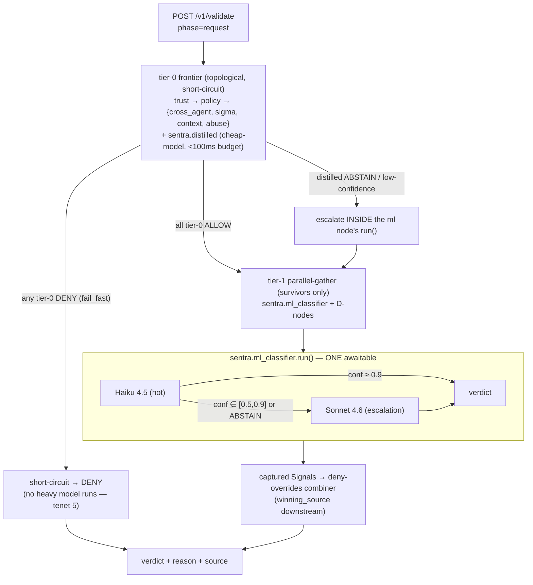
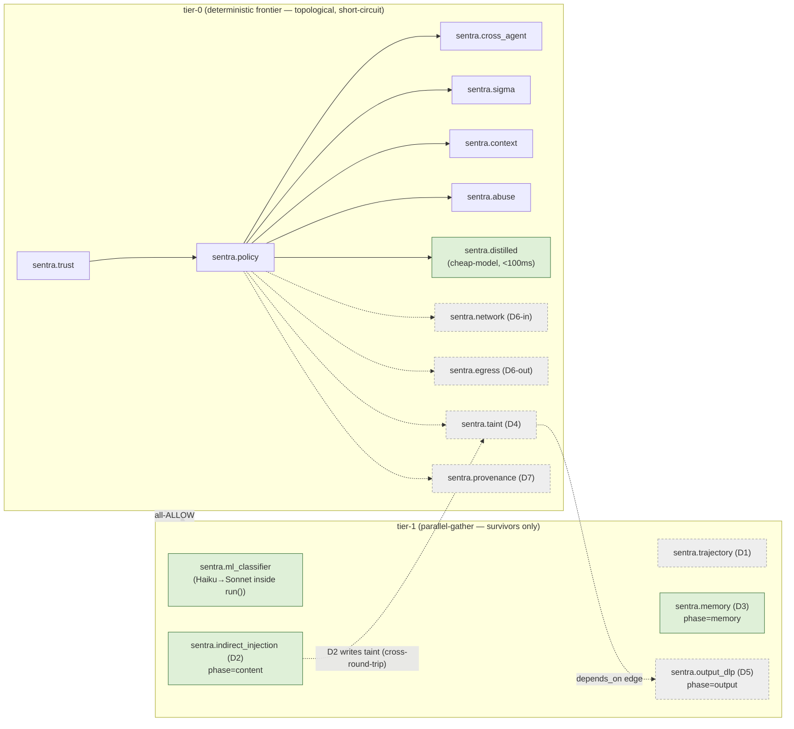
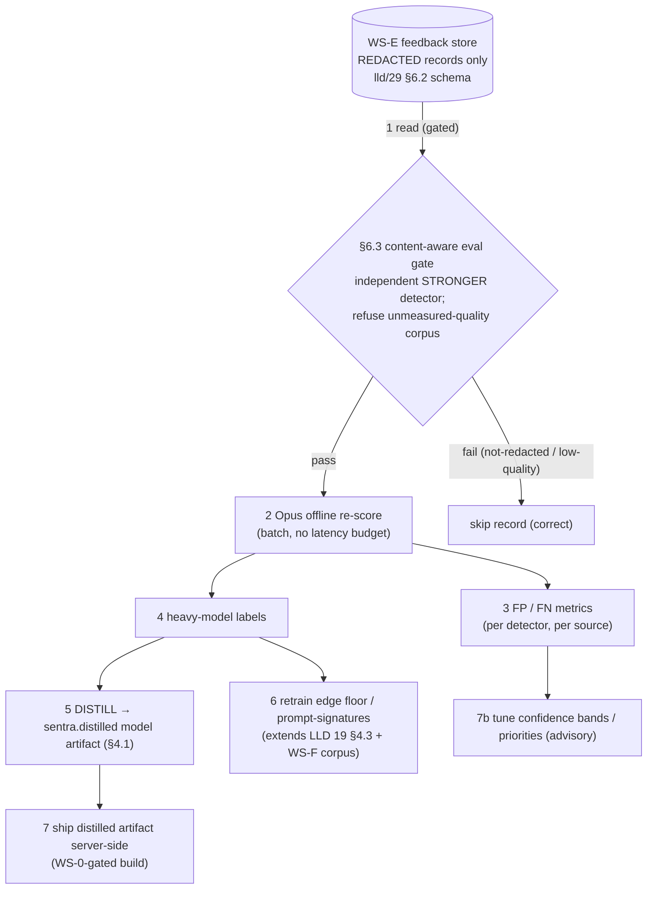

# LLD 32: Detection Depth (WS-L) — Serverless Build-of-Record

**Version**: 1.0
**Last Updated**: 2026-07-02
**Status**: Draft — for review
**Owner**: Founder
**Workstream**: WS-L (Serverless edition) — Detection Depth, consolidated

**Prerequisites (contracts this LLD consumes, does NOT re-cut):**
- [LLD 31: DAG Scheduler](31-dag-scheduler.md) (WS-C) — the `ValidatorNode` / `CostTier` / `depends_on` node vocabulary + `run_dag` execution. WS-C owns the *mechanism*; this LLD registers *nodes*.
- [LLD 30: Multi-phase Contract](30-multiphase-contract.md) (WS-B) — the `phase` field, `KNOWN_PHASES`, the `_CONTENT_FIELD` → `content_text` map, and the `phase_handler_not_implemented:<p>` fail-secure stub the three phase handlers replace.
- [LLD 29: Redaction](29-redaction.md) (WS-E) — the Tier-2 `redaction.ner` barrier + the redacted feedback-store schema (§6.2) + the §6.3 content-aware eval gate the offline loop reads through.

**Consolidates (superseded-for-Serverless, retained as origin design):**
- [LLD 19: ML Threat Classifier](19-ml-threat-classifier.md) — tiered Haiku/Sonnet/Opus models.
- [LLD 20: Defense-in-Depth Layers](20-defense-in-depth-layers.md) — the seven D1–D7 layers.

**Elaborates HLD:** [hld/serverless-edition.md](../hld/serverless-edition.md) §6.2(c) (the cost-annotated DAG, ADR-030), §6.2(h) (all-detectors-on, ADR-034), §6.2(b) (the phase contract), §6.2(e) (the edge-is-deterministic-only / models-are-server-side note), §3 (the "deep enough to catch real attacks" thesis).

## Table of Contents
1. [Context](#1-context)
2. [Scope & consolidation map](#2-scope--consolidation-map)
3. [Tenets carried forward](#3-tenets-carried-forward)
4. [Architecture: the tiered detection model (distilled → heavy → offline)](#4-architecture-the-tiered-detection-model-distilled--heavy--offline)
5. [Architecture: D1–D7 as DAG nodes](#5-architecture-d1d7-as-dag-nodes)
6. [Architecture: the three per-phase handlers (WS-B stub replacements)](#6-architecture-the-three-per-phase-handlers-ws-b-stub-replacements)
7. [Architecture: multimodal / image threat (FR-3.15)](#7-architecture-multimodal--image-threat-fr-315)
8. [Architecture: offline reclassify + retrain loop (FR-3.14)](#8-architecture-offline-reclassify--retrain-loop-fr-314)
9. [Signal taxonomy & priority additions](#9-signal-taxonomy--priority-additions)
10. [Cross-workstream seams & honest gaps](#10-cross-workstream-seams--honest-gaps)
11. [Security (SEC-1..n)](#11-security-sec-1n)
12. [Scaling & latency budget](#12-scaling--latency-budget)
13. [Resiliency & recovery (RES-1..n)](#13-resiliency--recovery-res-1n)
14. [Sequencing & rollout (honest phasing)](#14-sequencing--rollout-honest-phasing)
15. [Cross-references](#15-cross-references)

---

## 1. Context

**In plain terms.** WS-C already built the scheduler — the thing that runs the checks. WS-B already built the `phase` field — the thing that says whether a call is checking a tool request, ingested content, an output, or a memory write. This doc does not re-decide either. It fills the *depth* those two left empty: a cheap local classifier that answers the common case fast, the escalation chain behind it, the seven deep detection layers (D1–D7) as new scheduler nodes, and the three per-phase handlers that replace WS-B's "not implemented yet → deny" stubs with real detectors. Each thing this LLD adds is registered into the *existing* `run_dag` as an ordinary `ValidatorNode` — no new subsystem, no new combiner, no new endpoint.

This LLD deepens the **one approved HLD option** — [hld/serverless-edition.md](../hld/serverless-edition.md) §6.2(c) **Option A, the cost-annotated DAG** (tier-0 short-circuit, then tier-1 parallel-gather; ADR-030), operating on §6.2(b)'s phase contract, feeding §6.2(e)'s redacted store, under §6.2(h)'s all-detectors-on posture (ADR-034). It does **not** re-litigate those choices. It is the **Serverless build-of-record for all detection depth**, consolidating [LLD 19](19-ml-threat-classifier.md) (tiered models) and [LLD 20](20-defense-in-depth-layers.md) (D1–D7), both of which get a `superseded-for-Serverless by lld/32` forward pointer and are retained as origin design (propagate-change discipline — not deleted, not forked).

**Doc-number correction.** This document is **`lld/32-detection-depth.md`**. The WS-L scope doc ([tasks/serverless-edition/ws-l-detection-depth.md](../tasks/serverless-edition/ws-l-detection-depth.md)) refers to `lld/31` — that reference is **stale**; `lld/31` is WS-C's DAG scheduler ([lld/31-dag-scheduler.md](31-dag-scheduler.md)). The authoritative slot for WS-L is `lld/32` per [tasks/serverless-edition/00-index.md:16,38](../tasks/serverless-edition/00-index.md). The scope doc's cross-references should be reconciled to `lld/32` (§10).

---

## 2. Scope & consolidation map

**In plain terms.** Seven pieces of "depth" had no build owner: the distilled model, the heavy-tier chain, the offline retrain loop, the seven D-layers, multimodal, and the three phase handlers. This section is the one table that names each piece, its requirement ID, its origin design, its honest priority, and whether it's in the first build wave or later. It also states what is explicitly *not* this LLD's job.

### 2.1 The seven pieces

| Piece | Implements | Origin design (consolidated) | Priority (honest) | This LLD's status |
|---|---|---|---|---|
| **Distilled local model** (server-side tier-0 cheap-model node) | FR-3.12 (elevated to P0) | LLD 19 tiered strategy (no prior LLD) | P0 build-wave | **SLOT designed (§4.1); BUILD gated on WS-0 escalation-rate number** |
| **Heavy-tier escalation** (Haiku 4.5 → Sonnet 4.6 → Opus offline) | FR-3.2 | LLD 19 §3–4, §4.4 bands | P0 build-wave | Designed §4.2; interim cheap tier is today's `sentra.ml_classifier` Haiku node until distilled ships |
| **Offline reclassify + retrain loop** | FR-3.14 | LLD 19 §4.3/§13.3 + LLD 29 §6.6 gap | P0 (cold-path) | **CONTRACT designed §8; BUILD after WS-E ships the feedback store + eval gate** |
| **D1 Trajectory** | FR-3.5 | LLD 20 §4 | sub-PRD P2 | Designed §5.1; **LATER** (§14) |
| **D2 Indirect / second-order injection** | FR-3.6 | LLD 20 §5 | **P0** (owner call) | Designed §5.2 + §6.2; **FIRST WAVE**, standalone (no taint-thread) |
| **D3 Memory integrity** | FR-3.8 | LLD 20 §6 | **P0** (owner call) | Designed §5.3 + §6.3; **FIRST WAVE** |
| **D4 Taint / information-flow control** | FR-3.9 | LLD 20 §7 | sub-PRD P2 | Designed §5.4; **LATER** — the D2→D4→D5 chain extension |
| **D5 Output DLP** | FR-3.7 | LLD 20 §8 | later (owner call) | Designed §5.5 + §6.4; **routed-but-stubbed → fail-secure DENY** until the PDP→PEP rewrite loop exists |
| **D6 Network / egress** | FR-3.10 | LLD 20 §9 | sub-PRD P1/P2 | Designed §5.6; **LATER** |
| **D7 Supply-chain / inter-agent** | FR-3.11 | LLD 20 §10 | sub-PRD P2 | Designed §5.7; **LATER** |
| **Multimodal / image threat** | FR-3.15 | named-not-designed | P1/P2 | **SCOPE-ONLY §7** — the E6 image router is the current surface; a real evaluator is a later tier-1 node |

### 2.2 Explicit non-goals (owned elsewhere — do NOT re-cut here)

- **The DAG mechanism** — `run_dag`, `_toposort`, `_build_chains`, the tier-0/tier-1 split, `fail_fast`/`evaluate_all`. Owned by WS-C ([lld/31](31-dag-scheduler.md)). This LLD *registers nodes into* it; it changes no scheduler-core file.
- **The `phase` field / `KNOWN_PHASES` / `_CONTENT_FIELD`** — owned by WS-B ([lld/30](30-multiphase-contract.md)). This LLD *consumes* the contract additively; it does not add a phase, rename `content_text`, or add per-phase `*_body` fields.
- **The redacted feedback-store schema + the §6.3 eval gate** — owned by WS-E ([lld/29](29-redaction.md)). This LLD's offline loop is a *reader* of that store; it does not design the store.
- **The `coverage_sources(phase)` accessor** — WS-C owes it to WS-D ([lld/33](33-decision-trail.md)). This LLD only *registers its new sources* into the fallback tables so the trail joins on them (§9, §10).
- **The deny-overrides combiner algorithm** — unchanged (LLD 17 substrate). This LLD adds *producers* (Signal-emitting nodes), not a new combine algorithm.

---

## 3. Tenets carried forward

The **8 HLD master tenets** ([hld/serverless-edition.md](../hld/serverless-edition.md) §4, ARCHITECTURE §1.4 verbatim) and tie-breakers **A** (grow additively) and **B** (record what ran) govern every implementation call below. Restated for this LLD's context, most-important-first:

1. **Enforcement is local; the control plane is never on the action path** — the distilled model + D-nodes run in the PDP on the action path; the offline retrain loop (§8) is control-plane / cold-path, NEVER on `/v1/validate`.
2. **Fail secure, never fail open** — a dropped/errored D-layer abstains to the deterministic floor or re-raises to a fail-secure DENY; a stub replacement never opens a fail-open hole; abstain is never treated as "clean".
3. **Deny-by-default, explainable** — every D-node names its deciding `Source`; its `Signal` is captured into WS-D's decision trail; a new `Source` must be registered so the trail joins on it.
4. **Defense in depth** — D1–D7 are independent layers, each ABSTAINs on error/disable and is never a sole defense; evading one is caught by another.
5. **Latency scales with risk, not volume** — the distilled model classifies the common case cheaply so the heavy tier + D-nodes (tier-1) run only on tier-0 survivors / edge cases; no summed latency (parallel-gather + chains).
6. **The data boundary is the customer's to set** — D-nodes read the post-NER-barrier redacted view; no raw PHI retained by the reclassify loop (redacted records only).
7. **Honest staging** — ship deterministic floors first; each D-layer + the ML tiers graduate shadow→enforce via `metadata['enforce']`, NOT simultaneous ship; sub-PRD P1/P2 marks are honored with per-layer sequencing.
8. **Tie-breaker A — grow the contract additively** — new `Source.*` constants, D-nodes, and phase handlers are additive; no re-cut of the `phase` field, the `_CONTENT_FIELD` map, the `ValidatorNode` vocabulary, or the existing `DEFAULT_PRIORITIES` / tie-break.
9. **Tie-breaker B — record what ran; force nothing extra** — D-nodes register into the DAG so WS-D records what actually executed; producing the trail must not force layers to run that risk didn't warrant (`evaluate_all` is the opt-in high-assurance mode, not the default).

> Load-bearing consequences threaded through this doc: **tenet 4** — every D-node ABSTAINs on error/disable and is never a sole defense (§5, §13). **tenet 5** — the distilled node resolves the common case so the heavy tier runs only on survivors (§4, §12). **tenet 2** — the phase-handler stub replacement (§6) never fails open; on abstain the deterministic floor decides. **tenet 8** — each layer + tier graduates shadow→enforce via `metadata['enforce']` (`run.py:69-80` `_is_hard_deny`), not a simultaneous 7-layer flip (§14).

---

## 4. Architecture: the tiered detection model (distilled → heavy → offline)

**In plain terms.** Today one model node runs: `sentra.ml_classifier`, a Haiku call, tier-1, ~600 ms. This section puts a *smaller, faster, server-side* classifier in front of it — the **distilled model** — that answers the easy 90-something-percent of calls in under 100 ms and only escalates the genuinely ambiguous ones into the Haiku→Sonnet chain. The distilled model is *trained by* the offline loop in §8 (it distills the big models' labels into a small fast one). Because the DAG's tier-0 is "cheap deterministic," and a model is neither deterministic nor free, the distilled node rides tier-0 with a **hard sub-100 ms budget** — the one documented exception, justified below against `node.py`/`run.py` semantics.

### 4.1 The distilled model as a tier-0 cheap-model node (Q1)

**What it is.** A small server-side classifier (`sentra.distilled` node) placed **in front of** the Haiku hot node. It resolves the common case in **< 100 ms** and escalates only low-confidence / ABSTAIN cases into the tier-1 heavy chain. It is **produced by the FR-3.14 offline distill/retrain loop** (§8) — distilling Opus/Sonnet labels into a small fast model — which is precisely why FR-3.12 (the model) and FR-3.14 (the loop that makes it) are designed together in this one LLD.

**Where it runs — server-side in the PDP, NOT the SDK edge.** The Serverless SDK edge is stdlib-only and hosts no model ([hld/serverless-edition.md](../hld/serverless-edition.md) §6.2(e); [lld/29](29-redaction.md) §4). The distilled model runs **server-side in the PDP**, as a `ValidatorNode`. (The at-edge distilled variant is the in-VPC / sidecar story, out of this slice — WS-L task doc read-before-coding #2.)

**The `CostTier` decision (resolved cleanly, not hand-waved).** `CostTier` has exactly two members ([node.py:20-28](../src/security-controller/app/services/scheduler/node.py)): `DETERMINISTIC = "tier-0"` (the cheap short-circuit frontier) and `EXPENSIVE_MODEL = "tier-1"` (parallel-gathered survivors). A model on tier-0 is unusual because tier-0 is described as "deterministic." The choice — and its justification against the real scheduler code:

- **Decision: the distilled node rides `CostTier.DETERMINISTIC` (tier-0) as a documented cheap-*model* node with a hard sub-100 ms budget, WITHOUT adding a new enum member.** Adding a third `CostTier` would touch the scheduler core (`run_dag` branches on exactly `DETERMINISTIC` vs `EXPENSIVE_MODEL` at [run.py:438-439](../src/security-controller/app/services/scheduler/run.py)) — a re-cut of WS-C's contract, forbidden by tenet 8. Tier-0 is the *behavioral* class we want: it runs in `_toposort` order **before** any tier-1 node ([run.py:456](../src/security-controller/app/services/scheduler/run.py)), and (in `fail_fast`) a tier-0 DENY short-circuits **before the expensive tier-1 chain runs at all** ([run.py:473-477](../src/security-controller/app/services/scheduler/run.py)) — which is exactly tenet 5's "resolve the common case cheaply so the heavy tier runs only on survivors."
- **Why this is safe on tier-0 semantics.** A tier-0 node's exception is NOT caught inside `run_dag` — it bubbles to `validate_tool_call`'s outer handler → fail-secure error→DENY ([run.py:18-21](../src/security-controller/app/services/scheduler/run.py) docstring; §13 RES-1). The distilled node must therefore **catch its own inference failures and RETURN `ValidationResult.abstain(...)`** (never raise), exactly as the ML classifier does on a Bedrock outage ([models.py:236-253](../src/security-controller/app/api/models.py) `abstain`). A returned abstain flows to the deterministic floor; the *escalation* (below) is the low-confidence path, not the failure path.
- **The "deterministic" label is honored by the budget contract, not by pretending the model is deterministic.** The distilled node's `run()` enforces a **hard 100 ms wall** (an `asyncio.wait_for` inside its own `run`, timeout → returned abstain → escalate/floor). A node that cannot answer in its tier-0 budget behaves like a tier-0 miss (abstain), so the frontier's ~1–5 ms deterministic checks are never blocked behind a slow model — the tier-0 short-circuit's latency guarantee holds. This is the *sub-tier* concept made concrete without a new enum: a cheap-model node is a tier-0 node bound by a budget, documented here as the one exception to "tier-0 = pure regex/lookup."

**Escalation is INSIDE the node's single `run()` awaitable — never an in-node `asyncio.gather`.** The distilled node's `run(request, session)` awaits the distilled classifier; on `confidence < TRUST_THRESHOLD` or ABSTAIN it *within the same awaitable* awaits the tier-1 Haiku path and returns that result. This is one `Awaitable[ValidationResult]` per the `ValidatorNode.run` signature ([node.py:62](../src/security-controller/app/services/scheduler/node.py)). It is **NOT** a `gather` inside the node — the sole `asyncio.gather` in the system is `_run_tier1_with_edges` ([run.py:256,345](../src/security-controller/app/services/scheduler/run.py)); a self-gathering node re-introduces summed latency and bypasses the run-mode flag (WS-L task doc footgun #1).

**Interim (until the distilled model is trained + shipped).** The existing `sentra.ml_classifier` Haiku node **IS** the cheap tier. The distilled *slot* is designed now; its *build* waits on WS-0's escalation-rate number (§14) — if the measured escalation rate is high enough that a distilled front-tier meaningfully cuts p99, it is built; if the common case is already cheap, distillation is deferred.

### 4.2 Heavy-tier escalation (Haiku 4.5 → Sonnet 4.6 → Opus offline)

Consolidated from [LLD 19 §3–4](19-ml-threat-classifier.md). The heavy tier is a **tier-1** `EXPENSIVE_MODEL` chain, reached only when the distilled node (or, interim, the Haiku node) is low-confidence:

- **Haiku 4.5 (hot)** — the first heavy model; emits `confidence ∈ [0.0, 1.0]` alongside its decision.
- **Sonnet 4.6 (escalation)** — reached on the confidence band (LLD 19 §4.4):

| Haiku output | Action |
|---|---|
| `decision=ALLOW/DENY, confidence ≥ 0.9` | Trust Haiku. Skip escalation. |
| `confidence ∈ [0.5, 0.9]` | Escalate to Sonnet. Use Sonnet's verdict. |
| `confidence < 0.5` | Escalate to Sonnet AND emit ABSTAIN (Haiku effectively didn't decide) |
| Haiku ABSTAINs | Escalate to Sonnet |
| Both ABSTAIN | No `sentra.ml_classifier` signal — deterministic floor + distilled decide |

Thresholds are env-vars (`SENTRA_ML_CONFIDENCE_TRUST_THRESHOLD=0.9`, `SENTRA_ML_CONFIDENCE_ABSTAIN_THRESHOLD=0.5`) — tune without redeploy.

- **Opus** is **offline-only** (LLD 19 §4.3) — never on the request path (its ~5s would compound; §4.2 of LLD 19). Opus's role is the batch reclassify + label-generation of §8.

The whole heavy chain — Haiku, its Sonnet escalation — lives inside the `sentra.ml_classifier` node's `run()` as one awaitable, wrapped by `_apply_ml_enforce_wrapper` ([registry.py:402-425](../src/security-controller/app/services/scheduler/registry.py)) which stamps `metadata["enforce"]=True` so a live ML DENY can decide (`_is_hard_deny`). This is unchanged from WS-C; §4 only documents that the distilled node feeds it.

### 4.3 How distilled + heavy compose as DAG nodes



Key: the distilled node is a tier-0 node with a `depends_on=(Source.SENTRA_POLICY,)` edge (documentary — it runs after policy resolves, same as the other frontier nodes; [registry.py:290-331](../src/security-controller/app/services/scheduler/registry.py)) and `cost_tier=CostTier.DETERMINISTIC`. The heavy chain stays inside the tier-1 `sentra.ml_classifier` node. Escalation is a within-node awaitable, never a graph edge and never a gather.

---

## 5. Architecture: D1–D7 as DAG nodes

**In plain terms.** Each of the seven deep layers becomes one new `ValidatorNode`. Six of the seven are tier-1 (they run a model or a state lookup only for tier-0 survivors); two are cheap enough to sit on tier-0 (D6 inbound, egress). Three of them form a *chain* — D2 tags content as untrusted, D4 reads that taint to block privileged actions, D5 checks the output — expressed by `depends_on` edges (D4 depends on D2, D5 depends on D4) that `_build_chains` ([run.py:207-242](../src/security-controller/app/services/scheduler/run.py)) sequences. Each layer names a new `Source.*`, ABSTAINs on error/disable, and is never a sole defense. This section designs **all seven** (consolidating LLD 20); §14 sequences which ship first.

### 5.1 D1 — Conversation Trajectory (`Source.SENTRA_TRAJECTORY`)

- **Catches:** Crescendo / many-shot / slow-build intent drift — malice distributed across turns (LLD 20 §4). OWASP LLM01.
- **Mechanism:** a per-session GRU state head folds each turn's Bedrock embedding into an accumulated-risk hidden state persisted on the session item (`trajectory_state`, `trajectory_risk`, `trajectory_turn_count` in the `sentra-session-context` DDB table); a DENY when accumulated risk crosses threshold even though the current turn is individually benign. Encoder = frozen Bedrock embedding (`amazon.titan-embed-text-v2`); state head = in-process GRU (~KB weights).
- **Node:** `cost_tier=EXPENSIVE_MODEL` (tier-1; the ~20–50 ms embedding RTT), `depends_on=(Source.SENTRA_POLICY,)`, `phase=request`. Standalone (no `depends_on` onto another tier-1 node).
- **ABSTAIN:** on embedding-model outage or `D1_ENABLED=false` → `ValidationResult.abstain(...)` → no signal → floor decides.

### 5.2 D2 — Indirect / Second-Order Injection (`Source.SENTRA_INDIRECT`)

- **Catches:** ASI01 Goal Hijack, EchoLeak, RAG-poisoning — injection riding in content the agent *ingests* (LLD 20 §5). The single largest current coverage gap.
- **Mechanism:** reuse the sigma + ML detection stack pointed at `content_text` (content-framed ML prompt: "is this untrusted data carrying instructions to an agent?"), plus two indirect-specific detectors — instruction-density heuristic (imperative ratio, second-person directives) and encoding/obfuscation scan (base64, homoglyphs, zero-width chars). Verdicts: ALLOW / DENY / (SANITIZE — see §6.2 scoping).
- **Node:** `cost_tier=EXPENSIVE_MODEL` (tier-1; content-framed ML), `depends_on=(Source.SENTRA_POLICY,)`, `phase=content`.
- **First-wave scope (Q2):** D2 ships **STANDALONE** — it DENYs/ABSTAINs on ingested untrusted content in `content_text` **WITHOUT** taint-threading into D4. The taint-descriptor output (LLD 20 §5.4) that D4 would read is a **future chain extension** (§5.4), not first-wave. See §6.2.

### 5.3 D3 — Memory Integrity (`Source.SENTRA_MEMORY`)

- **Catches:** ASI06 Memory & Context Poisoning — a durable false "fact" planted in one session biasing future unrelated sessions (LLD 20 §6).
- **Mechanism:** a `MemoryWriteValidator` at the memory chokepoint enforces the integrity guards (LLD 20 §6.4): provenance mandatory; untrusted memory cannot promote itself (`trust_weight ≤ 0.3` cap); **memory tightens, never loosens security** (the policy engine ignores any memory that would expand `allowed_tools` / raise a limit / skip a check); signed + tamper-evident via KMS `GenerateMac`/`VerifyMac` over immutable birth facts; decay-bounded per-kind (short TTL on `AGENT_INFERENCE`, long/no TTL on authenticated `OPERATOR_DIRECTIVE`). Verdicts: ALLOW / DENY (`MEMORY_POISONING`).
- **Node:** `cost_tier=EXPENSIVE_MODEL` (tier-1 — it may run a content-framed classify over the memory candidate), `depends_on=(Source.SENTRA_POLICY,)`, `phase=memory`.
- **Model A (default):** Sentra stores a governance record only (provenance + content hash + signature in `sentra-agent-memory`); the memory *content* lives in the customer store (§3.7 data-residency). D3 is **depth, not the floor** — even with no D3, a poisoned memory can't bypass request-time enforcement when the agent *acts* on it.

### 5.4 D4 — Taint / Information-Flow Control (`Source.SENTRA_TAINT`)

- **Catches:** ASI02 Tool Misuse, ASI05 Code Exec, bulk-exfil — the structural endgame (LLD 20 §7; CaMeL, arXiv:2503.18813).
- **Mechanism:** a per-session `taint_ledger` (value-fingerprint → taint level) written by D2 on content ingest, read at `phase=request`: for each value in `tool_params`, if its fingerprint matches a known-`untrusted` value and the tool's `action_class` is `PRIVILEGED`/`IRREVERSIBLE` (declared in policy `tool_controls`), DENY `TAINTED_PRIVILEGED_ACTION`. Bypass-proof: even a perfect jailbreak fails if the destination param is tainted.
- **Node:** `cost_tier=DETERMINISTIC` (tier-0 — pure in-memory ledger lookup, ~2–5 ms; LLD 20 §13), `phase=request`, and — the load-bearing edge — **`depends_on=(Source.SENTRA_POLICY, Source.SENTRA_INDIRECT)`**: D4 reads the taint D2 wrote. Because D2 is a *different-phase* call (`content`) that persisted taint to the session, the within-call edge to `SENTRA_INDIRECT` is documentary; the real ordering is across round-trips.
- **First-wave scope (Q2):** D4 is a **LATER** chain extension. It ships when D2 is extended to emit the taint descriptor. Until then D2 is standalone (§5.2).

### 5.5 D5 — Output DLP (`Source.SENTRA_OUTPUT_DLP`)

- **Catches:** LLM02 Sensitive Disclosure, EchoLeak exfil — what the agent is about to *emit* (LLD 20 §8).
- **Mechanism:** DLP/PII detectors + exfil-channel detection (secret-looking token adjacent to an external URL) + volume anomaly + destination check over `content_text` at `phase=output`. Useful verdict is **REDACT** (masked payload) or **HOLD** (human-in-the-loop for `requires_human_approval` tools), not just ALLOW/DENY.
- **Node:** `cost_tier=EXPENSIVE_MODEL` (tier-1; reuses ML + DLP), `phase=output`, **`depends_on=(Source.SENTRA_TAINT,)`** — completing the D2→D4→D5 chain.
- **First-wave scope (Q2 / default):** **routed-but-stubbed → fail-secure DENY** (§6.4). A DENY-only output handler is low value; the REDACT/rewrite verdict needs the **PDP→PEP rewrite loop** the SDK decorator does not have today ([lld/30](30-multiphase-contract.md) out-of-scope; [lld/29](29-redaction.md) §2.1(d)). Designing that loop is a separate future deliverable — **NOT** in scope here.

### 5.6 D6 — Network & Identity (`Source.SENTRA_NETWORK` inbound, `Source.SENTRA_EGRESS` outbound)

- **Catches:** ASI03 Identity/Privilege Abuse, exfil destinations, anomalous callers (LLD 20 §9).
- **Mechanism (two halves):** *inbound* `network_validator` profiles the caller (IP threat-intel, velocity anomaly, impossible-travel) — DENY `MALICIOUS_SOURCE_IP` / `VELOCITY_ANOMALY` / `CREDENTIAL_ANOMALY`; *outbound* egress allow-list (default deny-all) checks any destination in `tool_params` / output — DENY if not in `egress_allowlist`.
- **Nodes:** both `cost_tier=DETERMINISTIC` (tier-0 — ~1–3 ms cached lookup; runs before any model). Inbound `phase=request`; egress on `phase=request` (params) and `phase=output` (destinations).
- **LATER** (§14).

### 5.7 D7 — Supply-Chain / Inter-Agent Integrity (`Source.SENTRA_PROVENANCE`)

- **Catches:** ASI04 Supply Chain, ASI07 Insecure Inter-Agent Comms (LLD 20 §10).
- **Mechanism:** tool-manifest pin+hash (silently-mutated tool def fails the hash check); `provenance_validator` verifies the calling agent's **signed identity token** (not just a claimed `agent_id`) — DENY `AGENT_SPOOFING`. Pairs with the existing `cross_agent_validator` (STEP 2.5, *is agent X allowed*) by adding authenticity (*is this really agent X*).
- **Node:** `cost_tier=DETERMINISTIC` (tier-0 — signature verify ~5–10 ms, inter-agent calls only; ABSTAINs on non-inter-agent calls), `depends_on=(Source.SENTRA_POLICY,)`, `phase=request`.
- **LATER** (§14).

### 5.8 Node graph with dependency edges



Dashed = LATER (§14); solid = first-wave or already-built. The **D2→D4→D5 chain** is the only real tier-1→tier-1 `depends_on` chain; `_build_chains` groups it and `run_chain` ([run.py:299-340](../src/security-controller/app/services/scheduler/run.py)) runs it sequentially, threading the upstream taint result forward — an upstream abstain aborts the chain to the deterministic floor (`_abstain_chain_remainder`, [run.py:245-253](../src/security-controller/app/services/scheduler/run.py)), never treating a missing taint label as "clean".

### 5.9 Per-layer phasing table (honoring Q2)

| Layer | Node source | cost_tier | phase | depends_on | First-wave? |
|---|---|---|---|---|---|
| D1 trajectory | `sentra.trajectory` | tier-1 | request | policy | LATER (P2) |
| D2 indirect | `sentra.indirect_injection` | tier-1 | content | policy | **FIRST (P0), standalone** |
| D3 memory | `sentra.memory` | tier-1 | memory | policy | **FIRST (P0)** |
| D4 taint | `sentra.taint` | tier-0 | request | policy, indirect | LATER (chain extension) |
| D5 output-DLP | `sentra.output_dlp` | tier-1 | output | taint | LATER (needs rewrite loop; stub→DENY) |
| D6-in network | `sentra.network` | tier-0 | request | policy | LATER (P1/P2) |
| D6-out egress | `sentra.egress` | tier-0 | request+output | policy | LATER (P1/P2) |
| D7 provenance | `sentra.provenance` | tier-0 | request | policy | LATER (P2) |

> **Barrier note (do NOT reuse for D-nodes).** The `redaction.ner` node is a *pre-DAG barrier* (`_is_barrier`, [run.py:55-66](../src/security-controller/app/services/scheduler/run.py)) — it mutates `content_text` in place and is lifted out of the tier split. D-nodes are **ordinary tier-0/tier-1 graph nodes**, NOT barriers; they must not reuse `_is_barrier` / the `REDACTION_NER` pattern (§9).

---

## 6. Architecture: the three per-phase handlers (WS-B stub replacements)

**In plain terms.** WS-B routes any non-`request` phase to a fail-secure DENY today ([routes.py:97-103](../src/security-controller/app/api/routes.py)): `content`, `output`, and `memory` all hit `_phase_not_implemented_deny`. This section replaces that early-return with a real path: send the content/memory phases **into `run_dag(phase)`** so the phase-specific D-nodes (D2 for content, D3 for memory) run as first-class scheduler nodes — not a bypass path around the DAG. Output stays stubbed → DENY until the rewrite loop exists.

### 6.1 The integration seam DECISION — route INTO `run_dag(phase)`, do not bypass it

The current guard ([routes.py:96-103](../src/security-controller/app/api/routes.py)):

```python
# GUARD 2 (only reached with phase IN KNOWN_PHASES):
if phase != "request":
    # content/output/memory: known phase, no live handler yet → fail-secure DENY.
    # WS-L replaces this line with the real D2/D3/D5 handler when it ships.
    return await _phase_not_implemented_deny(
        request, reason=f"phase_handler_not_implemented:{phase}"
    )
```

**Decision:** WS-L replaces this early-return **for `content` and `memory`** with a route into the *same* `validate_tool_call` → `run_dag(phase)` path, where `build_dag(service, phase, stamp_ctx)` ([registry.py:72](../src/security-controller/app/services/scheduler/registry.py)) returns the phase-specific node set (today it returns only the request nodes + the NER barrier for content-bearing phases; WS-L extends `build_dag` to append the D2/D3 nodes for their phases). This means:

- The content/memory detectors run as **first-class scheduler nodes** — they inherit tenet-5 tiering (the tier-0 frontier still short-circuits), the run-mode flag (`fail_fast`/`evaluate_all`), the parallel-gather (no summed latency), and the WS-D decision-trail capture. This is the correct honoring of the no-in-layer-gather footgun (WS-L task doc #1).
- It is **NOT** a bypass path around the DAG (a hand-rolled `if phase=="content": run_d2()` beside `run_dag` would fork the scheduler, lose the trail, and re-open the fail-open surface).
- It **consumes** WS-B's contract read-only: `phase` narrows the node set; `_CONTENT_FIELD[phase]` → `content_text` ([models.py:34-38,87](../src/security-controller/app/api/models.py)) is where the D-node reads the egressing content. WS-L re-cuts none of it (tenet 8).
- The **NER barrier already runs first** on content-bearing phases ([registry.py:350-359](../src/security-controller/app/services/scheduler/registry.py)) — so D2/D3 read the **post-redaction** `content_text` view (§11 SEC no-raw-PHI). This ordering is free: WS-L adds D-nodes into the *same* `build_dag`, after the barrier append.

```mermaid
sequenceDiagram
  participant AG as Agent interceptor
  participant RT as routes.py validate()
  participant VS as validation_service.validate_tool_call
  participant DAG as run_dag(phase)
  participant BAR as redaction.ner (barrier)
  participant DN as D-node (D2 content / D3 memory)
  AG->>RT: POST /v1/validate {phase=content, content_text}
  RT->>RT: GUARD 1: phase in KNOWN_PHASES? (422 if not)
  RT->>RT: GUARD 2: phase != request → route INTO pipeline (WS-L; was DENY-stub)
  RT->>VS: validate_tool_call(request)
  VS->>DAG: run_dag(build_dag(service, "content", ctx), ...)
  DAG->>BAR: barrier FIRST & ALONE — redact content_text in place
  BAR-->>DAG: ALLOW/ABSTAIN (content_text now redacted view)
  DAG->>DN: tier-1 D2 node reads redacted content_text
  DN-->>DAG: ALLOW / DENY (SENTRA_INDIRECT)
  DAG-->>VS: (ValidationResult, signals[])
  VS-->>RT: verdict + reason + source
  RT-->>AG: 200 ALLOW / 200 DENY (honest status; §11)
```

### 6.2 content → D2 (P0, standalone injection detector — Q2)

`phase=content` routes into `run_dag("content")`. `build_dag` (extended by WS-L) appends the `sentra.indirect_injection` tier-1 node (§5.2) after the NER barrier. It reads the redacted `content_text`, runs sigma-over-content + content-framed ML + the two indirect heuristics, and returns ALLOW / DENY (`SENTRA_INDIRECT`). **Standalone:** it does NOT thread a taint descriptor to D4 in the first wave — D4 (§5.4) and the taint-write are the LATER chain extension. The **SANITIZE** verdict (spotlighting, LLD 20 §5.3) is **deferred with D5's rewrite loop** — first-wave D2 is ALLOW/DENY only, because returning a spotlighted `sanitized_content` payload needs the same PDP→PEP rewrite path D5 lacks.

### 6.3 memory → D3 (P0)

`phase=memory` routes into `run_dag("memory")`; `build_dag` appends the `sentra.memory` tier-1 node (§5.3). It validates the memory-write candidate carried in `content_text` against the integrity guards (LLD 20 §6.4) and returns ALLOW / DENY (`SENTRA_MEMORY`, `MEMORY_POISONING`). The read-path consumers (D1 cross-session, policy hints) stay off (`AGENT_MEMORY_READ_ENABLED=false`) until the write-path guards are enforce-graduated — the non-negotiable D3 sequencing rule (LLD 20 §6).

### 6.4 output → D5 (LATER per default — routed-but-stubbed → fail-secure DENY)

`phase=output` **stays** on the `_phase_not_implemented_deny` early-return (fail-secure DENY, `phase_handler_not_implemented:output`) until the PDP→PEP rewrite loop exists. WS-L does **not** design that loop (a separate future deliverable spanning [lld/30](30-multiphase-contract.md) SDK decorator + [lld/29](29-redaction.md)). The `sentra.output_dlp` node (§5.5) is designed and registered *conceptually* into the graph (its `depends_on` on `SENTRA_TAINT` is declared) but its `build_dag` append is gated on the rewrite loop — until then the phase never reaches `run_dag`. This is tenet 2: an unbuilt handler denies, it never opens.

---

## 7. Architecture: multimodal / image threat (FR-3.15)

**SCOPE-ONLY** (per approved default). The **current surface** is the existing **E6 image router** ([registry.py:207-230](../src/security-controller/app/services/scheduler/registry.py) — `content_has_image`, `resolve_tool_image_mode`, `route_image_content` from `app.redaction.image_mode`): when the Tier-1 edge tagged a whole-value image blob into `content_text` as an `⟦AEGR:{nonce}:IMAGE⟧` marker, the NER barrier routes it per-tool **fail-secure** (default / unresolvable → `block`; `evaluate` forwards intact; `redact` replaces with a pending sentinel). A **real image-threat evaluator** (fraud/threat classification of forwarded-intact images) is a **later tier-1 content-path node** that would consume the `evaluate` route's forwarded image. **No full design here** — this LLD only names the surface and the seam so the later node has a defined attach point (the `evaluate` branch of `route_image_content`).

---

## 8. Architecture: offline reclassify + retrain loop (FR-3.14)

**In plain terms.** This is the *cold-path* loop that makes the distilled model (§4.1) and improves the floor. It runs on a schedule (never on `/v1/validate`), re-scores stored **redacted** records from WS-E's feedback store using a stronger detector, measures false-positive / false-negative rates, distills the heavy models' labels into the small distilled model, and retrains the edge floor / signatures. It is **HARD-dependent** on WS-E: the feedback store, the eval gate, and this loop are **NOT built** — this section is the *contract*, sequenced to build **after WS-E ships the store**.

### 8.1 Cold-path only — never on the action path (tenet 1)

The loop is control-plane / batch (LLD 19 §4.3). It never touches `run_dag` or `/v1/validate`. Its inputs are stored records; its outputs are model artifacts + metrics. A failure of the loop has **no action-path RTO/RPO** — the read path (`/v1/validate`) is stateless w.r.t. this loop; a stalled retrain just means the distilled model isn't refreshed, and the interim Haiku tier keeps running (§4.1).

### 8.2 What it reads (gated) and produces



- **Reads REDACTED records** from the WS-E store ([lld/29](29-redaction.md) §6.2) — never raw PHI (tenet 6). The §6.3 eval gate refuses to retrain on an unmeasured-quality / not-redacted corpus (fail-secure: no retrain rather than a bad retrain).
- **Opus** does the batch re-score (its latency is fine off the request path; §4.2).
- **Distills** heavy-model labels into `sentra.distilled` (§4.1) — the FR-3.12↔FR-3.14 coupling.
- **Retrains** the edge floor / signatures (extends LLD 19 §4.3/§13.3 Opus-batch + the WS-F prompt-signature corpus).

### 8.3 Hard dependencies (state plainly)

The feedback store + the §6.3 eval gate + this retrain loop are **NOT built** — WS-E promoted only the edge redactor + the Tier-2 NER barrier ([lld/29](29-redaction.md) §6.6 explicitly names the FR-3.14 retrain job as a WS-L-ownable gap: "no dedicated FR-3.14 retrain LLD yet"). **Sequence this loop AFTER WS-E builds the store** (§10, §14). The distilled-model build (§4.1) additionally waits on WS-0's escalation-rate number (§14).

---

## 9. Signal taxonomy & priority additions

**In plain terms.** Every new node needs a name (`Source.*`) and a strength (priority) so the deny-overrides combiner can rank it and the WS-D decision trail can join on it. This section adds eight new source constants — additively — using LLD 20's higher=stronger numbers (NOT LLD 19's stale inverted numbers), and registers each into the two WS-D trail-join tables. It does not touch any existing entry or the tie-break order.

### 9.1 New `Source.*` constants (additive to [combiners/sources.py](../src/security-controller/app/combiners/sources.py))

Confirmed against the code: **only 7 sentra sources + `redaction.ner` + 2 edge sources exist today** ([sources.py:22-45](../src/security-controller/app/combiners/sources.py)); the D1–D7 constants do NOT exist. Add:

```python
# Detection-depth layers — LLD 32 (consolidates LLD 20 §11). ADDITIVE.
SENTRA_NETWORK:    Final[str] = "sentra.network"            # D6 inbound
SENTRA_EGRESS:     Final[str] = "sentra.egress"             # D6 outbound
SENTRA_TAINT:      Final[str] = "sentra.taint"              # D4
SENTRA_PROVENANCE: Final[str] = "sentra.provenance"         # D7
SENTRA_TRAJECTORY: Final[str] = "sentra.trajectory"         # D1
SENTRA_INDIRECT:   Final[str] = "sentra.indirect_injection" # D2 (phase=content)
SENTRA_OUTPUT_DLP: Final[str] = "sentra.output_dlp"         # D5 (phase=output)
SENTRA_MEMORY:     Final[str] = "sentra.memory"             # D3 (phase=memory)
```

(The distilled node reuses `Source.SENTRA_ML_CLASSIFIER`? **No** — it is a distinct producer; add `SENTRA_DISTILLED: Final[str] = "sentra.distilled"` too, priority 66, one above ML at 65 and below sigma at 70, so a distilled DENY is explainable and unambiguous when both the distilled and heavy tiers fire. This keeps the deterministic-first ordering: sigma 70 > distilled 66 > ml 65.)

### 9.2 Priorities (higher = stronger; slotted additively into `DEFAULT_PRIORITIES`)

Using the **LLD 20 §11 table (higher=stronger)** — **NOT** LLD 19 §6.1's stale inverted (lower=higher) numbers. **Reconcile:** LLD 19 §6.1's priority convention is **superseded by LLD 20 §11** (and by the live `sources.py:55-62` comment, which confirms higher=stronger). The additive entries:

| New source | Priority | Rationale (LLD 20 §11) |
|---|---|---|
| `SENTRA_NETWORK` | 85 | malicious IP / leaked-key — strong, explainable infra denial |
| `SENTRA_TAINT` | 78 | structural IFC denial — strong, below policy authorization |
| `SENTRA_EGRESS` | 77 | destination block — deterministic |
| `SENTRA_PROVENANCE` | 75 | agent-spoofing denial |
| `SENTRA_TRAJECTORY` | 68 | multi-turn — below sigma, above ML |
| `SENTRA_DISTILLED` | 66 | cheap-model semantic — above ML, below sigma |
| `SENTRA_OUTPUT_DLP` | 63 | output-side — below request-side semantic |
| `SENTRA_INDIRECT` | 62 | content-surface semantic |
| `SENTRA_MEMORY` | 58 | write-path poisoning guard |

These slot **between** the existing entries (trust 90, policy 80, sigma 70, ml 65, context 60, abuse/cross_agent 50, edge 40) — no existing value moves.

### 9.3 The T-COMBINER-CLEAN coordination (with WS-C)

WS-C's `T-COMBINER-CLEAN` gate requires that **existing `DEFAULT_PRIORITIES` entries + the tie-break order do NOT change**; new entries are **additive-only**. All nine additions above are new keys — no existing key is edited, and the tie-break (`(priority, confidence, _neg_source)`, [run.py:83-115](../src/security-controller/app/services/scheduler/run.py) `_top_tier1_denier` / `pick_top_denier`) is untouched. An unknown source falls through `default_priority` → 0 ([sources.py:76-82](../src/security-controller/app/combiners/sources.py)) — so a node whose source is registered here ranks correctly, and a typo silently loses tie-breaks (the reason every node MUST pass `Source.SENTRA_*`, never a literal — [node.py:36-41](../src/security-controller/app/services/scheduler/node.py)).

### 9.4 Register each new source in the WS-D trail-join tables

Each new source is **also** added to `STATIC_FALLBACK_ORDER` ([sources.py:113](../src/security-controller/app/combiners/sources.py)) and `SOURCE_DISPLAY_NAMES` ([sources.py:130](../src/security-controller/app/combiners/sources.py)) — the tables WS-D's trail joins on. The live comment at `sources.py:128-129` already anticipates this ("a future WS-L D-layer renders as its raw name until its label is added here"). Without the display-name registration, a D-node renders as its raw source string in the trail; without the fallback-order registration, WS-D's coverage set under-counts it (§10). **D-nodes are ORDINARY graph nodes** — they do NOT reuse `_is_barrier` / the `REDACTION_NER` pattern ([run.py:55-66](../src/security-controller/app/services/scheduler/run.py)); only the pre-DAG NER redactor is a barrier.

---

## 10. Cross-workstream seams & honest gaps

**In plain terms.** This LLD depends on things other workstreams own or haven't built. This is the honest list of every seam — what's missing, who owns it, and how WS-L mitigates in the meantime — so a reviewer can see exactly what "designed but not fully wired" means here.

| # | Gap / seam | Owner | Status | WS-L mitigation |
|---|---|---|---|---|
| G1 | **`coverage_sources(phase)` accessor** — WS-D's trail records the *expected* source set per phase to mark "not-run" layers ([lld/33](33-decision-trail.md) §13; `trail_builder.py:79` currently falls back to `STATIC_FALLBACK_ORDER`). Adding D-nodes under-populates WS-D's coverage set until the accessor lands **and** includes the new sources. | **WS-C** owes the accessor mechanism | Not built | WS-L **registers** its new sources into `STATIC_FALLBACK_ORDER` + `SOURCE_DISPLAY_NAMES` (§9.4) so the trail joins on them via the static fallback until the phase-aware accessor exists. WS-L owns *registering the sources*; WS-C owns the *accessor*. |
| G2 | **WS-E feedback store + §6.3 eval gate** — the offline loop (§8) reads them. | **WS-E** | **NOT built** (only edge redactor + NER barrier promoted) | Sequence the §8 loop AFTER WS-E ships the store; the §8 contract is authored now against the [lld/29](29-redaction.md) §6.2 schema. |
| G3 | **WS-F prompt-signature corpus** — the retrain loop (§8.2 step 6) also feeds it. | **WS-F** | Separate WS | §8 declares the feed; no build coupling until WS-F's corpus exists. |
| G4 | **WS-0 spike gate** — the escalation-rate + recall-delta numbers that justify the distilled build and the D1–D7 "deep tier". | **WS-0** | packet unsigned | §14 frames the build as spike-gated but override-eligible; the distilled build specifically waits on WS-0's escalation-rate number even under override. |
| G5 | **Docstring drift** — [registry.py:26-28](../src/security-controller/app/services/scheduler/registry.py) says *"WS-D adds D1–D7 as additional tier-1 nodes here"*; the owner directive + [00-index.md](../tasks/serverless-edition/00-index.md) assign **D1–D7 to WS-L**. | doc | drift | **Reconcile:** the registry.py docstring should read "**WS-L** adds D1–D7"; WS-D owns the decision-trail, not the D-layers. Fix when WS-L's first D-node lands. |
| G6 | **Scope-doc `lld/31` reference** — [ws-l-detection-depth.md](../tasks/serverless-edition/ws-l-detection-depth.md) refers to `lld/31` for WS-L's LLD; the real slot is `lld/32` (§1). | doc | stale | Reconcile the scope-doc cross-references to `lld/32`. |

---

## 11. Security (SEC-1..n)

**In plain terms.** Every deep detector runs server-side in the PDP, reads only the redacted view of content, fails secure on error, and gets its verdict recorded in the audit trail. Nothing a D-node adds can turn the engine off or leak raw sensitive data.

- **SEC-1 — Where each node runs (trust boundary).** All D-nodes + the distilled model run **server-side in the PDP** ([hld/serverless-edition.md](../hld/serverless-edition.md) §6.2(e); the stdlib SDK edge hosts no model). No detection depth runs customer-side; the edge is deterministic-only. The action-path enforcement is local (tenet 1); the retrain loop (§8) is control-plane, off the action path.
- **SEC-2 — Fail-secure on a dropped/errored layer (tenet 2).** Two honest paths, both fail-secure: (a) a D-node that *returns* `ValidationResult.abstain(...)` (its own handled model/lookup outage) → the deterministic tier-0 floor decides (`run.py` docstring RES-4); (b) a D-node that *raises* an unexpected exception → tier-1 raise is harvested via `gather(return_exceptions=True)` then **RE-RAISED** ([run.py:345-390](../src/security-controller/app/services/scheduler/run.py)) → the outer handler returns a fail-secure error→DENY; a tier-0 raise bubbles straight to the outer handler. A real crash **never** becomes a silent ALLOW. A stub replacement (§6) never opens a fail-open hole — an unbuilt handler DENYs.
- **SEC-3 — Input validation at the `content_text` boundary.** `content_text` is bounded at **1 MiB** (`CONTENT_TEXT_MAX_LEN = 1_048_576`, [models.py:51,87-94](../src/security-controller/app/api/models.py)); an oversized body is a **422 at the edge**, before any handler runs — the D-nodes never absorb an unbounded parse. An unknown `phase` is a **422**, never a DENY ([routes.py:93-94](../src/security-controller/app/api/routes.py)). The server never trusts a client-asserted trust/taint level (D2/D4 derive trust server-side; LLD 20 §3.5/§5.4).
- **SEC-4 — No-raw-PHI invariant (tenet 6).** The `redaction.ner` barrier runs FIRST and ALONE on content-bearing phases ([registry.py:335-359](../src/security-controller/app/services/scheduler/registry.py)) and mutates `content_text` in place; every D-node on `content`/`output`/`memory` therefore reads the **post-NER redacted view**. The §8 reclassify loop reads only **redacted** records from the WS-E store. No D-node retains raw content.
- **SEC-5 — Audit (deny-by-default, explainable; tenet 3).** Each D-node emits a `Signal` (via `ValidationResult.to_signal()`, [models.py:260-299](../src/security-controller/app/api/models.py)) captured into `signals[]` and stamped with `default_priority(source)` — the same list the WS-D decision trail joins on. A new source registered in `SOURCE_DISPLAY_NAMES` (§9.4) renders with a human label; every verdict names its deciding source. Threat reasoning follows `sentra:threat-taxonomy` (the 8-value `threat_type` enum + ABSTAIN discipline — a D-node that can't decide ABSTAINs, it does not guess) and `sentra:cedar-policy-patterns` (forbid-wins, deny-on-missing for dangerous tools — D4's `action_class` gate is the taint analog).
- **SEC-6 — Honest error status (engineering.md).** A D-node DENY returns a real verdict body with a customer-safe reason + correlation id (`request_id`); an inability-to-evaluate surfaces as a 5xx that the PEP maps to a fail-secure DENY — never a `200 OK` wrapping an internal error, never a leaked exception/stack/host.

---

## 12. Scaling & latency budget

**In plain terms.** Because the scheduler gathers tier-1 nodes in parallel, adding six tier-1 D-nodes does not add six latencies — the tier-1 cost is `max(independent nodes, longest chain)`, not the sum. The distilled model is the lever that keeps the common case cheap: most calls never reach the heavy tier at all.

- **Tier-0 frontier (every `phase=request`):** trust → policy → {cross_agent, sigma, context, abuse} + `sentra.distilled` (<100 ms budget) + the tier-0 D-nodes (D4 taint ~2–5 ms, D6 network/egress ~1–3 ms, D7 provenance ~5–10 ms; LLD 20 §13). A tier-0 DENY short-circuits **before** any tier-1 model ([run.py:473-477](../src/security-controller/app/services/scheduler/run.py)) — tenet 5.
- **Tier-1 (survivors only, parallel-gather):** `sentra.ml_classifier` (~600 ms, Haiku→Sonnet inside `run()`) ∥ `sentra.trajectory` (~40 ms). Independent nodes gather concurrently (wall-time = max); the **D2→D4→D5 chain** runs sequentially inside `run_chain` (wall-time = sum of that chain only). Total tier-1 = `max(independents, longest chain)` ([run.py:10-16](../src/security-controller/app/services/scheduler/run.py) docstring).
- **Per-phase separation:** D2 (content), D3 (memory), D5 (output) run on **different phases** than the per-turn `request` path — they are separate round-trips and never compound the request budget (LLD 20 §13).
- **The distilled model as the lever:** if WS-0 measures a low escalation rate, most `request` calls resolve at the distilled node in <100 ms and never pay the ~600 ms heavy tax. This is FR-3.12's whole job (WS-L task doc #2).
- **Budget fit:** request-side p99 stays inside the ML-hot ≤900 ms / deterministic-floor ≤500 ms targets (CLAUDE.md constraint 1; LLD 24). Verdict-equivalence: adding nodes does not change the returned verdict for a given request (the deny-overrides ranking is order-independent; `_top_tier1_denier` uses the shared `pick_top_denier`, [run.py:83-115](../src/security-controller/app/services/scheduler/run.py)) — WS-C's T-EQUIV golden baseline for `phase=request` is untouched because WS-L adds no request-phase node that DENYs by default (new request-phase nodes D4/D6/D7 are LATER and ABSTAIN when disabled).
- **Tier-1 ceiling:** if a tier-1 model saturates, its node ABSTAINs (its own handled timeout) → floor decides; it does not block peers (`return_exceptions=True` harvests peers, [run.py:345](../src/security-controller/app/services/scheduler/run.py)).

---

## 13. Resiliency & recovery (RES-1..n)

**In plain terms.** Every failure mode of a deep layer ends in a safe state: either the deterministic floor decides, or the request fails secure to a DENY. Nothing degrades to a silent ALLOW. The offline loop is stateless read-path, so it has no action-path recovery objective.

- **RES-1 — a D-node exception (tier-1).** Harvested via `gather(return_exceptions=True)`, then **re-raised** → `validate_tool_call`'s outer handler → fail-secure error→DENY ([run.py:345-390](../src/security-controller/app/services/scheduler/run.py)). Fail-secure. A tier-0 D-node exception bubbles directly to the outer handler (same DENY).
- **RES-2 — a D-node returned abstain.** The node's own handled outage / disabled-flag path (`ValidationResult.abstain`) → no signal → the deterministic tier-0 floor decides the verdict (RES-4 in the `run.py` docstring). The layer is never a sole defense (tenet 4).
- **RES-3 — a chain-upstream abstain.** In the D2→D4→D5 chain, an upstream abstain aborts the chain — every downstream node fails to the deterministic floor via `_abstain_chain_remainder` ([run.py:245-253,319-340](../src/security-controller/app/services/scheduler/run.py)); a missing taint label is **never** treated as "clean" (HLD §A invariant 2).
- **RES-4 — the offline retrain loop failure (§8).** Cold-path, stateless read of the WS-E store — **no action-path RTO/RPO** (say so explicitly: the `/v1/validate` read path does not depend on the loop's state). A stalled retrain means the distilled artifact isn't refreshed; the interim Haiku tier keeps serving (§4.1). Recovery = re-run the batch job; no live traffic is affected. RPO is bounded by the last-shipped distilled artifact (no data loss — the WS-E store is the durable source).
- **RES-5 — shadow→enforce graduation as the safe rollout (tenet 8).** Each new D-node ships **advisory** (`metadata['enforce']` absent → `_is_hard_deny` returns False → the DENY is non-deciding, [run.py:69-80](../src/security-controller/app/services/scheduler/run.py)); it records its opinion into the trail (shadow metrics) but cannot block. A forgotten flag **under-blocks** (a missed detection, caught by shadow metrics), never a surprise false-positive outage. A node graduates to enforce by stamping `metadata['enforce']=True` in its wrapper (the pattern `_apply_ml_enforce_wrapper` uses, [registry.py:402-425](../src/security-controller/app/services/scheduler/registry.py)) — a per-layer flip, NOT a simultaneous 7-layer ship.
- **RES-6 — timeouts.** The distilled node's hard 100 ms wall (§4.1) and each model node's own timeout → returned abstain → floor. Bounded; no unbounded wait on the action path.

---

## 14. Sequencing & rollout (honest phasing)

**In plain terms.** Not all seven layers ship at once — the honest first wave is the distilled slot + the heavy tier + the reclassify *contract* + the two P0 phase handlers (D2 content, D3 memory). The rest come as they graduate shadow→enforce. The whole build is spike-gated on WS-0, but a founder override is anticipated (as with WS-C and WS-D); the distilled *build* specifically still waits on WS-0's escalation-rate number even under override.

### 14.1 First wave (P0 build-wave)

1. **Distilled-node SLOT** (§4.1) — tier-0 cheap-model node registered; interim = today's Haiku node until the model is trained.
2. **Heavy-tier escalation** (§4.2) — already live as `sentra.ml_classifier`; documented here.
3. **Reclassify/retrain-loop CONTRACT** (§8) — authored against the WS-E schema; build sequenced after WS-E.
4. **Content-phase handler D2** (§6.2) — standalone indirect/second-order injection detector on `phase=content`; DENY/ABSTAIN, no taint-thread. Replaces the `phase_handler_not_implemented:content` stub.
5. **Memory-phase handler D3** (§6.3) — memory-integrity write-path guard on `phase=memory`. Replaces the `phase_handler_not_implemented:memory` stub.

### 14.2 Later (mature as they graduate shadow→enforce)

- **D4 taint / IFC** (§5.4) — extends D2 into the D2→D4→D5 chain (adds the taint-write to D2 + the taint-gate node).
- **D5 output-DLP** (§5.5, §6.4) — needs the PDP→PEP rewrite loop; stays routed-but-stubbed → fail-secure DENY on `phase=output` until then.
- **D1 trajectory** (§5.1), **D6 network/egress** (§5.6), **D7 supply-chain / inter-agent** (§5.7).
- **Multimodal FR-3.15** (§7) — a real image-threat evaluator as a later tier-1 content-path node.

Each ships **shadow→enforce** per §RES-5 — never a simultaneous 7-layer flip.

### 14.3 The WS-0 build gate (Q3 — authored now, override anticipated)

- **Authoring is NOT gated** ([00-index.md:82](../tasks/serverless-edition/00-index.md): "P0 = build-wave priority, not authoring-order"). This LLD + its tasks are authored now.
- **The code-loop BUILD is spike-gated on the WS-0 packet BUT override-eligible** — a founder override is **anticipated**, mirroring the WS-C (2026-07-01) and WS-D (2026-07-02) overrides.
- **The honest risk (stated plainly):** WS-L's D1–D7 are the **"deep tier"** that WS-0's escalation-rate + recall-delta measurements are meant to validate. Building before WS-0 signs carries the exact thesis-risk the spike guards — if WS-0 later shows a bad recall-delta or a low escalation rate, the deep-tier value proposition weakens and the distilled-model lever may not pay off. The founder accepts this as with WS-C/D.
- **The distilled-model BUILD specifically still waits on WS-0's escalation-rate number even under the override** (§4.1) — that number is what justifies distillation. The distilled *slot* is designed now; the *model* is built when WS-0 confirms the escalation rate is high enough that a distilled front-tier meaningfully cuts p99.

---

## 15. Cross-references

- **Implements:** FR-3.2 (heavy-tier escalation), FR-3.5 (D1), FR-3.6 (D2 indirect), FR-3.7 (D5 output-DLP), FR-3.8 (D3 memory), FR-3.9 (D4 taint), FR-3.10 (D6 network/egress), FR-3.11 (D7 provenance), FR-3.12 (distilled model, elevated to P0), FR-3.14 (offline reclassify/retrain loop), FR-3.15 (multimodal, scope-only).
- **Consolidates (superseded-for-Serverless):** [LLD 19](19-ml-threat-classifier.md) (tiered Haiku/Sonnet/Opus models), [LLD 20](20-defense-in-depth-layers.md) (D1–D7 layers). Both retained as origin design with a forward pointer.
- **Shared contracts OWNED here:** the eight+one new `Source.*` constants (`SENTRA_TRAJECTORY`, `SENTRA_INDIRECT`, `SENTRA_MEMORY`, `SENTRA_TAINT`, `SENTRA_OUTPUT_DLP`, `SENTRA_NETWORK`, `SENTRA_EGRESS`, `SENTRA_PROVENANCE`, `SENTRA_DISTILLED`) + their `DEFAULT_PRIORITIES` entries + `STATIC_FALLBACK_ORDER` / `SOURCE_DISPLAY_NAMES` registrations (§9); the D1–D7 `ValidatorNode` set + `depends_on` edges (D4 depends_on D2; D5 depends_on D4); the three per-phase handler registrations into `build_dag` (content=D2, memory=D3; output=D5 gated).
- **Shared contracts USED (not re-cut):** `ValidatorNode` / `CostTier` / `depends_on` / `run_dag` (WS-C [lld/31](31-dag-scheduler.md)); `phase` / `KNOWN_PHASES` / `_CONTENT_FIELD` / `content_text` (WS-B [lld/30](30-multiphase-contract.md)); the redacted feedback-store schema + §6.3 eval gate + the `redaction.ner` barrier (WS-E [lld/29](29-redaction.md)); the `coverage_sources(phase)` seam (WS-D [lld/33](33-decision-trail.md)).
- **Upstream:** [hld/serverless-edition.md](../hld/serverless-edition.md) §6.2(c) (cost-annotated DAG, ADR-030), §6.2(h) (all-detectors-on, ADR-034), §6.2(b) (phase contract), §6.2(e) (edge-deterministic-only / server-side models), §3 (deep-enough thesis), §4 (tenets).
- **Decisions:** ADR-030 (DAG scheduler; owned by WS-C), ADR-034 (all-detectors-on, non-disableable floor); no new ADR introduced by this LLD (it deepens approved decisions). If the distilled-node tier-0 placement (§4.1) is judged a new decision at review, log it as an ADR then.
- **Sibling refs:** [lld/19](19-ml-threat-classifier.md) (consumes the tiered-model design), [lld/20](20-defense-in-depth-layers.md) (consumes D1–D7), [lld/29](29-redaction.md) (consumes the feedback store + NER barrier + image router), [lld/30](30-multiphase-contract.md) (consumes the phase contract + replaces its stubs), [lld/31](31-dag-scheduler.md) (registers nodes into the scheduler; coordinates T-COMBINER-CLEAN + T-EQUIV), [lld/33](33-decision-trail.md) (the coverage-sources seam); WS-F (prompt-signature corpus), WS-0 (measure-first spike / build gate).
- **Tasks:** [tasks/serverless-edition/ws-l-detection-depth.md](../tasks/serverless-edition/ws-l-detection-depth.md) (the scope doc — reconcile its `lld/31` reference to `lld/32`, §10 G6).
