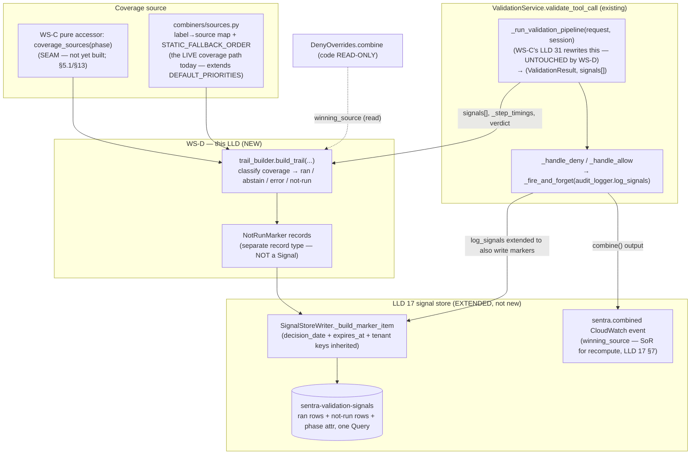
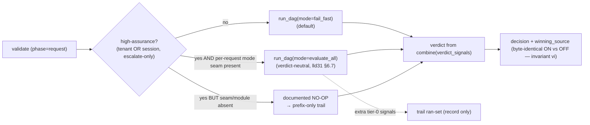
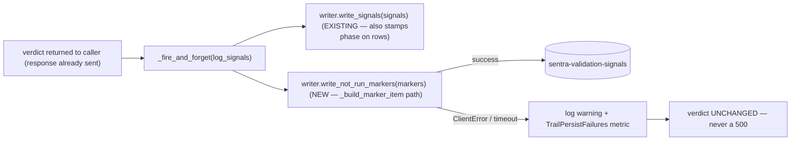

# LLD 33: Decision-trail — record what RAN vs NOT-RUN (WS-D / FR-6.8 / ADR-031)

**Version**: 1.1
**Last Updated**: 2026-07-01
**Status**: Draft — Ready for Review
**Owner**: Founder (Shashank Gupta)
**Designs against**: HLD [hld/serverless-edition.md](../hld/serverless-edition.md) §6.2(d) (the approved **Option A** — "record-what-ran, force nothing extra"), ADR-031, §7 shared-contract shape (:659), §8 hand-off row 4 (`FR-6.8 → ADR-031 → LLD 17`).
**Prerequisites / extends**:
- [LLD 17 §5.2](17-validation-signal-store.md) — the validation-signal store this LLD **extends** (this is NOT a new component).
- [LLD 31](31-dag-scheduler.md) (**WS-C**) — the DAG scheduler this LLD consumes (via a pure `coverage_sources(phase)` accessor WS-C must expose — §5.1, not yet built — and `evaluate_all` mode).
- [LLD 30](30-multiphase-contract.md) (**WS-B**) — the `phase` contract (`KNOWN_PHASES`, `_CONTENT_FIELD`).

> **This LLD elaborates the ONE approved HLD option; it does not re-open it.** HLD §6.2(d) chose Option A ("record-what-ran, force nothing extra") over Option B (always-run-all) and folded Option C (always-run-cheap-tier) in as an **opt-in per-tenant/per-session high-assurance mode**, not the default. That choice is fixed (Gate 3, ADR-031). This doc pins the exact record types, the classification of every coverage-set layer into **ran / ran-ABSTAIN / not-run**, the persistence path, and the invariant that `DenyOverrides.combine()` stays **byte-for-byte unchanged**. Two claims from the earlier scope doc [tasks/serverless-edition/ws-d-decision-trail.md](../tasks/serverless-edition/ws-d-decision-trail.md) are **dropped as ungrounded in the HLD** and are called out in §2.3.

## Table of Contents
1. [Context](#1-context)
2. [Tenets carried from the HLD](#2-tenets-carried-from-the-hld)
3. [The correctness contract (acceptance bar)](#3-the-correctness-contract-acceptance-bar)
4. [Component architecture](#4-component-architecture)
5. [Coverage-set resolution (consuming WS-C)](#5-coverage-set-resolution-consuming-ws-c)
6. [Data model (extends LLD 17 §5.2)](#6-data-model-extends-lld-17-52)
7. [Run-model wiring](#7-run-model-wiring)
8. [High-assurance mode](#8-high-assurance-mode)
9. [Persistence off the hot path](#9-persistence-off-the-hot-path)
10. [Security (SEC-1..5)](#10-security-sec-1-5)
11. [Non-functional](#11-non-functional-scaling--resiliency--networking--database--cost--metering)
12. [Test plan](#12-test-plan)
13. [Cross-references](#13-cross-references)

---

## 1. Context

**In plain terms.** For audit and compliance we need to record, on every validated request, **which detectors actually ran and what each decided** — and, just as honestly, **which detectors did *not* run** (because an earlier check already denied, or because the scheduler skipped an expensive tier to stay fast). The tricky part: the scheduler in WS-C ([lld/31](31-dag-scheduler.md)) *deliberately* skips detectors (it short-circuits on the first DENY and gates the expensive models behind the cheap tier), yet FR-6.8 wants a complete picture. We reconcile the two by **recording what ran plus explicit "not-run" markers for the rest** — we do not run any extra detector just to fill the record. A tenant who wants the complete cheap-tier picture on every request can turn on an opt-in **high-assurance mode**; the verdict it returns is identical either way.

This LLD is an **extension of [LLD 17 §5.2](17-validation-signal-store.md)** (the `sentra-validation-signals` store) plus a small new `trail_builder` module — **not a new component and not a new datastore**. It elaborates the approved HLD §6.2(d) Option A / ADR-031 recommendation. It touches the run model and the persisted record; `DenyOverrides.combine()`'s **code** stays byte-for-byte identical. One producer-side stamp (§7.1.1) changes what the combiner *sees* on a single fail-secure-DENY path — that attribution change is called out explicitly in §7.1.1 and reconciled with WS-C in §7.1.2, and is NOT hidden behind an "unchanged verdict" claim.

### 1.1 Coverage scope of the trail (what build_trail records — and what it does NOT)

The decision trail records the **validator pipeline** only — the layers reached inside `validate_tool_call → _run_validation_pipeline`. Two classes of DENY are **decided before the pipeline runs** and are therefore **out of `build_trail`'s coverage set** (see AS-1, SEC-5, and the threat disposition in §10):

- **Identity-gate DENYs** (`IDENTITY_UNVERIFIED` / `IDENTITY_TAMPERED` / `IDENTITY_MISMATCH`) — `_identity_deny` returns from `routes.py` ([routes.py:154,159,172](../src/security-controller/app/api/routes.py#L154)) **before** `validate_tool_call` is entered; the request never reaches the pipeline, so no ran/not-run trail row is written. These are audited by their own path (`_identity_deny`'s `AuditLogger` write under the reserved `_unverified` tenant — MEMORY [[identity-deny-not-metered]]).
- **`QUOTA_EXCEEDED` DENY** — the commercial-quota gate returns from `routes.py` ([routes.py:172](../src/security-controller/app/api/routes.py#L172)) before the pipeline.

This is a deliberate boundary, stated so an auditor/console is not misled into reading the trail as the record for *pre-pipeline* blocks. See **AS-1** (§3) for the numbered disposition and **T-TRAIL-16** for the test that pins the identity-DENY audit record.

---

## 2. Tenets carried from the HLD

The HLD §4 master tenets and tie-breaker B are the tie-breakers for every implementation call here. Priority-ordered:

- **Master tenet 3 — Deny-by-default, explainable.** Every verdict names its deciding source and is auditable. The not-run markers make the trail *honest about what did NOT run*, so an auditor never mistakes "gated, skipped" for "ran and approved."
- **Master tenet 4 — Defense in depth.** The trail records each independent layer's contribution; recording must not weaken any layer or change any layer's verdict.
- **Master tenet 5 — Latency scales with risk.** The default trail records the ran-prefix + the not-run complement and **must not force any skipped layer to run** — recording is free of extra execution on the default path.
- **Master tenet 8 — Honest staging.** `ABSTAIN` (a layer that *ran* but declined to vote) is recorded **distinctly** from *not-run* (a layer never invoked) — no conflation that would overstate coverage. Crucially, the not-run *reason* must not itself lie: a layer that was disabled-and-still-awaited is ran-ABSTAIN (not not-run), and the not-run reason string is **derived from the short-circuit point**, not a single hardcoded phrase (§7.1.3).
- **HLD tie-breaker B (load-bearing)** — "Record what ran; force nothing extra." Auditability is achieved by *recording*, not by *over-executing*. Only the opt-in per-tenant/session high-assurance mode re-runs the cheap deterministic tier-0 for the record's sake; re-running tier-1/expensive models for the trail is **forbidden** (HLD §6.2(d):344).
- **LLD-local invariant (shared with WS-C)** — `DenyOverrides.combine()`'s **code** is **READ-ONLY / byte-for-byte unchanged** (ADR-031). A not-run marker is a **separate record type** and **never enters the list passed to `combine()`**. (The §7.1.1 stamp changes what `combine()` *sees* on one path — an input change, not a code change; §7.1.1/§7.1.2.)

### 2.3 What is dropped as ungrounded

Two claims from the stale scope doc are **not** built, because the HLD §6.2(d) does not ground them:

1. **A per-request trail HEADER on the HTTP response with aggregate ran/not-run counts.** The HLD specifies a **persisted per-layer trail record** (§6.2(d):358-364), not a response header or an aggregate-count field. The console derives counts by reading the ran + not-run rows (§6) — there is no counts field on the `/v1/validate` response.
2. **A hard-coupled `gated_by = winning_source` field.** The HLD treats `winning_source` (the deciding source) and the not-run *reason* ("gated by earlier DENY", "skipped for cost/tier") as **separate concepts** (§6.2(d):343, :359-361). We carry them separately: `winning_source` is recomputed-on-read from the ran DENY rows (§6.3); the not-run reason is a derived string on the marker (§7.1.3).

---

## 3. The correctness contract (acceptance bar)

Six testable invariants + one numbered assumption. Each invariant maps to an acceptance test in §12.

| # | Invariant | Why it matters | Test |
|---|---|---|---|
| **(i)** | `abstain` (a layer that **ran** and returned no vote) is recorded **distinctly** from `not-run` (a layer never invoked) **and from `error` (a layer that ran but produced no *usable* signal — e.g. an unstamped-`source` result or a fail-secure synthetic DENY)**; and a not-run marker's **reason** names the *true* cause (gated-by-DENY vs skipped-for-cost/tier), never a single blanket phrase. | The central conflation trap. An ABSTAIN overstates nothing; treating a not-run layer as ABSTAIN (or vice-versa), **relabeling an error/fail-secure DENY as a benign ABSTAIN**, or stamping a misleading reason, makes the trail lie about coverage (tenet 8). | T-TRAIL-03, **T-TRAIL-13**, **T-TRAIL-17** |
| **(ii)** | A **not-run marker never enters the list passed to `combine()`** — structurally, because it is a *separate record type* (`NotRunMarker`), not a `Signal`. | `Signal.decision` is a frozen `Literal["ALLOW","DENY"]` ([signal.py:22,47](../src/security-controller/app/combiners/signal.py#L22)); a not-run marker has no such field, so it *cannot* be handed to `combine()` without a type error. Fail-secure: a not-run marker can never influence a verdict. | T-TRAIL-07 |
| **(iii)** | The **invoked set = keyset of `_step_timings`** ([validation_service.py:32](../src/security-controller/app/services/validation_service.py#L32)) **INTERSECTED with the coverage set** via an explicit label→source map. | The raw `_step_timings` keyset includes non-validator labels (`session`, `pipeline`, `handle`, `abuse_policy_load`, `policy_fallback`) that are not detectors; using it raw would classify plumbing as a "ran detector." | T-TRAIL-06 |
| **(iv)** | Recording forces **no extra layer to run** on the DEFAULT path (`dag_run_mode=fail_fast`). | Tie-breaker B. The trail is built *after* the pipeline returns, from data the pipeline already produced. | T-TRAIL-01, T-TRAIL-02 |
| **(v)** | **Both ALLOW and DENY** persist a full trail (ran + not-run), **within the coverage scope of §1.1** (pipeline verdicts; pre-pipeline identity/quota DENYs are recorded by their own path — AS-1). | The HLD is explicit the trail is not deny-only (§6.2(d):361). | T-TRAIL-04, T-TRAIL-16 |
| **(vi)** | The verdict (`decision` + recomputed `winning_source`) is **byte-identical** with high-assurance mode ON vs OFF. | Option C is a *recording* setting, not a verdict change. `combine()` sees only `verdict_signals` (§8). | T-TRAIL-08 |

**AS-1 (numbered assumption — pre-pipeline DENYs are out of trail coverage).** Identity-gate DENYs and the `QUOTA_EXCEEDED` DENY are decided in `routes.py` before `validate_tool_call` and are therefore **not** in `build_trail`'s coverage set (§1.1). They are recorded by the identity path's own `AuditLogger` write (under the `_unverified` tenant) / the quota metric path. The trail's completeness guarantee (v) is scoped to the validator pipeline. This dispositions the STRIDE-R repudiation threat that an auditor might read the trail as the record for *all* blocks; the console must present the identity/quota audit path alongside the trail for a complete picture. Pinned by **T-TRAIL-16**.

---

## 4. Component architecture

**In plain terms.** We add one new module, `app/services/trail_builder.py`, that runs **after** the validation pipeline has finished and returned its verdict. It reads three things the pipeline already produced — the `signals[]` list, the per-step timing dict (`_step_timings`), and the `winning_source` from the combined verdict — plus the coverage set for the request's phase (from WS-C's scheduler). From those it classifies every coverage-set layer into **ran-and-voted**, **ran-but-abstained**, **ran-but-errored** (ran and decided the verdict yet emitted no usable signal — §7.1), or **not-run**, and emits a trail: the ran `Signal`s (already persisted by LLD 17) plus a set of lightweight `NotRunMarker` records for the complement. It calls into the pipeline body **not at all** — it is a pure post-pipeline consumer of the stable `(signals[], _step_timings, verdict)` seam, which both the current sequential body and (once it lands) the WS-C DAG runner return identically (LLD 31 §6.6). That is why it sits outside the pipeline and off the combiner: nothing it reads depends on *how* the pipeline is structured, only on the outputs it always returns. (It also keeps WS-D off the file WS-C's LLD 31 rewrites — a second, incidental reason on top of the durable one.)

### 4.1 Where it plugs in (block diagram)



### 4.2 The ran / abstain / error / not-run classification (sequence)

```mermaid
sequenceDiagram
  participant VTC as validate_tool_call
  participant PIPE as _run_validation_pipeline (WS-C)
  participant TB as trail_builder
  participant SRC as combiners/sources.py
  participant W as SignalStoreWriter (LLD 17)

  VTC->>PIPE: run pipeline (fail_fast default)
  PIPE-->>VTC: (result, signals[]) — signals = ran non-abstain layers
  Note over VTC,TB: trail built AFTER pipeline returns (tie-breaker B — no extra run)
  VTC->>TB: build_trail(signals, step_timings, coverage, winning_source, phase, is_deny)
  TB->>SRC: coverage_set(phase), label_to_source, static_fallback
  TB->>TB: invoked = {label_to_source[k] for k in step_timings if k in map} ∩ coverage
  TB->>TB: ran = {s.source for s in signals}; denier = {winning_source} if is_deny
  TB->>TB: ran_error = (invoked ∩ denier) − ran (decided verdict, no Signal → ERROR)
  TB->>TB: ran_abstain = invoked − ran − ran_error (ran, genuinely abstained → ABSTAIN)
  TB->>TB: not_run = coverage − invoked (never invoked → NotRunMarker, reason derived §7.1.3)
  TB-->>VTC: TrailResult(markers=[NotRunMarker...], summary={phase})
  VTC->>W: log_signals(signals) + write_not_run_markers(markers)
  Note over W: ran Signals + not-run markers persisted through the SAME writer
```

**KD-4 — call site.** `build_trail(...)` is invoked from `validate_tool_call` **synchronously, after `_run_validation_pipeline` returns and before any `_fire_and_forget` hand-off** (the pipeline call + DENY/ALLOW dispatch at [validation_service.py:200-230](../src/security-controller/app/services/validation_service.py#L200)), never inside the pipeline body. Two reasons, one durable and one incidental:
- **Durable (branch-independent):** `build_trail` is a **pure post-pipeline consumer** of the `(signals[], _step_timings, verdict)` seam — the outputs the pipeline returns regardless of *how* it is structured internally. LLD 31 §6.6 guarantees the WS-C DAG runner returns that same seam identically, so this call site does not change when WS-C lands. WS-C's Cross-references name WS-D as the consumer of `evaluate_all` + `signals[]` ([lld/31:666](31-dag-scheduler.md)).
- **Incidental (today):** WS-C is **not yet landed on this codebase** (`_run_validation_pipeline` at [:253](../src/security-controller/app/services/validation_service.py#L253) is still the sequential body; there is no `_run_dag_pipeline` or scheduler package on `main` or this branch — verified). WS-C's LLD 31 rewrites `_run_validation_pipeline` into the DAG runner, so placing the trail builder inside it would collide with that in-flight rewrite on the same lines — an added reason to keep it out, on top of the durable one.

**Synchronous + by-value is load-bearing (contextvar safety).** `_fire_and_forget` is a bare `asyncio.create_task(coro)` with **no `contextvars.copy_context()`** ([validation_service.py:83](../src/security-controller/app/services/validation_service.py#L83)), so a coroutine it schedules is **not** guaranteed to observe the request's `_step_timings` contextvar. `build_trail` therefore runs **on the request coroutine**, with the `_step_timings` dict **snapshotted by value** and passed as the `step_timings` argument (§7.2) — the classification never reads the contextvar from inside a background task. The `markers` list is fully built (by value) **before** the off-path `_fire_and_forget(log_signals)` hands off; the marker *write* extends the two handlers `_handle_deny` ([:501](../src/security-controller/app/services/validation_service.py#L501)) / `_handle_allow` ([:610](../src/security-controller/app/services/validation_service.py#L610)) via the `log_signals` call each fires (§9.1). If the invoked snapshot were instead read inside the create_task coroutine, a full-ALLOW request could resolve `invoked = ∅` and mis-classify every coverage layer as not-run — the exact invariant-(i) conflation. **T-TRAIL-19** pins that the invoked set survives the fire-and-forget boundary (a full-ALLOW request's not-run markers are zero, not the whole coverage set).

---

## 5. Coverage-set resolution (consuming WS-C)

**In plain terms.** To know what "could have run," we need the set of detectors in this phase's graph. **WS-C is not built yet** (there is no `app/services/scheduler` package on `main` or this branch — verified; `_run_validation_pipeline` is still the sequential body), so the **static ordered fallback list is the ONLY live coverage path today** — WS-D is functional on it alone. When WS-C lands, the coverage set should come from its DAG, but there is a **shape mismatch WS-D must pin as a contract**: the accessor LLD 31 §5.2 *designs* is `build_dag(...)`, which takes the live `ValidationService` (its node callables delegate to the service's validators) — **not** a pure `phase → sources` lookup WS-D can call cheaply from a free function. LLD 31 also calls the cached form a `DAG_BY_PHASE` per-phase constant (§5.2, §Cross-references) — but that is a **design name, not yet a built symbol**, and its own `__init__` docstring mis-states the signature as `build_dag(phase)`. So WS-D asks WS-C to expose a **pure `coverage_sources(phase) -> list[str]`** (built once at startup from the DAG, callable without the service instance) as the real seam — §5.1 / §13.

### 5.1 The accessor (KD-3) — the pure WS-C seam WS-D needs (not yet built)

```python
# app/services/trail_builder.py — coverage resolution
def coverage_set(phase: str) -> list[str]:
    """Sources that COULD run for this phase, in a stable order.

    LIVE PATH TODAY: the static ordered list in combiners/sources.py — pinned
    to the live request-phase pipeline by the T-TRAIL-14 drift-guard. This is
    the ONLY path that runs today: the WS-C scheduler package is not built yet.

    PRIMARY (once WS-C lands the seam): a PURE per-phase accessor
    `coverage_sources(phase) -> list[str]`, built ONCE at startup from WS-C's
    DAG and callable WITHOUT the ValidationService instance. LLD 31's designed
    `build_dag(...)` takes the service, so it is NOT this accessor — the pure
    lookup is the named WS-C->WS-D contract (§13). Until it exists the import
    fails and the fallback runs.
    """
    try:
        from app.services.scheduler import coverage_sources   # WS-C seam (§13) — NOT YET BUILT
        return coverage_sources(phase) or coverage_sources("request")
    except (ImportError, AttributeError, KeyError):
        return STATIC_FALLBACK_ORDER                          # sources.py (§5.2) — the LIVE path today
```

> **Consistency-sweep flag (two accessor names are wrong, not one).** The stale scope doc names `scheduler.layers_for()` — that accessor **does not exist** in [lld/31](31-dag-scheduler.md). But the `DAG_BY_PHASE[phase]` accessor an earlier draft of THIS LLD named is **also not the real seam** — LLD 31 §5.2 designs `build_dag(...)` **coupled to the `ValidationService`** and merely *names* the cached form `DAG_BY_PHASE`; neither is built yet, and lld/31's `__init__` docstring mis-states the signature as `build_dag(phase)`. **The real WS-C→WS-D contract is for WS-C to expose a PURE `coverage_sources(phase) -> list[str]`** (built once at startup, no service instance) — the `phase → sources` lookup WS-D needs — and for §5.1 to point at THAT symbol. Until WS-C lands it, the static fallback is the live coverage path (§5.2), and T-TRAIL-12 pins **the fallback** path (there is no live primary to test yet). Reconcile the `layers_for()`/`DAG_BY_PHASE`/`build_dag(phase)` drift in the sweep.

### 5.2 The label→source map and static fallback (extends `combiners/sources.py`)

`combiners/sources.py` already exists ([sources.py](../src/security-controller/app/combiners/sources.py)) with `Source`, `DEFAULT_PRIORITIES`, and `default_priority()`. WS-D **adds two constants there** so there is **one source of truth** shared by the trail builder and the scheduler-absent path — it does **not** create a new file:

```python
# app/combiners/sources.py — ADDED by WS-D (alongside DEFAULT_PRIORITIES)

# The _step_timings labels that correspond to a coverage-set validator SOURCE.
# The raw _step_timings keyset also carries non-validator labels
# (session, pipeline, handle, abuse_policy_load, policy_fallback) — those are
# plumbing, NOT detectors, and are intentionally ABSENT from this map so the
# invoked-set intersection (invariant iii) excludes them.
STEP_LABEL_TO_SOURCE: dict[str, str] = {
    "trust":       Source.SENTRA_TRUST,
    "policy":      Source.SENTRA_POLICY,   # cedar OR legacy — same source
    # NOTE: "policy_fallback" is deliberately NOT mapped: it is the legacy
    # engine re-run after a Cedar abstain (validation_service.py:361) — the
    # SAME logical policy layer already represented by "policy". Mapping it
    # would double-count policy as two invoked sources.
    "cross_agent": Source.SENTRA_CROSS_AGENT,
    "sigma":       Source.SENTRA_SIGMA,
    "context":     Source.SENTRA_CONTEXT,
    "abuse":       Source.SENTRA_ABUSE,     # NOT abuse_policy_load (a DDB get, plumbing)
    "ml":          Source.SENTRA_ML_CLASSIFIER,
}

# Static ordered coverage for the request phase — the LIVE coverage path today
# (the WS-C pure accessor of §5.1 is not built yet, so this is not merely a
# fallback but the only path that runs). Mirrors the live sequential pipeline
# step order (validation_service.py _run_validation_pipeline STEP 1-6); LLD 31
# designs the same seven request-phase sources as DAG nodes. T-TRAIL-14 pins
# this set to the live pipeline so a drift fails the build.
STATIC_FALLBACK_ORDER: list[str] = [
    Source.SENTRA_TRUST,
    Source.SENTRA_POLICY,
    Source.SENTRA_CROSS_AGENT,
    Source.SENTRA_SIGMA,
    Source.SENTRA_CONTEXT,
    Source.SENTRA_ABUSE,
    Source.SENTRA_ML_CLASSIFIER,
]
```

**KD-2 — the invoked-set is intersected, not raw.** The invoked set is:

```python
invoked = {STEP_LABEL_TO_SOURCE[k] for k in step_timings if k in STEP_LABEL_TO_SOURCE} & set(coverage)
```

The `if k in STEP_LABEL_TO_SOURCE` guard drops the non-validator labels (`session`, `pipeline`, `handle`, `abuse_policy_load`, `policy_fallback`); the `& set(coverage)` intersection drops any mapped label that isn't in *this phase's* graph. The not-run complement is `coverage_set − invoked` (§7).

---

## 6. Data model (extends LLD 17 §5.2)

**In plain terms.** We store not-run markers as rows in the **same table** the ran-signals already use (`sentra-validation-signals`), sharing the same request partition, so the console reads the whole trail — ran and not-run — in **one Query**. But a marker is a **different kind of record** from a Signal: it has a `record_type` marker instead of an ALLOW/DENY decision, precisely so it can never be mistaken for a vote. We reuse the existing writer so the GSI-2 date attribute and the 90-day TTL are inherited, not re-implemented. The trail *summary* the console needs — `phase` (stamped on the rows) and `winning_source`/`block_point` (**recomputed on read** from the ran DENY rows, exactly as LLD 17 §5.3 recomputes the combined verdict) — needs **no new header row**.

### 6.1 D1 — `NotRunMarker` (KD-1): a separate record type, NOT a `Signal`

```python
# app/services/trail_builder.py
from dataclasses import dataclass, field
from typing import Literal, Optional

@dataclass(frozen=True)
class NotRunMarker:
    """A coverage-set layer that was NEVER invoked (not_run), ran-but-abstained
    (abstain), or ran-and-errored (error) on this request.

    Deliberately NOT a Signal: it has no `decision` field, so it structurally
    cannot be passed to DenyOverrides.combine() (whose input is Sequence[Signal]
    and whose decision is a frozen Literal["ALLOW","DENY"]). This is invariant
    (ii) enforced by the type system, not by a runtime check.
    """
    source: str                                     # coverage-set source that didn't run / abstained / errored
    record_type: Literal["not_run", "abstain", "error"] = "not_run"  # distinct row marker — NOT a decision value
    reason: str = "gated by earlier DENY"           # DERIVED from the short-circuit point (§7.1.3) — never a blanket lie
    phase: str = "request"
    metadata: dict = field(default_factory=dict)
```

`record_type="not_run"` is the row's type discriminator — it is **not** a decision value and does **not** widen the frozen `Literal["ALLOW","DENY"]` on `Signal`. A `NotRunMarker` has no `decision`, `priority`, or `confidence` — a `combine()` call on it would raise at attribute access, which is why invariant (ii) is a **structural** guarantee (verified by T-TRAIL-07 asserting `combine()` is never called with a not-run record). The `reason` is **derived** (§7.1.3), not a single constant.

### 6.2 D1 — persisted row shape (shares the LLD 17 partition)

Not-run markers are written into `sentra-validation-signals` through the **same `SignalStoreWriter`**, sharing the request partition so the console reads ran + not-run in one Query. **They do NOT go through `_build_item` as-is**: `_build_item` ([signal_store_writer.py:90](../src/security-controller/app/utils/signal_store_writer.py#L90)) is `Signal`-shaped — it unconditionally reads `signal.decision`/`signal.priority` ([:113-114](../src/security-controller/app/utils/signal_store_writer.py#L113)) and copies `reason`/`confidence`/`threat_type`, none of which a `NotRunMarker` has. Writing a marker through it as-is would either raise (missing attribute) or — worse — stamp a stray `decision` on a marker row, which a reader partitioning on `decision`-present would **mis-parse as a ran vote** (a not-run layer silently reported as ALLOW/DENY — the exact conflation invariants (i)/(ii) forbid, re-introduced at the storage layer). So WS-D adds a **marker-specific item builder** — module-level `_build_marker_item(...)` alongside `_build_item` (called by the new `write_not_run_markers` on `SignalStoreWriter`) — that:
- **REUSES the same writer-populated attributes `_build_item` uses**, by recomputing the same `decision_date = timestamp_iso[:10]` slice inline (there is no standalone `decision_date` helper — it is an inline expression inside `_build_item` at [signal_store_writer.py:119](../src/security-controller/app/utils/signal_store_writer.py#L119)), reusing the same `expires_at` **value** the caller `write_signals` computes once ([:207](../src/security-controller/app/utils/signal_store_writer.py#L207)) and the same `timestamp_ms`/`timestamp_iso`, and calling the genuinely-shared helper `tenancy.stamp_signal_item(item)` ([:144](../src/security-controller/app/utils/signal_store_writer.py#L144)) — so the GSI-2 date, the 90-day TTL, and the tenant keys are NOT re-implemented (KD-7 holds);
- **ASSERTS no `decision` attribute is ever written on a `record_type` row** (a guard, not a hope) — the invariant-(ii) type separation is thus enforced at persistence, not just at `combine()`;
- writes **only** `record_type`, `source`, `reason`, `phase` as the marker-distinguishing attributes.

`expires_at` and `timestamp_ms`/`timestamp_iso` are computed **once** in `write_signals`/the marker-write entry point and shared by both builders (they are function-local values, not helper calls) — so ran rows and marker rows for the same request carry the same timestamp and TTL basis.

The persisted marker row shape:

```
PK (session_id / tenant_session_id):  same as the ran signals for this request
SK:                                   request_id#timestamp_ms#source
                                      e.g. "xc-s1-...#1779763724344#sentra.ml_classifier"

Attributes (writer-populated, INHERITED — NOT re-implemented):
  decision_date   string   ← timestamp_iso[:10]  (GSI-2 membership, LLD 17 §5.2:280 / signal_store_writer.py:119, inline slice)
  expires_at      number   ← now + 90 days        (TTL, caller-passed from write_signals, signal_store_writer.py:207)
  timestamp_ms    number
  timestamp_iso   string
  <tenant keys>            ← tenancy.stamp_signal_item(item)  (signal_store_writer.py:144)

Attributes (WS-D-required, distinguishing a marker from a Signal):
  record_type     string   = "not_run"            ← the row-type discriminator (NOT a decision)
  source          string   ← the coverage source that did NOT run
  reason          string   ← DERIVED (§7.1.3): "gated by earlier DENY" | "skipped for cost/tier" | ...
  phase           string   ∈ KNOWN_PHASES          ← ALSO stamped on ran rows (§6.3, one-Query summary)
```

Because `record_type` is present only on markers and `decision` is present only on Signal rows (a marker row **never** carries `decision` — asserted by `_build_marker_item`), the console's single Query cleanly partitions the trail: rows with `decision` are ran-layers; rows with `record_type ∈ {not_run, abstain, error}` are the complement. **KD-7** — `_build_marker_item` reuses LLD 17's writer computations for `decision_date` (GSI-2), `expires_at` (TTL), and the `tenancy.stamp_signal_item` call, so WS-D re-implements none of them.

**Marker rows carry LESS content than ran rows (SEC / info-disclosure).** A marker's job is to say "layer X did not run/vote"; it does **not** need the request payload. So `_build_marker_item` stamps **only** the tenant keys + `source`/`reason`/`phase`/`record_type` + the timestamp/TTL/GSI-2 attributes — it does **NOT** copy the block-context depth (`user_input[:200]`, `tool_params`, `source_ip`) that ran rows carry via `_shared_attrs_from_request`. The block-context depth for the request lives on the **ran** rows and the `sentra.combined` CloudWatch event (§6.3), read from the same partition in the same Query — so an auditor still reconstructs the full picture, but the fan-out of up to ~6 marker rows per short-circuit-DENY does **not** multiply the (Serverless, still-unredacted-pre-DLP) content surface. This trims row size at zero audit cost.

### 6.3 KD-6 — trail summary: `phase` stamped on rows, `winning_source`/`block_point` recomputed-on-read (NO combined DDB row)

**Correction (consistency sweep).** An earlier draft claimed the trail summary "rides the existing `sentra.combined` row's metadata." **That row does not exist in DDB.** `DenyOverrides().combine()` is called inside `audit_logger.log_signals` ([audit_logger.py:155](../src/security-controller/app/utils/audit_logger.py#L155)) and its `metadata={'winning_source': ...}` output ([deny_overrides.py:51](../src/security-controller/app/combiners/deny_overrides.py#L51)/[:59](../src/security-controller/app/combiners/deny_overrides.py#L59)) is consumed **only** to build the CloudWatch `log_event` ([audit_logger.py:167-171](../src/security-controller/app/utils/audit_logger.py#L167)); the DDB dual-write ([audit_logger.py:177-190](../src/security-controller/app/utils/audit_logger.py#L177)) writes **only** the per-validator `signals[]` rows — **no aggregated row**. LLD 17 §5.3 is explicit: *"No write-time materialization of an aggregated row … the controller writes `sentra.combined` for caller convenience (matches the `/v1/validate` HTTP response body); the runner-layer aggregate is recomputed on every read."* So `winning_source` reaches DDB only on a real row, and there is no queryable combined row to hang `phase`/`block_point` on.

**How WS-D actually persists the summary (matching LLD 17's recompute-on-read model):**
- **`phase`** is stamped as a shared attribute on **every ran signal row and every marker row** for the request (WS-D has it in hand; ran rows get it via `_shared_attrs_from_request`/`shared_attrs`, marker rows via `_build_marker_item` — §6.2). This is the one summary field that must be durable per-row, because the not-run complement cannot be recomputed without it.
- **`winning_source` / `block_point` are NOT stored as a scalar** — they are **recomputed on read** exactly as LLD 17 §5.3 recomputes the combined verdict: the console (WS-G) reads the request partition, and `winning_source` is the `source` of the deny-overrides winner among the ran `DENY` rows (`block_point == winning_source` on a DENY; `null`/absent on an ALLOW). No new stored field, no new header row (§2.3 drop #1) — it reuses the read-time aggregate LLD 17 already builds. The durable copy of `winning_source` for offline/audit/backfill use lives on the **`sentra.combined` CloudWatch event** (LLD 17 §7), which is the reconstruction system-of-record (§9.2.1).
- After the §7.1.1 stamp fix, a fail-secure `POLICY_NOT_MIGRATED` DENY is a real `sentra.policy` `DENY` row, so the read-time recompute yields `winning_source = sentra.policy` on that path too (it yielded nothing before — §7.1.1 item 2).
- The §6.2(d):360 "block point + why, with depth" (prompt, tool + params, caller→target, IP) is **already carried on the ran rows** by `_shared_attrs_from_request` ([audit_logger.py:211](../src/security-controller/app/utils/audit_logger.py#L211) — `agent_id`, `tool_name`, `tool_params`, `user_input[:200]`, `platform`, `cloud_region`, `source_ip`) **and on the `sentra.combined` CloudWatch event**. WS-D adds no new depth capture (and deliberately does **not** duplicate that depth onto marker rows — §6.2).

---

## 7. Run-model wiring (D2)

**In plain terms.** After the pipeline returns its verdict and its `signals[]` list, we classify each coverage-set layer into one of four buckets using data we already have: a layer with a `Signal` in `signals[]` **ran and voted**; a layer whose `_step_timings` label fired but produced no `Signal` **ran and abstained** (LLD 17 §4 — the `_capture` closure returns on `result.is_abstain` and appends nothing, [validation_service.py:280-281](../src/security-controller/app/services/validation_service.py#L280)); a layer that **ran and decided the verdict yet emitted no usable signal** (the fail-secure synthetic DENY) is **ran-ERROR** — recorded as the ran denier, never as a benign abstain; a coverage layer that never appears in the invoked set **was not run**. We build the trail without changing any of the pipeline's `return` points (we do add one producer-side stamp so the fail-secure DENY becomes a real signal — §7.1.1).

### 7.1 The buckets

Let `coverage = coverage_set(phase)` (§5), `invoked` = the intersected keyset (§5.2), `ran = {s.source for s in signals}`, and `denier = {winning_source}` if the verdict is a DENY else `∅` (§7.1.1).

| Bucket | Definition | Persisted as |
|---|---|---|
| **ran** (voted) | `source ∈ ran` — a `Signal` was produced. | The existing `Signal` row (LLD 17 — already written). |
| **ran-ABSTAIN** | `source ∈ invoked` but `source ∉ (ran ∪ denier)` — the layer ran (`_step_timings` has its label) **and genuinely abstained**: `_capture` dropped its result because `result.is_abstain` ([validation_service.py:280](../src/security-controller/app/services/validation_service.py#L280)). | An **ABSTAIN marker** — `record_type="abstain"` (a `NotRunMarker` variant; §7.2). **Never** conflated with not-run or error (invariant i). |
| **ran-ERROR** | `source ∈ (invoked ∩ denier)` but `source ∉ ran` — the layer ran and **decided the verdict**, yet no `Signal` landed in `signals[]`. In the live pipeline this is the fail-secure synthetic DENY: `_fail_secure_deny` builds an **unstamped** `ValidationResult` (no `source`, [validation_service.py:69-75](../src/security-controller/app/services/validation_service.py#L69)), so `_capture`→`to_signal()` **raises `ValueError`** ([app/api/models.py:251-253](../src/security-controller/app/api/models.py#L251)) and the `except ValueError` at [validation_service.py:286-294](../src/security-controller/app/services/validation_service.py#L286) **only logs — it appends nothing** (its comment says "using synthetic signal" but no signal is actually created — verified in code; guarded by T-TRAIL-14b). | An **ERROR marker** — `record_type="error"` (§7.2). A denier that produced no signal is recorded as the **ran DENIER**, never as a benign ABSTAIN (invariant i). |
| **not-run** | `source ∈ coverage` but `source ∉ invoked` — never invoked. | A `NotRunMarker` (`record_type="not_run"`, reason DERIVED per §7.1.3). |

The single most common *benign* trap this guards: the **ML classifier disabled** case. When `ml_classifier_enabled=false`, ML **still runs** (`_timed("ml", ...)` fires — its label is in `_step_timings`) but returns ABSTAIN so `_capture` drops it. That is **ran-ABSTAIN**, not not-run — the ML layer *was consulted* and declined, versus a short-circuit DENY where ML was *never reached*. Invariant (i) / T-TRAIL-03 pins this distinction. (See §7.1.3 for why a disabled-but-awaited layer can never land in the not_run bucket with a misleading reason.)

The *dangerous* trap — and the reason invariant (i) grew a fourth bucket — is the **`legacy_retired=True` + Cedar-abstain** end-state path ([validation_service.py:339-350](../src/security-controller/app/services/validation_service.py#L339), the `if settings.legacy_retired:` branch calling `_capture(_fail_secure_deny(POLICY_NOT_MIGRATED, …))` at [:348](../src/security-controller/app/services/validation_service.py#L348)). There the policy layer **DENIES** (fail-secure `POLICY_NOT_MIGRATED`), but the DENY is carried by an **unstamped** `ValidationResult` that never becomes a `Signal`. Without the fix in §7.1.1, the `policy` label is in `_step_timings` (so `sentra.policy ∈ invoked`) while `sentra.policy ∉ ran`, so the naïve `invoked − ran` would classify the policy layer as **ran-ABSTAIN "ran; abstained (no vote)"** on a request the policy layer actually **blocked** — the exact conflation invariant (i) exists to prevent, on a DENY, in the FR-6.8 compliance artifact. (The codebase already treats `POLICY_NOT_MIGRATED` as an AUDIT-ONLY special case at [validation_service.py:563-569](../src/security-controller/app/services/validation_service.py#L563) — evidence this path needs bespoke trail handling.)

#### 7.1.1 Fix at the source: `_fail_secure_deny` must stamp `Source.SENTRA_POLICY` — and this CHANGES what `combine()` sees on one path

The clean fix is at the producer, not the classifier: **`_fail_secure_deny` stamps `source=Source.SENTRA_POLICY`** ([validation_service.py:69-75](../src/security-controller/app/services/validation_service.py#L69)) so the fail-secure DENY survives `_capture` as a real `Signal` and lands in `signals[]`. This is a one-line change WS-D owns (it touches the run model, not `combine()`'s code), and it repairs **three** things at once:

1. The policy DENY appears in `signals[]` → the classifier records `sentra.policy` as the **ran DENIER** (ran-voted), never ran-ABSTAIN.
2. `DenyOverrides.combine()` now **sees** the policy DENY → its `metadata['winning_source']` resolves to `sentra.policy` → §6.3's recomputed `block_point = winning_source` is correct on this real block (it resolved to nothing before, because the DENY signal was absent from `signals[]`).
3. The `record_type="error"` bucket becomes a **belt-and-suspenders backstop** (§7.2 keys it off `denier − ran`), not the primary path: after the stamp fix, a well-formed fail-secure DENY is a normal ran-voted signal, and the ERROR bucket only fires if some *future* validator regresses into emitting an unstamped denying result — surfacing the regression loudly in the trail instead of hiding it as an ABSTAIN.

**This is an attribution change, stated plainly (not hidden behind "verdict unchanged").** The stamp does **not** change `combine()`'s code and does **not** change `decision`/`should_deny` on this path (it was already a DENY). What it changes is the **input** `combine()` sees on the `legacy_retired=True` + Cedar-abstain (`POLICY_NOT_MIGRATED`) path: today **no** `sentra.policy` signal reaches `combine()` there (the unstamped result is dropped by `_capture`, verified in code), so the read-time-recomputed `winning_source` resolves to **nothing/none** on that path; after the fix it resolves to **`sentra.policy`**. Enumeration of every consumer of `winning_source` on that path and why none regress:

| Consumer of `winning_source` on the POLICY_NOT_MIGRATED path | Today (no signal) | After stamp (`sentra.policy`) | Regression? |
|---|---|---|---|
| **`decisions_service` recompute** (deny-overrides winner among ran DENY rows) | winner is whatever other ran DENY exists, else none | `sentra.policy` is the (only) DENY → winner = `sentra.policy` | No — `should_deny` is unchanged (still DENY); attribution becomes *correct* (the policy layer genuinely denied). |
| **`audit_logger` CloudWatch `log_event`** | `winning_source` absent/none | `winning_source = sentra.policy` | No — additive; the event already recorded a DENY; it now names the correct source. |
| **Dashboard "By" column** | blank / unattributed DENY | attributed to policy | No — corrects a currently-blank attribution. |
| **Trust-update / metering** | `POLICY_NOT_MIGRATED` is **AUDIT-ONLY, excluded from metered Decisions/quota** ([validation_service.py:563-569](../src/security-controller/app/services/validation_service.py#L563)) | still excluded (the stamp does not touch the `violation_type != POLICY_NOT_MIGRATED` metering guard) | No — metering path is keyed off `violation_type`, not `winning_source`; unchanged. |

So on this path the headline is precise: **`combine()`'s code is unchanged; `should_deny` is unchanged; `winning_source` moves from none→`sentra.policy` — a correction of a currently-blank attribution, with no downstream regression.** Every other pipeline path is byte-for-byte unchanged (the stamp only fires in the `POLICY_NOT_MIGRATED` branch).

**Auditability of the synthetic DENY (real-vs-synthetic).** A stamped fail-secure `POLICY_NOT_MIGRATED` DENY is recorded on the row *identically in shape* to a genuine Cedar DENY (both `sentra.policy`, both a real `Signal`), but the two remain **distinguishable by `violation_type`**: the synthetic carries `violation_type="POLICY_NOT_MIGRATED"` (a missing-`.cedar` co-artifact defect) vs a genuine Cedar `POLICY_VIOLATION`/etc. An auditor reading the trail can tell "Cedar genuinely denied" from "Cedar abstained → fail-secure synthesized a deny" by that field; this is acceptable for FR-6.8/NFR-10 because the verdict *and* its provenance are both on the row. T-TRAIL-13 pins this.

**`_timed` semantics — "awaited", not "completed successfully".** A `_step_timings` label is written in `_timed`'s `finally` block ([validation_service.py:41-44](../src/security-controller/app/services/validation_service.py#L41)), so a label proves the coroutine was **awaited**, not that it returned a usable result. In the live pipeline the only "awaited-but-no-usable-signal" states are (a) a genuine abstain (→ ran-ABSTAIN) and (b) the unstamped fail-secure DENY handled above (→ ran-ERROR/ran-DENIER after §7.1.1). A validator that *raises* inside `_timed` does not reach the trail at all — the exception propagates to `validate_tool_call`'s outer `except` ([validation_service.py:245-251](../src/security-controller/app/services/validation_service.py#L245)) → `_create_error_response` fail-secure DENY, and `build_trail` is never called for that request. The classifier therefore never sees a raised-exception label; the ran-ERROR bucket covers only the unstamped-result case.

#### 7.1.2 Merge-ordering contract with WS-C's golden baseline (the stamp changes the frozen `winning_source` on one scenario)

WS-C ([lld/31 §3](31-dag-scheduler.md)) proves `run_dag` reproduces a frozen golden `(decision, should_deny, winning_source)` baseline captured from the fixed-sequential pipeline. Because §7.1.1 changes `winning_source` on the `legacy_retired=True` + Cedar-abstain scenario (none → `sentra.policy`), WS-C and WS-D disagree on the frozen value for that one scenario unless the ordering is pinned. **Contract:**

1. **WS-D's merge re-records the golden baseline for the `POLICY_NOT_MIGRATED` scenario** (the stamp is WS-D-owned). Before WS-D: baseline `winning_source` for that scenario is `None`/absent. After WS-D: `sentra.policy`.
2. **WS-C's golden corpus MUST include a `legacy_retired=True` + Cedar-abstain case** so the change is *caught* by an equivalence test, not silently absorbed. WS-C ships with the pre-stamp value; the shared test that pins the **post-stamp** value (`winning_source == sentra.policy`, `should_deny == True`) is **owned by WS-D** and named **T-TRAIL-13** (which doubles as the equivalence pin for this scenario).
3. Whichever of WS-C / WS-D merges **second** re-records the baseline to the post-stamp value and cites this contract in its merge note. `decision`/`should_deny` are unchanged for the scenario in both orderings; only `winning_source` moves, and only for this scenario.

This is called out here so the parallel-workstream reconciliation has a named owner (WS-D) rather than being discovered at integration.

#### 7.1.3 The not-run reason is DERIVED from the short-circuit point, not a blanket string

A not-run marker's `reason` must not itself lie (tenet 8, invariant i). The reason is **derived from why the layer was skipped**, computed from the ran-prefix, not stamped as one hardcoded phrase:

- **`"gated by earlier DENY"`** — the request short-circuited on a DENY and the layer sits *after* the denier in the coverage order (the `STATIC_FALLBACK_ORDER` list today, or WS-C's `coverage_sources(phase)` order once it lands). This is the only case where "gated by DENY" is honest.
- **`"skipped for cost/tier"`** — the pipeline ALLOWed through the denier's position (no DENY gated it) yet the layer is still absent from `invoked` because the scheduler skipped it for cost/tier (an expensive tier-1 node not reached on a low-risk request). Distinct from a DENY-gate.
- A **configuration-disabled** layer can **never** land in the not_run bucket on the default `fail_fast` path, because a disabled coverage-set layer is **still awaited** (`_timed(label, …)` fires) and returns ABSTAIN → it is classified **ran-ABSTAIN**, not not_run (the `ml_classifier_enabled=false` case above is the canonical example). The classifier derives `not_run` only from `coverage − invoked`, and a disabled-but-awaited layer *is* in `invoked` — so it is structurally impossible for a disabled layer to carry the "gated by earlier DENY" reason. T-TRAIL-17 pins this: a disabled coverage layer is ran-ABSTAIN, and every `not_run` marker's reason matches its true short-circuit cause.

The derivation is: for a `not_run` source `s`, if any DENY-voting ran source precedes `s` in the coverage order → `"gated by earlier DENY"`; else → `"skipped for cost/tier"`. This is a pure function of the ran-prefix and coverage order — no new input.

### 7.2 `build_trail` (pseudo-code)

```python
# app/services/trail_builder.py
def build_trail(
    *, signals, step_timings, coverage, winning_source, phase, is_deny,
) -> "TrailResult":
    """Classify the coverage set into ran / ran-abstain / ran-error / not-run.

    Pure function over data the pipeline ALREADY produced. Runs no validator,
    changes no return point (Option B — 'always run all' — is rejected).
    Never touches DenyOverrides.combine() (its code is READ-ONLY).
    """
    from app.combiners.sources import STEP_LABEL_TO_SOURCE
    cov_order = list(coverage)                        # stable order (§5)
    cov = set(cov_order)
    invoked = {STEP_LABEL_TO_SOURCE[k] for k in (step_timings or {})
               if k in STEP_LABEL_TO_SOURCE} & cov
    ran = {s.source for s in signals}
    deny_sources = {s.source for s in signals if s.decision == "DENY"}
    # The layer that decided a DENY. After the §7.1.1 stamp fix this is already
    # in `ran`; `denier - ran` is the belt-and-suspenders backstop that catches a
    # denier which produced NO usable signal (unstamped result) and records it as
    # ran-ERROR (the ran DENIER), never as a benign ran-ABSTAIN (invariant i).
    denier      = {winning_source} if (is_deny and winning_source) else set()

    ran_error   = (invoked & denier) - ran            # ran + decided verdict, no Signal
    ran_abstain = invoked - ran - ran_error           # ran, genuinely abstained
    not_run     = cov - invoked                       # never invoked

    def _not_run_reason(src: str) -> str:
        # DERIVED (§7.1.3): gated-by-DENY iff a DENY-voter PRECEDES src in the
        # coverage order — purely positional. A DENY elsewhere on the request
        # does NOT make a cost-skipped node BEFORE the denier read "gated"
        # (that would overstate the gate — invariant i / tenet 8).
        i = cov_order.index(src)
        if any(d in cov_order[:i] for d in deny_sources):
            return "gated by earlier DENY"
        return "skipped for cost/tier"

    markers = (
        [NotRunMarker(source=s, record_type="error",
                      reason="ran; decided verdict but emitted no signal (fail-secure/unstamped)",
                      phase=phase) for s in ran_error]
        + [NotRunMarker(source=s, record_type="abstain",
                        reason="ran; abstained (no vote)", phase=phase) for s in ran_abstain]
        + [NotRunMarker(source=s, record_type="not_run",
                        reason=_not_run_reason(s), phase=phase) for s in not_run]
    )
    return TrailResult(markers=markers, summary={"phase": phase})
```

**Where `winning_source` comes from at the call site (the pipeline does NOT hand build_trail a pre-combined verdict).** On the hot path, `DenyOverrides.combine()` is **not** called synchronously inside the pipeline — it runs off-path inside `audit_logger.log_signals` ([audit_logger.py:155](../src/security-controller/app/utils/audit_logger.py#L155)) and again at read time in `decisions_service` (§6.3); the WS-C DAG runner likewise does not call `combine()` on the hot path (LLD 31 §6.4 — the verdict is the denier's own). So at `build_trail`'s call site there is **no combined verdict already in hand**. `build_trail` therefore does one of two equivalent things for *classification only*: (a) call the **read-only** `DenyOverrides().combine(signals)` over the `signals[]` it was handed — same untouched combiner, invoked purely to name the denier, never to alter the verdict — or (b) take `is_deny` from the returned `ValidationResult.should_deny` and pass `winning_source=None`, letting §6.3's read-time recompute fill the durable/console copy. Either way the classification denier set is `{winning_source}` on a DENY; the **durable** `winning_source`/`block_point` are always recomputed-on-read from the ran DENY rows (§6.3), never a stored scalar. `block_point` is **not** a returned/stored field.

### 7.3 The §6.4 escalate-async fence (bound into ADR-031's run model)

The HLD §6.4 escalate-async fence ([hld:653](../hld/serverless-edition.md)) is bound into ADR-031's run model: **money-movement / irreversible actions take the synchronous fail-closed path** — they are never routed to the worst-quadrant escalate-async fallback. The decision trail does **not** relax this: for a money-movement action the trail is built on the synchronous path exactly like any other request, and a persistence failure on the trail (§9) never converts the synchronous fail-closed verdict into an async or permissive one. The trail is a *recording* of the synchronous decision, not a participant in it.

---

## 8. High-assurance mode (D3)

**In plain terms.** By default we record what ran and mark the rest not-run — we do not run extra detectors. A tenant who wants the *complete cheap-tier picture* on every request (e.g. a regulated buyer who wants to see every deterministic layer's verdict even after an early DENY) can opt in to **high-assurance mode**. In that mode the cheap deterministic tier-0 runs to completion **for the record's sake only** — the extra runs enrich the trail's ran-set but **do not** change the verdict. Re-running the *expensive* models (ML, D1–D7) for the trail is explicitly forbidden. This is Option C from the HLD, offered as a setting, not the default.

### 8.1 Resolution — per-tenant / per-session, default OFF, escalate-only

High-assurance mode is an **opt-in per-tenant/per-session setting** (default OFF), resolved from the tenant record / session context — **not** a global env flag (KD-3 of the plan / HLD §6.2(d):343 "tunable per-tenant/per-session mode"). Resolution:

```
effective_high_assurance = tenant_setting OR session_override      # escalate-only
```

The per-request session override can only **escalate** recording (tenant-OFF → session-ON); it can **never** downgrade a tenant-mandated high-assurance setting to OFF. This is deliberate: `request.context` is agent-supplied and untrusted (a caller could otherwise thin its own audit enrichment by sending `override=off` when the tenant enabled the mode). High-assurance is a verdict-neutral **recording** knob (invariant vi), so escalate-only cannot affect a decision — it only prevents a self-serving reduction of the record a regulated tenant enabled. **T-TRAIL-18** pins that a request cannot turn OFF a tenant-enabled high-assurance mode.

### 8.2 Mechanism — couple to WS-C's `evaluate_all` (KD-5), resolved per-request at the call site

The HLD keeps the trail **under the scheduler** ([hld:343](../hld/serverless-edition.md)). So high-assurance mode does **not** hand-roll a second runner; it flips WS-C's scheduler into its `evaluate_all` mode ([lld/31 §6.7](31-dag-scheduler.md)), which "runs the WHOLE frontier despite an early DENY" and is **verdict-neutral** — lld/31 §6.7:421 guarantees the returned `(decision, should_deny, winning_source)` is *identical* to `fail_fast` on the same request; `evaluate_all` "only *adds* signals." The extra signals from the completed tier-0 land in the trail's **ran-set** but are **not** added to the list `combine()` sees for the verdict.

**Shared-contract seam WS-D depends on (WS-C must expose per-request `mode`).** WS-C wires the DAG run mode as a **process-global** config field today: `run_dag(..., mode=dag_run_mode)` where `dag_run_mode = Field(default='fail_fast', validation_alias='DAG_RUN_MODE')` ([lld/31:557-562](31-dag-scheduler.md)), and the DAG is built once at startup, never per request/tenant ([lld/31:123](31-dag-scheduler.md)). **`evaluate_all` is therefore NOT per-tenant-switchable as of today's WS-C call site** — lld/31:419 only *anticipates* WS-D wanting this. WS-D depends on a small WS-C seam: **resolve `mode` per-request from the tenant/session high-assurance setting at the `_run_validation_pipeline → run_dag(mode=...)` call site** (the DAG structure stays built-once; only the run-mode argument is threaded per request). This is named here as a WS-C→WS-D contract, not assumed. Until that seam lands, §8.2's NO-OP degrade (below) is the real behavior.



- **If the WS-C per-request `mode` seam (or the scheduler module) is absent** (WS-D builds in parallel), high-assurance mode is a **documented NO-OP** — it degrades to the prefix-only trail (the ran-prefix + not-run complement from the fail_fast pipeline). It **never** hand-rolls a divergent second runner (KD-5; the founder steer: what's in WS-C is correct; derive from the HLD). This is captured in the RES table (§11). **Sequencing (buyer-facing honesty):** until the seam merges, high-assurance mode returns the *same* prefix-only trail as the default — the net-new artifact **at launch** is the **honest not-run complement on every default request**, not the "re-run the cheap tier" enrichment. The `evaluate_all` enrichment becomes real when the WS-C seam lands; the default not-run trail is real on day one. A regulated auditor's requirement is satisfied by the *per-decision not-run record* (a gated-skip is recorded, not silently omitted) — the enrichment is an upgrade, not the floor.
- **Tier-1/expensive re-run is forbidden** even in high-assurance mode. `evaluate_all` runs every *node*, but the HLD (§6.2(d):344) explicitly rejects re-running tier-1 models just for the trail; the acceptance test T-TRAIL-09 asserts the **ML invocation count is unchanged** under high-assurance (the mode completes the cheap tier-0 after a DENY, it does not add ML calls beyond what `fail_fast` would run).

### 8.3 Verdict-invariance proof

`combine()` is called only on `verdict_signals` — the signals that determine the verdict on the normal (fail_fast-equivalent) path. The extra signals `evaluate_all` produces after a DENY are appended to the **trail's** ran-set, not to `verdict_signals`. Since (a) `evaluate_all` is verdict-neutral by lld/31 §6.7:421 and (b) `combine()` is byte-for-byte unchanged and sees an unchanged input, the returned `decision` + `winning_source` are byte-identical ON vs OFF (invariant vi, T-TRAIL-08). (This invariance is about the *high-assurance mode*; the separate §7.1.1 stamp is the only place `combine()`'s input changes, and only on the `POLICY_NOT_MIGRATED` path, independent of high-assurance.)

---

## 9. Persistence off the hot path

**In plain terms.** Writing the trail happens off the response path, the same way the audit dual-write already does — the verdict has already returned to the caller. We extend the existing fire-and-forget audit path to *also* write the not-run marker rows through the same writer. If that write fails, we swallow it, bump a CloudWatch metric so a dropped trail is visible and alarmable per tenant, and **never** turn a clean verdict into a 500.

### 9.1 Extend the existing `_fire_and_forget` audit dual-write

The DENY/ALLOW handlers already fire the audit dual-write off-path (`_handle_deny` at [validation_service.py:501](../src/security-controller/app/services/validation_service.py#L501) fires `log_signals` at [:593](../src/security-controller/app/services/validation_service.py#L593); `_handle_allow` at [:610](../src/security-controller/app/services/validation_service.py#L610) fires it at [:648](../src/security-controller/app/services/validation_service.py#L648) → `_fire_and_forget(audit_logger.log_signals(...))`). WS-D extends `audit_logger.log_signals` (KD-4) so that, alongside the existing `SignalStoreWriter.write_signals(signals)`, it also writes the not-run marker rows through the **same writer** — a new `write_not_run_markers(markers)` on `SignalStoreWriter` that funnels each marker through **`_build_marker_item`** (which reuses `_build_item`'s inline `timestamp_iso[:10]` decision_date slice, the caller-passed `expires_at` value, and `tenancy.stamp_signal_item` — §6.2), so the GSI-2 date / TTL / tenant keys are inherited. No new writer, no new table, no new hot-path call.



### 9.2 `TrailPersistFailures` metric

A silently-dropped trail must be **observable and alarmable**. We add a `TrailPersistFailures` CloudWatch metric, mirroring the existing fire-and-forget + swallowed-`Exception` pattern in `metrics_publisher` ([metrics_publisher.py:285](../src/security-controller/app/utils/metrics_publisher.py#L285) `put_metric_data`; namespace `Sentra/SecurityController`; `except Exception: # noqa: BLE001 — metrics never block validate`):

```python
# app/utils/metrics_publisher.py — ADDED by WS-D
async def publish_trail_persist_failure(self, tenant_id: str = "", count: int = 1):
    """Off-path, swallowed. A silently-dropped decision trail thins the fast-read
    view (FR-6.8 / NFR-10) — this makes it alarmable per-tenant. Never raises.
    (The durable complement survives in the CloudWatch SoR — §9.2.1.)"""
    try:
        self.cloudwatch.put_metric_data(
            Namespace=self.namespace,   # Sentra/SecurityController
            MetricData=[{
                "MetricName": "TrailPersistFailures",
                "Value": count,
                "Dimensions": [{"Name": "tenant_id", "Value": tenant_id or "_unknown"}],
            }],
        )
    except Exception as e:  # noqa: BLE001 — metrics never block validate
        logger.warning("TrailPersistFailures metric emit failed: %s", e)
```

A persistence failure **never** turns a clean verdict into a 500 — the write is off-path and the marker loss is bounded to a fast-read/observability gap (surfaced by the metric), never a correctness or availability regression. **Two alarms** are wired (both mirror the LLD 17 §12 pattern): `TrailPersistFailures` at **rate > 1%/5-min** (fleet) **and** a **per-tenant absolute-count** alarm on the same metric (so a sustained sub-1% thinning of one tenant is not silent — §9.2.1). A **separate `CombinedEventPersistFailures` metric** (same off-path swallow pattern) alarms the `sentra.combined` reconstruction-of-record write independently, so the compound "markers shed AND the combined event also lost" case is observable rather than silent (§9.2.1).

#### 9.2.1 What the trail guarantees vs. what is best-effort (buyer-facing)

The marker rows are a **fast-read convenience**, not the system-of-record — and the not-run complement is **deterministically reconstructable** from the durable system-of-record even when the DDB marker rows are dropped under backpressure. Precisely:

- **System-of-record (durable):** the `sentra.combined` CloudWatch event (LLD 17 §7) carries `winning_source`, `phase`, and the ran `signals[]` breakdown. `phase` + `winning_source` + the ran set are the durable inputs.
- **Durability caveat (threat disposition — STRIDE-R).** The reconstruction guarantee is **only as strong as the `sentra.combined` CloudWatch event's durability**. That event is written on the **same off-path `_fire_and_forget` audit dual-write** as the DDB marker rows (`audit_logger.log_signals` writes the CloudWatch `log_event` at [audit_logger.py:167-171](../src/security-controller/app/utils/audit_logger.py#L167) *before* the DDB dual-write in the same coroutine). It is **not** on a strictly-more-durable path than the markers. However, the two are **not equivalent under loss**: the CloudWatch `put_log_events` is a single call per request, whereas the DDB markers are up to ~6 rows × GSI fan-out subject to the writer's 200 ms budget + `_BG_TASKS_SOFT_CAP` shed — so under backpressure the **markers shed first** (more writes, tighter budget) while the single combined-event write is far likelier to land. The reconstruction claim therefore holds under *marker-shedding* backpressure (the common case), and **degrades to "best-effort" only if the combined event itself is also lost** (rare — a single small write). We do **not** promise durable-before-ack for either: FR-6.8's audit-of-record is served by the CloudWatch archive's normal durability, and the honest statement is *"the complement is reconstructable whenever the combined event landed, which is strictly more often than the markers land."* If a regulated buyer requires a hard durable-before-ack audit guarantee, that is a scoped follow-up (a synchronous-before-response combined-summary write), noted here so the disposition is explicit, not implicit.
- **Deterministic reconstruction:** `coverage_set(phase)` is a **pure function of `phase`** (§5 — a per-phase constant, guarded against drift by T-TRAIL-14). Given the archived `phase` and the ran-signal set, the not-run complement is exactly `coverage_set(phase) − invoked`, and `block_point == winning_source`. So the *fast-read* trail rows can be lost without losing the *reconstructable* complement — an auditor (or a backfill job) rebuilds it from the CloudWatch archive.
- **Therefore** the DDB marker rows are a read-latency optimization for the console, **not** the sole home of the compliance-differentiating data. *(This is why WS-D does not adopt the meter-events "durable-before-ack" bar (MEMORY / HLD §6.5): meter events ARE the billing SoR and have no other home, whereas the trail complement is reconstructable from the CloudWatch archive that already exists — subject to the durability caveat above. If reconstruction were NOT deterministic, this LLD would owe the durable-before-ack path instead; the guarantee rests on `coverage_set(phase)` staying a pure per-phase function, which T-TRAIL-14 enforces.)*

**Residual (repudiation) — two alarms make sub-threshold suppression detectable, not silent.** The `TrailPersistFailures` **rate** alarm (>1%/5-min) alone can miss a chronic sub-1% throttle or an adversary holding marker-drop just under threshold to thin one tenant's fast-read trail. Two additions close the *silent* part of that gap (the grill's adversarial-evidence kill-risk):
- **Per-tenant absolute-count alarm** on `TrailPersistFailures` (dimensioned by `tenant_id`, §9.2) — a raw count over a window, **alongside** the rate alarm, so a low-percentage-but-sustained thinning of one tenant is visible even when the fleet-wide rate stays under 1%.
- **A distinct `CombinedEventPersistFailures` metric** for the `sentra.combined` CloudWatch write (separate from the marker metric), so the compound "markers shed **and** the single reconstruction-of-record write also dropped" case is **observable**, not silent — that is the only case where the reconstructable complement is actually lost (§9.2.1 durability caveat).

The remaining residual is **accepted**: even with both alarms, WS-D does **not** promise durable-before-ack for the fast-read markers. The evidence-of-record for a DENY survives adversarial burst because (a) the verdict already returned and is in the CloudWatch archive, and (b) the shed order is verdict > ran rows > markers (§11.5) — so the ran DENY row (which carries *which layer blocked*) outlives the not-run markers, and the not-run complement is reconstructable from `phase` + the ran set whenever the combined event landed (now alarmed). A hard durable-before-ack guarantee for the not-run complement itself remains the scoped synchronous-combined-summary follow-up (§9.2.1).

---

## 10. Security (SEC-1..5)

| Domain | Statement |
|---|---|
| **SEC-1 authn/authz** | **No new authn/authz surface, endpoint, or secret.** The trail is built and persisted **inside the trust boundary**, after the request has already been authenticated and the verdict rendered. There is no new route (the trail is a side effect of `/v1/validate`, not a separate API) — nothing to spoof or bypass. Tenant scoping of the trail is only as strong as the tenancy authz WS-D depends on but does not provide (SEC-1 rests on `tenancy.stamp_signal_item`; the separately-tracked P0 policy-CRUD IDOR hole is out of WS-D's scope — §13). |
| **SEC-2 trust boundary** | The trail builder runs in-process in the controller after the pipeline; it introduces no new network hop and no new external input (§11 Networking). Coverage input comes from an in-process source (the `STATIC_FALLBACK_ORDER` constant today; WS-C's pure `coverage_sources(phase)` once it lands — §5.1), never from the request. |
| **SEC-3 secret/key handling** | None. No secrets touched; no credentials added. The writer reuses the existing controller task-role DDB grants (LLD 17 §10.1). |
| **SEC-4 input validation** | The only inputs are already-validated (`request.phase` narrowed to `KNOWN_PHASES` at the edge by WS-B, [lld/30 §2.1](30-multiphase-contract.md); `signals[]` produced by trusted in-process validators). `coverage_set(phase)` defaults to the `request` graph for a missing/unknown phase (never crashes). The per-request high-assurance `session_override` is escalate-only (§8.1) — it can never downgrade a tenant-mandated setting or affect a verdict. No external data reaches the trail builder unvalidated. |
| **SEC-5 audit** | The trail **is** the audit artifact (FR-6.8 / NFR-10) for the **validator pipeline** — recording is the whole point. Both outcomes are recorded (invariant v). **Pre-pipeline identity/quota DENYs are out of the trail's coverage set (AS-1, §1.1) and are recorded by their own `_identity_deny`/quota audit path** — the console must present both so an auditor sees a complete picture. |
| **SEC-5a tamper-evidence (scope disposition — STRIDE-R)** | **Tamper-evidence of the ran rows is NOT introduced by this LLD, and this is stated so the buyer-facing "tamper-evident" claim is not overstated.** The DDB trail rows are **access-scoped** (partitioned + `tenancy.stamp_signal_item`), **not** cryptographically sealed: `winning_source`/`block_point` are **recomputed on read** from the ran DENY rows (§6.3), so an actor with write access to `sentra-validation-signals` (or a compromise on the writer path — note the separately-tracked P0 policy-CRUD IDOR, SEC-1) could insert/delete a ran DENY row and silently change the recomputed deciding-source of a past decision. WS-D inherits LLD 17's store and adds **no** hash-chain / sequence-number / seal, and LLD 17 is not asserted here to provide one. **Disposition:** the durable **audit-of-record** for tamper-evidence is the **CloudWatch archive** (LLD 17 §7, append-only, IAM-scoped), not the recomputed DDB fast-read view; a cryptographic seal / hash-chain over the trail rows is a **roadmap item**, not P0 here (consistent with CLAUDE.md, which lists "tamper-evident audit" and "full forensic chain-of-thought" as roadmap, and SOC 2 Type II as *in progress*). If a regulated buyer's attestation requires a sealed, mutation-evident trail, that is a named separate deliverable with its own gate — this LLD does not claim to meet it. |

**Fail-secure behavior.** The load-bearing security property: a **not-run marker can never influence a verdict**. It is a separate record type (`NotRunMarker`, §6.1) kept off the list passed to `combine()` (invariant ii, T-TRAIL-07) — so a marker cannot be *forged into an ALLOW-equivalent* (it has no `decision` field to set). A trail **persistence** failure degrades to a swallowed-plus-metric event (§9) — it never degrades *detection* and never flips a verdict. Tenant scoping is inherited from the signal-store partition (`tenant_session_id`) and `tenancy.stamp_signal_item` (TENANCY_V2, HLD:562) — a tenant's markers land in that tenant's partition, no cross-tenant leak.

**Threat lens.** (1) *A not-run marker forged into an ALLOW* — structurally impossible; it is not a `Signal` and never reaches `combine()`. (2) *A persistence failure used to hide a DENY* — the DENY has already returned to the caller and is separately in the CloudWatch archive (LLD 17 §7); a lost DDB marker only thins the fast-read trail, surfaced by `TrailPersistFailures`. (3) *High-assurance mode used to change a verdict* — impossible; `evaluate_all` is verdict-neutral and `combine()` sees only `verdict_signals` (§8.3). (4) *An agent suppressing its own high-assurance recording* — impossible; the session override is escalate-only (§8.1, T-TRAIL-18). (5) *An auditor misled that the trail covers identity/quota blocks* — dispositioned by AS-1/§1.1: those are out of coverage and recorded by their own path (T-TRAIL-16). (6) *A future maintainer "fixing" `_capture` to append a synthetic signal, breaking the ran-ERROR premise* — guarded by T-TRAIL-14b (drift-guard asserting the `_capture` except-path appends no signal for an unstamped result). (7) *Post-hoc mutation of a ran DENY row to change the recomputed `winning_source` of a past decision* — **not prevented by this LLD** (the rows are access-scoped, not sealed); dispositioned by SEC-5a — tamper-evidence rests on the append-only CloudWatch archive (LLD 17 §7), and a cryptographic seal over the DDB trail is a named roadmap item, not claimed here.

---

## 11. Non-functional (Scaling · Resiliency · Networking · Database · Cost · Metering)

### 11.1 Scaling
Trail-build is `O(coverage_set)` — ~7 layers for the `request` phase, all in-memory set operations over data already in hand. Negligible CPU, no allocation of note, no new I/O on the hot path. Persistence is off-path and **inherits LLD 17's writer budget and backpressure** (200 ms best-effort budget, `_BG_TASKS_SOFT_CAP=1000` in `validation_service`) — the marker rows ride the same BatchWriteItem chunks (25/batch, [signal_store_writer.py:239](../src/security-controller/app/utils/signal_store_writer.py#L239)) as the ran signals. At the ceiling (DDB slow), markers are abandoned with the same timeout warning as signals; the trail degrades visibly, the verdict does not.

### 11.2 Resiliency & recovery (RES table)

| Failure mode | Response | Value / mechanism |
|---|---|---|
| **Marker persist fails** (ClientError / timeout) | Swallow + `TrailPersistFailures` metric; verdict returns clean. | Off-path fire-and-forget; **RPO for the trail row = up to 1 write** (CloudWatch archive still has the combined event, LLD 17 §7 — the trail row is a fast-read convenience, not the compliance SoR; durability caveat §9.2.1). **RTO: none** — the verdict path is unaffected. |
| **Missing `phase`** | Default to `"request"`. | `getattr(request, "phase", "request")`; matches WS-C degrade rule ([lld/31:245](31-dag-scheduler.md)). |
| **WS-C scheduler module / per-request `mode` seam absent** | Coverage falls back to `STATIC_FALLBACK_ORDER` (§5.2); high-assurance is a NO-OP (§8.2). | The real initial code path; no crash. |
| **`decision_date` missing** | Cannot happen — `_build_marker_item` recomputes it from `timestamp_iso[:10]`. | Same inline slice `_build_item` uses ([signal_store_writer.py:119](../src/security-controller/app/utils/signal_store_writer.py#L119)). |
| **High-assurance ON + seam absent** | Documented **NO-OP** → prefix-only trail. | §8.2; never hand-rolls a runner. |
| **`combine()` somehow handed a marker** | `AttributeError` at construct time (marker has no `decision`) — caught by T-TRAIL-07 in CI, structurally impossible in prod. | Type separation (§6.1). |
| **Same-SK collision** (a source classified into two buckets → two rows with the same SK `request_id#ts#source`, one silently overwrites the other on `PutItem`) | **Cannot occur — the four buckets are disjoint by construction, AND the policy layer maps to a single invoked source.** For a given `source`: `ran` = "in `signals[]`"; `ran_error` = `(invoked ∩ denier) − ran` (excludes ran); `ran_abstain` = `invoked − ran − ran_error` (excludes both); `not_run` = `coverage − invoked`. Each source lands in **exactly one** set. The rollout-era double-fire (`policy` cedar + `policy_fallback` legacy both in `_step_timings`, [validation_service.py:361](../src/security-controller/app/services/validation_service.py#L361)) collapses to a **single `sentra.policy` invoked source** (`policy_fallback` is unmapped, §5.2) — so the policy layer appears in exactly one bucket and, per-source, at most one marker row. T-TRAIL-13's regression guard + T-TRAIL-06 (rollout-era double-label) + the disjoint set-algebra make a double-bucket impossible; a `_build_marker_item` conditional `PutItem` (`attribute_not_exists(SK)`) is available as a loud-fail backstop if disjointness ever regresses (deferred). |

There is **no new stateful path** WS-D owns; the durable store of record is LLD 17's, whose RTO/RPO this LLD inherits unchanged. No new backup/restore is introduced.

### 11.3 Networking
**N/A — in-process, no new hop.** The trail builder is a pure function called in the controller after the pipeline; coverage comes from an in-process constant; persistence reuses the existing DDB client in `SignalStoreWriter`. No new ports, protocols, service-to-service paths, or timeouts.

### 11.4 Database (delta over LLD 17 §5.2 only)
- **No new table.** Marker rows land in `sentra-validation-signals` alongside ran signals.
- **New record type** (`NotRunMarker`, `record_type ∈ {not_run, abstain, error}`, written via `_build_marker_item` — §6.2), same PK/SK shape, same GSIs (GSI-1 agent-timestamp, GSI-2 decision-date-timestamp), same 90-day TTL (`expires_at`).
- **New durable attribute `phase`** stamped on both ran rows and marker rows (§6.3) — needed so the not-run complement is reconstructable per-request.
- **Access pattern unchanged** — the console's existing per-request `Query(PK=session, SK begins_with request_id)` now returns ran + marker rows in one shot; rows are partitioned by presence of `decision` (ran Signal) vs `record_type` (marker). A marker row **never** carries `decision` (asserted by `_build_marker_item`, T-TRAIL-15), so the partition is unambiguous. `winning_source`/`block_point` are recomputed from the ran DENY rows at read time (§6.3), matching LLD 17 §5.3.
- **Row-count delta**: per request the DDB row count grows by `not_run_count` (+ any ABSTAIN/ERROR markers). Migration is **additive** — no change to existing signal rows, no reader/writer on an old shape to break.

### 11.5 Cost
Extra DDB `PutItem`s per request = `not_run_count` marker rows (+ ABSTAIN/ERROR markers), dominated by the **GSI double-write** (each PutItem also writes GSI-1 + GSI-2 — LLD 17 §5.2, ≈3 writes/marker). At the LLD 17 MVP envelope (~1000 validations/day, ~6 signals each), adding up to ~6 markers/request roughly **doubles the marker-row write volume** on short-circuit-DENY requests (where the not-run complement is largest) and is near-zero on full-ALLOW requests (small complement). **[ESTIMATE]** at MVP traffic: on the order of **+$0.5–1.0/month** on top of LLD 17's ~$1.16/month — negligible against the Series-A horizon, consistent with LLD 17 §16 ("even at 10× traffic, ~$12/month"). High-assurance mode raises write volume only for opted-in tenants (its extra tier-0 signals are ran rows, which would have been not-run markers anyway on those requests — roughly write-neutral per row, more rows on the ALLOW side).

**Adversarial worst case (attack-burst amplification).** The not-run complement is **largest exactly on short-circuit-DENY requests**, and short-circuit DENYs are the **cheapest** requests for an attacker to generate on purpose (a trust-gate or sigma DENY fires on the first cheap layer). So an adversary flooding known-bad inputs maximizes marker fan-out (up to ~6 markers × ~3 writes = ~18 extra table writes) **per unit of attacker cost**, correlated with request rate. **[ESTIMATE]** worst case at, say, 100 short-circuit-DENY req/s sustained: ~1.8k extra WCU-equivalent/s on top of the ran-row writes — the DDB table is **on-demand / auto-scaled** (LLD 17 §5.2), so this scales the *bill* (transient, on attack traffic) but not the *verdict*, and the off-path writer sheds markers first under its 200 ms budget + `_BG_TASKS_SOFT_CAP=1000` (§11.1). **Marker writes are de-prioritized vs. ran-signal writes under backpressure** (ran signals are the SoR-adjacent breakdown; markers are reconstructable — §9.2.1), so under an attack the trail thins **visibly** (`TrailPersistFailures` fires) while the verdict and the ran rows are unaffected. This is the intended degradation order: verdict > ran rows > markers. *(A future optimization — collapse a request's markers into a single `not_run_set` row to kill the per-marker GSI fan-out — is noted but not built for MVP; the on-demand table + shed-under-budget behavior makes it unnecessary at the Series-A envelope.)*

### 11.6 Metering & billing
**N/A — the trail is not a billable event and must not be metered.** The decision trail is an audit artifact, not a usage event; it does **not** increment the `sentra-meter-events` durable pipeline (HLD §6.5 / ADR-033) and must **not** double-count a validation that the meter already counted once. WS-D touches no metering counter. The only CloudWatch emission WS-D adds is the ops-only `TrailPersistFailures` metric (§9.2), which is a health signal, not a billing signal.

---

## 12. Test plan

All acceptance tests hermetic (moto-safe env per the project test conventions). Each maps to an invariant in §3.

**Acceptance tests** (`tests/unit/test_trail_builder.py` + `tests/integration/test_decision_trail.py`):

| Test | Scenario | Asserts |
|---|---|---|
| **T-TRAIL-01** | ALLOW full-trail: full pipeline runs, all ALLOW. | Every coverage source is either a ran `Signal` or (for a disabled layer) an ABSTAIN marker; **zero** not-run markers; no extra layer forced (invariant iv). |
| **T-TRAIL-02** | Short-circuit DENY (trust denies): only trust ran. | not-run complement = `coverage − {trust}`; markers carry reason "gated by earlier DENY"; pipeline invoked exactly the prefix (invariant iv). |
| **T-TRAIL-03** | **The conflation trap** — `ml_classifier_enabled=false`, all cheap layers ALLOW. | ML is recorded **ran-ABSTAIN** (`record_type="abstain"`), **not** not-run — its `_step_timings["ml"]` label fired but `_capture` dropped the abstain (invariant i). A short-circuit case where ML is *never reached* records ML as **not-run** — the two are distinct rows. |
| **T-TRAIL-04** | Both outcomes: run one ALLOW and one DENY request. | Both persist a full trail (ran + not-run) (invariant v). |
| **T-TRAIL-05** | Block-context depth on a DENY. | The **ran** DENY rows carry tool / params / agent→target / IP from `_shared_attrs_from_request` ([:211](../src/security-controller/app/utils/audit_logger.py#L211)); marker rows do **NOT** carry that content (§6.2); the read-time recompute yields `block_point == winning_source` from the ran DENY rows (§6.3). |
| **T-TRAIL-06** | Non-validator label exclusion **+ rollout-era double-label**. | With `_step_timings` containing `session`/`pipeline`/`handle`/`abuse_policy_load`/`policy_fallback`, the invoked set contains **none** of them (invariant iii); a run with BOTH `policy` and `policy_fallback` labels present maps to a **single** `sentra.policy` invoked source (not two), landing in exactly one bucket / one persisted row for the request. |
| **T-TRAIL-07** | **DenyOverrides code unchanged.** | (a) `git diff` shows `combiners/deny_overrides.py` byte-unchanged; (b) a test double asserts `DenyOverrides.combine` is **never called with a `NotRunMarker`** in the list (invariant ii) — passing one is a type error the test proves cannot occur on the trail path. |
| **T-TRAIL-08** | High-assurance verdict-invariance (**PAIRED**). | Same request run with high-assurance ON and OFF → `decision` + recomputed `winning_source` **byte-identical** (invariant vi); ON produces ≥ the ran-signals OFF produces. |
| **T-TRAIL-09** | ML-invocation-count unchanged under high-assurance. | With high-assurance ON, `ml_classifier.validate` is called **no more times** than under `fail_fast` — tier-1 is never re-run for the trail (HLD §6.2(d):344). |
| **T-TRAIL-10** | `TrailPersistFailures` on a stubbed write failure. | `write_not_run_markers` raising → metric increments **and** the verdict still returns 200/clean (no 500). |
| **T-TRAIL-11** | `decision_date` + `phase` on every row. | Every ran row **and** every not-run marker row has `decision_date == timestamp_iso[:10]` (GSI-2 membership) and a `phase` attribute — inherited/stamped via `_build_marker_item`. |
| **T-TRAIL-12** | Scheduler-absent fallback. | With the WS-C module unimportable, `coverage_set("request") == STATIC_FALLBACK_ORDER` and high-assurance is a documented no-op (prefix-only trail). |
| **T-TRAIL-13** | **Fail-secure DENY is the ran DENIER, never ABSTAIN** (invariant i, the dangerous case) **+ WS-C baseline pin (§7.1.2)**. | `settings.legacy_retired=True` + a Cedar-abstain (no `.cedar` co-artifact) → the policy layer DENIES. Assert: (a) `_fail_secure_deny` stamps `source=sentra.policy` so a `Signal` lands in `signals[]`; (b) the trail records `sentra.policy` as **ran-voted (DENIER)**, with **zero** `record_type="abstain"` and **zero** `record_type="not_run"` rows for `sentra.policy`; (c) recomputed `winning_source == sentra.policy` and `should_deny == True` (this is the frozen post-stamp baseline value §7.1.2 owns); (d) the row's `violation_type == "POLICY_NOT_MIGRATED"` distinguishes it from a genuine Cedar DENY. Regression guard: an unstamped denying result is recorded `record_type="error"`, never ABSTAIN. |
| **T-TRAIL-14** | **Coverage drift-guard on BOTH paths** (one-source-of-truth, invariant iii). | (a) **Fallback path (live today):** a CI test asserts `set(STATIC_FALLBACK_ORDER)` **equals** the set of validator sources the live `request`-phase pipeline actually emits (and equals the mapped values of `STEP_LABEL_TO_SOURCE` minus non-`request`-phase sources) — so adding/removing/reordering a validator without updating `sources.py` **fails the build**, instead of silently under-reporting the not-run complement. (b) **WS-C path (once the `coverage_sources` seam lands):** the same test asserts `set(coverage_sources("request")) == set(STATIC_FALLBACK_ORDER)` — so a DAG that drops (or fails to register) a validator for the request phase fails the build too, and the live-vs-fallback paths can never report a different coverage set for the same phase. This closes the info-disclosure-by-omission where a present-but-incomplete DAG would under-report the complement on the primary path (§13 gap #4 names this as part of the WS-C→WS-D contract). |
| **T-TRAIL-14b** | **`_capture` except-path drift-guard** (ran-ERROR premise). | A test asserts that when `_capture` receives an unstamped (`source=None`) denying `ValidationResult`, **no signal is appended to `signals[]`** — so if a future maintainer makes the `except ValueError` block actually append a synthetic signal (the comment threatens to), this test goes red and the ran-ERROR bucket premise is not silently invalidated. |
| **T-TRAIL-15** | **Marker row carries no `decision`** (invariant ii at the storage layer). | A persisted marker row (via `_build_marker_item`) has `decision` **absent** AND `record_type` present AND (for a not-run marker) none of `user_input`/`tool_params`/`source_ip` — proving a marker can never be mis-parsed as a ran vote and never multiplies the content surface (§6.2 threat fix). |
| **T-TRAIL-16** | **Pre-pipeline identity DENY is out of trail coverage** (AS-1). | An `IDENTITY_UNVERIFIED` request (returns from `routes.py` before `validate_tool_call`) produces **no** trail rows AND produces the documented `_identity_deny` audit record under the `_unverified` tenant — proving the boundary is honest and the block is still recorded (by its own path). |
| **T-TRAIL-17** | **not-run reason is derived by POSITION, not blanket** (invariant i, tenet 8). | (a) A disabled coverage layer that is still awaited is recorded **ran-ABSTAIN**, never `not_run` — so it cannot carry "gated by earlier DENY". (b) On a short-circuit DENY, a layer **after** the denier gets reason `"gated by earlier DENY"`; on a full-ALLOW run with a cost-skipped tier-1 node, that node gets `"skipped for cost/tier"`. (c) **The positional-only guard (§7.1.3 threat fix):** on a DENY request where a genuinely cost-skipped node sits **BEFORE** the denier in coverage order, that node reads `"skipped for cost/tier"`, **NOT** `"gated by earlier DENY"` — a DENY elsewhere on the request must not overstate a gate on a node the gate did not reach (`_not_run_reason` is purely positional; no `is_deny` disjunct). |
| **T-TRAIL-18** | **High-assurance session override is escalate-only** (§8.1). | With `tenant_setting=ON`, a request carrying `session_override=off` still resolves `effective_high_assurance=ON` (a request cannot turn off a tenant-mandated setting); with `tenant_setting=OFF`, `session_override=on` escalates to ON. |
| **T-TRAIL-19** | **Invoked set survives the fire-and-forget boundary** (KD-4 contextvar safety). | `build_trail` is called synchronously with a by-value `_step_timings` snapshot **before** `_fire_and_forget` hands off; assert a **full-ALLOW** request produces **zero** not-run markers (not the whole coverage set) even when the marker write executes on the background task — i.e. `invoked` is non-empty at classification time, proving the snapshot was captured on the request coroutine and not read (empty) from inside the create_task coroutine that lacks `copy_context()`. |

**Integration** (`tests/integration/`, gated by `RUN_INTEGRATION=1`): POST a PII-bearing `/v1/validate` (short-circuit sigma DENY) → the DDB partition Query returns the ran prefix as `Signal` rows **and** the not-run complement as `record_type="not_run"` rows in one Query, all carrying `phase=request`; the read-time recompute over the ran DENY rows yields `winning_source=sentra.sigma`, `block_point=sentra.sigma`.

---

## 13. Cross-references

- **Implements:** **FR-6.8** (full decision-trail) + **NFR-10** (observability / full decision trail). Sub-PRD [prd/serverless-edition.md](../prd/serverless-edition.md) FR-6.8 (**P0-arch**, PARTIAL: deciding-source-only today), NFR-10. **What this LLD does and does NOT claim (scope honesty).** It satisfies FR-6.8 at the **"deciding-source + complete ran/not-run/abstain/error taxonomy per decision, best-effort-fast-read, deterministically reconstructable from the append-only CloudWatch archive"** level. It does **NOT** by itself deliver the **signable, durable-before-ack, tamper-evident audit-of-record** a regulated buyer's attestation may require — those are **named separate deliverables with their own gates**: (i) the synchronous-before-response combined-summary write for durable-before-ack (§9.2.1, deferred); (ii) a cryptographic seal / hash-chain over the trail for tamper-evidence (SEC-5a, roadmap); (iii) the tenancy authz that makes the tenant partition trustworthy (SEC-1 — the separately-tracked P0 policy-CRUD IDOR, a **hard prerequisite** for the buyer-facing GA of the trail, not a footnote). **Sequencing note:** this LLD is **cheap-and-additive** — it extends LLD 17, touches nothing on the hot path, and adds one producer-side stamp (§7.1.1, an attribution correction on one path). It is **not** traded off against the P0 policy-CRUD authz/IDOR hole (multi-tenancy workstream, different owner) — building the additive trail does not consume that budget — but the trail's **regulated-buyer value is not claimable until that authz lands** and the console read path (WS-G) enforces tenant scoping on trail reads.
- **Why the four-bucket taxonomy is P0-arch (not a nit), and where it de-scopes.** The ran / ran-ABSTAIN / ran-ERROR / not-run distinction is not gold-plating: the **dangerous** case (§7.1) is a fail-secure `POLICY_NOT_MIGRATED` **DENY** that, without the fourth bucket + the §7.1.1 stamp, is mis-recorded as a benign **ABSTAIN** on a request the policy layer actually **blocked** — a reason-lie in the FR-6.8 artifact (tenet 8). That correctness floor (ran-vs-not-run + never-relabel-a-DENY-as-abstain) is the P0-arch bar. If a reviewer wants the minimum FR-6.8 gate, it is **ran-set + phase + reconstructable complement + the DENY-never-mislabeled guard**; the ABSTAIN-vs-ERROR *sub*-distinction beyond "not a benign abstain" can be deferred until a buyer requires the finer skipped-layer taxonomy. The competitive note (below) already forbids selling any of this as a moat.
- **Decisions:** **ADR-031** (record-what-ran decision trail; DenyOverrides algorithm code unchanged) — this LLD elaborates it. New decision **KD-1** (NotRunMarker is a separate record type, not a Signal) is founder-approved and logged here; the §7.1.1 producer-side `_fail_secure_deny` stamp is an attribution correction on the `POLICY_NOT_MIGRATED` path (not a `combine()` code change) — if it warrants an ADR beyond ADR-031, log via the `adr` skill (flagged, not minted).
- **Shared contracts (this LLD OWNS / USES — canonical names):**
  - **OWNS:** the `NotRunMarker` record type (`record_type ∈ {not_run, abstain, error}`); the marker **row shape** + its writer `SignalStoreWriter.write_not_run_markers` / `_build_marker_item` (decision-free, content-trimmed) on `sentra-validation-signals`; the `phase` shared attribute stamped on ran + marker rows; the `source=Source.SENTRA_POLICY` stamp added to `_fail_secure_deny` (§7.1.1) **and** the frozen post-stamp `winning_source=sentra.policy` baseline value for the `POLICY_NOT_MIGRATED` scenario (§7.1.2, shared with WS-C); the derived not-run `reason` taxonomy (§7.1.3); the `STEP_LABEL_TO_SOURCE` map + `STATIC_FALLBACK_ORDER` list (both in `combiners/sources.py`); the `TrailPersistFailures` metric.
  - **USES (read-only):** a **pure `coverage_sources(phase) -> list[str]` accessor WS-C must expose** (§5.1 — not yet built; WS-C's designed `build_dag(...)` is service-coupled, so this pure lookup is the named seam) **and** `evaluate_all` mode via a **per-request `mode` seam WS-C must expose at the `run_dag(mode=...)` call site** (§8.2; WS-C / [lld/31](31-dag-scheduler.md); until both land the static fallback + high-assurance-NO-OP are the live behavior); `request.phase` + `KNOWN_PHASES` (WS-B / [lld/30](30-multiphase-contract.md), merged); `DenyOverrides.combine` + `metadata['winning_source']` (**code READ-ONLY**; the §7.1.1 stamp changes only its *input* on one path, [deny_overrides.py](../src/security-controller/app/combiners/deny_overrides.py)); the LLD 17 §5.3 recompute-on-read aggregate for `winning_source`; `SignalStoreWriter._build_item` + `_shared_attrs_from_request` (LLD 17); `_step_timings` + `_fire_and_forget` (`validation_service.py`).
- **Upstream:** HLD [hld/serverless-edition.md](../hld/serverless-edition.md) §6.2(d) (Option A) + §8 hand-off row 4.
- **Sibling refs:**
  - [LLD 17](17-validation-signal-store.md) — **parent** (the signal store this extends; §5.2 writer, GSI-2, TTL, §5.3 recompute-on-read, §7 CloudWatch archive).
  - [LLD 31](31-dag-scheduler.md) (**WS-C**) — coverage set + `evaluate_all` mode + the per-request `mode` seam (§8.2) + the golden-baseline reconciliation (§7.1.2); lld/31 §Cross-references already names WS-D as the consumer and states "the not-run markers are WS-D's, not WS-C's."
  - [LLD 30](30-multiphase-contract.md) (**WS-B**) — `phase` / `KNOWN_PHASES` (merged).
  - Console workstream (**WS-G**, FR-13.2 / FR-6.9 consumers) — reads the ran + not-run trail via the LLD 17 read path, recomputes `winning_source`/`block_point`, and **must enforce tenant scoping on trail reads** (the read-side half of SEC-1's authz prerequisite). **WS-G→WS-D contract (name in the sweep, currently asserted one-sided):** a single auditor "decision trail" query returns the pipeline trail **unified with** the pre-pipeline identity/quota audit records (or clearly labels the coverage boundary), so AS-1's omission is a **designed, labeled** UX boundary — not one an auditor must know to ask about. T-TRAIL-16 pins the identity-DENY record is queryable; the *unified presentation* is WS-G's to build.
- **Competitive note (evidence discipline).** The buyer-facing value of this trail is framed as a **correctness/honesty property of OUR audit** (an ALLOW-and-DENY, ran-and-not-run per-decision record with derived skip reasons), NOT as a standalone moat. The durable differentiators remain stateful action-governance + the in-VPC audit system-of-record (STRATEGY §2). Any "no competitor records what was skipped" claim is **not asserted here** without a dated check of ≥2 named competitors' audit-log schemas (per research-evidence discipline) — treat the not-run trail as table-stakes audit correctness, not a wedge.
- **Propagation gaps to fix in the consistency sweep (flagged, not fixed here):**
  1. [tasks/serverless-edition/00-index.md:101](../tasks/serverless-edition/00-index.md) `Implements` line **omits FR-6.8** — add it.
  2. [lld/ARCHITECTURE.md](ARCHITECTURE.md) indexes **no serverless LLD 27–33** — add the serverless LLD block to the index.
  3. The stale scope doc [tasks/serverless-edition/ws-d-decision-trail.md](../tasks/serverless-edition/ws-d-decision-trail.md) references `scheduler.layers_for()` (wrong — no such accessor; the real seam is a pure `coverage_sources(phase)` WS-C must expose, §5.1), the dropped per-request-header/`gated_by=winning_source` claims (§2.3), and the "rides the combined DDB row" summary mechanism (corrected in §6.3 — no such row) — reconcile to this LLD.
  4. **WS-C ([lld/31](31-dag-scheduler.md)) must expose two seams as mutual pre-merge contracts, each needing an owner+date in the sweep (currently one-sided):** (a) the **pure `coverage_sources(phase)` accessor** (§5.1 — LLD 31 designs only the service-coupled `build_dag(...)`, no pure lookup); (b) the **per-request `mode` seam** at the `run_dag(mode=...)` call site (§8.2). **And WS-C's golden corpus MUST add the `legacy_retired=True` + Cedar-abstain (`POLICY_NOT_MIGRATED`) fail-secure-DENY case** so the §7.1.1 `winning_source` change (none → `sentra.policy`) is caught by the equivalence test — **this case is genuinely ABSENT from WS-C's frozen corpus today** ([lld/31:613](31-dag-scheduler.md) enumerates 5 cases; its Cedar-abstain case (2) is explicitly `legacy_retired=false`). The reconciliation is asserted only from THIS side; lld/31 must be edited to carry it (§7.1.2).
  5. **WS-L→WS-D contract (not previously named).** `STEP_LABEL_TO_SOURCE` + `STATIC_FALLBACK_ORDER` (§5.2) are **WS-D-owned surfaces** that today enumerate only the 7 request-phase sources (incl. the single `ml_classifier` tier-1 node). When **WS-L** adds D1–D7 tier-1 nodes to a phase's DAG, it grows the coverage set — but WS-L will extend WS-C's node registry / `coverage_sources(phase)`, **not** these WS-D maps, unless told to. So WS-L must **also** extend `STEP_LABEL_TO_SOURCE` (a `_step_timings` label per new node) and the drift-guard's expected set, or the not-run complement silently under-reports the new layers (tenet-8 overstate-coverage failure). Name this as a WS-L→WS-D contract in the sweep; T-TRAIL-14 is the tripwire that fails the build if WS-L adds a pipeline node without updating the map.
