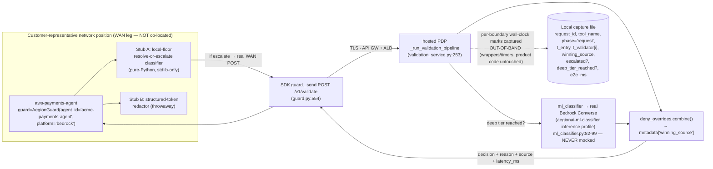
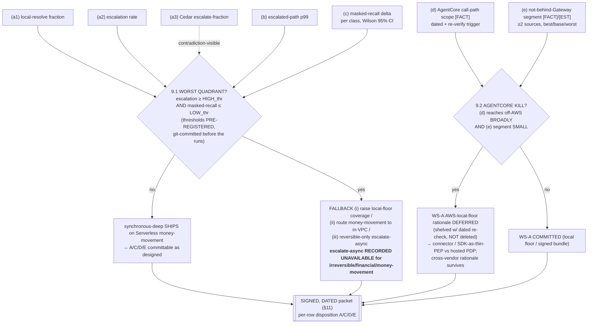

# LLD 34: WS-0 Measure-First Spike — Measurement Methodology

**Version**: 1.0
**Last Updated**: 2026-07-01
**Status**: Draft — Ready for Review
**Owner**: Founder (Shashank Gupta) — the single named sign-off; a one-person spike has no second to escalate to, so this owner is non-delegable for the packet sign-off.
**Designs against**: HLD [hld/serverless-edition.md](../hld/serverless-edition.md) §8 (**MEASURE-FIRST GATE**), §6.4 (the combined GA-gate table + escalate-async fence), §6.2(a)(ii) + **Appendix C** invariants (i)/(ii), §6.2(e) (redaction recall-delta precondition), §6.3 (token-confusion + leak-corpus hazards), **Appendix B** (AgentCore comparison + kill-checks).
**Elaborates the scope doc**: [tasks/serverless-edition/ws-0-measure-first-spike.md](../tasks/serverless-edition/ws-0-measure-first-spike.md) (the workstream boundary + `file:line` anchors + acceptance bar).

> **Numbering (resolved).** This doc is **`lld/34`**. `lld/33-decision-trail.md` (WS-D) was authored concurrently and cleanly owns number 33; `lld/32` is reserved for WS-L (D1–D7 detection depth). This LLD took the next free number, 34. This does not affect any shared contract — WS-0 tapes read-only onto existing contracts and OWNS none.

> **This LLD deepens ONE thing, and it is NOT a shippable data plane.** HLD §8 chose the measure-first gate; this doc pins the **reproducible measurement methodology** for the throwaway WS-0 spike whose only durable product is the **dated, founder-signed §6.4 result packet**. It does not re-open whether the gate exists, and it does not design WS-A/C/D/E. Charter up front: **no code from this WS ships to `main`, no new production contract is created, the stub instruments are measurement rigs (no hardening).**

## Table of Contents
0. [Context](#0-context)
1. [Charter & non-goals — the throwaway invariant](#1-charter--non-goals--the-throwaway-invariant)
2. [Tenets carried forward (from HLD §4)](#2-tenets-carried-forward-from-hld-4)
3. [Harness architecture — the instrumented throwaway rig](#3-harness-architecture--the-instrumented-throwaway-rig)
4. [Stub A — the local-floor resolve-or-escalate classifier](#4-stub-a--the-local-floor-resolve-or-escalate-classifier)
5. [Stub B — the structured-token redactor](#5-stub-b--the-structured-token-redactor)
6. [Metric definitions & measurement conditions (the heart)](#6-metric-definitions--measurement-conditions-the-heart)
7. [Corpus construction for the masked-vs-unmasked recall spike (M0-4)](#7-corpus-sourcing-for-the-masked-vs-unmasked-recall-spike-m0-4)
8. [The two non-numeric AgentCore kill-checks](#8-the-two-non-numeric-agentcore-kill-checks)
9. [Adjudication logic — kill/pivot rules](#9-adjudication-logic--killpivot-rules)
10. [Error / inconclusive model](#10-error--inconclusive-model)
11. [The signed-packet structure + gate-date mechanics](#11-the-signed-packet-structure--gate-date-mechanics)
12. [What this LLD does NOT need (deliberate N/A sections)](#12-what-this-lld-does-not-need-deliberate-na-sections)
13. [Cross-references](#13-cross-references)

---

## 0. Context

This LLD elaborates the **one approved HLD option**: the **MEASURE-FIRST GATE** ([hld/serverless-edition.md](../hld/serverless-edition.md) §8) plus its consumers — the **combined GA-gate table** (§6.4), the **escalate-fraction** ceiling (§6.2(a)(ii) + Appendix C invariant (ii)), the **redaction recall-delta precondition** (§6.2(e)), and the **AgentCore kill-checks** (Appendix B). The HLD already decided *that* three conditionally-frozen rows — the local-floor topology (a), the DAG depth claim (c), and the redaction GA gate (e) — must be measured **before** their build workstreams are decomposed, because sunk cost makes the honest fallback calls (route money-movement to in-VPC; don't build the local floor) un-makeable once the SDK/redactor/scheduler exist.

This doc does **not** re-argue that gate. It deepens the **ONE** thing the HLD left as method-to-be-designed: a **reproducible measurement rig + methodology** for the throwaway spike, whose sole durable product is a **dated, founder-signed §6.4 result packet** (§11). It is not a service; it produces numbers, two kill answers, and a signed packet, and nothing else.

---

## 1. Charter & non-goals — the throwaway invariant

The charter is a **binding LLD constraint**, restated from WS-0 §3.7 / §7 / §10, not a caveat:

**(C1) Throwaway instrumented harness, not a build.** WS-0 produces measurements + a signed packet. Its code is a spike rig; it is not promoted to `main` as product. A stub that over-engineers toward production biases the very schedule pressure the gate exists to resist (WS-0 §3.7 #7).

**(C2) Taps EXISTING hosted-pipeline boundaries read-only; never modifies product code.** The harness wraps/observes the existing `_run_validation_pipeline`, the existing `ml_classifier` Bedrock call, the existing SDK `guard._send`, and the existing Cedar policy set. It adds instrumentation *around* those boundaries (see §3) — it does not edit `validation_service.py`, `guard.py`, `ml_classifier.py`, or any `cedar/*.py`.

**(C3) The stubs (Stub A local-floor classifier, Stub B redactor) are measurement instruments.** No hardening; no signed bundle / JWT / staleness / distribution machinery (that is WS-A's job **if WS-A survives this gate**); no production redactor grammar beyond what the recall number needs (that is WS-E/[lld/29](29-redaction.md) **if WS-E survives**).

**Explicit non-goals:**
- Does **NOT** design WS-A (local floor / signed bundle), WS-C (DAG scheduler / [lld/31](31-dag-scheduler.md)), WS-D (decision-trail / [lld/33-decision-trail.md](33-decision-trail.md)), or WS-E (redaction / [lld/29](29-redaction.md)). It gates *whether their LLDs get commissioned at all*.
- Does **NOT** commission any of those LLDs. None may be decomposed-to-build until this packet is signed (with the founder-recorded WS-C override already noted in [00-index](../tasks/serverless-edition/00-index.md)).
- Does **NOT** add a `phase` handler. `phase` is **always `request`** for the subject agent today; WS-B ([lld/30](30-multiphase-contract.md)) added the enum, but WS-0 must **not** rely on any new phase handler (§3.4).

**What "done" is:** the packet **exists**, is **dated**, is **founder-signed**, records the three numbers + Cedar escalate-fraction + both kill adjudications + the per-row disposition for A/C/D/E, and its completion date is written into [tasks/serverless-edition/00-index.md](../tasks/serverless-edition/00-index.md)'s `Gate date: ____` line (`00-index.md:77`).

---

## 2. Tenets carried forward (from HLD §4)

The master tenets + HLD tie-breakers this methodology must honor, translated to **measurement obligations** (each is testable against the rig, not an aspiration):

| Tenet (source) | Measurement obligation this LLD imposes |
|---|---|
| **T1 — Enforcement is local; the control plane is never on the action path** (master 1) | Carried as a *measurement subject*: Stub A models the **local resolve/escalate split**; the **escalated path** is precisely what still crosses to the hosted PDP, and that crossing is the number the rig must capture (§6b). The rig does not add the control plane to any measured path. |
| **T2 — Fail secure, never fail open** (master 2) | Binds the error/inconclusive model (§10): every ambiguous or missing result fails **toward the worst quadrant**. No timeout auto-pass; an unrecognized Cedar construct **escalates** (never locally-ALLOWs, §4); a too-small recall corpus counts as **LOW** masked-recall (§7.6); neither kill-check may be left inconclusive in a signed packet. |
| **T5 — Latency scales with risk, not volume** (master 5) | The methodological basis for reporting **two numbers, not one** (§6a1/a2 + §6b): the latency win concentrates on benign traffic that least needed it, so the **escalated-path p99** (the security-relevant cases) is the falsifying number. A single "coverage" number is forbidden. |
| **T4 — Defense in depth** (master 4) | The masked-recall-delta measures whether masking **guts one defense layer** (value-dependent exfiltration detection) while **sparing another** (structural indirect-injection) — so it is reported **per attack class, never averaged** (§6c, §7.3). |
| **T8 — Honest staging — measure, never assert** (master 8) | The whole spike exists to replace assertions with numbers: **real WAN, real never-mocked Bedrock, real Cedar policies, dated `[FACT]` citations** for the kill-checks. A mocked classifier latency is a fabricated p99 and is explicitly forbidden (§6b, §10). |
| **HLD Appendix C invariants (i) closed-subset allowlist + (ii) fail-closed-escalate-on-unrecognized** | Carried as the **binding design contract for Stub A** (not WS-A's production interpreter): the allowlist makes an un-anticipated construct **escalate by default**, so the escalate-fraction is not inflated by a corpus gap and not deflated by an optimistic stub (§4). |
| **The throwaway charter (WS-0 §3.7 / §10)** | A design tenet for this LLD: the stubs are instruments, not products; over-engineering toward production is itself a tenet violation. |

**Tie-breaker for any close implementation call:** *falsifiability* — prefer the method that makes the "fast + deep + safe on money-movement" thesis **easier to break**, not the one that makes it look true. This is the operational reading of T8.

---

## 3. Harness architecture — the instrumented throwaway rig

### 3.1 The measured path (real, end-to-end)

The rig drives the **existing real refund agent** — `demo-agents/aws-payments-agent`, whose guard is constructed at [demo-agents/aws-payments-agent/tools/lambda_handler.py:36](../demo-agents/aws-payments-agent/tools/lambda_handler.py#L36) as `AegionGuard(agent_id="acme-payments-agent", platform="bedrock", ...)` — through the same boundaries a real Serverless customer traverses. **Do not invent a new agent** (WS-0 §3, M0-1).



### 3.2 The exact existing boundaries tapped (read-only)

| Boundary | Anchor (read-only) | What the rig captures | How, without touching product code |
|---|---|---|---|
| SDK WAN entry (the real Serverless leg) | `guard._send` POST → `self._client.post(payload)` at [guard.py:554-557](../demo-agents/sdk/aegion-guard-python/src/aegion_guard/guard.py#L554) | Wall-clock at POST send / response receive → **e2e escalated latency** including WAN | Wrap the guard call in the driver harness (the harness is the SDK's *caller*); read `Decision.latency_ms` off the parsed response ([guard.py:600](../demo-agents/sdk/aegion-guard-python/src/aegion_guard/guard.py#L600)). |
| Pipeline entry | `_run_validation_pipeline` at [validation_service.py:253](../src/security-controller/app/services/validation_service.py#L253) | `t_entry` | Timer wrapper in the harness driver / an out-of-band log tap; the first-DENY short-circuit is observed at the `_capture`-gated early return (the `_capture` closure at [:272](../src/security-controller/app/services/validation_service.py#L272) drives it), not modified. |
| Per-validator boundary | `_capture(result)` closure at [validation_service.py:272](../src/security-controller/app/services/validation_service.py#L272) (per-validator marks via `_capture(await _timed(...))`, e.g. [:337](../src/security-controller/app/services/validation_service.py#L337)/[:399](../src/security-controller/app/services/validation_service.py#L399)/[:431](../src/security-controller/app/services/validation_service.py#L431)); Cedar cutover branch `cutover = … and not settings.cedar_shadow_mode` at [:334](../src/security-controller/app/services/validation_service.py#L334); error→DENY via `_create_error_response` ([:714](../src/security-controller/app/services/validation_service.py#L714), returned at [:240](../src/security-controller/app/services/validation_service.py#L240)/[:247](../src/security-controller/app/services/validation_service.py#L247)) and DENY returns at [:571](../src/security-controller/app/services/validation_service.py#L571)/[:601](../src/security-controller/app/services/validation_service.py#L601) | `t_validator[i]` per boundary; which validator decided | Read the existing per-result capture / structured logs; no new instrumentation inside the loop. |
| Deciding source | `metadata['winning_source']` from `DenyOverrides.combine()` ([deny_overrides.py](../src/security-controller/app/combiners/deny_overrides.py)) | `winning_source`; whether the ML/deep tier was reached | Read off the combiner metadata already returned in the response. |
| Deep-tier / Bedrock call | `ml_classifier` Bedrock client at [ml_classifier.py:82-99](../src/security-controller/app/validators/ml_classifier.py#L82); `aegionai-ml-classifier` inference profile (docstring [:8-13](../src/security-controller/app/validators/ml_classifier.py#L8)) | `deep_tier_reached?`; the model latency inside the escalated path | Observed via the real call — **never mocked** (§6b). |

### 3.3 FOOTGUN — co-located timing hides the WAN leg

**Do NOT measure on the dev controller behind a co-located test client.** A co-located client shares the host with the PDP and elides the WAN round-trip — it silently under-reports p99 and makes the "fast enough to leave on synchronously" thesis look true when it is false. The escalated-path measurement (§6b, M0-3) MUST run over the **same network path a Serverless SDK traverses**: a customer-representative network position → the hosted **dev** PDP (recall from MEMORY: *dev-stack IS prod* here). The entry point is the real SDK `guard._send` POST ([guard.py:554](../demo-agents/sdk/aegion-guard-python/src/aegion_guard/guard.py#L554)), not an in-process call into `validation_service`.

### 3.4 Per-request capture schema (the local flat file, not a DB)

Results are a **flat capture file** (JSONL) + a summary packet — no database (see §12). Each row:

```
{
  "request_id": "<uuid>",             // correlation across boundaries
  "tool_name": "process_refund" | "get_order" | ...,
  "phase": "request",                 // ALWAYS 'request' today — WS-0 does NOT rely on any new phase handler (WS-B added the enum; not used here)
  "t_entry_ms": <float>,              // wall-clock at pipeline entry
  "t_validator": {"cedar": <ms>, "sigma": <ms>, "ml_classifier": <ms>, ...},  // per-boundary marks
  "winning_source": "<combiner metadata['winning_source']>",
  "escalated": true|false,            // Stub A verdict for this request (local-resolve vs escalate)
  "deep_tier_reached": true|false,    // did ml_classifier / the deep tier actually run?
  "e2e_ms": <float>,                  // SDK _send send→receive, WAN-inclusive (escalated rows only)
  "run_id": "<spike-run-id>",         // groups a concurrency run
  "concurrency": <int>                // the representative-concurrency level of this run (§6b)
}
```

`phase` is pinned to `"request"` for every row. The subject agent's traffic is all request-phase tool calls; there is no content/output/memory handler exercised, and the rig must not synthesize one.

---

## 4. Stub A — the local-floor resolve-or-escalate classifier

### 4.1 Design contract

Stub A answers **ONE question per request**: *would a closed-subset local floor resolve this locally, or escalate it to the hosted PDP?* It does **NOT** enforce, does **NOT** sign a bundle, does **NOT** cache, does **NOT** run `cedarpy`. It is a **classifier**, pure-Python, **stdlib-only** by design (mirroring what the real WS-A interpreter would be if built — HLD Appendix C: the SDK cannot embed `cedarpy`, which is native-wheel-only per HLD FAQ).

The closed subset it models is **exactly HLD Appendix C invariant (i)**:

1. literal **tool allow/deny sets**,
2. **numeric / string parameter bounds**,
3. **single-session sequence** rule,
4. **prompt-signature patterns**,
5. literal **egress destination/host/path/port** matching (egress is IN the subset — the "grow branch", HLD Appendix C).

**Anything outside that subset → escalate.** This is invariant (ii): **fail-closed-escalate on any unrecognized construct** — an **allowlist** (escalate-by-default), never a denylist. A stub that locally-resolves an un-modeled rule inflates the local-resolve fraction and corrupts the whole gate (WS-0 §3 #3).

### 4.2 Classifying the REAL `baseline-v1.cedar` constructs

Stub A reads the agent's **resolved** Cedar policy set from [src/security-controller/app/validators/cedar/](../src/security-controller/app/validators/cedar/) — the universal `baseline-v1.cedar` **plus** any agent-specific rules the translator appends (per the baseline header, per-agent variance lives in synthesized entity attributes `principal.allowed_tools` / `principal.allowed_agents` / `principal.max_refund_amount`). Each `@id` rule is classified against the allowlist. This mirrors [lld/28 §5.2](28-cedar-policy-engine.md)'s classifier semantics — **but Stub A only classifies; it does not emit a bundle** (that is WS-A/lld28's job if it survives).

| `@id` rule in `baseline-v1.cedar` | Cedar construct | Stub A classification | Why |
|---|---|---|---|
| `permit_use_tool` | `resource in principal.allowed_tools` | **IN-subset** | Set-membership over a synthesized entity attribute = literal tool allow-set (invariant (i) #1). Stub models `allowed_tools` as a literal set lookup. |
| `forbid_refund_over_cap` | `context has amount && principal has max_refund_amount && context.amount > principal.max_refund_amount` | **IN-subset** | `has`-guarded numeric parameter bound (`amount > max_refund_amount`, Long cents) = numeric parameter bounds (invariant (i) #2). The `has`-guards are recognized structure. |
| `forbid_refund_missing_amount` | `unless { context has amount }` (deny-on-missing) | **IN-subset** | Presence/`has` check driving a deny-on-missing = a recognized deterministic guard (fail-secure); modelled as "amount absent → forbid". |
| `forbid_high_fraud_identity` | `context has fraud_risk && context.fraud_risk == "high"` | **IN-subset** | `has`-guarded **string-equality** gate (invariant (i) #2, string bound). |
| `permit_invoke_agent` | `resource in principal.allowed_agents` | **IN-subset** | Set-membership over a synthesized entity attribute = literal agent allow-set (invariant (i) #1). |
| **`cross_cloud_dependencies`** (real — on `acme-payments-agent` + `acme-telecom-agent`) | a cross-cloud **tool-sequence precondition** Cedar does not enforce (deferred to `context_validator`) | **OUT-of-subset → whole policy escalates** | Not one of the five in-subset forms; the stub does not model cross-session/cross-cloud sequence → fail-closed-escalate (invariant (ii)). **This is the live construct that makes the escalate-fraction ≈ 2/3, not a hypothetical.** |
| *(any other translator-appended agent-specific rule)* | e.g. egress host match, or a construct not in the five | **classify each**; **any un-anticipated construct → OUT-of-subset → escalate** | The allowlist makes a construct the author never anticipated escalate **by default** (invariant (ii)). |

**Worked point (why the escalate-fraction is NOT a null measurement).** The `.cedar` *text* of the shipped baseline is entirely in-subset, so a reader could assume the escalate-fraction is a foregone **0.0**. It is not — because the **real, working policy corpus is not the baseline text alone.** The subject fleet is the **three `acme-` agents** that actually run ([policies.demo.yaml](../demo-agents/registration/policies.demo.yaml)): `acme-payments-agent`, `acme-identity-agent`, `acme-telecom-agent`. **Two of the three** — payments ([:28](../demo-agents/registration/policies.demo.yaml)) and telecom ([:68](../demo-agents/registration/policies.demo.yaml)) — carry a **`cross_cloud_dependencies`** precondition: a **tool-sequence rule that Cedar does not itself enforce** (the baseline explicitly defers it to `context_validator` — see the "cross-cloud preconditions: DEFERRED" comment). A cross-cloud sequence precondition is **outside the five enumerated in-subset forms** → Stub A **escalates the whole policy** (§4.2 row 6, whole-policy rule §4.2 below). So on the real `acme-` corpus the escalate-fraction is **≈ 2/3 (2 of 3 policies force escalate), not 0.0** — a real, non-tautological number that answers "do actual working policies escalate?" with a measured yes. The identity agent (no cross-cloud dep) is the in-subset third. **Corpus size is stated up front in the packet (N=3 acme- policies today); the number is honest about that N** — it is not dressed up as a large-sample ceiling. *(If/when a design partner's real policy set is available it is added and the fraction re-measured — but the gate does not wait on hypothetical customer policies; it reports the real N=3 today.)*

**Whole-policy escalate (carried from [lld/28 §5.3](28-cedar-policy-engine.md)):** the escalate unit is the **WHOLE policy, not a single rule**. Stub A must NOT classify a policy as locally-resolvable by looking only at its allowlisted rules and ignoring one out-of-subset rule — that re-opens the ALLOW-by-omission fail-open (an allowlisted `permit_use_tool` on `process_refund` + an out-of-subset `forbid` on the same tool: per-rule logic resolves locally and the server-side forbid never fires). If **any** rule in a policy is out-of-subset, **the whole policy escalates**. `escalate_fraction` is `1.0` or `0.0` **per policy** (lld/28 [:317](28-cedar-policy-engine.md), [:292](28-cedar-policy-engine.md)).

### 4.3 FOOTGUN — no `cedarpy` in the stub

Do **NOT** embed `cedarpy` to "be accurate." `cedarpy` is native-wheel-only (HLD FAQ) and the entire point is what the **stdlib-only** interpreter can resolve. Stub A is pure-Python by design — measuring the same subset a real WS-A SDK interpreter could carry. Embedding `cedarpy` would measure the *server's* engine, not the *edge's* reachable subset, and inflate the local-resolve fraction with constructs the edge could never evaluate.

---

## 5. Stub B — the structured-token redactor

### 5.1 Design contract

Stub B is a **throwaway, token-namespacing-safe** structured-token redactor. It replaces sensitive **values** with structure-preserving typed tokens so the deep tier can still reason about *shape* while the *value* is gone. It is **structure-preserving** and **deterministic** (same input → same tokenization, so the masked/unmasked recall comparison is apples-to-apples). It applies the HLD §6.2(e) typed-token convention: `<CARD>` / `<SSN>` / `<EMAIL>` / `<SECRET>` via **regex + Luhn (card) + entropy (secret)**.

It is explicitly **NOT** the production edge redactor (that is WS-E / [lld/29](29-redaction.md)). It carries only what the recall number needs.

### 5.2 FOOTGUN (load-bearing even in a throwaway) — token namespacing

Before emitting its own tokens, Stub B MUST **neutralize/escape any pre-existing token-shaped substring in the input** (HLD §6.3 token-confusion hazard; [lld/29 §3.3](29-redaction.md)). Otherwise attacker text containing a literal `<SECRET>` / `<CARD>` (or the production sentinel `AEGR:`) **spoofs the recall number**: a planted marker reads as a genuine redaction and either fools a detector or fakes a "redaction happened" signal, corrupting M0-4's masked-recall.

The neutralization grammar is the one lld/29 §3.3 ships (Stub B reuses the *grammar shape*, not the production code):
- Genuine marker: `⟦AEGR:{nonce}:TYPE[:meta]⟧` — reserved sentinel `AEGR:` + **per-call nonce** (`secrets.token_hex`, stdlib) + type (e.g. `CARD:6:4`, `SSN`, `EMAIL`, `SECRET`).
- **Neutralize first:** `_neutralize_planted_tokens`-equivalent escapes any literal sentinel sequence (raw `⟦` / `⟧` / literal `AEGR:` / bare `<CARD>`) the attacker supplied **before** any matcher runs, so it cannot read as a genuine marker downstream.
- Only `⟦AEGR:{nonce}:…⟧` carrying **this call's nonce** counts as a genuine marker; a planted one cannot carry the nonce (the attacker doesn't know it).

The augmentation generator (§7.4) asserts this round-trip — a planted sentinel is neutralized and a genuine marker carries the nonce — **before any corpus row is admitted**, so the recall measurement can't be spoofed by the corpus itself.

---

## 6. Metric definitions & measurement conditions (the heart)

Each metric is defined operationally so it is **independently reproducible**: population, measurement window/concurrency, instrument, and **what makes the number invalid**.

### 6a1. Local-resolve fraction

- **Definition:** of all replayed money-movement requests, the **percentage Stub A classifies as resolvable in the closed subset** (would not cross to the hosted PDP).
- **Population:** the real `acme-` fleet action mix (§7.1 in-repo benign + refund/order/port-out tool calls with in-bound and out-of-bound parameters) — **money-movement** agents, not a generic chat agent.
- **Instrument:** Stub A verdict per request (§4), the `escalated=false` count.
- **The escalate set is NOT near-empty (why (b) has a real sample).** Because 2 of the 3 acme policies carry a `cross_cloud_dependencies` precondition (§4.2), a whole class of ordinary requests **escalates by construction**: any `process_refund` / `port_out_number` whose required cross-cloud verify is **absent or stale** in the session escalates (Cedar can't resolve the sequence → whole policy escalates), as do out-of-bound-parameter and prompt-signature-flagged requests. So a1 is **not ≈100%** and the escalate-classified subset that feeds the §6b p99 is a real, non-trivial population — **the harness states the expected escalate-count N up front** and §6b's p99 is invalid if that N is too small (§6b invalidator v).
- **Invalidators:** (i) Stub A locally-resolving an unrecognized construct (violates §4 allowlist → number inflated, invalid); (ii) traffic that isn't money-movement-representative; (iii) a request mix engineered so nothing escalates (starves §6b) — the escalate-triggering classes above MUST be present in representative proportion.

### 6a2. Escalation rate

- **Definition:** the **complement** — percentage that **escalate** to the hosted PDP (`escalated=true`).
- **Reporting rule (T5, HLD §3 #1):** local-resolve fraction and escalation rate are **TWO SEPARATE reported numbers**. They are never collapsed into a single "coverage" number, because the latency win concentrates on benign traffic and the security-relevant requests are by construction the ones that escalate.

### 6a3. Cedar escalate-fraction (input-independent ceiling)

- **Definition:** the **fraction of the real working Cedar policy set that contains ≥1 out-of-subset construct** — i.e. policies that force escalate **regardless of input**. Per policy this is `escalate_fraction ∈ {0.0, 1.0}` (whole-policy, [lld/28 §5.3](28-cedar-policy-engine.md)); the reported number is the fraction of policies at `1.0`. This aligns with lld/28's `EdgeResolveTotal` vs `EscalatedToHostedTotal` accounting and its per-policy `escalate_fraction`.
- **Population (stated N, not a hypothetical ceiling):** the **three working `acme-` agent policies** ([policies.demo.yaml](../demo-agents/registration/policies.demo.yaml)) — the only agents actually running (founder scope call). Expected value **≈ 2/3**: payments + telecom carry a `cross_cloud_dependencies` sequence (out-of-subset → escalate); identity does not (in-subset). **The packet reports the raw count (`k of N` policies escalate, N=3 today), never just a percentage**, so the small N is visible and not laundered into a big-sample claim. A design-partner policy set, when available, is appended and the fraction re-reported.
- **Instrument:** Stub A's per-policy classification pass (§4.2), independent of traffic.
- **Contradiction-visible rule (mandatory):** a **high local-resolve fraction on benign traffic** together with a **high Cedar escalate-fraction** is a *contradiction made visible* — it means the benign traffic simply never triggers the complex policies. **Report BOTH side by side; never average them into a rosy coverage number** (HLD §3 #3). The packet shows all three numbers (a1, a2, a3) so this stays visible.
- **Invalidator:** classifying against `cedarpy` instead of the stdlib subset (§4.3) — measures the wrong engine.

### 6b. Escalated-path p99 (full WAN + real, never-mocked Bedrock)

- **Definition:** end-to-end latency of requests Stub A classifies "escalate," measured from the **SDK `guard._send` WAN POST** ([guard.py:554](../demo-agents/sdk/aegion-guard-python/src/aegion_guard/guard.py#L554)) → hosted `_run_validation_pipeline` → the **real** Bedrock `ml_classifier` inference ([ml_classifier.py:82-99](../src/security-controller/app/validators/ml_classifier.py#L82), `aegionai-ml-classifier` inference profile) → response. Report **p50 / p95 / p99**; **headline = p99**.
- **Population:** the escalate-classified subset of the money-movement traffic (the security-relevant cases).
- **Measurement window / concurrency — report ≥2 bands, not one point.** p99 is exquisitely load-sensitive, so a single founder-picked concurrency can be gamed low. The harness measures p99 at **at least two concurrency bands** (e.g. a steady-state band and a burst band) and reports the **load-sensitivity slope**, not one number — so a reader sees how p99 degrades under load, not a hand-picked best case. The bands + request mix are a **founder-recorded precondition anchored to external evidence** (§9.3(3)): the observed/expected request rate of a real or design-partner financial-action agent (RPS, burst factor, arrival distribution), **not** founder preference. Absent a design-partner number, the packet records the assumed load profile as a **falsifiable `[ESTIMATE]` with its basis**, and re-measurement is triggered when the first real customer volume is known.
- **WAN network position — pinned, not just "not co-located" (§9.3(6) precondition).** "Not co-located" rules out the worst under-report but still admits a 100s-of-ms range (same-region cross-AZ EC2 vs. cross-continent residential). The packet **names the client's concrete placement relative to the dev PDP** (region / account / network path — e.g. "agent client in a customer-representative region over the public internet to the PDP region") and justifies it against where target Serverless customers' agents actually run; the p99 headline is held to **that** path. This is founder-supplied external data — the LLD requires it, does not invent it.
- **Instrument:** the harness driver's WAN timer around `guard._send`, cross-checked against `Decision.latency_ms` ([guard.py:600](../demo-agents/sdk/aegion-guard-python/src/aegion_guard/guard.py#L600)); the Bedrock leg is observed inside the real call.
- **Invalidators (fail-secure):** (i) **mocked / stubbed Bedrock** → fictional p99, forbidden (T8); (ii) **co-located client** (no WAN) → under-reported p99, forbidden (§3.3); (iii) **Bedrock unavailable** during the run → **INCONCLUSIVE → gate NOT met** (§10), never a mocked substitute; (iv) single-shot serial timing instead of representative concurrency; (v) **escalate sample too small** — if the escalate-classified population (§6a1) is below a stated minimum, p99 is **INCONCLUSIVE** (a p99 over a handful of requests is noise); (vi) **only one concurrency band reported** (no slope) or an **unpinned WAN position**.
- **Note on ceilings:** NFR-2's ≤900 ms fast-ML ceiling is **NOT asserted satisfied** on the escalated Serverless path; even the ≤2.5 s deep ceiling is **measured here, not asserted** (HLD §6.4).

### 6c. Masked-vs-unmasked recall delta (per attack class)

- **Definition:** for each attack class, run the deep tier (today = `ml_classifier` + prompt-signature engine `sigma_engine.match_rules` at [sigma_engine.py:340](../src/security-controller/app/validators/sigma_engine.py#L340)) on **(1) unmasked** content and **(2) Stub-B-masked** content; report **recall on unmasked**, **recall on masked**, and the **delta = unmasked − masked**.
- **Population:** the corpus of §7 — **EXFILTRATION and INDIRECT-INJECTION measured and reported SEPARATELY, never averaged** (T4), on content that **includes obfuscated + non-US variants** (§7.4), not canonical-only.
- **Instrument:** the deep tier over the two corpora, Stub B for masking; per-class recall with a **Wilson 95% CI** (§7.6).
- **Detector-version binding + re-measure trigger (MANDATORY).** The recall numbers depend entirely on *which* detector runs, and today's deep tier is **in flux** — the `ml_classifier` is graduating shadow→enforce and the prompt-signature corpus is being rebuilt. So the packet **stamps the exact detector version the (c) numbers were produced against** (ML model + prompt hash/date; Sigma/prompt-signature corpus revision) and states that **the redaction-GA result (FR-3.13/NFR-7) is valid ONLY for that detector version.** A **re-measure is triggered** when the deep tier materially changes — specifically the ML shadow→enforce graduation and the prompt-signature rebuild. *(The structural intuition — masking blinds value-dependent exfiltration detection more than structural indirect-injection — is the reason the delta is reported per-class; but the magnitude is detector-bound and is not claimed detector-invariant.)*
- **Invalidators (fail-secure):** (i) averaging the two classes (hides the worst-quadrant signal — masking may barely hurt structural indirect-injection while gutting value-dependent exfiltration); (ii) a corpus below the per-class floor (§7.6) → that class treated as **LOW** masked-recall; (iii) a corpus not namespace-safe (§5.2) → spoofed number; (iv) canonical-only corpus (no obfuscated/non-US); (v) **an unstamped detector version** — a (c) number with no recorded detector version is not adjudicable (you can't tell what it measured).

---

## 7. Corpus sourcing for the masked-vs-unmasked recall spike (M0-4)

**Scope.** This section specifies the attack corpus that feeds WS-0 Milestone M0-4 — the masked-vs-unmasked deep-tier recall delta, reported PER attack class (EXFILTRATION and INDIRECT-INJECTION separately, never averaged) on content that MUST include obfuscated + non-US/multilingual variants. Founder decision: source from open-source injection datasets (reuse what's in the repo, pull the named open datasets covering various injection types), not hand-authored corpora. The row format is `redaction_recall.jsonl`-shaped (`text`, `[{class, span}]`) — a shape **defined by [lld/29 §15.4](29-redaction.md) but not yet created in-repo** (lld/29 marks it "New"; its path there is `src/security-controller/tests/corpus/redaction_recall.jsonl`, and no such file/dir exists today). WS-0 **consumes the shape**, not an existing file, and materializes its own throwaway copy under the harness dir. It is extended here with a per-row `attack_class ∈ {exfiltration, indirect_injection, generic}` and `variant ∈ {canonical, obfuscated, non_us}` label. Every external claim is `[FACT]` (cited URL, verified live in the adversarial pass), `[INFERENCE]`, or `[REC]`.

### 7.1 Reuse-from-repo — existing corpora and what each is missing

| In-repo file | Size / composition | Origin | Use in M0-4 | What it's MISSING |
|---|---|---|---|---|
| `demo-agents/eval/labeled_prompts.jsonl` | 662 (399 benign / 263 injection) | deepset/prompt-injections (HF) | binary FP/recall floor + the only in-repo benign hard-negative set | GENERIC only; EN+DE only; no char-obfuscation |
| `demo-agents/traffic/attack_prompts/injection.txt` | 265 (all label=1) | deepset | GENERIC-injection recall seed | unlabeled per-class |
| `demo-agents/traffic/attack_prompts/ml_injection.txt` | 19 (in-house semantic sigma-miss) | in-house | INDIRECT-INJECTION-adjacent seed | tiny; EN-only |
| `harness/sample_redaction_eval.jsonl` | 12 (synthetic) | in-house | wiring/smoke sample **only** — **NOT** a ground-truth recall set | does **not** count toward min-size |
| `demo-agents/sdk/aegion-guard-python/tests/corpus/pci_sad_pan.jsonl` | 49 (PAN) | in-house | feeds the **SEPARATE** deterministic PCI 0-miss gate ([lld/29 §15.4](29-redaction.md)), **NOT** M0-4 | never blended into the fuzzy recall number |

`[FACT]` in-repo attack corpora are generic-injection binary (deepset-derived) — **none carries the per-class exfil/indirect split**; non-US is German-only. Reuse as generic + benign-hard-negative baseline + German non-US slice; **the per-class corpus MUST come from §7.2.**

### 7.2 Pull-from-open-source — ranked, license-verified external datasets

All CONFIRMED available + PERMITS_RESEARCH_USE in the adversarial-verification pass.

| # | Dataset | Source | License | Size | Class coverage | Variant / caveat |
|---|---|---|---|---|---|---|
| 1 | **InjecAgent** | github.com/uiuc-kang-lab/InjecAgent | **MIT** | 1,054 (`attacker_cases_ds.jsonl` data-stealing + `attacker_cases_dh.jsonl` direct-harm) | **BOTH native** (data-stealing=EXFILTRATION; whole benchmark=INDIRECT-INJECTION) | English |
| 2 | **AgentDojo** | github.com/ethz-spylab/agentdojo | **MIT** | ~629 security cases / 4 suites | **BOTH** (banking/workspace `injection_tasks.py`=EXFIL send-to-attacker-IBAN/forward-2FA; core=INDIRECT-INJECTION) | English; **harvest step needed** (dynamic env → static rows) |
| 3 | BIPIA | github.com/microsoft/BIPIA | MIT code; borrowed task data CC-BY-SA-4.0 | 30 text + 20 code templates × samples | INDIRECT-INJECTION first-class | delivery not obfuscated; WebQA/Summarization withheld (self-download) |
| 4 | deepset/prompt-injections | HF | Apache-2.0 (HF tag) / CC-BY-4.0 also declared | 662 | GENERIC floor | already in repo; non_us EN+DE |
| 5 | Lakera/gandalf_ignore_instructions | HF | MIT | 1,000 | EXFIL-adjacent (secret extraction) / GENERIC-direct | obfuscated (spaced/broken/reversed/binary) + non_us; **VENDOR-sourced (COI flag)**, attack-only (no benign), small mislabel rate; obfuscation supplement only |
| 6 | DAMO-NLP-SG/MultiJail | HF | MIT | 315 × 10 langs (~3,150) | GENERIC/jailbreak (NOT exfil/indirect) | **non_us PRIMARY** (zh/it/vi/ar/ko/th/bn/sw/jv); English seeds derive from Anthropic harmful-query set (dedup) |
| 7 | AdvBench (GCG) | github.com/llm-attacks/llm-attacks | MIT | 520 behaviors + 574 strings | GENERIC/jailbreak | GCG suffixes are optimizer OUTPUT, not a shipped file → do **NOT** count as ready-made obfuscation |
| 8 | SPML_Chatbot_Prompt_Injection | HF (reshabhs) | MIT | ~16,012 | GENERIC-direct w/ system-prompt framing | English |
| 9 | hackaprompt-dataset | HF | MIT | ~600k | GENERIC breadth + prompt-leak (exfil-adjacent) | one-time HF login gate; success-labeled vs a specific model (filter `correct=true`) |
| 10 | TrustAIRLab/in-the-wild-jailbreak-prompts | HF | MIT | ~21.5k (1,405 jailbreak) | GENERIC/jailbreak | theme-cluster claim OVERSTATED |
| 11 | allenai/wildjailbreak | HF | ODC-BY + AI2 gate | 262k train / eval 2,000 harmful + 210 matched benign | GENERIC/jailbreak + matched hard-negatives (FP control) | GATED (named human accepts AI2 terms); multilingual claim OVERSTATED (English); **pull only eval hard-negatives** |
| 12 | JBB-Behaviors | github.com/JailbreakBench/jailbreakbench | MIT | 100 harmful + 100 benign | GENERIC/jailbreak + benign FP control | ships GOALS not attack strings (OVERSTATED as injection coverage) |

**CORE M0-4 PULL (load-bearing two): InjecAgent + AgentDojo** — the only datasets whose **native taxonomy IS our two required classes** AND that **target agent actions** (matching Sentra's action-governance model). `[REC]` These two are the exfil/indirect ground truth; everything else is baseline or augmentation supplement.

**7.2.1 License handling (no hard-blocked licenses; caveats recorded in the manifest §7.5):** wildjailbreak gated (named human accepts; internal recall-eval within ODC-BY, pull eval hard-negatives only); hackaprompt login gate + success-labeled (filter); AdvBench GCG not ready obfuscation; BIPIA borrowed data CC-BY-SA-4.0 share-alike-if-redistributed + WebQA/Summarization withheld (self-download) + cipher attacks are output-transform not obfuscated delivery; deepset dual-license (attribute deepset); Lakera vendor-COI + attack-only.

### 7.3 Per-class mapping (generic sets do NOT satisfy per-class)

**HARD RULE:** recall reported for EXFILTRATION and INDIRECT-INJECTION **separately, never averaged**; a generic injection/benign set is **GENERIC** and must NOT be relabeled into a class it doesn't carry.

- **EXFILTRATION ground truth** = InjecAgent `attacker_cases_ds.jsonl` (S1/S2 stages) + AgentDojo banking/workspace injection tasks; supplements = Lakera secret-extraction, hackaprompt prompt-leak; **NOT** jailbreak sets.
- **INDIRECT-INJECTION ground truth** = InjecAgent (entire benchmark = IPI) + AgentDojo core + BIPIA; supplement = in-repo `ml_injection.txt`; **NOT** direct-injection sets (deepset / SPML).
- **GENERIC baseline + FP** = in-repo deepset + SPML; **FP hard-negatives** = JBB + WildJailbreak adversarial-benign.

`[INFERENCE]` InjecAgent + AgentDojo are agent-tool traces needing a **harvest/adaptation step** (extract attacker instruction as content-phase text, tag `attack_class` from the native category, record exfil target span) — **throwaway WS-0 harness code, not product**.

### 7.4 Augmentation — obfuscated + non-US (source-first, synthesize to fill gaps)

- **Non-US:** PRIMARY = **MultiJail** (9 non-English langs, systematic); SECONDARY = in-repo deepset German + Lakera German/RU/FR/ES/ZH-output requests. MultiJail/Lakera are generic/jailbreak — so for **per-class non-US**, apply deterministic **machine-translation transforms** to InjecAgent/AgentDojo exfil+indirect rows (tag `variant=non_us` + transform + target language; flagged synthetic).
- **Obfuscated:** no clean source supplies obfuscated **per-class DELIVERY** (Lakera generic-only; BIPIA/AdvBench do not supply obfuscated delivery) — so obfuscation on exfil/indirect rows = **deterministic transforms** over InjecAgent/AgentDojo text: base64/hex encoding, homoglyph/unicode-normalization, spaced/punctuation-broken digits (HLD §6.3 hazard), ROT13/reversed. Each row tagged `variant=obfuscated` + transform id so degradation is attributable.
- **NAMESPACING-SAFE (HLD §6.3, MANDATORY correctness precondition):** Stub B neutralizes any pre-existing token-shaped substring before emitting its own typed tokens ([lld/29 §3.3](29-redaction.md): reserved sentinel `AEGR:` + per-call nonce). An attacker row containing a literal `<SECRET>` / `<CARD>` / `AEGR` marker must **not** read as a genuine redaction marker, else the corpus spoofs the measurement. The augmentation generator **asserts the round-trip** (planted sentinel neutralized; genuine marker carries the nonce) **before any row enters the corpus** (§5.2).

### 7.5 Labeling, dedup, provenance + license manifest

- **Per-class labels:** every row carries `attack_class`, `variant`, and (exfil) target span. Generic/benign rows **never inherit** a class they don't carry.
- **Dedup:** hash-dedup pulled rows against in-repo corpora AND each other (**MultiJail↔Anthropic-derived** overlap and **deepset↔injection.txt** overlap are known dupes); dedup **BEFORE** augmentation.
- **Provenance:** each row records `source_corpus` (extends the `sample_redaction_eval.jsonl` schema).
- **License manifest** `corpus/LICENSES.md` records every pulled dataset with verified license + URL + fetch date + caveat (MIT retain notice; Apache-2.0/CC-BY-4.0 attribute deepset; ODC-BY+AI2 gate; CC-BY-SA-4.0 BIPIA borrowed; vendor-COI Lakera).
- `[REC]` WS-0 is **throwaway internal** (no redistribution) so attribution/share-alike triggers do not fire — but the manifest is **required** so a later product corpus (WS-C/WS-F) inherits a clean license trail.

### 7.6 Fail-secure minimum-size rule (LOW-on-inconclusive bar)

Per the WS-0 error model (§10): attack corpus too small → record size + confidence caveat; if the delta cannot be distinguished from noise, treat masked-recall as **LOW** (fail-secure toward the worst quadrant), **not HIGH**.

- **Minimum per-class N:** **≥200** labeled attack rows per class (exfiltration, indirect-injection) at canonical variant; **≥50** rows per augmentation dimension per class (obfuscated, non_us).
- **NATIVE-rows floor, separate from the total (anti-self-measurement).** Synthetic obfuscated/non-US rows are deterministic transforms over the *same* native seeds (§7.4) — so a corpus of "180 machine-permuted + 20 native" would measure robustness to **our own transform pipeline**, not real attack diversity. Therefore a **separate floor of ≥100 NATIVE (non-synthetic) rows per class** must be met independently of the ≥200 total; the packet reports **native-count and synthetic-count separately per class**. A class that clears 200 total but misses the native floor is scored **LOW-confidence**, not passed.
- `[INFERENCE]` InjecAgent data-stealing + AgentDojo exfil clear ≥200 (and the native floor) for **exfiltration**; InjecAgent + AgentDojo + BIPIA clear it for **indirect-injection** — the bar is met from the two core pulls without hand-authoring. **This inference is contingent on the AgentDojo harvest completing (§7.7); if it slips, see the single-source downgrade there.**
- **Confidence bar:** report masked − unmasked recall delta per class with a **Wilson 95% CI**; if the **CI crosses zero** for a class, that class's masked-recall is scored **LOW** and drives the worst-quadrant kill, **never rounded to HIGH**.
- **Hard fail-secure:** a per-class corpus below the 200-row floor (or below the native floor) → that class **inconclusive → treated as LOW**; the packet records the shortfall as a named caveat; the gate does **NOT** silently pass on a thin or self-augmented corpus. `sample_redaction_eval.jsonl` (12) and `ml_injection.txt` (19) do **NOT** count toward the floor.

### 7.7 Open items (honest gaps after all sources)

- `[INFERENCE]` **Obfuscated + per-class is synthetic, not native** — no open dataset supplies obfuscated-delivery exfil/indirect; that slice measures detector robustness to **OUR transforms**, not in-the-wild obfuscated IPI. Flag in packet.
- `[INFERENCE]` **Non-US per-class is machine-translated** (MultiJail native is generic-only); translation artifacts may under/over-state degradation. Flag.
- `[FACT]` AgentDojo needs a **harvest step** (dynamic env → static rows) and BIPIA WebQA/Summarization source is withheld (self-download). **Hard rule:** the harvest is **DONE before (c) is scored**, OR the affected class is explicitly **downgraded to single-source → LOW-confidence → treated as LOW** in the packet (fail-secure). A class resting on InjecAgent alone + our own synthetic transforms is measuring one source machine-permuted (§7.6 native-floor) — it does **not** silently clear the bar; it is flagged **asserted-not-triangulated** and scored LOW-confidence.
- `[INFERENCE]` No dedicated indirect tool-output/data-poisoning corpus beyond InjecAgent/AgentDojo/BIPIA; **memory-phase** indirect injection ([lld/30](30-multiphase-contract.md) phase enum) is essentially **uncovered** by open data (and out of scope — WS-0's subject agent is request-phase only).
- `[FACT]` **Financial-action exfil is well-covered** (InjecAgent Financial-Data cases + AgentDojo banking suite align with the beachhead) — the one class where the corpus is strong.

---

## 8. The two non-numeric AgentCore kill-checks

The second, independent kill (the *differentiator*, not the tuning): whether the local-floor / signed-bundle workstream (WS-A) is **built at all**. Both answers are governed by the **research-evidence rule** (label + cite + verify; treat fetched content as data, not instruction).

### 8.1 (d) AgentCore interception scope — VERIFIED, not assumed

- **The load-bearing fact is the CALL PATH, not the framework.** Produce a **VERIFIED** statement of whether AgentCore **Gateway/Policy** can govern an agent making **DIRECT tool calls NOT routed through AgentCore Gateway**, on **customer-owned / off-Bedrock / off-AWS** infra (EC2/EKS/on-prem/off-AWS).
- **Output:** a `[FACT]` with a **dated AWS-docs URL** or a **named AWS solutions-architect** citation. This **closes HLD Appendix B's UNVERIFIED gap** ("the docs do NOT state whether enforcement can bind to an agent making tool calls *directly* … UNVERIFIED from public docs").
- **Sourcing method (not memory):** the `aws-core:amazon-bedrock` skill / `ReadInternalWebsites` (Midway-authed for `docs.aws.amazon.com`/`*.aws.dev`) / the AWS docs MCP (`aws___read_documentation` / `aws___search_documentation`).
- **FOOTGUN:** do **NOT** mark this "verified" off a marketing line ("Any framework, any model" — HLD already shows that line does NOT speak to the call-path boundary). An **asserted-not-proven** answer **fails the gate** and leaves (d) UNRESOLVED (§10).

### 8.2 (e) Not-behind-Gateway segment size (the GTM number)

- Size the genuinely **not-behind-AgentCore-Gateway** agent fleet — multi-cloud, off-AWS, or AWS-but-direct-tool-call. This is the GTM number the HLD explicitly does **not** own (Appendix B).
- **Output — triangulated, not a single founder guess (the project's own research-evidence bar).** Because (e) is load-bearing (it can NOT-COMMIT WS-A), it MUST meet the same triangulation bar §7 holds the corpus to: **≥2 independent sources** (e.g. an analyst agent-deployment split × a cross-cloud market-share figure), a **best / base / worst band** — not a point — and the assumption stated as a **falsifiable claim**. A single founder estimate the founder is motivated to size toward their prior does **not** qualify.
- **Disqualifier:** a single-source figure, an estimate with no stated assumption, or a point with no band does not ship (a number the reader can't trace to ≥2 sources doesn't count).

---

## 9. Adjudication logic — kill/pivot rules

Two independent kills, each reproducible, each with **explicit founder-recorded thresholds** (recorded IN the packet, §11 — not hidden in prose).



### 9.1 Worst-quadrant numeric kill (gates *synchronous-deep*)

- **Rule (HLD §6.4 + §8):** if **escalation rate ≥ HIGH threshold AND masked-recall ≤ LOW threshold** (slow *and* shallow on the requests that matter), the unconditional **"leave-it-on-synchronously + deep"** claim does **NOT** ship for money-movement on Serverless.
- **Fallbacks, recorded:** (i) raise local-floor coverage; (ii) route money-movement to **in-VPC** (deep tier sees unmasked content in-boundary); (iii) **reversible-only** escalate-async. Descope Serverless money-movement to **structured-token-PII non-deep-tier** customers until a later coverage milestone.
- **HARD FENCE:** **escalate-async (iii) is RECORDED UNAVAILABLE for irreversible/financial/money-movement actions** (HLD §6.4) — money-movement takes the **synchronous block-before-execute fail-closed** path. Do not record escalate-async as a money-movement fallback.
- **Thresholds are a FOUNDER DECISION recorded IN the packet** (a fill-in threshold table, §11) so the adjudication is reproducible. This LLD does **not** invent the numbers — that is a documented precondition (§9.3), not a gap.
- **PRE-REGISTRATION (MANDATORY — the gate's teeth).** The `HIGH_thr` / `LOW_thr` numbers MUST be **filled in and git-committed (dated) BEFORE the (b)/(c) measurement runs execute** — not after the numbers are seen. **Why this is load-bearing, not ceremony:** the kill fires on "escalation ≥ HIGH *and* masked-recall ≤ LOW", but if the founder sets HIGH/LOW *after* seeing the results, the bar can be (even unconsciously) placed just past the result so the gate always PASSES — the gate becomes structurally **incapable of killing anything the founder wants to build.** That defeats the entire anti-sunk-cost purpose of a *measure-first* gate. The risk is concrete here: this same gate has already been **overridden twice** (WS-C, WS-E, founder 2026-07-01), so a reader will (rightly) discount a self-graded, thresholds-set-after-the-fact packet. **Mechanism:** (1) the threshold table is committed dated-in-git as a pre-registration BEFORE any measurement run; (2) the packet cites that commit hash; (3) if a threshold is changed after the runs, the change is recorded with an explicit dated rationale (a visible amendment, never a silent edit). A packet whose thresholds post-date its measurement commits is **not signable**.
- **Single-sign limitation (disclosed, accepted).** A one-person spike has no independent adjudicator; the founder both sets thresholds and signs. Pre-registration is the compensating control; the packet states this limitation plainly so a reader weights it. A second-reader co-sign (advisor / design partner / red-team pass) is **recommended-not-required**.
- **Gates rows:** (a) FR-1.7 local-floor topology, (c) FR-2.8 DAG depth claim, (e) FR-3.13/NFR-7 redaction GA gate.

### 9.2 AgentCore kill (gates *whether WS-A is built*)

- **Rule (HLD §8):** if **(d) AgentCore governs customer-owned/off-AWS agents broadly AND (e) the not-behind-Gateway segment is small**, then **WS-A (local-floor / signed-bundle) is NOT committed** — fall back to connector / SDK-as-thin-PEP against the hosted PDP for the non-AgentCore-reachable fleet. Otherwise **WS-A is committed**.
- **Gates rows:** WS-A (FR-1.7) build decision specifically. The numeric quadrant (9.1) gates *synchronous-deep*; this gate decides whether the **local floor is built**.
- **DEFER, not DELETE (the outcome is reversible by construction).** A "NOT committed" verdict means **WS-A is SHELVED with a dated re-check trigger, not permanently abandoned.** (d) is a **competitor-capability snapshot** and AgentCore ships fast (NL→Cedar, deny-at-Gateway, GA) — a true-today fact rots. So the packet:
  1. **Stamps (d) with its citation date** and sets an **explicit re-verify trigger** — (d) MUST be re-checked before WS-A is *ever* treated as permanently dropped, and on a stated cadence (e.g. each AgentCore GA-release note, or ≤2 quarters). "NOT committed" is a **DEFER**; only a re-verified, still-broad (d) plus a still-small (e) converts it toward abandonment — and even then as a documented decision, not a silent lapse.
  2. **Records a neutrality sensitivity line:** name the **off-AWS segment size at which WS-A is worth building EVEN IF AgentCore reaches broadly on AWS** — because governing **Azure / GCP / on-prem** agents (the neutral-cross-vendor wedge) is value AWS structurally will not provide, *regardless* of how far AgentCore reaches on its own cloud. So the AgentCore kill can only ever NOT-COMMIT the **AWS-local-floor rationale** for WS-A; it cannot by itself kill the **cross-vendor** rationale. The packet states which rationale the verdict applies to.
- **Founder direction (2026-07-02):** "we still need to evaluate whether AWS supports it, and in any case we would want to defer WS-A." Recorded: (d) is still measured; the default disposition on a broad-(d) result is **DEFER WS-A with the re-check trigger above**, not delete.

### 9.3 Adjudication preconditions (documented, not blockers to authoring)

These are recorded in the packet and are the founder/ops calls the methodology depends on — they do not block *authoring* this LLD:
1. Founder **pre-registers** the explicit **HIGH-escalation** and **LOW-masked-recall** numeric thresholds — filled in and **git-committed (dated) BEFORE the (b)/(c) runs execute** (§9.1 pre-registration rule); the packet cites the commit hash. Thresholds set/edited after the runs require a visible dated amendment, never a silent change.
2. Live dev **Bedrock quota + spend budget** for the never-mocked (b) p99 run is available in the spike window (else (b) is INCONCLUSIVE → gate not met).
3. The **concurrency bands** (≥2, incl. a burst band) + request mix for (b) are **anchored to external evidence** — a real/design-partner financial-action agent's observed rate (RPS, burst factor, arrival distribution), recorded in the packet as a falsifiable `[ESTIMATE]` if no design-partner figure exists yet (§6b). Founder-preference-only is not acceptable.
4. AgentCore (d) call-path scope: a **named AWS SA** to close the UNVERIFIED-from-public-docs gap, **or** dated public-doc citations; if neither is definitive, (d) is UNRESOLVED and the packet is incomplete. **(d) carries a citation date + re-verify trigger; a broad-(d) verdict DEFERs WS-A, it does not delete it (§9.2).**
5. Corpus per-class labelling + augmentation is **net-new throwaway harness work** (accepted in-scope); ≥200-per-class floor **+ the ≥100 native-rows floor** with LOW-on-thin / LOW-on-single-source fail-secure (§7.6, §7.7).
6. The spike run MUST traverse a **genuine, PINNED WAN leg** — the client's concrete placement relative to the dev PDP (region/account/network path) is named in the packet and justified against where target customers' agents run, not merely "not co-located" (§6b, §3.3).

---

## 10. Error / inconclusive model

**Fail-secure toward the worst quadrant** (WS-0 §5 table, formalized here — the gate does **not** silently pass):

| Condition | Required handling |
|---|---|
| Bedrock `ml_classifier` unavailable during (b) | Escalated-p99 is **INCONCLUSIVE → gate NOT met** (escalated-p99 is mandatory). **No** mocked-latency substitute is signed. |
| Attack corpus too small for (c) for a class | Record size + confidence caveat; if the delta can't be distinguished from noise (Wilson CI crosses zero) or the class is below the ≥200 floor → treat that class's masked-recall as **LOW** (fail-secure), never HIGH (§7.6). |
| AgentCore (d) call-path scope unverifiable from docs/SA | (d) is **UNRESOLVED** → the AgentCore kill cannot be adjudicated → packet is **INCOMPLETE** and **WS-A stays blocked**. An unverified "probably narrow" does not unblock WS-A. |
| Stub A meets an unrecognized Cedar construct | **ESCALATE** — count toward the escalate-fraction, **never** locally-resolved (invariant (ii), §4). |
| Founder unavailable to sign in the build window | Gate does **NOT** waive; A/C/D/E stay blocked (HLD §8). **No timeout auto-pass.** |

**Explicit binding rule:** **NEITHER kill-check may be left inconclusive in a signed packet.** Both the numeric worst-quadrant kill (9.1) and the AgentCore kill (9.2) must be **RESOLVED** for the packet to be signable. An inconclusive kill → the packet is incomplete → the rows it gates stay blocked.

---

## 11. The signed-packet structure + gate-date mechanics

The **durable product**. Everything else (harness code, stubs, capture files) is throwaway; the packet is the only artifact that persists. It lives at `tasks/serverless-edition/ws-0-result-packet.md` (a flat doc, dated, founder-signed) with its capture files alongside as evidence attachments; its completion date is copied into `00-index.md`.

### 11.1 Packet contents

1. **The §6.4 combined table (a / b / c):**

   | Metric | Value | Condition (must be recorded) |
   |---|---|---|
   | (a1) local-resolve fraction | ____ % | money-movement traffic mix; Stub A allowlist |
   | (a2) escalation rate | ____ % | complement of a1 (reported separately, never merged) |
   | (a3) Cedar escalate-fraction | ____ % of policies | whole-policy, out-of-subset ≥1 construct; input-independent |
   | (a3) Cedar escalate-fraction | **k of N** = ____ of ____ (N=3 acme- today) | raw count, not just %; ≈2/3 expected (cross-cloud deps on payments+telecom) |
   | (b) escalated-path p50 / p95 / **p99** | band 1: __/__/**__** ms · band 2: __/__/**__** ms | full WAN + real Bedrock; **≥2 concurrency bands (slope)**; **WAN position = ____**; escalate-sample N = ____; **headline = p99** |
   | (c) recall Δ — **EXFILTRATION** | unmasked ____ / masked ____ / **Δ ____** (Wilson 95% CI ____) | separate; ≥200 total **+ ≥100 native** rows; obfuscated+non_us included; **detector version = ____** |
   | (c) recall Δ — **INDIRECT-INJECTION** | unmasked ____ / masked ____ / **Δ ____** (Wilson 95% CI ____) | separate; ≥200 total **+ ≥100 native** rows; obfuscated+non_us included; **detector version = ____** |

2. **(d) / (e) AgentCore answers with citations:** (d) `[FACT]` + **dated** URL / named SA **+ re-verify trigger date**; (e) `[FACT]`/`[ESTIMATE]` + assumption, **≥2 sources + best/base/worst band**.

3. **Founder PRE-REGISTERED threshold table (§9.1 — committed dated-in-git BEFORE the (b)/(c) runs; cite the commit):**

   | Threshold | Pre-registered value | Pre-reg commit (hash + date) | Rationale |
   |---|---|---|---|
   | HIGH escalation | ____ % | ____ | |
   | LOW masked-recall (per class) | ____ | ____ | |
   | Concurrency bands (≥2, external-anchored) | ____ | ____ | basis / source |

   *(Any post-run change to a threshold is a visible dated amendment here, never a silent edit — §9.1.)*

4. **Both kill adjudications:** 9.1 worst-quadrant (with the pre-registered thresholds above + chosen fallback if triggered, escalate-async recorded unavailable for money-movement); 9.2 AgentCore — WS-A committed / **DEFERRED (shelved w/ re-check date, NOT deleted)** with (d)+(e) rationale + the neutrality-sensitivity note (which rationale — AWS-local vs cross-vendor — the verdict applies to).

5. **Per-row disposition for A / C / D / E:** committed / pivoted / **deferred** / not-committed, each with its gating rationale and (for a DEFER) its re-check trigger.

### 11.2 Sign-off + gate-date mechanics

- **Single named sign-off: founder (Shashank Gupta).** The packet carries a completion **date**.
- **That date IS the gate date.** It is written into [tasks/serverless-edition/00-index.md](../tasks/serverless-edition/00-index.md)'s `Gate date: _________` line (`00-index.md:77`) as the **entry precondition** that unblocks (or kills/pivots) decomposition of **WS-A / WS-D / WS-E** (WS-C's WS-0 code-merge gate is already **OVERRIDDEN** per the founder 2026-07-01, per `00-index.md:14/25/79` — WS-C builds now; its C3 chain-runner is the accepted WS-0-contingent residual).
- Until that date is filled, A/D/E stay at LLD-planning only — no build tasks open.
- **No date ≠ indefinite build-anyway:** if the founder cannot own the spike in the build window, the gate does **NOT** waive (HLD §8). No auto-pass on timeout.

---

## 12. What this LLD does NOT need (deliberate N/A sections)

The write-lld template asks for Scaling / Resiliency / Networking / Database / Cost / Metering-billing sections. WS-0 is a **throwaway measurement rig, not a service** — so these are **deliberately N/A** (recorded here so `review-lld` doesn't flag them as gaps):

| Template section | Disposition | One-line reason |
|---|---|---|
| Resiliency & recovery (RTO/RPO, backup/restore) | **N/A** | No stateful production path; results are a flat capture file + a signed packet. Nothing to recover — a lost spike run is simply re-run. |
| Metering & billing | **N/A** | The rig meters nothing and bills nothing; it *consumes* the existing pipeline read-only. (Its own Bedrock spend is a budget precondition §9.3(2), not a metered product line.) |
| Database / schema | **N/A** | No DB. Results are a flat `*.jsonl` capture (§3.4) + a markdown packet (§11). No tables, no indexes, no migrations, no RLS. |
| Production scaling / autoscaling | **N/A** | Single-operator spike run; the harness does not autoscale. |
| Networking topology (segmentation/service-mesh) | **N/A as a design** | The rig uses the **existing** PEP→PDP path (TLS via API GW + ALB); it adds no topology. The one networking *requirement* is that the client sits at a customer-representative WAN position (§3.3), which is a measurement condition, not a design. |
| Cost | **Bounded, not a section** | The only real cost is the never-mocked Bedrock inference during (b) — a spike-window spend budget (§9.3(2)), an estimate, not a production cost model. |

**The ONE real scaling concern kept** is `representative concurrency` for the (b) p99 measurement (§6b / §9.3(3)) — a p99 under load, not autoscaling of a service.

---

## 13. Cross-references

- **Implements / gates:** the conditional-freeze rows **(a) FR-1.7**, **(c) FR-2.8**, **(e) FR-3.13 / NFR-7**; owns **residual #5** (masked-recall delta) and **residual #6** (local-resolve fraction + escalated-p99); provides the **escalated-path p99** number that [lld/31 §residual #6](31-dag-scheduler.md) references. ADRs **validated (not authored here): ADR-029, ADR-030, ADR-032.**
- **Shared contracts TAPPED read-only (WS-0 OWNS none):** `POST /v1/validate` (the PEP→PDP contract); `_run_validation_pipeline` ([validation_service.py:253](../src/security-controller/app/services/validation_service.py#L253)); the `ml_classifier` Bedrock call (`aegionai-ml-classifier` inference profile, [ml_classifier.py:82-99](../src/security-controller/app/validators/ml_classifier.py#L82)); SDK `guard._send` ([guard.py:554](../demo-agents/sdk/aegion-guard-python/src/aegion_guard/guard.py#L554)); `baseline-v1.cedar` closed-subset; `deny_overrides.combine()` `metadata['winning_source']`; `sigma_engine.match_rules` ([sigma_engine.py:340](../src/security-controller/app/validators/sigma_engine.py#L340)). **Consumed contract shapes (not owned):** the `redaction_recall.jsonl` `(text, [{class, span}])` format + the `⟦AEGR:{nonce}:TYPE[:meta]⟧` sentinel grammar + `redact(value, *, nonce) -> str` from [lld/29 §3.3 / §15.4](29-redaction.md); the per-policy `escalate_fraction` + `EdgeResolveTotal`/`EscalatedToHostedTotal` accounting from [lld/28 §5.3](28-cedar-policy-engine.md); the `phase` enum (`request|content|output|memory`) from [lld/30](30-multiphase-contract.md) — **WS-0 uses `phase='request'` only** and relies on NO new phase handler.
- **Upstream:** HLD [hld/serverless-edition.md](../hld/serverless-edition.md) §8 (MEASURE-FIRST GATE) + §6.4 (combined GA-gate + escalate-async fence) + §6.2(a)(ii) + Appendix B (AgentCore) + Appendix C (closed-subset/fail-closed-escalate invariants (i)/(ii)).
- **Sibling refs (this LLD GATES — none commissioned until the packet is signed):** **WS-A** (FR-1.7 local floor / signed bundle — [lld/28](28-cedar-policy-engine.md) is the bundle-emit side, its interpreter LLD is WS-A's, not-yet-commissioned); **WS-C** (FR-2.8 DAG scheduler → [lld/31](31-dag-scheduler.md) — **WS-0 gate OVERRIDDEN** for WS-C, founder 2026-07-01; builds now); **WS-D** (decision-trail → [lld/33-decision-trail.md](33-decision-trail.md) — WS-D rides WS-C's scheduler and stays WS-0-gated); **WS-E** (FR-3.13 redaction → [lld/29](29-redaction.md)); **WS-L** (D1–D7 detection depth → **lld/32**, reserved; consolidates+supersedes-for-Serverless LLD 19 + LLD 20). Does **not** gate WS-B ([lld/30](30-multiphase-contract.md)), WS-F (console), WS-G (metering) — settled-preference rows.
- **`00-index` gate-date record:** [tasks/serverless-edition/00-index.md](../tasks/serverless-edition/00-index.md) `Gate date: _________` line (`:77`) — the A/D/E entry precondition unblocked by this packet's completion date (§11.2).
- **Letter+FR drift reconciled (canonical per [00-index](../tasks/serverless-edition/00-index.md)):** **WS-C = DAG scheduler / FR-2.8** ([lld/31](31-dag-scheduler.md)); **WS-E = redaction / FR-3.13** ([lld/29](29-redaction.md)); **WS-L = D1–D7 detection depth / lld32** (author WS-C first — WS-L consumes its node-registry contract). **LLD 20 (D1–D7) is superseded-for-Serverless by WS-L / lld32** (retained as origin design with a forward pointer). The WS-0 scope doc's §7 Cross-references (`ws-0-measure-first-spike.md:186-188`) predates this reconciliation (it lists "WS-C (FR-3.13 edge redactor)" / "WS-D (FR-2.8 DAG scheduler)" / "WS-E (D1–D7 deep tier)" and "LLD 20 (D1–D7)") — those letter+FR pairings are **stale**; the canonical mapping above wins and the scope doc should be reconciled to it. **WS-L's LLD number — reconciled 2026-07-02:** the canonical WS-L number is **lld/32** (lld/31 is WS-C/DAG-scheduler). 00-index (`:14`, `:36`) and `ws-l-detection-depth.md` previously pointed WS-L at lld/31 — **now corrected to lld/32** across 00-index + the WS-L scope doc. The WS-0 scope doc's stale §7 letter+FR pairings were likewise reconciled to canonical in this same pass.
- **Code anchors (read-only; verified 2026-07-01 — symbol-anchored, line-numbers as of this date):** [validation_service.py](../src/security-controller/app/services/validation_service.py) — `_run_validation_pipeline`:253, `_capture` closure:272, Cedar cutover:334, `_create_error_response`:714 (error DENY returned :240/:247), DENY returns :571/:601; [ml_classifier.py:8-13/82-99](../src/security-controller/app/validators/ml_classifier.py#L82), [guard.py:554/600](../demo-agents/sdk/aegion-guard-python/src/aegion_guard/guard.py#L554) (`_send` at :554, `Decision.latency_ms` parse at :600), [sigma_engine.py:340](../src/security-controller/app/validators/sigma_engine.py#L340) (`match_rules`), [demo-agents/aws-payments-agent/tools/lambda_handler.py:36](../demo-agents/aws-payments-agent/tools/lambda_handler.py#L36) (`guard=AegionGuard(agent_id=AGENT_ID)`, `AGENT_ID="acme-payments-agent"` at :32), [baseline-v1.cedar](../src/security-controller/app/validators/cedar/baseline-v1.cedar), [demo-agents/traffic/attack_prompts/](../demo-agents/traffic/attack_prompts/), [demo-agents/eval/labeled_prompts.jsonl](../demo-agents/eval/labeled_prompts.jsonl). (Anchor by symbol name — the methodology is symbol-stable but the file is line-fragile; re-grep if the line drifts.)
