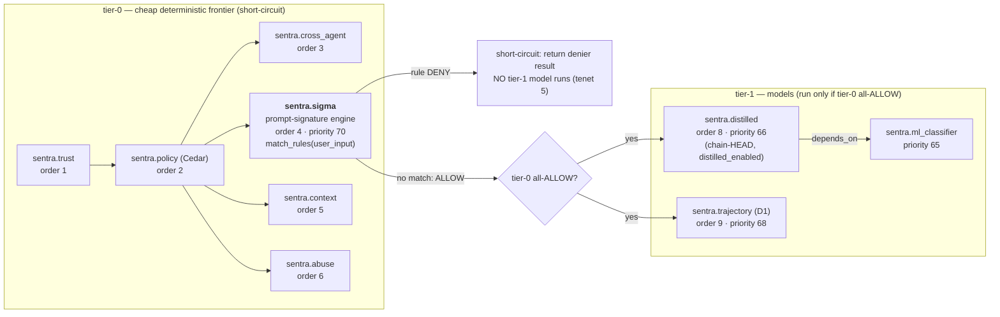
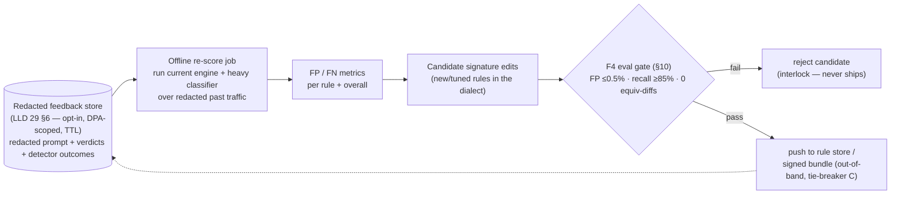

# LLD 35: Prompt-Signature Rules Engine (WS-F)

**Version**: 1.0
**Last Updated**: 2026-07-02
**Status**: Draft
**Prerequisites**: [LLD 31 — DAG scheduler](31-dag-scheduler.md) (landed), [LLD 30 — multi-phase contract](30-multiphase-contract.md), [LLD 33 — decision trail](33-decision-trail.md), [LLD 29 — redaction / feedback store](29-redaction.md), [LLD 28 — Cedar policy engine](28-cedar-policy-engine.md), [LLD 23 — Sentra Guard SDK](23-sentra-guard-sdk.md), [LLD 20 — defense-in-depth layers](20-defense-in-depth-layers.md), [LLD 17 — validation signal store](17-validation-signal-store.md)

## Table of Contents
1. [Context](#1-context)
2. [Scope, non-goals, and implementation status](#2-scope-non-goals-and-implementation-status)
3. [Architecture overview](#3-architecture-overview)
4. [The dialect (F1 + F2)](#4-the-dialect-f1--f2)
5. [Migration equivalence (F1.4)](#5-migration-equivalence-f14)
6. [Error handling and the honest error-contract](#6-error-handling-and-the-honest-error-contract)
7. [Threat-type vocabulary alignment (F7)](#7-threat-type-vocabulary-alignment-f7)
8. [The Cedar / signature boundary](#8-the-cedar--signature-boundary)
9. [The corpus (F3)](#9-the-corpus-f3)
10. [Eval / CI harness + gate (F4)](#10-eval--ci-harness--gate-f4)
11. [Scaling and hot-path budget](#11-scaling-and-hot-path-budget)
12. [Resiliency and recovery](#12-resiliency-and-recovery)
13. [Networking, database, cost, metering](#13-networking-database-cost-metering)
14. [FR-3.14 corpus continuous-improvement loop (F5, design-only)](#14-fr-314-corpus-continuous-improvement-loop-f5-design-only)
15. [Cross-references](#15-cross-references)
- [Appendix A — Dialect EBNF](#appendix-a--dialect-ebnf)
- [Appendix B — The 11 current rules: migration + threat-type map](#appendix-b--the-11-current-rules-migration--threat-type-map)

---

## 1. Context

**In plain terms.** The controller has a validator today the code calls the "Sigma engine." It is not real Sigma: `SigmaEngine.match_rules(user_input)` lowercases the prompt and does `pattern.lower() in user_input_lower` for every pattern of every rule ([sigma_engine.py:358](../src/security-controller/app/validators/sigma_engine.py#L358)) — a case-insensitive **substring** matcher, no regex, no conditions, no log-field matching. This LLD elaborates the ONE approved HLD option: rename it honestly to "prompt-signature rules," build it into a real regex+condition dialect over prompt text, grow our own red-teamed corpus, and gate rule growth on a CI eval harness that must pass before any rule auto-grows. It also fixes one honest-error-contract lie inside this layer (a rule-load failure returns a fake `200 OK` DENY today) and calls out — but does not fix — the pipeline-wide error-contract sites for a separate workstream.

This doc elaborates the approved recommendation in [hld/serverless-edition.md §6.2(e2)](../hld/serverless-edition.md) (line 433, "Prompt-signature rules — an honest rename and a real dialect"), §6.4 (the differential-conformance requirement, line 564), §8 hand-off row 6 (line 676), and the ADR-034 non-disableable-floor invariant (§6.2(h) line 513). It is **not** a re-opening of that choice — the HLD chose the honest rename + real dialect over importing SigmaHQ or keeping the substring matcher; this LLD pins *how*.

**Where the moat is — and is NOT (framing, so this LLD does not read as "heavy process around a grep").** The signature engine is **deliberately a cheap, commodity, deterministic tier-0 floor** — regex over prompt text is table-stakes (every point competitor does it, some with trained models at scale). It is **not** the detection moat and this LLD does not claim it is. The ceremony here (closed dialect, differential-conformance *spec*, ReDoS/authz hardening, the offline-gated eval harness) exists to make a **commodity floor honest, safe on a non-disableable path, and cheap to grow correctly** — not to make the *signatures* clever. The actual detection differentiation lives elsewhere and is out of WS-F scope: **(a) action-parameter + session-state governance in Cedar** (what the signature layer explicitly does NOT do — §8: `tool_name`/`parameters.*`/`session.*`/sequence are Cedar's surface), and **(b) the offline-gated corpus flywheel** (§10 gate + §14 loop) fed by de-identified/redacted signals. Read this LLD as "make the floor honest and non-vacuous," not "the floor is the edge."

**The recall bet, stated plainly.** Signatures are a **cheap deterministic floor *beneath* the enforcing ML classifier** (§6c: `sentra.ml_classifier` always enforces today, [registry.py:18-24](../src/security-controller/app/services/scheduler/registry.py#L18)) — not a recall competitor to a trained injection classifier. A hand-authored 11-rule regex corpus will lose on recall to a trained model, and WS-F does not pretend otherwise: the signature layer's job is a **fast, explainable, deterministic short-circuit** (tenet 5) for the *known* patterns, with ML carrying the probabilistic recall above it. WS-F's own value is therefore **debt-paydown + safety scaffolding** (honest rename, honest error-contract, ReDoS/authz hardening, the FP gate) for a commodity floor — it does **not** by itself move the competitive needle; that needle is Cedar's action/session governance (§8) and the flywheel (§10/§14), both of which WS-F is the minimum honest scaffolding *for*, not a substitute *for*.

### 1.1 Tenets and tie-breakers (the tie-breaker table)

The HLD's **8 master tenets** + **4 HLD tie-breakers (A–D)** govern every close call here. Where two mechanisms are otherwise equal, the highest applicable tenet wins.

| # | Tenet / tie-breaker | How this LLD honors it |
|---|---|---|
| M1 | Enforcement is local; control plane never on the action path | The eval gate (§10) and corpus tooling (§9) are offline / CI-only; they never gate the runtime `match_rules` decision. The rule refresh is out-of-band (§4.6, tie-breaker C). |
| M2 | Fail secure, never fail open | `re.escape` on every migrated literal (§4.2) prevents a metacharacter silently un-matching (fail-open); an uncompilable / ReDoS / undefined-selection rule is skipped or fails load (§6.4). **But** an *inability-to-evaluate* (rule-load failure) is an ABSTAIN + honest 5XX at the whole-pipeline level, **not** a fabricated 200-DENY (§6) — fail-secure enforcement on a total failure moves to the PEP's `fail_secure` on the honest 5XX. |
| M3 | Deny-by-default, explainable | A signature DENY names `Source.SENTRA_SIGMA` + the matched rule title; the reason cites the indicator (`threat_type`), never quotes the prompt verbatim (§6e). |
| M4 | Defense in depth | Signatures are ONE deterministic tier-0 layer over prompt text; the action-parameter surface stays Cedar's (§8). A blind signature layer ABSTAINs and Cedar/trust/ML still decide (§6c). ADR-034 makes the floor non-removable (§3.3). |
| M5 | Latency scales with risk | Tier-0 cheap deterministic, short-circuit DENY before any model (§3). Load-time compile keeps the hot path inside NFR-1 (§11). |
| M6 | The data boundary is the customer's | F5 (§14) re-scores from redacted / typed-token records only; the recall-delta is acknowledged, not hidden. |
| M7 | Multi-tenant / multi-cloud from foundation | Rules and verdicts are attributable per tenant/agent (tie-breaker D); the dialect is edition- and cloud-neutral (pure `re`). |
| M8 | Honest staging | Ship the deterministic floor + honest rename now; no rule auto-grows until the eval gate exists (§10); the F5 runtime loop is deferred (§14). |
| A | Shape the contract once, additively | The dialect grows the rule YAML schema **additively** (`|re`, `|all`, `condition`); `Source.SENTRA_SIGMA`, the DDB table, and the S3 prefix are unchanged (§4.1, §15). |
| B | Record what ran; force nothing extra | The node's ran / DENY / ABSTAIN signal feeds the LLD-33 trail with no extra execution (§6a, §12). |
| C | Refresh out-of-band; decide in-process | Rule refresh is the existing out-of-band version-poll + cache ([sigma_engine.py:159-174](../src/security-controller/app/validators/sigma_engine.py#L159)); `match_rules` decides in-process from the cached compiled rules (§4.6, §11). |
| D | An unattributable verdict is a metering/isolation defect | Every signature verdict is attributable per tenant/agent (§13); WS-F adds no new metering path. |

### 1.2 Explicit non-reopens

- **Rename is doc/contract only, not a symbol rename.** `Source.SENTRA_SIGMA = "sentra.sigma"` ([sources.py:24](../src/security-controller/app/combiners/sources.py#L24)), the module `sigma_engine.py`, class `SigmaEngine`, the DDB table `sentra-sigma-rules-metadata`, the S3 prefix `sigma_rules/llm/`, and the `Source` display strings **all stay** (a symbol rename ripples into `winning_source` in [deny_overrides.py](../src/security-controller/app/combiners/deny_overrides.py), the audit join, the per-`RuleId` CloudWatch series, and CDK). The prose rename ("Sigma" → "prompt-signature rules" in HLD/PRD/ARCHITECTURE/LLD-18/20) is **one `propagate-change` pass, called out (§15), not executed here.**
- **No SigmaHQ / online-HTTP rule import, no new pip dependency.** The engine and the SDK bundle interpreter stay stdlib-`re`-only (LLD 23 stdlib-only floor). Published Sigma rules are log-field matchers and are useless on free prompt text (HLD line 447).
- **The Cedar / signature boundary is fixed** (§8): signatures cover the prompt-text surface; Cedar covers the action-parameter surface. This LLD relocates the 4 param-matching rules out of the signature engine (§8), it does not re-litigate which engine owns which surface.

---

## 2. Scope, non-goals, and implementation status

**In plain terms.** FR-3.1 (the substring engine) is DONE and is not rebuilt — WS-F upgrades the dialect *inside* the working engine, adds a corpus and a CI gate, and designs (does not build) the FR-3.14 loop. The migration must change zero verdicts; threat-type re-tagging and the Cedar-boundary relocation happen *after* the equivalence-frozen migration.

### 2.1 Implementation-status table (carried from the sub-PRD gap analysis)

| Item | Status | Evidence (`file:line`) | WS-F action |
|---|---|---|---|
| FR-3.1 — substring prompt-signature engine | **DONE** | [sigma_engine.py:58,340,358](../src/security-controller/app/validators/sigma_engine.py#L58); loaded hybrid DDB+S3 [:139](../src/security-controller/app/validators/sigma_engine.py#L139); node wired [registry.py:305-311](../src/security-controller/app/services/scheduler/registry.py#L305) | Do NOT rebuild; upgrade dialect on top (F1/F2). |
| FR-3.14 — real dialect + corpus + eval loop | **NOT-DONE** | no regex/condition parsing (`_parse_sigma_rule` reads only `|contains`, skips `condition` [sigma_engine.py:294-302](../src/security-controller/app/validators/sigma_engine.py#L294)) | Build F1–F4; design-only F5. Corpus provenance + build: see §9.3/§9.4/§10.5. |
| Attack + benign corpus (F3) | **NOT-DONE (build)** | today ~22 benign seeds in rules' `falsepositives:`; VERIFIED license-permissive public seeds exist to start from (§9.3) | Curate from VERIFIED public seeds (§9.3) + hand-author into the closed dialect (offline, stdlib-only) + offline agent-assisted generation (§9.4); grow `benign.jsonl` to ≥200 (§10.5). |
| Threat-type enum alignment | **DEBT (F7 fixes)** | `_extract_threat_type` uppercases the raw `llm.<x>` tag [sigma_engine.py:315-321](../src/security-controller/app/validators/sigma_engine.py#L315); off-enum tags in corpus (`llm.dos`, `llm.financial_fraud`, …) | Remap AFTER migration (§7). |
| Param-selection rules inside signatures | **DEBT (§8 relocates)** | corpus rules with `parameters.*` / `session.*` selections (Appendix B) | Relocate to Cedar surface; flag gaps (§8). |
| Rule-load failure → fake 200-DENY | **DEBT (F6 fixes in-layer)** | `match_rules` returns `RULE_ENGINE_ERROR` DENY [sigma_engine.py:384-403](../src/security-controller/app/validators/sigma_engine.py#L384) | Fix to ABSTAIN + alarm (§6a). |
| Pipeline exception → fake 200-DENY (error-contract items 1+2) | **DEBT (WS-F now OWNS)** | `_create_error_response` 200-body DENY [validation_service.py:981-999](../src/security-controller/app/services/validation_service.py#L981) (call sites :487/:494); no `main.py` exception handler (verified — none) | Fix to honest 5XX + customer-safe body + correlation id (§6b, §6f); items 3–5 stay called-out for a separate owner. |

### 2.2 Non-goals (explicitly out of scope)

- **Symbol / infra rename** — see §1.2. Contract-name rename only.
- **SigmaHQ / third-party rule import; any new pip dependency** — §1.2.
- **Tool-parameter / action-sequence rules** — Cedar's surface (§8); a signature there drifts into a weaker duplicate authorization engine.
- **The P1 public red-team game** (Lakera-Gandalf / HackAPrompt lever) — a separate P1 brief (HLD line 449), corpus source only. **This includes BOTH the crowdsourced attack-submission game AND the user-proposed-rule ("what regex catches this?") mechanic** — both live in the separate P1 game brief, not WS-F. Note the **HackAPrompt MIT dataset already exists** (§9.3), so the game is **not** needed to unblock the corpus.
- **The F5 runtime loop** — design-only here (§14); the runtime job is a later WS dependent on the feedback store being runtime-consumable.
- **The pipeline-wide error-contract fix (items 3–5 only)** — WS-F fixes its own layer's fake-DENY (§6a) **AND now OWNS items 1+2** (the `_create_error_response` 200-DENY at `validation_service.py:981-999` and the missing `main.py` FastAPI exception handler) because it already touches that error path via the sigma ABSTAIN fix — see §6/§6f. Error-contract items **3–5** (quota→429, Cedar `POLICY_ERROR`→200-DENY, the `run.py` docstring divergence) stay **called out with `file:line` (§6f) for a separate owner**, not fixed here.

### 2.3 Ownership & dependencies (at a glance)

**In plain terms.** A navigation aid, not new design — it names who owns what and which pieces WS-F waits on. Every row points into an existing section.

**(1) WS-F OWNS / BUILDS:**

| Deliverable | § |
|---|---|
| Real dialect (matchers + condition AST) inside `match_rules` | §4 |
| Migration + 0-diff equivalence | §5 |
| Sigma-layer error-contract fix (ABSTAIN + propagate) **AND error-contract items 1+2** (honest 5XX at `_create_error_response` + `main.py` handler) | §6, §6f |
| Threat-type remap + corpus-lint (single-tag, `UNKNOWN_THREAT==0`, reorder-stable) | §7, §9.2 |
| The 4 param-rule relocations (gap list handed to WS-I) | §8 |
| Corpus (curate + hand-author + offline agent build) + CI eval gate (F4) | §9, §9.3, §9.4, §10 |
| F5 continuous-improvement loop — **design-only** | §14 |
| CI assertion that fails the build if any sigma-mutating route lacks a platform-operator gate (`require_platform` OR a platform-scoped `require_role`) | §3.3 |

**(2) WS-F EXPECTS FROM OTHERS:**

| Dependency | Owning WS | Implemented today? | § |
|---|---|---|---|
| SDK bundle interpreter (stdlib-only, byte-identical dialect) | **WS-A** | **NO** (no `bundle.py`/signature-eval module — verified) | §4.5 |
| Differential-conformance test (interpreter ↔ server; corpus co-owned w/ WS-I) | **WS-A** (co-owned WS-I) | **NO** (spike-gated, not started) | §4.5, §7 |
| Sigma-retire / version-epoch PLATFORM authz gate (`require_role` on `routes.py`) | **WS-M** (M-M3) | **NO** — **merge-blocking predecessor of WS-F** | §3.3 |
| Cedar coverage of the 4 relocated param rules | **WS-I** | **unproven** (gap list, coverage TBD) | §8 |
| DAG node contract (`sentra.sigma` tier-0 node, `depends_on`, `order_key`) | **WS-C** | **YES** (built + deployed) | §3 |
| ML classifier as enforcing prompt-text backstop | **WS-C** | **YES** (enforcing; shadow removed) | §6c |

**(3) NEEDS BUT UNOWNED:**

| Gap | Status |
|---|---|
| Error-contract items **3–5** (quota→429; Cedar `POLICY_ERROR`→200-DENY; `run.py` docstring divergence) | **No owner** — WS-F scopes them OUT (items 1+2 folded IN, table (1)); §6f. |

---

## 3. Architecture overview

**In plain terms.** The prompt-signature engine is one node in the WS-C DAG: `Source.SENTRA_SIGMA`, cost-tier `DETERMINISTIC` (tier-0), `depends_on=(Source.SENTRA_POLICY,)`, `order_key=4`, run callable `_run_sigma` which calls `service.sigma_engine.match_rules(req.user_input)` ([registry.py:123-124,305-311](../src/security-controller/app/services/scheduler/registry.py#L123)). In `fail_fast` mode the scheduler short-circuits on the first tier-0 DENY — so a signature DENY blocks *before* any model runs ([run.py:473-477](../src/security-controller/app/services/scheduler/run.py#L473)). WS-F changes the *rule dialect inside* `match_rules`; it does not touch the node's position, its `depends_on`, its `order_key`, or its `Signal`/`Source.SENTRA_SIGMA` contract.

### 3.1 The node in the DAG



The tie-break order `order_key=4` is pinned to the legacy STEP-3 index in `_ORDER` ([registry.py:65-81](../src/security-controller/app/services/scheduler/registry.py#L65)) so a two-simultaneous-DENY short-circuit returns the same denier the pre-DAG sequential chain returned (LLD 31 §6.2). `sentra.sigma` carries default priority **70** in the deny-overrides ranking ([sources.py:74](../src/security-controller/app/combiners/sources.py#L74)) — and WS-L (LLD 32) has since populated the tier-1 field between sigma (70) and ML (65): the distilled front-runner `sentra.distilled` (priority **66**, [sources.py:101](../src/security-controller/app/combiners/sources.py#L101)) and the D1 `sentra.trajectory` signal (priority **68**, [sources.py:100](../src/security-controller/app/combiners/sources.py#L100)) now also sit above ML. **sigma still tops them all** — it is the highest priority of any request-phase node, so it stays the headline `winning_source` / deny-overrides tie-break winner when it and any model fire together ([sources.py:74,100-101](../src/security-controller/app/combiners/sources.py#L74)). WS-F changes none of these priorities.

**Tier-1 chain (WS-L / LLD 32, post-dating LLD 31).** When `distilled_enabled` (default), `sentra.distilled` is the tier-1 **chain HEAD** (`order_key=8`) and `sentra.ml_classifier` chains **behind** it — `ml_depends_on=(Source.SENTRA_DISTILLED,)` ([registry.py:395-452](../src/security-controller/app/services/scheduler/registry.py#L395)) — so a confident distilled DENY short-circuits Haiku while an inconfident distilled result falls through to ML. `sentra.trajectory` (D1, `order_key=9`) is an independent tier-1 node. Two more D-nodes exist but are **other-phase** and are NOT on this request-phase graph: `sentra.indirect_injection` (D2, priority 62 — `content` phase) and `sentra.memory` (D3, priority 58 — `memory` phase) ([registry.py:507,533](../src/security-controller/app/services/scheduler/registry.py#L507); [sources.py:103-104](../src/security-controller/app/combiners/sources.py#L103)).

**Reconciliation — WS-L grew the DAG AROUND sigma, changing nothing about it.** Sigma remains a request-phase **tier-0** node (`depends_on=(Source.SENTRA_POLICY,)`, `order_key=4`, priority 70), and a sigma DENY still short-circuits **before ANY tier-1 model** (distilled included) runs ([run.py:473-477](../src/security-controller/app/services/scheduler/run.py#L473)); the new D-nodes are tier-1 / other-phase and change nothing about sigma's role or position.

### 3.2 Short-circuit DENY semantics

On a rule match, `match_rules` returns a `ValidationResult(decision="DENY", should_deny=True, …)` stamped `@stamps(Source.SENTRA_SIGMA)` ([sigma_engine.py:339,367-376](../src/security-controller/app/validators/sigma_engine.py#L339)). Because the node is tier-0, `run_dag`'s tier-0 loop returns that result immediately in `fail_fast` ([run.py:473-477](../src/security-controller/app/services/scheduler/run.py#L473)) — no ML/deep-tier node runs. In `evaluate_all`, a *later* tier-0 DENY is captured verdict-neutral/advisory so it never flips `winning_source` ([run.py:471-481](../src/security-controller/app/services/scheduler/run.py#L471)); the deciding source stays the topo-first denier in both modes. **`DenyOverrides.combine()` is byte-for-byte unchanged (ADR-031)** — the scheduler returns the denier's own result; `combine()` recomputes `winning_source` downstream.

### 3.3 The non-disableable-floor invariant (ADR-034)

The Cedar + prompt-signature deterministic floor is **non-disableable in every mode and every edition** (HLD line 513, [adr.md ADR-034](../adr.md)). Nothing WS-F adds may introduce a runtime path that turns the signature check off:

- There is **no** per-tenant "signatures off" switch, and none is added. The detection-strength dial is explicitly not built (ADR-034).
- The eval gate (§10) and corpus tooling (§9) are **offline / CI**; they gate what *ships into the rule store*, never the runtime `match_rules` call.
- **Kill-switch nuance = location-only.** A rule can be *retired from the store* (the console "disabled" verb maps its metadata row from `status='stable'` to `status='deprecated'` via `PATCH /sigma-rules/{rule_id}` [routes.py:1434-1435](../src/security-controller/app/api/routes.py#L1434) → `SigmaRulesService.update_rule_status(rule_id, ddb_status)` with `_enabled_to_ddb_status` (`enabled→stable` / `disabled→deprecated`), so `load_rules_metadata_from_dynamodb` [sigma_engine.py:100-130](../src/security-controller/app/validators/sigma_engine.py#L100), which loads only `status='stable'`, stops loading it). That retires ONE rule's *content*, it does not disable the *engine* — the node still runs on every request and still evaluates every remaining stable rule. "Disable the engine" is the forbidden path; "retire a specific rule via the CRUD store" is a normal content operation and is out-of-band (tie-breaker C). NB the vocabulary split: the API/console verb is `enabled`/`disabled`; the stored DDB status is `stable`/`deprecated` — a "disabled" rule is stored `deprecated`, not literally `disabled`.

  > **THREAT (STRIDE: Elevation-of-Privilege / Tampering-with-authz) — the retire path is UNAUTHENTICATED (blocking; owned + sequenced below).** `PATCH /sigma-rules/{rule_id}` ([routes.py:1434-1435](../src/security-controller/app/api/routes.py#L1434), `update_sigma_rule(rule_id, request)`) takes no `OperatorContext` and has **no `require_role` dependency** (verified — same class as the known [policy-CRUD-no-authz gap]; contrast e.g. the `require_role("admin")`-gated DSAR delete at [routes.py:823](../src/security-controller/app/api/routes.py#L823) `delete_feedback_subject`. Note there is **no** `delete_sigma_rule` endpoint — retire is *only* this PATCH). So any API-key / spoofable-`X-Operator-Email` holder can move a `stable` prompt-injection rule to `deprecated` and **silently strip detection** — a per-rule content kill-switch with **no authz gate is functionally the disable-path ADR-034 forbids, reached through the CRUD door.** The "retire a rule is normal / disable the engine is forbidden" distinction **collapses** until this write path is RBAC-gated.
  >
  > **Global blast radius (STRIDE: Elevation, cross-tenant).** The retire path takes only `rule_id` and mutates the **fleet-global** rule store (`sentra-sigma-rules-metadata` + `sigma_rules/llm/` are NOT tenant-partitioned — §13, unlike per-tenant Cedar policy). So one retire disables that rule for **every tenant**. The authz gate must therefore be a **platform-operator** role, never a tenant-scoped operator — a tenant-scoped role wired to a fleet-global mutation is a multi-tenant coverage/availability event, and the §8 coverage-gap-incident triage applies to any global retire.
  >
  > **Ownership + sequencing (so this is not an orphan).** The fix is a **merge-blocking predecessor of WS-F**, not a floating "should." The write path lives in the shared `routes.py`, and **WS-M (auth & authz — [ws-m-authz.md](../tasks/serverless-edition/ws-m-authz.md) M-M3) is the workstream that owns extending server-side `require_role` to the non-tenancy mutating routes in `routes.py`** (agent/policy/credential CRUD + this sigma retire path) — *re-homed from WS-G on 2026-07-03 so authz has one owner; WS-G keeps only the client render-gate*. This sigma-rules retire PATCH is the **same CRUD-authz class** as the tracked policy-CRUD-no-authz gap (BUG-1), so it is folded into WS-M's `routes.py` require_role sweep and fixed once for the whole mutating-CRUD surface — **but with a distinct scope: platform-operator, not tenant** (the sigma store is fleet-global; see below). (WS-I owns the *Cedar* engine, not this authz gate — §8's Cedar coverage-gap list still goes to WS-I.) **The WS-F merge gate cross-reference is carried in WS-M's task doc** (M-M3) and cross-noted in WS-G (so the merge-blocking dependency is discoverable from the owner side, not only asserted here). **Acceptance checklist (WS-F merge gate):** (1) `update_sigma_rule` and any future `|re`-content-write path (and the version-epoch write it triggers, §4.6 / mitigation below) are behind `Depends(require_role(...))` at a **platform-operator** scope; (2) a **failing-then-passing** authz test asserts an un-roled / tenant-scoped caller gets **403** on the retire path; (3) confirm whether spoofable `X-Operator-Email` is the only auth today and whether the same gap lets a caller retire *another* tenant's coverage (it does — the store is global, above); (4) a **CI assertion WS-F owns** (in WS-F's own gate, so the guard survives even if the WS-G fix regresses) that **fails the build if any sigma-mutating route** (`PATCH /sigma-rules/*`, the version-epoch write) **lacks a platform-operator gate dependency** — the grep must accept **`Depends(require_platform)`** (the symbol WS-M actually lands, [lld/39 §3.5](39-authz-rbac-edge-authorizer.md)) as well as a platform-scoped `require_role`; matching only `require_role` would false-fail the build once WS-M lands `require_platform`. This converts "merge-blocking predecessor owned by another WS" from a scheduling promise into a mechanically-enforced invariant WS-F cannot regress past. WS-F does not merge with this open.

---

## 4. The dialect (F1 + F2)

**In plain terms.** We replace the substring matcher with a real dialect: each rule is a set of named *selections*, each selection is a list of *matchers* (`|contains` = escaped literal, `|re` = author regex, `|all` = all-values-must-hit), and a *condition* string (`1 of them`, `all of them`, `and`/`or`/`not` over selection names) combines the selections into one boolean. Every regex is compiled ONCE at load time; `match_rules` only runs `.search()` over already-compiled patterns. The condition is parsed to a tiny boolean AST — never `eval()`. The exact grammar is a **closed** subset because the stdlib-only SDK bundle interpreter (LLD 23, **built by WS-A** — not WS-F; see §2.3) must implement the byte-identical dialect this LLD locks (differential conformance).

### 4.1 Data model

The rule model grows **additively** (tie-breaker A). Current `SigmaRule` ([sigma_engine.py:38-55](../src/security-controller/app/validators/sigma_engine.py#L38)) carries a flat `patterns: List[str]`; the new shape carries compiled selections + a parsed condition, keeping raw strings for logging/console.

```python
# app/validators/sigma_engine.py — new shape (pseudo-code, real names)

class CompiledMatcher:
    # ONE compiled matcher for ONE selection value. Compiled at LOAD, not match.
    raw: str                 # the author's string, kept for logging/console/trail
    pattern: re.Pattern      # re.compile(...) — IGNORECASE, matched via .search()
    modifier: str            # "contains" | "re" | "all"  (the closed modifier set)

class Selection:
    name: str                        # e.g. "instruction_override"
    matchers: List[CompiledMatcher]
    require_all: bool                # True for a |all selection; else "any matcher hits"

class Condition:
    # Parsed boolean AST over selection NAMES — never an eval() of the string.
    # Nodes: Ref(name) | And(l,r) | Or(l,r) | Not(x) | OneOfThem | AllOfThem
    ast: ConditionNode

class SigmaRule:
    id: str
    title: str
    selections: Dict[str, Selection]   # by name
    condition: Condition               # F1 default when absent = OneOfThem ("1 of them")
    severity: str
    threat_type: str                   # the 8-value enum after F7 (§7)
    action: str                        # "DENY"
```

`match_rules` evaluates, per rule: each selection to a bool (`any(m.pattern.search(text))`, or `all(...)` for `require_all`), then the condition AST over those selection bools. A `True` condition → DENY with the **exact same `ValidationResult` fields** the substring engine returned (decision / reason / `violation_type` / `threat_type` / `matched_rule` / `severity` / `penalty` / `should_deny`) and the same `await self._emit_match(rule.id)` per-`RuleId` CloudWatch emit ([sigma_engine.py:366-376](../src/security-controller/app/validators/sigma_engine.py#L366)). The `@stamps(Source.SENTRA_SIGMA)` decorator ([:339](../src/security-controller/app/validators/sigma_engine.py#L339)) is unchanged.

### 4.2 The closed modifier set

| Modifier | Semantics | Compilation (at LOAD) | Match |
|---|---|---|---|
| `<field>\|contains` | case-insensitive substring (the migrated F1 default) | `re.compile(re.escape(v), re.IGNORECASE)` per value | `.search()` |
| `<field>\|re` | author-supplied regex | `re.compile(v, re.IGNORECASE)` per value, **validated as untrusted input (§6d)** | `.search()` |
| `<field>\|all` | selection is true only if **all** its values hit (multi-token attacks) | each value compiled as `|contains` | selection = `all(.search())` |

**`re.escape` on EVERY `|contains` value is mandatory (M2 fail-secure).** Several live patterns carry regex metacharacters that must stay literal — `[SYSTEM]`, `<|im_end|>`, `'; DROP TABLE`, `\x`, `\u`, `---END SYSTEM---`, `OR 1=1--` (all real, from [prompt_injection_basic.yaml](../sample-artifacts/sigma_rules/llm/prompt_injection_basic.yaml)). Without `re.escape`, `[SYSTEM]` becomes a character class (matches the letters S,Y,E,M,T), `\x` is an invalid escape (uncompilable → the rule silently stops matching = **fail-open**). §5 proves the escape over exactly these patterns.

The `<field>` prefix (`prompt`, `user_input`) is **documentary** — the engine matches against the single `req.user_input` string (`_run_sigma` [registry.py:124](../src/security-controller/app/services/scheduler/registry.py#L124)). It is retained in the YAML for author readability and for the eventual multi-phase extension, but a signature never reads `parameters.*`/`session.*` fields (§8 — those are Cedar's). A selection whose only field is `parameters.*`/`session.*` contributes **zero matchers** (§8, Appendix B) — this is exactly why those rules never match today.

**A signature fires only on the request phase today — never on `content`/`output`/`memory`.** The prompt-signature node reads `req.user_input` (the request-phase prompt) and nothing else; it does **not** read the `content_text` that the multi-phase contract (LLD 30) routes for the `content`/`output`/`memory` phases. So the documentary `content|contains …` example in [Appendix A](#appendix-a--dialect-ebnf) is **illustrative of the eventual extension, not a live matcher** — no signature evaluates on a non-request phase in this workstream. Wiring signatures onto `content_text` is a later, LLD-30-dependent extension (the per-phase detection handlers are WS-L's, not WS-F's).

### 4.3 The condition grammar → tiny boolean AST (no `eval()`)

The condition is a **small, closed** grammar over selection names, parsed to a boolean AST and evaluated over the per-selection bools. The closed operator set is `1 of them`, `all of them`, `<sel> and <sel>`, `<sel> or <sel>`, `not <sel>` (parenthesizable). Full EBNF: **[Appendix A](#appendix-a--dialect-ebnf)**.

- **No `eval()`** — `eval` on rule-authored text is arbitrary code execution. The parser tokenizes then builds `And/Or/Not/Ref/OneOfThem/AllOfThem` nodes; evaluation is a pure fold over the selection-bool map.
- **Undefined-selection reference fails the rule LOAD** (§6d) — never silently false. A `condition: foo and bar` where `bar` is not a defined selection is a typo that "passes" = a disabled rule nobody notices = fail-open.
- Parse happens **at load** (inside `load_rules_from_s3`, on cold-load / cache-miss); the AST is stored on the rule; `match_rules` only walks it. Never parse in the hot path.

### 4.4 Load-time compile rule

**All compilation happens in the load path, never in `match_rules`.** `load_rules_from_s3` ([sigma_engine.py:139-232](../src/security-controller/app/validators/sigma_engine.py#L139)) already runs only on cold-load / cache-miss (the process-wide singleton [:416-423](../src/security-controller/app/validators/sigma_engine.py#L416) + version-poll cache [:159-174](../src/security-controller/app/validators/sigma_engine.py#L159) make it rare). `_parse_sigma_rule` ([:280](../src/security-controller/app/validators/sigma_engine.py#L280)) is extended to (a) compile every matcher, (b) parse the condition AST, (c) validate every `|re` (§6d), (d) reject undefined-selection references. A per-request `re.compile` would blow the ≤500 ms deterministic-floor budget (NFR-1) — see §11.

**"Load-time" in plain terms** = when rules are read into memory from the store (cold-load / cache-miss / version-poll refresh — [sigma_engine.py:139-232](../src/security-controller/app/validators/sigma_engine.py#L139)) — **NOT** per request, and **NOT** at pip-install / build time. For the SDK / edge (WS-A), "load-time" = when the signed bundle is **fetched / refreshed by the background poll**; the SDK ships **stdlib-only with NO rules baked in** — rules arrive at runtime out-of-band (§4.6, tie-breaker C).

### 4.5 The differential-conformance contract (dialect LOCKED; conformance NOT yet verifiable — see status note)

**WS-F does NOT build the second (SDK) evaluator — that is WS-A's (see §2.3).** WS-F delivers only the **LOCKED dialect spec** WS-A's stdlib-only interpreter must implement byte-identically. The **differential-conformance test** itself is **owned by WS-A** (co-owned with WS-I for the interpreter↔`cedarpy` corpus) and **cannot exist until WS-A's interpreter exists** (spike-gated, not started); WS-F provides only the **INPUT** — the locked spec + the §6d reject set. HLD §6.4 lists prompt-signature as one of **four** future differential subsets — today the prompt-signature arm is a **target spec, not running code**.

> **STATUS — the second evaluator does NOT exist yet (verified).** There is **no** prompt-signature bundle interpreter in the SDK today: [demo-agents/sdk/aegion-guard-python/src/aegion_guard/](../demo-agents/sdk/aegion-guard-python/) has `guard.py`, `client.py`, `redaction.py`, `identity.py`, … but **no `bundle.py` / signature-eval module**. HLD §6.4's concrete differential-test build requirement (line 564) is written against **`cedarpy`** and only *lists* "prompt-signature" as one of the four subsets a future interpreter will cover. So **byte-identity cannot be verified today — there is no second evaluator to differ from.** This section therefore does two things and is careful not to conflate them:
> 1. **What is LOCKED now:** the *dialect itself* — the closed matcher/condition grammar below. Closing the grammar **now** is exactly what lets a future interpreter be built to a fixed spec instead of chasing a drifting one; that is real, standalone value delivered by WS-F. **Concrete drift example (why locking now matters):** suppose the edge interpreter ships compiling `|re` with `.search()` + `IGNORECASE`, and the dialect later drifted to `.fullmatch()` or case-sensitive `|re`. Every already-vendored SDK (Lambda / Azure zips — **NOT hot-updatable**, LLD 23 §2) would then silently **ALLOW** inputs the server **DENYs** — a fleet-wide **fail-open with no error** — until every agent is re-vendored and the differential corpus re-run. Locking the grammar now makes any such change a **deliberate, synchronized change to both sides** (Appendix A), not a silent per-deployment fail-open.
> 2. **What is NOT yet a guarantee:** the "byte-identical local-vs-server verdict" *conformance property*. It is a **target spec for a not-yet-built interpreter**, with **no conformance guarantee until that interpreter ships with a running differential test** over this dialect. WS-F does **not** claim byte-identity is currently verified.
>
> **Owning WS + hard dependency.** The signature bundle interpreter is a **sequenced sibling workstream — WS-A** (FR-1.7 local floor: signed policy bundle + stdlib in-process interpreter, [ws-a-local-floor-bundle.md](../tasks/serverless-edition/ws-a-local-floor-bundle.md); it also co-owns the `cedarpy` differential corpus with WS-I, HLD §6.4). **WS-A is `spike-gated` and not-started** ([00-index.md:27](../tasks/serverless-edition/00-index.md)) — and its differential-conformance test (the thing that would prove byte-identity) is itself behind that gate, consistent with the "unproven conformance until that WS ships" language below. This dialect (§4.5, Appendix A) is WS-A's input spec. The contract may be called "conformance-verified" **only** when that WS ships a differential-conformance test that runs this dialect's shared corpus through the real SDK interpreter and the server engine and asserts identical ALLOW/DENY (and the §4.5 reject-set, see the threat note below) — not before. Until then, treat §4.5 as *"locked spec, unproven conformance."*

The dialect is **closed** because the stdlib-only SDK bundle interpreter (LLD 23), **once built**, must implement the **byte-identical subset** so a locally-evaluated signature verdict equals the server's (HLD §6.4 line 564: "the bundle interpreter must give the same ALLOW/DENY as the authoritative engine; any divergence is a silent fail-open or false-block"). The spec, shared with the FR-1.7 signed-bundle WS:

- **Matchers:** exactly `{contains, re, all}`; `contains`/`all` → `re.escape` + `IGNORECASE` + `.search()`; `re` → `re.compile(IGNORECASE) + .search()`.
- **Condition operators:** exactly `{1 of them, all of them, and, or, not}` over selection names, left-to-right with `not` binding tightest, then `and`, then `or`; parentheses allowed (Appendix A).
- **Case-folding:** the whole match runs against `user_input.lower()` and `IGNORECASE` — one fold, on the whole prompt, once ([sigma_engine.py:353](../src/security-controller/app/validators/sigma_engine.py#L353)).
- **Any construct outside this closed set** must be rejected by the bundle-emit step (never compiled into a bundle) and, if somehow encountered by the interpreter, **escalates to the hosted PDP** (fail-closed), never locally ALLOWs (HLD §6.4 line 564 subset-boundary rule). The signature subset is one of the four the bundle interpreter covers (literal allow/deny + param-bounds + sequence + **prompt-signature**).
- **The VALIDATION/REJECT set is part of the conformance subset, not just the MATCH semantics** (threat-model). The §6d load-time rejects — ReDoS structural heuristic, 512-char length cap, undefined-selection fail-load, `|re` `re.compile`-failure skip — are **server load-path** behavior; a rule the server would **skip** must **never be emitted into an edge bundle** (or the edge would compile-and-hang the very ReDoS the server heuristic caught, or evaluate a rule the server dropped → the exact silent divergence this section exists to prevent). The bundle-emit step therefore applies the identical reject set before emit, and the edge interpreter's disposition of any out-of-subset / uncompilable construct is the same **fail-closed escalate-to-PDP** stated above for match constructs. The differential-conformance test (when the interpreter WS ships) MUST assert the **reject set matches on both sides**, not only the ALLOW/DENY on well-formed rules.

### 4.6 Refresh out-of-band (tie-breaker C)

Rule refresh is the **existing** out-of-band mechanism, unchanged by WS-F: a shared version row (`__sigma_version__`) in the metadata table is polled (throttled, default 10 s) and the cache reloads when the version moves ([sigma_engine.py:27-30,159-174,254-278](../src/security-controller/app/validators/sigma_engine.py#L27)). A CRUD write invalidates the live cache write-through (`get_sigma_engine().invalidate()` [:271-278](../src/security-controller/app/validators/sigma_engine.py#L271)); other tasks converge via the version row. `match_rules` decides in-process from the cached compiled rules — no store read on the hot path.

---

## 5. Migration equivalence (F1.4)

**In plain terms.** Before deleting the substring path, we snapshot the OLD engine's verdicts on every current rule pattern + a benign control set, freeze that as the oracle, and prove the NEW regex engine returns byte-identical verdicts (0 diffs). The migration is bug-for-bug: it changes NO verdicts — including today's mis-tagged threat_types and the param-selection rules that never match. Threat-type remap (§7) and the Cedar-boundary relocation (§8) happen AFTER this equivalence is frozen, as separate steps.

### 5.1 The frozen oracle

`test_prompt_signature_migration.py` runs the CURRENT substring `match_rules` over the corpus and freezes the `(decision, threat_type, matched_rule)` tuple per input, THEN diffs the new regex engine against that snapshot. A migration whose only test is "the new engine DENYs X" cannot prove it didn't *start* DENYing something benign — the oracle is the old behavior, captured first.

### 5.2 Equivalence corpus

- **(a) Every literal pattern as input** — for each `|contains` value in each of the 11 rules, the exact value as `user_input` must produce the same verdict old-vs-new.
- **(b) A benign control set** — realistic benign prompts (incl. the `falsepositives:` cases each rule lists) must stay ALLOW old-vs-new.
- **(c) Metacharacter-bearing patterns** — the `re.escape` proof (§5.3).

### 5.3 The `re.escape` proof

A dedicated test feeds the metacharacter-bearing live patterns as input and asserts the new engine still DENYs them (proving the literal survived escaping): `[SYSTEM]`, `<|im_end|>`, `'; DROP TABLE`, `\x`, `\u`, `---END SYSTEM---`, `OR 1=1--`, `[/SYSTEM]`. Under naive `re.compile(value)` (no escape) `[SYSTEM]` and `\x` would change or break matching — this test is the guard against re-introducing a fail-open during the "refactor."

### 5.4 Freeze bug-for-bug

The migration preserves EVERY current verdict, including the two known bugs:

- **Mis-tagged threat_types stay mis-tagged** through migration (`llm.dos` → `DOS`, `llm.financial_fraud` → `FINANCIAL_FRAUD`, etc., via `_extract_threat_type` [sigma_engine.py:315-321](../src/security-controller/app/validators/sigma_engine.py#L315)). They are remapped in **F7 (§7), a separate later step**, not during migration — a migration that "fixes" threat_types is a verdict/label change masquerading as a refactor.
- **Param-selection rules that never match today stay non-matching.** `suspicious_parameter_manipulation`, `rate_limit_abuse`, `excessive_refund_attempts` have **no `prompt|contains` selection** — under the current `_parse_sigma_rule` (which reads only `|contains` [:300](../src/security-controller/app/validators/sigma_engine.py#L300)) they contribute **zero patterns and never DENY**. The new engine must reproduce that (zero matchers → selection never true → rule never fires). Their relocation to Cedar (§8) is a separate step; the migration itself is a no-op on them (Appendix B).

> **Load-bearing subtlety.** Because today's parser drops `condition` and all non-`|contains` selections, the *effective* current behavior of a mixed rule (e.g. `data_exfiltration`, which has `exfiltration_patterns: prompt|contains` AND `large_query_limit: parameters.limit|gte`) is "DENY iff any `prompt|contains` value hits" — the `parameters.limit|gte` selection is silently dead. The migration must reproduce **the effective behavior (the `prompt|contains` half only)**, not the YAML's *written* intent. F2's real `condition` evaluation is introduced only for the rules whose written condition is already `1 of them` over live `|contains` selections (equivalent to the old any-hit), so equivalence holds; a rule whose written condition would *change* behavior once conditions are honored is flagged and handled post-migration, never silently activated. (See Appendix B for the per-rule classification.)

### 5.5 What equivalence does NOT cover — the new dialect capabilities need their OWN tests

**Equivalence-by-construction only tests the half that did not change.** The frozen oracle (§5.1) is built from the CURRENT parser, which reads only `|contains` and drops `condition` entirely ([sigma_engine.py:294-302](../src/security-controller/app/validators/sigma_engine.py#L294)). So the §5 equivalence corpus can only exercise **substring→`|contains` port** behavior (the old any-hit semantics). It **cannot** exercise `condition` semantics, `|re`, or `|all` — none of those exist in the frozen oracle's behavior to diff against. The "0 diffs" gate (§10.3) is therefore a **strong guarantee about the boring half (the port) and NO guarantee about the new half (the added capability).** Stated plainly so nobody reads "0 equivalence diffs" as "the new dialect is verified."

The new-dialect capabilities are covered by a **separate** test file with its own bar, **not** the equivalence oracle:

- **Test file:** `test_prompt_signature_dialect.py` (distinct from `test_prompt_signature_migration.py`, which owns only the §5 equivalence port).
- **Coverage bar:** positive + negative unit tests for each new construct — `|re` (matches / does-not-match / rejected-at-load per §6d), `|all` (all-values-hit vs partial), and non-trivial `condition` ASTs (`and`/`or`/`not`, parenthesization, undefined-selection fail-load per §6d).
- **Interlock:** **no rule may USE a new-capability construct (`|re`, `|all`, or a condition that is not the old `1 of them`-equivalent) until its semantics are covered in `test_prompt_signature_dialect.py`.** A construct without a test is a flagged gap, not a silent pass (engineering: a behavior with no test is a flagged gap).

---

## 6. Error handling and the honest error-contract

**In plain terms (SEC + founder directive).** This is the core section. Today, if the signature engine can't load its rules, `match_rules` returns a `200 OK` with a fabricated `RULE_ENGINE_ERROR` DENY ([sigma_engine.py:384-403](../src/security-controller/app/validators/sigma_engine.py#L384)) — a lie: it reports "we detected a threat" when the truth is "we couldn't evaluate." WS-F fixes THIS layer: a rule-load / compile failure is an **inability-to-evaluate → the layer ABSTAINs** (it ran, produced no signal) and fires a HIGH ops alarm; a genuine engine crash **propagates** (stop swallowing it into a DENY) so the pipeline can surface an honest 5XX. When only signatures are blind, Cedar + trust + ML still decide (defense in depth) — we do not over-rotate one blind layer into a whole-request 5XX. And we call out — but do NOT fix — every OTHER `200`-wraps-error site in the pipeline, with `file:line`, for a separate agent.

**Decision — "if a sigma rule can't evaluate (exception), do we still run the other layers / the model, or fail the whole request?"** We **keep deciding on the other layers** (no behavior change; code-verified). Sigma is **tier-0 (deterministic), not tier-1** — it is not "a tier-1 rule." When sigma cannot evaluate its rules it **ABSTAINs** (it *returns* `ValidationResult.abstain(...)`, §6a — it does **not** raise): an abstain emits **no signal** (`capture` skips it — [run.py:411](../src/security-controller/app/services/scheduler/run.py#L411)), so the rest of the tier-0 frontier (Cedar / trust / context / abuse) **and** the tier-1 model chain (distilled → ML) still run and decide — `run_dag`'s tier-0 loop treats a *returned* abstain as **absence** (it only acts on `result.should_deny`) and proceeds ([run.py:456-481](../src/security-controller/app/services/scheduler/run.py#L456)). A whole-request **5XX is reserved for a GENUINE crash / total inability-to-evaluate** — that path is allowed to **RAISE** and bubble to the honest-5XX outer handler (§6b / §6f), not the per-layer ABSTAIN. We keep deciding on the other layers because **the floor-minus-one-layer is still a floor** (M4), and a blanket 5XX on a single blind layer would let a `fail_secure=False` client treat it as "proceed un-validated" and **bypass a valid Cedar DENY** (§6c) — a fail-open. The residual is bounded honestly by §6c: the ML backstop's indirect-injection recall is measured at only **~57–60%** (WS-0), so this is a real-but-bounded coverage degradation, not "ML fully covers it."

### 6a. WS-F's own layer: rule-load failure = ABSTAIN, not a fake-DENY

**Today (the lie to fix):**
```python
# sigma_engine.py:384-403 — CURRENT
except SigmaRulesLoadError as e:
    return ValidationResult(decision="DENY", reason="Threat detection unavailable",
                            violation_type="RULE_ENGINE_ERROR", penalty=-10, should_deny=True)
except Exception as e:
    return ValidationResult(decision="DENY", reason="Threat detection error",
                            violation_type="RULE_ENGINE_ERROR", penalty=-10, should_deny=True)
```
This is a `SYSTEM_ERROR`-class fabricated DENY dressed as a detection. Note the LLD-33 classification precisely: today's fake-DENY is a **stamped** `Source.SENTRA_SIGMA` DENY (the `@stamps(Source.SENTRA_SIGMA)` decorator [sigma_engine.py:339](../src/security-controller/app/validators/sigma_engine.py#L339) applies to the error-branch return too), so it **does** produce a `Signal` and can become `winning_source`. Under [lld/33 §2.2 row (i)](33-decision-trail.md) that makes it a normal **ran-DENIER (ran-voted)** — *not* `ran-error` (LLD 33's `ran-error` bucket is triggered ONLY by an **unstamped** result whose `to_signal()` raises, [lld/33 §7.2](33-decision-trail.md) — this fake-DENY is stamped, so it never reaches that bucket). So the harm is not a trail mis-bucketing; it is that (1) the trail records a genuine **detection DENY (`sentra.sigma` denier)** on a rule-store outage that has nothing to do with the prompt — a stamped lie that reads as "sigma detected a threat"; (2) `winning_source` can name `sentra.sigma` as the deciding source on that infra hiccup; and (3) it blocks legitimate traffic on an infra hiccup. The F6 fix moves sigma from **ran-DENIER (a stamped fake-detection) → ran-ABSTAIN** (§6a below).

**F6 (the fix):**
```python
# sigma_engine.py — FIXED
except SigmaRulesLoadError as e:
    logger.error("prompt-signature rules unavailable — layer ABSTAINS: %s", e, exc_info=True)
    await self._emit_load_failure_alarm()   # HIGH ops alarm (fire-and-forget)
    return ValidationResult.abstain(
        "prompt-signature engine: rules unavailable; layer abstains (inability-to-evaluate)"
    )
```
`ValidationResult.abstain(...)` ([models.py:237-253](../src/security-controller/app/api/models.py#L237)) sets `decision=None`, `should_deny=False`, `metadata={"abstain": True}`. In the pipeline this means:

- `_append_signal` skips it — an abstain emits **no signal** (the `if result.is_abstain` guard at [validation_service.py:106](../src/security-controller/app/services/validation_service.py#L106), inside `_append_signal` defined at [:94](../src/security-controller/app/services/validation_service.py#L94)); it never enters `combine()`.
- The DAG treats a tier-0 node's *returned* abstain as absence — the frontier's other tier-0 deniers (Cedar/trust/context/abuse) still decide; if none deny and all-ALLOW, tier-1 ML runs (§6c). It does NOT short-circuit (abstain ≠ DENY).
- The LLD-33 trail records it as **ran-ABSTAIN** (a layer that ran and declined to vote), recorded **distinctly from not-run and from error** (LLD 33 §2.2 (i)). The trail no longer says "sigma denied" when the truth is "sigma couldn't evaluate."
- A HIGH CloudWatch alarm (`PromptSignatureRulesUnavailable`) fires so ops notices the rule-store outage — a blind detection layer is an operational incident, not a silent state.

This is the WS-F half of the founder's honest-error-contract directive. A rule-store-unreachable-with-a-usable-stale-cache case is **not** an error — `load_rules_from_s3` already serves the stale cache on an S3/transient error ([sigma_engine.py:240-252](../src/security-controller/app/validators/sigma_engine.py#L240)); only a genuine no-cache-available `SigmaRulesLoadError` reaches the ABSTAIN branch.

### 6b. A genuine engine crash inside `match_rules` → propagate

The bare `except Exception → fake-DENY` at [sigma_engine.py:394-403](../src/security-controller/app/validators/sigma_engine.py#L394) also swallows an *unexpected* engine crash (a real bug — e.g. a `TypeError` in the AST evaluator) into a fabricated DENY. F6 removes the blanket swallow: an unexpected crash **propagates** out of `match_rules`. The DAG's tier-0 loop does not catch tier-0 exceptions — they bubble to `validate_tool_call`'s outer handler (run.py docstring §18-20; [run.py:18-26](../src/security-controller/app/services/scheduler/run.py#L18)) which today is `_create_error_response` (defined [validation_service.py:981](../src/security-controller/app/services/validation_service.py#L981); the `200`-body `{decision:DENY, violation_type:SYSTEM_ERROR}` return at :991-999; call sites :487/:494).

**Be precise about the two-step fix — and note WS-F now owns BOTH steps.** `_create_error_response` is itself a **200-body DENY lie** — the site §6f(1) flags. Historically that made F6's crash-path honesty *contingent on a separate WS*; **that is no longer true — WS-F now OWNS §6f items 1+2** (founder-approved), because it is already inside this exact error path for the sigma ABSTAIN fix. So WS-F delivers both halves: (i) `match_rules` stops fabricating a **per-layer `sentra.sigma` detection DENY** (`winning_source` no longer falsely names `sentra.sigma` on a non-prompt engine failure), **and** (ii) the propagated crash / total inability-to-evaluate now surfaces to the client as an **honest 5XX** (customer-safe body + correlation id) via the fixed `_create_error_response` + the new `main.py` exception handler, so the PEP's `fail_secure` decides — instead of the old fabricated `200 OK` DENY. The ABSTAIN branch (6a) still catches only the *expected, handled* `SigmaRulesLoadError` inability-to-evaluate; a genuine crash propagates to the (now-honest) outer handler; everything else is a bug and must not be disguised as a per-layer detection.

### 6c. Defense in depth: only signatures blind → the rest still decide

**Do NOT over-rotate one blind layer into a whole-request 5XX.** When *only* the signature layer cannot evaluate (6a ABSTAIN), Cedar + trust + context + abuse + ML still run and decide — the deterministic floor minus one layer is still a floor (M4). This mirrors the ML classifier's own handled Bedrock-outage path, which returns `ValidationResult.abstain(...)` and lets the deterministic tier-0 floor decide ([run.py:27-30, 362-367](../src/security-controller/app/services/scheduler/run.py#L27)).

The distinction that matters for M2:
- **One layer blind** → that layer ABSTAINs; the request still gets a real verdict from the others. Turning this into a 5XX would be a self-inflicted availability hit AND a fail-open risk: a `fail_secure=False` client (HLD §6.4 line 558; [guard.py:396,416](../demo-agents/sdk/aegion-guard-python/src/aegion_guard/guard.py#L396)) would treat the 5XX as "proceed un-validated" and **bypass a valid Cedar DENY that would otherwise have fired**. So a single-layer inability must NOT become a whole-request 5XX.
- **The whole pipeline cannot evaluate** (the outer handler, §6f) → an honest 5XX; the PEP's `fail_secure` (default `True`) then denies. Money-movement tenants cannot set `fail_secure=False` (server-side floor overrides, HLD §6.4 line 558).

**ABSTAIN is a *detection-availability* degradation of the non-disableable floor — say so plainly, and bound it (threat-model, promoted).** ADR-034 makes the floor **non-disableable by config**; it does **not** make it **non-defeatable by induced unavailability.** The honest prompt-text coverage analysis for a signature ABSTAIN window:

- **What still covers prompt text when signatures ABSTAIN?** For the **prompt-text threat surface specifically** (prompt-injection / jailbreak / SYSTEM_EXTRACTION): **Cedar governs the action-parameter surface, not prompt text** (§8), so it does **not** backstop this surface. But the **ML classifier DOES enforce today** — the shadow toggle was removed in the FR-2.8 / ADR-030 cutover, so `sentra.ml_classifier` always enforces (`metadata["enforce"]=True`; a live ML DENY decides via `_is_hard_deny` — [registry.py:18-24](../src/security-controller/app/services/scheduler/registry.py#L18); [lld/31 §6.5](31-dag-scheduler.md); HLD serverless "ML now enforces — shadow removed in the FR-2.8/ADR-030 cutover"), and it is turned on in the running fleet (`ml_classifier_enabled: true` in both [cdk/config/prod.yaml:52](../cdk/config/prod.yaml#L52) and [cdk/config/dev.yaml:91](../cdk/config/dev.yaml#L91); dev IS prod, acct 531109575379). So during a signature-blind window the ML classifier is an **enforcing prompt-text (injection/jailbreak) backstop** — the residual coverage gap is **NOT "effectively zero"**; it is the **narrower delta between the deterministic-signature floor and ML coverage**, subject to three caveats: (1) **ML's indirect-injection recall is now MEASURED at only ~57–60%** (WS-0, SIGNED 2026-07-02 — [ws-0-result-packet.md §1](../tasks/serverless-edition/ws-0-result-packet.md): INDIRECT-INJECTION recall **0.565 unmasked / 0.601 masked**; EXFILTRATION 0.968/0.973), so the ML backstop **misses ~40% of indirect-injection** — the delta is real and large, not a proven "ML fully covers it." **Caveat on the figure:** WS-0 did **not** separately score the direct-injection / jailbreak surface these signatures *primarily* cover — so the load-bearing measured number is **indirect-injection recall**, and this section does **not** over-claim ML coverage of the exact prompt-injection surface the signatures target. Closing that recall gap is owned by **WS-L** (D1–D7 depth); (2) ML is a probabilistic tier-1 layer that itself ABSTAINs on its own Bedrock-outage path ([run.py:27-30,362-367](../src/security-controller/app/services/scheduler/run.py#L27)) — a correlated backend outage could blind both; (3) `ml_classifier_enabled` **defaults `False`** in code ([config.py:253](../src/security-controller/app/config.py#L253)) and is only `true` because the deployed YAMLs set it — a fresh non-YAML deploy would be ML-less, so the "ML backstops" claim holds *for the deployed fleet*, not by code default. Net: the signature-blind window is a **real but bounded detection-coverage degradation** (deterministic floor minus one layer, with a **measured** ~40% indirect-injection ML miss making the window MORE consequential — it strengthens the SLO/paging premise below), **not** a total prompt-text blackout. We justify ABSTAIN over DENY on availability grounds (a fake-DENY on every request during a rule-store hiccup is its own outage and its own lie), while *bounding* the window:
- **Attack angle (denial-of-detection).** If an attacker can *induce* the load failure — poison a rule body so every reload raises before a cold-Lambda cache is populated, or exhaust the S3/DDB read path on cold start — they blind the signature layer fleet-wide and push injection payloads through the window. So the ABSTAIN branch is treated as an **availability attack on the floor**, not a benign ops event.
- **Mitigation (2 concrete, stdlib-only):**
  1. **Last-known-good compiled ruleset survives a poisoned reload.** If the process **has ever** loaded rules successfully, a *subsequent* reload that fails to compile (poisoned rule body / bad version) **keeps the previously-compiled ruleset** rather than dropping to blind — the ABSTAIN branch is reached only when **no** good compiled set has ever existed (genuine cold-start-no-cache). This is stronger than the existing stale-S3-cache serve (§6a: [sigma_engine.py:240-252](../src/security-controller/app/validators/sigma_engine.py#L240)) because it survives a *compile*/parse failure, not only a transient S3 read error. (Per-rule skip, §6d / [sigma_engine.py:196-217](../src/security-controller/app/validators/sigma_engine.py#L196), already prevents ONE bad rule from blinding the set — the residual this closes is the *total*-load-failure / cold-start-no-cache case only.)

     > **Threat gap this mitigation does NOT close by itself — the poisoned-but-compilable reload (STRIDE: Tampering / denial-of-detection).** Mitigation-1 fires only when a reload **fails to compile**. An attacker who reaches the unauthenticated mutation surface (the §3.3 retire path / version-epoch write) can instead write a **well-formed but neutered** ruleset (rules retired to `deprecated`, or bodies weakened) and **bump `__sigma_version__`** ([sigma_engine.py:27-30](../src/security-controller/app/validators/sigma_engine.py#L27), version poll [:159-174](../src/security-controller/app/validators/sigma_engine.py#L159)) — the poll sees a higher version, the new set **compiles cleanly**, mitigation-1 does **not** trigger, and detection is silently downgraded fleet-wide with **no** compile error and **no** `PromptSignatureRulesUnavailable` alarm. So the **primary** control for this vector is the §3.3 RBAC gate: **the version-epoch write inherits the same `require_role` platform-operator gate as the retire path** — an unauthenticated version bump is the real vector, not a compile bug. Defense-in-depth backstop: alarm on a **`stable`→`deprecated` (or rule-count-drop) delta across a version bump** (a benign refresh rarely strips rules), so a poisoned-but-compilable reload is not silent. (Distinct §12 row from "poisoned reload (bad body)".)
  2. **`PromptSignatureRulesUnavailable` is tied to a "signatures-blind" SLO with a documented response.** The severity is set on the *corrected* premise: the enforcing ML classifier still backstops prompt text (above), so a signature-blind window is **not** a total prompt-text blackout — but it **is** the loss of the deterministic-signature floor, and the residual ML delta is now **measured** (WS-0: ~57–60% indirect-injection recall → the ML backstop misses ~40% of indirect-injection), so it is treated as a genuine **detection-coverage-degradation incident** with a bounded max duration and an on-call runbook (restore the rule store / roll back the poisoned version), not merely a HIGH alarm someone eventually notices. The SLO exists because the signature floor is the *only deterministic* prompt-text layer; losing it while leaning on a probabilistic layer measured at only ~57–60% indirect-injection recall is a bounded-window risk worth paging on — the WS-0 number makes the case *stronger*, not weaker.

### 6d. Author `|re` regex = untrusted external data (validate at LOAD)

An author-supplied `|re` pattern is **external data** (engineering rule: never trust external data). Validated at LOAD (inside `_parse_sigma_rule`), skip+log the offending rule, serve the rest — never crash the loader, never compile in the hot path:

| Check (at load) | Reject action |
|---|---|
| `re.compile(v, re.IGNORECASE)` raises | Skip the rule, log a warning; loader continues with remaining rules. |
| Catastrophic-backtracking heuristic — nested unbounded quantifier (`(a+)+`, `(a*)*`, `(.+)+`), unbounded alternation-in-repetition | Skip the rule, log; a ReDoS regex on the tier-0 hot path is a DoS on the non-disableable floor (ADR-034 makes over-cost un-disableable too). |
| Pattern length cap (configurable, default 512 chars) | Skip the rule, log. |
| **Matcher-count cap per rule** (configurable, default 200 compiled matchers/rule) **and per ruleset** (default 5,000 total) | **Skip the rule (or reject the ruleset) + log** — a fat rule with thousands of individually-fine `|contains` values compiles cleanly and evades every per-value check above, but multiplies the per-request `O(rules × selections × values)` `.search()` cost on the non-disableable tier-0 floor (ADR-034 — the cost can't be shed by turning it off). This is a **hard load-time reject**, not the §11 review-only "soft ceiling" — a review judgment call does not stop a fat-corpus DoS. |
| `condition` references an undefined selection name | **Fail the rule LOAD** (skip + log) — never silently evaluate false (a typo'd selection that "passes" is a disabled rule nobody notices = fail-open). |

The heuristic is a static structural check (no execution) — it is a defense-in-depth backstop, not a proof of linearity; the length cap + the corpus review are the primary ReDoS guards. `|contains`/`|all` values are `re.escape`d so they cannot carry an author regex — only `|re` is the untrusted-regex surface.

**`|re` is a HUMAN-PR-ONLY authoring path (the primary ReDoS control).** A `|re` matcher may enter the corpus **only through a reviewed PR** that clears the F4 gate — it is **never** an F5 auto-grow candidate (§14: the F5 loop may propose `|contains` tunings, but a new/changed `|re` construct is escalated to a human PR, never auto-shipped). This is the load-bearing containment: the untrusted-regex surface can only expand under human review, not autonomously.

**F4-gate ReDoS smoke-test (stdlib-only, added to §10).** Beyond the structural heuristic, the F4 CI gate runs **every `|re` in the corpus against a worst-case adversarial input** (e.g. a length-capped `"a"*512 + "!"` style pathological string) under a per-pattern wall-clock budget measured in the CI process (a real linearity smoke-test, not a structural guess), and **fails the PR** if any pattern exceeds the budget. This runs offline/CI (never the hot path), needs no new pip dep, and catches the backtracking classes the structural heuristic misses (`(a|a)*`, overlapping alternations `(\d+|\w+)*`, shared-prefix quantified groups).

**Accepted residual — no RUNTIME bound (chosen risk, stated).** Python's stdlib `re` is a backtracking engine with **no timeout/step-budget**, and the LLD-23 stdlib-only floor forecloses both the `regex` module's timeout and RE2's linear guarantee (each is a new pip dep). So a catastrophic-backtracking `|re` that (a) evades the structural heuristic AND (b) is not caught by the F4 smoke-test's chosen adversarial inputs would, if it reached the store, hang every request behind it on the **non-disableable** tier-0 floor (ADR-034) — a fleet-wide denial-of-detection. We accept this residual as a **chosen risk gated on: (1) human-PR-only `|re` authoring, (2) the F4 ReDoS smoke-test, (3) the load-time structural heuristic, and (4) the 512-char length cap** — there is **no runtime execution guard** (a `signal.alarm` guard is unreliable under the async/`asyncio.to_thread` worker model, and a per-call monitored thread-pool would tax the sub-ms tier-0 budget). If a future edition needs a runtime linear-time guarantee, adopting `google-re2` is the escalation path — but it breaks the stdlib-only constraint and is out of WS-F scope. **Pre-committed escalation trigger:** the first `|re` rule authored onto a **money-movement tenant's** floor triggers a `google-re2`-for-that-edition evaluation (not left open-ended). The residual is thus a *bounded, reviewed* risk, not an implied-covered one. **Residual is PROSPECTIVE, not present at launch:** all 11 current rules are `|contains`-only (Appendix B), so the `|re` surface is **empty at launch** — WS-F ships with **zero `|re` exposure** and the ReDoS residual is purely about future human-PR-authored `|re` rules (materially lower severity than an at-launch exposure). The F4 smoke-test's adversarial inputs are derived from the known backtracking classes (nested quantifiers, overlapping/shared-prefix alternations), not ad hoc. (Also §11 ReDoS row.)

### 6e. Reason-text discipline (M3 explainable, customer-safe)

A signature DENY's `reason` cites the **indicator**, never the prompt: today it is `f"Threat detected: {rule.threat_type}"` ([sigma_engine.py:369](../src/security-controller/app/validators/sigma_engine.py#L369)) and `matched_rule=rule.title` — this is kept. The engine logs the matched pattern server-side at WARNING ([:359-361](../src/security-controller/app/validators/sigma_engine.py#L359)) for ops, but the customer-facing `reason` never quotes the user's prompt text verbatim (which could echo an attacker's injection back to another surface, or leak a co-tenant's content into a shared log). Customer-safe messages + a correlation id; the internal detail stays in the server log.

### 6f. Pipeline-wide `200`-wraps-error sites — items 1+2 OWNED by WS-F; items 3–5 called out for a separate owner

Each is a `200 OK` (or wrong status) wrapping a failure, violating the honest-error-contract. **Items 1+2 are now WS-F's to FIX** (founder-approved — WS-F is already inside this error path via §6a/§6b, so its crash-path honesty is no longer contingent on another WS). **Items 3–5 stay called out** with precise `file:line` for a separate owner. Listed:

1. **[WS-F OWNS] `validation_service.py:981` (body :991-999; call sites :487/:494) — `_create_error_response`.** Turns **every** pipeline exception into a `200`-body `{"decision":"DENY", …, "violation_type":"SYSTEM_ERROR"}` (a plain dict FastAPI serializes at HTTP 200). A total inability-to-evaluate is reported as a detection DENY at HTTP 200 — the same class of lie as 6a, but pipeline-wide. **WS-F fix:** honest 5XX (500 for a crash) + **customer-safe body** (never the internal exception / stack / host / query) + correlation id; the PEP's `fail_secure` then decides.
2. **[WS-F OWNS] `main.py` — NO FastAPI exception handler exists** (verified: `main.py` mounts `routes.router` + `tenancy_routes.router` + CORS only; `grep exception_handler` → none). There is no `@app.exception_handler(...)` mapping an inability-to-evaluate → `503`/`500` with a customer-safe body + correlation id. Every unhandled path therefore falls back to the fabricated 200-DENY of (1) or FastAPI's default 500 with a leaked detail. **WS-F fix:** a registered handler that returns the honest 5XX + sanitized body + correlation id (never leaking internal detail — logged server-side only).
3. **[separate owner] `routes.py:171-175` — `QUOTA_EXCEEDED` returns 200, not 429.** The commercial RPS-quota exceed path returns a `200`-body DENY string instead of `HTTP 429 Too Many Requests`. (Note [routes.py:696](../src/security-controller/app/api/routes.py#L696) *does* correctly `raise HTTPException(status_code=429)` for the discovery-import quota — the validate path is the inconsistent one.) **Should be:** `429` so gateways/retry policies see the real status.
4. **[separate owner] `validation_service.py:520-521` (documented behavior) / `_run_policy_step` — Cedar `POLICY_ERROR` stays a 200-DENY.** A Cedar evaluator error is returned as a considered `POLICY_ERROR` DENY verdict at 200. This is a *design choice* today (Cedar fails secure on its own evaluator error — a considered decision, not an inability-to-evaluate), but it is on the call-out list because the separate agent must decide whether a Cedar *evaluator crash* (vs a policy that legitimately denies) should instead surface as a 5XX. **Flagged, not asserted-wrong.**
5. **`run.py:349-354` — docstring asserts 5XX behavior the code does not deliver.** The comment says an unexpected tier-1 raise "must surface as a 5xx (which the SDK/PEP maps to a fail-secure DENY), never a fabricated 200-DENY" — but the outer handler it re-raises into is `_create_error_response` (1), which returns exactly the fabricated 200-DENY the docstring forbids. The docstring's intent is correct; the code diverges because (1)/(2) are unfixed. **Fixing (1)+(2) makes this docstring true.**

**WS-F fixes items 1+2** (founder-approved) alongside its own §6a/§6b layer fix — so WS-F now delivers the client-visible honest-error-contract for a total inability-to-evaluate (honest 5XX + customer-safe body + correlation id), not merely the per-layer ABSTAIN. **Items 3–5** are the residual change-list for a separate **honest-error-contract** effort — **which has NO owning workstream in the A–L map today** (WS-J is the canary + e2e test harness, [00-index.md:36](../tasks/serverless-edition/00-index.md), *not* an error-contract WS). Those three are **unassigned tracked debt** until a real owner is named (create the workstream, or fold into WS-J's scope with the founder's sign-off); target: after WS-F, before the Serverless GA error-contract gate.

**Acceptance test (WS-F, items 1+2):** a pipeline exception / rule-load inability-to-evaluate propagated through the outer handler MUST surface as an **honest 5XX** (a **customer-safe** body — no internal exception/stack/host/query — plus a correlation id), **NOT** a `200`-body DENY. A failing-then-passing test asserts the status code is 5XX and the body carries no internal detail.

---

## 7. Threat-type vocabulary alignment (F7)

**In plain terms.** Every rule tags exactly one of the 8-value `threat_type` enum. Several current rules use off-enum `llm.<x>` tags that `_extract_threat_type` uppercases into non-enum strings (`FINANCIAL_FRAUD`, `DOS`, …). AFTER the equivalence-frozen migration, F7 remaps each off-enum tag to an enum value (or `OTHER`), and a rule with no `llm.` tag (which today derives `UNKNOWN_THREAT`) is a corpus bug.

**Sequenced AFTER §5 migration** — remapping a threat_type changes the DENY `reason` string and the console grouping (LLD 33 trail + console read `threat_type`), so it is a deliberate labeled change, not part of the "no verdict change" migration.

The 8-value enum ([sentra:threat-taxonomy] / `_extract_threat_type` derivation [sigma_engine.py:315-321](../src/security-controller/app/validators/sigma_engine.py#L315)):
`NONE, PROMPT_INJECTION, PII_EXPOSURE, DATA_THEFT, PRIVILEGE_ESCALATION, JAILBREAK_ATTEMPT, SYSTEM_EXTRACTION, OTHER`.

**Proposed remap** (off-enum `llm.<x>` in the current corpus → enum value):

| Current `llm.<x>` tag | Rule(s) | Derived today | Remap → enum |
|---|---|---|---|
| `llm.prompt_injection` (+ stray `llm.jailbreak`) | prompt_injection_basic | `PROMPT_INJECTION` (first tag wins) | `PROMPT_INJECTION`; **drop the stray `llm.jailbreak`** (multi-tag lint fail — §9.2) |
| `llm.jailbreak` (+ stray `llm.bypass`) | jailbreak_attempts | `JAILBREAK` (first tag wins) | `JAILBREAK_ATTEMPT`; **drop the stray `llm.bypass`** (multi-tag lint fail — §9.2) |
| `llm.pii_exposure` | pii_exposure | `PII_EXPOSURE` | `PII_EXPOSURE` (valid) |
| `llm.data_theft` | data_exfiltration | `DATA_THEFT` | `DATA_THEFT` (valid) |
| `llm.prompt_leakage` | system_prompt_extraction | `PROMPT_LEAKAGE` | `SYSTEM_EXTRACTION` |
| `llm.authorization_bypass` | privilege_escalation | `AUTHORIZATION_BYPASS` | `PRIVILEGE_ESCALATION` |
| `llm.unauthorized_access` | unauthorized_tool_access | `UNAUTHORIZED_ACCESS` | **relocate to Cedar/tool-authz (§8); enum remap N/A** — inert today (no `prompt\|contains`, Appendix B sigma-llm-010), so it carries no live prompt-text signal. Only *if* a residual prompt-text signal is later authored does it take `PRIVILEGE_ESCALATION`. |
| `llm.sql_injection` | sql_injection | `SQL_INJECTION` | `OTHER` (prompt-text SQLi signal; not a distinct enum value) |
| `llm.financial_fraud` | excessive_refund_attempts | `FINANCIAL_FRAUD` | relocate to Cedar (§8); if a residual prompt-text signal remains → `OTHER` |
| `llm.dos` | rate_limit_abuse | `DOS` | relocate to Cedar/abuse (§8) |
| `llm.parameter_tampering` | suspicious_parameter_manipulation | `PARAMETER_TAMPERING` | relocate to Cedar (§8) |

**Combiner-reason / console-grouping impact:** the DENY `reason` (`f"Threat detected: {threat_type}"`) and the console's threat-type grouping change for the remapped rules; this is intended and is covered by an F7 test asserting every stable rule's derived `threat_type` is in the 8-value enum (`UNKNOWN_THREAT` count == 0). `UNKNOWN_THREAT` (a rule with no `llm.` tag [sigma_engine.py:321](../src/security-controller/app/validators/sigma_engine.py#L321)) is treated as a **corpus bug** the F4 gate fails on. **Two F4 corpus-lint checks, distinct** (neither subsumes the other): (a) `UNKNOWN_THREAT == 0` (every rule has a tag), and (b) **`>1 llm.<x> tag == 0`** (every rule has exactly one *primary* tag, §9.2) — because a multi-tag rule keeps `UNKNOWN_THREAT` at 0 while its derived label is YAML-order-fragile, so (a) alone does not catch it.

**Downstream blast-radius of the remap (reconcile these when SQL_INJECTION→OTHER etc. land).** The remap changes the *emitted* `threat_type` string for several live rules, and `threat_type` is a **stable enum contract** ([sentra:threat-taxonomy]) that consumers key on. Before the remap ships, grep and reconcile every consumer keyed on the OLD off-enum strings: **LLD-33 decision-trail records/queries** (any trail filter on `threat_type`), **console threat-type grouping/filters** ([dashboard](../src/dashboard/)), **existing scenario-test `expected_threat_type` assertions** (a test asserting `SQL_INJECTION`/`AUTHORIZATION_BYPASS` goes stale → must assert the NEW enum value, per the taxonomy rule that scenario assertions key on the enum value, **never** `expected_reason_contains`), and **any CloudWatch/metrics dimension** carrying `threat_type`. A consumer left keyed on the old string silently mis-groups or goes stale — this reconciliation is part of the F7 step, not an afterthought.

---

## 8. The Cedar / signature boundary

**In plain terms.** Four current rules match tool PARAMETERS / session counters, not prompt text — that is Cedar's action surface (HLD line 447), not the signature engine's. We relocate them out. For each, we state whether Cedar already covers it; any rule Cedar does NOT cover is a FLAGGED PROTECTION GAP written up for the Cedar workstream (WS-I). Because these are (nominally) live signature DENYs, the gap list is load-bearing — we must not silently drop DENY behavior.

**Critical fact from the code (§5.4):** under today's `_parse_sigma_rule` (reads only `|contains`, drops `condition` [sigma_engine.py:294-302](../src/security-controller/app/validators/sigma_engine.py#L294)), a param-selection-only rule contributes **zero patterns and never fires**. So three of the four rules are **already inert DENYs** — relocating them removes dead YAML, not live protection. The one exception (`data_exfiltration`) has a live `prompt|contains` half that STAYS in signatures; only its dead `parameters.limit|gte` selection moves. This is verified per-rule below and in Appendix B.

| # | Rule (id) | Param selection (Cedar's surface) | Live signature DENY today? | Cedar coverage | Disposition |
|---|---|---|---|---|---|
| 1 | `suspicious_parameter_manipulation` (sigma-llm-011) | `parameters.amount\|lt: 0`, `parameters.limit\|gte: 1000` | **No** — zero `|contains` → inert | Cedar param-bounds (LLD 28) can express `amount >= 0` and per-tool `limit` caps | **Move out.** If no Cedar policy asserts `amount >= 0` for the money tools → **FLAGGED GAP → WS-I.** |
| 2 | `rate_limit_abuse` (sigma-llm-009) | `session.query_count\|gte: 50`, `session.calls_per_minute\|gte: 20` | **No** — inert | This is the **abuse detector's** surface (`abuse_detector.check_rate_limit` [registry.py:129-151](../src/security-controller/app/services/scheduler/registry.py#L129)), not Cedar's | **Move out.** Verify the abuse detector's per-agent rate policy covers these thresholds; if not → **FLAGGED GAP → WS-I / abuse.** |
| 3 | `excessive_refund_attempts` (sigma-llm-006) | `tool_name: process_refund` + `parameters.amount\|gte: 5000`, `session.refund_count\|gte: 3` | **No** — inert | Cedar can express the per-tool amount cap; `session.refund_count` is a **sequence/session-state** condition (context validator's / Cedar sequence surface) | **Move out.** amount-cap → confirm a Cedar policy on `process_refund`; refund_count sequence → confirm context/sequence coverage; any uncovered → **FLAGGED GAP → WS-I.** |
| 4 | `data_exfiltration` (sigma-llm-003) | `parameters.limit\|gte: 500` (the `exfiltration_patterns: prompt\|contains` half is prompt-text) | **Partly** — the `prompt|contains` half fires; the `parameters.limit` half is inert | Cedar param-bounds can express a per-tool `limit` cap | **Split.** Keep the `prompt|contains` selection in signatures (`DATA_THEFT`); move `parameters.limit|gte` to Cedar. If no Cedar `limit` cap exists → **FLAGGED GAP → WS-I.** |

**Why the gap list is load-bearing:** even though three of the four are inert today, the *intent* encoded in the YAML (negative-amount block, rate ceiling, refund cap, query-limit cap) is real protection someone believed was live. Relocating them without confirming Cedar/abuse coverage would delete that intent silently. So the deliverable of §8 is a **written gap list handed to WS-I** (the Cedar engine WS) enumerating, per rule, the exact predicate and whether a covering Cedar/abuse policy exists — never a silent drop.

**This is a coverage-GAP incident, not just a refactor — two hard requirements (money-movement is the beachhead segment).**

1. **Disclosure triage (liability).** These controls (negative-amount block, refund cap, rate ceiling, query-limit cap) have been **inert in production and have never fired** — protections a customer security team, or a SOC 2 / HIPAA auditor, could reasonably have believed were live. WS-F therefore **files this as a coverage-gap incident** that must be triaged for whether any customer/auditor was ever told these were active controls (in a demo, a security questionnaire, a compliance-evidence package, or the pitch). "We're relocating it to Cedar (coverage TBD)" is **not** the same as "the control was live"; the blast radius of an inert refund cap on a money-movement agent is exactly the harm the product promises to prevent. This triage is a WS-F output, handed with the gap list — it is not silently absorbed into the relocation.

2. **Atomic (or coverage-first) sequencing — never a zero-coverage window.** The relocation of the money-movement predicates (`amount >= 0`, refund cap on `process_refund`, the `data_exfiltration` `limit` cap) MUST land **before, or atomically with,** the covering Cedar/abuse policy — there must be **no window where the YAML rule is removed but Cedar/abuse has not yet picked it up** (that window = zero coverage on a financial-action agent). Because the three are *inert* today, removing the dead YAML is itself harmless — but a relocation is only "done" when the Cedar/abuse coverage that *actually enforces* the predicate is live and tested; until then the inert YAML may stay (it changes nothing) rather than be dropped, so the sequencing rule holds even for the inert rules.

Accordingly the gap list carries, **per money-movement predicate: a severity and a required-by date** (not just "flag to WS-I") — e.g. `amount >= 0` on the money tools and the `process_refund` cap are **P0, required-by = before any relocation removes the YAML**; the rate/query-limit ceilings are severity-scored on their own risk. The gap list is the coverage contract WS-I must satisfy, dated.

**"Closed" means a tested covering policy exists, not just a filed flag.** For the P0 money-movement predicates (`amount >= 0`, the `process_refund` cap on `data_exfiltration`/`excessive_refund_attempts`), the gap is called closed **only** when a concrete Cedar/abuse policy **exists and is tested failing-then-passing** (a request with `amount < 0` / over-cap refund is DENYed by Cedar where it was not before) — not when the flag is handed to WS-I. Until that test is green, the inert YAML stays (it changes nothing, §8.2) rather than being dropped, so there is never a zero-coverage window and never a "relocated, coverage TBD" state on a financial-action agent.

> **THREAT (STRIDE: Tampering / EoP — deny-on-missing gap on relocation).** `amount` / `fraud_risk` are **agent-supplied and untrusted** ([sentra:cedar-policy-patterns] caveat). A relocated Cedar rule that expresses only the cap — e.g. `forbid_refund_over_cap` guarded `when { context.amount > principal.max_refund_amount }` — **fails OPEN if the attacker omits `amount` entirely**: the `has`-less forbid errors on the missing attribute and Cedar **drops** it (cedar-policy-patterns invariant 2/3), and the deleted signature rule no longer backstops it. A test that only asserts "`amount < 0` DENYs" passes while the missing-`amount` fail-open ships silently. **So the §8 coverage contract requires the relocated money-movement Cedar rule to satisfy ALL of [sentra:cedar-policy-patterns] invariants 2+3:** (a) `has`-guard **both** `context.amount` **and** `principal.max_refund_amount` before comparing, **and** (b) an explicit **deny-on-missing** forbid (`forbid(...) when { !(context has amount) }` for the dangerous money tools) so an omitted param DENYs rather than dropping the guard. **Second mandatory acceptance test (in addition to the `amount < 0` one above):** a `process_refund` / money-tool call with a **MISSING `amount` param** must **DENY**, not ALLOW. The gap is not "closed" until both tests are green. (Canonical refund-cap + deny-on-missing pattern: [sentra:cedar-policy-patterns].)

> **Disclosure-triage scope note.** The *engineering* half — the tested Cedar/abuse coverage above — is a WS-F/WS-I deliverable. The *representation* half — auditing whether any demo, security questionnaire, compliance-evidence package, or pitch/STRATEGY claim ever presented these four inert controls as active — is a **founder/GTM disclosure decision**, not an engineering task WS-F can self-close. WS-F's obligation is to **file the coverage-gap incident with the founder** (with the per-rule inert-since evidence) so that decision is made; WS-F cannot certify "nobody was misled," only surface the facts that force the call.

The boundary going forward (FOOTGUN, do not cross): **no new signature rule may match `tool_name`, `parameters.*`, `session.*`, or action sequence** — the engine matches only `req.user_input` (§4.2). A signature there drifts into a duplicate, weaker authorization engine.

---

## 9. The corpus (F3)

**In plain terms.** Rules live as YAML under `sample-artifacts/sigma_rules/llm/`, seeded into the DDB-metadata + S3 store by `scripts/seed_all.py`. Each rule carries an id, a title, exactly one `llm.<threat_type>` tag (mapping to the 8-value enum), a level, a `detection` block (selections + condition), and a `falsepositives:` list (the benign cases that MUST stay ALLOW). We author rules by red-teaming our own demo agents — no third-party import.

### 9.1 Layout and per-rule schema

Authoritative source: [sample-artifacts/sigma_rules/llm/](../sample-artifacts/sigma_rules/llm/) → compiled into DDB metadata (`sentra-sigma-rules-metadata`, status GSI) + S3 content (`sigma_rules/llm/`) via [scripts/seed_all.py](../scripts/seed_all.py).

```yaml
# per-rule schema (real fields, from the existing corpus)
id: sigma-llm-001                 # stable id; the CloudWatch per-RuleId series key
title: Basic Prompt Injection Detection for LLM Agents
status: stable                    # only status='stable' is loaded (load_rules_metadata GSI)
tags:
  - llm.prompt_injection          # EXACTLY ONE *primary* llm.<x> → the 8-value enum (F7 §7).
                                   # >1 llm.<x> tag is a corpus-lint FAILURE (F4 gate) — see §9.1.
level: high                       # → severity (penalty -20 high / -15 else)
detection:
  instruction_override:           # a named Selection
    prompt|contains:              # a modifier (contains|re|all)
      - "ignore previous instructions"
  role_manipulation:
    prompt|contains: ["you are now", "act as if you are"]
  condition: 1 of them            # the closed condition grammar (Appendix A)
falsepositives:                   # benign cases → the F4 benign corpus (§10)
  - Legitimate security testing with authorization
response:
  action: DENY
```

### 9.2 Authoring principles

- **Curate + hand-author, not import (F3.2).** There is **no internal red team** and no red-team artifact. Attack strings are **curated from license-permissive PUBLIC datasets (read offline as inspiration) and hand-authored into our dialect**, supplemented by **manual red-teaming of the live `acme-{payments,identity,telecom}` demo agents** (the real fleet, `policies.demo.yaml`). No `pip install` of a Sigma library, no SigmaHQ YAML, no runtime import of any dataset (§1.2 stdlib-only holds — the datasets are read OFFLINE as authoring inspiration, never vendored into the engine). Full provenance + licenses: §9.3.
- **Attribution.** Each rule keeps `author`, `date`, `modified`, and (where applicable) `references:` (the existing corpus already carries OWASP LLM Top-10 + cookbook references on `prompt_injection_basic`).
- **Small-but-correct.** Precision over volume — a large noisy corpus that over-blocks fails the load-bearing FP gate (§10). Every rule ships with its `falsepositives:` so the benign corpus grows with the attack corpus.
- **Exactly ONE primary `llm.<x>` tag per rule (mandatory; F4-lint-enforced).** `_extract_threat_type` ([sigma_engine.py:315-321](../src/security-controller/app/validators/sigma_engine.py#L315)) returns the **first** `llm.` tag by YAML iteration order — so a rule with two `llm.` tags derives a threat_type that is **YAML-ordering-dependent** (a reformat / alphabetical sort / merge silently flips it, with zero test coverage). **This is a corpus bug, not an accepted state.** Two current rules violate it (verified): `prompt_injection_basic.yaml` carries `llm.prompt_injection` **and** `llm.jailbreak`; `jailbreak_attempts.yaml` carries `llm.jailbreak` **and** `llm.bypass`. WS-F requires: (1) a rule declares **exactly one** primary threat-type tag; a second `llm.` tag is a **corpus-lint FAILURE** in the F4 gate (§10) — caught *independently* of the `UNKNOWN_THREAT == 0` check, which does **not** catch it (both tags are valid `llm.` tags, so the count stays 0 while the label is silently fragile); (2) the two offending rules are **de-duped to their single primary tag** as part of F7 (`prompt_injection_basic → llm.prompt_injection`; `jailbreak_attempts → llm.jailbreak`), with the secondary intent moved to a non-`llm.` descriptive tag or a separate rule; (3) a **migration test pins the derived threat_type for these two rules against tag-reordering** (assert the derived value is stable regardless of tag order), so the equivalence oracle (§5) does not freeze an arbitrary first-tag accident as "correct."

### 9.3 Corpus provenance & licenses

**In plain terms.** The attack corpus is *curated*, not generated by an internal red team (there is none). We read license-permissive public injection/jailbreak datasets **offline** — as inspiration for the *paraphrase-invariant sub-phrase* of each attack class — and hand-author matchers into our closed dialect. Nothing is `pip install`ed and no dataset is vendored into the engine (§1.2 stdlib-only holds); the datasets never ship in the runtime.

**Provenance table (VERIFIED sources; read offline only).**

| Source | License | Use |
|---|---|---|
| InjecAgent | MIT | Indirect-injection goals — **already vendored by WS-0** ([ws-0-result-packet.md §Provenance](../tasks/serverless-edition/ws-0-result-packet.md)); reused here as authoring inspiration. |
| AgentDojo | MIT | Agent tool-use attack tasks — **already vendored by WS-0.** |
| BIPIA (Benchmark for Indirect Prompt Injection Attacks) | MIT | Indirect-injection payloads — **already vendored by WS-0.** |
| deepset/prompt-injections | Apache-2.0 | Direct prompt-injection strings. (Dual-tag Apache-2.0/CC-BY-4.0 — both permissive; weak/direct fit — [WS-L corpus assessment](../research/wsl-detection-corpus-assessment-2026-07-05.md).) |
| Meta CyberSecEval `prompt_injection` (PurpleLlama) | MIT | Labeled **direct/indirect split** + multilingual injection cases — vendor the `CybersecurityBenchmarks/LICENSE`, not the top-level Llama license ([WS-L corpus assessment](../research/wsl-detection-corpus-assessment-2026-07-05.md)). |
| NotInject (InjecGuard) | MIT | **339 benign "over-defense" probes** — ideal FP near-miss seeds for `benign.jsonl` (§10); vendor the GitHub `InjecGuard/LICENSE` (no LICENSE file on HF) ([WS-L corpus assessment](../research/wsl-detection-corpus-assessment-2026-07-05.md)). |
| verazuo/jailbreak_llms (in-the-wild) | MIT | Real-world jailbreak / DAN-family phrasings. |
| HackAPrompt dataset | MIT (gated) | Crowdsourced injection/extraction attempts — **this is the usable public "gaming" corpus** (see caveat). |
| NVIDIA garak probes | Apache-2.0 | Probe taxonomy for injection/jailbreak classes. |

**Honest caveats.** (0) **Read the actual LICENSE file, not the HF/GitHub tag** — and **quarantine any EHR/PHI-derived rows** before drawing from any set (per the [WS-L corpus assessment](../research/wsl-detection-corpus-assessment-2026-07-05.md) verification discipline; these are authoring-inspiration reads, but the license/PHI check still gates what we hand-author from). (1) **L1B3RT4S** licensing is **inconsistent per-file** — do a per-file license check before drawing from any single file; do not treat the repo as uniformly permissive. (2) There is **no** permissive "Lakera Gandalf" dataset — the Gandalf challenge data is not published under a reusable license; the usable public artifact for that class is **HackAPrompt** (MIT, gated). So the P1 game (§2.2) is **not** required to unblock the corpus.

**Reverse-engineering method (one paragraph).** For each public attack we extract the **paraphrase-invariant sub-phrase** — the token(s) that survive rewording and carry the attack intent (e.g. "ignore previous instructions", a DAN role-assumption stem, an exfiltration verb) — and encode it as the **cheapest matcher that catches the class**: `|contains` for stable DAN/override/role strings; `|re` **only** for spaced-out / obfuscated evasion (the `i g n o r e` or zero-width-separator variants) — and `|re` is the human-PR-only ReDoS surface (§6d), never an F5 auto-grow. For every attack matcher we also author a **benign near-miss** into `benign.jsonl` (§10) — a realistic line that shares surface tokens but is legitimate (e.g. a support agent writing "ignore the previous email") — so the FP gate exercises precision, not just recall.

### 9.4 Agent-assisted corpus generation (offline)

**In plain terms.** Beyond hand-authoring from the public datasets, a periodic **offline** agent loop widens the corpus. It is a three-role loop whose only output is `attacks.jsonl` + `benign.jsonl` fixtures that flow through the **UNCHANGED** F4 gate (§10). It runs on a schedule (bounded Bedrock spend), commits **frozen** fixtures, and the gate reads those fixtures **hermetically** — it is **NOT** a per-PR CI step and never touches the runtime path (M1).

**The three roles:**
1. **Generator agents** — produce attack strings per threat class, few-shot-seeded with §9.3's public datasets, told to **mutate / obfuscate** (spacing, homoglyphs, indirection) — with emphasis on the **indirect-injection** class, where WS-0 measured the deep-tier recall drop to ~57–60% (§6c / [ws-0-result-packet.md §1](../tasks/serverless-edition/ws-0-result-packet.md)).
2. **Benign-generator agents** — produce realistic **and** adversarially-near-benign traffic.
3. **Judge / labeler agent** — an **independent second vote** over each item's provenance label (attack vs benign); disagreements are **quarantined for human spot-check**, never auto-committed.

**CRITICAL independence rule (defeats the "authors blind to their own FP classes" trap).** The benign generator MUST be a **different persona** than the rule author **AND** be **fed the current rule corpus** and tasked to **false-positive against it** — i.e. red-team the *defender's* precision, not just invent clean text. A benign set written by the same mind that wrote the rules cannot surface that mind's blind spots.

**Interlock with the gate.** Output flows through the **unchanged F4 gate (§10)**; any `|re` or `llm.<x>`-tag mutation among the candidates is **escalated to human PR (§6d, §14)**, never auto-shipped. The loop **widens coverage WITHIN the known taxonomy — it does not invent the taxonomy** (the same honest limit as the unknown-FN point in §10.6). Pattern precedent: WS-0's throwaway harness already drove real Bedrock over **1,550 rows** ([ws-0-result-packet.md §Provenance](../tasks/serverless-edition/ws-0-result-packet.md)), so a bounded-spend agent corpus-build is a proven shape, not a new capability.

This is a **dated WS-F corpus-build sub-deliverable**, gated by F4 — not a runtime feature and not the P1 public game (§2.2).

---

## 10. Eval / CI harness + gate (F4)

**In plain terms.** Two labeled corpora — `attacks.jsonl` (each line MUST DENY, labeled with the expected `threat_type`) and `benign.jsonl` (each line MUST ALLOW, including adversarially-*near*-benign text). An offline hermetic runner runs the ENGINE (not the frozen oracle) over both, computes per-rule + overall recall and FP-rate, and a CI gate fails the PR on any regression. The gate MUST exist before any rule auto-grows.

### 10.1 The two corpora

- **`attacks.jsonl`** — prompts that MUST DENY, each with expected `threat_type`. Sourced from §9 red-teaming.
- **`benign.jsonl`** — realistic benign prompts that MUST ALLOW, **including the `falsepositives:` cases** each rule lists **and adversarially-near-benign text** (e.g. a support agent legitimately writing "ignore the previous email, here's the corrected invoice"). A benign corpus of only obviously-clean text proves nothing about precision (FOOTGUN, WS-F F4.1).

### 10.2 The runner

Runs the **engine** (`match_rules` over the compiled rules — NOT the substring oracle) over both corpora and computes, per rule and overall: **recall** (attacks caught / total attacks) and **FP-rate** (benign wrongly DENYed / total benign). Emits a report naming the specific misclassified lines + offending rule so a regression is diagnosable.

### 10.3 The CI gate thresholds (LOCKED)

| Threshold | Value | Rationale |
|---|---|---|
| Migration-equivalence diffs (§5) | **0** | A migration that changes any verdict is a security change masquerading as a refactor. |
| FP-rate on `benign.jsonl` | **≤ 0.5%** (valid **only** at `|benign.jsonl| ≥ 200`, §10.5) | **THE load-bearing gate.** ADR-034 makes the floor non-disableable → over-blocking is un-disableable → a customer cannot turn it off, so an over-blocking rule is a product-breaking bug, not a tuning knob. Fail the PR on an FP-rate regression **even if recall improved.** *A 0.5% ratio is arithmetically meaningless below ~200 benign lines (0.5% of the current ~22 `falsepositives:` seeds rounds to zero) — so this gate does NOT certify precision until the benign corpus reaches the §10.5 floor; below it the gate reports INSUFFICIENT, not pass.* |
| Recall on `attacks.jsonl` | **≥ 85%** | Catches the known attack corpus; below this a rule addition isn't earning its place. Recall is the *secondary* gate — never traded against the FP gate. |
| `|re` ReDoS smoke-test | **every `|re` under a per-pattern wall-clock budget on a worst-case adversarial input** | The structural heuristic (§6d) is not a proof of linearity; this executes each `|re` against a pathological length-capped input and fails the PR if any exceeds the budget — the runtime-adjacent (CI-time) backstop for the classes the heuristic misses. |
| Minimum `benign.jsonl` size | **≥ 200 lines** (see §10.5) | The FP-rate gate below this floor is arithmetically meaningless (a handful of hand-picked benign seeds can't express 0.5%); below the floor the gate is reported **INSUFFICIENT**, not passing. |
| **Corpus-lint: tag integrity** | **`UNKNOWN_THREAT == 0`, exactly one primary `llm.<x>` tag per rule (`>1 == 0`), AND derived `threat_type` stable under tag reorder** (§7, §9.2) | **Every candidate — human PR OR F5 auto-loop — must pass this, not just the FP/recall/equiv gates.** An F5 `|contains` tuning that also drops/reorders/adds an `llm.<x>` tag would leave FP/recall unchanged (passing those gates) while silently flipping a live rule's derived `threat_type` (YAML-order-fragile, §9.2) — a stable-enum-contract corruption that mis-groups the trail/console. A candidate that **mutates any existing rule's tag set is escalated to a human PR** (same containment as `|re`, §6d / §14). |

### 10.4 Wiring

- **Offline / hermetic** — runs over the fixture `.jsonl` files with **no live DDB/S3** (the gate must not read the live rule store — non-hermetic, flaky). It loads the corpus YAML directly.
- **Per-PR** — added to the same gate as the other Serverless build-requirement scenario tests (HLD §6.4 line 564).
- **The interlock before auto-grow** — no rule (hand-authored or F5-candidate, §14) ships without passing this gate (M8; HLD line 437). This is the safety interlock on corpus growth.

### 10.5 The benign-corpus floor (the FP gate's precondition)

**In plain terms.** A "≤0.5% false-positive rate" is only a real number if the benign set is big enough to *express* 0.5%. Today the benign corpus is the **~22 `falsepositives:` seeds** across the 11 rules (verified: most rules carry 2, `prompt_injection_basic` 3, `jailbreak_attempts` 1 — [sample-artifacts/sigma_rules/llm/](../sample-artifacts/sigma_rules/llm/)). 0.5% of 22 ≈ 0.11 → rounds to **zero allowed FPs**, which makes the headline gate either trivially satisfiable by a couple-dozen hand-picked lines (proving nothing about precision — the exact §10.1 FOOTGUN) or unachievable. So the FP gate has a hard precondition:

- **Minimum size: `|benign.jsonl| ≥ 200`** realistic + adversarially-near-benign lines (rationale: you need ≥200 to resolve 0.5% below one whole FP, i.e. `1/200 = 0.5%`). Sourced from §9 (each rule's `falsepositives:` + hand-authored near-benign text like "ignore the previous email, here's the corrected invoice").
- **CI behavior below the floor: the FP gate is reported `INSUFFICIENT` and does NOT count as a pass** — it does not silently go green on a too-small set (which would be theater). The gate **certifies precision only once the corpus reaches the floor**; until then the LLD states plainly that the ≤0.5% claim is un-certified.
- **What MAY merge below the floor (the interim rule — the FP gate cannot be both "load-bearing" and "dark on day one with no merge-block").** While `|benign.jsonl| < 200`, only two things merge onto the non-disableable floor: (i) the **equivalence-frozen migration** (§5, the 0-diff port — it adds no net-new match surface), and (ii) the benign-corpus growth itself. A **net-new or widened detection rule** (hand-authored or F5-candidate, any new `|contains`/`|re`/`|all`/condition that broadens what DENYs) may **not** merge until the FP gate is **live** (corpus ≥ 200) — because ADR-034 makes an over-block un-disableable, so a net-new rule that over-blocks below the floor is exactly the un-guarded un-disableable over-block the gate exists to prevent. Interim substitute for a rule that genuinely must ship before the floor is reached: it must show **zero benign FPs on the full current benign set AND add ≥ N benign lines exercising its own match surface** (so the set grows toward the floor with each rule, and no rule ships un-precision-tested).
- **Dated deliverable.** Building `benign.jsonl` to ≥ 200 lines is a **hard, dated WS-F deliverable** (not open-ended) — sequenced so the FP gate goes live before any net-new detection rule merges, and F4 emits `|benign.jsonl|` in its report so the reader can see whether the gate is live or bootstrapping.

This is why §10.3 marks the FP gate "valid only at `|benign.jsonl| ≥ 200`."

### 10.6 False negatives: what recall does and does NOT measure

**In plain terms.** Recall tells us how many *known* attacks we catch — nothing about the attacks we never thought to write down.

1. **What is measured.** FN-rate = `1 − recall` on `attacks.jsonl`, computed **per-rule AND overall** (§10.2 already emits per-rule recall). A miss on a corpus attack is a visible, diagnosable FN.
2. **The honest limit.** Recall measures FN **only against attacks IN the corpus.** An **unknown / un-seeded attack class is a silent FN no metric shows** — so recall-on-corpus is **NOT** a claim about FN on **novel** attacks. A 100% recall on a narrow corpus can still be blind to a whole attack family nobody authored.
3. **The only defense against unknown-attack FN is corpus breadth.** That makes the **sourcing plan (§9.3 public-dataset curation + §9.4 offline agent generation)** the actual FN defense — not the gate number. Widening the corpus within the taxonomy is what shrinks the "known" blind spot; it does **not** invent the taxonomy (§9.4 limit).
4. **Signatures are a floor, not the ceiling.** They sit **beneath the enforcing ML classifier**, whose **own indirect-injection recall is measured at ~57–60%** (WS-0, §6c) — an unclosed FN hole **owned by WS-L**. So the corpus-recall number here is one layer's floor, not the pipeline's total FN posture.

**Per-rule FN is VISIBLE but not separately GATED** — a deliberate choice: only the **85% overall recall gate** (§10.3) blocks; per-rule recall is reported for diagnosis, not enforced as its own threshold (a per-rule gate would over-fit the corpus and fight the FP gate).

---

## 11. Scaling and hot-path budget

**In plain terms.** The hot path is `match_rules`: one lower-case of the prompt, then `.search()` of already-compiled patterns across rules × selections × values. All compilation (regex + condition AST) is at load time, so the per-request cost is O(total matchers) `.search()` calls over a short prompt — microseconds-to-low-milliseconds, well inside the ≤500 ms deterministic floor. The scaling threat is not throughput; it is a single catastrophic-backtracking `|re` regex, which is why §6d caps it at load.

| Concern | Mechanism | Budget / limit |
|---|---|---|
| Per-request cost | O(rules × selections × values) `.search()` over `user_input.lower()`; no compile, no store read on the hot path (§4.4, §4.6) | Sub-ms to low-ms for ~11 rules × ~10 selections; NFR-1 deterministic floor ≤500 ms p99; FR-1.7 edge target low-tens-of-ms |
| p50 / p95 / p99 | dominated by the number of compiled patterns and the prompt length; measured in the F4 eval report's timing (per-node timing preserved as `sentra.sigma` in `validation.timing`, LLD 31 §6.6) | must stay a small fraction of the ≤500 ms floor; the whole tier-0 frontier shares that budget |
| Rule-count growth | each rule adds its matchers to the linear scan; the eval report tracks per-rule match cost | soft ceiling by review — a rule that materially moves p99 in the F4 report is a red flag; corpus is "small-but-correct" (§9). **Hard backstop:** a load-time matcher-count cap per rule (default 200) and per ruleset (default 5,000) rejects a fat-corpus DoS at load (§6d) — the review ceiling is guidance, the cap is the enforced limit. |
| **ReDoS (the scaling threat)** | a `|re` with catastrophic backtracking would make ONE prompt hang the tier-0 floor for every request behind it (ADR-034: the floor can't be turned off to shed the cost) | **4 layered controls (§6d), NO runtime bound (accepted, chosen residual):** (1) `|re` is **human-PR-only** (never F5 auto-grow); (2) F4 CI **ReDoS smoke-test** runs each `|re` on a worst-case input under a wall-clock budget; (3) load-time nested-unbounded-quantifier heuristic; (4) length cap (default 512). `|contains`/`|all` are `re.escape`d so only `|re` is the surface. stdlib `re` has no runtime timeout (LLD-23 stdlib-only forecloses `regex`-timeout / RE2) — the no-runtime-guard residual is stated as a chosen risk in §6d. |
| Cache | version-poll + in-memory compiled-rule cache ([sigma_engine.py:159-174](../src/security-controller/app/validators/sigma_engine.py#L159)); process-wide singleton ([:416-423](../src/security-controller/app/validators/sigma_engine.py#L416)) | reload only on version-bump / TTL lapse; a rule write invalidates write-through |

At the ceiling (rule store unreachable, no usable cache) the engine ABSTAINs (§6a) — it does not degrade throughput, it declines to vote and alarms.

---

## 12. Resiliency and recovery

**In plain terms.** The engine is a stateless reader over a cached rule set; its durable state (the rule store) is owned elsewhere (DDB + S3, LLD 17 / the CRUD service). So RTO/RPO are N/A for this component — on any failure it either serves a stale cache or ABSTAINs, never fails open, never loses data it owns.

| Failure mode | Behavior | Tenet |
|---|---|---|
| Rule store unreachable on cold load, **no usable cache AND no last-known-good compiled set** | **ABSTAIN + HIGH alarm** (`PromptSignatureRulesUnavailable`), tied to a **"signatures-blind" SLO + runbook** (§6c) — a *detection-availability* degradation of the non-disableable floor: Cedar doesn't cover prompt text, but the **enforcing ML classifier still backstops it** ([registry.py:18-24](../src/security-controller/app/services/scheduler/registry.py#L18), enabled in prod/dev.yaml). **CHANGED from the current fail-secure fake-DENY, per §6a.** The other floor layers still decide; prompt-text coverage for the window drops to the deterministic-floor-minus-signatures level — the residual is the ML delta, now **measured** at ~40% indirect-injection miss (WS-0: ~57–60% recall, §6c), not ~zero. | M2 (honest), M4 |
| Poisoned reload — **bad body / uncompilable** (after a prior good load) | **Keep the last-known-good compiled ruleset** — do NOT drop to blind on a *reload* failure if a good set was ever compiled (§6c mitigation 1). ABSTAIN is reached only on genuine cold-start-no-cache. | M2, M4 |
| Poisoned reload — **well-formed but neutered + version bump** (compiles cleanly) | Mitigation-1 does NOT catch this (no compile failure). **Primary control:** the version-epoch write inherits the §3.3 `require_role` platform-operator gate (owned by **WS-M's** `routes.py` require_role sweep, M-M3 — an unauthenticated version bump is the vector). **Backstop:** alarm on a `stable`→`deprecated` / rule-count-drop delta across a version bump (§6c mitigation 1 threat note). | M2, M7 (authz) |
| **Stale-pin — repeated compile-FAILING version bumps** (each bump attempts, none takes) | Mitigation-1 correctly keeps the last-known-good set, but an attacker who can push versions but not a *compiling* set could **pin the fleet on an increasingly stale ruleset indefinitely** — a silent freeze of the floor where legitimate rule additions never take, visible today only as per-reload WARN logs. **Control: alarm (page, not WARN-log) when the engine serves a last-known-good set across `N` consecutive failed reloads OR `> T` minutes since the last successful compile** (defaults e.g. N=3 / T=30m) — a persistent poison-to-fail stale-pin pages ops rather than freezing the floor silently. (Distinct from the "bad body / uncompilable" single-reload row above and the "neutered + version bump" compiles-cleanly row.) | M2, M8 (honest) |
| S3/DDB transient error **with a usable cache** | Keep the stale cache, log a warning ([sigma_engine.py:240-252](../src/security-controller/app/validators/sigma_engine.py#L240)) — degrade-to-cached-floor. | M2 (degrade), tie-breaker C |
| One bad rule (uncompilable `|re`, ReDoS, undefined-selection) | Skip that rule at load, log; the engine serves the rest — one bad rule never fails the whole set (§6d, [sigma_engine.py:196-217](../src/security-controller/app/validators/sigma_engine.py#L196)). | M2, M4 |
| Version-poll read fails | Keep the existing cache (fail-to-cache, not a reload storm) — `_fetch_version` returns `-1` → keep fresh-enough cache ([sigma_engine.py:170-171,254-269](../src/security-controller/app/validators/sigma_engine.py#L170)). | tie-breaker C |
| Unexpected engine crash in `match_rules` | Propagate to the outer handler (§6b) — no fabricated per-layer DENY. | M2 |
| `_emit_match` / alarm CloudWatch failure | Swallow (fire-and-forget) — telemetry never blocks or changes a verdict ([sigma_engine.py:323-337](../src/security-controller/app/validators/sigma_engine.py#L323)). | — |
| **RTO / RPO** | **N/A** — the component is a stateless read over a cached, versioned rule set; the durable state (rule metadata + content) lives in DDB + S3 owned by LLD 17 / the CRUD service, with their own backup/restore. No component-local state to recover. | M1 |

---

## 13. Networking, database, cost, metering

**In plain terms.** WS-F inherits the existing network/DB/metering topology unchanged — it changes the dialect inside a node, not any I/O path. Cost is negligible incremental (regex over a cached rule set; the eval harness is CI-time only). Metering: a signature verdict is attributable per tenant/agent (tie-breaker D), but WS-F adds no new metering path (that is WS-H).

- **Networking (inherited, unchanged).** The engine's only I/O is the out-of-band rule load: `s3_client.get_object` (rule bodies) + DynamoDB `query`/`get_item` (metadata + version row), off the event loop via `asyncio.to_thread` ([sigma_engine.py:119,204,263](../src/security-controller/app/validators/sigma_engine.py#L119)), on cold-load / version-bump only — never on the validate hot path (tie-breaker C). No new ports/protocols/service-to-service paths.
- **Database (inherited, owned elsewhere).** Rule metadata in `sentra-sigma-rules-metadata` (PK `rule_id`, `status-index` GSI for stable-only load; the `__sigma_version__` singleton row for the version epoch); rule content in S3 under `sigma_rules/llm/`; per-`RuleId` match counts in CloudWatch (the console "Matches" column source). Schema/retention/backup are owned by LLD 17 / the CRUD service — **WS-F does not change the schema** (the dialect is expressed in the S3 YAML *content*, which is opaque to the DDB metadata shape). Additive-only: new `|re`/`|all`/`condition` YAML fields are read by the parser; no metadata column changes.
- **Cost.** Negligible incremental. The runtime cost is CPU-only regex `.search()` over a cached rule set (no per-request network, no model call) — a rounding error next to the ML-tier Bedrock inference and the durable meter PutItem (the two dominant Serverless COGS drivers, HLD §6.5). The eval harness (§10) is CI-time compute, not runtime. No new AWS resource is provisioned by WS-F.
- **Metering (inherited; WS-F adds none).** A signature DENY is attributed per tenant/agent through the existing path — the request runs under the resolved-tenant contextvar ([routes.py:161](../src/security-controller/app/api/routes.py#L161)) and the verdict is metered by the durable meter-event pipeline (ADR-033 / WS-H), keyed on `request_id`. Tie-breaker D holds: an unattributable signature verdict would be a metering/isolation defect — but WS-F introduces no new counter and no new attribution surface (the per-`RuleId` CloudWatch `_emit_match` is ops-only, demoted from billing per ADR-033). Metering integrity (NFR-12 ≥99.9%) is WS-H's deliverable, not WS-F's.

---

## 14. FR-3.14 corpus continuous-improvement loop (F5, design-only)

**In plain terms.** The loop closes like this: redacted past traffic → an offline job re-scores it → produces FP/FN metrics → proposes candidate signature edits → those MUST pass the F4 gate → then get pushed to the rule store / signed bundle. This is DESIGN-ONLY here: WS-E's code (the feedback-store library, the phi-ner client/container, the CDK constructs) has landed on main, but the loop is still not runtime-consumable — the feedback table + phi-ner service are wired into no deployed stack, the Tier-2 PHI redactor still defaults to the stdlib stub, and the re-score/retrain job does not exist. That job *is* FR-3.14 (P2), so building it is the later F5 workstream, not a WS-E dependency. We defer the runtime loop and state the recall-delta caveat. (§14.2 has the verified detail.)

**Boundary — F5 grows RULES, not model weights.** F5 grows the deterministic **signature-rule** corpus (it proposes `|contains` rules, gated by F4) — it does **NOT** retrain the ML classifier. The heavier classifier in the re-score job is only the **labeling instrument** used to find weak rules, not a training target. ML model-quality / retraining is a **separate concern owned by LLD 19** (superseded-for-Serverless by **LLD 32 / WS-L**), not by WS-F (§15 sibling refs).

### 14.1 The loop (design)



The **F4 gate is the interlock** (M8): a candidate signature from the auto-loop MUST pass the gate before it ships — the loop never writes a rule that bypasses the eval. The gate now includes the **tag-integrity corpus-lint** (§10.3: `UNKNOWN_THREAT == 0`, single primary `llm.<x>` tag, `threat_type` stable under reorder) that **every** candidate must pass — not just the FP/recall/equiv checks. **Two constructs are out of the auto-grow surface entirely, escalated to a human PR:** (1) a **new or changed `|re`** construct (§6d — the untrusted-regex/ReDoS surface expands only under human review); and (2) a candidate that **mutates any existing rule's `llm.<x>` tag set** (drop/reorder/add) — because a tag flip corrupts the YAML-order-fragile derived `threat_type` (§9.2) while leaving FP/recall unchanged, so it must not auto-ship even though it would clear the FP/recall gates. So the auto-loop can grow the *literal* `|contains` corpus but can neither introduce a backtracking regex nor silently re-label a live rule onto the non-disableable floor.

### 14.2 Why runtime is deferred (VERIFIED state)

WS-E's code has landed on main — the feedback-store library (`feedback_store.py`, ~28 tests), the `PhiNerClient` + `Tier2Redactor` interface (`phi_ner.py`), the phi-ner container (`docker/Dockerfile.phi-ner`), and the CDK constructs (`feedback_store_table_construct.py`, `phi_ner_service_construct.py`) are all committed. Even so, the F5 loop is **not runtime-consumable**, for a reason that is intrinsic to F5 being P2 rather than a WS-E gap:

- **The feedback table + phi-ner service are provisioned by no stack.** The constructs exist as tracked files but are instantiated in **no `cdk/` stack** (verified: no reference outside their own construct/test files; not wired into `cdk/app.py`). Nothing deploys the `dynamodb_feedback_store_table` the writer targets ([feedback_store.py:134](../src/security-controller/app/redaction/feedback_store.py#L134)).
- **The Tier-2 PHI redactor still defaults to the stdlib STUB.** `phi_ner.py` ships the `ReferenceNerRedactor` stub as the default `Tier2Redactor`; no served client reads a real ONNX/Presidio model endpoint ([phi_ner.py:16-21,79-84](../src/security-controller/app/redaction/phi_ner.py#L16) — *"NO live NER model … is wired here … stage 3"*). So the redacted records the loop would learn from are not yet produced at production fidelity.
- **No offline re-score/retrain job exists — and that job *is* F5.** A grep of `src/`, `scripts/`, `lambda/`, `cdk/` finds no re-score/reclassify/retrain entrypoint. This is not a missing dependency WS-F waits on; it is the FR-3.14 (P2) work itself. Building it — the job that reads the feedback store, re-scores past traffic, and proposes gate-passing candidate rules — is the later F5 workstream.

So the design conclusion is unchanged (**F5 is design-only here**), but the reason is precise: with WS-E's code on main, F5's runtime still needs (a) the feedback table + phi-ner service actually wired into a deployed stack, (b) the served model swapped in for the stub, and (c) the re-score/retrain job built — where (c) *is* the deferred P2 loop. This LLD delivers the loop's *design* and the F4 gate-interlock every candidate rule must pass; the runtime is explicitly the later F5 workstream.

### 14.3 The recall-delta caveat (M6)

Signatures are authored and matched on **raw `user_input`** (the request-phase prompt). The feedback store retains **redacted `content_text`** (LLD 29). So a re-score runs the engine over *redacted* text, while the live match runs over *raw* text — an authored `|contains "1234-5678-..."` literal (a PAN) would match raw but not the redacted typed-token form. The loop therefore measures a **recall-delta between raw-authored rules and redacted-re-scored traffic**; F5's design must surface that delta (it is the moat-tension residual #5, HLD line 429 — edge redaction thins the content-fed flywheel; the redacted feedback store partially recovers it). Concretely: F5 candidate rules must be authored against the *redacted* token forms where the target is a redacted class, or the delta is reported and accepted. This is stated, not hidden (M6).

---

## 15. Cross-references

- **Implements:** FR-3.1 (existing substring engine — DONE, not rebuilt), FR-3.14 (real dialect + corpus + eval loop; F5 loop design-only).
- **Shared contracts (canonical names — the join keys):**
  - `Source.SENTRA_SIGMA` (`"sentra.sigma"`, priority 70) — UNCHANGED ([sources.py:24,54](../src/security-controller/app/combiners/sources.py#L24)).
  - `SigmaEngine.match_rules(user_input: str) -> ValidationResult` — the node contract ([sigma_engine.py:340](../src/security-controller/app/validators/sigma_engine.py#L340)); **CHANGE: rule-load failure now returns `ValidationResult.abstain(...)` instead of a `RULE_ENGINE_ERROR` DENY** (§6a) — consumers of a `sentra.sigma` `RULE_ENGINE_ERROR` DENY (audit/console) must expect an ABSTAIN (no signal) on a rule-store outage.
  - `PromptSignatureRule` closed dialect (matchers `{contains, re, all}`; conditions `{1 of them, all of them, and, or, not}`) — **the LOCKED dialect spec** the LLD 23 SDK bundle interpreter must implement byte-identically **once that interpreter is built** (§4.5, Appendix A). NB: the interpreter **does not exist yet** and HLD §6.4's differential test currently targets `cedarpy`; byte-identity is a **target spec, unproven conformance** until the FR-1.7 signed-bundle/edge-floor WS ships a differential test over this dialect (§4.5 status note). The conformance subset includes the §6d reject set, not only match semantics.
  - The rule YAML schema (`id/title/status/tags/level/detection{selections+condition}/falsepositives/response`) — §9.1.
  - DDB table `sentra-sigma-rules-metadata`, S3 prefix `sigma_rules/llm/` — UNCHANGED (§1.2).
- **Upstream:** HLD [hld/serverless-edition.md](../hld/serverless-edition.md) §6.2(e2) (line 433), §6.4 differential conformance (line 564), §8 hand-off row 6 (line 676), ADR-034 non-disableable floor (§6.2(h) line 513).
- **Sibling refs:**
  - **LLD 31** (DAG scheduler) — the `sentra.sigma` tier-0 node + the tier-0 error-path (a tier-0 exception bubbles to the outer handler; §6b/§6f error call-out).
  - **LLD 30** (multi-phase contract) — the response-contract call-out (§6f); the `phase`/`content_text` fields the dialect's `<field>` prefix anticipates (§4.2).
  - **LLD 33** (decision trail) — the ran / ran-ABSTAIN / ran-error / not-run classification. F6 moves sigma from **ran-DENIER → ran-ABSTAIN** on a rule-load failure. NB: today's fake-DENY is a **stamped** `sentra.sigma` DENY, so under LLD 33 it is classified as a normal **ran-DENIER (ran-voted)**, *not* ran-error (LLD 33's ran-error bucket is the *unstamped*-result case only, [lld/33 §7.2](33-decision-trail.md)); the F6 abstain → no signal → ran-ABSTAIN bucket.
  - **LLD 29** (redaction / feedback store) — the F5 loop substrate (§14) and the recall-delta caveat.
  - **LLD 23** (SDK bundle interpreter) — the stdlib-only consumer of the closed dialect (§4.5). **The signature interpreter is NOT yet built** (no `bundle.py`/signature-eval module in the SDK — verified); it is owned by **WS-A** (FR-1.7 local floor + signed bundle, [ws-a-local-floor-bundle.md](../tasks/serverless-edition/ws-a-local-floor-bundle.md)), which is **spike-gated and not-started** ([00-index.md:27](../tasks/serverless-edition/00-index.md)) with a hard dependency on this dialect spec. Conformance is unproven until WS-A ships the differential test (itself spike-gated); WS-F delivers the locked spec, not the verified conformance.
  - **LLD 28** (Cedar engine) — the boundary + the 4 relocated param rules + the FLAGGED PROTECTION GAP list handed to **WS-I** (the Cedar-engine WS owns the *Cedar* coverage half, §8).
  - **WS-M** (auth & authz — [ws-m-authz.md](../tasks/serverless-edition/ws-m-authz.md)) — owns the §3.3 RBAC fix (re-homed from WS-G 2026-07-03). The unauthenticated `PATCH /sigma-rules/{rule_id}` retire path + version-epoch write is the **same CRUD-authz class** as the tracked policy-CRUD-no-authz gap (BUG-1), folded into WS-M's `routes.py` `require_role` sweep (M-M3, at **platform-operator** scope) — a **merge-blocking predecessor of WS-F**, whose gate cross-reference is carried in WS-M's task doc (and cross-noted in WS-G, which keeps the client render-gate). WS-F owns the CI assertion that fails the build if any sigma-mutating route lacks the platform gate.
  - **The pipeline-wide error-contract residual (items 3–5)** — **WS-F now OWNS items 1+2** (the `_create_error_response` 200-DENY + the missing `main.py` exception handler; §6b, §6f — folded in because WS-F is already inside that error path for the 6a ABSTAIN fix). Only items **3–5** (quota→429, Cedar `POLICY_ERROR`→200-DENY, the `run.py` docstring divergence) remain unfixed here and **have NO owning workstream in the A–L map today** (WS-J is the canary/e2e harness, [00-index.md:36](../tasks/serverless-edition/00-index.md)); those three are tracked debt to be assigned a real owner, not an existing WS letter — see §6f.
  - **LLD 20** (defense-in-depth layers) — signatures as one deterministic layer.
  - **LLD 19 / LLD 32** (ML classifier / detection depth — WS-L) — the **ML-model boundary**: F5 grows signature *rules*, never model *weights*; ML retraining / model-quality is LLD 19's concern (superseded-for-Serverless by LLD 32 / WS-L), and the ~57–60% indirect-injection recall gap (WS-0, §6c) is WS-L's to close, not WS-F's (§14).
- **ADRs:** ADR-034 (Cedar + prompt-signature deterministic floor non-disableable in every mode/edition — [adr.md:1390](../adr.md#L1390)), ADR-031 (DenyOverrides algorithm unchanged), ADR-030 (DAG scheduler). *(The FR-3.14 prompt-signature growth loop was logged inside ADR-032's redaction-loop discussion — [adr.md:1292](../adr.md#L1292), titled "Two-Tier Input Redaction…" — rather than in a dedicated prompt-signature ADR; there is no standalone prompt-signature-loop ADR. If a material prompt-signature decision needs its own record, raise a new ADR rather than citing ADR-032.)*
- **Propagate-change (called out, NOT executed here):** the "Sigma" → "prompt-signature rules" *prose* rename across HLD/PRD/ARCHITECTURE/LLD-18/LLD-20 is ONE `propagate-change` pass; the code symbols (`Source.SENTRA_SIGMA`, module/class, DDB table, S3 prefix) stay (§1.2). **GTM sequencing (real Sigma is a specific SigmaHQ SIEM format — a Sigma-literate buyer is actively misled by the retained name):** the **customer-facing** surfaces — the console "Matches" column / any source-display string a customer sees, and any doc shared with a prospect — must show "prompt-signature rules," **not** "Sigma," **before** any external exposure (customer console, shared docs). Retaining `sigma` in *internal code symbols* (for blast-radius) is defensible; retaining "Sigma" on a *customer surface* is the GTM risk to close first. This customer-surface rename is sequenced ahead of the internal-symbol retention, coordinated with WS-G (console).
- **Skills:** `sentra:threat-taxonomy` (the 8-value `threat_type` enum + ABSTAIN/reason discipline).

---

## Appendix A — Dialect EBNF

The **closed** grammar. Both the server engine (`sigma_engine.py`) and the stdlib-only SDK bundle interpreter (LLD 23) implement exactly this — no extensions without a synchronized change to both (differential conformance, §4.5).

```ebnf
(* ---- rule detection block (YAML) ---- *)
detection      = { selection } , condition ;
selection      = selection_name , ":" , matcher_map ;
selection_name = identifier ;                        (* referenced by the condition *)
matcher_map    = field_modifier , ":" , value_list ;
field_modifier = field , "|" , modifier ;
field          = identifier , { "." , identifier } ; (* e.g. prompt  (documentary; engine reads user_input) *)
modifier       = "contains" | "re" | "all" ;         (* THE CLOSED MODIFIER SET *)
value_list     = string | ( "[" , string , { "," , string } , "]" ) ;

(* ---- condition grammar → boolean AST (NO eval) ---- *)
condition      = or_expr ;
or_expr        = and_expr , { "or" , and_expr } ;
and_expr       = not_expr , { "and" , not_expr } ;
not_expr       = [ "not" ] , primary ;
primary        = "1" , "of" , "them"          (* OneOfThem: any selection true *)
               | "all" , "of" , "them"         (* AllOfThem: every selection true *)
               | selection_name                (* Ref: that selection's bool *)
               | "(" , or_expr , ")" ;

(* ---- precedence: not > and > or ; parentheses override ---- *)
(* ---- matcher semantics (compiled at LOAD) ----
   contains : re.compile(re.escape(v), re.IGNORECASE).search(text)         per value; selection = ANY hit
   all      : re.compile(re.escape(v), re.IGNORECASE).search(text)         per value; selection = ALL hit
   re       : re.compile(v, re.IGNORECASE).search(text)  [v validated §6d]  per value; selection = ANY hit
   text     : user_input.lower()  (single fold, whole prompt, once)
   A selection_name in `condition` MUST be defined in `detection` (else FAIL the rule load, §6d).
*)
```

---

## Appendix B — The 11 current rules: migration + threat-type map

Every rule's current effective behavior under `_parse_sigma_rule` (reads only `|contains`, drops `condition`), its migration disposition (§5), and its F7 remap (§7) / §8 relocation. "Live DENY today" = does the rule contribute any `|contains` pattern that can fire.

| id | title | selections (effective matcher) | Live DENY today | Migration (§5) | threat_type (F7 §7) | §8 relocation |
|---|---|---|---|---|---|---|
| sigma-llm-001 | Basic Prompt Injection | 10 `prompt\|contains` selections, `condition: 1 of them` | **Yes** | 1-of-them == old any-hit → equivalent; keep | `PROMPT_INJECTION` (drop stray `llm.jailbreak` — multi-tag, §9.2) | — |
| sigma-llm-002 | Jailbreak Attempts | `prompt\|contains`, `condition: jailbreak_keywords` | **Yes** | single-selection ref == any-hit → equivalent | `JAILBREAK_ATTEMPT` (first tag `llm.jailbreak`; drop stray `llm.bypass` — multi-tag, §9.2) | — |
| sigma-llm-003 | Data Exfiltration | `exfiltration_patterns: prompt\|contains` (live) + `large_query_limit: parameters.limit\|gte` (inert) | **Partly** | keep the `prompt\|contains` half; the `parameters.limit` half was dead → stays dead | `DATA_THEFT` | **split**: move `parameters.limit\|gte` to Cedar |
| sigma-llm-004 | PII Exposure | `prompt\|contains`, `condition: pii_keywords` | **Yes** | equivalent | `PII_EXPOSURE` | — |
| sigma-llm-005 | SQL Injection | `prompt\|contains`, `condition: sql_patterns` | **Yes** | equivalent (re.escape the metachar values) | `OTHER` (was `llm.sql_injection`) | — |
| sigma-llm-006 | Excessive Refund Attempts | `parameters.amount\|gte`, `session.refund_count\|gte` (both inert) | **No** | inert → stays inert | (relocated) | **move out** → Cedar amount-cap + sequence; flag gap |
| sigma-llm-007 | Privilege Escalation | `prompt\|contains`, `condition: privilege_keywords` | **Yes** | equivalent | `PRIVILEGE_ESCALATION` (was `llm.authorization_bypass`) | — |
| sigma-llm-008 | System Prompt Extraction | `prompt\|contains`, `condition: extraction_keywords` | **Yes** | equivalent | `SYSTEM_EXTRACTION` (was `llm.prompt_leakage`) | — |
| sigma-llm-009 | Rate Limit Abuse | `session.query_count\|gte`, `session.calls_per_minute\|gte` (both inert) | **No** | inert → stays inert | (relocated) | **move out** → abuse detector / Cedar; flag gap |
| sigma-llm-010 | Unauthorized Tool Access | `condition: write_tool_by_read_agent` (no `prompt\|contains`) | **No** | inert → stays inert | `PRIVILEGE_ESCALATION` if a residual prompt signal, else relocate | review: likely Cedar/tool-authz surface — flag |
| sigma-llm-011 | Suspicious Parameter Manipulation | `parameters.amount\|lt`, `parameters.limit\|gte` (both inert) | **No** | inert → stays inert | (relocated) | **move out** → Cedar param-bounds; flag gap |

**Reading:** the migration (§5) is a strict no-op on the four inert rules (006/009/010/011) and on the dead half of 003; it must preserve the 7 live prompt-text rules' verdicts byte-for-byte. F7 (§7) and §8 relocation are separate, post-migration, deliberately-labeled steps.
