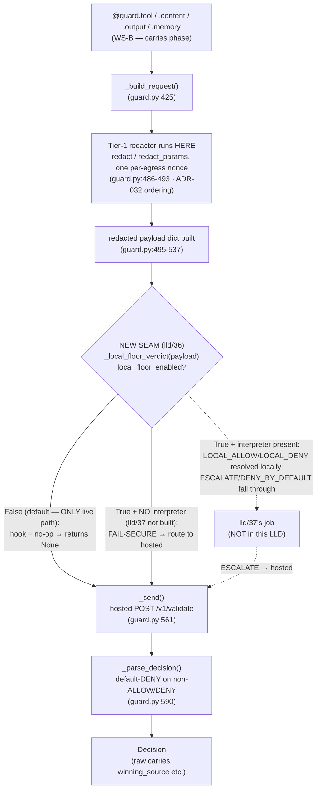
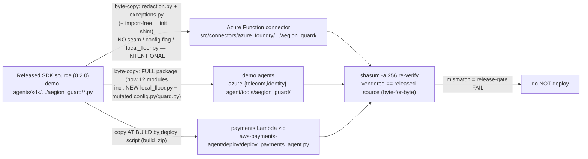

# LLD 36 — SDK release + no-op local-floor seam (WS-A ship-now)

> Distribution **`aegion-guard`** (import `aegion_guard`, class `AegionGuard`). This LLD is the **release
> vehicle** for the phase / redactor / trail work already merged into that SDK, plus a **typed no-op
> plug** where the future in-process local floor will live. It is deliberately **leaner than a caching
> LLD** — it builds a *release* and a *seam*, not the interpreter that fills the seam.

**Version**: 1.0
**Last Updated**: 2026-07-03
**Status**: Build-ready (Gate-3 approved 2026-07-03; plan at [tasks/serverless-edition/ws-a-sdk-release-plan.md](../tasks/serverless-edition/ws-a-sdk-release-plan.md))
**Prerequisites**: [LLD 23](23-sentra-guard-sdk.md) (the frozen SDK design this releases — supersede-banner **applied 2026-07-03**, [`23-sentra-guard-sdk.md:3`](23-sentra-guard-sdk.md); see §-sibling reconcile), [LLD 30](30-multiphase-contract.md) (the `phase` contract the decorators carry), [LLD 29](29-redaction.md) (the Tier-1 edge redactor this ships), [LLD 33](33-decision-trail.md) (the trail fields the SDK passes through)
**Fills-the-seam successor**: **[LLD 37](37-sdk-local-floor-caching.md)** — the interpreter + signed-bundle client + caching + crypto + durable meter journal that make this seam do work. **LLD 37 exists as a STUB** (planned/deferred; its authoritative design source is the plan [tasks/serverless-edition/ws-a-local-floor-caching-plan.md](../tasks/serverless-edition/ws-a-local-floor-caching-plan.md)) — every `[LLD 37]` link below resolves to that stub; the implementation-depth LLD is a separate deferred gate.

## Table of Contents
1. Context
2. Scope & non-goals
3. Carried-forward status table (what's already built)
4. Architecture
   - 4.1 The released SDK surface
   - 4.2 The no-op local-floor seam
   - 4.3 Versioning & release
   - 4.4 Re-vendor into the connectors
5. Security
6. Compatibility & migration
7. Scaling & latency
8. Resiliency & recovery
9. Test plan
10. Cross-references

---

## 1. Context

The `aegion-guard` Python SDK ([demo-agents/sdk/aegion-guard-python/](../demo-agents/sdk/aegion-guard-python/)) has accumulated three streams of **merged-but-unreleased** work: the WS-B additive phase decorators (`@guard.content` / `@guard.output` / `@guard.memory` alongside `@guard.tool`, plus `TransportError.status_code` for the 422/outage split), the WS-E Tier-1 edge redactor (`redaction.py`, hooked on the `content_text` seam and running before egress), and the WS-D trail fields the SDK passes through. **This LLD releases that surface** (version-bump `0.1.0` → `0.2.0`, `pyproject.toml` sync, re-vendor into the byte-copy connectors) **and adds a typed no-op `local_floor_enabled` seam** — a config flag (default `False`), a frozen verdict enum, and a single hook point in `guard.py` between `_build_request` (where the redactor already ran) and `_send`. It **elaborates the approved HLD Option A** from [hld/serverless-edition.md](../hld/serverless-edition.md) §6.2(a) (FR-1.7 in-process local enforcement) — but only its *seam*: this doc creates the plug-point; [LLD 37](37-sdk-local-floor-caching.md) builds the interpreter, signed-bundle client, caching, crypto and durable meter journal that fill it. **This is not a re-plan of the merged work and not the latency win** (that is LLD 37); it is a release + a plug. It exists because WS-A was split at Gate-3 (2026-07-03) so the SDK ships now and unblocks its dependents.

**This release is internal enablement, not an external FR-1.7 delivery — say so plainly.** It ships **no** latency win and no new enforcement; the flag is off and does nothing. What it *unblocks* by freezing the surface now: (1) the **byte-copy connectors** re-vendor against one released `0.2.0` instead of chasing an unversioned main; (2) **WS-J** (the differential-conformance runner) and **[LLD 37](37-sdk-local-floor-caching.md)**'s interpreter code against the frozen `LocalFloorVerdict` enum + `_local_floor_verdict` hook without a later public-API break; (3) **WS-H** metering can name the seam as its future heartbeat point. The FR-1.7 **latency win** (the in-process local floor that closes the ~0.6–1.2 s / ~3 s-p99 round-trip) is **[LLD 37](37-sdk-local-floor-caching.md)** and is **not** delivered here — the release/changelog must not be characterized externally as an FR-1.7 delivery (Cross-references already scopes this: *"Implements FR-1.7 — the SEAM ONLY"*).

---

## 2. Scope & non-goals

**In plain terms:** ship the SDK we already built as one coherent release, re-vendor it into the connectors that carry byte-copies, and add an off-by-default switch shaped like the future local floor — so LLD 37 and the harness can code against a frozen surface without another public-API change.

### 2.1 In scope (lld/36)
- **Release the merged phase + redactor + trail surface** as one semver-minor bump (`0.1.0` → `0.2.0`), `pyproject.toml` version synced, `__contract__` pinned.
- **The typed no-op seam**: `local_floor_enabled` config flag (default `False`), the frozen verdict enum `{LOCAL_ALLOW, LOCAL_DENY, ESCALATE, DENY_BY_DEFAULT}`, and one hook point in `guard.py` between `_build_request` and `_send`.
- **Re-vendor the connectors** (Azure Function subset + the demo-agent full copies + the payments-Lambda build-time vendoring) and re-verify checksums so the deployed edge matches the released SDK.
- **A supersede-banner on [LLD 23](23-sentra-guard-sdk.md)** pointing here (not an in-place rewrite).

### 2.2 Out of scope — deferred to lld/37 (fills this seam)
- The **closed-subset interpreter** that evaluates a bundle in-process.
- The **signed-bundle client**: fetch/poll, conditional-GET/304, keep-last-good.
- **Staleness / epoch / anti-rollback**, revocation.
- **Crypto**: the `[local-floor]` `ecdsa` ES256 extra (S1 — deferred; see §5.4).
- The **durable edge meter journal** (needed only once the floor starts skipping the server).

### 2.3 Out of scope — owned by other workstreams
- The per-phase detection **handlers** — WS-L ([LLD 32](32-detection-depth.md)). Status re-verified 2026-07-03: `content`/`memory` handlers are **live** ([`routes.py:98-118`](../src/security-controller/app/api/routes.py#L98)); only the `output` (D5) handler is unbuilt. lld/36's only touch here is gating `@guard.output` to fail fast (§4.1(a-out)); it builds no handler.
- The Tier-2 server-side **semantic-NER redactor** — WS-E2 ([LLD 29](29-redaction.md) §4).
- The **differential-conformance runner** (edge-interpreter vs `cedarpy`) — WS-J.
- The **hosted metering ledger** — WS-H.

> **The seam boundary is a hard line.** lld/36 introduces **no interpreter, no bundle, no caching, no poll, no staleness/epoch/anti-rollback, and no crypto.** A reviewer who finds any of those in this LLD's implementation has found scope creep into lld/37's territory.

---

## 3. Carried-forward status table (what's already built)

Re-verified against the real code at author time (2026-07-03). This is the bridge that tells `plan-workstreams` which milestones are already merged (release-only) vs net-new (the seam).

| Item | Status | Evidence (`file:line`, re-verified) |
|---|---|---|
| SDK version | `0.1.0` (bump target: `0.2.0`) | [`__init__.py:43`](../demo-agents/sdk/aegion-guard-python/src/aegion_guard/__init__.py#L43) `__version__ = "0.1.0"`; [`pyproject.toml:7`](../demo-agents/sdk/aegion-guard-python/pyproject.toml#L7) `version = "0.1.0"` |
| Contract pin | `"v1"` (informational; parse-time defense, not version-match) | [`__init__.py:51`](../demo-agents/sdk/aegion-guard-python/src/aegion_guard/__init__.py#L51) `__contract__ = "v1"` |
| Phase decorators (WS-B) | **MERGED** — `@guard.tool/content/output/memory` + `_phase_decorator` | [`guard.py:219-275`](../demo-agents/sdk/aegion-guard-python/src/aegion_guard/guard.py#L219) (four surfaces), [`guard.py:277-323`](../demo-agents/sdk/aegion-guard-python/src/aegion_guard/guard.py#L277) (`_phase_decorator`) |
| `phase` on the wire | **MERGED** — emitted only when `!= "request"` (request path byte-identical) | [`guard.py:521-536`](../demo-agents/sdk/aegion-guard-python/src/aegion_guard/guard.py#L521) |
| `TransportError.status_code` (422 vs 5xx split) | **MERGED** (was NOT-DONE in [LLD 30 §3.5](30-multiphase-contract.md)) | [`client.py:50`](../demo-agents/sdk/aegion-guard-python/src/aegion_guard/client.py#L50) (field), [`guard.py:572`](../demo-agents/sdk/aegion-guard-python/src/aegion_guard/guard.py#L572) (`if exc.status_code == 422:` use) |
| Tier-1 edge redactor (WS-E) | **MERGED** — `redact` / `redact_detailed` / `redact_params` + `new_nonce` | [`redaction.py:1102`](../demo-agents/sdk/aegion-guard-python/src/aegion_guard/redaction.py#L1102), [`:1121`](../demo-agents/sdk/aegion-guard-python/src/aegion_guard/redaction.py#L1121), [`:1178`](../demo-agents/sdk/aegion-guard-python/src/aegion_guard/redaction.py#L1178), [`:72`](../demo-agents/sdk/aegion-guard-python/src/aegion_guard/redaction.py#L72) |
| Redactor hooked before egress (ADR-032 ordering) | **MERGED** — runs in `_build_request` before the payload dict is built | [`guard.py:486-493`](../demo-agents/sdk/aegion-guard-python/src/aegion_guard/guard.py#L486) (nonce + redact), [`guard.py:539-559`](../demo-agents/sdk/aegion-guard-python/src/aegion_guard/guard.py#L539) (`_redaction_denied`, fail-secure) |
| WS-D trail fields the SDK carries | **MERGED (passthrough)** — `winning_source` etc. land in `Decision.raw`, not typed fields | [`guard.py:598-608`](../demo-agents/sdk/aegion-guard-python/src/aegion_guard/guard.py#L598) (`_parse_decision`, `raw=body`); `Decision` has no `winning_source` field ([`guard.py:67-79`](../demo-agents/sdk/aegion-guard-python/src/aegion_guard/guard.py#L67)) |
| `local_floor_enabled` config flag | **ABSENT** — this LLD adds it | [`config.py:20-33`](../demo-agents/sdk/aegion-guard-python/src/aegion_guard/config.py#L20) env-var block ends at `ENV_TOKEN_TTL`; no floor key |
| The seam hook + verdict enum | **ABSENT** — this LLD adds them | no reference in [`guard.py`](../demo-agents/sdk/aegion-guard-python/src/aegion_guard/guard.py) between `_build_request` ([:425](../demo-agents/sdk/aegion-guard-python/src/aegion_guard/guard.py#L425)) and `_send` ([:561](../demo-agents/sdk/aegion-guard-python/src/aegion_guard/guard.py#L561)) |
| Connectors vendor byte-copies | **PRESENT** — Azure Function subset + demo-agent full copies + payments-Lambda build-time copy | Azure subset [`src/connectors/azure_foundry/azure_function/tool_interceptor/aegion_guard/`](../src/connectors/azure_foundry/azure_function/tool_interceptor/aegion_guard/) (`__init__.py` shim + `redaction.py` + `exceptions.py`); demo full copies `demo-agents/azure-{telecom,identity}-agent/tools/aegion_guard/`; payments Lambda copies at build ([`deploy_payments_agent.py:35,64`](../demo-agents/aws-payments-agent/deploy/deploy_payments_agent.py#L35)) |
| LLD 23 (SDK design) | **FROZEN** 2026-06-08 v1.2 — supersede-banner **DONE (applied 2026-07-03)** | [`23-sentra-guard-sdk.md:3`](23-sentra-guard-sdk.md) (banner), [`:7-9`](23-sentra-guard-sdk.md) (design) |
| SDK test suite | **the full SDK suite (216 test functions across 14 files** at author time; run `pytest --collect-only -q` with the `identity` extra for the authoritative count) — must stay green through the release | `demo-agents/sdk/aegion-guard-python/tests/test_*.py` |

**Checksum baseline (re-verified 2026-07-03).** Every vendored copy is byte-for-byte identical to the released source *today* — the re-vendor step (§4.4) must preserve that equality **per-manifest** after the version bump lands. Note the release **mutates `config.py` + `guard.py`** (flag + seam) and **adds `local_floor.py`**, so the full-copy families' `guard.py`/`config.py` hashes will *change* (re-baseline against the new source) and `local_floor.py` is a **new** row; the Azure subset carries none of these three, so its baseline (`redaction.py`, `exceptions.py`) is unchanged.

| Vendored module | Which families carry it | `sha256` baseline |
|---|---|---|
| `redaction.py` | Azure subset, telecom, identity, payments | `ca2dd18…b9f884b` (unchanged by this release) |
| `exceptions.py` | Azure subset (+ full copies) | `a164129…2599b46d` (unchanged) |
| `guard.py` | telecom, identity, payments full copies (**NOT** Azure subset) | `e956992…d2beb7ab5` → **re-baseline** (seam mutates it) |
| `config.py` | full copies only (**NOT** Azure subset) | **re-baseline** (flag mutates it) |
| `local_floor.py` | full copies only (**NOT** Azure subset) | **NEW** — no prior baseline |

---

## 4. Architecture

**In plain terms:** the SDK's guarded-call hot path today is `decorator → _build_request → redactor → [SEAM] → _send → _parse_decision → Decision`. Today `[SEAM]` does not exist; the redacted payload flows straight into `_send`, which is the blocking WAN POST to the hosted `/v1/validate`. lld/36 inserts a **no-op hook** at `[SEAM]`: when `local_floor_enabled` is `False` (the only live path) the hook returns "not handled" and the call falls through to `_send` **unchanged** — the release adds a single boolean branch (~ns), no behavior change. The hook exists so that LLD 37 can later plug an interpreter in at exactly that point without touching the public API again.



> The dotted path (interpreter present, local resolution) is drawn only to show **where** LLD 37 plugs in. lld/36 ships the solid path: seam → `_send`. In lld/36 the `True + interpreter present` branch is **unreachable** because no interpreter is installed — it degrades to the `True + no interpreter` fail-secure-to-hosted branch (§4.2.3).

### 4.1 The released SDK surface

**In plain terms:** three merged features become one public release — the four phase decorators, the redactor that masks structured PII before egress, and the trail fields the SDK forwards. Nothing here is new code; this section names exactly what the `0.2.0` release *is*.

**(a) Phase decorators (WS-B, [LLD 30](30-multiphase-contract.md)).** `@guard.tool` (the `request` phase — the action-validation surface, byte-identical on the wire to pre-WS-B), plus `@guard.content` / `@guard.output` / `@guard.memory` for the second-order / egress / memory-integrity phases ([`guard.py:219-275`](../demo-agents/sdk/aegion-guard-python/src/aegion_guard/guard.py#L219)). All four delegate to `_phase_decorator` ([`guard.py:277`](../demo-agents/sdk/aegion-guard-python/src/aegion_guard/guard.py#L277)); the only thing threaded through vs. the pre-WS-B `tool()` is the `phase` string, which flows to `_build_request` and is emitted **only when `!= "request"`** ([`guard.py:521`](../demo-agents/sdk/aegion-guard-python/src/aegion_guard/guard.py#L521)). The SDK **carries** the phase; the server owns routing — an unknown/typo phase 422s at request-validation, a **live** phase runs the pipeline, and a known-but-unbuilt phase fails secure (DENY, `phase_handler_not_implemented`) — all **server-side** ([LLD 30](30-multiphase-contract.md) §3). `TransportError.status_code` ([`client.py:50`](../demo-agents/sdk/aegion-guard-python/src/aegion_guard/client.py#L50)) lets the guard distinguish that 422 (→ `BadRequest`, developer-actionable, halts before `fn` runs) from a 5xx/timeout outage (→ fail-secure DENY) at [`guard.py:572-583`](../demo-agents/sdk/aegion-guard-python/src/aegion_guard/guard.py#L572).

> **Server-side phase status re-verified against the code 2026-07-03 (WS-L has landed content/memory).** The earlier assumption that all three new phases deny-all is **stale**. [`routes.py:98-118`](../src/security-controller/app/api/routes.py#L98) (WS-L M2.1 / FIX-I / SEC-13): `content` and `memory` now have **LIVE handlers** — they fall through to the identity gate + `_run_validation_pipeline` exactly like `request`, and `build_dag` selects the D2/D3 node set per phase ([`registry.py:486-546`](../src/security-controller/app/services/scheduler/registry.py#L486)). Only **`output`** is still known-but-unbuilt: it routes to `_phase_not_implemented_deny` (`phase_handler_not_implemented:output`, [`routes.py:108-113`](../src/security-controller/app/api/routes.py#L108)) until WS-L's D5 output handler ships. So of the three new decorators, **two are fully live; only `@guard.output` deny-alls today** — which is why the SDK gates only `@guard.output` (§4.1(a-out) below), not all three.

**(a-out) `@guard.output` fails fast at decoration time (grill buyer-lens fix — Gate-3, 2026-07-03).** Because the `output` phase server-side still deny-alls (D5 unbuilt), a customer who decorates a **live** egress path with `@guard.output` would see every such call DENIED with only a changelog caveat as warning — a booby-trap (a changelog is not a control). Fix: `@guard.output` raises a clear `FeatureNotAvailable("@guard.output: the output phase is not yet enforced (WS-L D5 unbuilt); do not wire it to a production path — use @guard.tool for action validation")` **at decoration time** (when the decorator is applied, i.e. import/wire time — fail-fast and developer-actionable, not a silent per-call prod DENY). `@guard.tool`, `@guard.content`, `@guard.memory` decorate normally (all three have live server handlers). When WS-L lands D5, lld/… removes the guard and `@guard.output` decorates normally. **Propagate-change flag:** the `@guard.output` decorator body is owned by WS-B ([LLD 30](30-multiphase-contract.md) §-decorators); this fail-fast is a small contract nuance on that decorator — reconcile the one-line behavior into LLD 30 (a sibling-doc edit, not a silent re-decide). (Test: `test_output_decorator_fails_fast`, §9.)

**(b) Tier-1 edge redactor (WS-E, [LLD 29](29-redaction.md), ADR-032).** `redact` / `redact_detailed` / `redact_params` + `new_nonce` ([`redaction.py:1102/1121/1178/72`](../demo-agents/sdk/aegion-guard-python/src/aegion_guard/redaction.py#L1102)), stdlib-only, normalize-then-detect over PAN (Luhn, first6/last4), SSN, SAD (dropped, PCI never-store), labelled IDs, and high-entropy secrets. `_build_request` mints **one per-egress nonce** and threads it through `tool_params`, `user_input`, `context`, and (for egressing phases) `content_text` ([`guard.py:486-537`](../demo-agents/sdk/aegion-guard-python/src/aegion_guard/guard.py#L486)); the payload is stamped `redacted: True` + `redaction_nonce`. A redactor failure raises `RedactionError`, which `validate`/`avalidate` turn into a fail-secure DENY (`redaction_failed`) that **never reaches `_send`** ([`guard.py:539-559`](../demo-agents/sdk/aegion-guard-python/src/aegion_guard/guard.py#L539)). This ordering — **redact before the payload is built, before egress** — is ADR-032's happens-before contract and is the property that keeps a future local floor evaluating the same redacted payload that would egress (§5.2).

**(c) WS-D trail passthrough ([LLD 33](33-decision-trail.md)).** The trail is built server-side; `winning_source` is **recomputed on read** from the ran DENY rows and is **not** a stored scalar ([LLD 33](33-decision-trail.md) §6.3). The SDK therefore surfaces trail fields **only via `Decision.raw`** — `_parse_decision` keeps the full response body in `raw=body` ([`guard.py:598-608`](../demo-agents/sdk/aegion-guard-python/src/aegion_guard/guard.py#L598)) while typing only the stable fields (`decision`, `request_id`, `reason`, `trust_score`, `threat_type`, `matched_rule`, `severity`, `latency_ms` — [`guard.py:67-79`](../demo-agents/sdk/aegion-guard-python/src/aegion_guard/guard.py#L67)). This is deliberate: additive `/v1` fields (including any WS-D trail extras) are tolerated through `raw` without a typed-field change, matching the parse-time-defense contract ([`__init__.py:45-51`](../demo-agents/sdk/aegion-guard-python/src/aegion_guard/__init__.py#L45)). **This release adds no new typed `Decision` field** — a change here would be a breaking contract move, which S3 forbids.

**Public API vs internal.** Public (exported in `__all__`, [`__init__.py:53-76`](../demo-agents/sdk/aegion-guard-python/src/aegion_guard/__init__.py#L53)): `AegionGuard`, `Decision`, `GuardConfig`, the exception types, `redact`/`redact_detailed`/`redact_params`, the identity helpers, `from_bedrock_event`/`from_azure_request`, `infer_operation_type`, `__version__`, `__contract__`. Internal (leading underscore, not exported): `_build_request`, `_send`, `_parse_decision`, `_phase_decorator`, and the **new seam** `_local_floor_verdict` (§4.2). The verdict enum is the one *new* public export (§4.2.1) — frozen here so LLD 37 and WS-J code against it.

### 4.2 The no-op local-floor seam

**In plain terms:** we add one boolean config flag (`local_floor_enabled`, default `False`), one frozen enum of four verdict names, and one internal method `_local_floor_verdict(payload)` that the guard calls between building the redacted payload and sending it. Today that method always returns "not handled" (there is no interpreter), so every call routes to the hosted server exactly as it does now. The point of the seam is *only* to freeze the shape LLD 37 will fill.

#### 4.2.1 The frozen verdict enum

A new public type names the four outcomes a local floor can produce. It is frozen here so LLD 37's interpreter and WS-J's differential runner code against a stable contract without re-touching the public API (HLD Tie-breaker A — *shape the contract once, additively*).

> **The four values are provisional-complete, and additive-safe.** They cover LLD 37's known routing states (local ALLOW/DENY, out-of-subset escalate, stale/unusable → fail-secure deny). LLD 37's staleness/epoch/anti-rollback design is not yet pinned on disk (its plan is [ws-a-local-floor-caching-plan.md](../tasks/serverless-edition/ws-a-local-floor-caching-plan.md)); if it discovers it needs a *fifth* state (e.g. a distinct "stale-but-within-grace" verdict rather than folding it into `DENY_BY_DEFAULT`), **adding an enum member is backward-compatible** for `str`-Enum consumers — only *removing/renaming* an existing member is breaking, and lld/37 must not do that in a minor bump. So the freeze buys WS-J/LLD 37 a stable name set without foreclosing a later additive state. **Carry-forward for LLD 37:** confirm this four-value set maps 1:1 onto the interpreter's final verdict set before promoting the enum from provisional to hard-frozen.

> **Scope of the freeze: the ENUM + the FLAG are public-frozen; the HOOK SIGNATURE is internal and deliberately NOT frozen.** The only *public* commitments this release makes to WS-J / LLD 37 are the `LocalFloorVerdict` enum (a stable name set) and the `local_floor_enabled` flag + its semantics. `_local_floor_verdict` is a **leading-underscore internal** method (not in `__all__`); its `(self, payload)` signature is an implementation detail LLD 37 may widen. This is the answer to "you're freezing a contract before its consumer exists": the interpreter's real inputs — the signed bundle, the revocation epoch, staleness state, the meter-journal handle — are **per-guard state that lives on `self`** (set at construction + refreshed by the background poll), **not** call-time parameters, so `(self, payload)` remains sufficient even after LLD 37 lands the interpreter. If LLD 37 nonetheless needs to widen the *internal* signature, that is **not** a public-API break (nothing external calls `_local_floor_verdict`). What must not change is the enum and the flag — the genuinely additive-safe public surface.

```python
# aegion_guard/local_floor.py  (NEW module, lld/36)
from enum import Enum

class LocalFloorVerdict(str, Enum):
    """Outcome of the (future) in-process local floor. FROZEN here (lld/36);
    the evaluator that PRODUCES these is lld/37. str-Enum so the value is a
    plain string on any wire/log without a custom encoder."""
    LOCAL_ALLOW      = "LOCAL_ALLOW"       # floor decided ALLOW locally (lld/37)
    LOCAL_DENY       = "LOCAL_DENY"        # floor decided DENY  locally (lld/37)
    ESCALATE         = "ESCALATE"          # out-of-subset → must reach hosted PDP
    DENY_BY_DEFAULT  = "DENY_BY_DEFAULT"   # stale/unusable cache → fail-secure deny
```

> **`ESCALATE` is NOT a `Signal.decision` value.** The server-side `Signal.decision` field is typed by the module-level `Decision` alias (`= Literal["ALLOW", "DENY"]`, [`combiners/signal.py:22`](../src/security-controller/app/combiners/signal.py#L22)). `LocalFloorVerdict` is a **separate edge-only routing enum** — `ESCALATE` means "I can't decide locally, send it to the hosted PDP," and it **falls through to `_send`** (§4.2.2). It never mints a `Signal`, and it is never combined by `DenyOverrides.combine()` ([`combiners/deny_overrides.py:28`](../src/security-controller/app/combiners/deny_overrides.py#L28)), which stays **byte-for-byte read-only** in this LLD (ADR-031). Confusing the two enums would be the class of bug that lets an edge verdict leak into the server's combiner.

#### 4.2.2 The config flag

Add to `config.py` alongside the existing env-var block ([`config.py:20-33`](../demo-agents/sdk/aegion-guard-python/src/aegion_guard/config.py#L20)), reusing the existing `_env_bool` helper ([`config.py:45`](../demo-agents/sdk/aegion-guard-python/src/aegion_guard/config.py#L45)) so parsing/validation is consistent:

```python
# config.py — additive
ENV_LOCAL_FLOOR = "SENTRA_LOCAL_FLOOR_ENABLED"
# ... in GuardConfig dataclass (frozen):
local_floor_enabled: bool = False          # default OFF — the only live path in lld/36
# ... in resolve():
resolved_local_floor = (
    bool(local_floor_enabled) if local_floor_enabled is not None
    else _env_bool(ENV_LOCAL_FLOOR, False))     # DEFAULT FALSE
```

> **An *invalid* flag value fails closed.** `_env_bool` ([`config.py:45-57`](../demo-agents/sdk/aegion-guard-python/src/aegion_guard/config.py#L45)) raises `ConfigError` on an unparseable value (e.g. `SENTRA_LOCAL_FLOOR_ENABLED=maybe`) at `GuardConfig` construction — so no guard is built and no call routes (fail-closed), consistent with every other `_env_bool` flag. A future refactor must NOT silently coerce an invalid value to `False`. (Test: `test_invalid_flag_value_fails_closed`, §9.)

> **Default `False` is the SDK-level ship-now default and is intentionally the *opposite* of the lld/28 per-tenant default (`true`).** [LLD 28 §5](28-cedar-policy-engine.md) sets `local_floor_enabled=true` per-tenant in the *caching* world where an interpreter and a signed bundle already exist. In lld/36 there is no interpreter, so the flag defaults **off** — a `true` default here would route calls at a floor that does not exist. The **semantics** of the flag are identical to lld/28's ([LLD 28:394-397](28-cedar-policy-engine.md)): **off ≠ skip-validation and ≠ deny-all — off means network-required (route to hosted)**. lld/37 flips the shipped default to per-tenant-`true` when it lands the interpreter.

#### 4.2.3 The hook point + the three states (S2)

One new internal method, called from `validate`/`avalidate` **after** `_build_request` returns the redacted payload and **before** `_send`. It reads one **new instance attribute**, `self._floor_absent_warned`, which **must be initialized to `False` in `AegionGuard.__init__`** ([`guard.py:89`](../demo-agents/sdk/aegion-guard-python/src/aegion_guard/guard.py#L89)) — it **cannot** live on `GuardConfig` (that is `@dataclass(frozen=True)`, [`config.py:86`](../demo-agents/sdk/aegion-guard-python/src/aegion_guard/config.py#L86), so it is immutable and shared). Naming the init site is load-bearing: if the coder omits `self._floor_absent_warned = False` in `__init__`, the first read inside `_local_floor_verdict` raises `AttributeError` on a guarded call. (Asserted by `test_floor_absent_warns_once_per_guard`, §9, which constructs a fresh guard and exercises state 2.)

The seam is inserted at **both** `_send` reach-points as a **pre-check that runs before `_send`**: the sync `return self._send(payload)` at [`guard.py:358`](../demo-agents/sdk/aegion-guard-python/src/aegion_guard/guard.py#L358) and the async site at [`guard.py:388`](../demo-agents/sdk/aegion-guard-python/src/aegion_guard/guard.py#L388), which today is `return await asyncio.to_thread(ctx.run, self._send, payload)` (`self._send` passed as a *value*, with a comma — **not** a `self._send(` call). **The async `to_thread(ctx.run, self._send, payload)` line is left BYTE-IDENTICAL** — the seam is a boolean pre-check *above* it, not a rewrite of the dispatch (§4.2.3 pseudo-code). This is the deliberate answer to the "async no-op that isn't" risk: lld/36 introduces **no `_dispatch` closure, no contextvars change, no exception-ordering change** on the async path; the worker path stays literally today's. (lld/37, when it plugs a CPU-bound interpreter in, restructures that line to run the interpreter off-loop inside the worker — and owns the contextvars/exception-ordering equivalence tests for that change.)
>
> **Static-gate soundness (the load-bearing caveat).** The release-gate structural check (§9, `test_no_send_outside_seam`) must be an **AST dominator** assertion, not a `grep 'self._send('` — a `(`-keyed grep is **unsound for the async path**, where `self._send` appears as a bare attribute reference (`to_thread(ctx.run, self._send, payload)`) with no `(` after it, so a grep sees only the sync call site and `def _send` and the async invocation is invisible to it. The gate therefore matches **every reference to `_send`** — the call form `self._send(...)` *and* the bare-attribute form `self._send` passed to `to_thread` — and asserts each is dominated by a `_local_floor_verdict` reference in the same function/closure. If expressed as a grep it must be `self\._send\b` (word-boundary, not `(`). The **async path's true safety proof is the behavioral `test_seam_off_routes_to_send_async` + `test_seam_on_without_interpreter_fails_secure_to_hosted`** (spies asserting `_local_floor_verdict` runs before `_send` on `avalidate`); the static gate is necessary-but-not-sufficient for the async site.

```python
# guard.py — sync validate(): replaces the direct `return self._send(payload)` at :358
verdict = self._local_floor_verdict(payload)   # NEW seam (lld/36)
if verdict is None:                            # not handled locally → hosted
    return self._send(payload)                 # TODAY'S behavior, unchanged
# (lld/37 will map a LOCAL_ALLOW/LOCAL_DENY verdict to a Decision here)

# guard.py — async avalidate(): in lld/36 the async worker path is BYTE-IDENTICAL to today.
# The seam is a pre-check BEFORE the unchanged to_thread(ctx.run, self._send, payload). Because
# lld/36's seam is a no-op (returns None), avalidate's fast path stays literally today's line —
# NO new closure, NO contextvars change, NO exception-ordering change on the hottest async path.
verdict = self._local_floor_verdict(payload)   # NEW seam (lld/36) — trivial no-op, returns None
if verdict is not None:                         # lld/36: never taken. lld/37: a locally-resolved Decision
    return verdict
return await asyncio.to_thread(ctx.run, self._send, payload)   # UNCHANGED from today

# CARRY-FORWARD FOR lld/37 (NOT built here): a real interpreter is CPU-bound and MUST run OFF the
# event loop. lld/37 will restructure this into a `_dispatch` closure that calls _local_floor_verdict
# INSIDE the to_thread worker (interpreter off-loop), and its OWN tests must prove contextvars-
# propagation + exception-ordering equivalence. lld/36 deliberately ships NO such restructure —
# introducing a closure on every async call in a release whose contract is "zero runtime change" is
# exactly the risk the grill flagged; the byte-identical pre-check above avoids it. (The pre-check
# runs on-loop, which is harmless ONLY because lld/36's seam is a trivial attribute-read no-op.)

# TYPE CONTRACT (frozen here so lld/37 cannot regress it): `_local_floor_verdict` returns
# `Optional[Decision]` — a `Decision` or `None`, NEVER a bare `LocalFloorVerdict`. In lld/36
# it returns ONLY `None`. lld/37 must translate the enum to a Decision INSIDE the method
# (LOCAL_ALLOW->ALLOW Decision, LOCAL_DENY->DENY Decision; ESCALATE/DENY_BY_DEFAULT->None so
# the caller routes to `_send`) and must NOT return the enum to the caller: both the sync and
# async paths return the seam's result directly as a `Decision`, so an escaped enum would either
# AttributeError or (as a truthy str-Enum) read as ALLOW — a fail-OPEN. Frozen by
# `test_seam_returns_decision_or_none` (§9).

def _local_floor_verdict(self, payload: Dict[str, Any]) -> Optional[Decision]:
    """No-op seam (lld/36). Returns None → caller routes to hosted `_send`.

    THREE STATES (S2), all fail-secure by construction:
      1. local_floor_enabled == False (the ONLY live path): return None → hosted.
      2. local_floor_enabled == True  but no interpreter installed (lld/37 not
         built): FAIL-SECURE → return None → hosted. Never skip, never
         local-allow, never deny-all. (lld/28:397 semantics.)
      3. local_floor_enabled == True  and an interpreter is present: lld/37's job.
         Unreachable in lld/36 (no interpreter ships), so it degrades to state 2.
    """
    if not self._config.local_floor_enabled:
        return None                            # STATE 1 — hosted (no-op)
    # STATE 2/3: lld/36 ships no interpreter, so there is nothing to try.
    # Fail secure to the hosted path — the network-required posture.
    # Log ONCE per guard at WARNING (not per-call debug): a tenant that set the
    # flag True believes it has edge enforcement it does not — make that
    # silent degradation observable to ops. The line is STATIC (no payload/PII
    # interpolated — it sits on the redacted-payload hot path).
    if not self._floor_absent_warned:
        logger.warning("local_floor_enabled=True but no local floor installed "
                       "(lld/37 not built); routing every call to hosted PDP "
                       "(fail-secure). Edge enforcement is NOT active.")
        self._floor_absent_warned = True
    return None                                # STATE 2 — hosted (fail-secure)
```

> **Why WARNING + log-once (not per-call debug).** State 2 means a tenant *thinks* they have a local floor and don't — a silent degradation. A one-time WARNING per guard instance (an `_floor_absent_warned` flag on the guard) surfaces the misconfiguration to ops **without** flooding logs on every guarded call at high QPS. The line carries **no request fields** (no payload/PII interpolation), so it is safe on the redacted-payload hot path. (Covered by the SEC-5 assertion set, §5.)
>
> **Observability is deployment-dependent — do not over-claim it.** `_floor_absent_warned` is **per-guard-instance**, so its ops value depends on the guard's lifetime: a **long-lived** guard (module-level singleton reused across warm invocations) fires the WARNING **once** and is easy to miss on a per-request log scan; a **per-invocation** guard (a fresh `AegionGuard` built each Lambda/Azure-Function call — common at the very edges this LLD re-vendors into) resets the flag and re-fires **once per invocation**, i.e. effectively every call. Either way the log-once is a *floor*, not a reliable fleet signal. The **authoritative** state-2 detection is deferred to **WS-H** (a heartbeat/counter the control plane can count "N tenants set the flag but have no interpreter"); the edge WARNING is a local hint, not the metric. `test_floor_absent_warns_once_per_guard` (§9) constructs N guards and asserts the WARNING fires once **per guard** so the per-invocation multiplication is explicit to the reader.

| State | Condition (lld/36) | Behavior | Why it is safe |
|---|---|---|---|
| 1 | `local_floor_enabled=False` (default, only live path) | hook returns `None` → `_send` (hosted) | byte-identical to today; zero runtime change |
| 2 | `local_floor_enabled=True`, no interpreter | hook returns `None` → `_send` (hosted); **one-time WARNING per guard** ("edge enforcement NOT active") | **fail-secure**: never skip-validation, never local-allow, never deny-all — network-required ([LLD 28:397](28-cedar-policy-engine.md)); the WARNING is a local hint (visibility is deployment-dependent — §4.2.3); the authoritative fleet signal is WS-H |
| 3 | `local_floor_enabled=True`, interpreter present | **lld/37** | unreachable in lld/36 (no interpreter installed) → degrades to state 2 |

**Explicit non-actions in lld/36 (the seam mints nothing):**
- It **does not** construct a `Signal` or call `DenyOverrides.combine()` — the server combiner is untouched (ADR-031).
- `ESCALATE` (once lld/37 produces it) **falls through to `_send`**; it is not a decision.
- It **does not** read a bundle, poll, check staleness/epoch, or verify a signature — those don't exist yet (§2.2).
- On **any** ambiguity it returns `None` (route to hosted), never a local ALLOW.

### 4.3 Versioning & release

**In plain terms:** bump the version from `0.1.0` to `0.2.0` in two places, keep the contract pin at `"v1"`, tag it, and let CI publish. The bump is a **minor** because everything is additive (new decorators, new redactor exports, new seam) with no breaking change.

- **Semver rationale (S3).** The release adds public surface (`@guard.content/output/memory`, `redact*` exports already in `__all__`, the new `LocalFloorVerdict` enum) and changes **no existing signature or wire shape** on the `request` path (§6). Additive + backward-compatible ⇒ **minor bump** `0.1.0` → `0.2.0`.
- **Two version sites, kept in sync** (a release-gate assertion, §9): `__version__` at [`__init__.py:43`](../demo-agents/sdk/aegion-guard-python/src/aegion_guard/__init__.py#L43) and `version` at [`pyproject.toml:7`](../demo-agents/sdk/aegion-guard-python/pyproject.toml#L7). The `User-Agent` string `aegion-guard/{__version__}` ([`guard.py:157`](../demo-agents/sdk/aegion-guard-python/src/aegion_guard/guard.py#L157)) picks up the new value automatically.
- **`__contract__` pinned to `"v1"`** ([`__init__.py:51`](../demo-agents/sdk/aegion-guard-python/src/aegion_guard/__init__.py#L51)). The wire endpoint is `POST /v1/validate` (`validate_url` = base + `/v1/validate`, [`config.py:39,104`](../demo-agents/sdk/aegion-guard-python/src/aegion_guard/config.py#L39)); the release does not touch the contract version. (Note the constant value is the bare string `"v1"`, not `"/v1"`.)
- **`dependencies = []` stays UNCHANGED** ([`pyproject.toml:26`](../demo-agents/sdk/aegion-guard-python/pyproject.toml#L26)) — the seam is stdlib-only (`enum` is stdlib). **No `[local-floor]` extra is declared or stubbed** (S1); the only optional extra remains `identity` ([`pyproject.toml:33`](../demo-agents/sdk/aegion-guard-python/pyproject.toml#L33)).
- **Release-notes caveat — only `@guard.output` is unenforced (content/memory are live).** Re-verified 2026-07-03: WS-L has landed the `content` and `memory` handlers, so `@guard.content` / `@guard.memory` are **fully enforced** server-side ([`routes.py:98-118`](../src/security-controller/app/api/routes.py#L98)). Only **`@guard.output`** remains unbuilt (D5) and deny-alls server-side — and lld/36 now makes it **fail fast at decoration time** (§4.1(a-out)) so it cannot be silently wired onto a prod path. The `0.2.0` changelog SHOULD still state, in plain terms: *"`@guard.tool` (action validation), `@guard.content`, and `@guard.memory` are fully supported. `@guard.output` is not yet enforced (raises `FeatureNotAvailable` if applied) and will be enabled in a later release."* This keeps the release honest without overstating `output`. (The earlier "all three deny-all" caveat was based on stale status and is retracted.)
- **CI/tag/PyPI (from [LLD 23 §9](23-sentra-guard-sdk.md)).** The package is a standalone, extractable `aegion-guard`; distribution is PyPI (`pip install aegion-guard`) as primary, and CI publishes tagged releases. What actually happens on `0.2.0`: bump both version sites → tag `v0.2.0` → CI builds the sdist/wheel → publish → the demo agents (pinned dependents) pick it up on their next install, and the byte-copy connectors re-vendor (§4.4).

### 4.4 Re-vendor into the connectors

**In plain terms:** three families of connector carry a *copy* of the SDK code, not a pip install, because their runtimes can't reliably `pip install` at deploy. When the SDK version bumps we must re-copy those files and re-check the `sha256` so the deployed edge runs the exact released code.

Why copies exist: the Azure Function runtime (Oryx remote build) does not reliably install pip deps, and a Lambda zip vendors its code directly — so the SDK is stdlib-only precisely so it vendors *unchanged* ([LLD 23 §2](23-sentra-guard-sdk.md), best-practices §11 rule 4). The vendored subset must stay **import-free / stdlib-only** — no `identity`/crypto dragged to the edge (S4).



| Connector | Vendored modules (per-manifest) | Carries the seam? | Vendoring mechanism | Re-verify command |
|---|---|---|---|---|
| Azure Function (`tool_interceptor`) | **subset**: `redaction.py`, `exceptions.py`, import-free `__init__.py` shim ([`.../aegion_guard/__init__.py`](../src/connectors/azure_foundry/azure_function/tool_interceptor/aegion_guard/__init__.py)) — **NOT** `guard.py`, `config.py`, or the new `local_floor.py` | **No — intentional** (it never vendors `guard.py`/`config.py`; the seam is a no-op today, so the subset is unaffected). The checksum gate must **not** drift-fail this connector for lacking `guard.py`/`config.py`/`local_floor.py`. | manual byte-copy (re-sync after any redactor change) | `shasum -a 256 <sdk>/{redaction,exceptions}.py <connector>/{redaction,exceptions}.py` — the **subset** pairs must match (config/guard/local_floor are out-of-manifest, not compared) |
| Demo agents `azure-telecom-agent`, `azure-identity-agent` | **full** package — the **12-module set** = the 11 current modules (`__init__`, `_time`, `adapters`, `client`, `config`, `context`, `exceptions`, `guard`, `identity`, `provision`, `redaction`) **+ the NEW `local_floor.py`**; this release **mutates `guard.py`/`config.py`** and **adds `local_floor.py`** | **Yes** — full copy carries the flag + seam + enum | manual byte-copy | `diff -r <sdk-src>/aegion_guard <agent>/tools/aegion_guard` (must include `local_floor.py`) |
| Payments Lambda (`aws-payments-agent`) | **full** package (12 modules) via `SDK_SRC` at package time | **Yes** — full copy | **automatic at build** — `build_zip()` copies from `SDK_SRC` ([`deploy_payments_agent.py:35,64`](../demo-agents/aws-payments-agent/deploy/deploy_payments_agent.py#L35)); rebuild ⇒ re-vendored | rebuild the zip after the version bump; the copy is deterministic from source |

> **The re-vendor step is a release-gate item, not a follow-up.** After the `0.2.0` bump lands, the Azure-subset and demo-agent copies must be re-copied and the checksums re-run (the equality shown in §3 must still hold); the payments Lambda re-vendors automatically on its next `build_zip()`. A vendored copy that drifts from the released source ships **different code at the edge** than was released and tested — the exact silent-divergence the checksum gate exists to catch. §9 pins this as an automated test.
>
> **The gate must BLOCK the release tag and enumerate an explicit per-family module manifest — not be a test someone remembers to run.** The manual byte-copy for the Azure subset + demo agents is a drift-generator: the copy step upstream of the checksum is human, and the `0.2.0` mutation **adds `local_floor.py`** to the full-copy families. So the gate must (1) be wired into the release-tag CI job as a **required** check (a red gate blocks the tag), and (2) assert against an **explicit expected manifest per family** — the demo-agent/payments full copies must contain **exactly** the 12-module set *including* `local_floor.py` (a **missing** `local_floor.py` is a **FAIL**, never an ignored-file pass — a full copy that omits it ships a `guard.py` importing an absent module → `ImportError` = hard-down connector), and the Azure subset must be **exactly** `{redaction.py, exceptions.py, __init__ shim}` (config/guard/local_floor asserted **absent-by-design**, not merely un-compared). **Preferred fix (carry-forward for the connector workstreams):** make the Azure/demo vendoring a **build step** like the payments Lambda's `build_zip()` already is, deleting the manual-copy failure mode entirely. **TOCTOU note:** the payments `build_zip()` must vendor from the **released-tag** `SDK_SRC` (pin the tag, or emit a `sha256` manifest into the zip and have the gate compare the *deployed artifact's* manifest to the released source) — a green test run against a fresh tree does not prove the deployed zip was built from that same tree.

---

## 5. Security

**In plain terms:** the seam can only ever route a call to the hosted server or (once lld/37 exists) DENY — it can never *skip* validation or allow locally without a real evaluator. The redactor still runs before the seam, so no raw structured PII could reach any future local floor before it is masked. And no new secret or crypto surface is added.

**SEC-1/2 (authn/authz — unchanged).** The seam adds no auth surface. `x-api-key` (edge key) and the optional agent JWT (`Authorization: Bearer`, the `identity` extra) are still minted in `_send`/`_auth_header` ([`client.py:115-132`](../demo-agents/sdk/aegion-guard-python/src/aegion_guard/client.py#L115)) — **after** the seam. Because the seam is a no-op that routes to `_send`, every call still carries its edge key + JWT exactly as today.

**SEC-3 (fail-secure by construction — the load-bearing property).** All three seam states (§4.2.3) route to the hosted PDP or DENY; **none local-allows without an interpreter.** This is [LLD 28:397](28-cedar-policy-engine.md)'s footgun encoded at the SDK level: `local_floor_enabled=off` (or on-without-interpreter) is **network-required**, never "skip validation" and never "deny all." A misread of the flag as skip-validation would be the catastrophe; the code path makes that misread impossible by returning `None` (→ hosted) on everything but a real local ALLOW/DENY that only lld/37 can produce.

**SEC-3 (redactor-before-seam ordering — ADR-032 preserved).** The Tier-1 redactor runs inside `_build_request` ([`guard.py:486-537`](../demo-agents/sdk/aegion-guard-python/src/aegion_guard/guard.py#L486)), which returns **before** the seam is reached. So the payload the seam sees is already redacted — a future local floor (lld/37) evaluates **the same redacted payload that would egress**, and no raw structured identifier can reach the floor ahead of masking. A `RedactionError` still fails secure to a DENY that never reaches the seam or `_send` ([`guard.py:539-559`](../demo-agents/sdk/aegion-guard-python/src/aegion_guard/guard.py#L539)). **NFR-7 clause (a) (no raw structured identifier egresses on any edition) is unaffected** — the release changes nothing about where or how redaction runs.

**SEC-4 (no new secret/crypto surface — S1).** lld/36 adds **no crypto**: no signature verification, no `[local-floor]` `ecdsa` extra, no key material. There is no bundle to verify, so there is nothing to sign or verify (S1). Base `dependencies = []` is unchanged. The vendored connector subset stays import-free/stdlib-only ([`.../aegion_guard/__init__.py`](../src/connectors/azure_foundry/azure_function/tool_interceptor/aegion_guard/__init__.py)) — the release does not drag `identity`/crypto into the edge.

**SEC-5 (audit + seam log hygiene — unchanged/hardened).** No new audit event is emitted at the edge (the SDK does not log decisions; the server owns the audit trail). The optional `on_decision` hook is unchanged and still swallows its own errors ([`guard.py:620-629`](../demo-agents/sdk/aegion-guard-python/src/aegion_guard/guard.py#L620)). The one new log line — the state-2 WARNING (§4.2.3) — is **static** (no request field / payload / PII interpolated) and **log-once per guard instance**, so it neither leaks data on the redacted-payload hot path nor floods logs *within* a single guard's lifetime. Asserted in the SEC-5 test set (no payload substring reaches the log record; the warning fires at most once **per guard**). **Not over-claimed:** the WARNING is a local hint whose visibility is deployment-dependent (per-invocation edge runtimes re-fire it every call; a long-lived singleton fires it once) — the authoritative "flag-set-but-no-interpreter" fleet signal is **WS-H's** heartbeat/counter, not this log line (§4.2.3).

**Trust boundary.** The seam sits entirely inside the customer boundary (in-process, SDK), on the same side as the redactor and `_send`. It moves no data across a boundary and opens no port.

---

## 6. Compatibility & migration

**In plain terms:** a customer on `0.1.0` upgrading to `0.2.0` gets the phase decorators and the redactor with no code change, and the new flag defaults off, so nothing about their running behavior changes.

- **Additive, no breaking change (S3).** No existing public signature changes. `@guard.tool` callers are byte-identical on the wire — the `request` path emits no `phase`/`content_text` key ([`guard.py:515-520`](../demo-agents/sdk/aegion-guard-python/src/aegion_guard/guard.py#L515)). The only wire delta vs. a hypothetical pre-WS-E `0.1.0` is the redaction provenance (`redacted: True` + `redaction_nonce`) that the server already tolerates — and that is *already merged into the on-main SDK*, not new in this release.
- **Upgrade path.** `pip install -U aegion-guard` (→ `0.2.0`). A customer using only `@guard.tool` gets: (a) redaction of structured PII before egress (WS-E), (b) the three new phase decorators available but unused, (c) the seam present but off. **No code change required.**
- **Flag defaults off ⇒ no behavior change on upgrade.** `local_floor_enabled=False` means every call routes to hosted, exactly as `0.1.0` did. A customer must *explicitly* set the flag (and, later, install lld/37) to change routing — and even then, without lld/37 the on-state fails secure to hosted (§4.2.3 state 2).
- **`Decision` shape unchanged.** No new typed field (§4.1(c)); trail extras ride `Decision.raw`, so a caller reading `raw` today keeps working and a caller reading typed fields is unaffected.

---

## 7. Scaling & latency

**In plain terms:** this release does not change latency at all — every call is still a round-trip to the hosted server, just as today. The seam adds one boolean check (nanoseconds). The latency *win* is lld/37's caching, not this LLD's.

- **No latency change.** Every guarded call still egresses to the hosted `/v1/validate` (the seam is a no-op → `_send`). The measured envelope is today's: ~0.6–1.2 s typical and ~3 s p99 on non-co-located WAN (WS-0 measurements, [MEMORY: ws0-measurements-complete]). lld/36 neither improves nor regresses this.
- **Seam cost.** One attribute read (`self._config.local_floor_enabled`) + one branch per call — sub-microsecond, unmeasurable against a WAN round-trip.
- **Honest staging (tenet 8).** State plainly: **lld/36 is a RELEASE + a PLUG, not a performance change.** The in-process local floor that closes the round-trip on the deterministic tier is **lld/37** ([HLD §6.2(a)](../hld/serverless-edition.md)); FR-1.7's latency benefit is realized there, not here.
- **Throughput / ceiling.** Unchanged — throughput is bounded by the hosted PDP's capacity and the client's timeout ([`config.py:35`](../demo-agents/sdk/aegion-guard-python/src/aegion_guard/config.py#L35) `_DEFAULT_TIMEOUT_S=10.0`), both untouched.

---

## 8. Resiliency & recovery

**In plain terms:** the failure behavior is exactly today's — a transport error becomes a fail-secure DENY, an unparseable response becomes a default-DENY, and the new seam adds no new way to fail because on every path it either routes to the server or denies.

- **Transport failure → fail-secure DENY (unchanged).** A timeout / 5xx / connection error becomes a `validation_unavailable` DENY when `fail_secure=True` (the default), or raises `SentraUnavailable` when explicitly opted out ([`guard.py:565-583`](../demo-agents/sdk/aegion-guard-python/src/aegion_guard/guard.py#L565)). A 422 raises `BadRequest` (developer-actionable, halts before `fn`).
- **Unparseable / contract-drift response → default-DENY (unchanged).** Anything that is not a clean `ALLOW`/`DENY` reads as DENY ([`guard.py:590-608`](../demo-agents/sdk/aegion-guard-python/src/aegion_guard/guard.py#L590)); the client caps the body at 256 KB and default-DENYs non-JSON/non-object bodies ([`client.py:55,207-222`](../demo-agents/sdk/aegion-guard-python/src/aegion_guard/client.py#L207)).
- **The seam adds no new failure mode.** It has no I/O, no bundle, no cache — nothing that can time out or go stale in lld/36. Its only outputs are `None` (→ existing `_send` path, whose resiliency is above) or (in lld/37) a decision. `local_floor_enabled=False` is the safe default; on-without-interpreter degrades to the same hosted path (§4.2.3).
- **RTO/RPO.** N/A — the SDK is **stateless** (no local store, no cache, no journal in lld/36). There is nothing to back up or restore; recovery is "the next call routes to hosted." (The durable state that *would* need an RTO/RPO — the cached bundle and the meter journal — is lld/37's, and its LLD owns those numbers.)
- **Rollback.** A release rollback is `pip install aegion-guard==0.1.0` (or re-vendor the `0.1.0` files); because `0.2.0` is additive and the flag defaults off, rollback is behavior-neutral for `@guard.tool`-only callers.

> **Carry-forward risk register (do not bank the safety claim early).** The fail-secure guarantee *proven here* (SEC-3) covers **only** the no-op: every seam state routes to hosted or denies because no interpreter exists. The one genuinely dangerous state — an interpreter that returns `LOCAL_ALLOW` from a **stale or forged** bundle — is **unreachable in lld/36 and therefore untested here**; its safety depends entirely on [LLD 37](37-sdk-local-floor-caching.md)'s anti-rollback + signature verification. **Do not treat FR-1.7 local enforcement as security-reviewed until LLD 37's `LOCAL_ALLOW`-from-stale/forged-bundle path is designed and tested.**

---

## 9. Test plan

**In plain terms:** keep every existing SDK test green, and add tests that prove the seam is a true no-op (off → the call reaches `_send`), that on-without-interpreter fails secure to hosted (never skips, never local-allows), that the redactor still runs before the seam, and that the vendored connector copies are byte-for-byte equal to the released SDK.

All tests are unit tests in the SDK suite unless marked *(integration)*. The **full existing SDK suite** (216 test functions across 14 files at author time — re-verify the collected count with `pytest --collect-only -q`, `identity` extra installed) must stay green.

| Test | Asserts | Type |
|---|---|---|
| `test_phase_decorators_carry_phase` | `@guard.content/memory` emit the right `phase` + `content_text`; `@guard.tool` emits neither (WS-B regression, keep green) | unit ([LLD 30](30-multiphase-contract.md)) |
| `test_output_decorator_fails_fast` | `@guard.output` raises `FeatureNotAvailable` at **decoration time** (not first call); `@guard.tool/content/memory` decorate without raising (§4.1(a-out) — the booby-trap fix) | unit |
| `test_redactor_runs_before_seam` | the payload the seam receives is already redacted (`redacted: True`, structured PII masked) — redactor-before-seam ordering (WS-E / ADR-032 regression) | unit |
| `test_redaction_failure_denies_before_send` | a forced `RedactionError` → `redaction_failed` DENY, `_send` **never called** (fail-secure, no raw egress) | unit |
| `test_decision_parse_defaults` | non-`ALLOW`/`DENY` body → default-DENY; `raw` carries the full body incl. trail extras (WS-D passthrough) | unit |
| `test_seam_off_routes_to_send` | `local_floor_enabled=False` → `_local_floor_verdict` returns `None` → `_send` reached exactly once (**no-op proof**, sync `validate`) | unit |
| `test_seam_off_routes_to_send_async` | same, on `avalidate` — a spy proves the **async** path traverses `_local_floor_verdict` **exactly once, before `_send`, and inside the `to_thread` worker (not the loop)**, including under an exception raised between the two calls (closes the async-bypass fail-open before lld/37 adds a real `LOCAL_DENY`). **This behavioral spy — not the static gate below — is the load-bearing async-path proof.** | unit |
| `test_no_send_outside_seam` | **AST dominator** assertion (not a `self._send(` grep — that misses the async bare-reference `to_thread(ctx.run, self._send, payload)`): every reference to `_send` in `guard.py` — the call `self._send(...)` **and** the bare attribute `self._send` passed to `to_thread` — is dominated by a `_local_floor_verdict` reference in the same function/closure. If expressed as a grep it must be `self\._send\b` (word-boundary). Necessary-but-not-sufficient for the async site (§4.2.3). | unit |
| `test_seam_returns_decision_or_none` | **type contract (§4.2.3):** `_local_floor_verdict` returns a `Decision` or `None`, **never a bare `LocalFloorVerdict`** — freezes the no-leak boundary so a lld/37 author cannot return the enum into a `Decision`-typed path (a fail-open) | unit |
| `test_seam_on_without_interpreter_fails_secure_to_hosted` | `local_floor_enabled=True`, no interpreter → routes to `_send` (**never skip-validation, never local-allow, never deny-all**); asserted on **both** `validate` and `avalidate` | unit |
| `test_floor_absent_warns_once_per_guard` | constructs **N guards** with `local_floor_enabled=True` and asserts the state-2 WARNING fires **once per guard** (makes the per-invocation edge multiplication explicit — §4.2.3); the log record carries **no payload substring** | unit |
| `test_invalid_flag_value_fails_closed` | `SENTRA_LOCAL_FLOOR_ENABLED=maybe` → `ConfigError` at `GuardConfig` construction (fail-closed: no guard built, no call routes) — parallels the existing `_env_bool` contract | unit |
| `test_seam_mints_no_signal` | **structural**: the `aegion_guard` package has **no import path to `app.combiners`** (import-graph assertion) — the SDK *cannot* construct a `Signal` or reach `DenyOverrides.combine()`, so no `LocalFloorVerdict` value can ever leak into the server combiner (freezes the boundary before lld/37 wires a real producer; ADR-031 untouched) | unit |
| `test_verdict_enum_frozen` | `LocalFloorVerdict` has exactly the four members with their string values (frozen contract for lld/37 + WS-J) | unit |
| `test_version_and_contract_pin` | `__version__ == "0.2.0"`, `pyproject` version matches, `__contract__ == "v1"` | unit |
| `test_stdlib_only_holds` | no non-stdlib runtime import introduced by the seam; `dependencies == []`; **no `[local-floor]` extra declared** | unit ([`test_stdlib_only.py`](../demo-agents/sdk/aegion-guard-python/tests/test_stdlib_only.py)) |
| `test_revendor_checksum_equality` | **per-manifest, CI-blocking release-tag gate** (§4.4): full-copy families (demo agents, payments Lambda) are byte-for-byte equal on **exactly the 12-module manifest incl. `local_floor.py` + the mutated `config.py`/`guard.py`** — a **missing** `local_floor.py` (or any manifest member) is a **FAIL, not an ignored-file pass**; the Azure subset is exactly `{redaction.py, exceptions.py, __init__ shim}` and is **NOT** drift-failed for lacking `guard.py`/`config.py`/`local_floor.py` (asserted absent-by-design, not merely un-compared) | unit |
| `test_azure_connector_redaction_tie_in` *(integration)* | the Azure Function `tool_interceptor` redacts via the vendored subset identically to the SDK on a shared PAN/SSN fixture | integration |

> **Green-≠-correct guard.** `test_seam_off_routes_to_send` must fail if the seam were removed (assert `_send` is reached via a spy), and `test_revendor_checksum_equality` must fail on any drift — neither is a vacuous always-green test.

---

## 10. Cross-references

- **Implements:** FR-1.7 (in-process local enforcement — **the SEAM ONLY**; the caching that fills it is [LLD 37](37-sdk-local-floor-caching.md)), FR-3.4 (multi-phase `phase` contract — [LLD 30](30-multiphase-contract.md)), FR-3.13 (Tier-1 edge redaction — [LLD 29](29-redaction.md)), NFR-4 (fail-secure / deny-by-default), NFR-7 clause (a) (no raw structured identifier egress — preserved, not changed).
- **Decisions:** ADR-029 (In-Process Local Enforcement via Signed Policy Bundle — this seam is where it will live; [adr.md:1157](../adr.md)), ADR-032 (two-tier redactor + NFR-7 amendment — redactor-before-seam ordering; [adr.md:1292](../adr.md)), ADR-031 (record-what-ran trail — `DenyOverrides.combine()` untouched; [adr.md:1252](../adr.md)).
- **Shared contracts (canonical names — join keys):**
  - `local_floor_enabled` (config flag; **semantics fixed by [LLD 28:394-397](28-cedar-policy-engine.md)** — off = network-required, never skip-validation/deny-all; default `False` here, per-tenant `true` in lld/28/37).
  - `LocalFloorVerdict` = `{LOCAL_ALLOW, LOCAL_DENY, ESCALATE, DENY_BY_DEFAULT}` (**frozen here** — provisional-complete, additive-safe; consumed by [LLD 37](37-sdk-local-floor-caching.md) + WS-J; distinct from `Signal.decision`, typed by the `Decision` alias `= Literal["ALLOW","DENY"]` at [combiners/signal.py:22](../src/security-controller/app/combiners/signal.py#L22)).
  - `_local_floor_verdict(payload)` (the guard.py hook, between `_build_request` and `_send`).
  - `phase` / `content_text` / `KNOWN_PHASES` / `_CONTENT_FIELD` (multi-phase surface — owned by [LLD 30](30-multiphase-contract.md)).
  - `redact` / `redact_detailed` / `redact_params` / `new_nonce` / `redaction_nonce` (Tier-1 redactor — owned by [LLD 29](29-redaction.md)).
  - `Decision` (+ `winning_source` via `Decision.raw` passthrough — recomputed-on-read, owned by [LLD 33](33-decision-trail.md)).
  - `POST /v1/validate` (the wire contract; `__contract__ == "v1"`).
- **Upstream:** [HLD §6.2(a)](../hld/serverless-edition.md) (FR-1.7 — Option A JWT-signed bundle, in-process local floor; this LLD elaborates only its seam) + Tie-breaker A (shape the contract once, additively).
- **Sibling refs:**
  - [LLD 23](23-sentra-guard-sdk.md) — the SDK design this releases; **supersede-banner applied 2026-07-03** (S5 — not an in-place rewrite).
  - [LLD 30](30-multiphase-contract.md) (phase surface), [LLD 29](29-redaction.md) (redactor), [LLD 33](33-decision-trail.md) (trail) — the merged work this release ships.
  - [LLD 28](28-cedar-policy-engine.md) — owns the `local_floor_enabled` semantics + the bundle-emit the interpreter consumes.
  - WS-I (bundle emitter), WS-J (differential runner / canary harness — codes against the frozen verdict enum), WS-H (metering — heartbeat/meter-journal surface; **deferred to lld/37**, not stubbed here).
- **Forward link:** **[LLD 37](37-sdk-local-floor-caching.md) fills this seam** — the closed-subset interpreter, signed-bundle client, caching, staleness/epoch/anti-rollback, the crypto `[local-floor]` extra, and the durable edge meter journal. lld/36 freezes the surface; lld/37 makes it do work.

---

### Sibling docs to reconcile (consistency sweep)
- **[LLD 23](23-sentra-guard-sdk.md):** supersede-banner **DONE — applied 2026-07-03** at [`23-sentra-guard-sdk.md:3`](23-sentra-guard-sdk.md) ("SDK release surface as of 0.2.0 is specified in lld/36 … lld/36 wins", matching the [LLD 19](19-ml-threat-classifier.md)/20 banner convention). No further action.
- **[lld/ARCHITECTURE.md](ARCHITECTURE.md):** lld/36 **+ lld/37 stub** added to the LLD index **DONE — 2026-07-03**.
- **[LLD 37](37-sdk-local-floor-caching.md):** stub **DONE — landed 2026-07-03** so the `[LLD 37]` join keys resolve (the plan [ws-a-local-floor-caching-plan.md](../tasks/serverless-edition/ws-a-local-floor-caching-plan.md) remains the authoritative design source until the implementation-depth LLD is authored as a separate deferred gate).
- **[adr.md](../adr.md):** no new ADR — the seam is anticipated by ADR-029; note that lld/36 ships the *plug* and lld/37 the *fill* under ADR-029.
