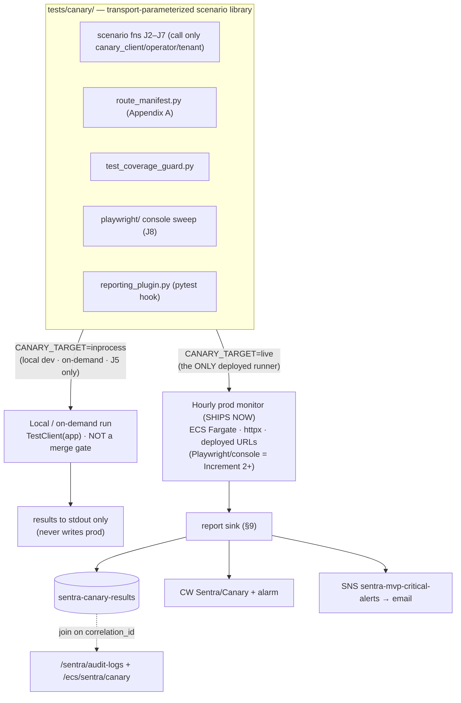
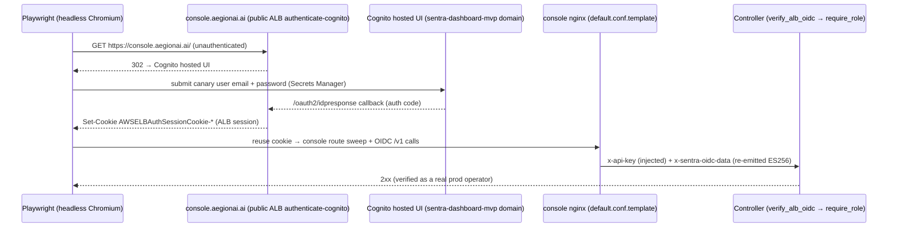
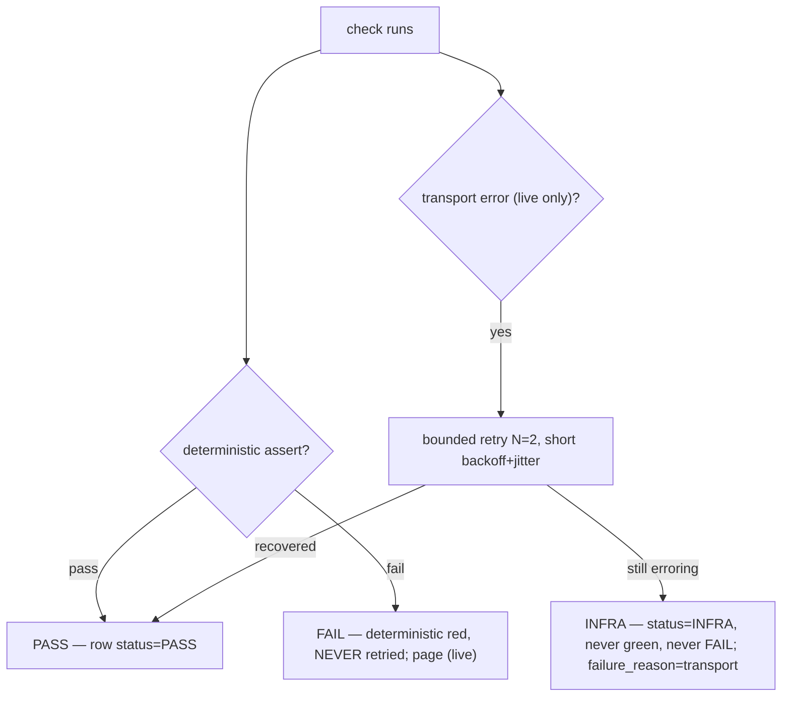

# LLD 38: Synthetic Canary + E2E Test Harness (WS-J)

**Version**: 1.0
**Last Updated**: 2026-07-05
**Status**: Draft
**Prerequisites**: [hld/serverless-edition.md](../hld/serverless-edition.md) (§6.4 + §8 + Appendix C); [tasks/serverless-edition/ws-j-canary-tests.md](../tasks/serverless-edition/ws-j-canary-tests.md) (the locked workstream scope, D-1..D-5); LLD 26 multi-tenancy; LLD 21 API inventory.

> **Doc role.** This is the implementation-grade LLD for **WS-J** — the synthetic canary and end-to-end test harness. Its boundary and locked decisions (D-1..D-5) are fixed by the workstream scope [tasks/serverless-edition/ws-j-canary-tests.md](../tasks/serverless-edition/ws-j-canary-tests.md); this doc says *exactly how to build it* against the real code, and revisits none of those decisions. Buildable tasks are generated from this LLD by `plan-workstreams`.

## Table of Contents
1. [Context — and the Increment-1 launch-day scope (founder P0s, 2026-07-05)](#1-context)
2. [Scope, dependencies & landed-vs-blocked status (Increment 1 vs deferred)](#2-scope-dependencies--landed-vs-blocked-status)
3. [Architecture — the transport-parameterized scenario library](#3-architecture--the-transport-parameterized-scenario-library)
4. [Route manifest & coverage guard (incl. negative-case + code-logic coverage — P0-1/P0-2)](#4-route-manifest--coverage-guard)
5. [Per-scenario assertion design (J2–J7) + per-route positive/negative cases (§5.9, P0-1)](#5-per-scenario-assertion-design-j2j7)
6. [Console UI canary (Playwright) — Increment 2+ (deferred)](#6-console-ui-canary-playwright)
7. [Security (SEC-1..5) at implementation altitude](#7-security-sec-15-at-implementation-altitude)
8. [New AWS infrastructure — `canary_stack.py` (CDK)](#8-new-aws-infrastructure--canary_stackpy-cdk)
9. [Reporting, RCA & the INFRA-vs-FAIL-vs-PASS model](#9-reporting-rca--the-infra-vs-fail-vs-pass-model)
10. [CI runner — OUT OF SCOPE (no PR merge-gate)](#10-ci-runner--out-of-scope-g3-1-no-pr-merge-gate-ships)
11. [Prod-write hygiene & seed/teardown](#11-prod-write-hygiene--seedteardown)
12. [Scaling, cost & resiliency](#12-scaling-cost--resiliency)
13. [Cross-references](#13-cross-references)
- [Appendix A — Full route manifest (61 in-code + 4 demo-proxy)](#appendix-a--full-route-manifest-61-in-code--4-demo-proxy)
- [Appendix B — Shared policy+input corpus file format](#appendix-b--shared-policyinput-corpus-file-format)

---

## 1. Context

This LLD elaborates the **one approved HLD approach** for the end-to-end canary: the "build requirement" carry-row in [hld/serverless-edition.md](../hld/serverless-edition.md) §8, the six numbered gating scenarios + the (2b) differential-conformance requirement in §6.4, and the interpreter-soundness invariants in Appendix C. The workstream scope [tasks/serverless-edition/ws-j-canary-tests.md](../tasks/serverless-edition/ws-j-canary-tests.md) locked **one transport-parameterized scenario library** (D-1), **exhaustive API coverage** (D-2), an **exhaustive headless-Playwright console canary** (D-3), **real-Cognito-login auth** (D-4), and **CloudWatch + DynamoDB + SNS reporting** (D-5). **Gate-3 scope refinement (G3-1, supersedes D-1's "two runners"):** only **one** runner ships — the hourly ECS `live` monitor; the `inprocess` mode is retained for local dev + on-demand runs + the J5 scenario, but the GitHub Actions PR merge-gate is **dropped** (§10). This doc pins the mechanisms — fixtures, manifest, assertion targets, the new `canary_stack.py`, the results schema, and the three-state error model — and does not re-open any of those calls.

**Build-vs-buy (why a bespoke harness, and where NOT to build one).** The **security-specific assertions** genuinely can't be expressed in a managed synthetics product (CloudWatch Synthetics / Datadog Synthetics / Checkly): differential-conformance (two engines must agree on a shared Cedar corpus, §5.2), redaction-sentinel **absence** at egress/logs (§5.4), cross-tenant isolation (§5.6), and `winning_source`/`deciding-validator` assertions (§5.1) all require domain logic and access to internal call boundaries that off-the-shelf synthetics have no concept of. But the honest scoring is per-scenario, and it exposes a real contingency:

| Scenario | Expressible in Datadog/Checkly? | Verdict |
|---|---|---|
| J2 ALLOW/DENY + `winning_source` | **Yes** (POST + assert response body field) | buy-able |
| J4.1 redaction leak-direction | **Yes** (assert a sentinel string is *absent* in body/logs) | buy-able |
| J6 cross-tenant read | **Awkward** (needs two auth contexts + tenant-scoped seed/teardown) | leans build |
| J8 console render / 5xx sweep | **Yes** (programmable Playwright in Checkly) | buy-able |
| J8.4/J8.5 gateway-vs-manifest diff | **Awkward** (needs `apigateway:GET` + manifest join) | leans build |
| J5 metering durable-before-ack / dedup | **No** (asserts on internal DDB `sentra-meter-events` partition) | build-only |
| J7 server-side `require_role`/IDOR | **Awkward** (needs role matrix + membership-derived tenant) | leans build |
| **J3 differential-conformance** | **No** (two-engine agreement on a shared corpus) | **build-only — and EXEMPT/may-be-cancelled** |

The genuinely-unexpressible-off-the-shelf set is small (J3, J5), and **J3 is the strongest of them yet is not yet gating** — exempt until the local floor lands. **Status (2026-07-05):** the WS-0 spike is signed and the local floor is **committed to build (not cancelled)**, so J3 is *pending the interpreter/emitter landing on `main`*, not at risk of permanent cancellation; J5 (metering) is not built yet. **Tripwire (DEC-adjacent, now a low-probability contingency):** *in the unlikely event the local floor is later pulled, re-evaluate migrating the buy-able set (J2/J4.1/J8) to a managed synthetic and retiring the Playwright container + generic sweep from `canary_stack.py`* — the bespoke decision is **contingent on J3 (and J5) landing**, which is now the expected path.

**Where we do *not* hand-roll (today):** the generic **uptime/reachability** layer — plain route-render + 5xx sweep, cert-expiry, multi-region probe — is a candidate to **delegate to CloudWatch Synthetics** rather than maintain in the Playwright container; if the generic sweep's maintenance cost grows, move it there and keep the bespoke harness for the security assertions only.

**Increment 1 — the launch-day build scope (founder PDF-comment P0s, 2026-07-05, SUPERSEDES the earlier D-3 exhaustive-console + D-4 Cognito-auth first-build picks).** The founder reviewed the rendered LLD and re-scoped the **first build increment** to three P0s, deferring console/auth/metering to later increments (design below stays in the doc, tagged *Increment 2+ — deferred*):
- **P0-1 — ALL APIs, POSITIVE + NEGATIVE (the headline P0).** The canary covers **every** API-key-reachable wired method, and for **each** route **both** the positive happy-path **and every documented negative/failure case** — `401`/`403`/`404`/`409`/`422`/`429`, `DENY`-is-`200`, malformed-body `400`, not-found `404`, conflict `409`, unknown-`phase` `422`. Negative-case coverage is a **HARD P0** (not "where applicable"): a route with only a happy-path check is a **RED coverage gap** (§4, §5). *(Verbatim founder comment, p2/p5: "All the APIs needs to be covered … All the usecases for APIs needs to be covered (Positive and negative)." p4: "we need to make sure that negative test cases are also covered.")*
- **P0-2 — ALL CODE LOGIC COVERED, measurable.** The coverage guard tracks a **route×behavior matrix** (each positive outcome + each negative/error branch = a required cell), and the on-demand `inprocess` runner (`TestClient` against the real `app.main:app`) runs under **pytest-cov (`--cov=app`)** and emits a coverage report against a **stated threshold** — so "all code logic covered" is **measurable, not asserted** (§4.3). *(Verbatim founder comment, p5: "All the code logic needs to be covered.")*
- **P0-3 — SNS alert email = `shshgup@amazon.com`.** The alert topic carries an `EmailSubscription` to **`shshgup@amazon.com`** (one-time SNS confirmation click; SMS none for now) (§9.4). *(Verbatim founder comment, p5: "Send the alert notification on shshgup@amazon.com".)*

**Deferred to Increment 2+ (design stays in this doc, NOT built in Increment 1 — per founder 2026-07-05, add when the owning WS lands):** J5 **metering** (WS-H); J7 **authz** (WS-M); J8 **console UI sweep** + the **Cognito hosted-UI login fixture** + **all OIDC-gated `/v1` route coverage** (WS-G/WS-M — "build in progress"). Metering is skipped for now (founder: "Skip metering for now"); console + auth are skipped for now ("Skip Console and Auth for now, its build in progress. once its done we will add that as well"). Each such scenario/section below is tagged **`Increment 2+ — deferred`**.

**Increment-1 API-coverage bound (stated honestly).** Because console + auth are deferred, the **OIDC-gated** tenancy/platform routes (`/v1/me`, `/v1/tenants/*`, `/v1/platform/*`, `/v1/agents/{id}/credentials*`) **cannot** be exercised by Increment 1 — they require the deferred Cognito browser login. So Increment 1's **REQUIRED** set is exactly the **`X-Api-Key` routes reachable without a browser session** (via the public API Gateway with the shared key); the **OIDC-gated subset is EXEMPT-until-console/auth-lands** via the same per-route `landed_flag` mechanism. "All APIs covered" is therefore honestly bounded to *"all API-key-reachable routes in Increment 1; the OIDC-gated subset activates with the console/auth increment"* — the doc does not claim to cover routes the deferred login is required to reach (§2, §4, §13).

**What ships now, mechanically (the scheduled ECS hourly canary — G3-1, unchanged).** WS-J ships **one** deployed/scheduled runner: the **hourly ECS live monitor** (Runner B) — `canary_stack.py`, ECS Fargate, EventBridge Scheduler, the dedicated canary usage plan, the 8th image, `sentra-canary-results`, and SNS — **all of it now**. The scenario library stays transport-parameterized (`CANARY_TARGET=inprocess|live`), and `inprocess`/`TestClient` mode is for **local dev + on-demand manual runs + the pytest-cov code-logic measurement (P0-2) + the deferred J5 metering scenario**; it is **not** wired as a merge gate (the PR-gate runner is dropped — see §10). The GitHub Actions branch-protection/required-status-check path is **out of scope** for WS-J; the scenario library *can* be wired to CI later, but no CI runner ships here. **Playwright/Chromium is part of the Increment-2 console increment** (it is only needed for the deferred J8 console sweep + the Cognito login fixture), so the Increment-1 container is `httpx` + `boto3` only (§8.4).

**Day-one value, stated honestly (the accepted answer to the ROI objection — build now, coverage grows into the security properties as counterpart WSs land).** In Increment 1 J3/J5/J7/J8 are EXEMPT/deferred (their counterparties, or the deferred console+auth increment, haven't landed), so the hourly monitor's *live* catch is: **the full API-key-reachable API sweep — every such route's positive path AND every documented negative/failure case (P0-1)**, **uptime + reachability**, **deploy/config/cert drift** (a gateway/app method mismatch or `api_key_required=False` slip via J8.4/J8.5, cert expiry — the `ff4fdfc`-class outage that already caused an 8-h enforcement outage on 2026-06-13), **redaction-plumbing** (J4.1 — the mechanism is wired and firing in prod), and **tenant-isolation** (J6). The **console render sweep (J8)** and the **local-floor differential (J3)/metering (J5)/authz (J7)** scenarios are **DESIGNED-but-EXEMPT/deferred** and **AUTO-ACTIVATE** (their `landed_flag` flips exempt→required) as their counterparts land: J8 + all OIDC-gated route coverage with the deferred **console/auth increment** (WS-G/WS-M); J3 as WS-A/lld37 interpreter + WS-I emitter land; J5 as WS-H's metering writer lands; J7 per-route as WS-M's `require_role` lands. So coverage **grows into** the security properties over time rather than being built to run mostly-exempt.

**HLD tenets carried forward (the tie-breaker for every close call here):** enforcement is local / the control plane is never on the action path (the canary is pure observability, **off** the action path — §12); **fail-secure / deny-by-default** (a canary that can't establish its precondition errors RED, never skips into green — §9); the data boundary is the customer's (the canary uses **synthetic** sentinels only, never real PII — §7); honest staging (scenarios for un-built workstreams are **explicitly exempt**, not silently passing — §4). Two rounds of founder decisions are honored verbatim: the **prior locked set DEC-1..DEC-4** (DEC-1 J3 activation flag §5.3, DEC-2 per-route exempt §4.3, DEC-3 isolated `canary_stack` §8, DEC-4 J5 `inprocess`-only §5.5/§9) **and** the **2026-07-05 Gate-3 round G3-1..G3-5** that refines them: **G3-1** drop the PR merge-gate — ship only the scheduled ECS hourly canary (§1 "What ships now", §10); **G3-2** flywheel safety = fail-closed separate partition (SEC-11); **G3-3** WS-M authz-lock is a P0 on the regulated-GA critical path + buyer/internal disclosure split (§2, §13); **G3-4** three hardening items — Cognito-login streak-page (§6.1/§9.4), visible concurrency-skip signal (§12.1/§9.2), drop the standing `_platform` grant (SEC-7); **G3-5** the §13 traceability fixes.

---

## 2. Scope, dependencies & landed-vs-blocked status

**In plain terms:** the canary is one library of scenario functions plus **one** deployed thing that runs them — an **hourly ECS Fargate task against deployed prod** (`live`). The same library also runs `inprocess` (`TestClient`) for **local dev, on-demand manual runs, the pytest-cov code-logic measurement (P0-2), and the deferred J5 metering scenario** — but there is **no PR merge-gate runner** (dropped per G3-1; §10). A scenario only becomes a *required* check once the workstream it proves has actually landed on `main`; until then the coverage guard marks it **exempt** so it neither runs falsely nor blocks.

**Increment split (founder 2026-07-05).** **Increment 1 (BUILD NOW):** ALL-API coverage — every **API-key-reachable** route, positive + negative (P0-1) — + all-code-logic coverage (P0-2) + reporting (`sentra-canary-results` + `Sentra/Canary` CW + SNS→`shshgup@amazon.com`, P0-3) + the scheduled ECS Fargate hourly runner + `canary_stack.py` + the coverage guard. **Increment 2+ (DEFERRED — design stays, not built now):** J5 metering (WS-H), J7 authz (WS-M), J8 console UI + the Cognito hosted-UI login fixture + **all OIDC-gated `/v1` route coverage** (WS-G/WS-M — "build in progress"). The OIDC-gated rows below are marked **EXEMPT-until-console/auth-lands** because Increment 1 has no browser session to reach them. This table is the authoritative phased-activation contract: each row's `landed_flag` is a boolean the coverage guard reads to flip a scenario from exempt to required.

| Scenario / dep | Sibling WS | Status today (with `file:line` evidence) | Coverage-guard state | Auto-flip trigger |
|---|---|---|---|---|
| **J2** validate ALLOW/DENY round-trip | core (live) | **DONE** — `POST /v1/validate` → `_run_validation_pipeline` ([validation_service.py:575](../src/security-controller/app/services/validation_service.py#L575)) → `DenyOverrides` ([deny_overrides.py](../src/security-controller/app/combiners/deny_overrides.py)) all live | **REQUIRED now** | — |
| **J2.3** per-`phase` round-trip | WS-B | **DONE on main** — `KNOWN_PHASES` ([models.py:27](../src/security-controller/app/api/models.py#L27)), `phase` Field ([:79](../src/security-controller/app/api/models.py#L79)), `content_text` ([:88](../src/security-controller/app/api/models.py#L88)) | **REQUIRED now** (WS-B landed) | already flipped |
| **J3** staleness + differential conformance | WS-A local-floor + WS-I emitter | **SPIKE-BLOCKED / SCOPE-ONLY** — SDK 0.2.0 ships only the `LocalFloorVerdict` enum ([local_floor.py]); `guard` always routes to the hosted PDP; lld/37 interpreter PLANNED/deferred; WS-I Group-2 emitter WS-0-spike-gated. Only `cedarpy` on main is the **server-side** hosted engine ([evaluator.py:91](../src/security-controller/app/validators/cedar/evaluator.py#L91)), not an SDK differential. | **Two-engine differential: EXEMPT (designed now, DEC-1)** — double-gated on `landed_flag` (interpreter+emitter present) **AND** flag `LOCAL_FLOOR_SHIPPED` (spike signed 2026-07-05, floor committed-to-build; flag remains as the activation seam + fail-secure escape hatch, not an open cancel decision). **Server-only Cedar regression over the shared corpus: REQUIRED now** (§5.3 — hosted-PDP golden-verdict gate, no SDK dependency) | differential flips when interpreter+emitter land **and** `LOCAL_FLOOR_SHIPPED=true` |
| **J4** redaction-before-egress | WS-E | **DONE** (Tier-1 edge + stage-2 server redaction deployed) — canary asserts the leak-direction | **REQUIRED now** | — |
| **J5** metering no-miss / dedup | WS-H | **SCOPE-ONLY** — no `sentra-meter-events` table, no durable writer; old path is fire-and-forget ([metrics_publisher.py:130](../src/security-controller/app/utils/metrics_publisher.py#L130)) | **EXEMPT (DEC-2)**; and **DEC-4: `inprocess`/ON-DEMAND ONLY — the hourly ECS prod monitor SKIPS J5** (billing-hygiene). With no PR-gate, J5 is a **manual/local** scenario, not automatically run. | `sentra-meter-events` durable writer lands |
| **J6** multi-tenant isolation | LLD 26 (DONE+DEPLOYED) | **DONE** — `tenant_identity_mode: enforce` ([dev.yaml:37](../cdk/config/dev.yaml#L37)), `resolve_tenant_from_jwt` ([deps.py:111](../src/security-controller/app/api/deps.py#L111)) | **REQUIRED now** | — |
| **J7** authz (server + console) | WS-M | **SCOPE-ONLY** — all 17 WS-M-scope routes ungated today: policy/agent-policy CRUD (`create_policy` [routes.py:1172], `update` [:1216], `delete` [:1271], `status` PATCH [:1313], attach [:882], detach [:902]), connections [734–821], **rollback (`rollback_action` [:1601], `rollback_conversation` [:1660]), quarantine (`quarantine_session` [:1730], `release_session` [:1816]), discovery import (`discovery_import` [:697])** — all verified `require_role`-less 2026-07-05; only `delete_feedback_subject` [:834] is gated | **EXEMPT (DEC-2)** — keyed **per-route** off `RouteSpec.authz_gap_flag`, not one WS-wide flag (WS-M lands in staged milestones M-M1 policy CRUD / M-M2 connections+quarantine+rollback+discovery-import / M-M3 sigma platform-gate) | each route flips when *its* `require_role`/`require_platform` lands |
| **J8** console UI sweep | WS-G / console (live) | **DEFERRED (Increment 2+)** — router present ([web/console/src/app/router.tsx](../web/console/src/app/router.tsx), routes [web/console/src/app/routes.ts](../web/console/src/app/routes.ts)); the Playwright harness + Cognito login fixture are **NOT built in Increment 1** (founder: "Skip Console and Auth for now, its build in progress") | **EXEMPT-until-console/auth-lands** (design in §6; render + no-5xx activates with the console increment); the J7.2 email-domain assertion tracks WS-G | console/auth increment lands (Playwright + Cognito login fixture) |
| **Exhaustive API coverage (positive + negative — P0-1)** | D-2 | **65 gateway-wired methods**, zero unwired after `ff4fdfc`; of these, the **API-key-reachable** subset (public `GET /v1/health` + the `key` routes) is reachable in Increment 1, the **16 OIDC-gated** methods need the deferred browser login | **REQUIRED now (Increment 1)** for every **API-key-reachable** route whose owning WS is landed — each such route's positive path AND every documented negative/failure axis (§5.9); the **OIDC-gated subset is EXEMPT-until-console/auth-lands** (per-route `landed_flag`) | per-route `landed_flag`; the OIDC subset flips with the console/auth increment |

**Not spike-gated as a whole (scope §1):** WS-J scaffolds the harness, both runners, and every already-shipped scenario now. Its scenario set *grows as each sibling WS lands* — a WS is not "done" until its canary scenario exists and gates.

**Launch-day (Increment 1) coverage statement (honest, so the coverage claim can't be over-read).** At WS-J Increment-1 ship, the canary **GATES**: J2 (ALLOW/DENY + `winning_source`), J2.3 (per-`phase`, WS-B landed), J4 (redaction leak-direction, WS-E landed), J6 (multi-tenant isolation, LLD 26 landed), and **every landed API-key-reachable route in Appendix A — its positive path AND every documented negative/failure case (P0-1, a hard gate)**. It is **EXEMPT/DEFERRED** (designed, not gating) on **four** areas, each leaving a specific known risk unmonitored at Increment-1 launch:
- **J8** (console UI sweep) **and the 16 OIDC-gated `/v1` routes** — **deferred to Increment 2+** because console + auth are "build in progress" (founder 2026-07-05); the canary carries **no browser session** in Increment 1, so console render and the OIDC-gated tenancy/platform/credential routes are not exercised until the console/auth increment lands. This is stated so "all APIs covered" reads honestly as *"all API-key-reachable routes in Increment 1."*
- **J3** (local-floor differential) — exempt until the floor lands **and** `LOCAL_FLOOR_SHIPPED=true` (spike signed, floor committed-to-build — pending the interpreter landing, not a cancel decision); the "local floor can't silently ALLOW what the hosted PDP denies" guarantee is not gated until then. **Interim substitute that DOES run today:** a **server-only Cedar regression** over the same corpus — `corpus_cedar_oracle(case) == case.expected_decision` for every in-subset case (the net-new WS-J adapter over `CedarEvaluator.is_authorized`, §5.2; a golden-verdict set with **zero** dependency on an SDK interpreter). It proves the hosted PDP hasn't regressed against the corpus even while the two-engine differential has no counterparty; it does **not** prove the (nonexistent) local floor is sound. This keeps J3 from being a monitored *vacuum* pre-floor.
- **J5** (metering no-miss/dedup) — exempt until WS-H's `sentra-meter-events` writer lands; the **billing/money path** is unproven by the canary until then (J5.3 adds a prod-safe canary-tenant reconcile once the table exists — §5.5).
- **J7** (authz) — exempt per-route until WS-M's `require_role`/anti-IDOR lands; the **open policy-CRUD/connection IDOR** (the `authz_gap_flag` routes, ungated today + spoofable `X-Operator-Email` — a buyer's pen-test hits it first) is **monitored-as-live via J7.0** but **explicitly not gated** on launch day. This is stated so the coverage story reads as "these N gate, these M are exempt with *these* named open risks," not "the whole surface is watched."
  - **P0 on the regulated-GA critical path (G3-3).** Closing this IDOR — **building WS-M** — is a **P0 on the path to the first regulated-buyer deployment**. J7.0 monitors the gap so it is alarmed rather than silent; it does **NOT** bless shipping the live cross-tenant IDOR to a regulated buyer. The raw IDOR admission stays in this internal coverage-honesty artifact; the buyer-facing coverage claim (§13) describes only what **is** monitored-and-gated.

---

## 3. Architecture — the transport-parameterized scenario library

**In plain terms:** there is one env var, `CANARY_TARGET`. When it is `inprocess`, the `canary_client` fixture hands scenarios a FastAPI `TestClient(app)` (the exact pattern in [src/security-controller/tests/test_health.py:5-14](../src/security-controller/tests/test_health.py#L5)); when it is `live`, the same fixture hands them an `httpx.Client` pointed at a real deployed URL. A scenario function calls `canary_client.post("/v1/validate", ...)` and asserts on the response — it **never reads `CANARY_TARGET`** and never branches on transport. That single rule lets the **one deployed `live` runner** and the **local/on-demand `inprocess`** mode share **the same scenario shells with transport-appropriate assertion depth** — for the round-trip scenarios (J2, J2.3, J4.1, J6, J8) the assertion code is genuinely identical across `inprocess` and `live`. For **two** scenarios the assertion *shell* is shared but the *depth differs by transport*, and the doc is explicit about it rather than claiming uniform strength — see the per-scenario depth table in §5.8.

**Honest scope of what the LIVE prod monitor proves (do not over-read "continuously monitored").** The `inprocess` (local/on-demand) mode and the `live` hourly monitor are NOT byte-identical for the two assertions that reach into in-process internals: J3's differential needs the SDK `bundle_interpreter` (in-process import only) and J4.2's deterministic PII-in-logs check drains `validation_service._bg_tasks` (a module-level set reachable only in-process). Their `live` forms are weaker (§5.8 marks each honestly). So "redaction leaks and local-floor soundness are *continuously monitored in prod*" over-reads the design: those two are proven only in the **`inprocess`/on-demand** run against a `TestClient`; the hourly prod monitor runs a **weaker** variant (or, for J4.2 `live`, the positive-intercept form via a hosted-side capture hook — a designed dependency, §5.8, not a hand-wave). The coverage guard's own blind spot (it introspects `app.routes`, not the deployed API Gateway) is closed by the §6.4 gateway-reconciliation scenario.

### 3.1 The one hard rule

```
HARD RULE (enforced by review + a lint check in test_coverage_guard.py):
  A scenario function may reference ONLY canary_client / canary_operator / canary_tenant.
  It MUST NOT import or read CANARY_TARGET, os.environ["CANARY_TARGET"], or any
  transport-specific symbol. All transport divergence lives in the FIXTURES.
```

### 3.2 Fixtures (`tests/canary/conftest.py`)

New package `tests/canary/{__init__.py, conftest.py}` that **imports and extends** [tests/integration/conftest.py](../tests/integration/conftest.py)'s `service_urls` / `aws_config` fixtures (does not duplicate them). Three canary fixtures:

- **`canary_client`** — the transport switch. Pseudo-code:
  ```python
  @pytest.fixture
  def canary_client(request):
      target = os.environ.get("CANARY_TARGET", "inprocess")   # ONLY the fixture reads this
      if target == "inprocess":
          from app.main import app                             # mirrors test_health.py
          return CanaryClient(TestClient(app), mode="inprocess")
      else:  # "live"
          base = os.environ["SENTRA_API_GW_URL"]              # public API Gateway URL
          key  = _load_secret("sentra/canary/api-key")        # shared X-Api-Key
          return CanaryClient(httpx.Client(base_url=base, headers={"X-Api-Key": key},
                                           timeout=8.0), mode="live")
  ```
  `CanaryClient` is a thin adapter exposing `.get/.post/.put/.delete/.patch` and, critically, `.correlation_id` — it injects a fresh `X-Correlation-Id`/`request_id` header per call (the RCA join key, §9) and records latency. **Every call in `live` mode carries a per-call timeout (8 s default, §12).**

- **`canary_tenant`** — yields an ephemeral tenant id `canary-<uuid4hex>`, seeds a membership row into `sentra-tenant-members` via the existing seed path ([scripts/seed_all.py](../scripts/seed_all.py)), and tears it down after (best-effort, idempotent — §11). **Never** hardcodes `acme`/`default`.

- **`canary_operator`** (D-4) — an authenticated *operator* context for OIDC-gated `/v1` routes. **Its `live` form (real hosted-UI login) is Increment 2+ (deferred with console/auth); the `inprocess` form ships in Increment 1** for local/on-demand code-logic coverage of the OIDC handlers, but no OIDC route is gated in the Increment-1 `live` monitor:
  - `inprocess`: sets `deps._alb_claims_override` (the test seam at [deps.py:279](../src/security-controller/app/api/deps.py#L279), consumed inside `verify_alb_oidc` at [:289](../src/security-controller/app/api/deps.py#L289)) to a callable returning synthetic verified claims `{sub, email}`, and seeds a matching `sentra-tenant-members` row so `resolve_operator_tenant` ([deps.py:323](../src/security-controller/app/api/deps.py#L323)) resolves a tenant. This bypasses ALB *only in-process* (production leaves the override `None`).
  - `live`: drives the **real hosted-UI login** via the shared Playwright context (§6) and reuses the resulting `AWSELBAuthSessionCookie-*` browser cookies for any OIDC `/v1` call made **through the console host** `https://console.aegionai.ai`. Token-mint is explicitly rejected (see §7).

### 3.3 Library → one deployed runner (+ local/on-demand `inprocess`)



**What each mode catches.** The `live` hourly ECS monitor (the only deployed runner) talks to the **real** API Gateway (and, in Increment 2+, the ALB / Cognito / nginx console path), so it catches uptime failures, deploy drift, and cert expiry that in-process tests structurally cannot see. **In Increment 1** it exercises the public API Gateway only (the `X-Api-Key` surface); nginx-config/Cognito-misconfiguration catches arrive with the deferred console/auth increment (§6). The `inprocess`/`TestClient` mode (local dev, on-demand, and the J5 metering scenario) is hermetic and fast (no AWS, no network) — it catches contract regressions when a developer runs it, but it is **not** a merge gate (G3-1; §10) and never writes to prod.

---

## 4. Route manifest & coverage guard

**In plain terms:** `route_manifest.py` is a hand-reconciled list of every wired endpoint, each row saying what auth it needs, which workstream owns it, whether it has landed, whether it carries a known authz gap, **and every documented negative/failure case that must be checked**. `test_coverage_guard.py` introspects `app.routes` at import time, joins it against the manifest, and goes **RED** if a wired route has no canary check for its positive path **or any of its documented negative cases**, *and* has no explicit not-yet-landed exemption. It is a **repo / on-demand self-check** — it runs inside the scheduled `live` canary and is runnable locally; it is **not** wired as a merge gate (G3-1; branch-protection is out of scope). That join is what makes "exhaustive coverage" — **positive AND negative, per P0-1** — a mechanical guarantee instead of a claim.

**Negative cases are first-class (P0-1 / founder p4).** The guard does **not** treat a route as covered because it has a happy-path check. Each route carries a `failure_axis` tuple (its documented `401`/`403`/`404`/`409`/`422`/`429`/`DENY`/malformed-`400` subset), and the guard requires a canary cell for **every** axis on the route, not just the positive outcome. A route with only a happy-path check is a **RED coverage gap** (`ROUTE_NEGATIVE_AXIS_UNCOVERED`), exactly as a route with no check at all.

### 4.1 The manifest data structure

`tests/canary/route_manifest.py` — a frozen list of `RouteSpec`:

```python
@dataclass(frozen=True)
class RouteSpec:
    path: str            # "/v1/policies/{policy_id}/status"
    method: str          # "PATCH"
    auth_class: str      # "public" | "api_key" | "oidc_rbac" | "demo_proxy"
    ws_owner: str        # "WS-M", "core", "WS-G", ...
    failure_axis: tuple  # ("401","403","404","422","429","409","DENY") applicable subset
    landed_flag: bool    # True → coverage REQUIRED; False → exempt until it lands
    authz_gap_flag: bool # True → today api-key-only, WS-M lock not yet present
```

The `auth_class` values map to the **verified** auth reality (§7): `public` = 1 route (`GET /v1/health`); `api_key` = 64 (every non-health route is api-key-only *at the gateway* — `authorization_type=NONE`, single shared key checked only by API Gateway per [api_endpoint_construct.py:68](../cdk/cdk_constructs/api_endpoint_construct.py#L68), the construct default; wired routes gate directly on `add_method(..., api_key_required=True)` in `api_stack.py`); `oidc_rbac` = the **labeled subset of 16** enforced *at the controller* by `require_role`/`require_platform` on top of forwarded `x-amzn-oidc-data` (it is **not** a distinct gateway class); `demo_proxy` = the 4 demo-agent proxy methods. **Auth-anchor caveat:** `api_endpoint_construct.py:68` is the *construct-level* default; the routes actually wired in `api_stack.py` set their gate directly on each `add_method(..., api_key_required=True)` call (verified: [api_stack.py:373](../cdk/stacks/api_stack.py#L373)/[:421](../cdk/stacks/api_stack.py#L421)/[:443](../cdk/stacks/api_stack.py#L443)/[:465](../cdk/stacks/api_stack.py#L465) — and the **one** `api_key_required=False` at [:389](../cdk/stacks/api_stack.py#L389) is precisely the public `GET /v1/health`) — those `add_method` calls are the faithful anchor for a wired route's `NONE`+api-key gate, and J8.5 (§6.4) asserts them against the **live** gateway. Full table: **Appendix A**.

### 4.2 The coverage-guard algorithm

```python
def test_every_wired_route_has_a_canary():
    from app.main import app
    wired = {(r.path, m) for r in app.routes for m in getattr(r, "methods", []) if m != "HEAD"}
    covered = _collect_canary_targets()          # {(path, method): {axis, ...}} each scenario exercises
    manifest = {(s.path, s.method): s for s in ROUTE_MANIFEST}

    missing = []
    for key in wired:
        spec = manifest.get(_normalize(key))
        if spec is None:
            missing.append(("UNKNOWN_ROUTE_NOT_IN_MANIFEST", key)); continue
        if not spec.landed_flag:
            continue                              # explicitly exempt — un-built WS or Increment-2 OIDC route
        covered_axes = covered.get(key, set())
        if "positive" not in covered_axes:
            missing.append(("LANDED_ROUTE_UNCOVERED", key)); continue
        # P0-1: every documented negative axis is a REQUIRED cell, not optional
        for axis in spec.failure_axis:
            if axis not in covered_axes:
                missing.append(("ROUTE_NEGATIVE_AXIS_UNCOVERED", key, axis))
    assert not missing, missing
```

The guard checks a **route×behavior matrix**: coverage is `{(path, method): {axis, ...}}` — a route is only "covered" when its positive cell **and every documented negative axis cell** is exercised. Three symmetric failures make this trustworthy:
- **`LANDED_ROUTE_UNCOVERED`** — a landed route with no positive-path canary → RED (D-2's "goes red when a behavior lands without its canary").
- **`ROUTE_NEGATIVE_AXIS_UNCOVERED`** — a landed route missing any documented negative/failure axis (P0-1) → RED. A happy-path-only check is **not** coverage.
- **`UNKNOWN_ROUTE_NOT_IN_MANIFEST`** — a *new* wired route nobody added to the manifest → RED. A route cannot slip into prod uncovered *and* undocumented; the self-check surfaces it (and the author is expected to classify it — auth_class, owner, **failure axis**, landed_flag — when they add the route). *(This is a self-check, not a branch-protection block — G3-1.)*

The manifest also holds `REQUIRED_SCENARIOS` keyed by WS letter (J2..J8) with the same `landed_flag` gating, so the guard covers **both** "every route" and "every landed WS's scenario" (scope J1.4). DEC-1 adds the second gate for J3: it stays exempt until `landed_flag AND os.environ.get("LOCAL_FLOOR_SHIPPED") == "true"`.

### 4.3 Code-logic coverage — measurable, not asserted (P0-2 / founder p5)

**In plain terms:** "all code logic covered" is made a measurable number, not a claim. The behavioral coverage guard above proves *every route×behavior cell has a check*; a **second, orthogonal** dimension proves the scenario suite actually *executes the request-path code lines*, via `pytest-cov`.

- **(a) Behavioral coverage (the route×behavior matrix, §4.1/§4.2).** Enforced in **both** modes: every route's positive outcome + every documented negative/error branch is a required cell. This is what the black-box `live` hourly monitor can enforce — it cannot instrument the remote process for line coverage, so **behavioral** coverage is its measurable unit.
- **(b) Line/branch coverage (the measurable gate, `inprocess`/on-demand only).** The on-demand `inprocess` runner (`TestClient` against the real `app.main:app`) runs under **`pytest --cov=app`** and emits a coverage report. The scenario suite must achieve **≥ 85% statement coverage of the request-path packages `app/api` + `app/services`** in `inprocess` mode (`--cov=app/api --cov=app/services --cov-fail-under=85`). *(85% is a **target to tune**, not a proven floor — it is a defensible starting bar for the wired-together request path; raise it as gaps close. It is asserted in the on-demand runner, not the hourly `live` monitor.)* This is the concrete mechanism that makes P0-2's "all code logic covered" a measured number.
- **(c) Honest bound — what this is NOT.** The `live` hourly monitor is **black-box** (it cannot instrument the remote process for line coverage), so it enforces only (a) behavioral coverage; the (b) line/branch gate runs in `inprocess`/on-demand mode. And **exhaustive unit-level coverage of internal helpers remains each WS's own unit-test job** — the canary proves *wired-together* behavior end-to-end, it is **not** a substitute for a WS's unit tests. So P0-2 is delivered as: behavioral coverage everywhere + a measured line/branch floor on the request path in-process, with unit-level helper coverage owned by each WS.

---

## 5. Per-scenario assertion design (J2–J7)

Each subsection fixes the **assert target** and the **fail-open direction the scenario forbids** (scope §3 milestones). Every scenario calls only the transport-agnostic fixtures. **Per P0-1, every route additionally carries a per-route positive+negative case set (§5.9) — the negative axis is a first-class REQUIRED check, gated by the coverage guard (§4), not an optional extra.**

### 5.1 J2 — validate ALLOW/DENY round-trip (REQUIRED now)

**In plain terms:** post a benign request, assert `200 + ALLOW`; post a request that trips a deterministic floor, assert `200 + DENY` and that `metadata['winning_source']` names the deciding validator. A DENY is a **successful** validation, so the forbidden mistake is asserting DENY on an HTTP error code.

- **J2.1 ALLOW.** POST a benign `ValidationRequest` ([models.py:54](../src/security-controller/app/api/models.py#L54)) → assert HTTP `200`, `decision == "ALLOW"`, and the pipeline actually ran (`metadata['winning_source']` present, set by `DenyOverrides`).
- **J2.2 DENY + deciding source.** POST a request tripping a Cedar `forbid` tool or out-of-bounds param → assert `decision == "DENY"`, **HTTP `200`**, and `metadata['winning_source']` names the validator. **Fail-open forbidden:** asserting on HTTP status instead of `winning_source` (a DENY is not a 4xx/5xx).
- **J2.3 per-`phase` (REQUIRED — WS-B landed).** Parametrize J2.1/J2.2 over `KNOWN_PHASES` ([models.py:27](../src/security-controller/app/api/models.py#L27)); assert an unknown/absent `phase` behaves per WS-B's invariant (`422` on unknown, or defaults to `"request"`). **Fail-open forbidden:** an unimplemented phase silently ALLOWing (must be `_phase_not_implemented_deny`).

### 5.2 J3 — staleness fail-closed + differential conformance (EXEMPT, designed now per DEC-1)

**In plain terms:** three checks prove the local floor can never silently ALLOW what the hosted PDP would DENY. We push a signed bundle's cached age past its staleness bound by injecting a fake clock (not `sleep`), feed it tampered/unsigned bundles, and — the core check — run every entry of a shared corpus through both the stdlib interpreter and authoritative `cedarpy` and assert **identical** verdicts.

- **J3.1 stale-past-bound.** Inject a monotonic clock ([hld:671](../hld/serverless-edition.md#L671)) to age a signed bundle past `max_staleness`; assert a request the *fresh* bundle would ALLOW now resolves **DENY / escalate-to-hosted-PDP**. **Fail-open forbidden:** a stale ALLOW (the Appendix-C catastrophe). **Footgun:** inject the clock — never `time.sleep`/wall-clock (flaky → retried-into-green → gate disabled).
- **J3.2 tampered/unsigned rejected.** Feed (a) a flipped-byte-after-signing bundle and (b) an unsigned bundle to the verify step; assert both **rejected before use** ([hld:230](../hld/serverless-edition.md#L230)) and the floor reverts to deny-by-default. Money-movement tenants require the crypto-extra verify path (hash-only rejected — [hld:792](../hld/serverless-edition.md#L792)).
- **J3.3 differential runner (WS-J owns; corpus generator is WS-A/WS-I).** `cedarpy` has **only** `Decision.Allow`/`Decision.Deny` — no `ESCALATE` ([evaluator.py:108](../src/security-controller/app/validators/cedar/evaluator.py#L108)). So the two-engine differential runs over **in-subset cases only** (where the server oracle is ALLOW/DENY); every `out_of_subset`/`expected_decision == "ESCALATE"` case is routed **exclusively to J3.4** (an ESCALATE case has no `cedarpy` counterpart, so `edge.decision == srv.decision` is structurally impossible and would false-FAIL). The oracle is checked three-way:
  ```python
  for case in load_shared_corpus():
      if case.out_of_subset or case.expected_decision == "ESCALATE":
          continue                                                    # → J3.4 owns these
      edge = bundle_interpreter.evaluate(case.bundle, case.request)   # stdlib, SDK
      srv  = corpus_cedar_oracle(case)                               # authoritative (adapter, below)
      # three-way: both engines AND the independent oracle agree (catches a
      # shared interpreter+oracle fail-open, not just interpreter≠server divergence)
      assert edge.decision == srv.decision == case.expected_decision, (case.id, edge, srv)
  ```
  **`corpus_cedar_oracle(case)` is a net-new WS-J adapter, not an existing call** — there is **no** `cedarpy_evaluate(policy, request)` on `main`. The real server engine is the class method `CedarEvaluator(policies).is_authorized(*, principal, action, resource, context, entities) -> CedarDecision(allow, determining_policy_ids, errors)` ([evaluator.py:67](../src/security-controller/app/validators/cedar/evaluator.py#L67)), which takes a **pre-split** principal/action/resource + a **synthesized entity-store JSON string**, not raw Cedar policy text + a `{principal,action,resource,context}` dict. So the adapter WS-J must build does: `corpus_cedar_oracle(case)` = load `case.policy` into a `CedarEvaluator`, synthesize the entity store + split `case.request` into `principal`/`action`/`resource`/`context`, call `.is_authorized(...)`, and map `.allow` → `"ALLOW"`/`"DENY"`. This adapter is **WS-J-owned net-new code** (flagged so the §5.3 interim gate rests on a real, buildable interface, not a phantom signature).
  Subset covered: literal tool allow/deny, numeric/string param bounds, single-session sequence, prompt-signature patterns, **and egress destination/host/path/port** ([hld:788](../hld/serverless-edition.md#L788)).
  **Mandatory `missing_attribute` subset (fail-secure, not happy-path):** the corpus MUST include cases where a **dangerous tool** is called with the guarded attribute **absent** — e.g. `process_refund` with `context.amount` missing, and a principal with no `max_refund_amount` — `expected_decision="DENY"` (deny-on-missing). A stdlib interpreter that treats a missing optional attribute as "no match" would local-ALLOW where `cedarpy`/baseline DENY; the three-way oracle assertion catches even the case where interpreter **and** server-Cedar both fail open identically. (Cedar-policy invariants 2/3/5: forbid-that-reads-a-missing-attribute must not be dropped-into-fail-open; explicit deny-on-missing for dangerous tools.) **A corpus-integrity guard (SEC-9) asserts these mandatory fail-secure subsets are actually present** — so a corpus that quietly drops its deny-on-missing cases (or has an `expected_decision` flipped `DENY→ALLOW`) goes RED rather than rubber-stamping a fail-open oracle the three-way assertion cannot self-detect.
- **J3.4 subset-boundary (STRUCTURAL — not corpus-dependent).** Two assertions ([hld:786](../hld/serverless-edition.md#L786) invariants (i)/(ii)):
  - out-of-subset construct → emitter **escalates / emits NO local-ALLOW**, never silently drops a `forbid`.
  - unrecognized bundle construct → interpreter **escalates to hosted PDP**, never local-ALLOWs.
  **Fail-open forbidden:** relying on the corpus happening to match (a corpus-only differential is insufficient — the structural allowlist⇒escalate guarantee is the assertion).

### 5.3 DEC-1 activation gate (feature-flagged)

J3's **two-engine differential** is fully **written now** but stays exempt in the coverage guard — its counterparties (the SDK stdlib `bundle_interpreter.evaluate()` and the corpus generator) do **not** exist on `main` today (SDK 0.2.0 ships only `LocalFloorVerdict` and always routes to the hosted PDP), so it is **out of WS-J's shippable-gate scope until the floor lands** — not dressed-up dead code. It auto-flips to required only when **both**: (a) the lld/37 interpreter and WS-I emitter are present on `main` (`landed_flag`), **and** (b) `LOCAL_FLOOR_SHIPPED=true`. **Status (2026-07-05):** the WS-0 spike is **signed** and the local floor is **COMMITTED to build (not cancelled)** — so the flip is *pending the interpreter+emitter landing on `main`*, not gated on a still-open cancel/no-cancel decision; the `LOCAL_FLOOR_SHIPPED` flag remains as the mechanical activation seam (and the fail-secure escape hatch if the floor were ever pulled), but the expectation is "ships, then flips," not "may stay dark indefinitely." Until the interpreter lands, J3's differential code stays exempt (preserved, not deleted) and the §5.3 server-only regression is the REQUIRED interim gate.

**Interim server-only substitute that GATES today (so J3 isn't a monitored vacuum).** Independent of the floor, WS-J runs a **server-only Cedar regression** over the shared corpus: for every in-subset case, `corpus_cedar_oracle(case) == case.expected_decision` (the same net-new WS-J adapter over `CedarEvaluator.is_authorized` defined in §5.2 — **not** a phantom `cedarpy_evaluate`) — a golden-verdict set, **zero** dependency on any SDK interpreter. This is a REQUIRED gate now — it proves the **hosted PDP** hasn't regressed against the corpus even while the two-engine differential has no counterparty. It does **not** prove a (nonexistent) local floor is sound; it is the honest interim safety property the canary proves today (see §2 launch-day statement).

### 5.4 J4 — redaction-before-egress (REQUIRED now)

**In plain terms:** send a request whose fields carry the sentinel `CANARY-PII-7F3A`, then prove that sentinel never appears on the egress body or in logs/audit, and that the redacted request still reaches the correct verdict.

- **J4.1 no raw value at egress — a sentinel SET, not one literal.** Use a small sentinel set spanning the redactor's **declared coverage classes** — PAN, SSN, email, phone (WS-E Tier-1/stage-2) — placed in **both** `user_input` **and** `tool_params`, and assert each is **absent** independently. Capture what the edge emits (SDK `_send` at [guard.py:642](../demo-agents/sdk/aegion-guard-python/src/aegion_guard/guard.py#L642); the call site is [:396](../demo-agents/sdk/aegion-guard-python/src/aegion_guard/guard.py#L396) `return self._send(payload)`) in `inprocess`; hosted-side egress in `live`. This tracks WS-E's actual coverage contract, not one fixed format. **Caveat (extends J4.3) — scoping, on every surface:** J4 proves **the redaction mechanism is wired and firing in prod** (a regression / plumbing gate); it is **NOT a data-loss-prevention completeness guarantee**. It plants sentinels of classes the redactor *already covers* and confirms they are masked, so a green J4 can never catch the failure a HIPAA/PCI buyer actually fears — an **uncovered** PII class (a new ID format, a PHI field the patterns miss) leaking. Recall/coverage completeness is measured elsewhere: the **WS-0 spike** and the **WS-E corpus** (§6.2(e) masked-recall), not here.
- **J4.4 uncovered-class probe (one non-tautological PII case).** So J4 is not purely self-confirming, plant a sentinel of a class the redactor does **not** yet cover (`CANARY-UNCOV-<class>`) and assert it is caught by **some downstream control** (server-side stage-2 redaction, or the egress denylist) — **or**, if nothing catches it, record it as a **known coverage gap** (`REDACTION_GAP` in `sentra-canary-results`, cross-referenced to WS-E) rather than passing green. This gives the canary at least one probe that can surface an *uncovered*-class leak instead of only re-confirming what already works. (Marked advisory-not-page until WS-E declares the class in-scope, at which point it promotes to J4.1.)
- **J4.2 no-raw-PHI-in-logs — assert on a deterministic barrier, never a poll.** The audit write is fire-and-forget (`_fire_and_forget` def at [validation_service.py:118](../src/security-controller/app/services/validation_service.py#L118), populating the module-level `_bg_tasks` set at [:55](../src/security-controller/app/services/validation_service.py#L55); the concrete call sites are `self.audit_logger.log_signals(...)` at [:891](../src/security-controller/app/services/validation_service.py#L891)/[:968](../src/security-controller/app/services/validation_service.py#L968) and `self.audit_logger.log_decision(...)` at [:904](../src/security-controller/app/services/validation_service.py#L904)/[:980](../src/security-controller/app/services/validation_service.py#L980)) — a **bare `asyncio.create_task` tracked in the module `_bg_tasks` set**, so you **cannot prove a negative by polling** the eventual audit store (a merely-slow write passes vacuously, then the sentinel lands 200 ms later — a vacuous-green PII test). Two provable forms, in priority:
  - **`inprocess` (preferred, deterministic):** drain all outstanding background tasks before asserting — `await asyncio.gather(*validation_service._bg_tasks)` (the set the existing `_fire_and_forget` already populates) — then scan the audit store for the sentinel. A drained store with the sentinel absent is a real negative.
  - **positive-intercept (both modes):** assert **positively** on the **redacted argument** the audit logger receives at the call boundary — intercept the `request=` / `markers=` args passed into `log_decision`/`log_signals` and assert the sentinel is already masked *there*, at the point the value enters the off-path writer. Proving the input is clean is provable; proving the eventual store is clean by polling is not.
  - `live` mode (no in-process handle) uses the intercept form via the hosted-side capture; a bounded poll is a fallback signal only, **never** the gate.
- **J4.3 functional gate.** Assert the masked request still yields the correct decision (redaction must not turn a DENY into an ALLOW). This is a functional gate, **not** the §6.2(e) masked-recall measurement (that is the spike's job).

### 5.5 J5 — metering no-miss / dedup (EXEMPT; **DEC-4: `inprocess`/ON-DEMAND ONLY**)

**In plain terms:** drive N validations and assert exactly N durable meter rows land before the response is acked; replay a `request_id` and assert the rollup does not double-count. Per **DEC-4 this scenario runs only `inprocess` (local dev / on-demand manual runs)** — the hourly ECS prod monitor **skips J5** to avoid polluting prod billing counters. With the PR-gate dropped (G3-1), J5 is a **manual/local** scenario, not automatically run anywhere.

- **J5.1 durable-before-ack.** Assert exactly N rows in the WS-H `sentra-meter-events` (PK `tenant_id`, SK `request_id`) for the canary tenant before ack. **Footgun:** assert against the durable rows WS-H adds, **not** `put_metric_data` on the old fire-and-forget path ([metrics_publisher.py:130](../src/security-controller/app/utils/metrics_publisher.py#L130)).
- **J5.2 re-drive dedup.** Replay the same `request_id`; assert `sentra-usage-rollup` unchanged (SK-`request_id` idempotency); a *new* id increments, a *replayed* one does not.
- **DEC-4 mechanism:** all J5 checks are marked `@pytest.mark.pr_gate_only` (the marker name is retained; it now means "`inprocess`/on-demand only, never the hourly prod monitor"); the ECS entrypoint runs `pytest ... -m "not pr_gate_only"` so the hourly prod monitor **skips J5 entirely**. The coverage guard exempts J5 from the `live`-runner required set.
- **J5.3 prod-safe canary-tenant meter reconcile (`live`, DEC-4-compatible).** DEC-4's stated reason is "don't pollute prod billing counters" — but metering **is** the billing system, so the money path should not be *entirely* unwatched in prod. The prod-safe check reconciles **only the ephemeral canary tenant's rows**: drive **N** validations under `canary-<uuid4hex>` → assert exactly **N** `sentra-meter-events` rows for **that tenant partition** (PK `tenant_id`) land durable-before-ack. The canary tenant is **never billed** (excluded from billable rollup by construction, §11), so this reconciles correctness without touching a billable counter. **If** meter writes turn out **not** to be tenant-isolable at the partition level, that is a **WS-H design gap to surface** (flag to WS-H), not a reason to blind the prod monitor — J5.3 then stays exempt with that gap recorded. Until WS-H's `sentra-meter-events` writer lands, J5 (incl. J5.3) is EXEMPT.

### 5.6 J6 — multi-tenant isolation (REQUIRED now)

**In plain terms:** seed data under two ephemeral tenants and prove neither can read or influence the other, reusing the *existing* enforcing tenancy path — assert, do not rebuild.

- **J6.1 no cross-tenant read.** Seed `canary_tenant_A`/`canary_tenant_B`; read/decide as A, assert B's data never returned (and vice-versa), under `tenant_identity_mode: enforce` ([dev.yaml:37](../cdk/config/dev.yaml#L37)) via `resolve_tenant_from_jwt` ([deps.py:111](../src/security-controller/app/api/deps.py#L111)). **Footgun:** identity-gate DENYs (`_identity_deny`) are **not metered** — assert the cross-tenant denial via the audit-log `IDENTITY_*` reason, not a decision metric.
- **J6.2 no decision bleed.** A session/trust/label written under A must not influence B's decision (tenant-scoped label store — [hld:810](../hld/serverless-edition.md#L810)).

### 5.7 J7 — authz, server + console (EXEMPT until WS-M lands, per DEC-2)

**In plain terms:** authenticated as the real canary operator, a `viewer` (or cross-tenant caller) attempting a mutation on the WS-M-gated routes must be rejected **403 at the server**, and an authorized role must succeed. This tests WS-M's lock; it does not build it.

- **J7.1 server-side role gate — over the FULL WS-M route set (all 17 `authz_gap_flag` rows), not just policy CRUD.** A `viewer`/under-privileged/cross-tenant operator mutating **every** `authz_gap_flag=True` route is **403 server-side**; the authorized role succeeds. The set is exactly the 17 WS-M-scope routes (Appendix A `G` rows): `POST/PUT/DELETE /v1/policies` + `PATCH /v1/policies/{id}/status` + agent-policy attach/detach (M-M1); `POST/PUT/DELETE /v1/connections/*` + `/v1/connections/{id}/test|scan` + `POST /v1/rollback` + `POST /v1/rollback/conversation/{id}` + `POST/DELETE /v1/quarantine/{id}` + `POST /v1/discovery/import` (→ `require_role("admin")`/`("editor")`, M-M2); `PATCH /v1/sigma-rules/{id}` (→ `require_platform`, M-M3). Assert the rejection is **server-enforced** (via `require_role` [deps.py:392](../src/security-controller/app/api/deps.py#L392) / `require_platform` [deps.py:379](../src/security-controller/app/api/deps.py#L379)), not merely UI-hidden. **Fail-open forbidden:** an under-privileged mutation that succeeds — including de-containment (a contained session self-releasing via `DELETE /v1/quarantine/{id}`) or an un-scoped `discovery/import`, the credential/state-mutating IDORs WS-M closes. Each route is REQUIRED the moment *its* `require_role` lands (per-route `authz_gap_flag`, §5.8 DEC-2), not gated as one block.
- **J7.2 membership-derived tenant.** Log in a console user whose email domain ≠ tenant membership; assert the resolved tenant comes from server-derived `sentra-tenant-members` ([deps.py:335](../src/security-controller/app/api/deps.py#L335)), **not** the cosmetic email-domain derivation in [web/console/src/lib/auth.ts](../web/console/src/lib/auth.ts) (the WS-G bug).
- **J7.3 console role-gated mutation.** A `viewer` mutation via the UI is rejected by `require_role`; `editor`/`admin`/`owner` succeeds (LLD 26 role order `owner|admin|editor|viewer`, reserved `_platform`). Server-enforced, not UI-hidden.
- **J7.0 IDOR-is-live tripwire (REQUIRED now — monitors the *current* open state, so the gap is alarmed, not laundered).** Because J7.1's `403`-gate assertions are EXEMPT until WS-M lands, the known cross-tenant policy-CRUD IDOR would otherwise sit **unmonitored** behind a green dashboard (the credibility landmine: "all monitored routes healthy" while an unauthenticated-tenant-can-CRUD-any-tenant's-policies bug is live). J7.0 turns that gap into a **watched risk over EVERY `authz_gap_flag` route, not just policy CRUD** — it walks the full manifest `authz_gap_flag=True` set (all 17 WS-M rows: policy/agent-policy CRUD **and** `POST /v1/rollback`, `POST /v1/rollback/conversation/{id}`, `POST/DELETE /v1/quarantine/{id}`, `POST /v1/discovery/import`, `POST/PUT/DELETE /v1/connections/*` incl. `/test`,`/scan`, `PATCH /v1/sigma-rules/{id}`), so the credential/state-mutating IDORs (a cross-tenant rollback, a self-release from quarantine, an un-scoped import) are monitored, not only the policy-CRUD one. From `canary_tenant_A`, it attempts each such mutation targeting `canary_tenant_B`'s resource with only a spoofed `X-Operator-Email` and A's api-key. It asserts the **currently-expected (vulnerable) behavior** — the mutation is *not* server-rejected — and **records the finding as `IDOR_LIVE` in `sentra-canary-results` with a WS-M cross-reference**. The route set J7.0 walks is exactly the manifest's `authz_gap_flag` rows (derived, not hand-listed), so a WS-M row that lands its gate without flipping the flag is caught by the disagreement check below. The moment WS-M's `require_role` lands for that route, J7.0's expectation **inverts** (the mutation must now be rejected) and its `authz_gap_flag` flip promotes J7.1 to the REQUIRED `403` gate. So the IDOR is a *monitored, tracked* open finding from day one — not an exempt blind spot — and the flip to a hard gate is mechanical. **This does not close the IDOR** (WS-M does); it ensures the canary can never present a green all-clear that masks it.
  - **Flag-vs-code disagreement alarm (the flip must not depend on a hand-flip landing atomically).** J7.0 does **not** hard-assert "mutation not rejected" off `authz_gap_flag` alone — cross-workstream merges rarely land the `require_role` code and the manifest flag in the same commit. It derives its expectation from the **observed server behavior AND the flag jointly**: (a) `authz_gap_flag=True` **and** the mutation is *not* rejected → the expected live-IDOR state, record `IDOR_LIVE`; (b) `authz_gap_flag=True` **but** the route now returns `403` → **RED as `AUTHZ_GAP_CLOSED_MANIFEST_STALE`** (a tracked WS-M-reconcile finding: the gap was fixed but the manifest wasn't updated — a fixed IDOR must not cry-wolf as a regression, and the stale flag must not keep J7.1 exempt); (c) `authz_gap_flag=False` → J7.1's `403` gate is REQUIRED (normal). This makes a fixed-but-unflagged route a manifest-drift finding, not a false failure — the same self-verifying posture §5.8/DEC-2 needs for a mechanical flip.

### 5.8 Transport-depth honesty table (what each `live` form actually proves)

Most scenarios assert identically across transports. These are the exceptions — where the `live` form is weaker than `inprocess`, stated so no reader over-reads prod coverage:

| Scenario | `inprocess` form (local / on-demand) | `live` form (hourly prod) | Honest gap |
|---|---|---|---|
| **J3.3** two-engine differential | `bundle_interpreter.evaluate()` (SDK, in-process) vs `cedarpy` — three-way oracle | **Not run** in `live` (SDK interpreter is an in-process import; EXEMPT until floor lands anyway) — `live` runs only the **server-only Cedar regression** (§5.3) | `live` proves the **hosted PDP** hasn't regressed vs the corpus; it does **not** prove local-floor soundness. Local-floor soundness is an **`inprocess`/on-demand-only** property (no PR-gate runs it now — G3-1). |
| **J4.2** no-raw-PII-in-logs | drain `validation_service._bg_tasks` then scan store — a **deterministic negative** | **positive-intercept** at the `log_decision`/`log_signals` call boundary via the hosted-side capture hook (below); a bounded poll is a fallback **signal only, never the gate** | `live` proves the value entering the off-path writer is **already masked**; it does not drain-then-scan the eventual store. Weaker but non-vacuous. |

**Hosted-side capture hook for J4.2 `live` (the named dependency, not a hand-wave).** In `live` mode the canary cannot reach `_bg_tasks`, so J4.2's positive-intercept relies on the hosted controller exposing the redacted `request=`/`markers=` it hands the audit writer. This hook does **not exist on `main` today**; J4.2's `live` form is therefore **EXEMPT until the hook lands** (tracked as a WS-E/controller delta: a debug-gated `x-canary-capture` response echo of the *already-redacted* logger input, emitted only for canary-tenant requests, never carrying raw content). Until then J4.2 gates at **PR time only**; the `live` runner records J4.2 as exempt-pending-hook rather than silently downgrading to a poll.

**DEC-2 activation (per-route, NOT one WS-wide boolean):** WS-M lands in **staged milestones** (M-M1 policy CRUD, M-M2 connections/quarantine/rollback/discovery-import, M-M3 sigma platform-gate) that merge independently. A single `WS_M_LANDED` boolean would either **under-gate** (flip before connections/sigma land) or **over-gate** (hold J7.1's policy assertions hostage to the sigma milestone). So J7 activation is keyed **per-route** off each `RouteSpec.authz_gap_flag` (the manifest already carries it per route): each route's canary flips from exempt to required the moment *its specific* `require_role`/`require_platform` gate lands — the coverage guard reads `authz_gap_flag` per route, not a workstream-wide flag. J2.3 is already flipped (WS-B done); J5 is keyed to `WS_H_LANDED` (its single-table gate lands atomically).

### 5.9 Per-route positive + negative case design (P0-1 — the headline P0)

**In plain terms:** the scenarios above (J2–J8) prove specific *security properties*; this subsection is the base API-coverage layer the founder made the headline P0 — for **every** API-key-reachable route in Appendix A, a positive happy-path check **and** a check for **every** documented negative/failure case, generated from each `RouteSpec.failure_axis` so the coverage guard (§4.2) can require each cell.

- **Positive (happy-path) cell.** A well-formed authenticated request → assert the route's documented success contract (`200`/`201`/`204` + the expected body shape/field). For `/v1/validate` the positive cell includes an ALLOW (§5.1 J2.1).
- **Negative cells — one per documented axis, each a REQUIRED check (not "where applicable"):**
  - **`400` malformed body** — send a syntactically-broken/wrong-type body → assert `400` (or `422` where FastAPI validation owns it), never a `200`-wrapping-an-error.
  - **`401` no/invalid credential** — omit the `X-Api-Key` (or, for the deferred OIDC routes in Increment 2, no session) → assert `401`.
  - **`403` forbidden** — a caller lacking authority for the resource → assert `403` server-side.
  - **`404` not-found** — a well-formed request against a non-existent id → assert `404` (not a `200` with an empty body).
  - **`409` conflict** — a duplicate-create / illegal-state-transition (e.g. `POST /v1/agents` a duplicate, a rollback of an already-rolled-back action) → assert `409`.
  - **`422` unprocessable** — schema-valid-but-semantically-invalid input (incl. unknown-`phase` on `/v1/validate`, per WS-B) → assert `422`.
  - **`429` throttled** — where a route's plan can be driven to its limit; asserted **only** against the canary's own dedicated usage plan (SEC-6), never the enforcement plan, so the negative probe cannot 429 the action path.
  - **`DENY`-is-`200`** — for `/v1/validate` and the demo-proxy `*/action` routes, a policy-tripping request returns **HTTP `200` with `decision=="DENY"`** (§5.1 J2.2); the forbidden mistake is asserting a `4xx`/`5xx` on a DENY.
- **Which axes apply to which route** is the per-route `failure_axis` tuple in Appendix A (the `F` column). The coverage guard requires exactly those cells; a route landing a new documented failure mode without its negative cell goes **RED** (`ROUTE_NEGATIVE_AXIS_UNCOVERED`, §4.2). This makes "all usecases for APIs, positive and negative" (founder p5) a mechanical guarantee, not prose.
- **Increment-1 bound.** This layer runs for the **API-key-reachable** routes in Increment 1; the 16 OIDC-gated routes' positive+negative cells (incl. their `401`/`403` axes) activate with the deferred console/auth increment (§1, §2).

---

## 6. Console UI canary (Playwright) — **Increment 2+ (deferred per founder 2026-07-05; design retained, NOT built in Increment 1)**

> **Increment status.** Console + auth are "build in progress" (founder 2026-07-05), so this entire section — the Playwright harness, the Cognito hosted-UI login fixture, the console route sweep, and all OIDC-gated `/v1` route coverage — is **deferred to Increment 2+**. The design below is retained verbatim so it is ready to build (and gate) the moment the console/auth increment lands; it is **not** in the Increment-1 build scope, and its scenarios are EXEMPT-until-console/auth-lands in the coverage guard.

**In plain terms:** a headless Chromium harness (packaged in the canary container) logs in once via the **real Cognito hosted-UI form-fill**, reuses that authenticated browser context, and sweeps every console route — asserting the page renders, no 5xx appears in the network trace, and the backing `/v1` calls returned 2xx. Then it walks login → tenant-switch → logout. All waits are **explicit** (never `sleep`).

### 6.1 The Cognito-login fixture (hosted-UI form-fill — DEC-4, verified)

The ALB signs the `x-amzn-oidc-data` ES256 token, so the canary **cannot forge** it — it must complete the real login. The verified mechanism (2026-07-05):



- Playwright navigates the console host `https://console.aegionai.ai/`, follows the 302 to the hosted-UI domain `sentra-dashboard-mvp` ([cognito_stack.py:135-142](../cdk/stacks/cognito_stack.py#L135)), form-fills the canary user's email + password, and follows the `/oauth2/idpresponse` callback so the ALB sets `AWSELBAuthSessionCookie-*`. That browser context is then reused for the whole run.
- **`USER_PASSWORD_AUTH`/token-mint is REJECTED** (§7) — it yields JWTs but **no ALB session cookie**, so it cannot reach ALB-gated routes.
- **OIDC `/v1` routes** (`/v1/me`, `/v1/tenants/*`, `/v1/platform/*`) MUST be called **through the console host**, where nginx re-emits `x-sentra-oidc-data` ([docker/console/default.conf.template:63](../docker/console/default.conf.template#L63)) and injects `x-api-key` ([:54](../docker/console/default.conf.template#L54)); a raw-ALB / dashboard-host call 401s (native `x-amzn-oidc-*` is stripped at every gateway hop).
- **Reuse** the existing app-client `sentra-dashboard-alb-client` and the existing `sentra-dashboard-mvp` domain — **no new app-client / domain / callback URL** (product CDK unchanged).

**Login-fixture brittleness & false-positive budget (Playwright-against-a-third-party-hosted-login is the single most flake-prone thing here, and it runs hourly).** AWS ships Cognito hosted-UI DOM changes unannounced; a naive selector break would fail the login precondition, and since login gates **every** oidc/console scenario, SEC-5's "precondition failure → RED/INFRA" would page the on-call for an AWS-side UI tweak, not a product bug. Three mitigations make this a decision, not an emergent 3am surprise:
- **Login-fixture failure is its OWN alarm class, not product `FAIL`/health-INFRA — but a STREAK pages (G3-4(a)).** A Cognito-login precondition failure emits a distinct `check_id=fixture.cognito_login` with a dedicated metric (`LoginFixtureFailed`) routed to a **lower-urgency channel (a ticket, not the critical-alerts page)** on a **single** run — *unless* it correlates with a product-side auth failure (a controller `401`/`5xx` on `/v1/me` in the same run), which escalates to a page immediately. **And: if the login fixture fails on 2 CONSECUTIVE scheduled runs, it PAGES** (a `LoginFixtureFailed >= 1 for 2 consecutive periods` composite alarm — §9.4), *even without* a correlated product failure. Rationale: login gates the **entire authz + console surface**, so a persistent login break silently blinds every oidc/console scenario; a one-off DOM tweak is a ticket, but a sustained break must page so an AWS hosted-UI/DOM change cannot silently blind that surface indefinitely. This severs "AWS changed the login DOM once" (ticket) from "our auth is broken" (immediate page) *and* from "login has been down for 2 hours" (streak page).
- **Selector-stability strategy.** Playwright pins to **stable form field semantics** (input `name="username"`/`name="password"`, `type="submit"`) and Cognito's documented hosted-UI field names — **never** DOM-structure/CSS-nth-child paths. A single owner (the WS-J maintainer) keeps the login fixture green across AWS UI changes; a login-fixture break is a tracked ticket with an SLA, not a silent page.
- **Explicit false-positive budget & triage owner.** Expected canary false-positive rate is budgeted at **< 1 page/week**; the WS-J owner owns triage. If the login fixture exceeds that, the fix is a selector/isolation change, not raising the alarm threshold (which would blunt the real signal). This is stated so the standing 24/7 pager load is an accepted, owned cost.

### 6.2 Exhaustive route sweep (J8.2)

For **every** console route in [web/console/src/app/routes.ts](../web/console/src/app/routes.ts) — the **16** `ROUTES` entries: `overview`=`/`, `threats`=`/threats`, `deployments`=`/deployments`, `agents`=`/agents`, `agentDetail`=`/agents/:agentId`, `topology`, `connect`, `import`, `deploy`=`/deploy`, `policies`=`/policies`, `policyNew`=`/policies/new`, `policyEdit`, `policyDetail`, `quarantine`, `residualAgents`=`/identity/residual-agents`, `audit` — plus the tenant switcher, assert per route:
1. page renders — a known landmark element is present (`await page.wait_for_selector(...)`, explicit wait);
2. **no 5xx** in the captured network trace (`page.on("response", ...)` collects statuses);
3. the backing `/v1` call(s) returned 2xx (network trace, not a client-held token — the browser never holds the api-key, nginx injects it server-side);
4. no console-error dialog / uncaught render error.

**Console coverage guard (code-enforced, symmetric to the server-side `test_coverage_guard.py`).** "Exhaustive" must be a mechanical guarantee on the console too, not a hand-maintained prose list (this list already drifted once — it omitted `deployments`/`deploy`). A generated manifest step reads `ROUTES` from `web/console/src/app/routes.ts` (a small build step emits `routes.json`, or the sweep imports it directly), joins the concrete route keys against the set the Playwright sweep actually visited, and goes **RED** on any un-swept `ROUTES` entry (`CONSOLE_ROUTE_UNCOVERED`) or any swept path not in `ROUTES` (`UNKNOWN_CONSOLE_ROUTE`). So adding a console route without adding its sweep fails the gate — the same invariant the server guard enforces for API routes.

### 6.3 Login → tenant-switch → logout lifecycle (J8.3)

Assert the login lands the correct membership-derived tenant (ties J7.2), the tenant switcher re-scopes data (sends `X-Aegion-Tenant`), and `/logout` ([docker/console/default.conf.template:92](../docker/console/default.conf.template#L92)) clears the Cognito session. **Footgun:** every wait is on an element/response; a transport flake reports `INFRA`, a genuine render/assert failure is `FAIL` (§9).

### 6.4 Gateway-vs-manifest reconciliation (J8.4, `live`-only — closes the coverage guard's structural blind spot)

**In plain terms:** the §4 coverage guard introspects the FastAPI `app.routes`, so it proves "every FastAPI route has a canary" — it structurally **cannot** see the API Gateway, where the 4 demo-agent proxies and every `add_method(..., api_key_required=...)` gate actually live in CDK (`api_stack.py`). A route wired in the app but mis-wired or unwired at the gateway (the exact `ff4fdfc` class of bug) is invisible to the in-process guard. So the `65`-method count is hand-reconciled prose, not machine-checked against prod. This `live`-only scenario makes it machine-checked.

- **J8.4 method-set diff.** Enumerate the **deployed** REST API via `apigateway:GET /restapis/{id}/resources?embed=methods` (the `get_resources` call) and build the deployed `(path, method)` set. Diff against `ROUTE_MANIFEST`:
  - a deployed method **absent** from the manifest → **FAIL** (`GATEWAY_METHOD_NOT_IN_MANIFEST` — an undocumented prod surface);
  - a landed manifest method **absent** from the gateway → **FAIL** (`MANIFEST_METHOD_MISSING_AT_GATEWAY` — deploy drift / an unwired route).
- **J8.5 api-key-required diff.** For every non-`public` manifest method, assert the deployed gateway method has `apiKeyRequired == true` (via the same `get_resources` method integration) — catching an `api_key_required=False` slip that the in-process guard cannot see. `/v1/health` is asserted **public** (no key).
- **Task-role delta:** adds `apigateway:GET` on `arn:aws:apigateway:{region}::/restapis/{sentra-mvp-id}/*` to the canary task role (§8.3) — read-only, still within SEC-4's least-privilege posture.

This is the scenario that actually catches the gateway/app drift the LIVE runner exists for; the in-process guard (§4) covers the app side, J8.4/J8.5 cover the gateway side. It is `live`-only (no gateway exists in `inprocess`), marked `requires_live`.

---

## 7. Security (SEC-1..5) at implementation altitude

**In plain terms:** the canary authenticates *exactly as a real operator does* (no product auth is weakened), holds the least privilege it can, and — the security-critical rule — treats any setup failure as RED, never a skip.

- **SEC-1 authn — where each check runs.** Live path: browser → **public ALB `authenticate-cognito`** ([compute_stack.py:846](../cdk/stacks/compute_stack.py#L846)) → Cognito code grant → ALB injects ES256 `x-amzn-oidc-data` → nginx re-emits as `x-sentra-oidc-data` → controller `verify_alb_oidc` ([deps.py:282](../src/security-controller/app/api/deps.py#L282)) verifies signature + `exp` with `algorithms=["ES256"]` (never trusts the header blind) → `resolve_operator_tenant` ([deps.py:323](../src/security-controller/app/api/deps.py#L323)) derives tenant from `sentra-tenant-members` → `require_role` ([deps.py:392](../src/security-controller/app/api/deps.py#L392)) / `require_platform` ([deps.py:379](../src/security-controller/app/api/deps.py#L379)). Agent identity inside `/v1/validate` is a separate ES256-JWT path ([deps.py:111](../src/security-controller/app/api/deps.py#L111)) that pins ES256 and blocks the `none`-downgrade.
- **SEC-2 rejected shortcut (fail-secure).** Injecting a synthetic `x-*-oidc-data` header at the controller is **rejected** — it would require weakening `verify_alb_oidc` to trust an unsigned identity, a genuine fail-secure hole. The canary completes the real login instead. The in-process test seam `_alb_claims_override` ([deps.py:279](../src/security-controller/app/api/deps.py#L279), consumed inside `verify_alb_oidc` at [:289](../src/security-controller/app/api/deps.py#L289)) is used **only** in `inprocess` mode (production leaves it `None`), so the real signature check is always exercised in prod.
- **SEC-3 key/secret handling.** The canary user's password and the shared `X-Api-Key` live in **AWS Secrets Manager** (`sentra/canary/*`), read at runtime by the canary task role — never in the repo, never in env literals, never logged. Required product-adjacent **data/config** additions (not CDK infra changes to the product): (a) a dedicated canary Cognito user with a **permanent** password (self-sign-up is off, temp passwords expire in 7 d — [cognito_stack.py:55](../cdk/stacks/cognito_stack.py#L55),[:68](../cdk/stacks/cognito_stack.py#L68)); (b) a `sentra-tenant-members` row for that user's `sub` (else `resolve_operator_tenant` 403s "no tenant membership" [deps.py:359](../src/security-controller/app/api/deps.py#L359)); (c) for `/v1/platform*`, use the **in-process seam** (`_alb_claims_override`) for behavior + **J8.4/J8.5 gateway-reconciliation** for live deploy-drift — **NO live `_platform` membership is granted** (SEC-7, G3-4(c): the canary carries no standing cross-tenant secret); (d) MFA **off** for the canary user (pool MFA is optional [cognito_stack.py:75](../cdk/stacks/cognito_stack.py#L75)) or a shared TOTP secret in the fixture.
- **SEC-4 least-privilege posture (the canary's OWN role).** The canary task role (§8) can do **only**: read the `sentra/canary/*` Secrets Manager secret, write CW `Sentra/Canary` metrics, write `sentra-canary-results`, publish to `sentra-canary-alerts` + `sentra-mvp-critical-alerts` (SEC-8), `ecs:ListTasks` (scoped to `cluster=sentra-mvp-cluster`) for the at-most-one startup guard (§12.1), and read-only `apigateway:GET` on the `sentra-mvp` REST API for the J8.4/J8.5 gateway-reconciliation scenario (§6.4). It has **no** write access to product tables, no `acme-*` fleet access, no broad IAM. The canary Cognito user is a non-privileged test principal — **`viewer` only** in its throwaway tenant, with **no standing `_platform` grant** (SEC-7, G3-4(c)).
- **SEC-5 fail-secure on setup failure + no real PII.** If a precondition can't be established (bundle won't sign, tenant won't seed, Cognito login fails), the scenario errors **RED / `INFRA`** — never xfail/skip into green (a skipped security canary is an ungated claim). All sensitive markers are the synthetic sentinel `CANARY-PII-7F3A` — **no real PHI** ever enters the repo or a request. Audit events are **read** for RCA (join on `correlation_id` into `/sentra/audit-logs`), never spoofed.
- **SEC-6 usage-plan / quota isolation (DoS, STRIDE-D — LOCKED).** The canary's shared `X-Api-Key` is on a **dedicated usage plan** (throttle-only or small dedicated quota), isolated from **both** the console/shared quota-bounded plan **and** the `/v1/validate` enforcement plan (§8.2). This makes the canary's request volume bounded and unable to exhaust the quota that already caused an 8-h enforcement outage (2026-06-13, [api_stack.py:198](../cdk/stacks/api_stack.py#L198)). Runbook: alert if the canary key approaches its plan limit. A canary that could 429 the action path would violate its own off-the-action-path tenet.
- **SEC-7 NO standing `_platform` grant (STRIDE-E/I — CHOSEN disposition: drop it, G3-4(c)).** A standing `_platform` membership ([deps.py:387](../src/security-controller/app/api/deps.py#L387)) would be a permanent cross-tenant read grant (LLD 26 §6.3 break-glass) held by a canary user with a **permanent** password and **MFA off** (SEC-3(a),(d)) — so a leak of `sentra/canary/*` would yield a durable cross-tenant read principal against prod, a blast radius larger than the task role SEC-4 scopes. **The chosen disposition is: the canary carries NO standing cross-tenant secret** — the live `_platform` grant is **dropped**, not accepted-with-controls. Consequences, all satisfied:
  - The live canary Cognito user holds only a **non-privileged `viewer`** role in its throwaway tenant; no cross-tenant identity exists to leak.
  - `/v1/platform/*` **behavioral** assertions (does a non-platform caller get `403`) are exercised via the **in-process seam** (`_alb_claims_override`, left `None` in prod), which needs no live `_platform` identity.
  - `/v1/platform/*` **LIVE deploy-drift** (is the route wired + api-key-gated at the gateway) is instead covered by the **J8.4/J8.5 gateway-reconciliation** scenario (§6.4) — which reads the deployed route wiring via `apigateway:GET` **without authenticating as `_platform`**. So dropping the grant loses no live coverage: J8.4/J8.5 sees the platform routes' wiring, the in-process seam sees their authz behavior, and neither requires a standing cross-tenant credential.
- **SEC-8 alert-channel spoofing / desensitization (STRIDE-S/D on the monitoring channel — Accept with controls).** SEC-6 protects the *action path* from the canary and §9.3 scopes *who may publish*, but neither addresses an adversary (or a noisy failure) who makes the canary's own signal untrustworthy. **Flooding/desensitization:** an attacker who can intermittently disrupt the canary's NAT egress or its api-key can drive repeated INFRA/FAIL rows into the **shared** `sentra-mvp-critical-alerts` topic, training on-call to ignore it (so a real product 5xx FAIL is dismissed). §9.1's "FAIL pages immediately, never retried" deliberately trades off against this. Mitigation, chosen deliberately: **route canary-originated pages to a canary-specific severity/sub-topic** (`sentra-canary-alerts`, a distinct subscription) so canary flapping **cannot desensitize** the shared critical-alerts audience the product's own incidents page on; the shared topic receives only the **sustained** canary escalations (the §9.1 2-run health streak, the §9.4 `ChecksExpected` shortfall). **Tamper (masking a FAIL):** the write-side is IAM-scoped (§9.3) — only the canary task-role may `PutMetricData` to `Sentra/Canary` / write results — so an attacker cannot suppress a metric to fake an all-clear without that role.
- **SEC-9 corpus-oracle integrity (STRIDE-T on `tests/canary/corpus/cedar_conformance.jsonl` — the J3 oracle).** The corpus `expected_decision` is the ground truth the J3 differential **and** the §5.3 server-only regression both assert against, and it is authored by a *different* workstream (WS-A/WS-I). If a line's `expected_decision` is silently flipped `DENY → ALLOW` (a bad merge, a compromised generator, an over-eager "fix the flaky test" edit), **both** gates go green while rubber-stamping a fail-open verdict — the exact catastrophe J3 exists to catch, inverted. The three-way oracle (§5.2) **cannot self-detect** this (it's the oracle that was poisoned). Mitigation — a **corpus-integrity guard** (a REQUIRED test, symmetric to the route/console coverage guards): (a) assert the corpus contains at least the named **fail-secure subsets** — ≥1 `missing_attribute` + `expected_decision=="DENY"` case per dangerous tool, and ≥1 `out_of_subset`/`ESCALATE` case — so a corpus that quietly drops its deny-on-missing cases goes **RED**, not vacuously green; (b) commit an `expected_decision` **histogram** the guard asserts against, so a mass `DENY→ALLOW` flip trips the guard; (c) treat corpus edits as **security-relevant in code review** — a `DENY→ALLOW` flip requires explicit sign-off. This closes the oracle-poisoning vector the three-way assertion structurally can't.
- **SEC-10 Playwright output-capture boundary (STRIDE-I — real prod cookies + 5xx bodies in the canary log stream).** The `live` Playwright run holds a real `AWSELBAuthSessionCookie-*` for a `viewer` operator (SEC-7 — no `_platform` grant), and §9.5 pivots `FAIL` rows into `/ecs/sentra/canary`. A service-emitted 5xx (the §9.1 FAIL case) could otherwise dump a real prod response body into the 7-day CW log group, and a Playwright screenshot-on-failure would capture the authenticated console DOM. Mitigation: on FAIL, the durable log captures **`correlation_id` + status + the sentinel-scan *result* (boolean / first-match offset)** — **never raw response bodies**; full-body capture stays task-local (ephemeral, not shipped to the 7-day group) or is run through the same sentinel/redaction scan before it lands. **Playwright screenshot/trace-on-failure artifacts are disabled** (or scoped to a short-TTL location off the shared log group). `/ecs/sentra/canary` is held to the same no-raw-PII posture J4 asserts for the product path.
- **SEC-11 canary audit/flywheel isolation (STRIDE-R/pollution — synthetic events must not poison the SOC/flywheel; FAIL-CLOSED by structural separation, G3-2).** The `live` runner performs real prod writes and deliberately trips DENY/`IDENTITY_TAMPERED`/`POLICY_ERROR` audit events (J3.2 feeds tampered bundles; J6/J7/J7.0 trip cross-tenant/authz DENYs). An hourly injection of synthetic "attack" events could skew behavioral-flywheel labels or mask a real tamper event during incident review. **The primary control is STRUCTURAL SEPARATION, not a shared-store filter** — because a filter-based control (every reader must remember to exclude `canary-*`) **fails OPEN**: a future flywheel/SOC consumer that forgets its `canary-*` filter silently ingests synthetic attacks. Instead, canary-origin audit/signal/decision events MUST be **written to a separate table/partition/stream that the behavioral-flywheel + SOC/threat readers are NOT wired to at all** — so a consumer that never learned about canary data **fails CLOSED** (canary rows are simply absent from what it reads), not open.
  - **Concrete seam the controller owes (tracked delta).** The controller today routes audit via `self.audit_logger.log_signals(...)`/`log_decision(...)` ([validation_service.py:891](../src/security-controller/app/services/validation_service.py#L891)/[:904](../src/security-controller/app/services/validation_service.py#L904)) and behavioral signals into the **shared** audit/signal store that the flywheel + SOC readers consume — there is **no canary-scoped sink on `main` today**. WS-J needs one of: **(a)** a **dedicated canary audit sink** (a separate `sentra-canary-audit` table/log group the flywheel/SOC readers do not attach to), or **(b)** a **canary-scoped tenant whose audit/signal rows are routed to that separate store** at the write boundary (the `audit_logger` branches on the reserved `canary-*` tenant and writes to the canary sink). This is a **controller-owed delta flagged for WS-E/controller** (the same write boundary §5.8's J4.2 capture hook touches), not present today.
  - **Backstop (secondary, not primary).** Keep a **standing REQUIRED scan-for-`canary-*`-in-flywheel test** — assert a `canary-*`-tenant signal does **not** appear in the flywheel/label store — as a defense-in-depth catch if the routing ever regresses. But the load-bearing guarantee is the structural separation above (fail-closed), not the scan (which only catches a leak after it happens).
- **SEC-12 activation-flag integrity (STRIDE-T on the gating metadata — the coverage claim's trusted control-plane).** SEC-9 hardens the *corpus* oracle, but the flags that decide REQUIRED-vs-EXEMPT for a whole scenario/route — `RouteSpec.landed_flag`, `RouteSpec.authz_gap_flag`, and the `LOCAL_FLOOR_SHIPPED`/`WS_H_LANDED` env flags — have no equivalent integrity guard, yet they are equally poisonable: a bad merge or an over-eager "unblock the gate" edit that flips a landed route's `landed_flag` back to `False`, or leaves `authz_gap_flag=True` after WS-M's `require_role` lands, **silently downgrades a REQUIRED gate to EXEMPT with zero alarm** — the exact "green dashboard masks an unmonitored risk" failure the doc fights everywhere (J7.0, SEC-9, `ChecksExpected`). Two symmetric mitigations, both REQUIRED checks:
  - **(a) authz_gap_flag ↔ code self-verification (symmetric to SEC-9).** A test greps each `authz_gap_flag` route's handler source in `routes.py`/`tenancy_routes.py` for a `Depends(require_role(...))`/`Depends(require_platform(...))` gate and asserts it **matches** the flag: a route the manifest marks `authz_gap_flag=True` whose handler now HAS a gate → **RED** (`AUTHZ_GAP_CLOSED_MANIFEST_STALE`, the WS-M-reconcile finding J7.0 also surfaces at runtime); a route marked `authz_gap_flag=False` whose handler has **no** gate → **RED** (a claimed-gated route that is actually open). This makes the manifest self-verifying against code instead of trusting hand-maintenance.
  - **(b) landed/exempt baseline diff (symmetric to the corpus histogram).** Commit a `coverage_baseline` snapshot (per-route `landed_flag`+`authz_gap_flag`, per-scenario activation) — a **lightweight committed baseline the scheduled guard diffs against** each run; the guard trips **RED** on any **EXEMPT-ward** transition (landed→exempt, or `LOCAL_FLOOR_SHIPPED` flipping back to false after the floor shipped). A REQUIRED→EXEMPT downgrade can never land silently. *(No CODEOWNERS / security-sign-off ceremony — G3-4(d): the baseline is a committed test artifact, not a gated approval flow; with the PR-gate dropped there is no merge gate to protect.)*

---

## 8. New AWS infrastructure — `canary_stack.py` (CDK)

**In plain terms:** per **DEC-3**, all canary infra goes in a **new, isolated** `cdk/stacks/canary_stack.py` (clean IAM boundary, isolated blast radius) — not an extension of `monitoring_stack.py`. It defines an ECS Fargate task copying the existing service pattern, a minimal task role, an EventBridge Scheduler firing hourly, the results table, the CW namespace + alarm, and the SNS email subscription (`shshgup@amazon.com`, P0-3). It reaches prod over two **public** paths that need **zero new SG rule**. **Increment 1 uses only the API-Gateway path** (the console-host path + the browser login it needs are part of the deferred console/auth increment); the container is `httpx`+`boto3` in Increment 1, Playwright added in Increment 2 (§8.4).

### 8.1 ECS Fargate task definition

Copies the [compute_stack.py:1689](../cdk/stacks/compute_stack.py#L1689) `add_container` / [:1693](../cdk/stacks/compute_stack.py#L1693) `from_registry` / [:1752](../cdk/stacks/compute_stack.py#L1752) `FargateService` pattern, reduced footprint:

```python
task_def = ecs.FargateTaskDefinition(self, "CanaryTask",
    family="sentra-canary", cpu=512, memory_limit_mib=1024,
    task_role=canary_task_role, execution_role=shared_execution_role)   # shared exec role
task_def.add_container("CanaryContainer", container_name="canary",
    image=ecs.ContainerImage.from_registry(
        f"{self.account}.dkr.ecr.{self.region}.amazonaws.com/sentra/canary:latest"),
    logging=ecs.LogDriver.aws_logs(stream_prefix="canary",
        log_group=logs.LogGroup(self, "CanaryLogs", log_group_name="/ecs/sentra/canary",
                                retention=logs.RetentionDays.ONE_WEEK)),   # 7-day
    environment={"CANARY_TARGET": "live",
                 "SENTRA_API_GW_URL": api_gw_url,
                 "SENTRA_CONSOLE_URL": console_url,      # from export sentra-mvp-console-url
                 "CANARY_RESULTS_TABLE": results_table.table_name})
```

The service/task runs in a **`PRIVATE_WITH_EGRESS`** subnet on the existing `sentra-mvp-cluster` ([compute_stack.py:94](../cdk/stacks/compute_stack.py#L94)); the task is **run on demand by the scheduler** (`RunTask`), not a long-lived `FargateService` (a canary runs to completion each hour, then exits).

### 8.2 Reach strategy (LOCKED — two public paths, zero new SG rule)

The controller `/v1` sits behind an **internal** ALB whose SG ingress is an SG-referenced allowlist ([network_stack.py:312-343](../cdk/stacks/network_stack.py#L312)) — the canary SG is **not** on it, so a private-ALB-direct connection would refuse. Both reach paths egress via the confirmed single NAT:

1. **api-key routes → the public API Gateway URL** (`sentra-mvp` API GW; api-key + throttling **enforced** — *more* faithful than the private ALB, which ignores the key). This serves the 64 `X-Api-Key` methods.

   **Usage-plan isolation (SEC / DoS — LOCKED, cites the 2026-06-13 incident).** The canary key `sentra/canary/api-key` MUST be provisioned on its **own dedicated usage plan** (throttle-only, or a small dedicated quota) — **never** the console/shared **quota-bounded** plan and **never** the `/v1/validate` enforcement hot-path key. On 2026-06-13 the console's polling exhausted the *shared monthly quota* and 429'd the agents' enforcement `/v1/validate` calls for ~8 h ([api_stack.py:198](../cdk/stacks/api_stack.py#L198) records this; the enforcement path is deliberately on a **separate throttle-only** plan with its own generated key). 24 hourly runs × ~70 calls added to the shared quota counter could reproduce that self-inflicted outage — the canary is **pure observability, off the action path** (its own tenet §12), so it must never be able to take *down* the action path via a shared quota. See threat-register **SEC-6**.
2. **OIDC/tenancy routes + console UI → the console host** `https://console.aegionai.ai` (export `sentra-mvp-console-url`), where the ALB `authenticate-cognito` rule + nginx supply identity + key.

**Documented alternative (not the default):** hitting the internal ALB directly would require `private_alb_sg.add_ingress_rule(<canary_sg>, ec2.Port.tcp(80))`. We **default to the API-Gateway path** (zero SG change, exercises the real edge including key + throttling). *(dev stacks **are** prod — acct 531109575379, `us-east-1`, profile `sentra`.)*

### 8.3 Minimal task role, execution role, scheduler role

- **Canary task role (NEW, minimal):** `secretsmanager:GetSecretValue` on `sentra/canary/*`; `cloudwatch:PutMetricData` (namespace `Sentra/Canary`); `dynamodb:PutItem/Query` on `sentra-canary-results`; `sns:Publish` on `sentra-canary-alerts` + `sentra-mvp-critical-alerts` (SEC-8); `ecs:ListTasks` scoped to `cluster=sentra-mvp-cluster` (the at-most-one startup guard, §12.1); read-only `apigateway:GET` on the `sentra-mvp` REST API (`arn:aws:apigateway:{region}::/restapis/{id}/*`) for the gateway-reconciliation scenario (§6.4). **Nothing else** (SEC-4).
- **Execution role:** the **shared** ECS execution role (ECR pull + log writes) — reused, not duplicated.
- **EventBridge Scheduler role (NEW):** `ecs:RunTask` on the canary task def + `iam:PassRole` on the canary task role **and** the execution role (both must be passable to `RunTask`).

### 8.4 Scheduling (net-new) + 8th image + ECR repo

- **EventBridge Scheduler** rule `rate(1 hour)` → `RunTask` target on `sentra-mvp-cluster` (net-new; no `Schedule`/`ScheduledFargateTask` exists in `cdk/` today), plus an **on-demand path** (the same task def, invoked ad hoc). *(EventBridge Scheduler chosen over a classic `events.Rule` schedule: it supports a native `RunTask` target, flexible time windows, and one-off on-demand invocations without a separate rule.)* **Note — Scheduler has NO overlap control** (each fire is independent; verified against the UserGuide): the 15-min deadline is therefore enforced task-side by the container `stopTimeout` (so the platform reaps a wedged task), and at-most-one is enforced by the entrypoint's `ecs:ListTasks` startup guard (§12.1), **not** by any scheduler concurrency setting.
- **8th Docker image** `docker/canary/Dockerfile` — **Increment 1:** `python:3.11-slim` + `httpx` + `boto3` (the API sweep + reporting need no browser). **Increment 2+ (with the deferred console increment):** add **Playwright Chromium** (`playwright install --with-deps chromium`) for the J8 console sweep + Cognito login fixture. Added to the `SERVICES` array in [scripts/build_and_push_images.sh:42](../scripts/build_and_push_images.sh#L42).
- **ECR repo** `sentra/canary` — added in [storage_stack.py](../cdk/stacks/storage_stack.py) alongside the other repos.

---

## 9. Reporting, RCA & the INFRA-vs-FAIL-vs-PASS model

**In plain terms:** every check writes one row to `sentra-canary-results` (in `live` mode only — a local/on-demand `inprocess` run never writes to prod). A pytest hook does the writing. CloudWatch metrics drive an alarm; a red run emails via SNS. To root-cause a failure you open the run in the results table, read each `FAIL` row's `correlation_id`, and pivot that id into the audit log and the canary log stream. And the three-state model keeps a flaky live network call from ever being counted as green.

### 9.1 The three-state model (Database of record: `sentra-canary-results`)



- **FAIL** — a deterministic assertion failed. **Never retried into green** (a retried-into-green canary is a disabled gate). On the hourly `live` monitor it **pages** (§9.4); on a local/on-demand `inprocess` run it surfaces as a non-zero pytest exit (there is no merge gate — G3-1).
- **INFRA** — a *live* transport error where **no response came from the service**: DNS failure, TCP connection reset/refused, TLS handshake failure, or a client-side timeout with no HTTP response. Bounded retry `N=2` with short backoff+jitter; if still failing, recorded `INFRA` with the transport error as `failure_reason` — **never** silently swallowed, **never** counted as green, **never** promoted to FAIL. (INFRA only exists on the `live` runner; the `inprocess`/on-demand mode is hermetic.)
- **PASS** — assertion passed.

**INFRA-vs-FAIL boundary (explicit — a prod outage must page, not hide as INFRA).** The danger is that a real prod incident presents *transport-shaped*, gets bucketed INFRA, and the canary that was bought to catch it instead defers to the same product alarms that may be down. So the classification is by **who produced the error**, not its shape:
- **INFRA** (retry, never red): DNS / conn-reset / conn-refused / TLS failure / client-side timeout with **no HTTP response** received.
- **FAIL** (deterministic red, pages): **any `5xx` returned *by* a service** on the path — an ALB 502/503, a Cognito 5xx during login, a controller 500/OOM that still returns a response, a health-check regression. A `503 from the ALB` is a prod FAIL, not a flaky blip.
- **Sustained-INFRA escalation:** an INFRA streak on the **health check** across **2 consecutive runs** escalates to a page (a dedicated `ChecksInfra >= threshold over 2h` composite alarm) — so "INFRA forever" can never silently mask a total outage. This closes the gap where a genuine outage looks like transport and the canary provides no independent detection.

**Determinism is mandatory:** scenarios pin time (monotonic-clock injection for staleness), seed deterministic fixtures, and assert on stable sources (`metadata['winning_source']`), never on timing alone.

### 9.2 `sentra-canary-results` schema

New DynamoDB table (follows the [storage_stack.py:162](../cdk/stacks/storage_stack.py#L162) pattern):

| Attribute | Type | Notes |
|---|---|---|
| `run_id` | S (**PK**) | `canary-<iso8601>-<uuid4hex>` — one per runner invocation |
| `check_id` | S (**SK**) | `<scenario>.<sub>` e.g. `J4.2` or `route:PATCH /v1/policies/{id}/status` |
| `status` | S | `PASS` \| `FAIL` \| `INFRA` \| `SKIPPED_OVERLAP` (self-skip signal, §12.1 G3-4(b)) |
| `failure_reason` | S | human string (empty on PASS) |
| `expected` / `actual` | S | the asserted-vs-observed values |
| `http_status` | N | last HTTP status seen |
| `latency_ms` | N | measured by `CanaryClient` |
| `correlation_id` | S | the `X-Correlation-Id` the check sent (**RCA join key**) |
| `scenario` / `route` | S | scenario letter / route path+method |
| `ttl` | N | epoch; **90-day** TTL via `time_to_live_attribute="ttl"` |

Config: `billing_mode=PAY_PER_REQUEST`, `point_in_time_recovery=False` (ephemeral observability data), `removal_policy=RemovalPolicy.DESTROY`.

### 9.3 The reporting plugin (pytest hook)

`tests/canary/reporting_plugin.py` implements the `pytest_runtest_makereport` hook. It maps a pytest outcome → `status` (`passed`→PASS, `failed`→FAIL, an INFRA marker raised by the retry wrapper→INFRA) and, **in `live` mode only**, writes one row per check to `sentra-canary-results`. A local/on-demand `inprocess` run **never writes to prod** — it emits results to stdout only.

**Defense-in-depth — "a local/on-demand run can't touch prod" is an IAM invariant, not just a Python `if`.** The `if mode == 'live'` branch is one guard; a misconfigured `CANARY_TARGET=live`, a copy-pasted local run with `sentra` creds, or a plugin refactor that inverts the branch would otherwise write to prod DDB and page on-call. So the boundary is enforced by IAM, not code alone:
- The **canary ECS task role is the ONLY principal** with `dynamodb:PutItem` on `sentra-canary-results` and `sns:Publish` on `sentra-mvp-critical-alerts` (SEC-4). A dev/CI/laptop principal is **denied by IAM**, so even `CANARY_TARGET=live` from a developer machine **cannot** write results or page.
- The plugin additionally **refuses to publish** to `sentra-mvp-critical-alerts` unless the caller identity (`sts:GetCallerIdentity`) is the canary task-role ARN — a belt-and-suspenders check so a mis-scoped principal can't page even if IAM were mis-provisioned.

### 9.4 CloudWatch metrics + alarm + SNS

- **Metrics** — namespace `Sentra/Canary`: `ChecksPassed`, `ChecksFailed`, `InfraErrors` (dimensioned per `scenario`), emitted by the plugin via `PutMetricData` at end-of-run.
- **Alarm** — on `ChecksFailed >= 1` over the last hour (`treat_missing_data=BREACHING` so a canary that *fails to run at all* also alarms — the monitor-the-monitor guarantee). **Alarm action → `SnsAction(canary_alerts_topic)`** (the dedicated `sentra-canary-alerts`), **not** the shared critical topic — so a routine assertion FAIL cannot desensitize the shared product-incident audience (SEC-8). The narrow exception that *does* page critical immediately is a **product-5xx FAIL** (a `5xx` returned *by* a service on the path — the §9.1 boundary): the plugin emits that class as a distinct `ProductFivexxFail` metric whose alarm actions `SnsAction(critical_alerts_topic)`, because a service-emitted 5xx is a real product incident, not canary flapping. Every other FAIL class (contract/assertion regression) and the missing-data breach page to `sentra-canary-alerts`; the shared critical topic additionally receives only the **sustained** escalations (the §9.1 2-run health-INFRA streak, the §9.4 `ChecksExpected` shortfall).
- **Shared-fate boundary with the observability plane (stated honestly).** The canary's page path runs through the **same** CloudWatch → `sentra-mvp-critical-alerts` SNS substrate the product's own alarms use, and the `treat_missing_data=BREACHING` guarantee itself lives in that CloudWatch. So the canary is **not** designed to survive an *observability-plane* brownout: if CloudWatch metric ingestion is degraded or the SNS topic is throttled/misconfigured, the canary detects and pages nothing — it is a **second consumer of the same substrate**, scoped to catch **app / deploy / product-service failures**, not an AWS-control-plane outage. This is an explicit accept, not an oversight.
  - **Optional out-of-band liveness (dead-man's-switch) — RECOMMENDED, low-cost.** To get a genuinely independent "canary went silent" signal, the ECS task pings an external heartbeat endpoint (Healthchecks.io / Better Uptime / a PagerDuty heartbeat) over plain HTTPS at the end of each successful run; a missed ping pages via a path that shares **zero** infrastructure with CloudWatch/SNS. Deferred as a follow-up (it needs a third-party account + one secret in `sentra/canary/*`), but named here so the shared-fate gap has a designed closure rather than being merely accepted.
- **Cognito-login streak-page alarm (G3-4(a)).** The plugin emits the `LoginFixtureFailed` metric (§6.1). A single failure routes to the low-urgency `sentra-canary-alerts` ticket channel; a **composite alarm on `LoginFixtureFailed >= 1` for 2 consecutive hourly periods pages `sentra-mvp-critical-alerts`** (a sustained login-fixture break blinds the entire authz+console surface, so it must page even absent a correlated product `401`/`5xx`). A same-run correlated product auth failure still pages immediately (§6.1).
- **Expected-check-count integrity alarm (anti-false-PASS).** `treat_missing_data=BREACHING` catches *total* non-execution, but not a run that silently drops *some* checks and reports the rest green (a canary that "reports green by running fewer checks than the manifest requires" is a disabled gate with no independent attestation — results rows keyed `(run_id, check_id)` overwrite, so a self-reported partial run leaves no duplicate to notice). Mitigation: the plugin emits a per-run `ChecksExpected` (the count the manifest requires for the currently-landed WS set) alongside `ChecksPassed`+`ChecksFailed`+`InfraErrors`; a composite alarm fires when `Passed+Failed+Infra < Expected` for a run. A run that drops checks alarms instead of passing.
- **SNS (P0-3 — alert email = `shshgup@amazon.com`, founder p5).** A **dedicated `sentra-canary-alerts` topic** (new, per SEC-8) carries routine canary pages so canary flapping cannot desensitize the shared product-incident audience; the existing `sentra-mvp-critical-alerts` topic ([monitoring_stack.py:639](../cdk/stacks/monitoring_stack.py#L639)) receives **only the sustained escalations** (the §9.1 2-run health-INFRA streak and the `ChecksExpected` shortfall). Add an **`EmailSubscription` whose endpoint is `shshgup@amazon.com`** to the `sentra-canary-alerts` topic (the [monitoring_stack.py:88](../cdk/stacks/monitoring_stack.py#L88)/[:646](../cdk/stacks/monitoring_stack.py#L646) `sns.Subscription`/`EmailSubscription` pattern) — this is the concrete P0-3 wiring; a **one-time SNS confirmation click** on the subscription-confirm email is required before delivery starts. The critical topic already notifies the product on-call. **SMS: none for now** (optional/deferred). *(The canary task role's `sns:Publish` in SEC-4/§8.3 is scoped to both canary-owned topics.)*

### 9.5 RCA flow (join, not hunt)

SNS email fires → open the `run_id` in `sentra-canary-results` → each `FAIL` row carries `failure_reason` + `correlation_id` → pivot that id into `/sentra/audit-logs` **and** the `/ecs/sentra/canary` CW log stream (full request/response bodies, tracebacks, sentinel scan) → root cause. "Collect all failures, then RCA each" is a query. **Scope (STRIDE-I):** the `/sentra/audit-logs` join is filtered to the canary's own `canary-*` tenant partition, not an unfiltered cross-tenant `correlation_id` lookup — so the RCA reader (or a leaked `sentra/canary/*` secret) cannot pull another tenant's audit payload. With SEC-7's chosen disposition (G3-4(c): **no standing `_platform` grant**), there is no cross-tenant read identity for a leak to abuse in the first place — the filter is defense-in-depth on top of that.

---

## 10. CI runner — OUT OF SCOPE (G3-1: no PR merge-gate ships)

**In plain terms:** WS-J does **not** ship a GitHub Actions PR merge-gate. Per the founder's Gate-3 decision (G3-1), the **only** deployed/scheduled runner is the hourly ECS `live` monitor (§8). The `inprocess` mode of the scenario library remains available for **local dev, on-demand manual runs, and the J5 metering scenario** — but there is no `.github/workflows/canary.yml`, no required-status-check, and no branch-protection tie-in in this workstream.

**How to run it locally / on-demand** (the same library, no CI):
```bash
# Behavioral run (positive + negative cells, P0-1):
CANARY_TARGET=inprocess pytest tests/canary/ -v -m "not requires_live"
# Measurable code-logic coverage (P0-2) — request-path line/branch floor:
CANARY_TARGET=inprocess pytest tests/canary/ -m "not requires_live" \
    --cov=app/api --cov=app/services --cov-fail-under=85 --cov-report=term-missing
```
- `-m "not requires_live"` excludes scenarios that structurally need a deployed endpoint (J8.4/J8.5 gateway-reconciliation — Increment 2+); the `live` ECS runner applies `-m "not pr_gate_only"` (DEC-4 J5 exclusion) so J5's dedup assertions never run against prod billing counters.
- The `--cov=app/api --cov=app/services --cov-fail-under=85` invocation is the **P0-2 measurable code-logic gate** (§4.3) — it runs `inprocess`/on-demand only (the black-box `live` monitor cannot instrument the remote process for line coverage). `85%` is a target-to-tune, not a proven floor.
- The **coverage guard** (§4) and the **corpus-integrity guard** (SEC-9) run inside the scheduled `live` canary and are runnable locally; they are **repo/on-demand self-checks, not merge gates** (G3-1). They still go RED on a landed-route-uncovered / oracle-poisoning condition — that redness surfaces in the scheduled run and locally, it just does not block a PR.

**Later (explicitly deferred, not built here):** the transport-parameterized library *can* be wired to CI as a required status check if the team later wants a pre-merge gate — the `inprocess` runner and the `-m "not requires_live"` marker already make that a small addition. That wiring is **out of scope for WS-J**; nothing in this LLD leans on branch-protection.

---

## 11. Prod-write hygiene & seed/teardown

**In plain terms:** the hourly `live` runner writes to real prod, so every write is scoped to a throwaway tenant, tenant-prefixed on the key, and torn down after — and it never touches the `acme-*` fleet or the prod meter/signal/tenant tables. This is the single biggest ECS-runner footgun.

- **Ephemeral tenant.** Every write uses `canary-<uuid4hex>` (the `canary_tenant` fixture). Reads are read-only-where-possible.
- **Fresh session per DENY-tripping scenario (self-quarantine invariant — MANDATORY).** Trust/quarantine keys on the **session** (`session.get('trust_score')`, [trust_checker.py:35](../src/security-controller/app/validators/trust_checker.py#L35)); a session that accrues DENY penalties past the thresholds (`SUSPEND_THRESHOLD=10`, `QUARANTINE_THRESHOLD=40`, [trust_checker.py:18-19](../src/security-controller/app/validators/trust_checker.py#L18)) is hard-blocked on **all** subsequent ops. J3.2/J6/J7/J7.0 deliberately trip DENYs against prod hourly — so every DENY-tripping scenario **MUST run under a fresh `session_id`** (and the ephemeral `canary-<uuid4hex>` identity), never a reused/stable one, so trust penalties never accumulate onto a reused principal and the canary can never drive **itself** into `SESSION_SUSPENDED`/`QUARANTINE_BLOCKED` (which would self-inflict a FAIL/INFRA storm or, worse, mask a real regression behind a self-caused block). Assert the canary principal is never itself quarantined at run start.
- **Tenant-prefix every PK.** No canary write lands on a key that could collide with product data; the tenant partition isolates it.
- **Never target** the real `acme-*` fleet, the prod `sentra-meter-events`/signal tables, or the real `sentra-tenant-members` rows for real operators.
- **Seed order:** tenant-member → operator → policies (dependencies first).
- **Teardown:** reverse order, **best-effort + idempotent** (a teardown failure logs but never fails the run into red on its own; a leaked ephemeral tenant is swept by the `ttl` on canary-scoped rows). Teardown runs in a pytest `finally`/fixture-finalizer so a mid-scenario failure still cleans up.

---

## 12. Scaling, cost & resiliency

**In plain terms:** the canary is small and cheap — one Fargate task-minute-ish per hour plus a handful of on-demand DynamoDB writes and custom metrics. It is pure observability, off the action path, so a canary outage impacts **no customer**; there is no RTO/RPO to defend.

### 12.1 Scaling / hot-path budget

The canary is **not** on any customer hot path — it *observes* the hot path. There is no p50/p95/p99 budget it must meet for customers. Its own internal budget: each `live` call carries an **8 s per-call timeout**; an Increment-1 hourly run (the API-key-reachable route checks, each with its positive + negative cells, + the landed J2/J4/J6 scenarios) targets completion in expected single-digit minutes. *(The 16-route Playwright console sweep is added in Increment 2+ with the console/auth increment.)*

**Hard per-run wall-clock deadline (`slow-not-down` is a real signal) — enforced EXTERNALLY, not by the task's own loop.** A degraded-but-not-down prod (every call slow, nothing erroring) could run long — several 8 s route timeouts compound past the 5-min estimate. So the run has a **hard 15-minute deadline**. It is enforced by **two independent mechanisms**, because a wedged task (a hung Playwright Chromium, a stuck TLS connect, an event loop the deadline logic itself can't reach) cannot be trusted to stop itself: (a) the container's `stopTimeout` + a scheduler/on-demand-side `StopTask` bound so the platform kills a task that outlives its window even if its own timer never fires; (b) the in-task best-effort deadline that, at 15 min, emits **`INFRA`** for every not-yet-run check (a partial run is honestly reported, never silently truncated-into-green). The sustained-INFRA escalation (§9.1) then catches a persistently slow prod. This bounds `slow-not-down`, which the design otherwise neither caught nor bounded.

**Concurrent-run behavior (at-most-one, enforced by a real guard — NOT a scheduler feature that doesn't exist).** EventBridge Scheduler has **no** overlap/concurrency control — a rate-based schedule fires each interval independently regardless of whether the prior invocation's ECS `RunTask` target is still running, and `RunTask` does not dedup by task family (verified against the [EventBridge Scheduler](https://docs.aws.amazon.com/scheduler/latest/UserGuide/managing-schedule.html) UserGuide — its only failure/config controls are a retry policy, a DLQ, and flexible time windows; there is no "skip if still running"). So if a canary task ever hangs past the 15-min deadline **and** the external `StopTask` above somehow fails to reap it, the next hourly fire *would* launch a second task. Two layered controls make at-most-one real and overlap harmless:
- **Primary — an at-most-one startup guard in the task entrypoint.** On start the task calls `ecs:ListTasks(cluster="sentra-mvp-cluster", family="sentra-canary", desiredStatus="RUNNING")`; if another canary task is already `RUNNING`, it exits `0` immediately without running any scenario. This is the enforced "runs must not overlap" invariant — a small SEC-4 delta (adds `ecs:ListTasks` to the canary task role, §8.3).
  - **A self-skip is VISIBLY a no-coverage hour, not a silent green (G3-4(b)).** The `exit 0` skip path MUST emit a **distinct signal** — a `CanarySkippedOverlap` CW metric **and** a `sentra-canary-results` row with `status=SKIPPED_OVERLAP` — so a self-skipped hour is not **indistinguishable from a healthy run** to the `ChecksFailed`/missing-data/`ChecksExpected` alarms (a skip emits zero PASS/FAIL rows, which would otherwise read as "nothing failed"). A composite alarm pages if `CanarySkippedOverlap` fires on 2 consecutive periods (a persistent skip means coverage has stopped). **Deadline check:** the 15-min `StopTask` reap deadline (§12) is `<<` the 60-min schedule interval, so a healthy task always finishes and exits before the next fire — an overlap only occurs if the reap itself fails, which the skip signal then makes visible rather than hiding.
- **Backstop — overlap is provably harmless anyway.** Everything is partitioned by `run_id` (results rows keyed `(run_id, check_id)`; canary-tenant writes keyed `canary-<uuid4hex>`), so a stray concurrent run cannot corrupt data. The only residual harm an overlap could cause is a **double-page** (to `sentra-canary-alerts` on the routine `ChecksFailed >= 1` alarm, or to `sentra-mvp-critical-alerts` on the `ProductFivexxFail` class — §9.4); SNS de-dups identical notifications within a short window, and the startup guard means a second run should not start in the first place, so a double-page is bounded, not a data-integrity event.

### 12.2 Cost envelope (estimates, labeled)

Assumptions: 24 runs/day, ~5 min/run, 512 CPU / 1024 MiB Fargate; ~80 DDB writes/run; ~3 custom metrics/run.

| Driver | Rough monthly estimate | Note |
|---|---|---|
| Fargate task-minutes | **~$3–6/mo** *(estimate)* | 24×5 min/day × 512/1024 Fargate |
| DynamoDB on-demand writes | **<$1/mo** *(estimate)* | ~80 writes/run × 24 × 30, PAY_PER_REQUEST |
| CW custom metrics | **~$0.90/mo** *(estimate)* | 3 custom metrics × $0.30 |
| CW Logs (7-day) | **<$1/mo** *(estimate)* | low volume, 7-day retention |
| SNS email | **negligible** | per-notification, red runs only |

Dominant cost = **Fargate task-minutes**; it scales linearly with cadence (halving to `rate(30 minutes)` roughly doubles Fargate cost). Total **~$5–10/mo** *(estimate)* — trivially small relative to the assurance it buys.

### 12.3 Resiliency & recovery

- **Blast radius / fault isolation (RES).** All canary infra is in the **isolated** `canary_stack.py` (DEC-3) with a minimal IAM role — a canary bug or a compromised canary task can read one secret, write one results table, and publish one SNS topic; it **cannot** mutate product state.
- **RTO/RPO = N/A (stated explicitly).** The canary is **pure observability, off the action path** — a canary outage degrades *monitoring*, not customer traffic. There is no stateful customer path here, so there is **no RTO/RPO to defend**. If the canary task fails to run, the CW alarm (`treat_missing_data=BREACHING`) fires on missing data — the monitor-the-monitor guarantee.
- **Timeouts/retries.** Live calls: 8 s timeout; transport errors bounded-retry `N=2` with short backoff+jitter, then `INFRA` (§9). Deterministic FAILs are **never** retried.
- **Graceful degradation.** A teardown failure never turns a run red on its own; a leaked ephemeral tenant is TTL-swept. A scenario that cannot **reach** a deployed endpoint at all (no HTTP response — DNS/conn-reset) reports `INFRA`, not a FALSE-FAIL. But a `5xx` **returned by** the ALB/Cognito/controller is a **FAIL that pages** (§9.1 boundary) — the canary is an *independent* detector of a service-emitted-5xx outage, not merely a deferral to the product's own alarms; and a 2-run INFRA streak on the health check escalates to a page so a total (no-response) outage cannot hide as INFRA forever.
- **Idempotency.** J5.2 asserts the metering re-drive is idempotent (SK-`request_id`); results rows are keyed `(run_id, check_id)` so a re-driven canary write overwrites its own row rather than duplicating.

---

## 13. Cross-references

- **Implements:** the §6.4 gating-test **build-requirement** over FR-1.7 *(local-floor differential J3 — **designed-but-exempt**; auto-activates when the interpreter/emitter land, not gating in the hourly monitor today)*, FR-3.4, FR-6.8 *(scoped to "deciding-source present" — what J2.1/J2.2 actually assert, **not** full-trail run-and-record)*, FR-3.13, FR-12.1 *(metering no-miss — J5, which runs **inprocess/on-demand only**, never the hourly monitor; no 429-quota or billing-record scenario exists)*, FR-13.3 *(scoped to exactly what J7/J8 assert — server-side RBAC via `require_role` + membership-derived tenant — **not** the whole console-auth family; **deferred to Increment 2+** with the console/auth increment, per founder 2026-07-05, so **not gated in Increment 1**)*, NFR-4, NFR-6, NFR-7, NFR-10, NFR-12 — extended (scope §0) to a continuous production synthetic monitor over **every deployed API + the console UI**. **FR-2.8 is intentionally NOT claimed** — no scenario exercises the parallel-gather scheduler. (Adds no product behavior; **proves** the behavior every other WS ships. Each item names the scenario that exercises it, and where a scenario is **designed-but-exempt** (FR-1.7/J3) or **inprocess-only** (FR-12.1/J5) that is stated inline — a canary must never *silently* claim to prove an FR no live scenario runs; the exceptions are annotated, not hidden behind a green.) **Buyer-facing coverage-claim wording (carry verbatim onto any prospect-facing surface — Increment-1 bound):** *"exhaustive over every API-key-reachable landed route (each route's positive path and every documented failure case); the OIDC-gated console/tenancy routes (J8/J7), the local-floor differential (J3), and metering (J5) are designed-but-exempt scenarios that auto-activate as the console/auth increment and their owning workstreams land."* This wording is **honestly bounded to what Increment 1 reaches** — it does **not** claim to cover the OIDC-gated routes the deferred browser login is required to reach. The raw policy-CRUD IDOR admission is an **internal-only** note (see below), not a buyer-facing line. The canary must never present a green "all monitored routes healthy" that masks a known open finding or an un-reached route class.
- **Internal-only coverage-honesty note (NOT for buyer-facing surfaces):** the live policy-CRUD/connection **IDOR** (routes ungated today, spoofable `X-Operator-Email`) is monitored-as-live via **J7.0** (§5.7), not silently exempt; closing it (build **WS-M**) is a **P0 on the path to the first regulated-buyer deployment** (§2). The canary monitors the gap — it does not bless shipping it to a regulated buyer.
- **Shared contracts (canonical names — the join keys):** `sentra-canary-results` (DDB table, PK `run_id` / SK `check_id`); `Sentra/Canary` (CW namespace); `CANARY_TARGET` (transport switch env var); `canary_client` / `canary_operator` / `canary_tenant` (fixtures); `route_manifest.py` (`RouteSpec`, `ROUTE_MANIFEST`, `REQUIRED_SCENARIOS`); the **shared policy+input corpus** format (Appendix B, `load_shared_corpus()`); `sentra-canary` (ECR repo + ECS task family); `sentra/canary/*` (Secrets Manager path); `LOCAL_FLOOR_SHIPPED` / `WS_H_LANDED` (activation flags) + per-route `RouteSpec.authz_gap_flag` (WS-M per-route gate, no WS-wide `WS_M_LANDED` boolean).
- **Upstream:** [hld/serverless-edition.md](../hld/serverless-edition.md) §6.4 (six scenarios + (2b) differential + build-requirement mandate, [:564](../hld/serverless-edition.md#L564)); §8 hand-off (FR-1.7 local-floor carry-row, [:671](../hld/serverless-edition.md#L671)); Appendix C (interpreter-soundness invariants, [:782](../hld/serverless-edition.md#L782)); staleness/tamper ([:230](../hld/serverless-edition.md#L230)); tenant-scoped label store ([:810](../hld/serverless-edition.md#L810)).
- **Sibling refs:** WS-A ([ws-a-sdk-release.md](../tasks/serverless-edition/ws-a-sdk-release.md) — local-floor interpreter; **owns** the corpus format WS-J's J3.3 runner consumes) · WS-I ([ws-i-cedar-engine.md](../tasks/serverless-edition/ws-i-cedar-engine.md) — corpus **generator**/emitter) · WS-B ([ws-b-multiphase-contract.md](../tasks/serverless-edition/ws-b-multiphase-contract.md) — `phase`/`KNOWN_PHASES`/`content_text`, J2.3) · WS-E ([ws-e-redaction.md](../tasks/serverless-edition/ws-e-redaction.md) — redactor, J4) · WS-H ([ws-h-metering.md](../tasks/serverless-edition/ws-h-metering.md) — `sentra-meter-events`/`sentra-usage-rollup`, J5) · **WS-M** ([ws-m-authz.md](../tasks/serverless-edition/ws-m-authz.md) — the server-side `require_role`/anti-IDOR lock J7 tests). **Reconcile status (all resolved 2026-07-05):** WS-M's §3 table + Cross-references block previously cited the ungated CRUD handlers at stale line numbers — **reconciled** to the live code (`create_policy` 1172 / update 1216 / delete 1271 / status 1313 / attach 882 / detach 902 / sigma-retire `update_sigma_rule` 1446), used throughout this LLD. WS-J's scope doc was **corrected** to the verified **65**-wired-method count (61 in-code + 4 demo-proxy, D-2) — superseding the earlier "68/77" — and its auth/reach notes now match this LLD; the two-line J3.3 sketch there is superseded by the in-subset/non-ESCALATE three-way runner here (§5.2, Appendix B). WS-J §8.2's console-route list (~10 routes) is superseded by this LLD's 16-route `routes.ts` manifest (§6.2), which is authoritative. · WS-G (console RBAC render-gate, J7.2/J8).
- **DONE / designed-against (do not rebuild):** LLD 26 multi-tenancy ([tasks/26-multi-tenancy/99-go-live-runbook.md](../tasks/26-multi-tenancy/99-go-live-runbook.md)); dev tenancy `enforce` ([cdk/config/dev.yaml:37](../cdk/config/dev.yaml#L37)).
- **Existing harness reused (extended, not replaced):** [tests/integration/conftest.py](../tests/integration/conftest.py) (`service_urls`/`aws_config`); [tests/integration/test_e2e_agents.py](../tests/integration/test_e2e_agents.py); [src/security-controller/tests/test_health.py](../src/security-controller/tests/test_health.py) (`TestClient(app)`).
- **CDK patterns copied:** [compute_stack.py:1689](../cdk/stacks/compute_stack.py#L1689) (task-def/service); [storage_stack.py:162](../cdk/stacks/storage_stack.py#L162) (DDB); [monitoring_stack.py:639](../cdk/stacks/monitoring_stack.py#L639)/[:88](../cdk/stacks/monitoring_stack.py#L88) (SNS topic + EmailSubscription); [network_stack.py:312](../cdk/stacks/network_stack.py#L312) (private-ALB SG allowlist — reach constraint); [cognito_stack.py:135](../cdk/stacks/cognito_stack.py#L135) (hosted-UI domain).
- **New decision:** DEC-3 (isolated `canary_stack.py`) is a build-time structuring choice consistent with the HLD's fault-isolation tenet; if a reviewer deems it ADR-worthy, log via `adr` — it does not re-open any HLD decision.

---

## Appendix A — Full route manifest (61 in-code + 4 demo-proxy)

**65 gateway-wired methods** (45 [routes.py](../src/security-controller/app/api/routes.py) + 16 [tenancy_routes.py](../src/security-controller/app/api/tenancy_routes.py) = 61 in-code, + 4 demo-agent proxies). **Zero unwired** after commit `ff4fdfc` (2026-07-02, which wired `GET /v1/metrics`, `GET/POST /v1/sessions/{id}/signals`). Every method is `authorization_type=NONE` **at the gateway** ([api_endpoint_construct.py:68](../cdk/cdk_constructs/api_endpoint_construct.py#L68), the construct default; the wired routes set it via `add_method(..., api_key_required=True)` in [api_stack.py](../cdk/stacks/api_stack.py) — verified :373/:421/:443/:465, with the sole `api_key_required=False` at :389 being the public `GET /v1/health`) — auth is enforced downstream: `api_key` at the gateway (single shared key), `oidc_rbac` at the controller (`require_role`/`require_platform` on forwarded `x-amzn-oidc-data`).

Legend — **AC** (auth_class): `pub`=public, `key`=api_key, `oidc`=oidc_rbac (also api-key at gateway). **G** = `authz_gap_flag` (api-key-only today, IDOR until WS-M). **F** = failure axes to cover.

### Public (1)
| Path | Method | AC | Owner | F |
|---|---|---|---|---|
| `/v1/health` | GET | pub | core | — (liveness) |

### Validate / logs / sessions / decisions / rollback / quarantine (core, `key`; rollback/quarantine mutations = **G** until WS-M M-M2)
| Path | Method | AC | G | F |
|---|---|---|---|---|
| `/v1/validate` | POST | key | | 422, DENY (identity-spoof/invalid-JWT), unknown-`phase`→422/DENY |
| `/v1/logs` | GET | key | | 401/403, 422 |
| `/v1/logs/conversation/{id}` | GET | key | | 403, 404 |
| `/v1/sessions` | GET | key | | 403 |
| `/v1/sessions/{id}/decisions` | GET | key | | 403, 404 |
| `/v1/sessions/{id}/trail` | GET | key | | 403, 404 |
| `/v1/sessions/{id}/signals` | GET | key | | 403, 404 |
| `/v1/sessions/{id}/signals` | POST | key | | 403, 422 |
| `/v1/decisions` | GET | key | | 403 |
| `/v1/decisions/{id}/verdict` | GET | key | | 403, 404 |
| `/v1/rollback` | POST | key | ● | 403, 422, 409 |
| `/v1/rollback/conversation/{id}` | POST | key | ● | 403, 404 |
| `/v1/quarantine/{id}` | POST | key | ● | 403, 404 |
| `/v1/quarantine/{id}` | DELETE | key | ● | 403, 404 |

### Metrics (core, `key`)
| Path | Method | AC | F |
|---|---|---|---|
| `/v1/metrics` | GET | key | 403 *(legacy bare — WIRED after `ff4fdfc`)* |
| `/v1/metrics/overview` | GET | key | 403 |
| `/v1/metrics/platform-distribution` | GET | key | 403 |
| `/v1/metrics/decisions-timeseries` | GET | key | 403, 422 |

### Agents (core, `key`; agent-policy attach/detach = **G** until WS-M)
| Path | Method | AC | G | F |
|---|---|---|---|---|
| `/v1/agents` | GET | key | | 403 |
| `/v1/agents` | POST | key | | 403, 422, 409 |
| `/v1/agents/{id}` | GET | key | | 403, 404 |
| `/v1/agents/{id}` | PUT | key | | 403, 404, 422 |
| `/v1/agents/{id}` | DELETE | key | | 403, 404 |
| `/v1/agents/{id}/tools` | GET | key | | 403, 404 |
| `/v1/agents/{id}/policies` | POST | key | ● | 403, 404, 422 |
| `/v1/agents/{id}/policies` | DELETE | key | ● | 403, 404 |

### Policies (core, `key`; all mutations = **G** until WS-M)
| Path | Method | AC | G | F |
|---|---|---|---|---|
| `/v1/policies` | GET | key | | 403 |
| `/v1/policies` | POST | key | ● | 403, 422 |
| `/v1/policies/{id}` | GET | key | | 403, 404 |
| `/v1/policies/{id}` | PUT | key | ● | 403, 404, 422 |
| `/v1/policies/{id}` | DELETE | key | ● | 403, 404 |
| `/v1/policies/{id}/status` | PATCH | key | ● | 403, 404, 422 |

### Sigma rules (core, `key`; `PATCH` → `require_platform` under WS-M)
| Path | Method | AC | G | F |
|---|---|---|---|---|
| `/v1/sigma-rules` | GET | key | | 403 |
| `/v1/sigma-rules/{id}` | PATCH | key | ● | 403, 404, 422 |
| `/v1/sigma-rules/{id}/content` | GET | key | | 403, 404 |

### Discovery / connections (core, `key`; connections = **G** until WS-M)
| Path | Method | AC | G | F |
|---|---|---|---|---|
| `/v1/discovery/agents` | GET | key | | 403 |
| `/v1/discovery/summary` | GET | key | | 403 |
| `/v1/discovery/platforms` | GET | key | | 403 |
| `/v1/discovery/import` | POST | key | ● | 403, 422 |
| `/v1/connections` | GET | key | | 403 |
| `/v1/connections` | POST | key | ● | 403, 422 |
| `/v1/connections/{id}` | GET | key | | 403, 404 |
| `/v1/connections/{id}` | PUT | key | ● | 403, 404, 422 |
| `/v1/connections/{id}` | DELETE | key | ● | 403, 404 |
| `/v1/connections/{id}/test` | POST | key | ● | 403, 404 |
| `/v1/connections/{id}/scan` | POST | key | ● | 403, 404 |

### ALB OIDC + RBAC (`oidc` — via console host, D-4 canary user)
| Path | Method | AC | Owner | F |
|---|---|---|---|---|
| `/v1/me` | GET | oidc | core | 401 (no session) |
| `/v1/identity/residual-agents` | GET | oidc | WS-G | 401, 403 |
| `/v1/agents/{id}/credentials` | GET | oidc | core | 401, 403, 404 |
| `/v1/agents/{id}/credentials` | POST | oidc | core | 401, 403, 422 |
| `/v1/agents/{id}/credentials/{kid}` | DELETE | oidc | core | 401, 403, 404 |
| `/v1/agents/{id}/credentials/rotate` | POST | oidc | core | 401, 403, 404 |
| `/v1/tenants` | GET | oidc | LLD26 | 401, 403 |
| `/v1/tenants` | POST | oidc | LLD26 | 401, 403, 422 |
| `/v1/tenants/{id}` | GET/PUT/DELETE | oidc | LLD26 | 401, 403, 404 |
| `/v1/tenants/{id}/members` | GET/POST/DELETE | oidc | LLD26 | 401, 403, 404 |
| `/v1/tenants/{id}/invites` | GET/POST | oidc | LLD26 | 401, 403, 422 |
| `/v1/invites/redeem` | POST | oidc | LLD26 | 401, 422, 409 |
| `/v1/platform/tenants` | GET | oidc(`_platform`) | LLD26 | 401, 403 (non-platform) |
| `/v1/platform/tenants/{id}` | GET | oidc(`_platform`) | LLD26 | 401, 403, 404 |
| `/v1/feedback/subjects/{locator}` | DELETE | oidc | WS-E | 401, 403, 404 *(only gated CRUD today)* |

*(The `/v1/tenants/*` and `/v1/agents/{id}/credentials/*` rows collapse several REST methods into one line for length; the concrete `route_manifest.py` enumerates each `(path, method)` as a distinct `RouteSpec` — the 16 `tenancy_routes.py` methods (which include `/me`, the credential routes `/agents/{id}/credentials[/{kid}][/rotate]`, tenants, invites, and platform) ARE the `oidc_rbac` labeled subset.)*

### Demo-agent proxies (`demo_proxy`, 4 — [api_stack.py:477-534](../cdk/stacks/api_stack.py#L477))
| Path | Method | F |
|---|---|---|
| `/v1/agents/customer-query/query` | POST | 422 |
| `/v1/agents/customer-query/action` | POST | 422, DENY |
| `/v1/agents/payment/query` | POST | 422 |
| `/v1/agents/payment/action` | POST | 422, DENY |

**No skip-list.** The earlier "skip-list" (`GET /v1/metrics`, `GET/POST /v1/sessions/{id}/signals`) is **removed** — all three are WIRED after `ff4fdfc` and appear above as live `key` routes. The coverage guard treats any *newly* unwired route as `UNKNOWN_ROUTE_NOT_IN_MANIFEST` → RED.

---

## Appendix B — Shared policy+input corpus file format

**In plain terms:** WS-A/WS-I generate a corpus file of test cases; WS-J's J3.3 runner (§5.2) loads it and asserts the stdlib interpreter and `cedarpy` agree on every case. This appendix fixes the *format* WS-J consumes (WS-A/WS-I own the *generator*); it is the join key between the three workstreams.

**File:** `tests/canary/corpus/cedar_conformance.jsonl` (JSON Lines — one case per line; deterministic, diffable, appendable). `load_shared_corpus()` yields one `CorpusCase` per line:

```python
@dataclass(frozen=True)
class CorpusCase:
    id: str                 # stable case id, e.g. "tool-allow-001"
    policy: str             # the authoritative Cedar policy text (fed to cedarpy)
    bundle: dict            # the emitted local-floor bundle (fed to the stdlib interpreter)
    request: dict           # the evaluation input: {principal, action, resource, context{params, egress...}}
    expected_decision: str  # "ALLOW" | "DENY" (in-subset oracle; both engines must match it)
                            # | "ESCALATE" (out-of-subset — J3.4 only; NO cedarpy counterpart)
    subset: str             # which subset construct this exercises
                            # (tool_allow|param_bound|sequence|signature|egress|missing_attribute)
    out_of_subset: bool     # True → J3.4 structural case (emitter must escalate, emit NO local-ALLOW)
```

Example line:
```json
{"id":"egress-host-003","policy":"permit(principal,action,resource) when {context.egress.host == \"api.stripe.com\"};","bundle":{"rules":[{"type":"egress_allow","host":"api.stripe.com"}]},"request":{"action":"http_post","context":{"egress":{"host":"api.stripe.com","port":443,"path":"/v1/charges"}}},"expected_decision":"ALLOW","subset":"egress","out_of_subset":false}
```

**Runner contract (J3.3) — matches §5.2 exactly:** the two-engine differential runs over **in-subset, non-ESCALATE cases only** (`if case.out_of_subset or case.expected_decision == "ESCALATE": continue`) — `cedarpy` has no ESCALATE decision ([evaluator.py:108](../src/security-controller/app/validators/cedar/evaluator.py#L108)), so those cases have no server counterpart and would false-FAIL a two-engine equality. For each in-subset case, `edge = bundle_interpreter.evaluate(case.bundle, case.request)` and `srv = corpus_cedar_oracle(case)` (the net-new WS-J adapter over `CedarEvaluator.is_authorized` — §5.2 — **not** a phantom `cedarpy_evaluate`); assert the **three-way** `edge.decision == srv.decision == case.expected_decision` (the independent oracle catches an interpreter+server *shared* fail-open, not just interpreter≠server divergence). A divergence where `edge=ALLOW, srv=DENY` is the **fail-open catastrophe** (RED, CRITICAL). Every `out_of_subset`/`ESCALATE` case is routed **exclusively** to J3.4, which asserts the emitter escalated and emitted no local-ALLOW rule (the structural guarantee — not merely that the corpus matched).

**Corpus-integrity guard (SEC-9 — the oracle can be poisoned, so guard it).** Because `expected_decision` IS the ground truth both the differential and the §5.3 server-only regression assert against, a silent `DENY→ALLOW` flip would make both go green on a fail-open verdict. A REQUIRED guard (symmetric to the route/console coverage guards) asserts the corpus contains the mandatory fail-secure subsets (≥1 `missing_attribute`+`DENY` per dangerous tool; ≥1 `out_of_subset`/`ESCALATE`) and checks a committed `expected_decision` histogram so a mass-flip trips it; corpus edits are security-relevant in review (a `DENY→ALLOW` flip needs sign-off).
