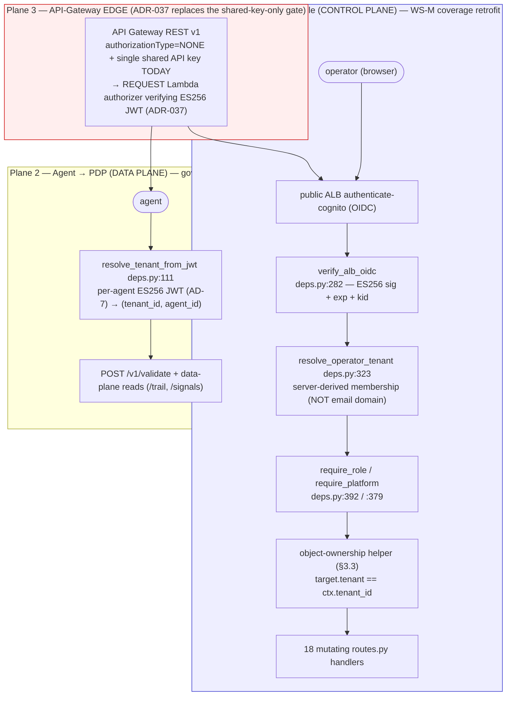
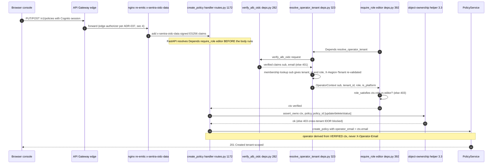
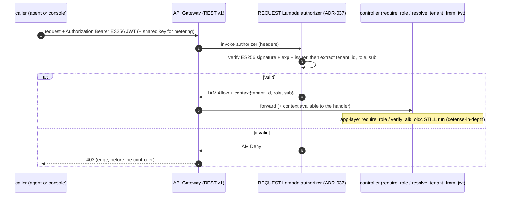
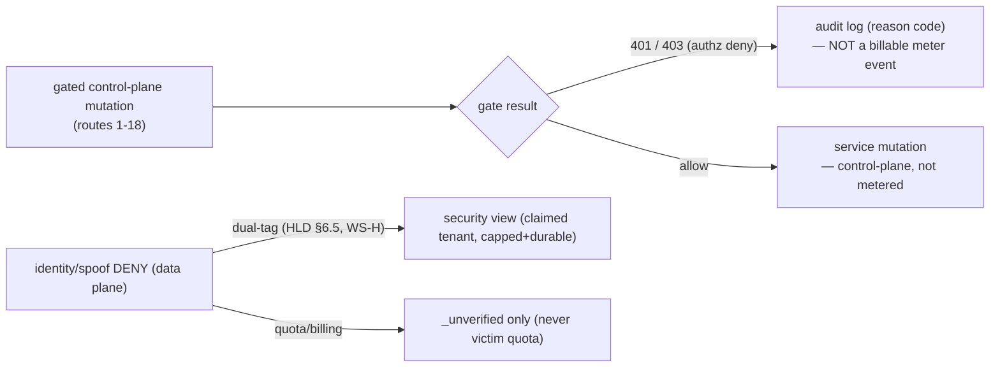

# LLD 39: Authorization / RBAC Coverage Retrofit + Edge Authorizer (WS-M)

**Version**: 1.0
**Last Updated**: 2026-07-05
**Status**: Draft
**Prerequisites**: [LLD 26 — Multi-Tenancy](26-multi-tenancy.md) §5–6 (the RBAC primitives, already built + live on dev) · [LLD 08 — Authentication & ALB](08-authentication-and-alb-architecture.md) §6.5 (edge/ALB Cognito auth) · [lld/35 — Prompt Signatures](35-prompt-signatures.md) §3.3 (the sigma-retire authz gap this LLD closes)
**Workstream:** WS-M — Authentication & Authorization ([tasks/serverless-edition/ws-m-authz.md](../tasks/serverless-edition/ws-m-authz.md))
**Elaborates HLD:** [hld/serverless-edition.md](../hld/serverless-edition.md) §6.2(f) (console sign-in & who-sees-what), §6.3 (the AuthN/Z plane split), §6.6 row (f), §8 residual #1 (AD-7 GA gate).

## Table of Contents
1. [Context](#1-context)
2. [Architecture overview — the three auth planes](#2-architecture-overview--the-three-auth-planes)
3. [Security (SEC-1..5) — the body](#3-security-sec-15--the-body)
4. [Edge authorizer + shared-API-key replacement (ADR-037)](#4-edge-authorizer--shared-api-key-replacement-adr-037)
5. [Verified-agent-identity (AD-7) GA-gate timing adjudication](#5-verified-agent-identity-ad-7-ga-gate-timing-adjudication)
6. [Federation-seam consumption (ADR-035, design-only)](#6-federation-seam-consumption-adr-035-design-only)
7. [Scaling](#7-scaling)
8. [Resiliency & recovery](#8-resiliency--recovery)
9. [Networking](#9-networking)
10. [Database](#10-database)
11. [Cost](#11-cost)
12. [Metering & billing](#12-metering--billing)
13. [Test matrix (M7 — tests are the arbiter)](#13-test-matrix-m7--tests-are-the-arbiter)
14. [Implementation-status table](#14-implementation-status-table)
15. [Cross-references](#15-cross-references)

---

## 1. Context

**In plain terms.** Our control plane (the web console + its API) already has a working access-control library — role checks (`require_role`), a platform-operator check (`require_platform`), a verified-login check (`verify_alb_oidc`), and an "does this operator's tenant own this agent?" check (`_assert_owns_agent`). All four are built and running on dev. The problem is *coverage*: those checks are wired onto **one** of the two route files (`tenancy_routes.py`, fully gated) but almost none of the other (`routes.py`, where 18 mutating routes — policy create/delete, cloud-connection credential writes, quarantine release, rollback, the fleet-wide detection kill-switch — carry **no** access check today). Any holder of the single shared API key can call them against **any** tenant's data. This LLD is the *retrofit*: it wires the already-built checks onto those 18 routes, generalizes the ownership check to cover policies/connections/sessions (not just agents), and replaces the "single shared API key is the only gate at the front door" model with a proper edge authorizer (ADR-037). It **builds nothing new for RBAC** — the FastAPI `Depends(...)` ladder that LLD 26 already ships *is* the mechanism.

This doc explores the approved HLD approach in implementation detail. The HLD (§6.2(f), §6.3, §6.6 row (f)) already **decided** the model: keep Cognito behind an IdP-neutral seam, server-derived `sentra-tenant-members` membership is the tenant authority, RBAC roles `owner | admin | editor | viewer` + reserved `_platform`, `require_role` is the server-side authority. This LLD does **not** re-litigate any of that. It answers the one question the HLD hands down: *given the primitives are built, how exactly do we close the coverage gap, replace the edge gate, and sequence the verified-identity GA gate* — the WS-M slice of the approved option.

**Locked identifiers.** This is **lld/39** (36/37/38 are taken — WS-A SDK/local-floor, SDK caching, canary monitoring). The one new decision recorded here is **ADR-037** (edge/gateway authorizer + shared-API-key replacement); **ADR-036 is taken** (Detection-Depth Enforce Overrides) — do not conflate. The WS scope doc ([ws-m-authz.md](../tasks/serverless-edition/ws-m-authz.md)) originally carried the wrong `ADR-036` + placeholder `lld/NN` throughout (header **and** ~8 body refs); this was **swept to ADR-037 / lld/39 on 2026-07-06** (§14 row) — the two docs now agree.

**This is a coverage retrofit — the reuse boundary is load-bearing.** WS-M is the **coverage owner, not the primitive owner**. The primitives live in and are owned by [LLD 26 §5–6](26-multi-tenancy.md) (`require_role`, `require_platform`, `resolve_operator_tenant`, `role_satisfies`, `_ROLE_ORDER`, `OperatorContext`) and [LLD 08 §6.5](08-authentication-and-alb-architecture.md) (`verify_alb_oidc`). This LLD does not rebuild them and does not add a general-purpose authz engine (no Casbin, no Oso, no Cedar-for-console — tenet 6). The one genuinely new artifact is the **generalized object-ownership helper** (§3.3), a small generalization of the existing `_assert_owns_agent`, and the **edge authorizer** (§4), which is a deployment/gateway artifact, not an RBAC engine.

**Why this is P0-security.** The anchor deliverable closes **BUG-1** — a *live production* IDOR. Per [[dev-stack-is-prod]] the `Sentra-DEV-*` stacks ARE production (account `531109575379`), and today any holder of the shared API key can CRUD **any** tenant's policies via `POST/PUT/DELETE /v1/policies` — none of which carry an authz gate ([routes.py:1244/1216/1271/1313](../src/security-controller/app/api/routes.py#L1244)). It is also a **merge-blocking predecessor of WS-F**: WS-F does not merge until `PATCH /v1/sigma-rules/{id}` is behind a platform-operator gate ([lld/35 §3.3](35-prompt-signatures.md), §3.5 below).

---

## 2. Architecture overview — the three auth planes

**In plain terms.** Auth in Sentra is three separate planes, and conflating them is the trap. **Plane 1** is an *operator* logging into the *console* (control plane) — this is where the coverage gap lives. **Plane 2** is an *agent* calling `/v1/validate` (data plane) — this is where verified per-agent identity (AD-7) lives, and it is deliberately governed by policy, not operator roles. **Plane 3** is the *API-Gateway edge itself* — today its only gate is a single shared API key, which is not authentication. WS-M owns Plane 1's coverage (the retrofit), adjudicates a Plane-2 residual (the AD-7 GA-gate *timing*), and re-designs Plane 3 (the edge authorizer, ADR-037).

### 2.1 The three planes (flow)



**Plane 1 — operator → console. Mostly BUILT + LIVE (dev); WS-M is the coverage retrofit.** Cognito OIDC is verified at the ALB and re-verified in-app by `verify_alb_oidc` ([deps.py:282](../src/security-controller/app/api/deps.py#L282), ES256, `kid`-keyed LRU). Tenant is **server-derived from membership, never the email domain** ([deps.py:323](../src/security-controller/app/api/deps.py#L323) `resolve_operator_tenant` → `sentra-tenant-members`, PK `operator_sub` / SK `tenant_id`); the `X-Aegion-Tenant` switcher is a client preference re-validated server-side against the membership set (deny non-member). RBAC is server-authoritative: `require_role` ([deps.py:392](../src/security-controller/app/api/deps.py#L392)), `require_platform` ([deps.py:379](../src/security-controller/app/api/deps.py#L379)), roles `viewer`(0) < `editor`(1) < `admin`(2) < `owner`(3) + reserved `_platform` (`_ROLE_ORDER` [deps.py:39](../src/security-controller/app/api/deps.py#L39), `role_satisfies` [deps.py:372](../src/security-controller/app/api/deps.py#L372) — unknown role → `False`, fail-secure). Built at the LLD 26 go-live (2026-06-24). **WS-M does not rebuild any of this** — it *applies* it to the ungated `routes.py` handlers.

**Break-glass semantics WS-M inherits (do not assume `ctx.tenant_id` implies full membership).** `resolve_operator_tenant` has a **platform break-glass** branch: a `_platform` operator supplying `X-Aegion-Tenant` for a **non-member** tenant is synthesized a **`viewer`** `Membership` in that tenant ([deps.py:344](../src/security-controller/app/api/deps.py#L323), with an inline comment that mutations in a non-member tenant require a separate audited elevation). This is **not** a defect against the new gates: `viewer` (0) `< editor`/`admin`, so every mutation `require_role` denies break-glass by design, and the sole `require_platform` route (12) grants to `is_platform` intentionally. WS-M relies on **no** route treating `ctx.tenant_id` as proof of full membership — the role ladder, not membership presence, is the mutation authority.

**Plane 2 — agent → PDP data plane.** Per-agent signed-JWT identity (AD-7 / FR-10.3, TENANCY_V2): the controller resolves authoritative `(tenant_id, agent_id)` from the *verified* credential, never a body field ([deps.py:111](../src/security-controller/app/api/deps.py#L111) `resolve_tenant_from_jwt`), enforcing for tenant `acme` on dev. Data-plane reads (`GET /v1/sessions/{id}/trail`, `/signals`) deliberately carry **no** `require_role` — isolation is structural (verified-JWT contextvar + tenant-composite PK, WS-D §D5.3). WS-M owns adjudicating one Plane-2 residual: the AD-7 GA-gate *timing* (§5) — the HLD already resolved the *substance*.

**Plane 3 — the API-Gateway edge (the open architectural gap).** The hosted PDP is fronted by API Gateway (REST/v1) → VpcLink → NLB → private ALB → ECS. Today the gateway method is `authorizationType=NONE` and a **single shared API key** is the only edge gate ([api_stack.py:373](../cdk/stacks/api_stack.py#L373) `api_key_required=True`; usage plans at [:176](../cdk/stacks/api_stack.py#L176)/[:229](../cdk/stacks/api_stack.py#L229)). An API key is **not** an authentication mechanism (AWS's own usage-plan guidance says so — §4). §4/ADR-037 replaces it with a REQUEST-type Lambda authorizer verifying the ES256 JWT the caller already presents, demoting the shared key to metering/usage-plan only.

### 2.2 The core problem statement — asymmetric coverage IS the vulnerability

The two route modules are asymmetrically gated, and that asymmetry is the bug:

| Module | Mutating routes | With an authz gate today | The gap |
|---|---|---|---|
| `tenancy_routes.py` | 10 | **10** (`require_role` at lines 86/138/151/234/267/290/309/349 + `require_platform` at 437/454; `_assert_owns_agent` at 48) | none — the positive template |
| `routes.py` | 19 | **1** (`delete_feedback_subject` [routes.py:904](../src/security-controller/app/api/routes.py#L904), `require_role("admin")`) | **18 ungated mutating routes** |

`routes.py` *already imports* `OperatorContext, require_role` ([routes.py:19](../src/security-controller/app/api/routes.py#L19)) and *proves the file can be gated correctly* — `delete_feedback_subject` is tenant-scoped via `ctx.tenant_id`, not a header. The other 18 routes simply predate that discipline and were never retrofitted. **WS-M is that retrofit — coverage owner, not primitive owner.** Copying the `tenancy_routes.py` per-mutation `Depends(require_role(...))` + ownership-assert pattern onto the 18 routes is the whole job for M1–M3.

### 2.3 The 18 ungated routes (verified inventory)

**The handler NAME + route PATH are the stable join keys — resolve routes by name, not line.** Line anchors below were refreshed against `main` at 2026-07-06 (`routes.py` drifts as the file grows, so a stale number could point at the wrong handler; the coder confirms by symbol name). The [ws-m-authz.md](../tasks/serverless-edition/ws-m-authz.md) §3 numbers are older still:

| # | Route | Handler | `routes.py:line` | Gate today | Target gate |
|---|---|---|---|---|---|
| 1 | `POST /v1/policies` | `create_policy` | [1172](../src/security-controller/app/api/routes.py#L1244) | `X-Operator-Email` only | `require_role("editor")` + tenant-own (policy) |
| 2 | `PUT /v1/policies/{id}` | `update_policy` | [1216](../src/security-controller/app/api/routes.py#L1288) | `X-Operator-Email` only | `require_role("editor")` + tenant-own |
| 3 | `DELETE /v1/policies/{id}` | `delete_policy` | [1271](../src/security-controller/app/api/routes.py#L1343) | `X-Operator-Email` only | `require_role("admin")` + tenant-own |
| 4 | `PATCH /v1/policies/{id}/status` | `set_policy_status` | [1313](../src/security-controller/app/api/routes.py#L1385) | `X-Operator-Email` only | `require_role("editor")` + tenant-own |
| 5 | `POST /v1/agents/{id}/policies` | `attach_agent_policy` | [882](../src/security-controller/app/api/routes.py#L954) | `X-Operator-Email`, no ownership | `require_role("editor")` + own(agent) + own(policy) |
| 6 | `DELETE /v1/agents/{id}/policies/{pid}` | `detach_agent_policy` | [902](../src/security-controller/app/api/routes.py#L974) | `X-Operator-Email`, no ownership | `require_role("editor")` + own(agent) |
| 7 | `POST /v1/connections` | `create_connection` | [742](../src/security-controller/app/api/routes.py#L814) | none | `require_role("admin")` + tenant-own |
| 8 | `PUT /v1/connections/{id}` | `update_connection` | [762](../src/security-controller/app/api/routes.py#L834) | none — writes `role_arn`/Azure SP `secret_ref` | `require_role("admin")` + tenant-own |
| 9 | `POST /v1/connections/{id}/test` | `test_connection` | [788](../src/security-controller/app/api/routes.py#L860) | none — live `sts:AssumeRole`/Azure probe | `require_role("editor")` + tenant-own |
| 10 | `POST /v1/connections/{id}/scan` | `scan_connection` | [808](../src/security-controller/app/api/routes.py#L880) | none | `require_role("editor")` + tenant-own |
| 11 | `DELETE /v1/connections/{id}` | `delete_connection` | [822](../src/security-controller/app/api/routes.py#L894) | none | `require_role("admin")` + tenant-own |
| 12 | `PATCH /v1/sigma-rules/{id}` | `update_sigma_rule` | [1446](../src/security-controller/app/api/routes.py#L1518) | none — fleet-global detection kill-switch | **`require_platform`** (§3.5) |
| 13 | `DELETE /v1/quarantine/{id}` | `release_session` | [1816](../src/security-controller/app/api/routes.py#L1888) | none — `operator_id` query param | `require_role("admin")` + tenant-own |
| 14 | `POST /v1/quarantine/{id}` | `quarantine_session` | [1730](../src/security-controller/app/api/routes.py#L1802) | none — `operator_id` in body | `require_role("admin")` + tenant-own |
| 15 | `POST /v1/rollback` | `rollback_action` | [1601](../src/security-controller/app/api/routes.py#L1673) | none — `operator_id` in body | `require_role("admin")` + own(ACTION) (§3.3) |
| 16 | `POST /v1/rollback/conversation/{id}` | `rollback_conversation` | [1660](../src/security-controller/app/api/routes.py#L1732) | none — `operator_id` default `"system"` | `require_role("admin")` + own(CONVERSATION) (§3.3) |
| 17 | `POST /v1/discovery/import` | `discovery_import` | [697](../src/security-controller/app/api/routes.py#L769) | none | `require_role("editor")` + tenant-scope imported ids |
| 18 | `POST /v1/decisions/{id}/verdict` | `post_decision_verdict` | [916](../src/security-controller/app/api/routes.py#L988) | none — `operator_id` in body; feeds FP/FN training | authenticate + tenant-own (derive operator from ctx) |
| 19 | `POST /v1/sessions/{id}/signals` | `post_session_signal` | [453](../src/security-controller/app/api/routes.py#L525) | none — external producer write | **interim: fail-closed now** (§5.3); full producer credential + tenant-scope + `threat_type`-enum validation design-only (D4) |
| — | `GET /v1/sessions/{id}/trail` | `get_session_trail` | [393](../src/security-controller/app/api/routes.py#L465) | none — **CORRECT** (data-plane read) | **do NOT change** (Invariant 6) |

**Two findings worse or subtler than the tracked policy hole:**
- **The connection routes (7–11) are credential-bearing and carry NO role gate.** `update_connection` writes an IAM `role_arn` / Azure service-principal `secret_ref`, and `test`/`scan` drive **live cross-account STS calls** — yet any authenticated operator (even a `viewer`) can create/modify/delete/probe them. **Precise threat (verified):** the *cross-tenant* dimension is **already mitigated** — `cloud-connections` is **born tenant-scoped** (PK is `tenant_id`, every read/write keys on `tenancy.current_tenant()` derived from the verified `ctx`, [connections_service.py:169/238/303](../src/security-controller/app/services/connections_service.py#L169), comment [:10–13](../src/security-controller/app/services/connections_service.py#L10)), so a cross-tenant read returns nothing and a write lands in the caller's own partition. The **real** gap is a **missing role gate** (privilege escalation *within* a tenant — a `viewer` performing credential writes / live `AssumeRole`), **not** a cross-tenant credential-theft IDOR. That is still material (credential-bearing, `admin`-only in the target map) and was **not** in the BUG-1 write-up — but ranked honestly as a role/privilege gap, since the tenant-scoped PK already blocks the cross-tenant path.
- **`operator_id` is self-asserted in the request body** for quarantine/rollback/verdict (14/15/16/18) — so even the *audit attribution* is spoofable, not just the authz. Deriving `operator_id` from the verified `ctx` fixes both (§3.4, tenet 5).

### 2.4 The operator-mutation auth flow (sequence)

The load-bearing path this LLD wires. Shown for `create_policy` (route 1); every gated `routes.py` mutation follows the identical dependency ladder.



**The retrofit boundary in one line:** every arrow in that diagram except `H→OWN` is *already built and running on dev*; WS-M adds the `Depends(require_role(...))` on the handler, the `H→OWN` ownership assert, and the `operator_email=ctx.email` derivation. Nothing in the ladder is invented.

---

## 3. Security (SEC-1..5) — the body

**In plain terms.** This section pins the actual checks and where each runs, at implementation altitude. SEC-1 (authn): `verify_alb_oidc` cryptographically verifies the operator's login token per request (§3.1) — plus a hardening item: it does not yet pin the ALB signer ARN. SEC-2 (authz): the `require_role` factory + the per-route role map (§3.2). SEC-3 (anti-IDOR): a generalized ownership helper asserts the target object belongs to the caller's tenant on every mutation (§3.3). SEC-4 (attribution): the operator identity is derived from the verified context, never a spoofable header/body (§3.4). SEC-5 (fail-secure): the fleet-global sigma-retire path gets a *platform* gate (§3.5), plus a fail-secure fix to a latent fake-200 anti-pattern on the connection handlers (§3.7).

### 3.1 SEC-1 authn — `verify_alb_oidc` (where it runs, and the signer-ARN hardening)

`verify_alb_oidc` ([deps.py:282](../src/security-controller/app/api/deps.py#L282)) runs **per control-plane request** as the root of the operator dependency chain (`resolve_operator_tenant` calls it first). It reads the ES256 JWT from `x-sentra-oidc-data` (the nginx-re-emitted transport) falling back to the native `x-amzn-oidc-data`, extracts the `kid`, fetches the matching regional ALB public key via a per-`kid` LRU (`_ALBKeyCache`, [deps.py:250](../src/security-controller/app/api/deps.py#L250)), and verifies **signature + `exp`**. Any failure → **401**. Missing `sub` → 401. This is the built, live authn floor — WS-M reuses it unchanged as the authn layer under every gated route.

**Hardening item (fold in, not a rebuild): pin the ALB signer ARN.** Today `verify_alb_oidc` verifies the signature and expiry but does **not** assert that the token's `signer` header equals the *expected* ALB ARN ([deps.py:282–319](../src/security-controller/app/api/deps.py#L282)). AWS's own guidance is to check the JWT header's `signer` field against the ALB you expect, because *any* ALB in the same region can mint a token that passes plain ES256 signature verification against the regional key set. [FACT] AWS: "Verify the signer field in the payload's header is the same value as the Amazon Resource Name (ARN) of the load balancer that you configured for authentication." [1] Without the pin, a token minted by an unrelated in-region ALB is accepted. The fix is small and defense-in-depth: add an expected-signer-ARN config value (e.g. `settings.alb_signer_arn`) and, in `verify_alb_oidc`, compare `jwt.get_unverified_header(data).get("signer") == settings.alb_signer_arn` before `jwt.decode`, raising 401 on mismatch. Because it changes a *shared* primitive owned by LLD 26/08, the edit is coordinated with those owners (§footguns); it is scoped here as a hardening line, not a new mechanism.

**Why the pin is load-bearing, not optional hardening.** Today `verify_alb_oidc` also passes `verify_aud=False` (ALB sets no stable `aud` — [deps.py:282–319](../src/security-controller/app/api/deps.py#L282)) and asserts no issuer, so the acceptance surface is "any ES256-valid, unexpired token the regional ALB key set signs, for *any* Cognito pool." Because §4.0's BUG-1 closure rests on `verify_alb_oidc` rejecting a forged token, this pin is the thing that makes that rejection sound — so it is **not** a defer-able defense-in-depth line. It is a **cheap, unconditional deny-by-default hardening**: it costs nothing when the single-ALB premise holds and closes a cross-app token-confusion hole (EoP-into-console) if a second in-region `authenticate-cognito` ALB exists. Account `531109575379` is **shared and hosts multiple stacks** ([[dev-stack-is-prod]]), which raises — not lowers — the odds of a confusable ALB, so the pin ships regardless of the count.
  - **AS-1 (single-ALB premise, owner: WS-M).** The premise "only one in-region `authenticate-cognito` ALB and one Cognito pool exist" is recorded as a first-class Assumption with a **build-time verification step**: WS-M runs `describe-load-balancers` (count) + a Cognito-pool count at M1 and escalates to a ranked SEC defect if >1. But the pin lands **unconditionally at M1** either way — it is not gated on AS-1 holding.
  - **The pin is signer + issuer.** Pin the ALB `signer` ARN (`jwt.get_unverified_header(data).get("signer") == settings.alb_signer_arn`) **and** the Cognito issuer (`iss` / `token_use`) — signer-only still trusts any token that ALB region mints for *any* pool. It **must apply to whichever header is read** — the `x-sentra-oidc-data` vs native `x-amzn-oidc-data` fallback precedence (§9) cannot be used to bypass it, and a test asserts both header paths enforce it.

### 3.2 SEC-2 authz — `require_role` + `require_platform` + the per-route role map

`require_role(min_role)` ([deps.py:392](../src/security-controller/app/api/deps.py#L392)) is a dependency *factory*: it returns a `Depends`-able that runs after `resolve_operator_tenant`, and denies **403** if `role_satisfies(ctx.role, min_role)` is `False`. `role_satisfies` ([deps.py:372](../src/security-controller/app/api/deps.py#L372)) compares `_ROLE_ORDER` indices (`viewer`0 < `editor`1 < `admin`2 < `owner`3) and returns `False` on any unknown role string (fail-secure). `require_platform` ([deps.py:379](../src/security-controller/app/api/deps.py#L379)) is a separate gate keyed on the reserved `_platform` membership (not a tenant role). All three are built + live.

**The retrofit adds exactly one parameter per handler** — a `ctx: OperatorContext = Depends(require_role(...))` (or `Depends(require_platform)`) — mirroring `tenancy_routes.py`. Pseudo-code for route 1 (`create_policy`), the pattern applied to all:

```python
# app/api/routes.py — retrofit shape (pseudo-code, real names)

@router.post("/policies", status_code=201)
async def create_policy(
    request: PolicyCreateRequest,
    ctx: OperatorContext = Depends(require_role("editor")),   # NEW — authz gate
    # X-Operator-Email header REMOVED as an authority; operator now = ctx.email
) -> Dict:
    # create binds to the caller's tenant; no cross-tenant target on create
    return await PolicyService().create_policy(
        policy_data=_scope_to_tenant(request.dict(exclude_none=True), ctx.tenant_id),
        operator_email=ctx.email,                              # derived, not spoofable
    )

@router.put("/policies/{policy_id}")
async def update_policy(
    policy_id: str,
    request: PolicyUpdateRequest,
    ctx: OperatorContext = Depends(require_role("editor")),
) -> Dict:
    assert_owns(ctx, ResourceKind.POLICY, policy_id)           # §3.3 anti-IDOR
    return await PolicyService().update_policy(policy_id, ..., operator_email=ctx.email)
```

**The two routes that are more than a one-line `Depends` (call them out — not "copy the pattern"):**
- **`attach_agent_policy`(5)** takes TWO ids and needs TWO ownership asserts, in order: `assert_owns(ctx, AGENT, agent_id)` **then** `assert_owns(ctx, POLICY, policy_id)` — a caller must own both the agent and the policy being bound, else 403/404. `detach`(6) asserts only the AGENT.
- **`discovery_import`(17)** is a **bulk** write of multiple promoted agent ids. It is not a single-id `assert_owns`; the retrofit **prefix-stamps every imported/promoted agent_id to `ctx.tenant_id` before write** (the tenant-prefixed id is the ownership key, per the AGENT model above), so no imported record can land under another tenant. `require_role("editor")` gates the call; the loop enforces the scope.

```python
@router.post("/agents/{agent_id}/policies")
async def attach_agent_policy(agent_id, policy_id, ctx=Depends(require_role("editor"))):
    assert_owns(ctx, ResourceKind.AGENT, agent_id)     # own the agent
    assert_owns(ctx, ResourceKind.POLICY, policy_id)   # AND own the policy
    ...
# discovery_import: for each promoted agent → id = f"{ctx.tenant_id}-{raw_id}" before write
```

**Per-route role map (the target gate for all 18 + route 19 deferred):**

| Gate | Routes |
|---|---|
| `require_role("editor")` + tenant-own | `create_policy`(1), `update_policy`(2), `set_policy_status`(4), `attach_agent_policy`(5, + own agent + own policy), `detach_agent_policy`(6, + own agent), `test_connection`(9), `scan_connection`(10), `discovery_import`(17, + tenant-scope imported ids) |
| `require_role("admin")` + tenant-own | `delete_policy`(3), `create_connection`(7, tenant-own on create is N/A — born-scoped), `update_connection`(8), `delete_connection`(11), `release_session`(13, own SESSION), `quarantine_session`(14, own SESSION), `rollback_action`(15, own ACTION §3.3), `rollback_conversation`(16, own CONVERSATION §3.3) |
| `require_platform` (NOT tenant) | `update_sigma_rule`(12) + its `_bump_enforcement_version` write (§3.5) |
| authenticate + tenant-own (derive operator from ctx) | `post_decision_verdict`(18) |
| **interim fail-closed NOW; full design deferred (D4)** | `post_session_signal`(19) — reject external write until the producer credential exists (§5.3); full: producer credential + tenant-scope + validate `threat_type` against the 8-value enum + bound `priority` |
| UNCHANGED (no `require_role`, Invariant 6) | `get_session_trail`, `/signals` reads |

The role choices mirror the LLD 26 §6.3 RBAC matrix: `editor` = policy CRUD + import; `admin` = destructive/credential/containment ops; `owner` inherits admin. Destructive ops (delete policy, delete connection, quarantine release, rollback) are `admin` because they either destroy state or lift a containment control.

### 3.3 SEC-3 anti-IDOR — the generalized object-ownership helper (D2)

**In plain terms.** Being logged in with the right role is not enough — the caller must **own the specific object** they name in the URL. Today only agents have that check (`_assert_owns_agent`). This LLD generalizes it into one helper that asserts tenant-ownership for agents, policies, connections, and sessions, so there is one place to audit and test. This is the OWASP API1:2023 Broken Object Level Authorization control: *"check ownership in every function that uses client input to access a record."* [2]

The existing `_assert_owns_agent` ([tenancy_routes.py:48](../src/security-controller/app/api/tenancy_routes.py#L48)) uses a **delimited-prefix** check (`agent_id.startswith(ctx.tenant_id + "-")`) — never a bare `startswith` (delimiter-unsafe). The other three kinds are keyed **differently from each other**, and two of them are already structurally isolated by their key layout — so "one uniform point-read + compare" is the wrong shape. Verified against the code, there are **three distinct ownership mechanisms**, and the helper dispatches to the one that matches how each store is actually keyed:

- **AGENT** — the id **is** tenant-prefixed → delimited-prefix check, **no read** (unchanged).
- **CONNECTION** — `cloud-connections` is **born tenant-scoped, no flag**: its PK **is** `tenant_id` and every read keys on `tenancy.current_tenant()` ([connections_service.py:169/238/303](../src/security-controller/app/services/connections_service.py#L169), comment at [:10–13](../src/security-controller/app/services/connections_service.py#L10)). A cross-tenant read therefore returns **nothing** and a write lands in the caller's own partition — cross-tenant access is **already structurally blocked**, exactly like the SESSION reads. The tenant-scoped point-read of `(current_tenant, connection_id)` is the assertion: row present ⇒ owned; row absent ⇒ 404. There is **no** read that returns a *foreign* connection's tenant to compare against.
- **SESSION** — quarantine/release (routes 13/14) resolve via `SessionManager.get_session`/`manual_release`, which key on `tenancy.item_key('session_id', session_id)` ([session_manager.py:94/128/447](../src/security-controller/app/utils/session_manager.py#L94)) → the tenant-scoped composite `{tenant_id, session_id}` **when `TENANCY_V2_ENABLED` is on, which it is in the live env** (below). A tenant-scoped read 404s on a foreign `session_id`. (Only if the flag were off would `item_key` return a bare `{session_id}`; the helper denies rather than falling through to a bare-key read in that case. The composite-PK `signal_pk_value` isolation — [decisions_service.py:86/134](../src/security-controller/app/services/decisions_service.py#L86) — governs the **signals/`/trail` read store** Invariant 6 relies on, a *different* store from the `SessionManager` quarantine/release path; do not conflate them.)
- **POLICY** — tenant is a **stored attribute**, stamped because `TENANCY_V2_ENABLED` is on in the live env (below); uses fetch-owner-and-compare. **All three kinds are effective on the deployed store; CONNECTION is additionally flag-independent (born tenant-scoped).**

```python
# app/api/ownership.py (new module — see §footguns) reused by both route files — pseudo-code

class ResourceKind(str, Enum):
    AGENT = "agent"; POLICY = "policy"; CONNECTION = "connection"; SESSION = "session"
    ACTION = "action"; CONVERSATION = "conversation"   # rollback routes 15/16

def assert_owns(ctx: OperatorContext, kind: ResourceKind, resource_id: str) -> None:
    """Fail-secure tenant-ownership assertion. Denies on mismatch OR on a lookup
    failure — never 'allow because we couldn't check'. Reads ALWAYS resolve tenant
    from `ctx`, never from the ambient contextvar default (see §3.3 note)."""
    if kind is ResourceKind.AGENT:
        # id is tenant-prefixed → delimited-prefix, no read
        if not resource_id.startswith(ctx.tenant_id + "-"):
            raise HTTPException(status_code=403, detail="agent not owned by tenant")
        return
    if kind is ResourceKind.CONNECTION:
        # STRUCTURAL isolation, flag-INDEPENDENT: cloud-connections is BORN tenant-scoped
        # (PK *is* tenant_id, connections_service.py:167-174 — not gated on TENANCY_V2).
        # A tenant-scoped point-read returns the row IFF owned. Absent ⇒ 404 mask.
        if not _exists_in_tenant(kind, resource_id, ctx.tenant_id):
            raise HTTPException(status_code=404, detail="connection not found")
        return
    if kind is ResourceKind.SESSION:
        # SESSION isolation depends on TENANCY_V2 being on — which it IS in the live env
        # (dev.yaml tenancy_v2_enabled:true, dev=prod). quarantine/release resolve via
        # SessionManager.get_session/manual_release, keyed on item_key('session_id', id)
        # (session_manager.py:94/128/447) -> composite {tenant_id, session_id} under v2.
        # The tenant-scoped read returns the row IFF owned; absent => 404 mask. If a record
        # can't be tenant-resolved (a stray un-stamped/flag-off case) the check DENIES, never
        # falls through to a bare-key cross-tenant read. NOTE: the operative store is
        # SessionManager (utils/session_manager.py), NOT decisions_service.signal_pk_value
        # (that governs the signals/trail store the /trail reads use — a different path).
        if not _exists_in_tenant(kind, resource_id, ctx.tenant_id):   # tenant-scoped; denies if unresolvable
            raise HTTPException(status_code=404, detail="session not found")
        return
    # POLICY: tenant is a stored attribute — but STAMPED ONLY when v2 is on.
    # MUST NOT reuse the cached PolicyService.get_policy path (tenant-blind cache — see below).
    owner = _tenant_of_policy(resource_id, ctx.tenant_id)   # DIRECT tenant-scoped point-read (§10)
    if owner is None:
        raise HTTPException(status_code=404, detail="policy not found")   # 404 mask
    if owner != ctx.tenant_id:
        raise HTTPException(status_code=403, detail="policy not owned by tenant")
```

`_assert_owns_agent` remains as a thin alias (`assert_owns(ctx, AGENT, agent_id)`) so `tenancy_routes.py`'s existing call sites keep the same symbol name. **Concrete integration step (not just a signature note):** `_assert_owns_agent` today lives *inside* `tenancy_routes.py` ([:48](../src/security-controller/app/api/tenancy_routes.py#L48)), so after the generalized helper moves to `app/api/ownership.py`, `tenancy_routes.py` must **import the alias from `ownership.py`** — a new cross-file dependency in a file WS-D and WS-G also touch. The coder re-exports/aliases `_assert_owns_agent` from `ownership.py` and repoints its ~10 existing gate call sites without changing their behavior; the M7 suite's existing `tenancy_routes` ownership tests are the regression guard that the move didn't break those 10 gates. `ownership.py` is named as a shared contract in §15 so WS-D/WS-G coordinate against the single file.

**`TENANCY_V2_ENABLED` is ON in the live environment — the POLICY and SESSION gates are effective on the deployed store, NOT vacuous (verified 2026-07-06).** The live account `531109575379` loads **`cdk/config/dev.yaml`, where `tenancy_v2_enabled: true`** ([dev.yaml:25](../cdk/config/dev.yaml#L25)), and **dev *is* prod** ([[dev-stack-is-prod]]) — enforcing since the TENANCY_V2 go-live 2026-06-24 (tenant `acme` enforcing, `0 _unverified`, PRD FR-10.1). So on the deployed store the policy `tenant_id` attribute **is** stamped (`stamp_base_item()` when `v2_enabled()`, [tenancy.py:250](../src/security-controller/app/utils/tenancy.py#L250)) and `item_key` returns the tenant-scoped composite — the POLICY fetch-owner-compare and the SESSION quarantine/release tenant-scoped read are **live**. (The code default `False` in [compute_stack.py:1401](../cdk/stacks/compute_stack.py#L1401), and `prod.yaml`/`staging.yaml` both `false`, are **not** the deployed live env — they would matter only if a *fresh* env were stood up flag-off; a legitimate concern for a future env, not the current deploy.)
  - **Why the anti-IDOR check must still deny-not-allow when it can't read a stored tenant (kept as a fail-secure guard, not a blocking predecessor).** `_tenant_of_policy` / the SESSION read **deny, never allow**, when a record carries no stored tenant — so a would-be flag-off env (or a stray un-stamped legacy record) degrades to *deny* (outage-shaped, caught) rather than to a *silent cross-tenant open*. This is a robustness invariant on the helper, not a merge blocker: the live env has the flag on.
  - **The M7 anti-IDOR test asserts non-vacuity as a REGRESSION guard.** It runs in the deployed flag state and proves the gate actually denies a cross-tenant caller (tenant-B → 403/404). Optionally it also asserts that with the flag *forced off* in a test fixture the helper denies (never silently allows) — so a future flag-off regression is caught. This is test discipline, **not** a "flip the flag first" predecessor, because the flag is already on in prod.
  - **The three resource kinds, by isolation mechanism (all effective in the live env):** **CONNECTION** — flag-INDEPENDENT (born tenant-scoped: PK *is* `tenant_id`, [connections_service.py:167-174](../src/security-controller/app/services/connections_service.py#L167)); **POLICY** — stored-attribute compare, effective because v2 is on; **SESSION** — tenant-scoped read via `SessionManager.get_session`/`manual_release` keyed on `tenancy.item_key('session_id', session_id)` ([session_manager.py:94/128/447](../src/security-controller/app/utils/session_manager.py#L94)), effective because v2 is on (`item_key` returns the composite `{tenant_id, session_id}` under `v2_enabled()`; a bare `{session_id}` only if the flag were off — [tenancy.py:231](../src/security-controller/app/utils/tenancy.py#L231)). NOTE the SESSION store is `SessionManager` (utils), **not** the `signals`/`trail` store's `signal_pk_value` path ([decisions_service.py:86/134](../src/security-controller/app/services/decisions_service.py#L86)) — that is a *different* store (the one Invariant 6's `/trail` reads use); don't conflate them.

**`_tenant_of_policy` MUST bypass the tenant-blind policy cache (a second, subtler way the POLICY gate could stay open).** Even with v2 on and the record correctly stamped, `_tenant_of_policy` **must not** resolve through `PolicyService.get_policy` — that path caches by a **tenant-blind key** `cache_key = f"policy:{policy_id}"` ([policy_service.py:196](../src/security-controller/app/services/policy_service.py#L196)) in a **process-wide singleton** cache (`get_cache_manager()` → `_cache_instance` global, [cache_manager.py:271–302](../src/security-controller/app/utils/cache_manager.py#L271)). The cache short-circuits **before** the tenant-scoped DDB read (`tenancy.item_key('policy_id', policy_id)` → `{tenant_id: current_tenant(), policy_id}`, [tenancy.py:231](../src/security-controller/app/utils/tenancy.py#L231)). Failure sequence: tenant A reads `p1` (cache now holds A's row under `policy:p1`) → tenant B calls `assert_owns(POLICY, "p1")` → if the resolver reuses `get_policy`, B is served **A's cached row**, and the `owner == ctx.tenant_id` compare either passes on A's data or leaks A's policy — the exact cross-tenant IDOR WS-M closes, re-opened by a warm cache. **Fix (one of, in the same WS-M change):** (i) `_tenant_of_policy` issues a **DIRECT tenant-scoped DDB point-read** on `(ctx.tenant_id, policy_id)` bypassing the cached path — a miss ⇒ 404 (present in *the caller's* partition ⇒ owned; absent ⇒ not owned or not present, both denied); **or** (ii) tenant-scope the policy cache key itself (`f"policy:{tenant_id}:{policy_id}"`) so a cross-tenant key can never collide. (i) is preferred: the ownership assertion is the security boundary and must not depend on a cache-key refactor landing correctly. This is a **shared-contract touch on `policy_service.py`/`cache_manager.py`** — name it in §15 so WS-D/WS-H (who own the policy store + caching) coordinate.

**ACTION / CONVERSATION ownership for the rollback routes (15/16) — the one place the resolution path is net-new.** Routes 15/16 name a bare `action_id` / `conversation_id`, which is **neither tenant-prefixed nor a tenant-scoped store key today**: `rollback_coordinator._get_action_from_logs(action_id)` resolves the action by a CloudWatch Logs Insights query filtered **only** on `action_id` ([rollback_coordinator.py:181](../src/security-controller/app/utils/rollback_coordinator.py#L181)) — **no tenant scoping**, so `require_role("admin")` alone would let tenant-B's admin rollback tenant-A's financial action (an IDOR that *reverses money-movement effects*). The role gate is necessary but not sufficient; the ownership check needs a concrete mechanism. Design:
  - `_tenant_of_action(action_id)` resolves the action's owning tenant from the **decision/audit log record** the rollback already reads, and `assert_owns(ctx, ACTION, action_id)` asserts that record's `tenant_id` == `ctx.tenant_id`. Concretely: the Logs Insights filter is **narrowed to the tenant** (`filter action_id = ... and tenant_id = ctx.tenant_id`), so a foreign `action_id` returns **not-found → 404 mask** — the same fail-secure shape as POLICY/SESSION, never "allow because we couldn't check." A stamped `tenant_id` on the emitted action log record is the predecessor (if absent on legacy records, the rollback denies rather than proceeding unscoped).
  - `CONVERSATION` (route 16) resolves via the conversation's session rows, which are already tenant-scoped by the composite `tenant_session_id` PK (SESSION model above) — so `assert_owns(ctx, CONVERSATION, conversation_id)` is the same structural tenant-scoped read as SESSION.

**403-vs-404 rule (stated explicitly).** RFC 9110 permits masking a forbidden resource as **404** to avoid leaking that an id is a real record in another tenant. [3] The default is **403** per the WS error model (a clear "you're not allowed"), **except** where mere existence is sensitive — for policy/connection/session lookups by opaque id, a cross-tenant target is masked as **404** (the caller cannot distinguish "doesn't exist" from "exists in another tenant"), because a 403 there would confirm the id is a live record in some other tenant. Agent ids are tenant-prefixed and self-evidently not the caller's, so the agent path stays **403**. The rule: *tenant-prefixed / obviously-foreign id → 403; opaque-id existence-sensitive resource in another tenant → 404.* A lookup that fails (store error) also denies (404/403), never allows — fail-secure.

**Check-here / act-elsewhere must agree on the tenant (no TOCTOU) — and a raised dependency must NOT leave a stale tenant bound.** `assert_owns` and the downstream service call **must read the same tenant**. The connection/policy/session stores resolve their partition from `tenancy.current_tenant()` — a `ContextVar` whose default is `"default"` ([tenancy.py:140](../src/security-controller/app/utils/tenancy.py#L140)). That contextvar is bound by `resolve_operator_tenant`, which calls `tenancy.set_current_tenant(chosen.tenant_id)` **on the success path only, before returning** ([deps.py:344+](../src/security-controller/app/api/deps.py#L323)). The gap the design closes: a ContextVar is **not** reset per request, so on a reused event-loop worker, a request B whose auth dependency **raises** (missing/invalid OIDC, non-member `X-Aegion-Tenant`, no membership) — raising *before* it binds — leaves **request A's tenant still bound**. Any tenant-scoped read reached on that path (a non-gated helper, or a future handler) would then act on the *prior* tenant's partition (STRIDE tampering / cross-tenant EoP). So the invariant "binding always runs first" is only true when the dependency **succeeds**; WS-M hardens it two ways:
  - **Per-request reset (fail-hard, not silent-default):** bind/reset the tenant ContextVar in a request middleware (or via its token in a `finally`) so it starts each request at a **hard-deny sentinel**, never at a leaked prior value and never silently at `"default"` — a tenant-scoped read on an unbound contextvar raises rather than keying `"default"`. `resolve_operator_tenant` sets the real tenant on success; a raised dependency leaves the sentinel, not the prior tenant.
  - **Tests (two cases):** (i) a handler whose contextvar was **not bound** DENIES rather than defaulting to `"default"`; **and** (ii) request B whose auth dependency **raises after** request A bound `tenant-A` must NOT observe `current_tenant() == "tenant-A"` (the stale-bind case). `assert_owns` itself reads tenant from `ctx`, never from the ambient default, so the *gated mutation* path is safe regardless; the reset closes the non-gated / downstream-service reach.

**Break-glass viewer cannot mutate a foreign tenant — proven across ALL mutation routes, not just sigma.** The §2 break-glass branch synthesizes a `viewer` `Membership` for a `_platform` operator in a **non-member** tenant and still calls `set_current_tenant(requested)` — so `current_tenant()` can be bound to a tenant the operator is not a real member of. The mutation authority is the **role ladder** (`viewer`(0) `< editor`/`admin`), not membership presence, so every `require_role` mutation denies break-glass by design. WS-M **proves** this rather than asserting it: a test drives a `_platform` break-glass operator (viewer synthesized in a non-member tenant) at **each** admin/editor mutation route (1–18) and asserts **403 by the role ladder**, and asserts no gated handler acts on the break-glass-bound `current_tenant()` in a way that mutates the foreign tenant. Route 12 (`require_platform`) is the one deliberate grant — and it is fleet-global, not a per-tenant effect, so it carries no cross-tenant-mutation risk.

**Shared-contract note.** `assert_owns` lives in a **new small `app/api/ownership.py` module** (NOT `deps.py`) reused by both route files. `deps.py` today holds only auth primitives (no store point-reads); putting policy/connection/session point-reads there would pull service/store imports into the auth-primitive module. The concrete home is `app/api/ownership.py` so WS-D and WS-G coordinate against a **single named file** (`deps.py`/`tenancy_routes.py`/`routes.py`/`ownership.py` are the shared files). Its signature `(ctx, ResourceKind, resource_id) -> None` is a **shared contract** named in Cross-references (§15); edits coordinate with those workstreams.

### 3.4 SEC-4 operator-identity derivation (tenet 5 — an unattributable verdict is a defect)

**Drop `X-Operator-Email` as an authority.** Today `create_policy`/`update_policy`/attach/detach read `operator_email: str = Header(None, alias="X-Operator-Email")` and pass `operator_email or "unknown"` ([routes.py:1246](../src/security-controller/app/api/routes.py#L1244), [:885](../src/security-controller/app/api/routes.py#L957), [:905](../src/security-controller/app/api/routes.py#L977)) — a spoofable header (default literal `"unknown"`, [deps.py:8–9](../src/security-controller/app/api/deps.py#L8)). The retrofit drops it as an authority and feeds the existing `operator_email=` audit param from the **verified `ctx`**. `X-Operator-Email` may survive at most as a legacy audit-label alias *fed from* `ctx.email` — never read from the request as truth. If a request presents `X-Operator-Email` but has no verified identity, it is rejected (the header is not an authority).

**The durable attribution key is `ctx.sub`, not `ctx.email`.** `verify_alb_oidc` 401s on a missing `sub`, so `ctx.sub` is **guaranteed non-empty** — but `email` is **not**: `resolve_operator_tenant` reads `email = claims.get("email", "")` ([deps.py:323+](../src/security-controller/app/api/deps.py#L323)), which is empty if the Cognito user pool does not emit `email` in the OIDC claims. So an attribution built only on `ctx.email` could silently record an **empty-string operator** — a verified-but-blank field, no better than the spoofable header it replaces. The retrofit uses **`ctx.sub` as the durable, always-present attribution key**, with `ctx.email` a display-only label; a test asserts a claims set with **no `email`** still produces a **non-empty verified operator identity** on the audit record. (Alternatively, confirm the pool is configured to always emit `email` — but keying on `sub` is the fail-secure choice regardless.)

**Self-asserted `operator_id` in bodies (quarantine/rollback/verdict).** `quarantine_session`(14) and `rollback_action`(15) read `operator_id` from the request body; `rollback_conversation`(16) defaults it to `"system"`; `release_session`(13) reads it as a query param; `post_decision_verdict`(18) reads it from the body and it feeds FP/FN training labels. The retrofit derives `operator_id` from `ctx` (`ctx.sub`/`ctx.email`), **never** from the body/query, for all five. This fixes both the authz *and* the audit attribution (HLD tie-breaker D: an unattributable verdict is a metering + isolation defect).

### 3.5 SEC-5 the platform-scope gate on the fleet-global sigma-retire chain (M3 — WS-F merge-gate)

**In plain terms.** Retiring a prompt-injection signature rule (`PATCH /v1/sigma-rules/{id}`) flips one rule from `stable` to `deprecated`, and the engine then stops loading it — for **every** tenant, because the sigma store is not tenant-partitioned. So this route must require the **platform** scope, not a tenant role. A tenant-scoped `admin` gate would let any tenant-admin retire a detection rule fleet-wide — which is the disable-switch ADR-034 forbids, reached through the CRUD door.

The retire chain is **one call chain behind one missing door**: `update_sigma_rule` ([routes.py:1518](../src/security-controller/app/api/routes.py#L1518)) → `SigmaRulesService.update_rule_status` → `SigmaRulesService._bump_enforcement_version` ([sigma_rules_service.py:402](../src/security-controller/app/services/sigma_rules_service.py#L402)), which bumps the shared `__sigma_version__` epoch item and invalidates the engine cache. `load_rules_metadata_from_dynamodb` ([sigma_engine.py:100](../src/security-controller/app/validators/sigma_engine.py#L100)) loads only `status='stable'`, so a `deprecated` rule is dropped from the enforced set. Both the PATCH handler and the version-epoch write are behind the **one** `require_platform` gate:

```python
@router.patch("/sigma-rules/{rule_id}")
async def update_sigma_rule(
    rule_id: str,
    request: Dict,
    ctx: OperatorContext = Depends(require_platform),   # NOT require_role — platform scope
) -> Dict:
    ...
```

**WHY platform, not tenant (the load-bearing subtlety).** The sigma store (`sentra-sigma-rules-metadata` + S3 `sigma_rules/llm/`) is **NOT tenant-partitioned** ([lld/35 §13](35-prompt-signatures.md)), unlike per-tenant Cedar policy. One retire strips a rule from every tenant's enforced floor. A tenant-scoped role wired to a fleet-global mutation is a multi-tenant coverage/availability event, and an ungated path is the disable-switch **ADR-034** forbids (the non-disableable deterministic floor), reached via the CRUD door. **Footgun:** copying the tenant-scoped `delete_feedback_subject` pattern here is the wrong-scope trap — that route is correctly tenant-scoped; this one must be platform.

**The failing-then-passing 403 test pins the decision** (§13): an un-roled caller AND a merely-tenant-scoped `admin` (not `_platform`) both get **403**; a genuine platform operator gets 200. The tenant-scoped-still-403 assertion is what distinguishes platform-vs-tenant. WS-F owns the **CI assertion** that fails the build if any sigma-mutating route lacks a platform gate ([lld/35 §3.3](35-prompt-signatures.md)); WS-M *lands the gate it checks for*. **WS-M's sigma gate is the merge-blocking predecessor — land it before WS-F's merge gate trips.**

**Coordination hazard — the CI assertion must recognize `require_platform`, not only `require_role` (already reconciled on lld/35's side).** WS-M lands `Depends(require_platform)` ([deps.py:379](../src/security-controller/app/api/deps.py#L379)) on route 12, and **explicitly not** a tenant `require_role` (that would be the wrong-scope trap above). The CI grep must therefore accept `Depends(require_platform)` as the platform gate — matching only `require_role` would **false-fail the build** once WS-M lands `require_platform`, blocking the merge for the wrong reason. **This is already reconciled on the sibling side:** lld/35 §3.3 ([lines 106/172/631/708](35-prompt-signatures.md)) already states the CI grep "must accept **`Depends(require_platform)`** (the symbol WS-M actually lands, [lld/39 §3.5]) as well as a platform-scoped `require_role`; matching only `require_role` would false-fail the build once WS-M lands `require_platform`." The two docs already name the same symbol — no further propagation is owed here; this note just records the shared invariant so a reader does not re-open a closed loop.

### 3.6 Audit events + the fail-secure matrix

Every gate emits the existing audit trail; the retrofit adds no new audit path (that is WS-H). The verdict → response contract:

| Condition | Response | Where |
|---|---|---|
| Missing / invalid ALB-OIDC on a control-plane mutation | **401** | `verify_alb_oidc` (deps.py:282) |
| Authenticated but role `< min_role` | **403** | `require_role` (deps.py:392) |
| Authenticated, right role, target belongs to another tenant (IDOR) | **403** (tenant-prefixed id) / **404** (opaque existence-sensitive id) — never mutate | `assert_owns` (§3.3) |
| Tenant-scoped caller (not `_platform`) on `PATCH /sigma-rules` | **403** | `require_platform` (deps.py:379) |
| Unknown role string | deny | `role_satisfies` → False (deps.py:372) |
| `X-Operator-Email` present but no verified identity | **rejected** — header is not an authority | §3.4 |
| Ownership lookup fails (store error) | **deny** (403/404), never allow | `assert_owns` fail-secure |
| Data-plane read (`/trail`, `/signals`) | **no `require_role`** — tenant-scoped by verified-JWT + composite PK (unchanged) | Invariant 6 |

Every 403/401 names its reason (tenet 3, deny-by-default explainable); the message returned to the caller is customer-safe (no internal detail leaked), the internal detail stays in the server log.

### 3.7 The fake-200 fail-secure fix (D3 — reconciled to the verified code)

**What the code actually is (verified).** The plan (D3) flagged `routes.py:796-731` as a `return HTTPException(...)`-instead-of-`raise` fake-200 defect. On inspection, lines 724–731 are inside `_connection_http(exc)` ([routes.py:790](../src/security-controller/app/api/routes.py#L790)) — a **mapper factory** that *returns* `HTTPException` objects, and **all six callers correctly `raise` its result** (`raise _connection_http(exc)` at [routes.py:820/758/784/804/818/828](../src/security-controller/app/api/routes.py#L820)). So there is **no currently-firing fake-200 path** — the returned exception is raised by every caller today.

**Why it is still in-scope as a fail-secure fix (honoring D3, truthfully).** The `return HTTPException(...)` inside a helper whose contract is "raise my result" is a **latent anti-pattern / footgun**: a single future caller writing `return _connection_http(exc)` (an easy mistake — the helper *looks* like it returns a response) would silently emit a **200 OK with an error body**, hiding the failure from every caller, retry policy, gateway, and monitor (violates engineering.md's error-contract rule + master tenet 2 fail-secure). WS-M already edits these connection handlers to gate them (routes 7–11), so it hardens the factory here so the fake-200 cannot be reintroduced. Two acceptable shapes:

```python
# Preferred: make the factory itself raise, so no caller can turn its result into a 200.
def _raise_connection_http(exc: Exception) -> NoReturn:
    """Map a connections-domain exception to the honest HTTP status and RAISE it.
    Callers use `_raise_connection_http(exc)` (no `raise`, no `return` needed)."""
    if isinstance(exc, ConnectionNotFound):
        raise HTTPException(status_code=404, detail=str(exc))
    if isinstance(exc, ProviderNotAvailable):
        raise HTTPException(status_code=409, detail=f"PROVIDER_NOT_AVAILABLE: {exc}")
    if isinstance(exc, NotConnected):
        raise HTTPException(status_code=409, detail=f"NOT_CONNECTED: {exc}")
    if isinstance(exc, InvalidRoleArn):
        raise HTTPException(status_code=400, detail=f"VALIDATION_ERROR: {exc}")
    raise HTTPException(status_code=500, detail=str(exc))
# callers become: `except ConnectionError as exc: _raise_connection_http(exc)`
```

A test asserts the failure path returns the **real status code** (404/409/400/500), **not** 200 — including a regression test that a `ConnectionNotFound` on a connection route yields a 404 status, not a 200-with-error-body. This is a small, clearly-labeled fail-secure sub-item under M2 (connections), scoped honestly as *hardening a latent anti-pattern*, not fixing a live outage.

**One live 200-on-failure IS shipping today — `test_connection` (route 9) — and it is a legitimate probe-result envelope, not the fake-200 defect (adjudicated).** `test_connection` deliberately returns **`200 {ok:false, message}` on a *rejected* cross-account credential**; only an *unknown connection* is an HTTP error ([routes.py:860](../src/security-controller/app/api/routes.py#L860) docstring). This is **not** the whole-request-failure-masked-as-success anti-pattern the error-contract rule forbids — it is a **credential-probe RESULT**: the request to *run the probe* succeeded, and `{ok:false}` is the structured per-item outcome the console renders ("we tried your role; AWS rejected it"). That is exactly engineering.md's **partial-success carve-out** (a documented result envelope, like a 207/GraphQL-style per-item status), so §3.7's honest disposition is: **(a) keep the 200 as a documented probe-result envelope**, but **(b) the `message` field MUST be a customer-safe sanitized string** — never the raw provider `AssumeRole` error / principal ARN / STS detail (that would leak internal detail to a viewer-or-above operator, tenet: customer-safe CX); the internal provider detail is logged server-side only. A test pins that (i) a **genuine transport error or unknown connection still 4xx/5xxs** (the `_connection_http` factory path above — masking *that* as 200 would be the real defect) and (ii) the rejected-credential `message` contains **no** internal provider detail. Because WS-M is already editing these connection handlers (routes 7–11) to gate them, this adjudication + the message-sanitization test land with M2. (Earlier drafts said "no currently-firing fake-200 path"; that was true only of the `_connection_http` factory and missed this handler's deliberate 200 — corrected here.)

---

## 4. Edge authorizer + shared-API-key replacement (ADR-037)

**In plain terms.** The front door (API Gateway) today has no real lock — its method is `authorizationType=NONE` and a single shared API key is the only thing checked, and AWS itself says an API key is for metering, not authentication. This section replaces that with a small Lambda at the gateway that verifies the ES256 JWT the caller already carries (the per-agent JWT for programmatic callers; optionally the ALB OIDC token for the console), returns an allow/deny to the gateway, and passes the verified `(tenant_id, role, sub)` down to the app. The shared key is demoted to metering/usage-plan only. We pick a Lambda authorizer over the AWS-proprietary alternatives because verifying a standard RFC-7519 JWT ports 1:1 to Envoy/Kong/NGINX for the Azure/GCP/air-gapped editions — our cross-vendor thesis. **This LLD commits the decision (ADR-037) and the design; full rollout is staged.**

### 4.0 Post-M3, pre-edge-authorizer threat model (what actually closes BUG-1, and why the edge deferral is safe)

**The load-bearing clarification (so §2/§4's "no real lock" framing is not read as leaving BUG-1 open after M3).** BUG-1's threat is *"any holder of the single shared API key can CRUD any tenant's policies."* After M1–M3 ship the app-layer gates and **before** the edge authorizer, the concrete chain is:
- Routes 1–18 are **control-plane** routes. Their `require_role` ladder roots in `verify_alb_oidc` → `resolve_operator_tenant`, which reads the ES256 OIDC token from `x-sentra-oidc-data` (read first, [deps.py:302](../src/security-controller/app/api/deps.py#L302)) or the native `x-amzn-oidc-data`. A **programmatic shared-API-key holder does not traverse the ALB `authenticate-cognito` flow**, so in the common case it presents **no OIDC token** → `verify_alb_oidc` raises **401** before any handler body runs. **But the safety does NOT rest on the absence of the header** — `x-sentra-oidc-data` is a *non-reserved* custom name that survives every gateway hop (that is precisely why nginx uses it, §9), so a caller reaching an nginx-downstream path *could* set it directly. What actually closes BUG-1 is that `verify_alb_oidc` **cryptographically verifies the ES256 signature** of whichever header it reads: a forged token fails signature verification against the regional ALB key set → **401**. **This is why the §3.1 signer-ARN + Cognito-issuer pin is load-bearing here, not merely "hardening":** plain ES256 verification accepts any token *some* in-region ALB / *any* Cognito pool signed, so the BUG-1 closure is only as complete as that pin. The pin is therefore a **hard M1 predecessor of the BUG-1 closure** (not a deferred defense-in-depth item), and WS-M runs `describe-load-balancers` at build to confirm the in-region `authenticate-cognito` ALB count, escalating if >1 (§3.1). With the pin, a shared-key (or any non-console) caller cannot forge an accepted token, so it **cannot reach** the newly-gated mutation routes. **The app-layer gate + the §3.1 signer/issuer pin close BUG-1's control-plane threat model on their own.**
- So **ADR-037's edge authorizer is defense-in-depth for the control plane, not the P0 fix for BUG-1** — the app-layer `require_role` ladder (rooted in the *pinned* `verify_alb_oidc`) is. Where the edge authorizer **is** still load-bearing is the **data plane**: `/v1/validate` + the `/trail`/`/signals` reads are fronted today only by the shared API key (§4.1), and their real per-caller authority is the **agent JWT** (Plane 2), not an operator role. The edge authorizer replaces "shared key = the only edge check" with per-request JWT verification for **those** callers. That is why it is correctly **staged** after the app-layer coverage (the P0 IDOR is closed by M1–M3) rather than a blocker of them — but it is **not** merely cosmetic: it is the edge gate for the data-plane surface the operator gates don't cover.

The "no real lock at the front door" language in §2/§4 refers to that **data-plane edge** (shared-key-only, an API key is not auth) — **not** to the now-gated control-plane routes. M1–M3 close the control-plane IDOR; the edge authorizer closes the data-plane edge gap.

**Residual window (named + owned — the deferral is not implied-closed).** A security buyer's pen-test or a SOC 2 Type II auditor will (correctly) ask why the *most tamper-sensitive* data-plane surfaces are staged while the console routes are fixed now — a forged-ALLOW-signal into a money-movement session (route 19) is arguably worse than a console policy IDOR. The honest disposition:
  - **Route 19's interim fail-closed guard (§5.3 option 1) is the HARD default that ships with M1–M3, not an option** — the route is never left both externally reachable and unauthenticated across the retrofit window (§5.3, §14 row corrected). This removes the highest-severity data-plane tamper path immediately.
  - **The edge authorizer (ADR-037) build is staged after M1–M3.** During the window **between M3 and the edge-authorizer deploy**, the data plane (`/v1/validate`, `/trail`, `/signals`) is protected by **shared-key + agent-JWT (Plane 2) only** — no per-request edge JWT verification. The residual threat is: a shared-key holder reaching the data-plane edge is metered but not per-caller-authenticated at the gateway (the agent-JWT contextvar + composite-PK isolation still scope reads, but the edge itself is not a real lock). This window is **explicitly risk-accepted** and requires a **dated commitment or founder risk-acceptance sign-off** on the edge-authorizer deploy + the route-19 full producer credential (tracked in §14; owner: WS-M for the adjudication, deploy dated at go-live planning). The residual is **named and owned**, not implied-closed.

### 4.1 The verified edge topology (why "defer, the ALB is the door" is not defensible)

The API Gateway **is** the public edge: `API Gateway (REST/v1) → VpcLink → NLB → private ALB → ECS controller` ([api_stack.py:253–267](../cdk/stacks/api_stack.py#L253) VpcLink → `compute_stack.api_nlb`; the private ALB path-routes to the controller target group). The public entry is the gateway, not the internal ALB — so the edge gate is a real, reachable surface, and "defer it, the ALB is the door" is not defensible. Today the `/v1/validate` method sets `api_key_required=True` ([api_stack.py:373](../cdk/stacks/api_stack.py#L373)) with `authorizationType` unset (NONE); usage plans ([:176](../cdk/stacks/api_stack.py#L176)/[:229](../cdk/stacks/api_stack.py#L229)) bind the shared key(s).

### 4.2 The option table (ADR-037)

| Option | Mechanism | Portable (cross-vendor)? | Verdict |
|---|---|---|---|
| **A — REQUEST-type Lambda authorizer verifying the ES256 JWT (chosen)** | A Lambda at the gateway validates the ES256 JWT the caller already presents (per-agent JWT; optionally ALB OIDC for console), returns an IAM allow/deny policy + a context object `{tenant_id, role, sub}`; app-layer `require_role` stays as defense-in-depth; shared API key demoted to metering only | **Yes** — verifying a standard RFC-7519 JWT ports 1:1 to Envoy/Kong/NGINX | **CHOSEN** |
| B — Per-tenant scoped API keys | Distinct API keys per tenant, bound to usage plans | Partial — but keys are still not authentication (below) | Rejected |
| C — IAM SigV4 auth | Native API-Gateway IAM authorization | No — AWS-proprietary; breaks cross-vendor edge portability | Rejected |
| D — Defer (keep shared-key-only) | Status quo | n/a | Rejected — the gateway is the public edge (§4.1); an API key is not auth |

**Why A (AWS-cited).**
- [FACT] Native JWT authorizers are an **HTTP-API (v2) only** feature; our API is **REST (v1)**, so a **Lambda authorizer is the AWS-documented substitute** for token verification at a REST gateway. [4][5]
- [FACT] AWS's usage-plan guidance is explicit that **API keys are not an auth mechanism**: *"Don't use API keys for authentication or authorization for your APIs. If you have authentication and authorization needs … use an IAM role, a Lambda authorizer, or an Amazon Cognito user pool."* [6] So the shared key is correctly demoted to metering/usage-plan only.
- [FACT] The OWASP REST Security Cheat Sheet backs a centralized-IdP + signed-JWT model at the edge. [7]
- **The two AWS-cited facts above fully justify option A on their own** — a REST (v1) gateway has no native JWT authorizer, and an API key is not auth, so a Lambda authorizer verifying the presented JWT is the AWS-documented path regardless of any cross-vendor consideration.
- [INFERENCE] *Secondary, not load-bearing:* because the chosen contract is "verify a standard RFC-7519 JWT," it also **does not foreclose** the non-AWS edges (Envoy `jwt_authn`, Kong, NGINX `auth_jwt`) the Azure/GCP/air-gapped editions will eventually front the PDP with. This is framed as "the AWS-justified choice happens not to be harmed by the roadmap cross-vendor need" — **not** as a portability benefit realized today (no non-AWS edge ships yet). The AWS facts decide it; the cross-vendor note only confirms the decision doesn't paint us into an AWS-proprietary corner (which Cognito-authorizer + IAM-SigV4 would).
  - **Scope of the "ports 1:1" claim (be precise for GTM).** The portable artifact is the **Plane-2/3 data-plane JWT verification** (the agent JWT + the edge authorizer contract) — that is IdP/edge-neutral and *is* a genuine cross-vendor proof point worth citing in [pitch/share/architecture-brief.md](../pitch/share/architecture-brief.md). It does **NOT** cover **Plane 1 (the operator console)**: the console path depends on **ALB `authenticate-cognito` + the nginx `x-sentra-oidc-data` re-emit** (§9), which is AWS/ALB-specific and will need a **per-cloud edge redesign** on Azure/GCP. So the cross-vendor edge claim is honest for the data plane and roadmap-with-rework for the console — do not let the architecture-brief imply the console edge ports unchanged.

### 4.3 How the authorizer binds to the app layer



The edge authorizer is **defense-in-depth in front of**, not a replacement for, the app-layer `require_role` ladder (§3) — the app layer stays the authority, so a mis-scoped or bypassed edge cannot open the control plane. **Handlers MUST NOT read the authorizer-injected context (`tenant_id`, `role`, `sub`) as an authz input at all** — not merely "do not trust it as the *sole* authority." `verify_alb_oidc` / `resolve_operator_tenant` / `resolve_tenant_from_jwt` remain the **only** authz inputs; the authorizer context is opaque metadata the app layer ignores for decisions. (A *partial*-trust read is still an injection surface if a future handler consumes the context header directly — so the rule is zero-trust of the edge context, closing that confused-deputy path.)

### 4.4 Rollout staging + footguns

- **Staged rollout.** ADR-037 commits the decision + design now; the full gateway rollout (building the authorizer Lambda, wiring `authorizer=` on each method in `api_stack.py`, key demotion) is **staged** — the shippable retrofit in this WS is the *app-layer* coverage (§3). The edge authorizer follows on its own deploy.
- **Footgun — gateway flush.** After changing any route's authz OR wiring the authorizer, the API Gateway **must be re-flushed** (`apigateway create-deployment` to flush the stale prod-stage snapshot), or the change 403s at the edge for the wrong reason — a route present in the REST API but absent from the deployed stage returns `403 Missing Authentication Token` ([[apigw-per-resource-no-proxy]], [[sentra-prod-deploy-mechanism]]). App-layer route changes deploy via the immutable-image → `ecs update-service --force-new-deployment` path (task-def pins `:latest` by tag, so a Compute cdk deploy is a no-op); the authorizer wiring is an **API-stack** change → `cdk deploy` the API stack **then** `create-deployment`.
- **WS-K coordination.** The WS-K activation K8 suite already asserts `require_role` + `X-Aegion-Tenant` membership; extend it with a **positive authz assertion** on the newly-gated policy-CRUD routes (§13).

*(ADR-037 is recorded via the `adr` skill and cross-linked; see §15.)*

---

## 5. Verified-agent-identity (AD-7) GA-gate timing adjudication

**In plain terms.** Plane 2 (agent → PDP) is the *data plane* (agent → PDP → `/v1/validate`) — the same thing this doc elsewhere calls the data plane; do not read "Plane 2" as a second, separate plane. Its one open question: how strongly do we verify the agent's identity before a customer goes to prod-enforce? **Decided (2026-07-06 founder brainstorm): M5 is IN scope and the strong per-agent signed-JWT identity is a HARD, mandatory GA gate — the shared/tenant-scoped API key is NOT an acceptable standing posture for a prod-enforce customer.** This sharpens the earlier "interim key OK for non-money-movement design partners" reading: the interim key is now only a *pre-enforce dev/soak* bridge, never the posture a customer runs enforcement on. What this LLD adjudicates is the *timing* of the prod flip and its coordination with the WS-K enforce flip.

### 5.1 What the HLD already resolved (do not re-litigate)

[FACT — HLD §8 residual #1, sharpened by the 2026-07-06 amendment to HLD §6.2(f) / ADR-035] Verified per-agent JWT identity is a **hard, mandatory GA gate** — the §6.5 spoof-DoS defense (dual-tag split, quota off the claimed tenant) and tenet D (an unattributable verdict is a metering + isolation defect) both *assume* a verified credential. **The shared/tenant-scoped API key is not an acceptable standing enforcement posture** — it is only a pre-enforce dev/soak bridge, retired before a tenant's prod `TENANT_IDENTITY_MODE=enforce` flip. The mechanism is DONE on dev (per-agent ES256 JWT, LLD 26 §3, enforcing for tenant `acme`). **What stays open for the LLD/go-live is the *timing* of the prod flip, not *whether* it gates GA — and M5 is IN scope for this workstream (not deferred).**

### 5.2 What this LLD adjudicates — the timing + coordination protocol

- **Prod-activation timing.** The prod enforce flip for verified per-agent identity gates on the **same dev-soak discipline as TENANCY_V2** (HLD residual #2) — i.e. mechanism-proven-on-dev + per-agent credential coverage ≈100% for the tenant before its prod `TENANT_IDENTITY_MODE=enforce` flip. It is **sequenced after** the WS-0-informed money-movement routing is settled (money-movement is the segment the gate is *for*), and it is **not** a blocker for M1–M3 (the control-plane coverage retrofit is independent of the agent-identity flip).
- **`TENANCY_V2_ENABLED` is ON in the live env — POLICY and SESSION isolation are effective now (verified 2026-07-06), so there is no "flip the flag first" predecessor for this workstream.** The live account loads `dev.yaml` (`tenancy_v2_enabled: true`, [dev.yaml:25](../cdk/config/dev.yaml#L25)) and dev *is* prod ([[dev-stack-is-prod]]), enforcing since 2026-06-24. POLICY (stored-attribute compare) and SESSION (tenant-scoped `item_key` read) both resolve tenant-scoped on the deployed store; CONNECTION is additionally flag-independent (born tenant-scoped). The flag-off concern applies only to a *future fresh env* stood up flag-off (`prod.yaml`/`staging.yaml` are `false` but not deployed) — the helper's deny-not-allow-on-unresolvable-tenant guard (§3.3) covers that case fail-secure. So the real remaining seam is not a flag flip; it must not sit open-ended (a control plane selling regulated-buyer isolation cannot leave a policy-tenant attribute unstamped in the prod account indefinitely). The flip to `TENANCY_V2_ENABLED=true` is **soak-gated** (dev-soak proven, backfill/stamp legacy policy items, then the prod env flip via `force-new-deployment`, [compute_stack.py:1401](../cdk/stacks/compute_stack.py#L1401) — an env change, not a redeploy) and is a **committed, dependency-graphed predecessor of the POLICY gate merge** (§3.3), not a "someday." Until it flips, the POLICY gate is not claimed closed (§3.3's non-vacuity test enforces that honestly).
- **Coordination with the WS-K two-latch enforce flip.** Effective identity enforcement = `min(env ceiling, tenant.identity_mode)` — a per-tenant `identity_mode` can only *tighten* below the environment ceiling, never loosen above it. So WS-M's GA-gate adjudication feeds the *tenant* latch (which tenants require verified identity) and WS-K owns the *env* latch (the prod ceiling); neither alone can flip a money-movement tenant to fail-open.
- **Credential issuance/rotation coverage drive.** The remaining tail is the prod rollout + rotation policy + per-agent credential coverage before the enforce flip (the open part of FR-10.3/FR-10.5, PRD §Open-questions #1). WS-M owns the *adjudication + coordination*, not the credential-machinery build.

### 5.3 Route 19 (`post_session_signal`) — design the producer credential, defer the build (D4)

`post_session_signal` ([routes.py:525](../src/security-controller/app/api/routes.py#L525)) is an **external-producer write** (a data-plane signal ingest), not an operator mutation and not the agent's own `/v1/validate` path — so neither `require_role` (control-plane) nor the agent-JWT path fits cleanly. **The tamper surface is real:** the caller supplies `source`/`decision`/`threat_type`/`confidence`/`priority`, which are written to the session trail via the same `SignalStoreWriter` the deny-overrides combiner and FP/FN training consume ([decisions_service.py:586–640](../src/security-controller/app/services/decisions_service.py#L586)) — so an unauthenticated reacher can inject forged ALLOW signals into a victim session (skew a combiner verdict) or poison training labels. **Design (pinned, build deferred):** a **dedicated data-plane producer credential** (a scoped signing key issued to the external signal producer, verified like the agent JWT, deriving `(tenant_id)` from the verified claim) + tenant-scoping the write to that verified tenant.

**Interim guard — this route must NOT stay unguarded across the retrofit window (fail-secure).** Because it is the single most tamper-sensitive write on the data plane, deferring the *full* producer-credential build does **not** mean shipping M1–M3 with route 19 open. The interim posture, in order of preference:
1. **Fail-closed by default:** reject external `POST /v1/sessions/{id}/signals` (return 403/404) until the producer credential exists — the combiner loses no *first-party* signal (agents post their own decisions via `/v1/validate`, not this route), so closing the external ingest is safe. This is the default WS-M ships.
2. If an external producer must keep writing before the credential lands, the compensating controls are **explicit**: a **network ACL restricting the route to the connector subnet only** (not internet-reachable at the edge), **and** the combiner **ignores externally-posted ALLOW signals** (an external producer may only *raise* suspicion, never vote ALLOW) — so a forged signal cannot manufacture a permit.

The **build** of the full producer credential is staged (like the §4 edge-authorizer full rollout and §5.2 identity flip), but the **interim guard above ships with M1–M3** — the route is never left both externally reachable and unauthenticated. The design is pinned here so it is not lost.

**Shape validation is part of the full design (pins WHO *and* WHAT).** Authenticating the producer pins *who* may write; it does not bound *what* they post. Even an authenticated-but-compromised/buggy producer must not skew the combiner: the accepted signal **validates `threat_type` against the exact 8-value enum** (`NONE`/`PROMPT_INJECTION`/`PII_EXPOSURE`/`DATA_THEFT`/`PRIVILEGE_ESCALATION`/`JAILBREAK_ATTEMPT`/`SYSTEM_EXTRACTION`/`OTHER`) and **bounds `priority` to the source's `DEFAULT_PRIORITIES` range**, so an out-of-contract `threat_type` or an inflated `priority` cannot reach the deny-overrides combiner. **An unknown `threat_type` from an external producer is a HARD reject (400/drop) — explicitly NOT a detector's ABSTAIN-then-ALLOW default.** This is an integrity gate on an external *writer*, not a detector classifying ambiguous input: a detector abstains and lets the combiner decide, but an external write that fails the contract must be refused outright, or the "ABSTAIN → treated as ALLOW" default becomes a channel to store an arbitrary signal. Relatedly, the **live handler today is documented "lenient — unknown sources are stored with `priority=0` plus a warning"** ([routes.py:525](../src/security-controller/app/api/routes.py#L525) docstring) — i.e. it currently *accepts and stores* an unknown/unauthenticated producer. The **interim fail-closed guard (above) removes that lenient-accept path** as part of M1–M3; the full design then re-admits only credentialed producers with hard shape validation. Route 18 (`post_decision_verdict`) gets **authenticate + tenant-own with operator derived from ctx NOW** (§3.4) — it is an operator/console-adjacent write on the existing OIDC path, so it fits the retrofit; route 19 does not.

### 5.4 Reconcile the AD-7 status contradiction

[FACT] `lld/ARCHITECTURE.md:332` records AD-7 as **"Roadmap (FR-10.3)"**, while the HLD §6.3 and LLD 26 §3 describe it as **"enforcing on dev"** for tenant `acme`. These are reconciled: the **mechanism is built + enforcing on dev**; the **prod activation is founder-gated off** (FR-10.5). ARCHITECTURE:332's "Roadmap" refers to the *prod* status; it is stale for the *dev* status and is flagged for reconciliation (propagate-change) to read "mechanism enforcing on dev; prod activation founder-gated (FR-10.5)."

**PRD FR-13.3 / FR-13.1 — RECONCILED (done 2026-07-06, commit f3f2b1f).** `PRD.md` FR-13.1/FR-13.3 now read "backend tenant-resolution + RBAC built + live on dev … UI render-gating roadmap (WS-G)" and name the SSO/SCIM federation + org-first model — no longer the stale "no tenant mapping/RBAC". This reconcile is closed; only the ARCHITECTURE.md:332 AD-7 "Roadmap" line above remains genuinely stale (verified still open) and owed to propagate-change.

---

## 6. Federation-seam consumption (ADR-035, design-only)

**In plain terms.** Customers will log in with their own corporate SSO (their Okta/Entra/Google Workspace) instead of us managing their users in Cognito. Per the 2026-07-06 HLD §6.2(f) amendment, this is **sequenced right after the RBAC coverage (M1–M5) — no longer "done last."** The division is the enterprise standard: **the customer's IdP owns *who* their operators are** (federated via SAML/OIDC, lifecycle synced via SCIM so a departed employee auto-loses access), **we keep *what* each role can do uniform in-app**. WS-M *consumes* the IdP-neutral seam WS-G designs; it does not swap the provider or rebuild the membership/RBAC layer. Cognito stays as the *broker* (it brokers SAML/OIDC upstream IdPs into the user pool), so this is additive — no app rewrite.

WS-M consumes the IdP-neutral **verified operator subject** seam that ADR-035 defines and WS-G designs (G3.7): a `VerifiedOperator{sub, email, idp_groups[]}` claim-extraction shape behind ONE seam, so that when federation lands only that seam changes, not every call site. Concretely, `resolve_operator_tenant` already reads the verified `sub`/`email` from `verify_alb_oidc`'s claims — that read *is* the seam consumption point; WS-M ensures no new call site reads the raw Cognito `sub` directly, so the seam stays the single extraction point. The `idp_groups[]` claim is the input to **Tier-1 role mapping** (below).

**Role model — tiered (2026-07-06 amendment; the customer controls *who*, we guarantee *what*).**
- **Tier 1 — fixed ladder + IdP-group→role mapping (NOW, live on dev):** the customer maps their IdP groups (e.g. an Okta group `Bank-Admins`) onto our four fixed roles; `admin` means the same for every tenant. No per-tenant role redefinition — this is exactly the current `_ROLE_ORDER` + membership `role` ([deps.py:39](../src/security-controller/app/api/deps.py#L39), [tenant_service.py:34/134](../src/security-controller/app/services/tenant_service.py#L34)).
- **Tier 2 — customer-composed custom roles from *our* permission primitives (roadmap, enterprise upsell):** e.g. a read-only "Compliance-Auditor". Additive — the primitives already exist implicitly in the `require_role` gates; making the role→permission map data-driven is the future work (the Wiz/CrowdStrike model). Flagged as an LLD-for-later, not built here.
- **Tier 3 — customer authors arbitrary permission logic: REJECTED** (breaks uniform-authz + SOC 2 auditability; no comparable vendor does it).

**Org-first console (2026-07-06 amendment; consumes this seam).** The console opens with an "enter your organization (= tenant)" page: the org selection routes login to that org's IdP (Tier-1 federation) and sets the session tenant. **Load-bearing invariant (OWASP Multi-Tenant §1): the typed org name is a client preference, never proof** — after IdP authentication the server validates the verified `sub` against `sentra-tenant-members` and 403s a non-member. This is the existing `X-Aegion-Tenant` server-side re-validation ([deps.py:340-353](../src/security-controller/app/api/deps.py#L340)) promoted to a first-class landing page — the *binding + membership check* is already built; the new build is the org-first UI + per-org IdP routing (WS-G owns the UI, this seam feeds it). A non-member org selection → **403** (§3.3 error model). Pre-login "org exists?" is a mild enumeration leak, accepted with a generic message (as Zenity does).

**Two credential lanes, never conflated (2026-07-06 amendment).** *Operator identity* (console login) = the customer's **IdP** — cloud-agnostic, **not** their cloud IAM. *Workload/cloud access* (the control plane reaching into the customer's cloud to scan/govern) = **cross-account assume-role + external-id**, already built ([connections_service.py:14-18, 438-488](../src/security-controller/app/services/connections_service.py#L14): `role_arn` + minted `external_id`, 900 s STS temp creds; Azure SP secret held as a *vault reference*, never the raw secret). Console login goes through the IdP; cloud IAM is only the separate scanning job — conflating them would break the cross-vendor neutrality (an IdP seam is neutral; an IAM-login seam would be AWS-specific).

**Anti-goals (explicit, tenet 7 / ADR-035):** NO IdP *swap* (Cognito stays the substrate/broker; the swap to WorkOS/Auth0/self-host is what stays "last", only if Cognito's federation limits are outgrown); NO rebuild of the live membership/RBAC layer; NO Tier-3 customer-authored permissions. WS-M does not own the seam UI (WS-G does) — it is a *consumer*.

---

## 7. Scaling

**In plain terms.** These are control-plane routes, which run at low request rates (operators clicking in a console), not the hot `/v1/validate` path. Each gated call adds one cached membership lookup and one tiny ownership check — negligible. Nothing WS-M does touches the latency of the action path.

- **Low-QPS control plane.** The gated routes are operator mutations (policy/connection/quarantine/rollback/sigma) — human-driven, low volume. There is no per-second scaling concern.
- **Per-gated-call added work.** One `resolve_operator_tenant` membership lookup (a `sentra-tenant-members` point-read, cached per request via the dependency graph — FastAPI resolves each `Depends` once per request even when `require_role` layers on `resolve_operator_tenant`) + one `assert_owns` check (an O(1) prefix check for agents, or a single store point-read for policy/connection/session, §10). No fan-out, no scan.
- **No hot-path (`/v1/validate`) impact (tenet 1).** WS-M gates the **control plane only**; the data-plane validate path is untouched. The per-`kid` public-key LRU (`_ALBKeyCache`) keeps OIDC signature verification off the network on the common case (a fetch happens once per new `kid`, then cached).
- **Ceiling behavior.** At the (low) control-plane ceiling, API-Gateway usage plans rate-limit the surface (existing, [api_stack.py:176](../cdk/stacks/api_stack.py#L176)); a gate adds no new backpressure path.

---

## 8. Resiliency & recovery

**In plain terms.** WS-M adds no new stateful storage — it reuses the membership/credential/policy stores LLD 26 owns. The gate is an additive `Depends` on each route, so it can be reverted per-route if it ever mis-scopes. Every failure mode denies (fail-secure), never opens.

- **No new stateful path → RTO/RPO N/A.** WS-M writes no new table and owns no new durable state; it reuses `sentra-tenant-members`, the credential store, and the policy/connection/session/sigma stores that LLD 26 (and their owning LLDs) already back up and recover. There is no WS-M-specific RTO/RPO because there is no WS-M-specific stateful path.
- **Per-failure-mode response (fail-secure, tenet 2).** OIDC unreachable / key-fetch fails → the `_ALBKeyCache` returns the cached key for a known `kid`; an *unknown* `kid` with a failed fetch → the verify raises → **401** (deny, not allow). Membership store unreachable → `resolve_operator_tenant` cannot resolve a tenant → **deny** (no unauthenticated mutation proceeds). Ownership lookup fails → `assert_owns` denies (403/404). Every degraded path denies.
- **Blast radius of a mis-scoped gate.** A gate wired too *tight* (e.g. `admin` where `editor` suffices) blocks a legitimate operator — a **403 availability** issue, recoverable by a one-line per-route revert (the gate is an additive `Depends`, revertible independently). A gate wired too *loose* is caught by the M7 test matrix (below-role → 403, cross-tenant → 403) before merge. The §3.5 platform-vs-tenant trap is the one high-blast case (a tenant gate on the fleet-global sigma route) — pinned by the M3 both-403 test.
- **Rollback path.** Reverting WS-M is per-route removal of the `Depends(...)` line + the `assert_owns` call — no data migration, no schema change. The gateway flush (§4.4) applies on revert too.

---

## 9. Networking

**In plain terms.** The request path is unchanged; WS-M rides the existing topology. The one thing worth naming is which network hops strip the ALB's signed identity header and why nginx re-emits it under a non-reserved name.

- **Real topology (unchanged).** Operator: browser → **public ALB (`authenticate-cognito` OIDC)** → **API Gateway (public edge)** → **VpcLink** → **NLB** → **internal/private ALB** → ECS controller ([api_stack.py:253–267](../cdk/stacks/api_stack.py#L253), [compute_stack.py:633–706](../cdk/stacks/compute_stack.py#L633)). Ports/protocols reused; no new segmentation.
- **Header-strip + re-emit (load-bearing for §3.1).** The native `x-amzn-oidc-data` is a **reserved, ALB-authoritative** header: every gateway hop *after* the authenticating public ALB (API Gateway AND the internal ALB) **strips inbound `x-amzn-oidc-*`** to prevent spoofing. So the console **nginx re-emits** the verified token under a **non-reserved** name, `x-sentra-oidc-data`, which survives the gateway; `verify_alb_oidc` reads that first, falling back to the native header for paths that preserve it (direct/test calls). Renaming the *transport* is not a spoof vector — the ES256 signature is still cryptographically verified ([deps.py:292–299](../src/security-controller/app/api/deps.py#L292)).
- **No new hops.** WS-M adds no network segmentation, no new listener, no new port. The §4 edge authorizer adds a Lambda invocation at the gateway (an internal API-Gateway → Lambda call), not a new network path to the controller.

---

## 10. Database

**In plain terms.** WS-M reads existing tables to answer "who is this operator and does their tenant own this object?" — it changes no schema. The one subtlety is that the sigma-rule store is deliberately *not* tenant-partitioned, which is exactly why route 12 needs a platform gate (§3.5).

- **Reused stores only (no schema change — retrofit).**
  - `sentra-tenant-members` — PK `operator_sub` / SK `tenant_id`; the membership + role authority, read by `resolve_operator_tenant`. (LLD 26 §5–6 owns it.)
  - Policy store — read by `assert_owns(POLICY, policy_id)` to fetch the policy's owning tenant.
  - `cloud-connections` — read by `assert_owns(CONNECTION, connection_id)` for the connection's tenant.
  - Session/quarantine store — read by `assert_owns(SESSION, session_id)`.
  - `sentra-sigma-rules-metadata` + S3 `sigma_rules/llm/` — the fleet-global (NOT tenant-partitioned) sigma store; the M3 platform-gate subtlety.
  - agent-credential store — read by the AD-7 verify path (Plane 2), unchanged.
- **Ownership-assertion access patterns.** Agent: O(1) delimited-prefix check on the id, **no read**. Policy/connection/session: a **single point-read** by primary key to fetch the stored tenant attribute, then a `== ctx.tenant_id` compare. No scan, no GSI fan-out.
- **NOT tenant-partitioned (the M3 subtlety).** The sigma store is fleet-global by design ([lld/35 §13](35-prompt-signatures.md)); there is no `tenant_id` partition to scope a tenant role against — which is precisely why the retire route is platform-scoped, not tenant-scoped (§3.5).
- **No migration, no retention change.** WS-M adds no table, alters no index, changes no TTL/retention.

---

## 11. Cost

**In plain terms.** Effectively free. The retrofit adds at most one small database read per control-plane mutation, and those are low-volume. The validate path — where any real cost lives — is untouched.

- **Incremental cost driver.** One extra DynamoDB point-read per mutating control-plane call for the `assert_owns` policy/connection/session lookup (the agent path is a prefix check with no read; the membership read already happens in the built `resolve_operator_tenant`). At control-plane QPS (operator-driven), this is a negligible number of eventually-consistent point-reads — well within on-demand/free-tier envelopes.
- **No validate-path cost.** Zero added cost on `/v1/validate` (tenet 1); no added Bedrock/model calls, no added detector work.
- **Edge authorizer (§4, staged).** [ESTIMATE] A REQUEST Lambda authorizer adds one short Lambda invocation per gateway request; API Gateway caches authorizer results (configurable TTL) to avoid invoking per call. Cost is a fraction of the existing per-request gateway cost; the dominant control-plane cost stays the ALB + gateway fixed monthly (~$32/mo per LLD 08 §7). Labeled an estimate — sized precisely when the authorizer is built.

---

## 12. Metering & billing

**In plain terms.** This is a control-plane authz retrofit, so it is mostly outside the metering/billing story (we bill per governed agent, not per console click). The one thing to watch: don't let a newly-gated 403 make an identity-DENY silently disappear from the metering the audit trail expects.

- **Mostly N/A.** WS-M gates control-plane mutations, which are not the metered/charged dimension (billing is per *governed agent*, HLD §6.5). No new meter counter, no new billable unit, no change to `sentra-meter-events`/`sentra-usage-rollup`.
- **The one note — identity-DENY dual-tagging must not regress.** Identity/spoof DENYs are dual-tagged for the **security/audit + billing views but NOT the victim's quota series** (HLD §6.5 — so an attacker can't exhaust the claimed tenant's rate budget). Historically, tenancy identity-gate DENYs (`_identity_deny`) have skipped the `Decisions`/`ValidationsTotal` metrics ([[identity-deny-not-metered]]). **Guard:** the newly-gated **403s** WS-M adds (a below-role or cross-tenant control-plane denial) must not silently escape the audit/metering path the trail expects — a 403 authz denial is recorded to the audit log with its reason (IDENTITY_*/authz reason codes), so a console drop cannot mean the DENYs went invisible. WS-M adds no new metering *path*; it only ensures its 403s land in the existing audit trail. (The durable spoof-DENY dual-tag mechanism itself is HLD §6.5 / WS-H, not WS-M.)



---

## 13. Test matrix (M7 — tests are the arbiter)

**In plain terms.** The retrofit isn't done until, for every newly-gated route, three tests pass: no login → 401, wrong role → 403, and a cross-tenant target → 403 (the anti-IDOR proof). Plus the special cases: the sigma route must 403 even a tenant-admin, the data-plane reads must stay ungated, and the fake-200 path must return an honest error code.

Per gated route (mirror the `tenancy_routes` positive template):

| Test class | Assertion | Applies to |
|---|---|---|
| **(a) authn** | missing/invalid OIDC → **401** | all 18 gated routes |
| **(b) authz** | authenticated but role `< min_role` → **403** | all `require_role` routes |
| **(c) anti-IDOR** | valid operator of tenant B targeting tenant A's policy/agent/connection/session → **403** (or **404** for opaque existence-sensitive ids per §3.3) — never mutate | routes with a target id (2–16, 18) |
| **(c-warm) anti-IDOR warm-cache** | tenant A reads policy `p1` **first** (warming the process-wide `policy:{id}` cache), **then** tenant B's `assert_owns(POLICY, "p1")` still denies (**404/403**) — proves `_tenant_of_policy` bypasses the tenant-blind cache (§3.3), not just the cold-cache path | policy routes (2–4), the BUG-1 anchor |
| **(c-nonvacuous) POLICY+SESSION regression guard** | the cross-tenant anti-IDOR test **passes** (tenant-B → 404/403) in the live flag state (`TENANCY_V2_ENABLED` on), proving the gate denies; **and** with the flag *forced off* in a fixture, the helper still **denies** (never silently allows) — so a future flag-off regression is caught. Runs for **both** POLICY *and* SESSION (§3.3) | policy routes (2–4) **and** session routes (13/14) |
| **(M3 both-403)** | un-roled caller **AND** merely-tenant-scoped `admin` (not `_platform`) → **403**; genuine platform operator → **200** on `PATCH /sigma-rules` | route 12 (pins platform-vs-tenant; unblocks WS-F merge) |
| **(data-plane unchanged)** | `/trail` + `/signals` still carry **no** `require_role`; a cross-tenant read returns **zero rows via composite PK**, not via RBAC (structural isolation) | `get_session_trail`, `/signals` |
| **(D3 fake-200)** | a genuine transport/unknown-connection failure returns the **real** status (404/409/400/500), **not** 200-with-error-body; **and** route-9 `test_connection`'s rejected-credential `200 {ok:false}` carries a **sanitized** `message` (no raw provider `AssumeRole`/ARN/STS detail) | connection routes 7–11 (route 9 probe-result envelope, §3.7) |
| **(attribution)** | a request carrying a **conflicting** body/query/header `operator_id`/`operator_email` records the **`ctx`-derived** identity (`ctx.sub`) on the audit record **AND the supplied body value never reaches any downstream consumer** (assert the field is dropped, not merely that the audit label is right — a handler that audits `ctx` but forwards `body.operator_id` downstream would pass a label-only check yet stay spoofable) | routes 1–6, 13–16, 18 |

- **Systemic regression gate (M1 — WS-M owns it; lands BEFORE/WITH the first route fix).** The durable answer is not the 18-instance fix — it is the **process control**, so it lands **first**. WS-M ships a **build-failing CI/test that enumerates every `@router.post/put/patch/delete` handler in `routes.py` + `tenancy_routes.py` and fails if any lacks an authz `Depends`** (`require_role` / `require_platform`), with an **explicit allowlist** for the deliberate data-plane exceptions (`/trail`, `/signals` reads, and route 19 while it is interim-fail-closed). Sequencing it at **M1, before or with the first route fix**, means the *process gap* closes at the same moment as the instances — a new ungated mutating route cannot merge. This is the answer a SOC 2 Type II auditor and a security buyer's pen-test actually want, and the systemic control the WS-F sigma-specific check does not generalize to (it generalizes WS-F's sigma-only assertion, §3.5).
  - **Honest post-mortem (why 18 routes shipped ungated).** The asymmetry is *verifiable, not hand-waved*: `tenancy_routes.py` was built **authz-first** at the LLD 26 go-live (10 gates from day one), while `routes.py` **predates** that discipline and was never retrofitted — the gates were added where the code was new, not swept across the older file. The M1 enumerator is what stops that class recurring.
  - **Exploitation check (name it, don't imply it).** WS-M's M1 acceptance includes an **audit-trail review** for any historical cross-tenant CRUD via the ungated routes (grep the audit log for policy/connection mutations whose `X-Operator-Email`/`operator_id` tenant does not match the target's tenant). The LLD does not assert "no exploitation occurred"; it **requires the check to be run and its result recorded** at M1 — an unrun check is not a clean bill.
- **WS-F CI assertion** passes (the build fails if any sigma-mutating route lacks a platform gate) — WS-M lands the gate; WS-F owns the check.
- **WS-J pairs-with:** add WS-M to WS-J so the canary harness carries positive-authz coverage on the previously-ungated routes.
- **WS-K K8 suite:** extend it with a positive authz assertion on the fixed policy-CRUD routes (§4.4).

---

## 14. Implementation-status table

Carried forward so `plan-workstreams` can skip already-built work.

| Item | Status | Evidence (`file:line`) |
|---|---|---|
| `verify_alb_oidc` (ES256 + kid LRU) | **DONE** (dev) | [deps.py:282](../src/security-controller/app/api/deps.py#L282), `_ALBKeyCache` [:250](../src/security-controller/app/api/deps.py#L250) |
| `resolve_operator_tenant` (server-derived membership) | **DONE** (dev) | [deps.py:323](../src/security-controller/app/api/deps.py#L323) |
| `require_role` / `require_platform` / `role_satisfies` / `_ROLE_ORDER` | **DONE** (dev) | [deps.py:392](../src/security-controller/app/api/deps.py#L392) / [:379](../src/security-controller/app/api/deps.py#L379) / [:372](../src/security-controller/app/api/deps.py#L372) / [:39](../src/security-controller/app/api/deps.py#L39) |
| `_assert_owns_agent` (delimited-prefix) | **DONE** (dev) | [tenancy_routes.py:48](../src/security-controller/app/api/tenancy_routes.py#L48) |
| `tenancy_routes.py` fully gated (10 gates) | **DONE** (dev) | require_role 86/138/151/234/267/290/309/349, require_platform 437/454 |
| `routes.py` imports `require_role`/`OperatorContext` | **DONE** | [routes.py:19](../src/security-controller/app/api/routes.py#L19) |
| One gated route in `routes.py` (positive template) | **DONE** | `delete_feedback_subject` [routes.py:904](../src/security-controller/app/api/routes.py#L904) |
| Per-agent JWT identity (AD-7) mechanism | **DONE** (dev, enforcing tenant `acme`); **prod founder-gated** | [deps.py:111](../src/security-controller/app/api/deps.py#L111); FR-10.3/10.5 |
| **18 ungated mutating routes gated** | **NOT-DONE** (this WS, M1–M3) | routes.py 1172/1216/1271/1313/882/902/742/762/788/808/822/1446/1816/1730/1601/1660/697/916 |
| **Generalized `assert_owns` (agent/policy/connection/session/action/conversation)** | **NOT-DONE** (this WS, §3.3) | new `app/api/ownership.py`; generalizes [tenancy_routes.py:48](../src/security-controller/app/api/tenancy_routes.py#L48) |
| **Systemic "every mutating route must be gated" CI check** | **NOT-DONE** (this WS, §13) — build fails on a new ungated `post/put/patch/delete` | new; enumerates `routes.py`+`tenancy_routes.py`, allowlists `/trail`,`/signals`,route 19 |
| **`TENANCY_V2_ENABLED` — ON in the live env; POLICY+SESSION isolation effective now** | **DONE (live)** — dev.yaml `true`, dev=prod, enforcing since 2026-06-24. POLICY (stored-attr compare) + SESSION (`item_key` tenant-scoped read) both resolve tenant-scoped on the deployed store; CONNECTION additionally flag-independent. No flag-flip predecessor for this WS; helper denies-not-allows on an unresolvable tenant (fail-secure guard for a future flag-off env) | [dev.yaml:25](../cdk/config/dev.yaml#L25), [tenancy.py:231/250](../src/security-controller/app/utils/tenancy.py#L231), [session_manager.py:94](../src/security-controller/app/utils/session_manager.py#L94), [policy_service.py:204](../src/security-controller/app/services/policy_service.py#L204) |
| **Signer-ARN + Cognito-issuer pin in `verify_alb_oidc`** | **NOT-DONE — hard M1 predecessor of the BUG-1 closure** (§3.1/§4.0; AS-1 verified at build, pin lands unconditionally) | [deps.py:282–319](../src/security-controller/app/api/deps.py#L282) |
| **Fake-200 factory hardening (D3)** | **NOT-DONE** (this WS, §3.7) — latent factory anti-pattern; PLUS adjudicate route-9 `test_connection` live 200-{ok:false} as a probe-result envelope + sanitize its `message` | `_connection_http` [routes.py:790–731](../src/security-controller/app/api/routes.py#L790); `test_connection` [routes.py:860](../src/security-controller/app/api/routes.py#L860) |
| **Edge authorizer + shared-key demotion (ADR-037)** | **NOT-DONE** — decision + design committed here; **build staged** | [api_stack.py:373](../cdk/stacks/api_stack.py#L373) (`api_key_required`), :176/:229 usage plans |
| **Route 19 (`post_session_signal`) — interim fail-closed guard** | **SHIPS WITH M1–M3** (§5.3 option 1, not deferred) — reject external write until the producer credential exists; removes the lenient-accept live path | [routes.py:525](../src/security-controller/app/api/routes.py#L525) |
| **Route 19 full producer credential + shape validation** | **DESIGN-ONLY, build deferred (D4)** | [routes.py:525](../src/security-controller/app/api/routes.py#L525) |
| **AD-7 GA-gate timing** | **OPEN (adjudicated §5)** — substance resolved in HLD §8; timing gated on TENANCY_V2-style dev-soak + WS-K enforce flip | HLD §8 residual #1 |
| AD-7 status contradiction (ARCHITECTURE:332) | **RECONCILE** (propagate-change, §5.4) | [ARCHITECTURE.md:332](ARCHITECTURE.md#L332) |
| PRD FR-13.3 / FR-13.1 stale "no RBAC" status | **DONE** (2026-07-06, f3f2b1f) — now "backend RBAC + tenant mapping built + live on dev; UI render-gating roadmap (WS-G)" + SSO/SCIM/org-first | [PRD.md:332/334](../PRD.md) |
| ws-m scope doc — ADR-036 + lld/NN throughout | **DONE** (2026-07-06) — swept ADR-036→ADR-037 (7 refs) + lld/NN→lld/39 (header + body); docs now agree | [ws-m-authz.md](../tasks/serverless-edition/ws-m-authz.md) |

---

## 15. Cross-references

- **Implements:** FR-10.1 (multi-tenant isolation) · FR-10.3 (verified agent identity) · FR-10.5 (prod activation) · FR-13.1 (multi-tenant console, no cross-tenant leak) · FR-13.3 (console auth & tenancy + RBAC role model) · FR-6.8 (decision-trail read is the authz *contrast*, unchanged) · NFR-10 (observability / decision-source attribution).
- **Decisions:** **ADR-037** (NEW — edge/gateway Lambda authorizer verifying ES256 JWT + shared-API-key demotion to metering-only) · ADR-035 (federation seam — WS-M *consumes* the IdP-neutral verified-operator-subject seam, does not swap the IdP) · ADR-034 (non-disableable floor → the sigma-retire path must be platform-scoped) · ADR-019 / AD-8 (Cognito + RBAC console layer) · AD-7 (verified per-agent identity / TENANCY_V2).
- **Shared contracts (canonical names — the join keys):** `require_role(min_role)` / `require_platform` / `verify_alb_oidc` / `resolve_operator_tenant` / `role_satisfies` / `_ROLE_ORDER` ([deps.py:392/379/282/323/372/39](../src/security-controller/app/api/deps.py#L392)) · `OperatorContext` + verified `ctx.email`/`ctx.sub` (replaces spoofable `X-Operator-Email`) · **`assert_owns(ctx, ResourceKind, resource_id)`** (the NEW generalized ownership helper, §3.3; supersedes/wraps `_assert_owns_agent` [tenancy_routes.py:48](../src/security-controller/app/api/tenancy_routes.py#L48)) · the 18 mutating routes + route 19 ([routes.py:1244/1216/1271/1313/882/902/742/762/788/808/822/1446/1816/1730/1601/1660/697/916/453](../src/security-controller/app/api/routes.py#L1244)) · the sigma retire chain (`update_sigma_rule` [routes.py:1518](../src/security-controller/app/api/routes.py#L1518) → `SigmaRulesService._bump_enforcement_version` [sigma_rules_service.py:402](../src/security-controller/app/services/sigma_rules_service.py#L402)) · the `VerifiedOperator{sub,email,idp_groups[]}` claim-extraction seam (ADR-035, WS-G owns).
- **Upstream (LLDs this elaborates):** [hld/serverless-edition.md](../hld/serverless-edition.md) §6.2(f) / §6.3 / §6.6 row (f) / §8 residual #1 · [LLD 26 §5–6](26-multi-tenancy.md) (the RBAC primitives — already built) · [LLD 08 §6.5](08-authentication-and-alb-architecture.md) (ALB/Cognito auth) · [lld/35 §3.3](35-prompt-signatures.md) (the sigma-retire authz gap + WS-F merge gate).
- **Sibling refs:** **WS-G** (owns client render-gating + the ADR-035 seam; WS-M lands the *server* gate + consumes the seam) · **WS-A** (A5.4 leaked-signing-key path — WS-M is the upstream authoring control, defense-in-depth) · **WS-D** (verified-JWT data-plane read — deliberately no RBAC; do NOT re-home; shared `deps.py`/`tenancy_routes.py`) · **WS-F** (owns the sigma-retire CI assertion; WS-M is its merge-gate predecessor) · **WS-J** (canary authz assertions — WS-M is a pairs-with) · **WS-K** (prod authz verification / K8 suite + the two-latch enforce flip).
- **Memory:** [[policy-crud-routes-no-authz]] ≡ BUG-1 · [[dev-stack-is-prod]] (this IDOR is live in prod) · [[apigw-per-resource-no-proxy]] + [[sentra-prod-deploy-mechanism]] (re-flush the gateway after gating a route) · [[identity-deny-not-metered]] (newly-gated 403s must not escape the audit/metering trail).

### Sources

1. AWS — *Security best practices when using ALB authentication* (verify the `signer` field equals the configured load-balancer ARN). https://aws.amazon.com/blogs/networking-and-content-delivery/security-best-practices-when-using-alb-authentication/
2. OWASP API Security Top 10 (2023) — *API1:2023 Broken Object Level Authorization* ("check ownership in every function that uses client input to access a record"). https://owasp.org/API-Security/editions/2023/en/0xa1-broken-object-level-authorization/
3. IETF RFC 9110 — *HTTP Semantics* (a server MAY use 404 to mask a forbidden resource's existence). https://www.rfc-editor.org/rfc/rfc9110
4. AWS — *API Gateway v2 (HTTP API) JWT authorizers* (native JWT authorizer is HTTP-API-only). https://docs.aws.amazon.com/apigatewayv2/latest/api-reference/apis-apiid-authorizers-authorizerid.html
5. AWS Compute Blog — *Evaluating access control methods to secure Amazon API Gateway APIs* (Lambda authorizer as the REST-API token-verification path). https://aws.amazon.com/blogs/compute/evaluating-access-control-methods-to-secure-amazon-api-gateway-apis/
6. AWS — *Use API keys with usage plans* ("Don't use API keys for authentication or authorization … use an IAM role, a Lambda authorizer, or an Amazon Cognito user pool"). https://docs.aws.amazon.com/apigateway/latest/developerguide/api-gateway-api-usage-plans.html
7. OWASP — *REST Security Cheat Sheet* (centralized IdP + signed JWT). https://cheatsheetseries.owasp.org/cheatsheets/REST_Security_Cheat_Sheet.html
