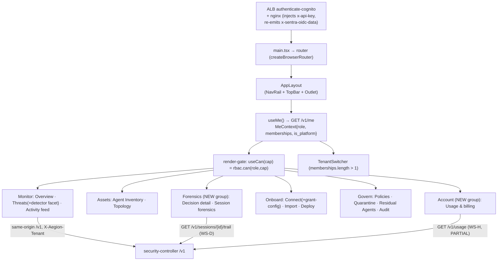
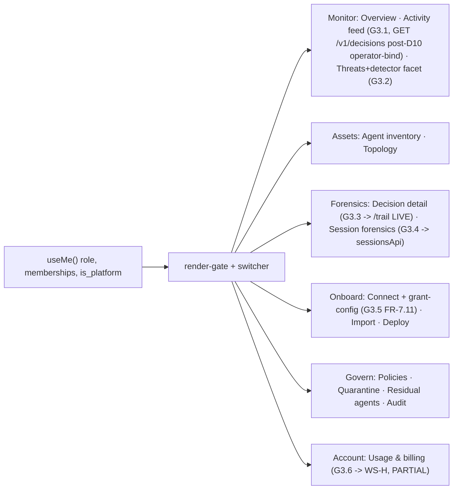
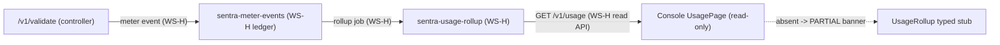

# LLD 40: Multi-tenant SOC Console (WS-G)

**Version**: 1.0
**Last Updated**: 2026-07-07
**Status**: Draft
**Prerequisites**: [LLD 26 §5–6](26-multi-tenancy.md) (membership authority, RBAC, tenant switcher), [LLD 08](08-authentication-and-alb-architecture.md) (ALB-OIDC auth), [lld/39](39-authz-rbac-edge-authorizer.md) (WS-M — the SHIPPED server-side authz boundary), WS-D (decision trail), WS-H (metering/billing)

## Table of Contents
1. Context
2. Scope & status (DONE / PARTIAL / NOT-DONE)
3. Architecture overview
4. M-G1 — Cosmetic-tenant containment (FR-13.1)
5. M-G2 — RBAC render-gating + tenant switcher (FR-13.3)
6. M-G3 — Exhaustive FR-13.2 dashboard set
7. View → API contract catalog
8. Security (SEC-1..5)
9. Resiliency & degradation
10. Scaling / performance / bundle budget
11. Networking
12. Client state / data model
13. Cost
14. Metering & billing (read path)
15. Per-view test cases
16. Cross-references
- Appendix A — Full control → Capability → server-route map
- Appendix B — ADR-035 verified-operator-subject seam

---

## 1. Context

This LLD elaborates the **approved HLD option `hld/serverless-edition.md` §6.2(f) Option A** ("Keep Cognito now, harden the seam, defer the provider switch"), plus its 2026-07-06 refinement (customer-IdP-as-source-of-truth for *who*, sequenced after RBAC coverage; roles kept uniform on our side; org-first console). It is the implementation-grade design for the **`web/console`** React/Vite SOC console — the one workstream WS-G owns.

It does **not** re-argue the choice. Two constraints frame everything below:

1. **It EXTENDS [LLD 26 §5–6](26-multi-tenancy.md)** — the membership authority (`sentra-tenant-members`), `resolve_operator_tenant`, `require_role`, `GET /v1/me`, and the `TenantSwitcher` primitive are **already built and live** (LLD-26 go-live, refined by WS-C/WS-D). This doc consumes them; it does not restate their internals. It does **not** duplicate [lld/04](04-dashboard-v2.md) (the decommissioned Streamlit dashboard).
   - **Which console is "the console" (do not follow a stale PRD trail).** WS-G builds on **`web/console/`** (React/Vite) — the current, live SOC console. Two older UIs still exist on disk and are **superseded, NOT the WS-G target**: `src/dashboard/` (the LLD-04 Streamlit dashboard, decommissioned) and `frontend/` (an earlier React app). The sub-PRD's FR-13.x status evidence (§4.10/§5) cites `src/dashboard/` and `frontend/src/components/Dashboard.tsx` ("no tenant filter … no tenant claim in `auth.py` … React frontend has no tenant logic") — that evidence is **stale**: it profiles the superseded dirs, not `web/console/`, whose tenant-scoping/RBAC/switcher are the already-built spine this doc consumes (§2). A reader following the PRD file trail lands on the wrong code; the join key is `web/console/`.
2. **The server-side authorization boundary already SHIPPED (WS-M / [lld/39](39-authz-rbac-edge-authorizer.md), prod milestone-102, `main` @ `0e9f6d0`).** `require_role` covers 18/21 mutating `routes.py` routes (+ `require_platform` on the sigma-retire path), `assert_owns(...)` closes the cross-tenant IDOR (BUG-1), and `X-Operator-Email` is fully removed (0 reads). **The console client render-gate MIRRORS that live server gate and is NEVER the boundary — it is UX only.** A tampered client gains nothing.

WS-G's real, unbuilt work is three milestones: **M-G1** close the residual `tenantOf()` cosmetic-tenant surface (lint/type guard), **M-G2** finish RBAC render-gating (`useCan` is wired into only 1 of 8 features today) + verify+fix the shipped `TenantSwitcher`, **M-G3** promote embedded/component views to routed tenant-scoped FR-13.2 views + land the D10 operator-scope prerequisite + fix dead `operator_id` client stubs. The ADR-035 federation seam (G3.7) is **design-only**.

**Why this is a workstream, not polish (GTM consequence — the honest read).** The server authorization boundary shipped in WS-M; several individual G-items *are* hardening of an already-shipped boundary (rename + lint, wire `useCan` into more buttons, promote embedded components to routed pages). But the workstream's payoff is a concrete GTM gate: **a self-serve multi-tenant, RBAC-gated console is what lets logo #2..N transact on one shared deployment instead of a per-tenant stand-up.** It unblocks a multi-tenant design-partner demo where two tenants' operators log in and see only their own fleet. That is the sellable unit; the individual tasks are the parts that add up to it.

**Sellability limit — state it plainly (buyer gate, NOT solved here).** This console keeps **Cognito-hosted login** (HLD §6.2(f) Option A, founder-decided). Federation to a customer's own IdP (Okta/Entra via SAML/OIDC + SCIM provisioning, ADR-035) is deferred. That deferral is fine for **design-partner / early-adopter logos who accept a vendor-hosted user pool for a pilot**, but it is a **hard onboarding blocker for the regulated / in-VPC segment (Moat 2)** — a CISO's SOC team will not onboard operators into a vendor IdP for production. So: **this console is demo/pilot-sellable today, and NOT enterprise-sellable to a regulated logo until ADR-035 (the federation WS) executes.** ADR-035 is design-only *here* (the seam is cheap — Appendix B), but its *execution* must be sequenced before/concurrent with selling the regulated segment, not treated as indefinitely optional. lld/40 does not schedule that WS; it flags the gate.

**Deprovisioning story (a buyer will ask; answer it plainly).** Even without SSO/SCIM auto-deprovisioning, a departed operator's access is revoked by **removing their `sentra-tenant-members` row** (member management is LLD-26 §6, not a WS-G view yet): `resolve_operator_tenant` calls `get_member_store().by_operator(sub)` on every request and **403s an operator with no membership** (`deps.py:409` → "operator has no tenant membership"), so a removed operator is denied at the boundary on their next call **even though their Cognito login still exists**. The gap SSO/SCIM closes is *automatic* deprovisioning tied to the customer's IdP lifecycle (and single-sign-on to the operator's existing identity) — until ADR-035, deprovisioning is a **manual membership-row removal** the customer's admin performs, which is acceptable for a pilot but is exactly the procurement friction a mid-market SOC buyer may bounce on. This is a GTM/scheduling input for the ADR-035 decision below, not a WS-G build item. **[REC]** validate with 2–3 design partners that a manual, membership-row deprovisioning + vendor-hosted Cognito login is acceptable for a *paid* pilot (not just a free demo) before treating the funding segment as unblocked on this gate.

**Segment framing — say which segment funds this, and don't leave the moat-bearing one on an unscheduled dependency.** Per STRATEGY, the **data-flywheel moat (Moat 1) compounds in Serverless/mid-market**, while the **structural moat (Moat 2) lives in regulated/in-VPC**. This shared multi-tenant SaaS console's value accrues almost entirely to **Serverless/mid-market** — it is explicitly the GTM enabler that lets logo #2..N transact on one shared deployment. So **WS-G is scoped as a Serverless/mid-market GTM enabler**, and that segment funds it; its enterprise value is real but gated on ADR-035. That is defensible *only* if the moat-bearing segment isn't left waiting indefinitely: the **in-VPC console path (customer-IdP federation + dedicated deployment) must carry a dated commitment on the roadmap** (ADR-035 execution scheduled before/concurrent with the first regulated sales motion), not an open "later". **[REC/founder decision needed]:** either (a) schedule ADR-035 federation concurrently so the regulated onboarding path exists, or (b) explicitly accept WS-G as Serverless-only for now with a named date by which the in-VPC console lands. lld/40 flags this as a scheduling decision the founder owns — it does not silently assume the regulated segment is served by this console.

---

## 2. Scope & status (DONE / PARTIAL / NOT-DONE)

> **In plain terms.** Most of the "auth" half WS-G was originally scoped around is already built and running in prod. This table is the honest as-built so the build tasks skip finished work. "DONE" rows are `file:line`-cited and are **verify-only**; "PARTIAL/NOT-DONE" rows are the actual build.

| FR / capability | Status | Evidence (`file:line`) | WS-G action |
|---|---|---|---|
| Server-derived tenant from session (never email domain) | **DONE (live)** | `app/api/deps.py:404` `_resolve_operator_tenant_inner` → `tenancy.set_current_tenant` @ `deps.py:435` | Regression-test (G1.3); do not rebuild |
| ALB-OIDC operator auth, signature-verified (ES256, `kid` cache) | **DONE (live)** | `deps.py:304` `verify_alb_oidc`; issuer/signer pin `deps.py:355` `_assert_signer_issuer_pinned` | Verify; name as the ADR-035 seam substrate (G3.7) |
| `X-Aegion-Tenant` switch validated vs membership (403 if not a member) | **DONE (live)** | server `deps.py:414–427`; client `web/console/src/lib/tenant.ts`, `http.ts:158` (`tenantHeader()`) | Verify (G2.2) |
| Server RBAC authority `require_role` on 18/21 mutating routes + `require_platform` on sigma-retire | **DONE (live, WS-M)** | `deps.py:471` `require_role`; routes enumerated in Appendix A | Mirror in client gate (G2.1); do NOT re-own the server edit |
| Anti-IDOR ownership assert (BUG-1 closed) | **DONE (live, WS-M)** | `app/api/ownership.py` `assert_owns`; cited across `routes.py` | N/A (server-owned) |
| `GET /v1/me` → `{sub,email,tenant_id,role,is_platform,memberships[]}` | **DONE (live)** | `app/api/tenancy_routes.py` `get_me`; client `lib/api/me.ts`, `lib/query/useMe.ts`, type `types/api.ts:61` `MeContext` | Reuse as the sole role source |
| Client RBAC mirror `can()` / `useCan()` / `Capability` map | **DONE (exists), UNDER-WIRED** | `web/console/src/lib/rbac.ts`; `lib/query/useMe.ts:22` `useCan` | Wire into every mutating control (G2.1) — **1 of 8 features today** |
| `TenantSwitcher` UI (multi-membership) | **DONE (exists + mounted), 1 CODE FIX** | `web/console/src/components/ui/TenantSwitcher.tsx`; mounted in `TopBar.tsx:117` | Verify render + **fix cache-clear primitive** `invalidateQueries()`→`removeQueries()` (G2.2, §5.5) |
| `GET /v1/sessions/{id}/trail` (WS-D full deny-overrides trail) + `GET /v1/sessions/{id}/signals` | **DONE (live), BOUND TO WRONG LANE** | `routes.py:541` `get_session_trail` + `routes.py:515` `get_session_signals` both wrap `_dataplane_tenant_bind` (`routes.py:466`, AGENT JWT) — 401s the tokenless console at enforce | Re-bind to operator identity (D10 §6.2) + bind real trail (G3.3) — do NOT bind legacy `DecisionTrace`. **Reverses a still-standing lld/39 §4/§5 "do NOT change (Invariant 6)" row — reconciled by ADR-038 + propagate-change (§6.2).** |
| `GET /v1/decisions` time-range scan | **DONE (live), NOT TENANT-BOUND** | `routes.py:574` `scan_decisions` — no auth dep, no tenant bind | **D10 prerequisite fix** (operator-identity bind) before G3.1 |
| `GET /v1/sessions` list | **DONE (live), FLEET-WIDE — NOT TENANT-BOUND** | `routes.py:640` `get_sessions` → `session_manager.py:610` `fleet_scan` (spans all tenants), no auth dep | **D10 prerequisite fix** (tenant-scope to operator) before G3.4 |
| `GET /v1/sessions/{id}/decisions` | **DONE (live), NOT TENANT-BOUND** | `routes.py:450` `get_session_decisions` — no auth dep, ambient `default` partition | **D10 prerequisite fix** (operator-identity bind) before G3.4 |
| `GET /v1/agents` + `/agents/{id}` + `/agents/{id}/tools` (Assets spine) | **PARTIAL — NOT TENANT-BOUND** | `routes.py:1235` `get_agents`, `:1274`, `:1303` — no auth dep → `query_or_scan` on ambient `default` | **D10 prerequisite fix** (operator-identity bind) before the Assets views are trusted multi-tenant (§6.2) |
| `GET /v1/policies` + `/policies/{id}` (Govern spine) | **PARTIAL — NOT TENANT-BOUND** | `routes.py:1346` `get_policies`, `:1415` — no auth dep → `query_or_scan` on ambient `default` | **D10 prerequisite fix** (operator-identity bind) before the Policies view is trusted multi-tenant (§6.2) |
| `GET /v1/connections` + `/connections/{id}` (Connect spine) | **PARTIAL — NOT TENANT-BOUND** | `routes.py:951` `list_connections` (docstring: "tenant-scoped by the ambient tenant"), `:978` — no auth dep | **D10 prerequisite fix** (operator-identity bind) before G3.5 is trusted multi-tenant (§6.2) |
| `tenantOf()` email-domain label | **DONE (downgraded to display-only), REINTRODUCIBLE** | `web/console/src/lib/auth.ts:61` — commented "DISPLAY-ONLY, NON-AUTHORITATIVE" | Quarantine via lint/type guard (G1) |
| Activity / live decision feed (first-class routed view) | **NOT-DONE** | Overview embeds `features/overview/LiveActivity.tsx` only | Build (G3.1) |
| Violations & threats **per detector** | **PARTIAL** | `features/threats/ThreatsPage.tsx` exists; no per-`winning_source` facet | Add facet (G3.2) |
| Decision detail (FR-6.8 full trail) as a routed view | **PARTIAL** | `components/decisions/DecisionTrace.tsx` embedded in ThreatsPage/Quarantine; not routed | Route + bind `/trail` (G3.3) |
| Session forensics (FR-6.9) as a routed view | **PARTIAL** | `lib/api/sessions.ts` client + `SessionDecisionsResponse` exist; no routed view | Build (G3.4) |
| Connectors + **FR-7.11 in-console grant config** | **PARTIAL** | `features/connect/{GrantAccessCard,GrantAzureAccessCard}.tsx`, `cloudCatalog.ts` exist | Promote + GCP "coming soon" (G3.5) |
| Usage & billing (FR-12.x) | **NOT-DONE** | none | Build against WS-H stub, PARTIAL (G3.6) |
| ADR-035 federation seam | **DESIGN-ONLY** | Cognito path is `deps.py:406–407` claim read | Interface spec only (G3.7); no `deps.py` change |
| `operator_id` client stubs (spoofable, server-overridden) | **PARTIAL (dead-code hygiene)** | `DecisionReviewPanel.tsx:22`, `ThreatsPage.tsx:190`, `sessions.ts:31` | Remove (D8) |

**Out of scope for lld/40** (stated, not silently dropped): Tier-2 customer-composed custom roles (HLD refinement, roadmap); the actual SAML/OIDC/SCIM provider swap (ADR-035 *execution*); compliance-report export (FR-6.5, P1); the `_platform` cross-tenant platform-admin console (LLD-26 §5.5 / WS-E).

---

## 3. Architecture overview

> **In plain terms.** The console is a static React SPA served behind the ALB. On load it calls `GET /v1/me` once (`useMe()`); the returned `MeContext.role` drives every render-gate (`useCan(cap)` → `rbac.can(role,cap)`), and `MeContext.memberships` drives the `TenantSwitcher`. Every data call goes same-origin to `/v1` through one `http` wrapper that attaches the `X-Aegion-Tenant` header (`tenantHeader()`) and the nginx-injected API key. There is **no client-held auth state and no client tenant authority** — the server resolves tenant + role from the verified ALB-OIDC session on every request. Routed feature pages are lazy-loaded chunks under one `AppLayout` shell (`NavRail` + `TopBar` + `<Outlet/>`).

### 3.1 Component / route tree



### 3.2 The MeContext → render-gate → switcher spine (already built)

- `useMe()` (`lib/query/useMe.ts:12`) issues `GET /v1/me` once, `staleTime: 5m`, `retry: false` — **non-throwing** so the shell renders even if `/v1/me` is unavailable (fail-secure: `data` is `undefined` → `can()` returns `false` → controls hidden).
- `useCan()` (`lib/query/useMe.ts:22`) closes over `data?.role` and returns `(cap) => rbacCan(role, cap)`.
- `TenantSwitcher` (`components/ui/TenantSwitcher.tsx`) renders only when `memberships.length > 1`; on choose it calls `setActiveTenant(id)` (`lib/tenant.ts:32`) then **cancels in-flight queries and hard-clears** the cache (`cancelQueries()` then `removeQueries()`) so no other tenant's rows — cached OR late-resolving — can render during the refetch window (see §5.5 — the shipped code uses `invalidateQueries()`, which is the wrong primitive and G2 changes it; the mandatory per-view `tenant_id === getActiveTenant()` render gate is the final backstop).

WS-G adds **new views** and **new render-gates** to this spine; it does not change the spine's contract.

---

## 4. M-G1 — Cosmetic-tenant containment (FR-13.1)

> **In plain terms.** `tenantOf()` (`lib/auth.ts:61`) derives a tenant *label* from the email domain and is already commented "DISPLAY-ONLY, NON-AUTHORITATIVE". The fix already shipped (it is only rendered as a chip in `AccountMenu.tsx:44`). G1 makes the misuse **un-reintroducible**: a future dev must not be able to feed it into a query key, an http param, or a gate. We do this WITHOUT deleting it (its one display consumer would break).

### 4.1 D1 — Rename + lint guard (both, not one)

1. **Rename the export** `tenantOf` → `tenantLabelForDisplay` in `web/console/src/lib/auth.ts` and its single caller `AccountMenu.tsx:12,44`. The new name makes intent legible at the call site and makes the lint rule's target name stable.
2. **Add an ESLint `no-restricted-syntax` rule** to `web/console/eslint.config.js` (today a flat config with no custom rules — this is a net-new `rules` block on the `**/*.{ts,tsx}` entry) that **fails the build** if `tenantLabelForDisplay` (or the legacy identifier `tenantOf`, kept in the selector to catch a re-add) is passed as an argument into `queryKeys.*`, `http.*`/`http.get|post|put|patch|del`, or `can`/`rbacCan`/`roleSatisfies`. Selector shape (AST, `CallExpression` whose callee matches the sink and whose arguments include the identifier):

```js
// eslint.config.js — additive rules block (pseudocode of the selector intent)
'no-restricted-syntax': ['error', {
  selector:
    "CallExpression[callee.object.name='queryKeys'] :matches(Identifier[name='tenantLabelForDisplay'], Identifier[name='tenantOf'])," +
    "CallExpression[callee.object.name='http'] :matches(Identifier[name='tenantLabelForDisplay'], Identifier[name='tenantOf'])," +
    "CallExpression[callee.name=/^(can|rbacCan|roleSatisfies)$/] :matches(Identifier[name='tenantLabelForDisplay'], Identifier[name='tenantOf'])",
  message: 'Cosmetic email-domain tenant label must never scope data, gate UI, or reach the API — use useMe().data.tenant_id (server-derived). FR-13.1.',
}]
```

**Do NOT delete `tenantOf`/`tenantLabelForDisplay`** — `AccountMenu` consumes it for the tenant chip; deleting it breaks the shell (footgun from the WS doc). Quarantine, don't remove.

### 4.2 Grep-proof of display-only callers (G1.1)

`grep -rn "tenantOf" web/console/src` — every hit must be a JSX label/avatar/header string. Current hits: `lib/auth.ts` (definition), `components/ui/AccountMenu.tsx:12,44` (chip render). Both are display. After the rename the grep target becomes `tenantLabelForDisplay`; the acceptance test asserts **no hit** inside a `queryKey`, `http` param, or gate predicate.

### 4.3 FR-13.1 server-authority regression test (G1.3)

A backend test (mirror the existing `deps`/tenancy tests under `src/security-controller/tests/`) that proves `resolve_operator_tenant` **ignores the email domain entirely**: an operator whose ALB-OIDC `email` claim is `alice@acme.io` but whose sole `sentra-tenant-members` membership is `t_globex` resolves to `tenant_id == "t_globex"` (not `t_acme`). This is the FR-13.1 acceptance proof — it pins that the authority is the membership store (`get_member_store().by_operator(sub)` at `deps.py:409`), never the domain.

---

## 5. M-G2 — RBAC render-gating + tenant switcher (FR-13.3)

> **In plain terms.** `rbac.ts` declares 8 capabilities but `useCan()` is wired into only `PolicyLibraryPage.tsx` today (7 of 8 caps unused). Every other feature renders its create/edit/delete/attach/release control unconditionally. G2 wires `useCan(cap)` around every mutating control so a `viewer` never *sees* a button they can't use — and, critically, extends the client `Capability` map so each capability's minimum role **equals** the `require_role` of the route it fronts (today the client map is coarser than the server, so an `editor` sees a Delete-policy button the server rejects with 403). The server gate stays the boundary; this is UX parity with it.

### 5.1 D2 — Authoritative per-view capability map (LOAD-BEARING)

The client render-gate MUST mirror WS-M's live server gate. Each mutating control gates on a `rbac.ts` `Capability` whose `MIN_ROLE` equals the server `require_role` on the route it invokes. **Divergence today:** client `policies.write=editor` fronts server `DELETE /policies=admin`; connections have **no** client capability at all. The fix extends the `Capability` union + `MIN_ROLE` map so the mapping is 1:1. Summary (full table in Appendix A):

| Control (feature) | Client `Capability` (MIN_ROLE) | Server route @ line | Server role |
|---|---|---|---|
| Verdict FP/FN (`DecisionReviewPanel`, Threats) | `decisions.verdict` (editor) *new* | `POST /decisions/{id}/verdict` @ `routes.py:1196` | editor |
| Quarantine session (Threats) | `quarantine.manage` (admin) *new* | `POST /quarantine/{id}` @ `routes.py:2090` | admin |
| Release quarantine (Quarantine) | `quarantine.manage` (admin) *new* | `DELETE /quarantine/{id}` @ `routes.py:2184` | admin |
| New/Edit policy (PolicyLibrary/Editor) | `policies.write` (editor) | `POST /policies` @ `1465`, `PUT /policies/{id}` @ `1512`, `PATCH …/status` @ `1612` | editor |
| Delete policy (PolicyLibrary) | `policies.delete` (admin) *new* | `DELETE /policies/{id}` @ `1569` | admin |
| Attach/Detach policy (AgentInventory/Detail) | `agents.write` (editor) | `POST /agents/{id}/policies` @ `1151`, `DELETE …` @ `1177` | editor |
| Import agents (Import) | `agents.write` (editor) | `POST /discovery/import` @ `861` | editor |
| Connect: create/delete/update conn (Connect) | `connections.write` (admin) *new* | `POST /connections` @ `960`, `DELETE` @ `1085`, `PUT` @ `989` | admin |
| Connect: test/scan conn (Connect) | `connections.operate` (editor) *new* | `POST …/test` @ `1027`, `POST …/scan` @ `1065` | editor |
| Sigma-rule retire (PolicyLibrary toggle) | `sigma.retire` (**platform**, gate on `is_platform`) | `PATCH /sigma-rules/{id}` @ `1746` | `require_platform` |

> This summary lists only the controls **WS-G wires**. The shipped `rbac.ts` union also carries `credentials.rotate` (editor), `credentials.write` (admin), `members.read` (editor), `members.manage` (admin), `tenant.delete` (owner) — **retained unchanged** (Appendix B) because they gate LLD-26 tenancy/credential controls that are not yet WS-G routed views; they are in the `MIN_ROLE` map (and the D3 completeness allowlist/mapping) but have no new WS-G control row here. Their omission from *this* table is not a drop.

**`sigma.retire` is special**: the server gates it with `require_platform` (not `require_role`) because the prompt-signature store is fleet-global and not tenant-partitioned ([lld/35 §3.3](35-prompt-signatures.md)). The client toggle in `PolicyLibraryPage` (`SigmaRuleRow`, line ~299) must therefore gate on `useMe().data.is_platform`, **not** a tenant role — a tenant `admin` must NOT see the retire toggle.

### 5.2 D3 — Client↔server role map is ONE contract (parity test)

`rbac.ts` `RANK = {viewer:0, editor:1, admin:2, owner:3}` MUST stay identical to the server `deps.py:39` `_ROLE_ORDER = ("viewer","editor","admin","owner")` and its `role_satisfies` (`deps.py:446`). A divergence either hides a usable control (annoyance) or shows an unusable one (confusing 403). Lock it with a test that fails on drift. Because the two live in different languages, the mechanism is a **generated fixture**: a tiny backend endpoint/test dumps `_ROLE_ORDER` + the per-capability min-role to a JSON fixture checked into `web/console/src/lib/__fixtures__/role-model.json`; a Vitest asserts `rbac.RANK` ordering and each `MIN_ROLE[cap]` equal the fixture. CI regenerates and diffs the fixture in the backend `pytest` run, so a server-side role change that isn't mirrored fails **both** suites.

**Parity is not enough — the fixture MUST also assert COMPLETENESS (coverage of the route set, not just agreement on the intersection).** The parity check above only compares capabilities that *already* have a client mapping; it is structurally blind to a NEW server route. When a future engineer adds a mutating route server-side with a `require_role`/`require_platform` and **no** corresponding client `Capability`, nothing fails — the client simply has no gate, so the button renders unconditionally and the user eats a 403 (exactly the D2 failure — client coarser than server). So the backend fixture generator MUST **enumerate every `require_role`/`require_platform`-bearing route** (walk the FastAPI route table for the two dependencies, not just the roles) and emit `{route, method, gate}` for each; the Vitest **fails CI if any such route has no mapped client `Capability`/`PlatformCapability`** (a per-route allowlist covers the deliberately-unconsoled routes — e.g. `POST /rollback` @ 1919, roadmap — so an *intentional* no-console route is an explicit entry, not a silent hole). Coverage of the set + agreement on the intersection, both asserted.

**Also guard the D10 bug class itself — the "ZERO auth dep" route, invisible to the walk above.** The walk enumerates routes that *already bear* a gate; it is structurally blind to the actual bug D10 exists to fix — `scan_decisions`/`get_sessions`/`get_session_decisions` had **no auth dependency at all** (not a missing client mapping). A future data route added with zero dep is not enumerated, nothing fails, and it serves unbound (ambient `default`/`fleet_scan`) exactly as the D10 routes did. So the generator ALSO enumerates **every tenant-scoped DATA route** (GET/read handlers under `routes.py` that touch a tenant-partitioned store) and **fails CI unless each carries a tenant-binding dependency** (`resolve_operator_tenant` / `require_role` / the operator-lane bind) **OR is on an explicit no-auth allowlist**. That makes the D10 ungated-read bug class un-reintroducible, mirroring how M-G1's lint guard makes the `tenantOf` misuse un-reintroducible and how lld/39 M1's systemic gate makes an ungated *mutation* un-mergeable. This read-side gate is the console-lane complement to lld/39 M1 (which enumerates only mutating `post/put/patch/delete`).

**The allowlist is NOT an escape hatch for a genuinely-unbound tenant-partitioned read.** A **tenant-partitioned read may NEVER be allowlisted** — the allowlist is reserved for routes that are genuinely tenant-*agnostic* (e.g. `/health`, and other non-partitioned public reads). If a tenant-scoped data route lacks a binding, the fix is to BIND it (add `resolve_operator_tenant`), not to allowlist it into "deliberate" — allowlisting a partitioned read silently converts a real cross-tenant leak into a rubber-stamped one. The D3 generator MUST classify `/agents`, `/agents/{id}`, `/agents/{id}/tools`, `/policies`, `/policies/{id}`, `/connections`, `/connections/{id}`, `/decisions`, `/sessions`, `/sessions/{id}/decisions`, `/sessions/{id}/trail`, `/sessions/{id}/signals` (GET), and `/metrics/overview` as **tenant-scoped-data routes that MUST bind** — they may not appear on the no-auth allowlist. **First-run reconciliation (honest, not green-washed):** because these reads are unbound TODAY, the gate's **first run enumerates them as current failures**, which is the correct signal — it forces the D10 scope open (§6.2) so they are bound, rather than allowlisted to make CI green. A CI run that goes green by allowlisting a partitioned read is the failure this gate exists to prevent.

**CI wiring is explicit (so the fixture can't rot silently).** The contract only holds if the fixture is regenerated-and-diffed on every backend change: the backend `pytest` step **regenerates `role-model.json` and fails on an uncommitted diff** (a server role/route change that isn't mirrored fails the backend suite), and the frontend Vitest runs against the **committed** fixture in the **same** CI pipeline. Both suites + the regeneration step are one gate on every PR; a server change that isn't mirrored fails a check that actually runs, and the per-route allowlist is **asserted** (an unknown, un-allowlisted route fails) rather than advisory.

### 5.3 Wiring `useCan` into every mutating control

For each feature under `web/console/src/features/{agents,policies,connect,import,quarantine,identity,discovery}`, wrap the mutating control's render in `useCan('<capability>')`. Concrete edits (verified control sites):

- `features/quarantine/QuarantinePage.tsx` `ReleaseButton` (line ~33) → gate on `quarantine.manage`.
- `features/threats/ThreatsPage.tsx` Quarantine button (line ~183) → `quarantine.manage`; `DecisionReviewPanel` FP/FN → `decisions.verdict`.
- `features/policies/PolicyLibraryPage.tsx`: New Policy already gates `policies.write` (line 111); **add** gates to the row Edit (→`policies.write`), Disable/Enable (→`policies.write`), Delete (→`policies.delete`), and the Sigma retire toggle (→`is_platform`). Today only New Policy is gated.
- `features/agents/AgentInventoryPage.tsx` Attach/Detach (lines ~135,~151) + `AttachPolicyModal` confirm → `agents.write`.
- `features/import/ImportAgentsPage.tsx` import button (line ~111) → `agents.write`.
- `features/connect/ConnectAccountPage.tsx` connect/create + start-over/remove (lines ~121,~281) → `connections.write`; `GrantAccessCard`/`GrantAzureAccessCard` Test/Scan → `connections.operate`.
- `features/identity/ResidualAgentsPage.tsx` is read-only → `identity.residual.read` (viewer floor); no mutation to gate.

Pattern (already used in `PolicyLibraryPage`): `const can = useCan()` then `{can('policies.write') && <Button .../>}`. A gated control that a role can't use is **not rendered** (not merely disabled) so it can't be re-enabled via devtools — and even if it were, the server 403s.

### 5.4 D6 — Fail-secure UI degrade contract

| Condition | Behavior | Detection signal |
|---|---|---|
| No role (`/v1/me` unavailable OR `role` undefined) | Every `useCan(cap)` → `false` → mutating controls hidden | `useMe().data` is `undefined` (non-throwing `retry:false`) |
| WS-D `/trail` or WS-H `/usage` API absent | View renders a **PARTIAL banner** (read-only degrade), never fabricated success | `ApiException.status` in `{404, 501}` OR a typed feature-probe (see §7) |
| 403 from a mutation the gate should have hidden | Toast `requires role ≥ <r>` (belt-and-braces; the gate should have hidden it) + **invalidate `MeContext`** (`qc.invalidateQueries(['me'])`) so a server-side role/membership change is picked up immediately, not after the 5m `staleTime` | `ApiException.status === 403` from a mutation |
| Operator demoted / removed from a tenant server-side | Stale `MeContext` could show buttons for up to `staleTime` (5m) and keep offering a revoked tenant in the switcher — **the server 403 still holds the boundary** (not a breach), but revocation should feel immediate in a SOC console. Mitigate: **refetch `/v1/me` on tenant switch and on window-focus** (identity query only — `refetchOnWindowFocus:true` for `['me']`), plus the 403→invalidate above. Accepted staleness window when none of those fire: **≤5m** (deliberate, documented — not indefinite) | `useMe()` `staleTime:5m`; server 403 on the revoked scope |

### 5.5 TenantSwitcher — VERIFY (already shipped)

`TenantSwitcher.tsx` exists and is mounted in `TopBar.tsx:117`, but G2 carries **one required code fix** on it (not pure verification):
- renders only when `memberships.length > 1` (line 25) — verify;
- **cache-clear primitive is WRONG today — AND a hard-clear alone does not close the window.** `choose()` calls `setActiveTenant(id)` then `qc.invalidateQueries()` (`TenantSwitcher.tsx:34`). `invalidateQueries()` only marks queries stale and triggers a refetch — the previously-cached **tenant A** data STAYS in the cache and keeps rendering with `isFetching:true` until tenant B's refetch resolves. So for the entire refetch window after a switch, mounted views paint the previous tenant's rows: the exact "visual cross-tenant leak" this guard exists to prevent, un-closed. **Fix: `qc.cancelQueries()` THEN `qc.removeQueries()`** — in that order. `removeQueries()` alone drops the *cached* rows, but a GET already **in flight** for tenant A (dispatched with `X-Aegion-Tenant: A` before the switch) can **resolve after the switch and re-write A's rows into the cache** under the tenant-agnostic key (§12 keeps keys tenant-agnostic), re-painting A under active tenant B. `cancelQueries()` aborts those in-flight A requests first; `removeQueries()` then clears the cached data so mounted views fall to their loading state until B's data arrives. `resetQueries()` (which cancels+clears+refetches) is the acceptable one-call equivalent. Do NOT ship `invalidateQueries()`, and do NOT ship `removeQueries()` without the preceding `cancelQueries()`.
- **Per-view tenant-match render gate is MANDATORY, not "may" (defense against the late-resolving promise).** Every tenant-scoped view **must** gate its data render on `useMe().data.tenant_id === getActiveTenant()` (render loading/empty when they differ). This is not optional belt-and-braces: even with cancel+remove, a promise that has already begun resolving can slip a write in, and the tenant-agnostic query key cannot distinguish an A-response from a B-key. The render gate is the one check that a stale-tenant row can never pass. (A longer-term hardening — embedding `tenant_id` in the query keys so a late A-response cannot collide with a B key — is noted in §12 as the durable alternative; the mandatory render gate is what ships now.)

**The gate's two inputs race — and the race resolves to the SAFE direction (state this explicitly; it is why the gate is airtight).** `getActiveTenant()` flips to B **synchronously** on switch (`localStorage`/module var, `lib/tenant.ts`), while `useMe().data.tenant_id` is cached (`staleTime:5m`, refetches on switch/focus) and **still reads A** for the refetch window after a switch. So during that window the two inputs transiently **disagree** (`data.tenant_id==A`, `getActiveTenant()==B`) — and the gate `data.tenant_id === getActiveTenant()` therefore evaluates **false**, which renders **loading/empty, never a row**. The mismatch always fails *closed* (hide), never *open* (render stale-A under active-B): the only way the gate can evaluate **true** is when both agree, which for a stale-A `data` requires `getActiveTenant()` to also read A — i.e. no switch is in progress. A stale-A `data.tenant_id` can therefore never transiently pass the gate under active-tenant B. **Test (§15):** while `useMe()` is refetching after a switch to B, assert the view shows **loading**, not stale-A data, even though `data.tenant_id` still reads A.
- **The regression test must assert the leak is gone, not merely that a clear was called, AND must exercise the in-flight race.** Test: render two memberships, seed a query cache under tenant A with visible rows **plus one A request left PENDING (in-flight)**; switch to B; **resolve the pending A request AFTER the switch**; assert **no tenant-A row is ever present in the DOM** (the view stays in loading/empty until B resolves) — a test that only asserts `removeQueries`/`cancelQueries` was called, or that seeds no in-flight request, would go green while the late-resolve leak is still visible.

### 5.6 Platform-route hiding (G2.3)

Any `_platform` surface (WS-E, out of WS-G build scope) gates on `useMe().data.is_platform`. WS-G renders nothing platform-scoped for a customer operator. No platform route exists in this env yet, so this is a **no-op assertion** in the nav config (documented, not invented) plus the `sigma.retire` `is_platform` gate above.

```mermaid
sequenceDiagram
  participant U as Operator (browser)
  participant N as console nginx
  participant ALB as ALB (authenticate-cognito)
  participant API as security-controller /v1
  U->>N: GET /v1/me (+ optional X-Aegion-Tenant)
  N->>ALB: forward; ALB injects signed x-amzn-oidc-data
  N->>API: re-emit as x-sentra-oidc-data + x-api-key
  API->>API: verify_alb_oidc (ES256, kid, issuer pin) -> claims.sub
  API->>API: MemberStore.by_operator(sub) -> memberships
  API->>API: validate X-Aegion-Tenant in memberships (403 if not)
  API->>API: set_current_tenant(chosen.tenant_id)
  API-->>U: {tenant_id, role, is_platform, memberships[]}
  U->>U: useMe() caches 5m; render-gate can(role,cap); switcher if >1
```

---

## 6. M-G3 — Exhaustive FR-13.2 dashboard set

> **In plain terms.** Every FR-13.2 view must be a routed, tenant-scoped page reachable from the nav — several exist only as embedded components today. G3 promotes them, binds each to the real `/v1` API (WS-D trail, WS-H usage), and adds the two missing views (Activity feed, Usage). It also lands the D10 prerequisite backend fix that **operator-identity-binds** the console reads (`GET /v1/decisions`, `/sessions`, `/sessions/{id}/decisions`, and re-binds `/trail` off the agent lane) before the feeds formalize their use.

### 6.1 D4 — Routes + nav IA

New route constants in `web/console/src/app/routes.ts` and lazy pages in `lazyPages.ts` + `router.tsx`:

| Route key | Path | Nav group | View |
|---|---|---|---|
| `activity` | `/activity` | Monitor (existing) | Activity feed (G3.1) |
| `decisionDetail` | `/decisions/:sessionId/:requestId` | Forensics (**NEW group**) | Decision detail (G3.3) |
| `sessionDetail` | `/sessions/:sessionId` | Forensics (**NEW group**) | Session forensics (G3.4) |
| `usage` | `/usage` | Account (**NEW group**) | Usage & billing (G3.6) |

**Nav IA decision:** add a **Forensics** group (Decision detail, Session forensics) and an **Account** group (Usage & billing) to `navConfig.ts` `NAV_GROUPS`; the Activity feed slots under the existing **Monitor** group. (Decision detail + Session forensics are detail targets linked from feeds; whether they get top-level nav items or only breadcrumb entries is a rendering choice — the Forensics group exists so the routes are reachable and breadcrumb-derivable via `NAV_ITEMS`.)

**Decision-detail route is `:sessionId/:requestId` (BOTH keys) — not `:requestId` alone.** The trail API is session+request scoped because the DynamoDB PK is the composite `tenant_session_id`; `request_id` alone is **not** a partition key (`routes.py:554` FOOTGUN, and `decisions_service.get_session_trail` inlines the same session-partition Query). A `/decisions/:requestId` route could not build the query. The activity feed and threats rows already carry both `session_id` and `request_id` on `DecisionItem`, so the cross-link is `decisionDetailPath(sessionId, requestId)`.

### 6.2 D10 — PREREQUISITE backend fix: tenant-bind the console reads via the OPERATOR identity (before G3.1)

**FOUNDER-DECIDED 2026-07-07 (fix mechanism corrected 2026-07-07 after code review — see below).** `scan_decisions` (`routes.py:573`) has **no auth dependency and no tenant bind**. Its GSI-2 partition key is the composite `{tenant}#{YYYY-MM-DD}` (`decisions_service.py:472` `tenancy.decision_date_gsi_value`), read from the **ambient** `current_tenant()`, which defaults to `"default"` (`tenancy.py:113` default). Because no request in this path binds the operator's tenant, the scan reads the `default` partition.

**What that partition actually holds (honest triage — leak vs blind depends on fleet mode, not asserted as fact).** The audit write path binds the tenant only on an **enforce + verified** `/validate` (`set_current_tenant(ctx.tenant_id)`), so an enforcing tenant's decisions land in *its own* `{tenant}#date` partition; an `off`/`shadow` tenant's `/validate` never binds a real tenant, so its rows land in the ambient `default#date` partition. Consequence on the current live fleet (`dev.yaml tenant_identity_mode: enforce`; only the three Acme agents drive live `/validate`, all under enforcing tenant `acme`): the `default` partition is **near-empty for the enforcing tenant** — so today the unbound read is largely a **blinding** (operators see the empty/`default` slice, not Acme's rows), *and* it is a **latent cross-tenant read** the moment any tenant runs at `off`/`shadow` (that tenant's rows co-mingle in `default`, readable by any operator). Either way the read is **not correctly tenant-scoped** and must be bound before the Activity feed (G3.1) formalizes it. We do **not** claim "a live cross-tenant leak" as a settled fact — that requires a prod partition inspection (owned by WS-M) and is orthogonal to the fix.

**Current-state blast-radius (bound the severity, don't leave a reader to infer a live leak).** As of 2026-07-07 the live fleet is **single-tenant**: only the three Acme agents (`policies.demo.yaml`) drive live `/validate`, all under the one enforcing tenant `acme`, and no second customer tenant has console-authenticating members. So **today the blast radius of these unbound reads is nil-to-blinding, not an active multi-tenant leak** — there is no second tenant whose rows another operator could read. The exposure becomes **live the instant a second tenant onboards** (the exact precondition for the multi-tenant demo WS-G exists to enable), which is precisely why D10/D11 are a **hard pre-demo gate** (§6.2 sequencing gate) rather than an open incident: they must land *before* logo #2 authenticates, not after. If a second tenant is already live when this reads, D10/D11 are an **active P0 to remediate now**, not gated on the demo train.

**Why the original `_dataplane_tenant_bind` prescription was WRONG (operator vs agent lane).** An earlier draft bound `scan_decisions` through `_dataplane_tenant_bind(http_request)` (`routes.py:466`), the same helper `/trail` uses. That helper resolves tenant via `resolve_tenant_from_jwt` (`deps.py:127`), which reads an **AGENT** `Authorization: Bearer` JWT (`tid` claim). **The console is the OPERATOR lane and sends NO bearer** — verified: `web/console/src/lib/http.ts:158` attaches only `X-Aegion-Tenant` + the nginx-injected key; grep finds no `Authorization` header anywhere in `web/console/src`. So on a console request the agent-JWT bind fails both ways: (a) at fleet `off`/`shadow` it takes the `else: yield` (`routes.py:508`) → **no bind** → the ambient-`default` gap is NOT closed; (b) at `enforce` (the live prod config) `resolve_tenant_from_jwt` returns `unverified` → `should_deny` → **HTTP 401**, breaking the Activity feed, Overview's `LiveActivity`, and (same helper) the Decision-detail `/trail` view for the *authenticated* operator. No fleet state yields a correct, switcher-respecting operator read.

**Fix (coordinated WS-D / WS-M-shared edit, landed BEFORE G3.1 formalizes the binding):** bind the console read through the **operator identity**, not the agent JWT. Add `_ctx: OperatorContext = Depends(resolve_operator_tenant)` to `scan_decisions`. `resolve_operator_tenant` (`deps.py:374`) does ALB-OIDC signature verify (`verify_alb_oidc`), resolves the operator's memberships, validates any `X-Aegion-Tenant` switch against membership (**403** on non-member, `deps.py:427`), and calls `set_current_tenant(chosen.tenant_id)` (`deps.py:435`) — which the existing `asyncio.to_thread` scan inherits via copied contextvars, so the GSI hits the operator's own composite partition and honors the tenant switcher.

> **Contextvar persistence is VERIFIED, not assumed (fixes the "bind vanishes on teardown" trap).** `resolve_operator_tenant` is a **plain `async def` dependency, NOT a generator dependency** — it `set_current_tenant`s at `deps.py:435` and *returns* (`deps.py:436`); the only reset is on the *raising* path (`deps.py:396–401`, fail-secure). There is **no `finally` teardown that unsets the tenant before the handler runs**, so on the success path the bind is live for the whole handler, and `asyncio.to_thread` copies the current context into the worker thread — the scan reads the operator's partition, not `default`. **Belt-and-braces (adopted from review):** the handler nonetheless re-affirms the bind with an explicit `set_current_tenant(_ctx.tenant_id)` / `reset_current_tenant(token)` pair *inside* the handler around the `to_thread` scan — mirroring `get_session_trail`'s in-handler bind (via `_dataplane_tenant_bind`) — so a future refactor of `resolve_operator_tenant` into a generator-with-`finally` cannot silently re-blind the scan. The §15 D10 test asserts the **actual GSI partition value equals the operator tenant** (not merely that the response filtered), so a teardown-order regression fails a test.

This is authN + tenant-bind with **no** role requirement (a customer read carries no RBAC role; break-glass `_platform` reads default to `viewer`), so it does not violate Invariant 6 — that invariant is about *agent* data-plane reads; a console feed is an *operator control-plane* read, which the earlier draft mis-categorized. Ship the regression test (§15) with it.

**This reverses a shipped, explicitly-frozen sibling decision — reconcile it, do not silently re-decide (Axis-1 gate).** `get_session_trail` + `get_session_signals` today wrap `_dataplane_tenant_bind` (`routes.py:466`, the SHIPPED WS-M M5.2 agent-JWT bind, prod milestone-102), and **[lld/39](39-authz-rbac-edge-authorizer.md) §4 route-table (row for `GET /v1/sessions/{id}/trail`) + §5 still classify these reads as "none — CORRECT (data-plane read) / do NOT change (Invariant 6)" and "UNCHANGED (no `require_role`, Invariant 6)".** D10 recategorizes these two reads from the **agent data-plane lane** to the **operator control-plane lane**. That is a security-boundary reversal of a live decision, so it is dispositioned three ways rather than left contradictory:
1. **ADR-038 records the lane recategorization** (Cross-references §16): "`/trail` + `/signals` reclassified data-plane→operator control-plane read; agent-JWT bind replaced by `resolve_operator_tenant`." It supersedes the lld/39 §4/§5 "do NOT change (Invariant 6)" disposition for these two reads and narrows Invariant 6's scope statement to *genuine agent-consumed* data-plane reads (`POST /v1/validate` and route 19's write ingest), not console feeds. **ADR-038 must be APPROVED by WS-M (the owner of Invariant 6), not merely drafted, BEFORE the D10 PR merges** — reversing a shipped, explicitly-frozen security invariant requires the owning workstream's explicit sign-off, not a unilateral WS-G re-decide. Merge-blocked on that sign-off.
2. **propagate-change to lld/39** (WS-N lands it WITH the D10 PR, WS-M approves the ADR-038 narrowing): update the §4 route-table `get_session_trail` / `signals` rows and the §5 "UNCHANGED" line from "do NOT change (Invariant 6)" to "operator-lane bound by D10/ADR-038 (lld/40)", and narrow the Invariant-6 scope sentence there. A lld/39 left citing the frozen disposition is residual drift.
3. **Dropping the agent-lane bind is safe — VERIFIED, not asserted.** The sole consumer of the GET `/trail` and GET `/signals` reads is the operator console: grepping `src/`, `demo-agents/`, `web/console/` finds **no** SDK / connector / agent GET caller of `/trail` or `/sessions/{id}/signals` (the only `/signals` client, `src/connectors/base/signals_client.py:80`, is a **POST write** to route 19, a different handler). So moving these reads to operator-only binding loses **no** live access — it *adds* the isolation (and un-breaks the console at enforce), rather than removing an agent's read path. The agent JWT never legitimately reached these GETs.

> **Scope of the lane fix (D10 covers the whole console read set, not just `/decisions`).** The same operator-vs-agent mismatch affects every data-plane read the console consumes:
> - **The forensic reads:** `GET /v1/sessions/{id}/trail` and `GET /v1/sessions/{id}/signals` (both wrap `_dataplane_tenant_bind` — agent JWT → 401 the tokenless console at enforce), `GET /v1/sessions` (`fleet_scan`, cross-tenant, no auth — §6.6), `GET /v1/sessions/{id}/decisions` (ambient `default`, no bind).
> - **The spine reads (added 2026-07-07 — were mis-marked LIVE; verified unbound):** `GET /v1/agents` (`routes.py:1235` `get_agents` → `AgentService.list_agents` → `tenancy.query_or_scan` on ambient `current_tenant()=='default'`, **no** auth dep), `GET /v1/agents/{id}` (`:1274`), `GET /v1/agents/{id}/tools` (`:1303`), `GET /v1/policies` (`routes.py:1346` `get_policies`, same `query_or_scan` pattern via `policy_service`), `GET /v1/policies/{id}` (`:1415`), `GET /v1/connections` (`routes.py:951` `list_connections` — its own docstring says "tenant-scoped by the ambient tenant"), `GET /v1/connections/{id}` (`:978`). These are the EXACT D10 bug class (unbound read on the ambient `default` partition — a blind for the enforcing `acme` tenant and a latent cross-tenant read for any `off`/`shadow` tenant), NOT a distinct issue; the §2 rows are corrected from "DONE (live)" to **PARTIAL — NOT TENANT-BOUND**. Verified there is no tenant-binding middleware (`main.py` has only CORS middleware; only WRITE routes bind via `require_role`→`resolve_operator_tenant`).
>
> Each must be reconciled to the **operator-identity** bind (`resolve_operator_tenant` + the in-handler `set/reset_current_tenant` pair) before G3.1/G3.3/G3.4/G3.5 or the Assets/Govern spine views are trusted multi-tenant. Per-tenant regression tests (tenant-A operator sees only tenant-A agents/policies/connections/sessions/decisions) ship with each (§15).
>
> **Helper strategy — REPLACE, not fork (both `/trail` and `/signals`).** Because the sole consumer of these two GET reads is the operator console (verified above — no agent/SDK/connector GET caller), the console reads move **wholesale to the operator lane**: `get_session_trail` (`routes.py:541`) and `get_session_signals` (`routes.py:514`) swap `async with _dataplane_tenant_bind(http_request)` for `_ctx = Depends(resolve_operator_tenant)` + the in-handler `set/reset_current_tenant` pair. We do **NOT** fork `_dataplane_tenant_bind` into an agent-lane and operator-lane variant — no remaining caller needs the agent-JWT read path, so a fork would be dead code. After the swap `_dataplane_tenant_bind` has **zero GET callers**. **Deprecate through a one-release 403-logging shim, do NOT hard-delete immediately (grep is best-effort — the deletion is otherwise irreversible for a missed/out-of-repo caller).** The verification that "no agent/SDK/connector GET caller of `/trail`/`/signals` remains" is a point-in-time grep; if any missed, future, or out-of-repo agent integration still calls those GETs, a hard delete removes the agent read path with **no fallback and a silent 401**. So for **one release** the helper stays as a **deprecation shim that emits a WARN access-log** ("`_dataplane_tenant_bind` invoked on a GET read post-D10 — unexpected agent-lane caller: <caller>") so a missed caller surfaces **loudly** instead of silently 401ing; the D3 read-side CI gate (§5.2) additionally **fails CI if any non-console caller of `/trail`/`/signals` reappears**. Remove the helper only in the following release, once the shim has logged zero hits in prod. We do **NOT** fork it into an agent-lane and operator-lane variant — no remaining caller needs the agent-JWT read path, so a fork would be dead code. Route 19's `POST /v1/sessions/{id}/signals` write ingest is a *different* handler and keeps its own fail-closed disposition (lld/39 §5.3); D10 does not touch it. All four read edits (`/decisions`, `/sessions`, `/sessions/{id}/decisions`, `/trail`+`/signals`) are owned **jointly with WS-D/WS-M** since `routes.py`/`decisions_service.py`/`session_manager.py`/`deps.py` are shared files — see the §6.8-style sequencing gate below.
>
> Overview's `/metrics/overview` is fleet-wide CloudWatch `SEARCH` with no tenant dimension (`metrics_query_service.py:106`) — dispositioned separately in §6.10 (it does NOT get a silent pass). Do not build a console view against an unbound or agent-JWT-bound read.

> **D10 is a HARD SEQUENCING GATE, not "jointly owned so it'll get done" (single-owner + merge-order named).** D10 closes a live, verified cross-tenant exposure (unauthenticated `fleet_scan` on `/sessions`, ambient-`default` reads on `/decisions` + `/sessions/{id}/decisions`, agent-lane 401 on `/trail`+`/signals`) that sits in **shared enforce-path files** WS-G cannot merge alone. **OWNER (retargeted, founder 2026-07-07): [WS-N](../tasks/serverless-edition/ws-n-read-route-authz.md) is the single implementing owner of the whole D10+D11 read-route auth+tenant scope** (the tasks-stage decomposition of this §6.2/§6.10 design; covers all 21 reads, not just these four). WS-N lands it as ONE PR, **reviewed with WS-D (trail shape) and WS-M (owns `routes.py`/`deps.py` authz + Invariant 6 — WS-M must APPROVE ADR-038 before merge)**, **merged and its regression suite (§15 D10 + sibling-reads) green BEFORE any G3 view that consumes a re-bound read is exposed.** Until it merges, the G3.1/G3.3/G3.4 **console routes are feature-flagged off** (the same `navConfig`/route-flag mechanism §6.8 uses for Usage). This prevents the kill-risk: a console shipping the multi-tenant demo while a read still returns another tenant's sessions/decisions/trust to any authenticated operator.

**Sibling-suite blast radius — the D10 PR reclassifies these reads from `key` to `oidc`, so two live suites MUST land in the SAME PR or they flip RED (AUTHORITATIVE — verified).** Today the four D10 reads (`/decisions`, `/sessions`, `/sessions/{id}/decisions`, `/sessions/{id}/trail`+`/signals`) and the D11 `/metrics/overview` read are exercised as **`X-Api-Key`-only, no-OIDC** routes by two sibling suites — because that is what they are today (`landed_flag=True`, `auth_class="key"`). Once D10 binds them to `resolve_operator_tenant` (which 401s on a missing `x-sentra-oidc-data` header — `deps.py:326` `verify_alb_oidc` → `raise HTTPException(401, "missing ALB identity")`), a valid-api-key request with no operator OIDC gets **401**, and both suites break on routes they assert are reachable with the key:
> 1. **WS-J hourly prod canary** — `tests/canary/route_manifest.py` classifies `/v1/sessions`, `/v1/sessions/{session_id}/decisions`, `/v1/sessions/{session_id}/trail`, `/v1/sessions/{session_id}/signals` (GET), `/v1/decisions`, and `/v1/metrics/overview` as `auth_class="key"` with `landed_flag=True` (`_key(...)`); the live canary client sends only `X-Api-Key` (`tests/canary/conftest.py`), no OIDC header. After D10 these flip to `401` on a key-only probe → the **hourly SOC-read canary flips RED in prod**.
> 2. **WS-K post-cutover gate** — `tests/integration/test_post_cutover_suite.py` lists all of these under `_PUBLIC_ROUTES` and `TestQuerySocReads` expecting `200` with the auth'd operator → the post-cutover gate fails.
>
> **Propagation (lands WITH the D10 PR, WS-M-owned, reconciled with WS-J/WS-K):** reclassify those six reads in `tests/canary/route_manifest.py` from `_key(...)`→`_oidc(...)` (which sets `auth_class="oidc"`, `landed_flag=False` — the Increment-2 console/operator lane the canary already models for the 16 `tenancy_routes.py` rows via `_oidc`; the canary presents synthetic verified-operator OIDC claims for `oidc` rows as it does for `/v1/me`), and move them out of `_PUBLIC_ROUTES`/`TestQuerySocReads` in `test_post_cutover_suite.py` into the operator-OIDC-gated set (expecting `401` without an operator session). These two files join the "**landed WITH this edit**" set alongside lld/39. Add the **canary route-coverage suite** (`tests/canary/`) and the **post-cutover suite** (`tests/integration/test_post_cutover_suite.py`) to the §15 build gates so the D10 PR cannot go green while the live SOC-read canary still probes these as key-class. *(The three spine reads `/agents`,`/policies`,`/connections` are NOT in either sibling suite's SOC-read set today, so they add no sibling-suite break — only the new per-tenant regressions in §15.)*

### 6.3 G3.1 — Activity / live decision feed

Reverse-chron, tenant-scoped, cursor-paginated stream of validate decisions (ALLOW/DENY + deciding source + agent + tool). Binds `GET /v1/decisions` (post-D10). Reuse the existing `useDecisions` infinite-query hook (`lib/query/useDecisions.ts:11`) — cursor via `next_token`, `refetchInterval: 15_000`. A new routed `ActivityPage` renders the `DecisionItem` rows (reuse the `LiveActivity` row visual or a `Table`), each row linking to `decisionDetailPath(session_id, request_id)`.

**Near-real-time caveat (footgun):** audit writes are fire-and-forget (`validation_service._fire_and_forget`, `validation_service.py:137` — a bare `asyncio.create_task` whose done-callback only *logs* failures; no retry, no DLQ) and can both **lag and silently DROP** under load/error. Label the feed **"near-real-time"** and use cursor pagination + the modest 15s refetch — never a tight poll that promises real-time against a lagging store.

**Durability contract (the feed is a VIEW, not the system-of-record).** The Activity feed reads the same signal store the audit dual-write populates, so a dropped `log_signals` write means a decision is missing from BOTH the feed and the store — which collides with the STRATEGY "tamper-evident audit / system-of-record for SOC2/HIPAA/EU AI Act" claim. WS-G does **not** own the durability of that write, but the console must not paper over it: the LLD's contract is that the *live feed* is eventually-consistent (lag-and-may-drop is acceptable for a UI), while the *durable, tamper-evident audit record* is a separate guarantee owned by the audit-write path. **OPEN dependency flagged to WS-17/WS-D:** the current `_fire_and_forget` audit write is lossy (no retry/DLQ) and does not by itself satisfy "system-of-record" — closing that (durable async write with retry/DLQ, or a synchronous durable append with an async projection to the feed) is a prerequisite for the compliance claim and is tracked outside WS-G. The console labels the feed near-real-time and never fabricates a decision it did not read.

**Cross-doc integrity note (blast radius, founder-adjudicated).** [pitch/share/STRATEGY.md](../pitch/share/STRATEGY.md):33,34,51 make an **unqualified** "tamper-evident audit / system-of-record for SOC 2 / HIPAA / EU AI Act" claim. That claim is **currently unsupported by the write path** (the lossy `_fire_and_forget` above) and a compliance auditor testing durability would find it. This is larger than a console footnote: **[REC]** before the system-of-record / tamper-evident-audit claim is used in any *regulated* sales motion, either (a) the durable audit write (WS-17/WS-D) lands, or (b) STRATEGY marks that claim **roadmap-gated on the durable write path, not shipped**. lld/40 does not edit STRATEGY (an investor-facing moat narrative the founder owns); it records the dependency so the blast radius is computed, not lost.

### 6.4 G3.2 — Violations & threats per detector

Extend `features/threats/ThreatsPage.tsx` with a facet by **deciding source**. The taxonomy is the combiner's `winning_source` (`app/combiners/deny_overrides.py` `metadata['winning_source']`; constants in `app/combiners/sources.py` `Source.SENTRA_*` — `sentra.trust`, `sentra.policy`, `sentra.sigma`, `sentra.ml_classifier`, `sentra.context`, `sentra.abuse`, `sentra.cross_agent`, plus depth `sentra.trajectory` / `sentra.indirect_injection` / `sentra.memory` / `sentra.distilled`).

**Drive the facet list from the API response values, NOT a frontend constant** (footgun): as detection depth lands D1–D7 incrementally, a new `winning_source` must appear as a facet with **no console change**. Derive the facet set from the distinct `winning_source` values present in the loaded decision pages (fall back to `DecisionCombined.winning_source` / `DecisionSignal.source`), and render a human label via a *best-effort* label map that degrades to `source.replace(/^sentra\./,'')` for unknown values (the same pattern `DecisionTrace.sourceLabel` already uses at line 23). No hardcoded enum gate.

### 6.5 G3.3 — Decision detail (FR-6.8 full trail) — bind WS-D `/trail` (LIVE)

Promote the embedded `DecisionTrace` to a routed `DecisionDetailPage` at `/decisions/:sessionId/:requestId`. **Bind the real WS-D trail API `GET /v1/sessions/{session_id}/trail?request_id=...` (LIVE in prod), NOT the legacy `GET /v1/sessions/{id}/decisions` shape.** **Prerequisite (D10 lane fix, §6.2):** `/trail` today binds `_dataplane_tenant_bind` (agent JWT) and 401s the tokenless console at enforce — it must be re-bound to `resolve_operator_tenant` (operator identity) before this view consumes it, or the Decision-detail page breaks for the authenticated operator on the live prod config. The `/trail` response returns the four coverage buckets (ran / ran-ABSTAIN / ran-ERROR / not-run) in coverage order with derived display names, counts, and recomputed `winning_source` + `block_point` — richer than the client-side pipeline walk `DecisionTrace` does today (which reconstructs status from signal presence). Render: caller identity, each layer's verdict, the winning source, the reason text; keep the `DecisionReviewPanel` FP/FN action (gated `decisions.verdict`). Cross-link from the Activity feed (G3.1) and Threats rows.

**Demo-narrative note — this view is where the buyer SEES the differentiator, so lead the demo with it, not the commodity KPIs.** The console's Monitor/Threats/Sessions views are table-stakes observability that a point tool also ships; the **wedge no point tool has — stateful action governance (parameter bounds + sequence integrity + accumulated trust)** — is visible here and in Session forensics (§6.6). The demo narrative should foreground a **blocked money-movement action with its parameter-bound reason** (e.g. a refund over the tenant cap, `winning_source = sentra.policy`) and the **trust/sequence state that triggered it** (the trust trajectory + ordered tool sequence in §6.6), front and center — not buried behind a generic dashboard. The design already surfaces this (the `/trail` `winning_source` + reason text here, the trust trajectory + tool sequence in Session forensics); the requirement is that the routed Forensics group is reachable and demo-linked from the first ALLOW/DENY row an operator clicks, so the console sells the action-governance edge rather than reading as commodity security telemetry. A new type for the `/trail` response is added under `types/api.ts` (WS-D owns the shape; the console only consumes it) — do not invent it beyond what WS-D returns.

### 6.6 G3.4 — Session forensics (FR-6.9)

Routed `SessionForensicsPage` at `/sessions/:sessionId` reconstructing a session's action sequence from `sessionsApi.list` (`SessionInfo`: trust trajectory, quarantine status, allow/deny counts) + `sessionsApi.decisions(sessionId)` (`SessionDecisionsResponse` → ordered `SessionDecision[]` with per-request tool + verdict). Reuse `lib/api/sessions.ts` — the client API already exists. Show the ordered tool-call sequence, trust score over the session, and quarantine status; each request links to the Decision detail view.

**Prerequisite (D10 lane fix, §6.2) — both backing reads are cross-tenant today, must be operator-scoped BEFORE this view ships:**
- `GET /v1/sessions` (`session_manager.py:610`) uses **`fleet_scan`** — it deliberately spans *every* tenant's partitions and has **no auth dependency**. Promoting it to a customer forensics view as-is would expose every tenant's `SessionInfo` (agent IDs, trust trajectory, allow/deny counts, quarantine status) to any authenticated operator — a direct cross-tenant leak that contradicts T7 (§8 SEC-2). `fleet_scan` is defensible only for a `_platform` SOC KPI, which WS-G scopes out. For the WS-G customer view, replace `fleet_scan` with a tenant-scoped `query_or_scan` under `set_current_tenant(ctx.tenant_id)` via `resolve_operator_tenant` (or gate the fleet-wide variant behind `useMe().data.is_platform`).
- `GET /v1/sessions/{id}/decisions` (`routes.py:450` `get_session_decisions`) has **no bind** and reads `signal_pk_value(session_id)` at ambient `current_tenant()=='default'` — the same residual D10 flags for `/decisions`. Apply the same operator-identity tenant-bind before G3.4 consumes it.

These are §2/§7 prerequisite scoping fixes (like D10), NOT "LIVE" as-is.

### 6.7 G3.5 — Connectors & FR-7.11 grant-config

Promote the existing `GrantAccessCard` / `GrantAzureAccessCard` / `cloudCatalog.ts` into the connect flow as the FR-7.11 surface: per cloud, the exact **read-only copy** the customer applies in their own account.
- **AWS:** the live CloudFormation trust-policy template (`buildRoleTemplate` with the minted `ExternalId` + `aegion_principal_arn`) + the Role ARN capture field + AssumeRole `POST /connections/{id}/test` probe (already in `GrantAccessCard`).
- **Azure:** the Service-Principal allowlist / `az` commands (`buildAzureSetup`, `GrantAzureAccessCard`) — live.
- **GCP:** render **"coming soon"** (`cloudCatalog.ts` `available:false`), never a broken form.

**FOOTGUN (D9): copy-only, read-only. The console NEVER applies a grant** — it has no customer-account credentials; FR-7.11 is "surface the config," not "execute it." The only network call is the read-only AssumeRole *test* probe against our own principal.

### 6.8 G3.6 — Usage & billing (FR-12.x) — WS-H PARTIAL

Routed `UsagePage` at `/usage` (Account group). Renders the tenant's metered usage from **WS-H's** rollup read API — validations-this-period, plan/quota, per-tenant RPS ceiling. **The usage read-API contract is a WS-H deliverable — prerequisite, not assumption.** Until it ships, scaffold against a **typed stub** (`UsageRollup` interface in `types/api.ts`, marked provisional) and render the **PARTIAL banner** (§5.4). Never read the raw `sentra-meter-events` ledger from the console (durable ledger, not a query surface). See §14 for the read data-flow.

**Do NOT ship a dark billing tab to customers (sequencing gate).** An open-ended PARTIAL against a non-existent API can linger for months, and a permanently-empty "Usage & billing" tab is worse than no tab — a paying customer can't see what they consume or owe. Two acceptable states, pick per release train:
- **WS-H lands in the same release train** → the Usage view lights up with real `UsageRollup`; ship the route.
- **WS-H is NOT in this train** → **do not expose the `/usage` route/nav item to customers** (feature-flag it off) until WS-H ships. The interim customer story for usage is out-of-band (WS-H's rollup surfaced via the existing billing/ops path), not an empty console tab. The provisional stub + PARTIAL banner exists for internal scaffolding and the flag-on demo, not as a customer-facing empty tab.

This makes the WS-H dependency a dated gate on the *route's visibility*, not a silently-dark tab.



### 6.9 D8 — Remove dead `operator_id` client stubs

The console currently sends a hardcoded `operator_id` in three request bodies/params. WS-M made these **inert** — the server overrides with the verified `ctx.sub` (`routes.py:1220` "NOT a spoofable body `operator_id`"; `routes.py:2128`/`2202` same). Removing them is **hygiene-only** (confirm the request contract still validates without the field):
- `components/decisions/DecisionReviewPanel.tsx:22` — drop `operator_id: 'dana.reyes'` from the `VerdictRequest` body (and from the `VerdictRequest` type / make optional).
- `features/threats/ThreatsPage.tsx:190` — drop `operator_id: 'dana.reyes'` from the `QuarantineRequest` body.
- `lib/api/sessions.ts:31` — drop the `operator_id = 'operator'` default + query param from `release`; the server attributes `ctx.sub`.

This also makes attribution honest (Tie-breaker D): the audit record's operator is the verified subject, never a client string.

### 6.10 D11 — Overview KPI tiles: tenant-scope them (NOT a silent fleet-wide pass)

> **In plain terms.** The Overview page is the console's **landing screen** — the first thing a tenant operator sees. Today it binds `GET /v1/metrics/overview`, whose CloudWatch `SEARCH` schema is `{Sentra/SecurityController,AgentId,Decision}` (`metrics_query_service.py:106`) with **no tenant dimension** — so it returns fleet-wide `requests_total` / `allowed` / `denied` / `avg_latency` / `trust` spanning **every** tenant to any operator (`get_metrics_overview`, `routes.py:716`, has no auth/tenant dependency). That is a cross-tenant KPI leak (contradicts **FR-13.1** "no cross-tenant leakage", P0) — and worse, it is on the **first screen of the exact multi-tenant demo WS-G exists to enable** (a demo whose narrative is "each tenant sees only its own fleet" cannot open on fleet-wide aggregate KPIs). So Overview gets a **real disposition here**, not a "flagged, not fixed" pass.

**The fix is small — the per-tenant metric streams already exist (verified).** `metrics_publisher.py:104–127` already emits, on every validate, a `Decisions` metric dimensioned `{tenant_id, verdict}` and a `ValidateLatency` metric dimensioned `{tenant_id}` — **alongside** the AgentId-keyed `ValidationsTotal`/`ValidationLatency` the current `overview()` SEARCHes. So a tenant-scoped Overview is a **`tenant_id` filter on an existing stream, NOT a new pipeline** (the §7 note's earlier "separate, larger scoping gap" framing overstated the cost and is corrected). Pick per release train:
- **Primary (D11, in WS-G scope):** add a tenant-scoped `overview()` path that SEARCHes the `Decisions`/`ValidateLatency` streams with a `tenant_id="<active>"` filter (schema `{Sentra/SecurityController,tenant_id,verdict}`), and bind `_ctx = Depends(resolve_operator_tenant)` on `get_metrics_overview` so the tile query uses the operator's resolved tenant (honoring the switcher). `requests_total = allowed + denied` from the per-tenant `Decisions` verdicts; latency from per-tenant `ValidateLatency`. This is the same operator-identity bind D10 applies to the `/decisions` cards on the same page — one pattern, not two.
- **Fallback (only if D11 slips its train):** the fleet-wide tiles are **feature-flagged OFF for non-`is_platform` operators** (mirroring the §6.8 Usage sequencing gate) — a customer operator sees the tenant-scoped `/decisions`-derived counts (already D10-bound) in place of the CloudWatch aggregate tiles, never the cross-tenant SEARCH. The fleet-wide variant survives only behind `useMe().data.is_platform` for the `_platform` SOC view (WS-E). **A P0 no-leak console must not ship a fleet-wide KPI page to a customer operator** — neither state renders one.

**Owner:** [WS-N](../tasks/serverless-edition/ws-n-read-route-authz.md) (same single owner as D10 — the `get_metrics_overview` bind + the tenant-scoped `overview()`/`count_sessions_by_status` scope are WS-N's M-N2, in the shared `routes.py`/`metrics_query_service.py`/`session_manager.py` files, reviewed with WS-M/WS-D), gated the same way (§6.2 sequencing gate). §15 adds the regression: tenant-A operator's Overview totals equal tenant-A's `Decisions` sum, not the fleet sum.

---

## 7. View → API contract catalog

> **In plain terms.** Every dashboard binds an existing `/v1` response shape and an existing TypeScript type; WS-G adds only the two shapes WS-D/WS-H own. This catalog is the join between each view and its contract, marked LIVE or PARTIAL(dep-absent).

| View | `/v1` endpoint | Bound type (`types/api.ts`) | Status |
|---|---|---|---|
| Overview (landing) | `GET /v1/metrics/overview`, `GET /v1/decisions` | `MetricsOverview`, `DecisionItem` | decisions **PARTIAL until D10 operator-bind**; metrics tiles **FLEET-WIDE today** (CloudWatch `SEARCH`, no tenant dim — `metrics_query_service.py:106`) → **tenant-scoped by D11** via the existing `Decisions{tenant_id,verdict}` stream + `resolve_operator_tenant` bind (§6.10), or feature-flagged off for customer operators if D11 slips. **Not shipped fleet-wide to a customer.** |
| Activity feed (G3.1) | `GET /v1/decisions` (cursor) | `DecisionItem` / `Page<DecisionItem>` | LIVE **after D10 operator-identity bind** |
| Threats + detector facet (G3.2) | `GET /v1/decisions` | `DecisionItem`, facet from `winning_source` | LIVE **after D10 operator-identity bind** (same read) |
| Decision detail (G3.3) | `GET /v1/sessions/{sessionId}/trail?request_id=` | new `SessionTrail` (WS-D-owned) | **PARTIAL** — `/trail` binds the wrong (agent) lane; needs D10 operator re-bind (§6.2/§6.5) |
| Session forensics (G3.4) | `GET /v1/sessions`, `GET /v1/sessions/{id}/decisions` | `SessionInfo`, `SessionDecisionsResponse`, `SessionDecision`, `DecisionSignal` | **PARTIAL** — `/sessions` is `fleet_scan` (cross-tenant) + `/sessions/{id}/decisions` is ambient-`default`; both need D10 operator-scope (§6.2/§6.6) |
| Connectors + grant (G3.5) | `GET /v1/connections`, `POST /connections/{id}/test` | `CloudConnection`, `ConnectionTestResult` | **PARTIAL** — `GET /v1/connections` reads the ambient `default` partition (no operator bind, `routes.py:951`); needs the D10 operator-identity bind (§6.2) before trusted multi-tenant. Grant-config copy + AssumeRole test probe are LIVE; GCP "coming soon" |
| Usage & billing (G3.6) | `GET /v1/usage` (WS-H) | new `UsageRollup` (WS-H-owned, provisional stub) | **PARTIAL** |
| Identity / role source | `GET /v1/me` | `MeContext` | LIVE |
| Audit (Govern nav) — decision/session forensics | `GET /v1/decisions`, `GET /v1/sessions/{id}/trail` | `DecisionItem`, `SessionTrail` | the **live-audit / forensic** slice of FR-13.2's "Audit & compliance" is delivered by the Activity feed + Decision detail + Session forensics views above (same D10-bound reads). The **compliance-report *export*** sub-view (FR-6.5, P1) is **DEFERRED with FR-6.5** (a separate NOT-DONE backend req — see §2 out-of-scope); the Govern "Audit" nav item routes to the forensic views, not an export builder, until FR-6.5 ships. Not a silent drop. |

**Reuse existing types** (`MeContext`, `SessionDecision`, `DecisionSignal`, `DecisionItem`, `SessionInfo`, `CloudConnection`); add only `SessionTrail` (WS-D) and `UsageRollup` (WS-H). PARTIAL detection signal (§5.4/§9): `ApiException.status ∈ {404,501}` on the dep endpoint, or a typed feature-probe returning `available:false`.

---

## 8. Security (SEC-1..5 at implementation altitude)

> **In plain terms.** The console authenticates nothing and authorizes nothing as a boundary — the ALB verifies the operator (Cognito OIDC), and the controller's `require_role` decides every mutation. The console's only security jobs are: never treat a client value as tenant authority, mirror the server gate in what it renders, never hold a secret, and degrade fail-secure. This section names the exact mechanisms.

### SEC-1 Authentication (upstream; console never authenticates)
The console sits behind the ALB `authenticate-cognito` action ([LLD 08](08-authentication-and-alb-architecture.md)). ALB verifies the Cognito session and injects the signed `x-amzn-oidc-data` JWT; nginx re-emits it as `x-sentra-oidc-data` (the native header is stripped inbound to prevent spoofing — `deps.py:314–321`). The console holds **no token**; it relies on the `AWSELBAuthSessionCookie`. On expiry the ALB answers same-origin XHRs with a cross-origin 302 (or a clean 401 on the `/v1*` deny rule); `http.ts` uses `redirect:'manual'` + `reauthenticate()` to bounce a **top-level** navigation (a `fetch`-followed cross-origin login is CSP-blocked). Do not add a second fetch path that breaks this.

### SEC-2 Authorization (the MIRROR invariant)
The client render-gate (`rbac.can`/`useCan`) is **UX-only and NEVER the boundary**. The boundary is the controller's `require_role` (18/21 mutating routes) + `require_platform` (sigma retire) + `assert_owns` (anti-IDOR), all shipped by WS-M. A tampered client that force-renders a hidden button still gets a 403. The client contract is: (a) each gated control's `Capability` min-role equals its route's `require_role` (D2, Appendix A); (b) `RANK ≡ _ROLE_ORDER` (D3 parity test); (c) missing role hides everything (fail-secure). **T7:** every routed view is tenant-scoped through server-derived `MeContext` + `X-Aegion-Tenant`; the switcher **cancels in-flight queries then hard-clears** the query cache on switch (`cancelQueries()`+`removeQueries()`, §5.5) so neither a cached nor a late-resolving prior-tenant row paints during refetch, and every tenant-scoped view **mandatorily** gates render on `useMe().data.tenant_id === getActiveTenant()` (the row a stale response can never pass); `tenantLabelForDisplay` (email domain) is NEVER an authority (M-G1 lint guard).

### SEC-3 Secrets / key handling
The console **never** sets `x-api-key` — the Usage-Plan key is injected server-side by nginx in prod / the Vite dev proxy in dev (`http.ts` SECURITY comment). No secret, token, or key is in the bundle or client code. All requests are same-origin `/v1`.

### SEC-4 Trust-boundary & input validation
The trust boundary is the controller `/v1` edge, not the browser. The console validates external data at the boundary before render — every DTO's nullable fields are honored (`types/api.ts` §11.2 discipline, e.g. `trust_score: number | null`), and `normalizeErrorBody` (`http.ts:87`) narrows the controller's three error shapes into the `ApiErrorBody` envelope so a malformed body can't crash a toast. The console treats all `/v1` responses as data, never instructions.

### SEC-5 Audit events (attributed to `ctx.sub`)
Every mutation the console triggers is audited **server-side** and attributed to the verified `ctx.sub` (verdict `routes.py:1220`, quarantine `2128`, release `2202`, policy CRUD `operator_email=ctx.sub`). D8 removes the client `operator_id` stubs so no client string can even appear to be the actor. The console itself logs no PII/secrets.

**Read access to forensic data must ALSO be non-repudiable (D12 — flagged to WS-D/WS-M).** The D10-bound reads surface truncated `user_input` snippets and per-request tool params (decision trails, session decisions) — for a multi-tenant console positioned as the SOC2/HIPAA/EU-AI-Act **system-of-record**, "which operator viewed which tenant's forensic records" is itself an audit obligation, and today only mutations are attributed. **Add a server-side access-log event scoped to the FINAL D10-bound read set — every read that carries `resolve_operator_tenant`, not just the four forensic reads** — recording `ctx.sub` + the resolved `tenant_id` + the query scope. That set is: the forensic reads (`scan_decisions`, `get_sessions`, `get_session_decisions`, `get_session_trail`+`signals`), the D11 `get_metrics_overview`, **and the spine reads** (`get_agents`/`{id}`/`{id}/tools`, `get_policies`/`{id}`, `list_connections`/`{id}`) — because read-access attribution coverage must equal the tenant-bound read set (which per §6.2 is larger than four). **Especially the break-glass `_platform` reads**: a `_platform` operator may run any of these against any tenant (defaults to `viewer`, §6.2), so the event MUST record `ctx.sub` + the resolved `tenant_id` + scope on the cross-tenant path to make it non-repudiable. This is a shared-file edit owned jointly with WS-D/WS-M **like D10** (same `routes.py`/`deps.py`), landed with the D10 bind; the console does not implement it but the LLD names it so it isn't a silent gap in the system-of-record claim.

### 8.1 ADR-035 verified-operator-subject seam (DESIGN-ONLY — D7)
**FOUNDER-DECIDED 2026-07-07: no `deps.py` code change now.** Cognito is kept; no provider swap; the SAML/OIDC/SCIM execution is deferred to the federation WS (ADR-035). lld/40 specifies the seam precisely enough that the future swap is a **1-function change** (full pseudo-code + call-site map in Appendix B). The four facts the spec MUST capture (all grep-verified in code):

1. **Interface shape:** `VerifiedOperator{ sub: str, email: str, idp_groups: list[str] }` — the IdP-neutral value the claim-extraction seam emits.
2. **`OperatorContext` (`deps.py:263`, constructed `deps.py:436`) is ALREADY the neutral consumer-side seam.** Every downstream site (`require_role`, `assert_owns`, all attribution via `ctx.sub`/`ctx.email`, the switcher via `ctx.memberships`) consumes `OperatorContext`. The seam formalizes claim-**extraction** feeding it; it does **not** invent a new object.
3. **Today only `sub` (`deps.py:406`) + `email` (`deps.py:407`) are read** from the ALB-OIDC claims into `OperatorContext`. That raw-claim read is a **single ~2-line site inside `_resolve_operator_tenant_inner`** — NOT a 50-site change. (Option B in the HLD was over-stated as large; it is small — but its payoff is **zero today** because there is no second IdP, which is why Option A / deferral is right, not because B is big.)
4. **`idp_groups[]` has NO SOURCE today.** It maps to the Cognito `cognito:groups` claim, which the current code does **not** read (grep-confirmed absent from `deps.py`). Naming this **one net-new claim read** (`cognito:groups → idp_groups[]`) is what makes the spec COMPLETE rather than cosmetic. A spec that only says "wrap `sub`/`email`" is UNDER-SPECIFIED and must be rejected by review.

**The future cut:** rename/wrap the claim-extraction inside `_resolve_operator_tenant_inner` to emit `VerifiedOperator` (from today's `verify_alb_oidc` claims) **and add the `cognito:groups` read**; nothing downstream changes because `OperatorContext` already funnels every consumer. Console impact: none today (the console reads `MeContext` from `GET /v1/me`, not claims); when `idp_groups[]` later drives role mapping, `MeContext.role` still arrives server-resolved and the render-gate is unchanged.

### 8.2 Fail-secure UI degrade table
See §5.4 (no-role → hide; dep-absent → PARTIAL; unexpected 403 → toast). The default is **deny/hide**, never show-and-hope.

---

## 9. Resiliency & degradation

> **In plain terms.** The console is a stateless read client — it stores no durable data, so there is no RTO/RPO to quote. Its resiliency is about degrading gracefully when a dependency is missing or slow, and never showing a stale tenant's data.

| Failure mode | Response | Mechanism |
|---|---|---|
| `/v1/me` unavailable | Shell renders; all mutating controls hidden (fail-secure) | `useMe` `retry:false`, non-throwing; `useCan`→false |
| WS-D `/trail` absent | Decision detail → PARTIAL banner, read-only | §5.4 detection (404/501/probe) |
| WS-H `/usage` absent | Usage view → PARTIAL banner against typed stub | §5.4 detection |
| ALB session expired (302/401) | Top-level re-auth navigation, once per 10s (loop guard) | `http.ts` `reauthenticate()`, `REAUTH_GUARD_KEY` |
| Network error | `ErrorState` with retry; `ApiException(status:0, NETWORK_ERROR)` | `http.ts:162` |
| Non-member `X-Aegion-Tenant` | Server 403 → toast "not a member of requested tenant" | `deps.py:427`; switcher only offers member tenants (belt-and-braces) |
| Near-real-time feed lag | Labelled "near-real-time"; cursor + 15s refetch, not tight poll | §6.3 |
| Tenant switch | `cancelQueries()` + `removeQueries()` **cancel-then-hard-clear** prior tenant's cache (+ mandatory per-view `tenant_id===getActiveTenant()` gate) so neither a cached nor a late-resolving stale row renders during refetch (G2 fix — the shipped `invalidateQueries()` leaves A's rows painting until B resolves; §5.5) | `TenantSwitcher.tsx:34` |

**RTO/RPO — N/A with reason:** the console is a stateless SPA (static assets + client cache); it owns no persistent state. On a full reload it re-derives everything from `/v1`. Backup/restore of tenant data is owned by the backend LLDs (LLD-26 tables), not here. **Timeouts/retries:** TanStack Query `retry:1` default (`queryClient.ts`), `retry:false` for `/v1/me`; the ALB key fetch (server-side) has a 2s timeout (`deps.py:292`). No circuit-breaker is needed on a read client.

---

## 10. Scaling / performance / bundle budget

> **In plain terms.** The console has no server hot path — it's a browser app. Its "scaling" is bundle size and not melting the browser on big feeds. Heavy routes are code-split, feeds are cursor-paginated, and the query cache is hard-cleared on tenant switch.

- **Code-splitting:** every feature page is a lazy chunk (`lazyPages.ts`) so first load pulls only the shell + landed route (the monolith was ~645 KB / ~28 s on a captured HAR — the split is why that's fixed). New G3 views (`ActivityPage`, `DecisionDetailPage`, `SessionForensicsPage`, `UsagePage`) are added as `lazy()` entries — **budget: no single route chunk regresses the shell past its current envelope**; a regression is treated like a failing test, not a nit.
- **Feeds:** Activity (G3.1) and Session-forensics (G3.4) use cursor pagination (`next_token`) via `useInfiniteQuery` (existing `useDecisions`/`useSessions` pattern) with dedupe-by-id across page boundaries (already done in `ThreatsPage`/`QuarantinePage`). For very long feeds, virtualize the row list (windowing) — don't render thousands of DOM rows.
- **Refetch budget:** live feeds at `refetchInterval: 15_000`; static/detail views do not poll. `refetchOnWindowFocus:false` (global). Callers that accumulate many pages pass `refetchInterval:false` (existing pattern — the Topology map does this).
- **Cache:** TanStack Query, `staleTime:30s` global / `5m` for `/v1/me`; **hard-clear-on-switch (`removeQueries`)** is the correctness-critical rule (§5.5 — `invalidateQueries` is insufficient: it leaves the prior tenant's rows rendering through the refetch window).
- **No server hot path:** the controller `/v1` budgets (≤500 ms p99 deterministic floor) are owned by the controller LLDs; the console adds only cheap reads.

---

## 11. Networking

- **Same-origin `/v1` only.** `API_BASE = '/v1'` (`http.ts:12`); no cross-origin fetch. CSP `connect-src 'self'` (enforced by the console nginx).
- **`redirect:'manual'`** on every fetch so the ALB's cross-origin login 302 surfaces as an opaque redirect (status 0) → top-level `reauthenticate()` instead of a CSP-blocked cross-origin load.
- **Header path:** `X-Aegion-Tenant` attached by `tenantHeader()` when an explicit tenant is set (omitted → server uses primary); `x-api-key` injected by nginx (prod) / Vite proxy (dev), never by the client; `Content-Type: application/json` only when a body is present.
- **Topology:** browser → ALB (`authenticate-cognito`) → console nginx (static SPA + `/v1` reverse-proxy, injects key, re-emits OIDC header) → security-controller `/v1`. Ports/protocols and the ALB→nginx→controller path are owned by [LLD 08](08-authentication-and-alb-architecture.md) and [LLD 16](16-apigw-vpc-link-networking.md) — referenced, not restated.

---

## 12. Client state / data model

> **In plain terms.** There is no database here. Client "state" is the TanStack Query cache keyed by `queryKeys.ts`, plus the active-tenant preference in `localStorage`. `MeContext` is the single source of role; there is no shadow tenant/role copy.

- **Query-key registry** (`lib/queryKeys.ts`) is the cache namespace; tenant-scoping is implicit (the server scopes by `X-Aegion-Tenant` + session, and the switcher **cancels in-flight queries then hard-clears** the whole cache on switch via `cancelQueries()`+`removeQueries()`, backed by the mandatory per-view `tenant_id===getActiveTenant()` render gate — §5.5). Keys therefore need not embed the tenant *today*. **Durable alternative (noted, not required now):** embedding `tenant_id` in each key would make a late-resolving A-response structurally unable to collide with a B-key, removing the reliance on cancel+gate; it is the harder-isolation option if the render-gate discipline ever proves fragile. New views add keys: `decisions.trail(sessionId, requestId)`, `sessions.forensics(sessionId)`, `usage.rollup(period)` — follow the existing filter-object key shape.
- **Single source of role/tenant:** `MeContext` from `useMe()`. No component stores its own copy of role or tenant; gates derive from `data.role`, the switcher from `data.memberships`. **No shadow tenant state** — `lib/tenant.ts` holds only the active-tenant *preference* (module var + `localStorage['aegion:active-tenant']`), which is a header hint, never authority.
- **Derive, don't duplicate:** facet lists (G3.2) derive from loaded API values; quarantine status derives from the sessions query; nothing is a second stored field that can desync.
- **Database — N/A with reason:** the backing tables (`sentra-tenants`, `sentra-tenant-members`, the signal store, `sentra-usage-rollup`) are owned by LLD-26 / LLD-17 / WS-H. The console reads them only through `/v1`. No schema is defined here.

---

## 13. Cost

> **In plain terms.** The console is a static SPA behind the existing ALB + an ECR-hosted nginx container — its incremental cost is a rounding error next to the controller. The only cost that scales with use is the extra `/v1` reads the new feeds issue.

- **Hosting envelope (estimate):** the console container reuses the existing ECS/ALB footprint (docker/console image in ECR); no net-new always-on compute. Static assets are small (code-split chunks). **Estimate: negligible incremental infra cost** (< a few $/mo of ECR storage + the container's share of an already-running task) — labelled estimate; the dominant platform cost stays the controller + DynamoDB.
- **Dominant driver that scales with load:** the Activity feed's 15s refetch × active operators × cursor pages = extra `GET /v1/decisions` DynamoDB Query RCUs. Bounded by `limit` (≤100/page) and the refetch interval; virtualization + PARTIAL degrade cap it. This is a controller/DynamoDB cost, surfaced here because the feed drives it — keep the interval modest (§6.3) rather than tight-polling.
- **DoS/cost ceiling on the feed read (flagged to WS-M, jointly-owned like D10).** Post-D10 `scan_decisions` (`routes.py:574`) is authN'd but carries **no role requirement** (a customer read has no RBAC role, by design) — so any authenticated `viewer`, or many operators on one tenant, can drive repeated time-range scans; the only throttle today is the deployment-wide nginx-injected usage-plan key, **not** a per-tenant/per-operator cap. **[REC]** add a per-tenant (or per-operator) rate/RCU ceiling on the feed reads, or bound `scan_decisions` to an indexed Query with a capped time window + page limit rather than an open scan. This is a controller/DynamoDB concern owned jointly with WS-M (same shared `routes.py`), noted here because the feed drives it.
- **Assumptions:** single ALB shared with the API; console nginx co-located; no CDN assumed (same-origin behind ALB). If a CDN is added later for the SPA, static-asset egress moves there — out of scope for this LLD.

---

## 14. Metering & billing (read path)

> **In plain terms.** The console **measures nothing and increments no counter.** Billing usage is metered entirely by WS-H (the meter table + rollup). The Usage view is a pure reader of WS-H's rollup API. This section shows that read data-flow and the PARTIAL fallback.

- **What the console does:** `UsagePage` issues `GET /v1/usage` (WS-H) and renders `UsageRollup` — validations-this-period, plan/quota, per-tenant RPS ceiling. It does **not** count validations, does **not** write `sentra-meter-events`, and does **not** read that raw ledger.
- **Attribution:** the rollup is already per-tenant (WS-H keys it by tenant); the console shows the operator's active tenant's rollup, scoped server-side by session + `X-Aegion-Tenant`. No client-side aggregation.
- **Idempotency / exactly-once:** owned entirely by WS-H (the meter is the counter; the console is a read). No double-count risk originates here.
- **Failure mode:** WS-H API absent → PARTIAL banner against the typed stub (§5.4/§6.8); a denied/errored read shows `ErrorState`, never a fabricated usage number.



---

## 15. Per-view test cases

**M-G1**
- `grep -rn "tenantOf\|tenantLabelForDisplay" web/console/src` → only display callers (no `queryKeys.*`, `http.*`, or gate predicate).
- ESLint rule fails the build when `tenantLabelForDisplay`/`tenantOf` is passed into `queryKeys.*` / `http.*` / `can` (add a fixture file that would trip it; assert `npm run lint` fails, then remove).
- Backend regression: operator email-domain `acme.io` + sole membership `t_globex` → `resolve_operator_tenant` returns `t_globex` (FR-13.1 proof).

**M-G2**
- Viewer role: every mutating control (verdict, quarantine, release, policy new/edit/delete, attach/detach, import, connection create/test) is **not rendered**; editor sees editor-level, not admin-level (Delete policy hidden for editor).
- Role-map parity: Vitest asserts `rbac.RANK` order + each `MIN_ROLE[cap]` equals the generated `role-model.json` fixture; backend test regenerates the fixture and fails on drift.
- Role-map **completeness**: the fixture enumerates every `require_role`/`require_platform` route; Vitest fails if any such route lacks a mapped client `Capability`/`PlatformCapability` (except explicit allowlisted no-console routes). Add a throwaway server route with `require_role` and assert CI fails until it is either mapped or allowlisted.
- `sigma.retire` toggle rendered only when `is_platform === true`.
- TenantSwitcher: renders iff `memberships.length > 1`; on switch, `cancelQueries()`+`removeQueries()` cancel-then-clear the cache and **no tenant-A row is in the DOM during the refetch window — including the in-flight race**: seed cache under A with visible rows **plus one A request left PENDING**, switch to B, **resolve the pending A request after the switch**, assert the view shows loading/empty (NOT A's rows) throughout — a test that only asserts the clear-call was made, or that seeds no pending request, is insufficient. Also assert the per-view `tenant_id===getActiveTenant()` gate hides mismatched data. **Switch-window safe-direction:** while `useMe()` is refetching after a switch to B (so `data.tenant_id` still reads A but `getActiveTenant()` reads B), assert the view renders **loading/empty**, never stale-A rows — proving the gate's racing inputs resolve fail-closed (§5.5).
- 403 from a mutation → toast `requires role ≥ <r>`.

**M-G3**
- Each new view renders tenant-scoped (mock `MeContext` tenant A vs B, assert data reflects the active tenant header).
- **D11 (Overview tenant-scope):** a tenant-A operator's Overview `requests_total`/`allowed`/`denied` equal tenant-A's `Decisions{tenant_id=A}` SEARCH sum, **not** the fleet sum (seed two tenants' `Decisions` metrics; assert A's operator sees only A's counts); `get_metrics_overview` returns **401** with no ALB-OIDC session. Fallback path: with D11 off, a non-`is_platform` operator does not render the fleet-wide CloudWatch tiles.
- **D10 (operator-identity bind):** backend test — a console request (ALB-OIDC operator, **no** agent bearer) to `scan_decisions` with `X-Aegion-Tenant: t_globex` for an operator whose membership includes `t_globex` returns only `t_globex` decisions (bound via `resolve_operator_tenant` → `set_current_tenant`); the same request with `X-Aegion-Tenant` for a tenant the operator is NOT a member of → **403**; a request with no ALB-OIDC session → **401**. **Assert the ACTUAL GSI partition value the scan issues equals the operator's tenant** (`{t_globex}#{date}`), not merely that the response filtered — this catches a teardown-order regression if `resolve_operator_tenant` were ever refactored into a generator dependency that resets the contextvar before the `to_thread` scan runs (the in-handler set/reset pair in §6.2 must keep the bind live). Assert the read no longer touches the ambient `default` partition. Regression: assert the console path does NOT require an agent bearer (the removed-agent-lane test — a tokenless operator request at `tenant_identity_mode: enforce` must succeed, proving the old `_dataplane_tenant_bind` 401 is gone).
- **D10 sibling reads:** `/sessions` for a `t_globex` operator returns only `t_globex` sessions (no `fleet_scan` leak of other tenants); `/sessions/{id}/decisions` returns only the operator's tenant's rows; `/trail` for a tokenless operator at enforce succeeds (operator-lane bind, not agent-lane 401).
- Activity feed: cursor pagination loads pages; labelled near-real-time; row links to `/decisions/:sessionId/:requestId`.
- Per-detector facet driven by API `winning_source` values — inject a novel `sentra.<new>` value in a mock decision and assert a facet appears with the fallback label, no code change.
- Decision detail binds the real `/trail` shape (mock WS-D response); PARTIAL banner when `/trail` returns 404/501.
- Usage view: PARTIAL banner when `/v1/usage` absent; binds `UsageRollup` when present.
- FR-7.11 grant-config: AWS template + Azure commands are copy-only; GCP shows "coming soon"; no apply-grant call is issued.
- D8: verdict/quarantine/release requests omit `operator_id` and still succeed (server attributes `ctx.sub`).

**D10 spine reads (agents / policies / connections):**
- Backend test — a tenant-A operator (ALB-OIDC, no agent bearer) `GET /v1/agents`, `/v1/policies`, `/v1/connections` returns only tenant-A rows; a tenant-B operator on the same data sees only tenant-B's; a request with no ALB-OIDC session → **401**. Assert the read binds `set_current_tenant(operator.tenant_id)` (the `query_or_scan` no longer touches the ambient `default` partition). These are the same D10 operator-identity bind pattern, not a distinct fix.

**Build gates**
- `npm run build` (tsc -b + vite) and `npm run lint` pass.
- Backend `pytest tests/` green for the touched `deps`/route gating + the D10 `scan_decisions`/spine-read binds + the FR-13.1 regression + the role-model fixture.
- **WS-J canary route-coverage suite (`tests/canary/`) green** with the six D10/D11 reads reclassified `key`→`oidc` — so the D10 PR cannot merge while the live hourly SOC-read canary still probes them as key-class (would flip RED in prod).
- **WS-K post-cutover suite (`tests/integration/test_post_cutover_suite.py`) green** with those six reads moved out of `_PUBLIC_ROUTES`/`TestQuerySocReads` into the operator-OIDC-gated set (401 without an operator session).

---

## 16. Cross-references

- **Implements:** FR-13.1 (multi-tenant console authority), FR-13.2 (exhaustive dashboard set), FR-13.3 (login/tenancy model + RBAC render-gating); FR-6.8 (decision trail, via WS-D), FR-6.9 (session forensics), FR-7.11 (in-console grant config), FR-12.x (usage view, via WS-H). Refines AD-8 / ADR-019.
- **Decisions:** AD-8 / ADR-019 (console multi-tenant SSO/RBAC, refined); **ADR-035** (SAML/OIDC/SCIM federation seam — design-only here, executed in a later WS); **ADR-037** (edge Lambda authorizer + IdP swap — WS-M-owned, deferred; in-service `verify_alb_oidc` + RBAC IS the boundary); **ADR-038** (D10 — `/trail` + `/signals` reclassified from the agent data-plane lane to the operator control-plane lane; supersedes the lld/39 §4/§5 "do NOT change (Invariant 6)" disposition for those two reads and narrows Invariant 6's scope to genuine agent-consumed reads).
- **Shared contracts (canonical names):** `GET /v1/me` → `MeContext{sub,email,tenant_id,role,is_platform,memberships[]}`; `GET /v1/sessions/{sessionId}/trail?request_id=` (WS-D `SessionTrail`); `GET /v1/decisions` (`DecisionItem`, + D10 **operator-identity** tenant-bind via `resolve_operator_tenant`, NOT the agent-JWT `_dataplane_tenant_bind`); `GET /v1/sessions` + `GET /v1/sessions/{id}/decisions` + `GET /v1/sessions/{id}/trail` (all re-scoped to the operator identity by D10 — `/sessions` off `fleet_scan`, the others off ambient-`default`/agent-lane; `SessionDecisionsResponse`, `SessionTrail`); `GET /v1/usage` (WS-H `UsageRollup`, provisional); `X-Aegion-Tenant` header; `rbac.Capability` map + `RANK`; server `require_role` / `require_platform` / `_ROLE_ORDER` / `role_satisfies`; `OperatorContext` (`deps.py:263`); `VerifiedOperator{sub,email,idp_groups[]}` (ADR-035 seam) + the `cognito:groups → idp_groups[]` plug-point; `winning_source` (`combiners/sources.py` `Source.SENTRA_*`); `tenantLabelForDisplay` (formerly `tenantOf`, display-only).
- **Upstream:** HLD `hld/serverless-edition.md` §6.2(f) Option A (approved) + 2026-07-06 refinement; §8 hand-off row 8.
- **Sibling refs:** **LLD-26 §5–6** (membership/RBAC/switcher primitives — this LLD extends, does not restate); **lld/39** (WS-M — the SHIPPED server-side authz boundary the render-gate mirrors); **LLD-08** (ALB-OIDC auth, `verify_alb_oidc`, `GET /v1/me`); **LLD-17** (signal store / `GET /v1/decisions`, `scan_decisions`); **LLD-33** (WS-D decision trail — `/trail`); **WS-H** (metering/billing — `sentra-usage-rollup`, Usage view binds it); **WS-E** (`_platform` platform-admin surface — out of scope, shares `deps.py`); **LLD-04** (decommissioned Streamlit — NOT duplicated). Task scope: `tasks/serverless-edition/ws-g-console.md`.

---

## Appendix A — Full control → Capability → server-route map

Every mutating console control, the client `Capability` it gates on (with `MIN_ROLE`), and the server route + `require_role` it mirrors. This is the load-bearing D2 contract: **client `MIN_ROLE` MUST equal server role** for each row. `*new*` = capability added by WS-G to close a granularity gap in today's `rbac.ts`.

| # | Control (file) | Client `Capability` (MIN_ROLE) | Server route | Server gate @ line |
|---|---|---|---|---|
| 1 | Verdict FP/FN (`DecisionReviewPanel.tsx`) | `decisions.verdict` (editor) *new* | `POST /decisions/{id}/verdict` | `require_role("editor")` @ 1196 |
| 2 | Quarantine session (`ThreatsPage.tsx`) | `quarantine.manage` (admin) *new* | `POST /quarantine/{id}` | `require_role("admin")` @ 2090 |
| 3 | Release quarantine (`QuarantinePage.tsx`) | `quarantine.manage` (admin) *new* | `DELETE /quarantine/{id}` | `require_role("admin")` @ 2184 |
| 4 | New policy (`PolicyLibraryPage.tsx`) | `policies.write` (editor) | `POST /policies` | `require_role("editor")` @ 1465 |
| 5 | Edit policy (`PolicyEditorPage.tsx`) | `policies.write` (editor) | `PUT /policies/{id}` | `require_role("editor")` @ 1512 |
| 6 | Enable/Disable policy (`PolicyLibraryPage.tsx`) | `policies.write` (editor) | `PATCH /policies/{id}/status` | `require_role("editor")` @ 1612 |
| 7 | Delete policy (`PolicyLibraryPage.tsx`) | `policies.delete` (admin) *new* | `DELETE /policies/{id}` | `require_role("admin")` @ 1569 |
| 8 | Attach policy (`AgentInventoryPage`/`AttachPolicyModal`) | `agents.write` (editor) | `POST /agents/{id}/policies` | `require_role("editor")` @ 1151 |
| 9 | Detach policy (`AgentInventoryPage.tsx`) | `agents.write` (editor) | `DELETE /agents/{id}/policies/{pid}` | `require_role("editor")` @ 1177 |
| 10 | Import agents (`ImportAgentsPage.tsx`) | `agents.write` (editor) | `POST /discovery/import` | `require_role("editor")` @ 861 |
| 11 | Create connection (`ConnectAccountPage.tsx`) | `connections.write` (admin) *new* | `POST /connections` | `require_role("admin")` @ 960 |
| 12 | Update connection | `connections.write` (admin) *new* | `PUT /connections/{id}` | `require_role("admin")` @ 989 |
| 13 | Delete connection (`ConnectAccountPage.tsx`) | `connections.write` (admin) *new* | `DELETE /connections/{id}` | `require_role("admin")` @ 1085 |
| 14 | Test connection (`GrantAccessCard`/`GrantAzureAccessCard`) | `connections.operate` (editor) *new* | `POST /connections/{id}/test` | `require_role("editor")` @ 1027 |
| 15 | Scan connection (`ConnectAccountPage.tsx`) | `connections.operate` (editor) *new* | `POST /connections/{id}/scan` | `require_role("editor")` @ 1065 |
| 16 | Retire sigma/prompt-signature rule (`PolicyLibraryPage.tsx` toggle) | `sigma.retire` (**platform** — gate on `is_platform`) | `PATCH /sigma-rules/{rule_id}` | `require_platform` @ 1746 |
| 17 | View residual agents (`ResidualAgentsPage.tsx`) | `identity.residual.read` (viewer) | `GET /identity/residual-agents` | read (viewer floor) |
| — | Manage members / delete tenant (LLD-26 §6, not a WS-G view yet) | `members.manage` (admin) / `tenant.delete` (owner) | tenancy routes | `require_role` (LLD-26) |

**Line numbers** are the WS-M-shipped `routes.py` @ `main` (refreshed 2026-07-07); they may shift with edits — the join key is the route path + role, not the line. `POST /rollback` @ 1916 and `POST /rollback/conversation/{id}` @ 1992 (both `require_role("admin")`) have no console control today (roadmap) and are listed for completeness.

Additive `rbac.ts` change (D2/D3):

```ts
// Role-gated capabilities — EVERY member of this union MUST have a MIN_ROLE entry.
// `MIN_ROLE` is typed `Record<Capability, TenantRole>` (exhaustive) in rbac.ts:29,
// so a key omitted from the map fails `tsc -b` (the §15 `npm run build` gate).
export type Capability =
  | 'agents.write'          // editor  — import/attach/detach agents
  | 'policies.write'        // editor  — create/edit/enable/disable policy
  | 'policies.delete'       // admin   — delete policy (NEW: server DELETE is admin)
  | 'decisions.verdict'     // editor  — FP/FN verdict (NEW)
  | 'quarantine.manage'     // admin   — quarantine / release (NEW)
  | 'connections.write'     // admin   — create/update/delete connection (NEW)
  | 'connections.operate'   // editor  — test/scan connection (NEW)
  | 'credentials.rotate'    // editor
  | 'credentials.write'     // admin
  | 'members.read'          // editor
  | 'members.manage'        // admin
  | 'tenant.delete'         // owner
  | 'identity.residual.read'// viewer

// Platform-gated capability — deliberately SEPARATE from `Capability` so it is NOT
// forced into the exhaustive MIN_ROLE map. It is gated on `useMe().data.is_platform`,
// mirroring server `require_platform`, NOT on a tenant role.
export type PlatformCapability = 'sigma.retire'
```

**`sigma.retire` MUST NOT be added to the `Capability` union.** `MIN_ROLE` is an exhaustive `Record<Capability, TenantRole>`; putting `sigma.retire` in the union without a `MIN_ROLE` entry fails `tsc -b`, and giving it a role entry would be wrong (it is platform-gated, not role-gated). Model it as the separate `PlatformCapability` type above (or, equivalently, type the map `Record<Exclude<Capability,'sigma.retire'>, TenantRole>` if kept in one union) and gate the toggle on `is_platform`. The coder must not add `'sigma.retire'` to `Capability` verbatim.

---

## Appendix B — ADR-035 verified-operator-subject seam (design-only)

The seam and the future 1-function cut. **No code lands now** (D7); this is the precise spec so the later swap is cheap.

Today (verified, `deps.py`):

```python
# deps.py:304 — ALB verifies + injects; we verify signature + issuer pin
def verify_alb_oidc(request) -> Dict:            # returns Cognito claims
    ...                                          # claims.sub, claims.email (+ NOT read: cognito:groups)

# deps.py:404 — the SINGLE claim-extraction site (~2 lines, #3 in §8.1)
async def _resolve_operator_tenant_inner(request):
    claims = verify_alb_oidc(request)
    sub   = claims["sub"]                        # deps.py:406
    email = claims.get("email", "")              # deps.py:407
    members = get_member_store().by_operator(sub)
    ...
    return OperatorContext(sub=sub, tenant_id=..., role=..., email=email,
                           memberships=..., is_platform=...)   # deps.py:436 — the neutral seam
```

Future (ADR-035 execution — a later WS, NOT now). One new function + one added claim read; nothing downstream changes because `OperatorContext` already funnels every consumer:

```python
@dataclass
class VerifiedOperator:                          # IdP-neutral extraction result
    sub: str
    email: str
    idp_groups: list[str]                        # NET-NEW source: cognito:groups (unread today)

def extract_verified_operator(request) -> VerifiedOperator:
    claims = verify_alb_oidc(request)            # Cognito today; SAML/OIDC provider later, by config
    return VerifiedOperator(
        sub=claims["sub"],
        email=claims.get("email", ""),
        idp_groups=claims.get("cognito:groups", []),   # THE one net-new claim read
    )

async def _resolve_operator_tenant_inner(request):
    op = extract_verified_operator(request)      # replaces the 2-line inline read
    members = get_member_store().by_operator(op.sub)
    # (optional, later) map op.idp_groups -> role when membership store defers to IdP groups
    ...
    return OperatorContext(sub=op.sub, email=op.email, ...)   # unchanged downstream
```

**Call-site map (why the cut is 1 function):**
- Only `_resolve_operator_tenant_inner` reads raw claims (grep-confirmed single site).
- Every other consumer reads `OperatorContext` (`require_role`, `require_platform`, `assert_owns`, all `ctx.sub`/`ctx.email` attribution, `GET /v1/me` → `MeContext`). None read claims directly.
- **Console impact: none today.** The console reads `MeContext` from `GET /v1/me`; `role`/`tenant_id`/`memberships` stay server-resolved. When `idp_groups[]` later drives role mapping, `MeContext.role` still arrives resolved and the render-gate is unchanged.

A spec that only "wraps `sub`/`email`" without naming the `cognito:groups → idp_groups[]` net-new read is UNDER-SPECIFIED and must be rejected by review (D7).
