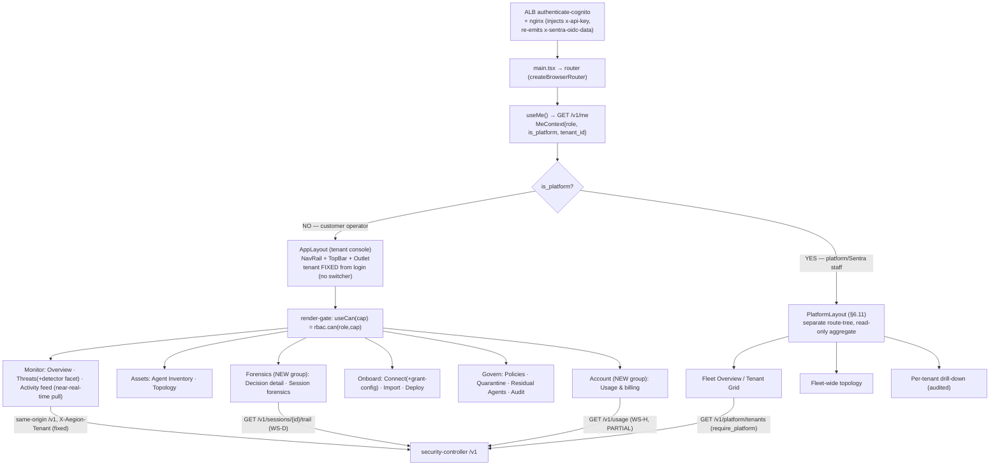
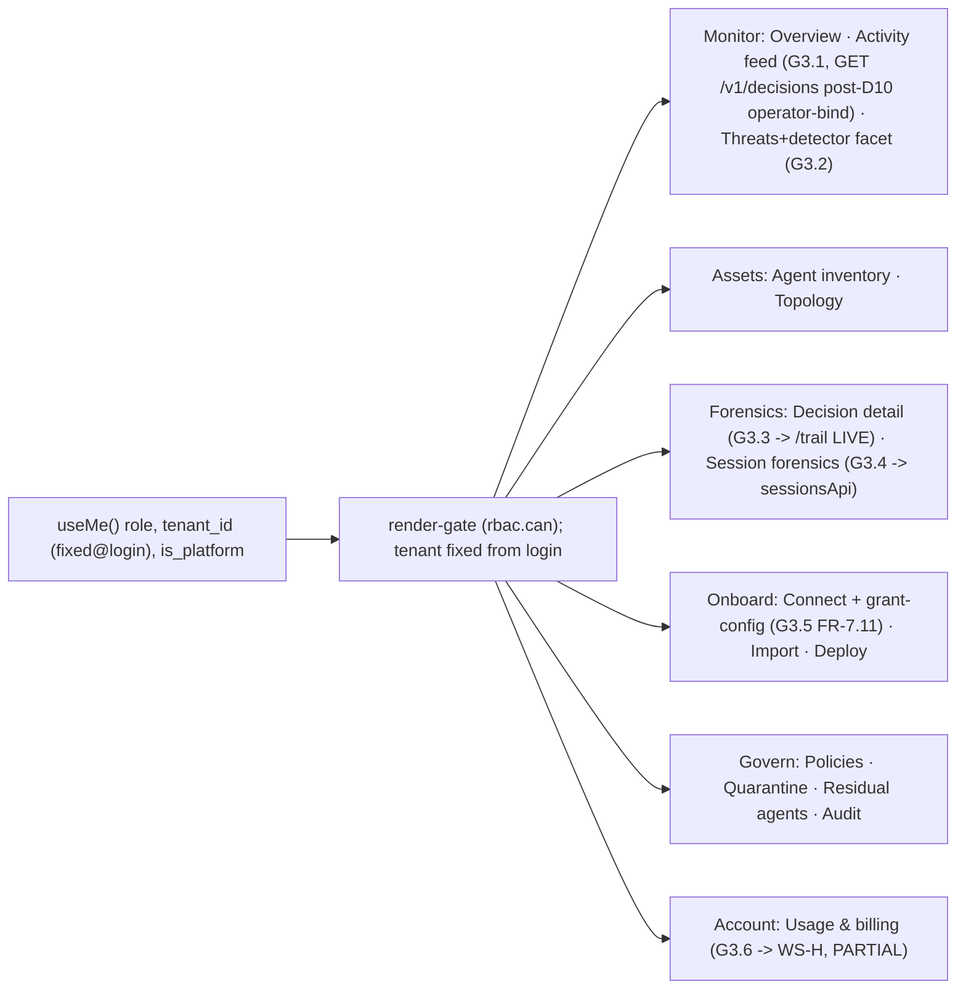
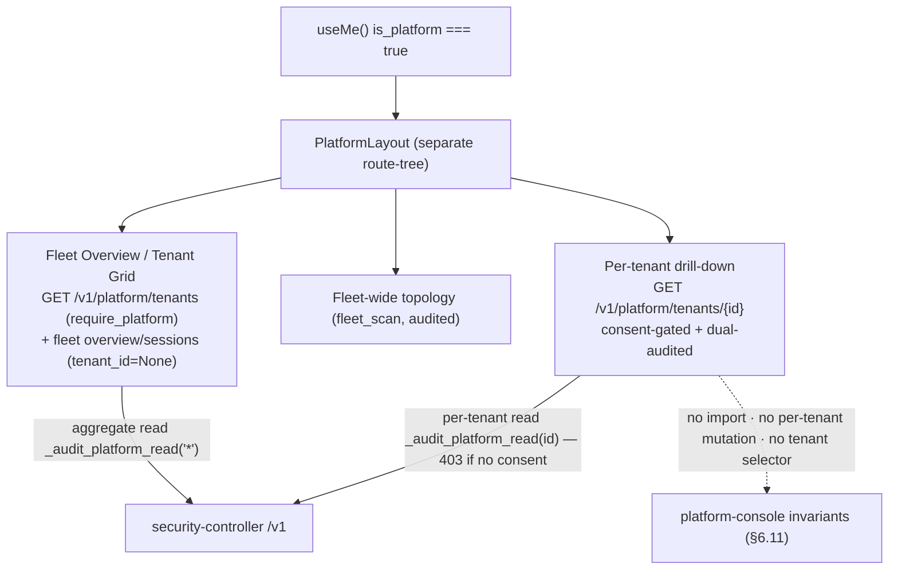
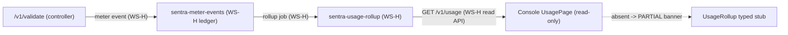

# LLD 40: Multi-tenant SOC Console + Platform Global-Admin Console (WS-G)

**Version**: 1.5
**Last Updated**: 2026-07-08
**Status**: Draft
**Prerequisites**: [LLD 26 §5–6](26-multi-tenancy.md) (membership authority, RBAC, `GET /v1/me`, platform-admin distinct surface §5.5), [LLD 08](08-authentication-and-alb-architecture.md) (ALB-OIDC auth), [lld/39](39-authz-rbac-edge-authorizer.md) (WS-M — the SHIPPED server-side authz boundary), [WS-N](../tasks/serverless-edition/ws-n-read-route-authz.md) (the read-route auth + tenant-bind backend — lld/40's D10/D11 owner, now COMPLETE), WS-D (decision trail), WS-H (metering/billing)

> **v1.5 (2026-07-08 — review-lld + grill reconciliation pass; correctness/consistency fixes, no design reversal).** (1) **LLD-26 §5.1/§5.4 propagate-change was NOT actually done** — those sections still described the OPPOSITE mechanism (a post-login picker + "pre-auth page unreachable" + "`resolve_org` deferred to ADR-035"). Now reconciled to org-first pre-login in lld/26 §5.1/§5.4; the §16 "propagate-change DONE" claim is finally true. (2) **Removed a fictional "as-built" claim** in §6.2 — the doc said `scan_decisions`/`get_session_trail` carry an in-handler `set_current_tenant`/`reset_current_tenant` belt-and-braces pair "mirroring `_dataplane_tenant_bind`"; verified against `main` @ `761bb88` they carry **only** `Depends(resolve_operator_tenant)` (the bind relies on the plain-async-dep + `to_thread` context copy, which IS sufficient; the in-handler pair is a guard to ADD on a future generator refactor, not shipped code). §15 test bullet corrected to match. (3) **ADR-039 owner-sign-off consequence** marked satisfied by the founder acceptance (was contradicting its own Accepted status). (4) **`resolve_org` reachability MUST-FIX (Appendix C.1):** a `/v1/*`-namespaced `resolve_org` is 401'd by the priority-5 `ConsoleApiListenerRule` deny rule *before* it can be public — so it must mount on a NON-`/v1` public path with a dedicated public listener rule at priority < 5, plus an nginx `location` + a private-ALB forward rule (the private ALB 404s any non-enumerated path). And the org PAGE must be a standalone static HTML page (like `splash.html`), NOT a React-SPA route (whose hashed asset chunks fall through to Cognito). (5) **Org-first miss-path contradiction resolved:** a non-enumerating `resolve_org` miss must loop back to the org page, NOT advance to a header-omitted session that silently binds primary (which C.4 forbids for a multi-membership operator); §11 reconciled. (6) **Demo-readiness gate added to §1:** D14 (`resolve_org`, unbuilt+unassigned), D13 (shadow-write, open), and the WS-N 2nd deploy still block the two-tenant DoD — the GTM prerequisite is "WS-N read-binds cleared," NOT "demo-able." (7) **D11 per-tenant `denied` tile** documented as deliberately excluding identity-gate DENYs (they emit under `_unverified`, not the customer tenant). (8) **D3 CI gate** committed to the runtime dependency-tree walk as primary (static interprocedural is infeasible-to-theater in Python) and assigned to WS-N/WS-M who own the files. (9) **Platform read-attribution (§6.11)** noted as a synchronous durable `put_item` before serving (NOT the lossy fire-and-forget feed path). No mermaid or shared-contract name changed.
>
> **v1.4 (2026-07-08 — two mechanical reconciliations: WS-N is now COMPLETE, and the org-first flip is finished end-to-end).** Two verified deltas, no design change.
> **(1) WS-N is COMPLETE on `main` (verified in code 2026-07-08, HEAD `761bb88`).** The console's entire backend dependency (D10 read-binds + D11 KPI rescope) is now **fully met** — WS-N shipped N0–N10, controller suite **1195 pass**, **first deploy milestone-106**; the **2nd deploy** of the D10/D11/N0.3/N9/N10 code is the **only** WS-N residual (a deploy, not a build gap). Three concrete flips this drives, all `file:line`-verified: **(a) `/trail` + `/signals` are NO LONGER agent-lane** — `get_session_signals` (`routes.py:539`) and `get_session_trail` (`routes.py:567`) now carry `Depends(resolve_operator_tenant)`, and **`_dataplane_tenant_bind` was DELETED as dead code** (commit `761bb88`); so the §2 `/trail`+`/signals` row flips from "OPEN — still agent-lane" to **BOUND (WS-N D10/ADR-038) — operator lane**, and the Decision-detail view (G3.3) is **no longer 401-blocked**. **(b) D11 `/metrics/overview` per-tenant rescope LANDED** — `metrics_query_service.py:112` `_search_tenant()` + `overview(tenant_id=…)` dual-mode SEARCH over the `Decisions{tenant_id,verdict}` / `ValidateLatency{tenant_id}` streams; customer KPI tiles are **real, not null**. So §2's `/metrics/overview` row + §6.10 flip from "PARTIAL — fallback only" to **DONE (WS-N D11)** — per-tenant SEARCH via `_search_tenant`; fleet view for a `_platform` operator via `tenant_id=None`. This revision updates the §2 rows, §6.2, §6.6, §6.10, and the §7 catalog to the WS-N-complete as-built.
> **(2) The org-first flip is now applied end-to-end.** v1.3 *declared* the flip to ORG-FIRST pre-login but left **§9, §12, §15, §16, and Appendix C** still describing the OPPOSITE (a Cognito-first post-login picker over `memberships[]`). v1.4 finishes it: every one of those spots is now org-first pre-login, both sequence diagrams (§3.2 + Appendix C.3) are org-first, and **Appendix C is rewritten wholesale** ("Login-journey tenant binding: ORG-FIRST pre-login (ADR-039)") — the false-premise "Why NOT a pre-auth org page" §C.1 is DELETED (its premise "the ALB fronts everything with `authenticate-cognito`" is factually wrong — `compute_stack.py:887` defines the **priority-3 `ConsoleSplashRule`** public unauthenticated carve-out for `/`, `/splash.html`, `/favicon.svg`, and the priority-10 `authenticate-cognito` rule is only the fall-through), replaced by the org-first flow + the `resolve_org` contract + the ALB carve-out citation. **`resolve_org` is a NET-NEW backend endpoint** (public, fail-closed, rate-limited, non-enumerating, maps org display-name → `tenant_id`) — **it is NOT part of WS-N's completed scope** (WS-N correctly shipped no `resolve_org`); it is assigned explicitly as a future backend task to the WS-M/WS-N-backend class (routes.py/tenancy) and flagged as a prerequisite for the org-first login journey, NOT dismissed. **Everything else is unchanged and PRESERVED** — the §6.2.1 **D13 shadow-write-path fix** (a real open backend item, separate from WS-N's completed N0–N10 scope), the platform global-admin console (§6.11), the Owner column, near-real-time-polling relabel, the RBAC render-gate-mirror invariant, ADR-035 seam (design-only), and the D3 read-side CI gate.
>
> **v1.3 (2026-07-07 — login-flow correction to the founder's ORG-FIRST decision).** The founder decided — explicitly, twice — an **org-first, pre-login** tenant-binding flow, and the v1.1/v1.2 drafts of §3.2 / §5.5 / Appendix C described the **opposite** (a Cognito-first, post-login picker over `memberships[]`) on the false premise that "the ALB fronts everything with `authenticate-cognito`, so a pre-auth org page is unreachable." **That premise is factually wrong (verified `cdk/stacks/compute_stack.py:887`):** the ALB **already** serves a PUBLIC, unauthenticated carve-out — the **priority-3 `ConsoleSplashRule`** serves `/`, `/splash.html`, `/favicon.svg` **without** `authenticate-cognito` (the priority-10 `ConsoleListenerRule` *with* `authenticate-cognito` is only the fall-through for everything else). So a pre-auth **org page** + a public **`resolve_org(org)→tenant_id`** lookup **extend an existing, deployed carve-out**, not a net-new attack-surface pattern. This revision (a) flips **every** login-flow reference to **org-first pre-login** (§2 rows, §3.1/§3.2 + the login sequence diagram, §5.5, §5.6, §8 SEC-1/SEC-2, §9, §12, §15, §16, and **Appendix C rewritten wholesale**); (b) brings the public **`resolve_org`** lookup back **into scope** as **D14** (a WS-N/WS-M-coordinated backend addition on the public carve-out path — the earlier draft's Appendix-C.5 "`resolve_org`/D13 removed from scope" is retired, and its D13 label collided with the shadow-write D13); (c) reconciles **ADR-039** + **LLD-26 §5.1/§5.4** to org-first. **Everything else is unchanged and PRESERVED** — notably the §6.2.1 **D13 shadow-write-path fix** (verified correct) and the WS-N **as-built `BOUND (landed, ece1ede/8a12cb2)`** rows (WS-N is on `main`; those rows are TRUE).
>
> **v1.2 (2026-07-07 — as-built reconciliation to landed WS-N).** WS-N has **LANDED** on `main` (commits `ece1ede` "gate 21 read routes with `resolve_operator_tenant`" + `8a12cb2` D11 CW-field leak fix), and **ADR-038 is `Accepted (founder) 2026-07-07`** (adr.md:1570) with lld/39 §4/§5 + LLD-26 §5.1/§5.4 already reconciled by propagate-change. So this revision (a) sweeps every stale "ADR-038 must be APPROVED before merge / merge-blocked" assertion to "ADR-038 Accepted; siblings reconciled — only implementation remains" (matching adr.md + lld/39 + the WS-N doc corrected in `aa486ec`); (b) corrects the §2 status rows + the §6.2/§6.6/§6.10 present-tense "no auth dependency / NOT TENANT-BOUND" claims to reflect the landed bind — **19 of 21 reads now carry `Depends(resolve_operator_tenant)`** (`scan_decisions`@609, `get_sessions`@678, `get_session_decisions`@482, `get_metrics_overview`@777, `get_agents`@1364/`{id}`@1407/`{id}/tools`@1432, `get_policies`@1483/`{id}`@1552, `list_connections`@1075); only `get_session_trail`@576 + `get_session_signals`@550 remain on the agent lane (`_dataplane_tenant_bind`@501) and are the sole remaining D10 open item; (c) records that the D11 landing (`8a12cb2`) shipped the §6.10 **fallback** (null the fleet-wide CloudWatch fields for non-`is_platform` operators) — the **primary** rescope of `metrics_query_service.overview()`'s SEARCH onto a per-tenant stream is NOT yet done and is carried as an explicit open item. The design/rationale below is unchanged and was fulfilled; these are factual as-built corrections, not design changes.
>
> **v1.1 (2026-07-07 founder PDF review — three authoritative deltas applied).** (1) §2 status table gains an explicit **Owner** column (WS-M shipped / WS-N read-binds / WS-G client+views / WS-D trail / WS-H usage). (2) The console is **near-real-time POLLING (TanStack Query `refetchInterval`), NOT streaming** — no WebSocket/SSE/EventSource exists in `web/console/src` (verified); "Activity feed" and every "live" label are relabelled "near-real-time (≤15s pull)". (3) **Architecture correction — the in-session tenant switcher is REVERSED:** tenant is chosen at **org-first login** and fixed for the session (no `TenantSwitcher`); the **platform** surface is a **separate global-admin console** (a distinct aggregate route-tree), not the tenant views with controls hidden. Both consoles are designed here. The switcher reversal propagates back to [LLD-26 §5.1/§5.4](26-multi-tenancy.md) via **ADR-039** (WS-M / LLD-26 owner sign-off, mirrors the ADR-038 pattern).

## Table of Contents
1. Context
2. Scope & status (DONE / PARTIAL / NOT-DONE) + Owner column
3. Architecture overview (two consoles: customer-tenant + platform global-admin)
4. M-G1 — Cosmetic-tenant containment (FR-13.1)
5. M-G2 — RBAC render-gating + org-first login binding (FR-13.3)
6. M-G3 — Exhaustive FR-13.2 dashboard set (incl. §6.11 Platform global-admin console)
7. View → API contract catalog
8. Security (SEC-1..5)
9. Resiliency & degradation
10. Scaling / performance / bundle budget
11. Networking
12. Client state / data model
13. Cost
14. Metering & billing (read path)
15. Per-view test cases
16. Cross-references
- Appendix A — Full control → Capability → server-route map
- Appendix B — ADR-035 verified-operator-subject seam
- Appendix C — Login-journey tenant binding: ORG-FIRST pre-login (ADR-039)

---

## 1. Context

This LLD elaborates the **approved HLD option `hld/serverless-edition.md` §6.2(f) Option A** ("Keep Cognito now, harden the seam, defer the provider switch"), plus its 2026-07-06 refinement (customer-IdP-as-source-of-truth for *who*, sequenced after RBAC coverage; roles kept uniform on our side; org-first console). It is the implementation-grade design for the **`web/console`** React/Vite SOC console — the one workstream WS-G owns.

It does **not** re-argue the choice. Two constraints frame everything below:

1. **It EXTENDS [LLD 26 §5–6](26-multi-tenancy.md)** — the membership authority (`sentra-tenant-members`), `resolve_operator_tenant`, `require_role`, and `GET /v1/me` are **already built and live** (LLD-26 go-live, refined by WS-C/WS-D). This doc consumes them; it does not restate their internals. It does **not** duplicate [lld/04](04-dashboard-v2.md) (the decommissioned Streamlit dashboard).
   - **⚠️ Architecture reversal (v1.1, founder 2026-07-07): the in-session tenant switcher is REMOVED; tenant is chosen ORG-FIRST, BEFORE login.** LLD-26 §5.1/§5.4 specified a `TenantSwitcher` that renders for operators with `memberships.length > 1` and swaps tenant *inside* a live session. That model is **reversed here and propagated back to LLD-26 via ADR-039** (§5.5, §16 Cross-references): the flow is **org-first** — an unauthenticated **organization page** (operator types their org name = their tenant) → resolve org→`tenant_id` → **then** the Cognito login page → the operator works in that fixed tenant for the whole session; to change tenant they **log out, pick another org, and start again** (founder flow 2026-07-07, matching `.kombai/canvas/aegion-login.canvas` variant B2). **This is a *pre-Cognito* org page, which is buildable: the ALB already serves a PUBLIC unauthenticated carve-out** (`compute_stack.py:887`, the priority-3 splash rule for `/`, `/splash.html`, `/favicon.svg` — served WITHOUT `authenticate-cognito`), so the org page + a public `resolve_org(name)→tenant_id` lookup extend that existing precedent (Appendix C), not a net-new pattern. The shipped `web/console/src/components/ui/TenantSwitcher.tsx` is **DELETED from the design** (not verified/fixed). Multi-membership operators (partner/MSSP) are supported by picking the org at the org page each session. **ADR-039 is `Accepted (founder) 2026-07-07`** (adr.md:1610); **LLD-26 §5.1/§5.4 must be reconciled** to "org-first login selection, tenant fixed for the session, no in-session switch" (propagate-change — a sibling reversal). Remaining implementation: delete `TenantSwitcher`, build the org page + `resolve_org` endpoint (Appendix C) + `sessionStorage` binding.
   - **Which console is "the console" (do not follow a stale PRD trail).** WS-G builds on **`web/console/`** (React/Vite) — the current, live SOC console. Two older UIs still exist on disk and are **superseded, NOT the WS-G target**: `src/dashboard/` (the LLD-04 Streamlit dashboard, decommissioned) and `frontend/` (an earlier React app). The sub-PRD's FR-13.x status evidence (§4.10/§5) cites `src/dashboard/` and `frontend/src/components/Dashboard.tsx` ("no tenant filter … no tenant claim in `auth.py` … React frontend has no tenant logic") — that evidence is **stale**: it profiles the superseded dirs, not `web/console/`, whose tenant-scoping + RBAC are the already-built spine this doc consumes (§2). A reader following the PRD file trail lands on the wrong code; the join key is `web/console/`.
2. **The server-side authorization boundary already SHIPPED (WS-M / [lld/39](39-authz-rbac-edge-authorizer.md), prod milestone-102, `main` @ `0e9f6d0`).** `require_role` covers 18/21 mutating `routes.py` routes (+ `require_platform` on the sigma-retire path), `assert_owns(...)` closes the cross-tenant IDOR (BUG-1), and `X-Operator-Email` is fully removed (0 reads). **The console client render-gate MIRRORS that live server gate and is NEVER the boundary — it is UX only.** A tampered client gains nothing.

WS-G's real, unbuilt work is three milestones: **M-G1** close the residual `tenantOf()` cosmetic-tenant surface (lint/type guard), **M-G2** finish RBAC render-gating (`useCan` is wired into only 1 of 8 features today) + wire the **org-first login tenant binding** (replacing the removed in-session switcher), **M-G3** promote embedded/component views to routed tenant-scoped FR-13.2 views + land the D10 operator-scope prerequisite + fix dead `operator_id` client stubs + build the **platform global-admin console** (§6.11, the LLD-26 §5.5 distinct surface — now IN scope). The ADR-035 federation seam (G3.7) is **design-only**.

**Why this is a workstream, not polish (GTM consequence — the honest read).** The server authorization boundary shipped in WS-M; several individual G-items *are* hardening of an already-shipped boundary (rename + lint, wire `useCan` into more buttons, promote embedded components to routed pages). But the workstream's payoff is a concrete GTM gate: **a self-serve multi-tenant, RBAC-gated console is what lets logo #2..N transact on one shared deployment instead of a per-tenant stand-up.** It unblocks a multi-tenant design-partner demo where two tenants' operators log in and see only their own fleet. That is the sellable unit; the individual tasks are the parts that add up to it.

**Honest dependency read — WS-G alone is NOT sellable standalone; the tenant boundary lives in WS-N (state it plainly).** The one thing that makes the multi-tenant demo *sellable* — each tenant seeing only its own fleet — is the read-route tenant binding (D10/D11), which is **[WS-N](../tasks/serverless-edition/ws-n-read-route-authz.md)'s** shared-file backend PR, not WS-G's client code. WS-G can be 100% CODE-DONE (lint guard, `useCan` wired, views promoted, platform console built) and still deliver **zero** GTM value if the backend tenant binding is missing — which is why the G3.1/G3.3/G3.4/M-G4 routes were gated on WS-N (§6.2 sequencing gate). **That gating dependency is now SATISFIED: WS-N is COMPLETE on `main` @ `761bb88` (N0–N10, D10+D11 landed; only a 2nd deploy pending).** So the routes no longer need a feature-flag hold on WS-N. **WS-G's definition-of-done remains "demo-able end-to-end with two real tenants whose operators each see only their own fleet," which required WS-N on the critical path, not beside it** (its M-N1/M-N2/M-N3 binds + M-N8 canary lockstep) — that prerequisite has landed. Absent WS-N it would have been **client hardening (rename+lint, `useCan` wiring, routed views, platform tree), non-sellable standalone** — retained as the record of why the gate existed. **But "WS-N cleared" removes only the read-bind hold — it does NOT make the two-tenant demo demonstrable: D14 (`resolve_org`, unbuilt), D13 (shadow-write, open), and the WS-N 2nd deploy still block the DoD (see the Demo-readiness gate table below). Do not read this as "GTM gate cleared."**

**Sellability limit — state it plainly (buyer gate, NOT solved here).** This console keeps **Cognito-hosted login** (HLD §6.2(f) Option A, founder-decided). Federation to a customer's own IdP (Okta/Entra via SAML/OIDC + SCIM provisioning, ADR-035) is deferred. That deferral is fine for **design-partner / early-adopter logos who accept a vendor-hosted user pool for a pilot**, but it is a **hard onboarding blocker for the regulated / in-VPC segment (Moat 2)** — a CISO's SOC team will not onboard operators into a vendor IdP for production. So: **this console is demo/pilot-sellable today, and NOT enterprise-sellable to a regulated logo until ADR-035 (the federation WS) executes.** ADR-035 is design-only *here* (the seam is cheap — Appendix B), but its *execution* must be sequenced before/concurrent with selling the regulated segment, not treated as indefinitely optional. lld/40 does not schedule that WS; it flags the gate.

**Deprovisioning story (a buyer will ask; answer it plainly).** Even without SSO/SCIM auto-deprovisioning, a departed operator's access is revoked by **removing their `sentra-tenant-members` row** (member management is LLD-26 §6, not a WS-G view yet): `resolve_operator_tenant` calls `get_member_store().by_operator(sub)` on every request and **403s an operator with no membership** (`deps.py:409` → "operator has no tenant membership"), so a removed operator is denied at the boundary on their next call **even though their Cognito login still exists**. The gap SSO/SCIM closes is *automatic* deprovisioning tied to the customer's IdP lifecycle (and single-sign-on to the operator's existing identity) — until ADR-035, deprovisioning is a **manual membership-row removal** the customer's admin performs, which is acceptable for a pilot but is exactly the procurement friction a mid-market SOC buyer may bounce on. This is a GTM/scheduling input for the ADR-035 decision below, not a WS-G build item. **[REC]** validate with 2–3 design partners that a manual, membership-row deprovisioning + vendor-hosted Cognito login is acceptable for a *paid* pilot (not just a free demo) before treating the funding segment as unblocked on this gate.

**Segment framing — say which segment funds this, and don't leave the moat-bearing one on an unscheduled dependency.** Per STRATEGY, the **data-flywheel moat (Moat 1) compounds in Serverless/mid-market**, while the **structural moat (Moat 2) lives in regulated/in-VPC**. This shared multi-tenant SaaS console's value accrues almost entirely to **Serverless/mid-market** — it is explicitly the GTM enabler that lets logo #2..N transact on one shared deployment. So **WS-G is scoped as a Serverless/mid-market GTM enabler**, and that segment funds it; its enterprise value is real but gated on ADR-035. That is defensible *only* if the moat-bearing segment isn't left waiting indefinitely: the **in-VPC console path (customer-IdP federation + dedicated deployment) must carry a dated commitment on the roadmap** (ADR-035 execution scheduled before/concurrent with the first regulated sales motion), not an open "later". **[REC/founder decision needed]:** either (a) schedule ADR-035 federation concurrently so the regulated onboarding path exists, or (b) explicitly accept WS-G as Serverless-only for now with a named date by which the in-VPC console lands. lld/40 flags this as a scheduling decision the founder owns — it does not silently assume the regulated segment is served by this console.

**Demo-readiness gate — the GTM prerequisite is NOT "cleared," it is "WS-N read-binds cleared; three items still block the two-tenant demo" (be precise, don't conflate code-on-main with demo-able).** The prior "GTM gate cleared" framing was too strong: WS-N's read/tenant-bind dependency (D10/D11) *is* met on `main`, which removes the feature-flag hold on the console views — but the **definition-of-done for this workstream is "two real tenants each see only their own fleet, live," and that DoD is not demonstrable on the current state** until the three items below are deployed to the target env and the cross-tenant regression suite is green **in that env**. Each is flagged elsewhere in this doc; this table is the single owner+status roll-up so the demo is not scheduled prematurely:

| Blocker | What it gates | State (2026-07-08) | Owner | Target date |
|---|---|---|---|---|
| **D14 — `resolve_org` + org page + ALB/nginx carve-out** | The org-first login journey — the literal entry point of the two-tenant demo. No `resolve_org` → no org page → no login. | **UNBUILT** (grep-verified absent from `app/` @ `761bb88`); NET-NEW backend + CDK, NOT in WS-N's completed scope | **UNASSIGNED — WS-M/WS-N-backend class (routes.py/tenancy + CDK); MUST be assigned** | **[founder to set — currently none]** |
| **D13 — shadow-write tenant bind** | A new tenant onboards in SHADOW by design; without D13 its decisions write to `default#date` and its console is **BLANK** on first impression. | **OPEN** backend item (§6.2.1); separate from WS-N's done N0–N10 | WS-N/WS-M (`/validate` write path) | **[founder to set]** |
| **WS-N 2nd deploy** | The D10/D11/N0.3/N9/N10 read-binds are on `main` (first deploy milestone-106) but **not yet on the demo/target env's 2nd deploy** — code-on-`main` ≠ deployed. | **PENDING deploy** (not a build gap) | WS-N | **[founder to set]** |

**Gate (explicit):** the two-tenant demo is **NOT scheduled** until **all three** are deployed to the target env **and** the cross-tenant regression suite (§15 D10/D11 + M-G4) is green **in that env** (not merely hermetically). "WS-N complete" clears the *read-bind* prerequisite; it does not by itself make the sellable unit demonstrable. Do not describe the GTM gate as "cleared" while D14 and D13 are unbuilt/open and unassigned.

**Cross-tenant isolation is IMPLEMENTED + hermetically tested — NOT yet exercised with two live tenants (verification-honesty).** The live fleet is **single-tenant** today (only the three Acme agents drive `/validate`, all under the one enforcing tenant `acme` — §6.2 blast-radius), so the 21-read tenant bind's isolation behavior has only ever been validated by **hermetic tests** (1195 pass), never against a **second real tenant's data in a deployed env**. Until a two-tenant run in the target env **asserts the actual GSI/SEARCH partition values** (not just filtered responses) — tenant-A's operator provably cannot see tenant-B's decisions/sessions/agents/policies/metrics — isolation should be described as **"implemented + hermetically tested, not yet exercised with two live tenants,"** not "as-built / trusted multi-tenant." (This doc's own revision history — `only six reads`→`actually 21`, the login-flow corrected twice, `WS-N complete` corrected — is why code-on-`main` + hermetic-green is not treated as verified-multi-tenant-correct.) This two-tenant live run is part of the demo-readiness gate above.

---

## 2. Scope & status (DONE / PARTIAL / NOT-DONE)

> **In plain terms.** Most of the "auth" half WS-G was originally scoped around is already built and running in prod. This table is the honest as-built so the build tasks skip finished work. "DONE" rows are `file:line`-cited and are **verify-only**; "PARTIAL/NOT-DONE" rows are the actual build. **The `Owner` column (v1.1) says which workstream delivers each row** — the join key so a reader never confuses a WS-M/WS-N shipped-or-backend row with WS-G's own client work: **WS-M** = the shipped server authz boundary (verify-only from WS-G's side); **WS-N** = the read-route auth + tenant-bind backend (the tasks-stage decomposition of §6.2 D10 / §6.10 D11 — every "NOT TENANT-BOUND / D10 / D11 prerequisite" row is WS-N's, all 21 reads, cross-linked to its N-milestones); **WS-G** = the client render-gate + routed views + org-first login binding; **WS-D** = the decision-trail shape; **WS-H** = the usage read API.

| FR / capability | Status | Owner | Evidence (`file:line`) | WS-G action |
|---|---|---|---|---|
| Server-derived tenant from session (never email domain) | **DONE (live)** | WS-M | `app/api/deps.py:404` `_resolve_operator_tenant_inner` → `tenancy.set_current_tenant` @ `deps.py:435` | Regression-test (G1.3); do not rebuild |
| ALB-OIDC operator auth, signature-verified (ES256, `kid` cache) | **DONE (live)** | WS-M | `deps.py:304` `verify_alb_oidc`; issuer/signer pin `deps.py:355` `_assert_signer_issuer_pinned` | Verify; name as the ADR-035 seam substrate (G3.7) |
| `X-Aegion-Tenant` switch validated vs membership (403 if not a member) | **DONE (live)** | WS-M | server `deps.py:414–427`; client `web/console/src/lib/tenant.ts`, `http.ts:158` (`tenantHeader()`) | **Header is now set ONCE at login binding, not by an in-session switcher** (§5.5); server check verify-only |
| Server RBAC authority `require_role` on 18/21 mutating routes + `require_platform` on sigma-retire | **DONE (live, WS-M)** | WS-M | `deps.py:471` `require_role`; routes enumerated in Appendix A | Mirror in client gate (G2.1); do NOT re-own the server edit |
| Anti-IDOR ownership assert (BUG-1 closed) | **DONE (live, WS-M)** | WS-M | `app/api/ownership.py` `assert_owns`; cited across `routes.py` | N/A (server-owned) |
| `GET /v1/me` → `{sub,email,tenant_id,role,is_platform,memberships[]}` | **DONE (live)** | WS-M | `app/api/tenancy_routes.py` `get_me`; client `lib/api/me.ts`, `lib/query/useMe.ts`, type `types/api.ts:61` `MeContext` | Reuse as the sole role source |
| Tenant selection at login (org-first, pre-login) | **PARTIAL — org page + `resolve_org` UNBUILT; membership data exists** | WS-G (org page) / **NET-NEW backend** (`resolve_org` — WS-M/WS-N-backend class, NOT in WS-N's shipped scope) | `GET /v1/me` returns `memberships[]` (`MeContext`, `types/api.ts:61`) for the server-side re-validation; no org page + no public `resolve_org` endpoint yet (grep-verified: `resolve_org` absent from `app/` on `main` @ `761bb88`) | **ORG-FIRST pre-login** (Appendix C): an unauthenticated **org page** (operator types their org) → public **`resolve_org(org)→tenant_id`** lookup (D14) → **then** Cognito login → tenant fixed for the session (`X-Aegion-Tenant`). Build the org page (WS-G) + the public `resolve_org` endpoint on the priority-3 ALB carve-out (`compute_stack.py:887`; **a NET-NEW backend task — WS-N is complete on its N0–N10 scope and correctly shipped no `resolve_org`; assign D14 explicitly to the WS-M/WS-N-backend class, do NOT fold it into WS-N**; Appendix C.2–C.3) + `sessionStorage` binding (C.4). To change tenant → logout → org page → re-pick |
| Client RBAC mirror `can()` / `useCan()` / `Capability` map | **DONE (exists), UNDER-WIRED** | WS-G | `web/console/src/lib/rbac.ts`; `lib/query/useMe.ts:22` `useCan` | Wire into every mutating control (G2.1) — **1 of 8 features today** |
| Tenant selection UI | **REVERSED — in-session `TenantSwitcher` DELETED; org-first login binds tenant** | WS-G | `web/console/src/components/ui/TenantSwitcher.tsx` (`invalidateQueries()` @ :34) — **removed from design**; selection = the **pre-login org page** → `resolve_org(org)→tenant_id` → Cognito (Appendix C.1) | **Remove `TenantSwitcher`; build the pre-login org page + `resolve_org` (D14) + `sessionStorage` binding** (§5.5, Appendix C). No in-session switch → the §5.5 switch-race apparatus collapses to cheap defense-in-depth |
| `GET /v1/sessions/{id}/trail` (WS-D full deny-overrides trail) + `GET /v1/sessions/{id}/signals` | **BOUND (landed, WS-N D10/ADR-038) — operator lane** | **WS-N** (D10) | `routes.py:567` `get_session_trail` + `routes.py:539` `get_session_signals` now carry `Depends(resolve_operator_tenant)`; **`_dataplane_tenant_bind` DELETED as dead code** (commit `761bb88`) | Done — bind real trail in the routed Decision-detail view (G3.3); the view is **no longer 401-blocked**. **ADR-038 (Accepted, founder 2026-07-07) recorded the lane reversal; lld/39 §4/§5 reconciled; the implementation swap has LANDED.** Regression-test the operator-lane read (§15) |
| `GET /v1/decisions` time-range scan | **BOUND (landed, WS-N `ece1ede`)** | **WS-N** (D10) | `routes.py:609` `scan_decisions` now carries `Depends(resolve_operator_tenant)` (was: no auth dep) | Done — regression-test only (G3.1 consumes the bound read) |
| `GET /v1/sessions` list | **BOUND dual-mode (landed, WS-N `ece1ede`)** | **WS-N** (D10) | `routes.py:678` `get_sessions` now `Depends(resolve_operator_tenant)`; `SessionManager.query_sessions` dual-mode (customer→`query_or_scan`, platform→`fleet_scan`+audit, WS-N M-N2). ⚠️ dual-CALLER: the tokenless dashboard runner path is a WS-N FG-7 concern (see §6.6) | Done for the operator lane — verify G3.4 consumes the bound read |
| `GET /v1/sessions/{id}/decisions` | **BOUND (landed, WS-N `ece1ede`)** | **WS-N** (D10) | `routes.py:482` `get_session_decisions` now `Depends(resolve_operator_tenant)`; DDB composite auto-scopes. ⚠️ dual-CALLER (FG-7, §6.6) | Done for the operator lane — verify G3.4 consumes it |
| `GET /v1/agents` + `/agents/{id}` + `/agents/{id}/tools` (Assets spine) | **BOUND (landed, WS-N `ece1ede`)** | **WS-N** (D10) | `routes.py:1364` `get_agents`, `:1407` `get_agent`, `:1432` `get_agent_tools` all `Depends(resolve_operator_tenant)`; `get_agent_tools` also `assert_owns` (`8a12cb2`) | Done — Assets views trusted multi-tenant |
| `GET /v1/policies` + `/policies/{id}` (Govern spine) | **BOUND (landed, WS-N `ece1ede`)** | **WS-N** (D10) | `routes.py:1483` `get_policies`, `:1552` `get_policy` both `Depends(resolve_operator_tenant)` → `query_or_scan` on the bound tenant | Done — Policies view trusted multi-tenant |
| `GET /v1/connections` + `/connections/{id}` (Connect spine) | **BOUND (landed, WS-N `ece1ede`)** | **WS-N** (D10) | `routes.py:1075` `list_connections` now `Depends(resolve_operator_tenant)`, `:1105` | Done — G3.5 trusted multi-tenant |
| `GET /v1/metrics/overview` KPI tiles | **DONE (WS-N D11) — per-tenant SEARCH landed; fleet view for platform** | **WS-N** (D11) | `routes.py:771` `get_metrics_overview` carries `Depends(resolve_operator_tenant)`; `metrics_query_service.py:112` `_search_tenant()` + `overview(tenant_id=…)` dual-mode SEARCH over the `Decisions{tenant_id,verdict}` / `ValidateLatency{tenant_id}` streams — a customer operator sees **real per-tenant KPI tiles** (`tenant_id="<active>"` filter), a `_platform` operator gets the fleet view via `tenant_id=None` | Done — Overview tiles are real, not null. Regression-test: a tenant-A operator's totals equal tenant-A's `Decisions` sum, never the fleet sum (§15) |
| `tenantOf()` email-domain label | **DONE (downgraded to display-only), REINTRODUCIBLE** | WS-G | `web/console/src/lib/auth.ts:61` — commented "DISPLAY-ONLY, NON-AUTHORITATIVE" | Quarantine via lint/type guard (G1) |
| Activity / decision feed (first-class routed view, **near-real-time pull**) | **NOT-DONE** | WS-G | Overview embeds `features/overview/LiveActivity.tsx` only; polls `useDecisions` `refetchInterval:15_000` (no WS/SSE) | Build routed view (G3.1); label **near-real-time (≤15s pull)**, not "live/streaming" |
| Violations & threats **per detector** | **PARTIAL** | WS-G | `features/threats/ThreatsPage.tsx` exists; no per-`winning_source` facet | Add facet (G3.2) |
| Decision detail (FR-6.8 full trail) as a routed view | **PARTIAL** | WS-G (view) / WS-D (shape) / WS-N (bind) | `components/decisions/DecisionTrace.tsx` embedded in ThreatsPage/Quarantine; not routed | Route + bind `/trail` (G3.3) |
| Session forensics (FR-6.9) as a routed view | **PARTIAL** | WS-G (view) / WS-N (bind) | `lib/api/sessions.ts` client + `SessionDecisionsResponse` exist; no routed view | Build (G3.4) |
| Connectors + **FR-7.11 in-console grant config** | **PARTIAL** | WS-G | `features/connect/{GrantAccessCard,GrantAzureAccessCard}.tsx`, `cloudCatalog.ts` exist | Promote + GCP "coming soon" (G3.5) |
| Usage & billing (FR-12.x) | **NOT-DONE** | WS-G (view) / WS-H (API) | none | Build against WS-H stub, PARTIAL (G3.6) |
| **Platform global-admin console** (aggregate fleet oversight) | **PARTIAL — backend routes live, no console** | WS-G (console) / WS-N (fleet reads) | routes `tenancy_routes.py:433` `platform_list_tenants`, `:449` `platform_tenant_detail` (both `require_platform`, `_audit_platform_read`) — no `web/console` surface | **NOW IN SCOPE** — build the separate platform route-tree (§6.11 / M-G4): tenant grid, ranking, quota headroom, audited drill-down; no import / no per-tenant mutation |
| ADR-035 federation seam | **DESIGN-ONLY** | WS-G (spec) | Cognito path is `deps.py:406–407` claim read | Interface spec only (G3.7); no `deps.py` change |
| `operator_id` client stubs (spoofable, server-overridden) | **PARTIAL (dead-code hygiene)** | WS-G | `DecisionReviewPanel.tsx:22`, `ThreatsPage.tsx:190`, `sessions.ts:31` | Remove (D8) |

**Out of scope for lld/40** (stated, not silently dropped): Tier-2 customer-composed custom roles (HLD refinement, roadmap); the actual SAML/OIDC/SCIM provider swap (ADR-035 *execution*); compliance-report export (FR-6.5, P1); **true push streaming (WebSocket/SSE)** for the feeds — a deferred option with infra cost, not the current polling design (§6.3). *(The `_platform` platform-admin console, previously out-of-scope, is now IN scope per founder 2026-07-07 — §6.11.)*

---

## 3. Architecture overview

> **In plain terms.** There are **two consoles behind one router**, split at the router root on `useMe().data.is_platform`. A **customer operator** (not platform) lands in the **customer-tenant console**: their tenant is fixed **on the login flow, ORG-FIRST** — before Cognito, an unauthenticated org page takes the operator's org name, a public `resolve_org(org)→tenant_id` lookup routes it to a tenant, and only then does Cognito authenticate the operator into that fixed tenant. So every data call goes same-origin to `/v1` through one `http` wrapper that attaches the fixed `X-Aegion-Tenant` header (`tenantHeader()`) and the nginx-injected API key, and the returned `MeContext.role` drives every render-gate (`useCan(cap)` → `rbac.can(role,cap)`). A **platform operator** (`is_platform`) lands in a **completely separate route-tree** — read-only aggregate fleet oversight (tenant grid, ranking, drill-down) with no import and no per-tenant mutation. There is **no client-held auth state, no client tenant authority, and no in-session tenant switcher** — to change tenant an operator logs out, returns to the org page, picks another org, and re-logs-in. Routed feature pages are lazy-loaded chunks under one `AppLayout` shell (`NavRail` + `TopBar` + `<Outlet/>`).

### 3.1 Two route-trees, split at the router root on `is_platform`

The router (`main.tsx` → `createBrowserRouter`) branches at its root on `useMe().data.is_platform`: a customer operator gets the **customer-tenant route-tree**; a platform operator gets the **platform global-admin route-tree** (§6.11). They are **separate trees**, not one tree with controls conditionally hidden — a platform operator never sees per-tenant mutation controls (they are meaningless cross-tenant), and a customer operator never sees a platform route. There is **no `TenantSwitcher` node** in either tree (removed, v1.1).



### 3.2 The MeContext → render-gate spine (already built) + the two login flows

- `useMe()` (`lib/query/useMe.ts:12`) issues `GET /v1/me` once, `staleTime: 5m`, `retry: false` — **non-throwing** so the shell renders even if `/v1/me` is unavailable (fail-secure: `data` is `undefined` → `can()` returns `false` → controls hidden).
- `useCan()` (`lib/query/useMe.ts:22`) closes over `data?.role` and returns `(cap) => rbacCan(role, cap)`.
- **Tenant is bound on the login flow, ORG-FIRST, not switched in-session (v1.1/v1.3).** The `X-Aegion-Tenant` header (`tenantHeader()`, `http.ts:158`) is set once for the session from the tenant the operator resolves to **at the org page, before Cognito**; it does not change while the session is live. The `MeContext.memberships[]` array is still returned (a multi-membership partner/MSSP operator has >1) — but it is the **server-side re-validation set** (`resolve_operator_tenant` checks the picked tenant ∈ `memberships` and 403s a non-member), **not** a post-login picker. `components/ui/TenantSwitcher.tsx` is **removed**.

**Customer-tenant login flow (ORG-FIRST, pre-login — ADR-039).** Detailed spec in **Appendix C**. The founder invariant is "operator picks their org first, that org resolves to a tenant, then they authenticate into that fixed tenant." The *mechanism* is a **pre-Cognito org page** + a **public `resolve_org(org)→tenant_id` lookup** (D14), and it **is buildable** (Appendix C.1): the ALB **already** serves a PUBLIC unauthenticated carve-out — the **priority-3 `ConsoleSplashRule`** (`compute_stack.py:887`) serves `/`, `/splash.html`, `/favicon.svg` **without** `authenticate-cognito`, and the priority-10 `ConsoleListenerRule` (with `authenticate-cognito`) is only the fall-through. The org page + the public `resolve_org` path **extend that existing, deployed carve-out** (add their asset/lookup paths to the priority-3 rule or a sibling public rule — Appendix C.3), so they are **precedented, not net-new attack surface**. The flow:

```mermaid
sequenceDiagram
  participant U as Operator (browser)
  participant ORG as Org page (public, pre-Cognito)
  participant RES as resolve_org (public carve-out, D14)
  participant COG as Cognito (ALB authenticate-cognito)
  participant API as security-controller /v1
  U->>ORG: open console → priority-3 public rule serves the org page (no auth)
  U->>ORG: type organization name
  ORG->>RES: POST resolve_org(org) — public, fail-closed, rate-limited, non-enumerating
  RES-->>ORG: {tenant_id} (or generic "continue to login" on miss)
  ORG->>U: stash tenant_id (sessionStorage), advance to Cognito login
  U->>COG: Cognito hosted UI (priority-10 authenticate-cognito) → authenticate
  COG-->>API: authenticated session; ALB injects signed x-amzn-oidc-data
  U->>API: GET /v1/me; /v1 calls carry X-Aegion-Tenant = resolved tenant_id (fixed)
  API->>API: verify_alb_oidc.sub → resolve_operator_tenant re-validates tenant ∈ memberships (403 if not) → set_current_tenant
  API-->>U: {sub, email, role, tenant_id, is_platform, memberships[]}
  U->>U: render customer console; tenant fixed; to change → logout → org page → pick another org → re-login
```

WS-G adds **new views** and **new render-gates** to this spine; it does not change the spine's contract. The removed switcher's cache-race apparatus (§5.5) collapses to cheap defense-in-depth because a full page reload on re-login (via the org page) gives a clean cache. **The org-resolved tenant survives a page reload via a scoped, non-authoritative persistence key** (Appendix C.4) — the server re-validates it against membership on every call, so a lost/absent value fails safe back to the org page, never a silent bind to the wrong tenant.

---

## 4. M-G1 — Cosmetic-tenant containment (FR-13.1)

> **In plain terms.** `tenantOf()` (`lib/auth.ts:61`) derives a tenant *label* from the email domain and is already commented "DISPLAY-ONLY, NON-AUTHORITATIVE". The fix already shipped (it is only rendered as a chip in `AccountMenu.tsx:44`). G1 makes the misuse **un-reintroducible**: a future dev must not be able to feed it into a query key, an http param, or a gate. We do this WITHOUT deleting it (its one display consumer would break).

### 4.1 D1 — Rename + lint guard (both, not one)

1. **Rename the export** `tenantOf` → `tenantLabelForDisplay` in `web/console/src/lib/auth.ts` and its single caller `AccountMenu.tsx:12,44`. The new name makes intent legible at the call site and makes the lint rule's target name stable.
2. **Add an ESLint `no-restricted-syntax` rule** to `web/console/eslint.config.js` (today a flat config with no custom rules — this is a net-new `rules` block on the `**/*.{ts,tsx}` entry) that **fails the build** if `tenantLabelForDisplay` (or the legacy identifier `tenantOf`, kept in the selector to catch a re-add) is passed as an argument into `queryKeys.*`, `http.*`/`http.get|post|put|patch|del`, or `can`/`rbacCan`/`roleSatisfies`. Selector shape (AST, `CallExpression` whose callee matches the sink and whose arguments include the identifier):

```js
// eslint.config.js — additive rules block (pseudocode of the selector intent)
'no-restricted-syntax': ['error', {
  selector:
    "CallExpression[callee.object.name='queryKeys'] :matches(Identifier[name='tenantLabelForDisplay'], Identifier[name='tenantOf'])," +
    "CallExpression[callee.object.name='http'] :matches(Identifier[name='tenantLabelForDisplay'], Identifier[name='tenantOf'])," +
    "CallExpression[callee.name=/^(can|rbacCan|roleSatisfies)$/] :matches(Identifier[name='tenantLabelForDisplay'], Identifier[name='tenantOf'])",
  message: 'Cosmetic email-domain tenant label must never scope data, gate UI, or reach the API — use useMe().data.tenant_id (server-derived). FR-13.1.',
}]
```

**Do NOT delete `tenantOf`/`tenantLabelForDisplay`** — `AccountMenu` consumes it for the tenant chip; deleting it breaks the shell (footgun from the WS doc). Quarantine, don't remove.

### 4.2 Grep-proof of display-only callers (G1.1)

`grep -rn "tenantOf" web/console/src` — every hit must be a JSX label/avatar/header string. Current hits: `lib/auth.ts` (definition), `components/ui/AccountMenu.tsx:12,44` (chip render). Both are display. After the rename the grep target becomes `tenantLabelForDisplay`; the acceptance test asserts **no hit** inside a `queryKey`, `http` param, or gate predicate.

### 4.3 FR-13.1 server-authority regression test (G1.3)

A backend test (mirror the existing `deps`/tenancy tests under `src/security-controller/tests/`) that proves `resolve_operator_tenant` **ignores the email domain entirely**: an operator whose ALB-OIDC `email` claim is `alice@acme.io` but whose sole `sentra-tenant-members` membership is `t_globex` resolves to `tenant_id == "t_globex"` (not `t_acme`). This is the FR-13.1 acceptance proof — it pins that the authority is the membership store (`get_member_store().by_operator(sub)` at `deps.py:409`), never the domain.

---

## 5. M-G2 — RBAC render-gating + org-first login binding (FR-13.3)

> **In plain terms.** `rbac.ts` declares 8 capabilities but `useCan()` is wired into only `PolicyLibraryPage.tsx` today (7 of 8 caps unused). Every other feature renders its create/edit/delete/attach/release control unconditionally. G2 wires `useCan(cap)` around every mutating control so a `viewer` never *sees* a button they can't use — and, critically, extends the client `Capability` map so each capability's minimum role **equals** the `require_role` of the route it fronts (today the client map is coarser than the server, so an `editor` sees a Delete-policy button the server rejects with 403). The server gate stays the boundary; this is UX parity with it.

### 5.1 D2 — Authoritative per-view capability map (LOAD-BEARING)

The client render-gate MUST mirror WS-M's live server gate. Each mutating control gates on a `rbac.ts` `Capability` whose `MIN_ROLE` equals the server `require_role` on the route it invokes. **Divergence today:** client `policies.write=editor` fronts server `DELETE /policies=admin`; connections have **no** client capability at all. The fix extends the `Capability` union + `MIN_ROLE` map so the mapping is 1:1. Summary (full table in Appendix A):

| Control (feature) | Client `Capability` (MIN_ROLE) | Server route @ line | Server role |
|---|---|---|---|
| Verdict FP/FN (`DecisionReviewPanel`, Threats) | `decisions.verdict` (editor) *new* | `POST /decisions/{id}/verdict` @ `routes.py:1196` | editor |
| Quarantine session (Threats) | `quarantine.manage` (admin) *new* | `POST /quarantine/{id}` @ `routes.py:2090` | admin |
| Release quarantine (Quarantine) | `quarantine.manage` (admin) *new* | `DELETE /quarantine/{id}` @ `routes.py:2184` | admin |
| New/Edit policy (PolicyLibrary/Editor) | `policies.write` (editor) | `POST /policies` @ `1465`, `PUT /policies/{id}` @ `1512`, `PATCH …/status` @ `1612` | editor |
| Delete policy (PolicyLibrary) | `policies.delete` (admin) *new* | `DELETE /policies/{id}` @ `1569` | admin |
| Attach/Detach policy (AgentInventory/Detail) | `agents.write` (editor) | `POST /agents/{id}/policies` @ `1151`, `DELETE …` @ `1177` | editor |
| Import agents (Import) | `agents.write` (editor) | `POST /discovery/import` @ `861` | editor |
| Connect: create/delete/update conn (Connect) | `connections.write` (admin) *new* | `POST /connections` @ `960`, `DELETE` @ `1085`, `PUT` @ `989` | admin |
| Connect: test/scan conn (Connect) | `connections.operate` (editor) *new* | `POST …/test` @ `1027`, `POST …/scan` @ `1065` | editor |
| Sigma-rule retire (PolicyLibrary toggle) | `sigma.retire` (**platform**, gate on `is_platform`) | `PATCH /sigma-rules/{id}` @ `1746` | `require_platform` |

> This summary lists only the controls **WS-G wires**. The shipped `rbac.ts` union also carries `credentials.rotate` (editor), `credentials.write` (admin), `members.read` (editor), `members.manage` (admin), `tenant.delete` (owner) — **retained unchanged** (Appendix B) because they gate LLD-26 tenancy/credential controls that are not yet WS-G routed views; they are in the `MIN_ROLE` map (and the D3 completeness allowlist/mapping) but have no new WS-G control row here. Their omission from *this* table is not a drop.

**`sigma.retire` is special**: the server gates it with `require_platform` (not `require_role`) because the prompt-signature store is fleet-global and not tenant-partitioned ([lld/35 §3.3](35-prompt-signatures.md)). The client toggle in `PolicyLibraryPage` (`SigmaRuleRow`, line ~299) must therefore gate on `useMe().data.is_platform`, **not** a tenant role — a tenant `admin` must NOT see the retire toggle.

### 5.2 D3 — Client↔server role map is ONE contract (parity test)

`rbac.ts` `RANK = {viewer:0, editor:1, admin:2, owner:3}` MUST stay identical to the server `deps.py:39` `_ROLE_ORDER = ("viewer","editor","admin","owner")` and its `role_satisfies` (`deps.py:446`). A divergence either hides a usable control (annoyance) or shows an unusable one (confusing 403). Lock it with a test that fails on drift. Because the two live in different languages, the mechanism is a **generated fixture**: a tiny backend endpoint/test dumps `_ROLE_ORDER` + the per-capability min-role to a JSON fixture checked into `web/console/src/lib/__fixtures__/role-model.json`; a Vitest asserts `rbac.RANK` ordering and each `MIN_ROLE[cap]` equal the fixture. CI regenerates and diffs the fixture in the backend `pytest` run, so a server-side role change that isn't mirrored fails **both** suites.

**Parity is not enough — the fixture MUST also assert COMPLETENESS (coverage of the route set, not just agreement on the intersection).** The parity check above only compares capabilities that *already* have a client mapping; it is structurally blind to a NEW server route. When a future engineer adds a mutating route server-side with a `require_role`/`require_platform` and **no** corresponding client `Capability`, nothing fails — the client simply has no gate, so the button renders unconditionally and the user eats a 403 (exactly the D2 failure — client coarser than server). So the backend fixture generator MUST **enumerate every `require_role`/`require_platform`-bearing route** (walk the FastAPI route table for the two dependencies, not just the roles) and emit `{route, method, gate}` for each; the Vitest **fails CI if any such route has no mapped client `Capability`/`PlatformCapability`** (a per-route allowlist covers the deliberately-unconsoled routes — e.g. `POST /rollback` @ 1919, roadmap — so an *intentional* no-console route is an explicit entry, not a silent hole). Coverage of the set + agreement on the intersection, both asserted.

**Also guard the D10 bug class itself — the "ZERO auth dep" route, invisible to the walk above.** The walk enumerates routes that *already bear* a gate; it is structurally blind to the actual bug D10 exists to fix — `scan_decisions`/`get_sessions`/`get_session_decisions` had **no auth dependency at all** (not a missing client mapping). A future data route added with zero dep is not enumerated, nothing fails, and it serves unbound (ambient `default`/`fleet_scan`) exactly as the D10 routes did. So the generator ALSO enumerates **every tenant-scoped DATA route** and **fails CI unless each carries a tenant-binding dependency** (`resolve_operator_tenant` / `require_role` / the operator-lane bind) **OR is on an explicit no-auth allowlist**.

**The classification signal is mechanical, NOT a hand-maintained "is this partitioned?" list (name it precisely — the gate is only as strong as this).** "Touches a tenant-partitioned store" is **not** derivable from the FastAPI route table (which exposes only paths, methods, and declared dependencies), so the gate keys on the **store-access call sites** instead — the same named-sink AST-selector approach M-G1's lint guard uses for `tenantOf`, applied to the backend: the generator (an **AST walk over each `routes.py` GET handler's call graph**) flags any handler that reaches a **tenant-partition store-access sink** — `query_or_scan`, `fleet_scan`, `signal_pk_value`, `item_key`, or `decision_date_gsi_value` (the concrete functions that read a `current_tenant()`-composed key) — **without `resolve_operator_tenant` (or `require_role`) in its dependency chain**, and **fails CI**. This is fail-**closed**: a *new* read handler that calls one of those sinks with no bind is flagged **because it hits a named sink**, not because someone remembered to annotate it — an un-annotated new read cannot pass silently (the exact failure the threat-model raised). A handler that touches none of those sinks is tenant-agnostic by construction (nothing to bind). That makes the D10 ungated-read bug class un-reintroducible, mirroring how M-G1's lint guard makes the `tenantOf` misuse un-reintroducible and how lld/39 M1's systemic gate makes an ungated *mutation* un-mergeable. This read-side gate is the console-lane complement to lld/39 M1 (which enumerates only mutating `post/put/patch/delete`).

**Two hardening requirements the gate MUST meet (grill + threat-model, promoted — the gate is only as strong as these).**
1. **The gate's PRIMARY mechanism is the RUNTIME dependency-tree walk, NOT the static interprocedural walk (commit to the one that actually catches the D10 indirection).** The real D10 routes do NOT call a sink directly — `get_agents` calls `AgentService.list_agents` which calls `tenancy.query_or_scan`. An AST walk over only the *handler body* finds no sink and passes it, and a whole-program interprocedural static call graph is **infeasible-to-fragile in Python** (dynamic dispatch + FastAPI DI defeat a complete static graph — a static walk that silently fails to follow an indirection is *theater*: it green-lights the exact unfollowed call path the bug lives in). So the gate is **committed to option (b) as primary**: at test time, walk FastAPI's **resolved dependency tree** for each route and assert every route whose handler (transitively, exercised via a real request/`TestClient` fixture that trips the `current_tenant()` sinks) carries `resolve_operator_tenant`/`require_role` in its dependency chain. The static sink-selector AST walk (a) is retained only as a **cheap advisory pre-filter**, never the sole gate. **Acceptance (the negative test that decides whether the gate counts): add a NEW handler that reaches `query_or_scan` via a service method with no bind, and prove the runtime gate FAILS CI.** If that negative test does not fail, the gate does not make the bug class un-reintroducible and must not be claimed to.
   **Owner: [WS-N](../tasks/serverless-edition/ws-n-read-route-authz.md)/WS-M, not WS-G.** This gate lives in the backend files (`routes.py`, `tenancy.py`, the `pytest` suite) that WS-N/WS-M own — WS-G does not own `routes.py` and cannot merge the gate. WS-N's N7 in-app read-coverage gate is this mechanism; WS-G *consumes* the guarantee it provides. Assigning it to WS-G would put the un-reintroducibility guarantee in a workstream that cannot land it.
2. **The sink list itself must not silently rot (meta-guard).** The sink set (`query_or_scan`, `fleet_scan`, `signal_pk_value`, `item_key`, `decision_date_gsi_value`) is hand-enumerated; a future partition-key helper (a new `*_pk_value`/`*_gsi_value`) composing a `current_tenant()`-scoped key would be invisible to the selector, so a new read using it ships unbound. Add a meta-test that enumerates every DynamoDB key-composition helper in `tenancy.py` (or every reader of `current_tenant()`) and **fails CI if any is not in the gate's sink selector** — so adding a partition-key helper forces adding it to the gate.

**The allowlist is NOT an escape hatch for a genuinely-unbound tenant-partitioned read.** A **tenant-partitioned read may NEVER be allowlisted** — the allowlist is reserved for routes that are genuinely tenant-*agnostic* (e.g. `/health`, and other non-partitioned public reads). If a tenant-scoped data route lacks a binding, the fix is to BIND it (add `resolve_operator_tenant`), not to allowlist it into "deliberate" — allowlisting a partitioned read silently converts a real cross-tenant leak into a rubber-stamped one. The D3 generator MUST classify `/agents`, `/agents/{id}`, `/agents/{id}/tools`, `/policies`, `/policies/{id}`, `/connections`, `/connections/{id}`, `/decisions`, `/sessions`, `/sessions/{id}/decisions`, `/sessions/{id}/trail`, `/sessions/{id}/signals` (GET), and `/metrics/overview` as **tenant-scoped-data routes that MUST bind** — they may not appear on the no-auth allowlist. **First-run reconciliation (honest, not green-washed):** because these reads are unbound TODAY, the gate's **first run enumerates them as current failures**, which is the correct signal — it forces the D10 scope open (§6.2) so they are bound, rather than allowlisted to make CI green. A CI run that goes green by allowlisting a partitioned read is the failure this gate exists to prevent.

**CI wiring is explicit (so the fixture can't rot silently).** The contract only holds if the fixture is regenerated-and-diffed on every backend change: the backend `pytest` step **regenerates `role-model.json` and fails on an uncommitted diff** (a server role/route change that isn't mirrored fails the backend suite), and the frontend Vitest runs against the **committed** fixture in the **same** CI pipeline. Both suites + the regeneration step are one gate on every PR; a server change that isn't mirrored fails a check that actually runs, and the per-route allowlist is **asserted** (an unknown, un-allowlisted route fails) rather than advisory.

### 5.3 Wiring `useCan` into every mutating control

For each feature under `web/console/src/features/{agents,policies,connect,import,quarantine,identity,discovery}`, wrap the mutating control's render in `useCan('<capability>')`. Concrete edits (verified control sites):

- `features/quarantine/QuarantinePage.tsx` `ReleaseButton` (line ~33) → gate on `quarantine.manage`.
- `features/threats/ThreatsPage.tsx` Quarantine button (line ~183) → `quarantine.manage`; `DecisionReviewPanel` FP/FN → `decisions.verdict`.
- `features/policies/PolicyLibraryPage.tsx`: New Policy already gates `policies.write` (line 111); **add** gates to the row Edit (→`policies.write`), Disable/Enable (→`policies.write`), Delete (→`policies.delete`), and the Sigma retire toggle (→`is_platform`). Today only New Policy is gated.
- `features/agents/AgentInventoryPage.tsx` Attach/Detach (lines ~135,~151) + `AttachPolicyModal` confirm → `agents.write`.
- `features/import/ImportAgentsPage.tsx` import button (line ~111) → `agents.write`.
- `features/connect/ConnectAccountPage.tsx` connect/create + start-over/remove (lines ~121,~281) → `connections.write`; `GrantAccessCard`/`GrantAzureAccessCard` Test/Scan → `connections.operate`.
- `features/identity/ResidualAgentsPage.tsx` is read-only → `identity.residual.read` (viewer floor); no mutation to gate.

Pattern (already used in `PolicyLibraryPage`): `const can = useCan()` then `{can('policies.write') && <Button .../>}`. A gated control that a role can't use is **not rendered** (not merely disabled) so it can't be re-enabled via devtools — and even if it were, the server 403s.

### 5.4 D6 — Fail-secure UI degrade contract

| Condition | Behavior | Detection signal |
|---|---|---|
| No role (`/v1/me` unavailable OR `role` undefined) | Every `useCan(cap)` → `false` → mutating controls hidden | `useMe().data` is `undefined` (non-throwing `retry:false`) |
| WS-D `/trail` or WS-H `/usage` API absent | View renders a **PARTIAL banner** (read-only degrade), never fabricated success | `ApiException.status` in `{404, 501}` OR a typed feature-probe (see §7) |
| 403 from a mutation the gate should have hidden | Toast `requires role ≥ <r>` (belt-and-braces; the gate should have hidden it) + **invalidate `MeContext`** (`qc.invalidateQueries(['me'])`) so a server-side role/membership change is picked up immediately, not after the 5m `staleTime` | `ApiException.status === 403` from a mutation |
| Operator demoted / removed from a tenant server-side | Stale `MeContext` could show buttons for up to `staleTime` (5m) — **the server 403 still holds the boundary** (not a breach), but revocation should feel immediate in a SOC console. Mitigate: **refetch `/v1/me` on window-focus** (identity query only — `refetchOnWindowFocus:true` for `['me']`), plus the 403→invalidate above. **A full deprovisioning takes effect on the operator's next login** — since tenant is bound at login (no in-session switch), a removed operator with no membership is 403'd at the boundary on their next request (`deps.py:409`) even though their Cognito login still exists. Accepted staleness window when neither focus-refetch nor a 403 fires: **≤5m** (deliberate, documented — not indefinite) | `useMe()` `staleTime:5m`; server 403 on the revoked scope |

### 5.5 Tenant binding — chosen ORG-FIRST on the login flow (pre-Cognito org page), NO in-session switcher (REVERSES LLD-26 §5.1/§5.4)

> **In plain terms.** The tenant an operator sees is chosen **once, on the login flow, ORG-FIRST** — before Cognito, an unauthenticated org page takes the operator's org name, a public `resolve_org(org)→tenant_id` lookup routes it to a tenant, and only then does Cognito authenticate them into that fixed tenant (Appendix C) — and it is **fixed for the whole session**. There is **no live tenant switcher** — to see a different tenant an operator **logs out, returns to the org page, picks another org, and re-logs-in**. That single decision **deletes** the entire cache-race apparatus a prior draft of this section carried: with no in-session tenant transition, there is no window in which one tenant's cached (or late-resolving) rows can paint under another tenant, so the per-view render-gate drops from load-bearing to cheap defense-in-depth.

**What changes (v1.1 switcher removal / v1.3 org-first login):**
- **`components/ui/TenantSwitcher.tsx` is REMOVED** from the design (not verified/fixed). Its shipped `choose()` → `setActiveTenant(id)` + `qc.invalidateQueries()` (`TenantSwitcher.tsx:34`) path — and the `invalidateQueries()`→`cancelQueries()`+`removeQueries()` fix a prior draft prescribed for it — **no longer exist**, because there is no in-session switch to guard. The component and its mount (`TopBar.tsx:117`) are deleted.
- **Tenant is bound ORG-FIRST, before Cognito** (§3.2 flow, Appendix C): a **pre-auth org page** (served on the ALB's existing priority-3 public carve-out, `compute_stack.py:887`) takes the operator's org name; a public **`resolve_org(org)→tenant_id`** lookup (D14) routes it to a tenant; the SPA stashes that `tenant_id` (`sessionStorage`, C.4) and advances to Cognito. After authentication, `resolve_operator_tenant` server-side validates the bound `X-Aegion-Tenant` against membership on every request (403 on non-member) and calls `set_current_tenant`. `X-Aegion-Tenant` (`tenantHeader()`) carries that one tenant for every request and does not change while the session lives.
- **Multi-membership operators (partner/MSSP) are still supported** — they pick the org at the **org page each session**; to work a different tenant they log out, return to the org page, pick another org, and re-login. This is the LLD-26 §5.1 "partner managing several customers" use case, served by re-org + re-login rather than a live switch. A single-membership operator still types/confirms their org at the org page (the resolved tenant is then re-validated against their sole membership server-side).

**Why the switch-race apparatus collapses (state it explicitly — it is the load-bearing consequence).** A prior draft required, on an in-session switch: `cancelQueries()`+`removeQueries()` to purge tenant-A's cached + in-flight rows, plus a **mandatory per-view effective-tenant render gate** (`getActiveTenant() === null || useMe().data.tenant_id === getActiveTenant()`) to catch a late-resolving A-promise, and it fixed a null-preference bug at commit `23cdea4` where a naive `data.tenant_id === getActiveTenant()` rendered every operator's view empty (because `getActiveTenant()` is `null` for a non-switching operator). **All of that existed ONLY because of live switching.** With switching removed:
- **A full page reload on re-login gives a clean query cache** — there is no tenant-A residue in the cache to race a tenant-B render, and no in-flight tenant-A request to resolve late. The cross-tenant-flash failure mode is structurally gone, not merely mitigated.
- **The per-view render gate collapses to cheap defense-in-depth.** A view may still assert `useMe().data.tenant_id === <the tenant its data was fetched under>` as a fresh-mount sanity check, but it is **no longer load-bearing** — a stale-tenant render **cannot occur because there is no in-session tenant transition** to produce one. (The `getActiveTenant()`/null-preference bug that the old gate had to work around is moot: there is no active-tenant preference distinct from the server-resolved tenant.)
- **§12 simplifies to match:** query keys remain tenant-agnostic (the server scopes by the fixed `X-Aegion-Tenant` + session); the "embed `tenant_id` in every key" durable alternative is **no longer needed** as a hedge against a fragile render-gate, because the render-gate is no longer the thing standing between the user and a cross-tenant leak.

**One-line invariant to keep:** a stale-tenant row can never render because **there is no in-session tenant transition** — the only way to change tenant is a logout + re-login, which starts a fresh SPA with an empty cache.

### 5.6 Platform-console split (G2.3) — separate route-tree, not hidden controls

The `_platform` surface is a **completely separate route-tree** gated on `useMe().data.is_platform` at the **router root** (§3.1), built here as **M-G4 / §6.11** (previously out of scope; now in scope, founder 2026-07-07). A customer operator's router never mounts a platform route; a platform operator's router mounts *only* the platform tree (no per-tenant mutation controls — they are meaningless cross-tenant). Within the customer tree, the one platform-gated control that co-exists is the `sigma.retire` toggle, gated on `is_platform` (§5.1) because the prompt-signature store is fleet-global.

```mermaid
sequenceDiagram
  participant U as Operator (browser)
  participant N as console nginx
  participant ALB as ALB (authenticate-cognito)
  participant API as security-controller /v1
  U->>N: GET /v1/me (X-Aegion-Tenant fixed from login)
  N->>ALB: forward; ALB injects signed x-amzn-oidc-data
  N->>API: re-emit as x-sentra-oidc-data + x-api-key
  API->>API: verify_alb_oidc (ES256, kid, issuer pin) -> claims.sub
  API->>API: MemberStore.by_operator(sub) -> memberships
  API->>API: validate X-Aegion-Tenant in memberships (403 if not)
  API->>API: set_current_tenant(chosen.tenant_id) — FIXED for session
  API-->>U: {tenant_id, role, is_platform, memberships[]}
  U->>U: useMe() caches 5m; router root splits on is_platform; render-gate can(role,cap)
```

---

## 6. M-G3 — Exhaustive FR-13.2 dashboard set

> **In plain terms.** Every FR-13.2 view must be a routed, tenant-scoped page reachable from the nav — several exist only as embedded components today. G3 promotes them, binds each to the real `/v1` API (WS-D trail, WS-H usage), and adds the two missing views (Activity feed, Usage). It also lands the D10 prerequisite backend fix that **operator-identity-binds** the console reads (`GET /v1/decisions`, `/sessions`, `/sessions/{id}/decisions`, and re-binds `/trail` off the agent lane) before the feeds formalize their use.

### 6.1 D4 — Routes + nav IA

New route constants in `web/console/src/app/routes.ts` and lazy pages in `lazyPages.ts` + `router.tsx`:

| Route key | Path | Nav group | View |
|---|---|---|---|
| `activity` | `/activity` | Monitor (existing) | Activity feed (G3.1) |
| `decisionDetail` | `/decisions/:sessionId/:requestId` | Forensics (**NEW group**) | Decision detail (G3.3) |
| `sessionDetail` | `/sessions/:sessionId` | Forensics (**NEW group**) | Session forensics (G3.4) |
| `usage` | `/usage` | Account (**NEW group**) | Usage & billing (G3.6) |

**Nav IA decision:** add a **Forensics** group (Decision detail, Session forensics) and an **Account** group (Usage & billing) to `navConfig.ts` `NAV_GROUPS`; the Activity feed slots under the existing **Monitor** group. (Decision detail + Session forensics are detail targets linked from feeds; whether they get top-level nav items or only breadcrumb entries is a rendering choice — the Forensics group exists so the routes are reachable and breadcrumb-derivable via `NAV_ITEMS`.)

**Decision-detail route is `:sessionId/:requestId` (BOTH keys) — not `:requestId` alone.** The trail API is session+request scoped because the DynamoDB PK is the composite `tenant_session_id`; `request_id` alone is **not** a partition key (`routes.py:554` FOOTGUN, and `decisions_service.get_session_trail` inlines the same session-partition Query). A `/decisions/:requestId` route could not build the query. The activity feed and threats rows already carry both `session_id` and `request_id` on `DecisionItem`, so the cross-link is `decisionDetailPath(sessionId, requestId)`.

### 6.2 D10 — PREREQUISITE backend fix: tenant-bind the console reads via the OPERATOR identity (before G3.1)

> **AS-BUILT (v1.4): D10 is COMPLETE — all 21 reads are operator-bound; this section is now the design-of-record for what shipped, not an open prescription.** WS-N is COMPLETE on `main` (@ `761bb88`, N0–N10, controller **1195 pass**, first deploy milestone-106). `scan_decisions` (`routes.py:610`), `get_sessions` (`:675`), `get_session_decisions` (`:451`), `get_metrics_overview` (`:771`), the forensic reads `get_session_trail` (`:567`) + `get_session_signals` (`:539`), and the spine reads `get_agents`/`get_agent`/`get_agent_tools`, `get_policies`/`get_policy`, `list_connections` all carry `Depends(resolve_operator_tenant)`. **`_dataplane_tenant_bind` — the former agent-JWT lane for `/trail`+`/signals` — was DELETED as dead code (`761bb88`); the operator-lane swap that was the last open D10 item has LANDED.** The design/rationale below describes the bind that shipped; the historical "has no auth dependency" phrasing is retained ONLY as the pre-fix account of the bug D10 closed. **The only WS-N residual is a 2nd deploy of the D10/D11/N0.3/N9/N10 code (milestone-106 was the first) — a deploy, not a build gap.**

**FOUNDER-DECIDED 2026-07-07 (fix mechanism corrected 2026-07-07 after code review — see below).** `scan_decisions` **originally** (pre-`ece1ede`) had **no auth dependency and no tenant bind**. Its GSI-2 partition key is the composite `{tenant}#{YYYY-MM-DD}` (`decisions_service.py:472` `tenancy.decision_date_gsi_value`), read from the **ambient** `current_tenant()`, which defaults to `"default"` (`tenancy.py:113` default) — so before the bind the scan read the `default` partition. **As landed (`ece1ede`), `scan_decisions` (`routes.py:609`) carries `Depends(resolve_operator_tenant)`, so the GSI now hits the operator's own composite partition.** The mechanism below is what shipped.

**What that partition actually holds (honest triage — leak vs blind depends on fleet mode, not asserted as fact).** The audit write path binds the tenant only on an **enforce + verified** `/validate` (`set_current_tenant(ctx.tenant_id)`), so an enforcing tenant's decisions land in *its own* `{tenant}#date` partition; an `off`/`shadow` tenant's `/validate` never binds a real tenant, so its rows land in the ambient `default#date` partition. Consequence on the current live fleet (`dev.yaml tenant_identity_mode: enforce`; only the three Acme agents drive live `/validate`, all under enforcing tenant `acme`): the `default` partition is **near-empty for the enforcing tenant** — so today the unbound read is largely a **blinding** (operators see the empty/`default` slice, not Acme's rows), *and* it is a **latent cross-tenant read** the moment any tenant runs at `off`/`shadow` (that tenant's rows co-mingle in `default`, readable by any operator). Either way the read is **not correctly tenant-scoped** and must be bound before the Activity feed (G3.1) formalizes it. We do **not** claim "a live cross-tenant leak" as a settled fact — that requires a prod partition inspection (owned by WS-M). **The write-side half of this — that a `shadow`/`off` tenant's decisions land in `default#date` where the now-bound read cannot find them (a BLANK console for a shadow-mode tenant) — is addressed by D13 (§6.2.1), the write-path bind.** D10 (bind the read) and D13 (bind the shadow write) are complementary: both must land for a shadow-mode tenant's own console to render its own decisions.

**Current-state blast-radius (bound the severity, don't leave a reader to infer a live leak).** As of 2026-07-07 the live fleet is **single-tenant**: only the three Acme agents (`policies.demo.yaml`) drive live `/validate`, all under the one enforcing tenant `acme`, and no second customer tenant has console-authenticating members. So **today the blast radius of these unbound reads is nil-to-blinding, not an active multi-tenant leak** — there is no second tenant whose rows another operator could read. The exposure becomes **live the instant a second tenant onboards** (the exact precondition for the multi-tenant demo WS-G exists to enable), which is precisely why D10/D11 are a **hard pre-demo gate** (§6.2 sequencing gate) rather than an open incident: they must land *before* logo #2 authenticates, not after. If a second tenant is already live when this reads, D10/D11 are an **active P0 to remediate now**, not gated on the demo train.

> ### 6.2.1 D13 — WRITE-path fix: bind the verified tenant on a SHADOW `/validate` (prerequisite for a non-blank shadow-mode console)
>
> **In plain terms.** With WS-N landed, the console **reads** a tenant's decisions from its own partition (`{tenant}#date`). But a tenant in **shadow mode** (the default a new customer onboards in — "ship deterministic floors first; ML stays in shadow until graduation") has its `/validate` decisions **written to the wrong drawer**: the ambient `default#date` partition, not the tenant's own. So a newly-onboarded shadow tenant's operator logs in and sees a **completely blank console** — Activity feed empty, decision counts zero — even though their agents are actively generating decisions. This is the flagship first-impression screen for exactly the logo evaluating the product.
>
> **The gap (verified in code).** `validate_tool_call` (`routes.py:111`) binds the tenant on only two of three branches: **enforce+verified** binds `set_current_tenant(ctx.tenant_id)` (`routes.py:282`, reset in `finally` at `:299`); the **DENY** path binds `_unverified` (`routes.py:319`). The **SHADOW** branch (`routes.py:301-308`) *resolves* the real tenant — it even logs `ctx.tenant_id` at `:306` — but calls `validation_service.validate_tool_call(request)` **on the ambient tenant with no `set_current_tenant`**, so the audit write inside lands on `default#date`. The bound console read (WS-N) looks in `{ctx.tenant_id}#date` → finds nothing → blank feed. (This is the write-side complement of the D10 read-side fix — D10 alone does not close it; the two must both land for a shadow tenant's own console to render its own decisions.)
>
> **The fix (mirror the enforce branch — verified-only).** In the shadow branch, when `ctx.is_verified`, bind the verified tenant for the observe-and-log call exactly as the enforce branch does:
> ```python
> # SHADOW: observe + log, do NOT route — but a VERIFIED tenant's decisions must
> # land in ITS partition so its console isn't blank pre-enforce (D13).
> if ctx.is_verified:
>     logger.info("identity shadow: resolved tid=%s agent=%s (observed, not routed)", ctx.tenant_id, ctx.agent_id)
>     token = tenancy.set_current_tenant(ctx.tenant_id)      # NEW — mirrors routes.py:282
>     try:
>         return await validation_service.validate_tool_call(request)
>     finally:
>         tenancy.reset_current_tenant(token)                # NEW — mirrors routes.py:299
> # uncredentialed / unverified shadow → UNCHANGED: ambient path, never a claimed tenant
> return await validation_service.validate_tool_call(request)
> ```
> **Guard (fail-secure):** bind **only** when `ctx.is_verified` (a cryptographically verified agent JWT resolved the tenant). An **unverified/uncredentialed** shadow caller must stay on the ambient path — it must NEVER write to a *claimed* (unverified) tenant partition (that would let a spoofed `tid` seed a victim tenant's console). Verified-but-shadow is the only case that binds.
>
> **Owner + scope.** **D13 edits `/validate` (the data-plane write path) — owned by WS-N/WS-M** (the `routes.py`/`tenancy` files they own), same shared-file class as D10. It is NOT a console (WS-G) change; WS-G only *consumes* the now-correctly-partitioned rows. Flag as a **pre-demo prerequisite** alongside D10/D11 (a shadow-mode tenant is the common demo case; without D13 its console is blank).
>
> **No backfill (stated, not silently dropped).** D13 fixes decisions written **after** it lands; shadow-mode decisions already written to `default#date` before the fix stay in the wrong partition and remain invisible to the tenant read. For a **new/demo** tenant nothing pre-exists, so no migration is specified. A backfill (re-partition historical `default#date` rows by their `claimed_tenant_id`) is explicitly **out of scope** unless a tenant with pre-fix shadow history needs its console populated — call it out then, don't assume it.
>
> **Test (required).** Seed a **verified shadow-mode** `/validate` for tenant A; assert (a) the decision is written to `{A}#date`, not `default#date`, and (b) tenant-A's operator `scan_decisions`/Activity feed renders it (non-empty). Plus the fail-secure guard: an **unverified** shadow `/validate` with a *claimed* `tid=A` does **not** write to `{A}#date` (stays ambient/`_unverified`) — so a spoofed claim can't seed a victim's console.

**Why the original `_dataplane_tenant_bind` prescription was WRONG (operator vs agent lane).** An earlier draft bound `scan_decisions` through `_dataplane_tenant_bind(http_request)` (`routes.py:466`), the same helper `/trail` uses. That helper resolves tenant via `resolve_tenant_from_jwt` (`deps.py:127`), which reads an **AGENT** `Authorization: Bearer` JWT (`tid` claim). **The console is the OPERATOR lane and sends NO bearer** — verified: `web/console/src/lib/http.ts:158` attaches only `X-Aegion-Tenant` + the nginx-injected key; grep finds no `Authorization` header anywhere in `web/console/src`. So on a console request the agent-JWT bind fails both ways: (a) at fleet `off`/`shadow` it takes the `else: yield` (`routes.py:508`) → **no bind** → the ambient-`default` gap is NOT closed; (b) at `enforce` (the live prod config) `resolve_tenant_from_jwt` returns `unverified` → `should_deny` → **HTTP 401**, breaking the Activity feed, Overview's `LiveActivity`, and (same helper) the Decision-detail `/trail` view for the *authenticated* operator. No fleet state yields a correct, login-bound operator read.

**Fix (coordinated WS-D / WS-M-shared edit, landed BEFORE G3.1 formalizes the binding):** bind the console read through the **operator identity**, not the agent JWT. Add `_ctx: OperatorContext = Depends(resolve_operator_tenant)` to `scan_decisions`. `resolve_operator_tenant` (`deps.py:374`) does ALB-OIDC signature verify (`verify_alb_oidc`), resolves the operator's memberships, validates any `X-Aegion-Tenant` switch against membership (**403** on non-member, `deps.py:427`), and calls `set_current_tenant(chosen.tenant_id)` (`deps.py:435`) — which the existing `asyncio.to_thread` scan inherits via copied contextvars, so the GSI hits the operator's own composite partition (the tenant fixed at login).

> **Contextvar persistence is VERIFIED, not assumed (fixes the "bind vanishes on teardown" trap).** `resolve_operator_tenant` is a **plain `async def` dependency, NOT a generator dependency** — it `set_current_tenant`s at `deps.py:435` and *returns* (`deps.py:436`); the only reset is on the *raising* path (the outer `except` in `resolve_operator_tenant`, fail-secure). There is **no `finally` teardown that unsets the tenant before the handler runs**, so on the success path the bind is live for the whole handler, and `asyncio.to_thread` copies the current context into the worker thread — the scan reads the operator's partition, not `default`. **The bind therefore relies solely on this two-part property (verified sufficient against `main` @ `761bb88`): (1) `resolve_operator_tenant` is a plain async dependency that leaves the tenant bound on the success path, and (2) `asyncio.to_thread` copies the caller's context into the worker thread.** As-built, `scan_decisions` (`routes.py:601`) carries **only** `Depends(resolve_operator_tenant)` — there is **no** in-handler `set_current_tenant`/`reset_current_tenant` pair, and `get_session_trail`/`get_session_signals` are likewise plain `Depends(resolve_operator_tenant)` (the `_dataplane_tenant_bind` helper was deleted, `761bb88`). **If a future refactor turns `resolve_operator_tenant` into a generator-with-`finally` dependency** (which would reset the contextvar before the handler runs), the fix is to add an explicit in-handler `set_current_tenant(_ctx.tenant_id)`/`reset_current_tenant(token)` pair around the `to_thread` scan at that point — it is a **guard to add on that refactor, not code that ships today**. The §15 D10 test asserts the **actual GSI partition value equals the operator tenant** (not merely that the response filtered), so a teardown-order regression fails a test.

This is authN + tenant-bind with **no** role requirement (a customer read carries no RBAC role; break-glass `_platform` reads default to `viewer`), so it does not violate Invariant 6 — that invariant is about *agent* data-plane reads; a console feed is an *operator control-plane* read, which the earlier draft mis-categorized. Ship the regression test (§15) with it.

**This reversed a shipped, explicitly-frozen sibling decision — reconciled, not silently re-decided (Axis-1 gate).** `get_session_trail` + `get_session_signals` **formerly** wrapped `_dataplane_tenant_bind` (the SHIPPED WS-M M5.2 agent-JWT bind, prod milestone-102), and **[lld/39](39-authz-rbac-edge-authorizer.md) §4 route-table (row for `GET /v1/sessions/{id}/trail`) + §5 originally classified these reads as "none — CORRECT (data-plane read) / do NOT change (Invariant 6)".** D10 recategorized these two reads from the **agent data-plane lane** to the **operator control-plane lane** (now landed — both carry `Depends(resolve_operator_tenant)` and `_dataplane_tenant_bind` is deleted). That was a security-boundary reversal of a live decision, so it was dispositioned three ways rather than left contradictory:
1. **ADR-038 records the lane recategorization** (Cross-references §16): "`/trail` + `/signals` reclassified data-plane→operator control-plane read; agent-JWT bind replaced by `resolve_operator_tenant`." It supersedes the lld/39 §4/§5 "do NOT change (Invariant 6)" disposition for these two reads and narrows Invariant 6's scope statement to *genuine agent-consumed* data-plane reads (`POST /v1/validate` and route 19's write ingest), not console feeds. **ADR-038 is `Accepted (founder) 2026-07-07`** (adr.md:1570) — the WS-M-owned sign-off on reversing the frozen invariant has been GRANTED; there is **no pending approval gate**. Only the implementation (the `/trail`+`/signals` swap) remains.
2. **propagate-change to lld/39 — DONE.** lld/39 §4/§5 already read "operator-lane bound by D10/ADR-038 (lld/40 §6.2)" and "Invariant 6 narrowed to genuine agent-consumed reads (`POST /v1/validate` + route 19 write ingest)". No residual drift remains on lld/39. (Verified against lld/39 §4 row for `GET /v1/sessions/{id}/trail` + §5.)
3. **Dropping the agent-lane bind is safe — VERIFIED, not asserted.** The sole consumer of the GET `/trail` and GET `/signals` reads is the operator console: grepping `src/`, `demo-agents/`, `web/console/` finds **no** SDK / connector / agent GET caller of `/trail` or `/sessions/{id}/signals` (the only `/signals` client, `src/connectors/base/signals_client.py:80`, is a **POST write** to route 19, a different handler). So moving these reads to operator-only binding loses **no** live access — it *adds* the isolation (and un-breaks the console at enforce), rather than removing an agent's read path. The agent JWT never legitimately reached these GETs.

> **Scope of the lane fix (D10 covered the whole console read set, not just `/decisions`) — all LANDED (v1.4).** The same operator-vs-agent mismatch affected every data-plane read the console consumes; each is now operator-bound:
> - **The forensic reads:** `GET /v1/sessions/{id}/trail` and `GET /v1/sessions/{id}/signals` (formerly wrapped `_dataplane_tenant_bind` — agent JWT → 401 the tokenless console at enforce; now `Depends(resolve_operator_tenant)`, helper deleted), `GET /v1/sessions` (was `fleet_scan`, cross-tenant, no auth — §6.6; now dual-mode), `GET /v1/sessions/{id}/decisions` (was ambient `default`, no bind; now operator-bound).
> - **The spine reads (added 2026-07-07 — were mis-marked LIVE; verified unbound):** `GET /v1/agents` (`routes.py:1235` `get_agents` → `AgentService.list_agents` → `tenancy.query_or_scan` on ambient `current_tenant()=='default'`, **no** auth dep), `GET /v1/agents/{id}` (`:1274`), `GET /v1/agents/{id}/tools` (`:1303`), `GET /v1/policies` (`routes.py:1346` `get_policies`, same `query_or_scan` pattern via `policy_service`), `GET /v1/policies/{id}` (`:1415`), `GET /v1/connections` (`routes.py:951` `list_connections` — its own docstring says "tenant-scoped by the ambient tenant"), `GET /v1/connections/{id}` (`:978`). These were the EXACT D10 bug class (unbound read on the ambient `default` partition — a blind for the enforcing `acme` tenant and a latent cross-tenant read for any `off`/`shadow` tenant), NOT a distinct issue. **As-built (v1.2): all of these spine reads are now BOUND** (`ece1ede` added `Depends(resolve_operator_tenant)` to each; the §2 rows read BOUND, not PARTIAL). Historically there was no tenant-binding middleware (`main.py` has only CORS middleware; pre-`ece1ede`, only WRITE routes bound via `require_role`→`resolve_operator_tenant`) — WS-N's read-route gating closed that.
>
> Each was reconciled to the **operator-identity** bind (`resolve_operator_tenant` + the in-handler `set/reset_current_tenant` pair), so G3.1/G3.3/G3.4/G3.5 and the Assets/Govern spine views are now trusted multi-tenant. Per-tenant regression tests (tenant-A operator sees only tenant-A agents/policies/connections/sessions/decisions) shipped with each (§15).
>
> **Helper strategy — REPLACED, not forked (AS-BUILT, both `/trail` and `/signals`).** Because the sole consumer of these two GET reads is the operator console (verified — no agent/SDK/connector GET caller), the console reads moved **wholesale to the operator lane**: `get_session_trail` (`routes.py:567`) and `get_session_signals` (`routes.py:539`) now carry `_ctx = Depends(resolve_operator_tenant)`, and **`_dataplane_tenant_bind` was DELETED outright** (`761bb88`) — WS-N did NOT fork it into agent-lane/operator-lane variants (no remaining caller needs the agent-JWT read path, so a fork would be dead code) and, after the swap left it caller-less, removed it (along with its orphaned `contextlib` import). The earlier draft's one-release deprecation shim was not needed in the end: WS-N's caller-inventory (N0.2) confirmed the only tokenless server-to-server caller was the legacy Streamlit `sentra-dashboard` (dead code, which calls `/sessions`+`/sessions/{id}/decisions`, not `/trail`/`/signals`), so no live agent read path was removed. The D3 read-side CI gate (§5.2) plus WS-N's N7 in-app read-coverage gate still **fail CI if any non-console agent-lane caller of `/trail`/`/signals` reappears**. Route 19's `POST /v1/sessions/{id}/signals` write ingest is a *different* handler and keeps its own fail-closed disposition (lld/39 §5.3); D10 did not touch it. All four read edits (`/decisions`, `/sessions`, `/sessions/{id}/decisions`, `/trail`+`/signals`) shipped in WS-N (owned jointly with WS-D/WS-M since `routes.py`/`decisions_service.py`/`session_manager.py`/`deps.py` are shared files).
>
> Overview's `/metrics/overview` is fleet-wide CloudWatch `SEARCH` with no tenant dimension (`metrics_query_service.py:106`) — dispositioned separately in §6.10 (it does NOT get a silent pass). Do not build a console view against an unbound or agent-JWT-bound read.

> **D10 sequencing — COMPLETE (v1.4 as-built).** D10 closed a live cross-tenant exposure across reads in **shared enforce-path files** WS-G cannot merge alone. **OWNER: [WS-N](../tasks/serverless-edition/ws-n-read-route-authz.md) is the single implementing owner of the whole D10+D11 read-route auth+tenant scope** (all 21 reads), now **COMPLETE on `main` @ `761bb88`** (N0–N10, 1195 pass, first deploy milestone-106), reviewed with WS-D (trail shape) and WS-M (owns `routes.py`/`deps.py` authz + Invariant 6). **ADR-038 is Accepted (founder 2026-07-07)** — no approval gate blocks anything. **All 21 reads are bound; `/trail`+`/signals` — the last open swap — landed and `_dataplane_tenant_bind` was deleted.** The regression suite (§15 D10 + sibling-reads) is green. With every backing read bound, the G3.1/G3.3/G3.4 **console views can consume the operator-lane reads without a feature-flag gate** (the flag that previously held G3.3 off pending the `/trail` swap is no longer needed). The only WS-N residual is a **2nd deploy** of the landed code. This closed the kill-risk: a console shipping the multi-tenant demo while a read still returned another tenant's sessions/decisions/trust to any authenticated operator.
>
> **The console feature-flag was UX-only and never closed the exposure — the real backstop was the bind itself (threat-model, promoted into the design; now SATISFIED).** Flagging the console view off would have hidden only the *UI*; the backend read routes were the exposure. **WS-N landed the bind on all 21 reads (`761bb88`)**, so the exposure is closed at the source. The two backstops that guarded the interim were: **(1)** the D3 read-side CI gate (§5.2), which makes an unbound tenant-partitioned read **un-mergeable** (build-time) — WS-N's N7 in-app gate implements this; **(2)** a deployment/onboarding guard against provisioning a SECOND console-authenticating tenant until the regression suite was green in the target env (runtime) — because the exposure only became a live cross-tenant leak when a second tenant existed (§6.2 blast-radius). With WS-N complete and its regression suite green (1195 pass), the code-side precondition is met; **the remaining operational precondition before the multi-tenant demo is the 2nd deploy of the WS-N code to the target env** (the code is on `main`, first deploy was milestone-106). If a second tenant were already live before that deploy, the bind would be an **active P0 to deploy now**, not a demo-gated item.

**Sibling-suite blast radius — the D10/D11 PR reclassifies the WHOLE tenant-bound read set from `key` to `oidc`, so two live suites MUST land in the SAME PR or they flip RED (AUTHORITATIVE — verified against code 2026-07-07).** Today the **entire tenant-bound read set WS-N binds — all 21 reads, NOT just four** (`/decisions`, `/sessions`, `/sessions/{id}/decisions`, `/sessions/{id}/trail`+`/signals`, the D11 `/metrics/overview`, **and the spine reads `/agents`+`/agents/{id}`+`/agents/{id}/tools`, `/policies`+`/policies/{id}`, `/connections`+`/connections/{id}`**) is exercised as **`X-Api-Key`-only, no-OIDC** routes by two sibling suites — because that is what they are today (`landed_flag=True`, `auth_class="key"`). Once D10 binds them to `resolve_operator_tenant` (which 401s on a missing `x-sentra-oidc-data` header — `deps.py:326` `verify_alb_oidc` → `raise HTTPException(401, "missing ALB identity")`), a valid-api-key request with no operator OIDC gets **401**, and both suites break on routes they assert are reachable with the key:
> 1. **WS-J hourly prod canary** — `tests/canary/route_manifest.py` classifies **all** of `/v1/agents`(`:120`), `/v1/agents/{agent_id}`(`:121`), `/v1/agents/{agent_id}/tools`(`:123`), `/v1/policies`(`:128`), `/v1/policies/{policy_id}`(`:129`), `/v1/connections`(`:147`), `/v1/connections/{connection_id}`(`:149`), `/v1/sessions`(`:96`), `/v1/sessions/{session_id}/decisions`(`:97`), `/v1/sessions/{session_id}/trail`(`:98`), `/v1/sessions/{session_id}/signals`(`:99`), `/v1/decisions`(`:101`), and `/v1/metrics/overview` as `auth_class="key"` with `landed_flag=True` (`_key(...)`); the live canary client sends only `X-Api-Key` (`tests/canary/conftest.py:208`), no OIDC header, and its positive probe **forbids 401/403** (`tests/canary/scenarios.py:170`). After the bind these flip to `401` on a key-only probe → the **hourly SOC-read canary flips RED in prod**.
> 2. **WS-K post-cutover gate** — `tests/integration/test_post_cutover_suite.py` lists all of these under `_PUBLIC_ROUTES` (`/agents` `:313`, `/agents/{id}` `:314`, `/agents/{id}/tools` `:315`, `/policies` `:316`, `/policies/{id}` `:317`, `/connections` `:302`, `/connections/{id}` `:304`, `/decisions` `:291`, `/sessions` `:292`, `/sessions/{id}/decisions` `:290`) and `TestQuerySocReads` expecting `200` with the auth'd operator → the post-cutover gate fails.
>
> **Propagation (lands WITH the D10/D11 PR, WS-N-owned, reconciled with WS-J/WS-K):** reclassify **the full tenant-bound read set (WS-N's 21 rows — [WS-N §2.4 / M-N8](../tasks/serverless-edition/ws-n-read-route-authz.md), authoritative on the exact list)** in `tests/canary/route_manifest.py` from `_key(...)`→`_oidc(...)` (which sets `auth_class="oidc"`, `landed_flag=False` — the Increment-2 console/operator lane the canary already models for the 16 `tenancy_routes.py` rows via `_oidc`; the canary presents synthetic verified-operator OIDC claims for `oidc` rows as it does for `/v1/me`), and move them out of `_PUBLIC_ROUTES`/`TestQuerySocReads` in `test_post_cutover_suite.py` into the operator-OIDC-gated set (expecting `401` without an operator session). This is WS-N's **M-N8 canary lockstep**. These two files join the "**landed WITH this edit**" set alongside lld/39. Add the **canary route-coverage suite** (`tests/canary/`) and the **post-cutover suite** (`tests/integration/test_post_cutover_suite.py`) to the §15 build gates so the D10 PR cannot go green while the live SOC-read canary still probes any of these as key-class. *(The earlier draft's "only six reads / the spine reads are absent from the sibling suites" claim was **wrong** — corrected 2026-07-07: `/agents`,`/policies`,`/connections` and their by-id variants ARE `_key` in both suites, so they DO break both suites and MUST be reclassified in lockstep. The reclassification set is WS-N's full 21, not six.)*

### 6.3 G3.1 — Activity / decision feed (near-real-time PULL, NOT streaming)

> **In plain terms.** The feed is a reverse-chron table of validate decisions that the browser **re-fetches every 15 seconds** — it is **polling, not push**. There is **no WebSocket, no Server-Sent Events, no `EventSource`** anywhere in the console (verified: `grep -riE "websocket|EventSource|text/event-stream" web/console/src` returns **zero hits**). The label is **"near-real-time (≤15s pull)"**, never "live" or "streaming".

Reverse-chron, tenant-scoped, cursor-paginated feed of validate decisions (ALLOW/DENY + deciding source + agent + tool). Binds `GET /v1/decisions` (post-D10). Reuse the existing `useDecisions` infinite-query hook (`lib/query/useDecisions.ts:11`) — cursor via `next_token`, **`refetchInterval: 15_000` (TanStack Query poll; `useDecisions.ts:20`)**. A new routed `ActivityPage` renders the `DecisionItem` rows (reuse the `LiveActivity` row visual or a `Table`), each row linking to `decisionDetailPath(session_id, request_id)`.

**It is a POLL, and that is deliberate — two reasons (relabel every "live" phrase to "near-real-time pull"):**
1. **The mechanism is TanStack Query `refetchInterval`, not a socket.** Every feed hook polls: `useDecisions` 15s (`useDecisions.ts:20`), `useSessions` 15s (`useSessions.ts:10`) / 30s (`:21`); `/v1/me` is `staleTime: 5m` (`useMe.ts:16`), no interval. Nothing opens a persistent connection. So the honest UX label is **"near-real-time (updates every ≤15s)"** — the console never claims a real-time push it does not implement.
2. **A socket would promise real-time over a lagging store.** Audit writes are fire-and-forget (`validation_service._fire_and_forget`, `validation_service.py:137` — a bare `asyncio.create_task` whose done-callback only *logs* failures; no retry, no DLQ) and can both **lag and silently DROP** under load/error. A push channel would advertise real-time freshness against a store that is itself eventually-consistent-and-lossy — worse than an honest 15s pull. So even if streaming were built, the store's semantics cap the truthful freshness claim at "near-real-time".

**True streaming (WebSocket / SSE) is an explicitly DEFERRED option, not the current design (infra cost).** Push would require a stateful connection layer the current stateless-SPA-behind-ALB topology (§11, CSP `connect-src 'self'`) does not have — a WebSocket/SSE endpoint on the controller (or a fan-out service), sticky routing or a pub/sub backbone, and connection lifecycle/back-pressure handling — none of which exist today. It is a legitimate future upgrade **only after** the durable audit-write path (below) lands so the stream isn't advertising freshness over a lossy store; until then the 15s pull is the correct design, not a stopgap. Recorded so the deferral is a decision, not an omission.

**Durability contract (the feed is a VIEW, not the system-of-record).** The Activity feed reads the same signal store the audit dual-write populates, so a dropped `log_signals` write means a decision is missing from BOTH the feed and the store — which collides with the STRATEGY "tamper-evident audit / system-of-record for SOC2/HIPAA/EU AI Act" claim. WS-G does **not** own the durability of that write, but the console must not paper over it: the LLD's contract is that the *near-real-time feed* is eventually-consistent (lag-and-may-drop is acceptable for a UI that polls every ≤15s), while the *durable, tamper-evident audit record* is a separate guarantee owned by the audit-write path. **OPEN dependency flagged to WS-17/WS-D:** the current `_fire_and_forget` audit write is lossy (no retry/DLQ) and does not by itself satisfy "system-of-record" — closing that (durable async write with retry/DLQ, or a synchronous durable append with an async projection to the feed) is a prerequisite for the compliance claim and is tracked outside WS-G. The console labels the feed near-real-time and never fabricates a decision it did not read.

**Cross-doc integrity note (blast radius, founder-adjudicated).** [pitch/share/STRATEGY.md](../pitch/share/STRATEGY.md):33,34,51 make an **unqualified** "tamper-evident audit / system-of-record for SOC 2 / HIPAA / EU AI Act" claim. That claim is **currently unsupported by the write path** (the lossy `_fire_and_forget` above) and a compliance auditor testing durability would find it. This is larger than a console footnote: **[REC]** before the system-of-record / tamper-evident-audit claim is used in any *regulated* sales motion, either (a) the durable audit write (WS-17/WS-D) lands, or (b) STRATEGY marks that claim **roadmap-gated on the durable write path, not shipped**. lld/40 does not edit STRATEGY (an investor-facing moat narrative the founder owns); it records the dependency so the blast radius is computed, not lost.

### 6.4 G3.2 — Violations & threats per detector

Extend `features/threats/ThreatsPage.tsx` with a facet by **deciding source**. The taxonomy is the combiner's `winning_source` (`app/combiners/deny_overrides.py` `metadata['winning_source']`; constants in `app/combiners/sources.py` `Source.SENTRA_*` — `sentra.trust`, `sentra.policy`, `sentra.sigma`, `sentra.ml_classifier`, `sentra.context`, `sentra.abuse`, `sentra.cross_agent`, plus depth `sentra.trajectory` / `sentra.indirect_injection` / `sentra.memory` / `sentra.distilled`).

**Drive the facet list from the API response values, NOT a frontend constant** (footgun): as detection depth lands D1–D7 incrementally, a new `winning_source` must appear as a facet with **no console change**. Derive the facet set from the distinct `winning_source` values present in the loaded decision pages (fall back to `DecisionCombined.winning_source` / `DecisionSignal.source`), and render a human label via a *best-effort* label map that degrades to `source.replace(/^sentra\./,'')` for unknown values (the same pattern `DecisionTrace.sourceLabel` already uses at line 23). No hardcoded enum gate.

### 6.5 G3.3 — Decision detail (FR-6.8 full trail) — bind WS-D `/trail` (LIVE)

Promote the embedded `DecisionTrace` to a routed `DecisionDetailPage` at `/decisions/:sessionId/:requestId`. **Bind the real WS-D trail API `GET /v1/sessions/{session_id}/trail?request_id=...` (LIVE in prod), NOT the legacy `GET /v1/sessions/{id}/decisions` shape.** **Prerequisite (D10 lane fix, §6.2) — LANDED (v1.4 as-built):** `/trail` (`routes.py:567`) now carries `Depends(resolve_operator_tenant)` (operator identity), and `_dataplane_tenant_bind` was deleted (`761bb88`) — the Decision-detail page is **no longer 401-blocked** for the authenticated tokenless operator at `tenant_identity_mode: enforce`. The `/trail` response returns the four coverage buckets (ran / ran-ABSTAIN / ran-ERROR / not-run) in coverage order with derived display names, counts, and recomputed `winning_source` + `block_point` — richer than the client-side pipeline walk `DecisionTrace` does today (which reconstructs status from signal presence). Render: caller identity, each layer's verdict, the winning source, the reason text; keep the `DecisionReviewPanel` FP/FN action (gated `decisions.verdict`). Cross-link from the Activity feed (G3.1) and Threats rows.

**Demo-narrative note — this view is where the buyer SEES the differentiator, so lead the demo with it, not the commodity KPIs.** The console's Monitor/Threats/Sessions views are table-stakes observability that a point tool also ships; the **wedge no point tool has — stateful action governance (parameter bounds + sequence integrity + accumulated trust)** — is visible here and in Session forensics (§6.6). The demo narrative should foreground a **blocked money-movement action with its parameter-bound reason** (e.g. a refund over the tenant cap, `winning_source = sentra.policy`) and the **trust/sequence state that triggered it** (the trust trajectory + ordered tool sequence in §6.6), front and center — not buried behind a generic dashboard. The design already surfaces this (the `/trail` `winning_source` + reason text here, the trust trajectory + tool sequence in Session forensics); the requirement is that the routed Forensics group is reachable and demo-linked from the first ALLOW/DENY row an operator clicks, so the console sells the action-governance edge rather than reading as commodity security telemetry. A new type for the `/trail` response is added under `types/api.ts` (WS-D owns the shape; the console only consumes it) — do not invent it beyond what WS-D returns.

### 6.6 G3.4 — Session forensics (FR-6.9)

Routed `SessionForensicsPage` at `/sessions/:sessionId` reconstructing a session's action sequence from `sessionsApi.list` (`SessionInfo`: trust trajectory, quarantine status, allow/deny counts) + `sessionsApi.decisions(sessionId)` (`SessionDecisionsResponse` → ordered `SessionDecision[]` with per-request tool + verdict). Reuse `lib/api/sessions.ts` — the client API already exists. Show the ordered tool-call sequence, trust score over the session, and quarantine status; each request links to the Decision detail view.

**Prerequisite (D10 lane fix, §6.2) — LANDED (v1.4 as-built). Both backing reads are operator-scoped:**
- `GET /v1/sessions` (`get_sessions`, `routes.py:675`) carries `Depends(resolve_operator_tenant)` and `SessionManager.query_sessions` is **dual-mode** (WS-N M-N2): a customer operator passes `_operator_read_scope(ctx, "sessions.list")` → `query_or_scan` scoped to their own tenant; a `_platform` operator passes `None` → `fleet_scan` + `_audit_platform_read`. So the customer forensics view sees only its own tenant's `SessionInfo`, and the fleet variant is `_platform`-gated + audited — the T7 (§8 SEC-2) leak is closed.
  - **⚠️ Dual-CALLER note (WS-N FG-7) — RESOLVED as YAGNI.** `/sessions` and `/sessions/{id}/decisions` also had a **tokenless server-to-server caller** — the legacy Streamlit `sentra-dashboard` (`src/dashboard/services/security_controller_client.py`). WS-N's caller-inventory (N0.2) proved this is **dead code** and no other legitimate machine reader exists (connectors only `POST /signals`; the canary is OIDC-aware via N8; the console carries OIDC), so **the M-N1-dc service-credential path was DROPPED (founder 2026-07-07), not built** — the dead runner's 401-on-deploy is accepted. If a real machine reader ever appears (watch for unexpected 401s on these two routes), build the service-credential path then. The console (operator lane) is unaffected.
- `GET /v1/sessions/{id}/decisions` (`get_session_decisions`, `routes.py:451`) carries `Depends(resolve_operator_tenant)`; the DDB composite PK auto-scopes on the bound `current_tenant()`.

These shipped as §2/§7 scoping fixes (like D10); they are BOUND for the operator lane as-built.

### 6.7 G3.5 — Connectors & FR-7.11 grant-config

Promote the existing `GrantAccessCard` / `GrantAzureAccessCard` / `cloudCatalog.ts` into the connect flow as the FR-7.11 surface: per cloud, the exact **read-only copy** the customer applies in their own account.
- **AWS:** the live CloudFormation trust-policy template (`buildRoleTemplate` with the minted `ExternalId` + `aegion_principal_arn`) + the Role ARN capture field + AssumeRole `POST /connections/{id}/test` probe (already in `GrantAccessCard`).
- **Azure:** the Service-Principal allowlist / `az` commands (`buildAzureSetup`, `GrantAzureAccessCard`) — live.
- **GCP:** render **"coming soon"** (`cloudCatalog.ts` `available:false`), never a broken form.

**FOOTGUN (D9): copy-only, read-only. The console NEVER applies a grant** — it has no customer-account credentials; FR-7.11 is "surface the config," not "execute it." The only network call is the read-only AssumeRole *test* probe against our own principal.

### 6.8 G3.6 — Usage & billing (FR-12.x) — WS-H PARTIAL

Routed `UsagePage` at `/usage` (Account group). Renders the tenant's metered usage from **WS-H's** rollup read API — validations-this-period, plan/quota, per-tenant RPS ceiling. **The usage read-API contract is a WS-H deliverable — prerequisite, not assumption.** Until it ships, scaffold against a **typed stub** (`UsageRollup` interface in `types/api.ts`, marked provisional) and render the **PARTIAL banner** (§5.4). Never read the raw `sentra-meter-events` ledger from the console (durable ledger, not a query surface). See §14 for the read data-flow.

**Do NOT ship a dark billing tab to customers (sequencing gate).** An open-ended PARTIAL against a non-existent API can linger for months, and a permanently-empty "Usage & billing" tab is worse than no tab — a paying customer can't see what they consume or owe. Two acceptable states, pick per release train:
- **WS-H lands in the same release train** → the Usage view lights up with real `UsageRollup`; ship the route.
- **WS-H is NOT in this train** → **do not expose the `/usage` route/nav item to customers** (feature-flag it off) until WS-H ships. The interim customer story for usage is out-of-band (WS-H's rollup surfaced via the existing billing/ops path), not an empty console tab. The provisional stub + PARTIAL banner exists for internal scaffolding and the flag-on demo, not as a customer-facing empty tab.

This makes the WS-H dependency a dated gate on the *route's visibility*, not a silently-dark tab.



### 6.9 D8 — Remove dead `operator_id` client stubs

The console currently sends a hardcoded `operator_id` in three request bodies/params. WS-M made these **inert** — the server overrides with the verified `ctx.sub` (`routes.py:1220` "NOT a spoofable body `operator_id`"; `routes.py:2128`/`2202` same). Removing them is **hygiene-only** (confirm the request contract still validates without the field):
- `components/decisions/DecisionReviewPanel.tsx:22` — drop `operator_id: 'dana.reyes'` from the `VerdictRequest` body (and from the `VerdictRequest` type / make optional).
- `features/threats/ThreatsPage.tsx:190` — drop `operator_id: 'dana.reyes'` from the `QuarantineRequest` body.
- `lib/api/sessions.ts:31` — drop the `operator_id = 'operator'` default + query param from `release`; the server attributes `ctx.sub`.

This also makes attribution honest (Tie-breaker D): the audit record's operator is the verified subject, never a client string.

### 6.10 D11 — Overview KPI tiles: tenant-scope them (NOT a silent fleet-wide pass)

> **In plain terms.** The Overview page is the console's **landing screen** — the first thing a tenant operator sees. It binds `GET /v1/metrics/overview`, whose `overview()` CloudWatch `SEARCH` schema is `{Sentra/SecurityController,AgentId,Decision}` (`metrics_query_service.py:106`) with **no tenant dimension** — so the raw `overview()` numbers (`requests_total` / `allowed` / `denied` / `avg_latency` / `trust`) span **every** tenant. That would be a cross-tenant KPI leak (contradicts **FR-13.1** "no cross-tenant leakage", P0) on the first screen of the exact multi-tenant demo WS-G exists to enable. So Overview gets a **real disposition here**, not a "flagged, not fixed" pass.

> **AS-BUILT (v1.4): BOTH the operator-bind AND the primary per-tenant SEARCH-rescope SHIPPED — D11 is DONE.** `get_metrics_overview` (`routes.py:771`) carries `Depends(resolve_operator_tenant)`, and WS-N landed the **primary** rescope: `metrics_query_service.py:112` `_search_tenant()` + `overview(tenant_id=…)` dual-mode. A customer operator now sees **real per-tenant KPI tiles** (a `tenant_id="<active>"` filter on the tenant-dimensioned streams), not the null fields the interim fallback returned. A `_platform` operator gets the fleet view via `tenant_id=None`. The FR-13.1 no-leak requirement holds (a customer never sees the cross-tenant aggregate) AND the tiles carry real numbers.

**The fix was small — the per-tenant metric streams already existed, so this was a `tenant_id` filter, not a new pipeline (verified).** `metrics_publisher.py` emits, on every validate, a `Decisions` metric dimensioned `{tenant_id, verdict}` and a `ValidateLatency` metric dimensioned `{tenant_id}`. WS-N's `_search_tenant()` (`metrics_query_service.py:112`) SEARCHes those streams with the operator's resolved tenant:
- **Primary (SHIPPED):** `overview(tenant_id="<active>")` uses schema `{Sentra/SecurityController,tenant_id,verdict}` and `{Sentra/SecurityController,tenant_id}` — `requests_total = allowed + denied` from the per-tenant `Decisions` verdicts (`_search_tenant("Decisions","Sum",…,verdict=…)`), latency from per-tenant `ValidateLatency`. Defence-in-depth: `_search_tenant` validates `tenant_id` against `_SAFE_METRIC_TOKEN` and raises (mapped to a **400**, commit `4392385`) rather than interpolate free text into the SEARCH grammar — fail-secure, not injectable (the header can only select an existing server-minted `t_<opaque>` membership id).
- **Fleet (platform only):** `overview(tenant_id=None)` retains the fleet-wide aggregate for a `_platform` operator (§6.11).

> **Known, deliberate undercount — identity-gate DENYs are NOT in a customer's per-tenant `denied` tile (verified against code; state it, don't let the tile silently mislead).** A **fail-secure identity-gate DENY** (unsigned/uncredentialed/spoofed-`tid` agent — `_identity_deny`, `routes.py:338`) DOES publish a `Decisions` DENY metric (`routes.py:363`), but it is emitted while `current_tenant()` is the reserved **`_unverified`** tenant — **never the claimed customer tenant** (an explicit fail-secure choice: a spoofed `tid` must not be able to inflate a victim tenant's metrics; code comment at `routes.py:358–362`). So `overview(tenant_id="<active>")`'s `denied` count reflects only **verified, tenant-bound** DENYs (policy/Sigma/trust/etc.) and **excludes** identity-gate DENYs against that tenant's agents — those live in the `_unverified` series, visible only to the platform fleet view. This is **correct** for isolation but means a customer's landing-screen `denied`/`requests_total` **undercounts** attempts blocked at the identity gate. **Disposition:** the per-tenant tile is defined as "verified tenant-bound decisions"; if surfacing identity-gate DENYs *attributed to the targeted tenant* is wanted on the customer Overview, that needs a **separate dual-tagged `_unverified{claimed_tenant_id}` metric read** (the audit path already dual-tags `claimed_tenant_id`, `routes.py:339–340`) — a WS-N/WS-H follow-up, NOT the current `_search_tenant` behavior. §15 asserts the tile equals the `Decisions{tenant_id=A}` (verified) sum, so the tile is honest about what it counts.

**Owner:** [WS-N](../tasks/serverless-edition/ws-n-read-route-authz.md) (same single owner as D10) — **COMPLETE**. The `get_metrics_overview` bind + the `_search_tenant` rescope + the `count_sessions_by_status` dual-mode scope all landed under WS-N M-N2/M-N4. The v1.2 "coverage gap" flag (that M-N2 lacked a task to rescope `overview()`'s SEARCH) is **resolved** — WS-N shipped the rescope. §15 keeps the regression: a tenant-A operator's Overview totals equal tenant-A's `Decisions{tenant_id=A}` SEARCH sum, **never** the fleet sum.

### 6.11 M-G4 — Platform global-admin console (LLD-26 §5.5 distinct surface — NOW IN SCOPE)

> **In plain terms.** This is a **second, separate console** for **Sentra staff** (`is_platform`), reachable only when `useMe().data.is_platform === true`, mounted as its own route-tree at the **router root** (§3.1) — NOT the customer views with buttons hidden. It is **read-only aggregate fleet oversight**: how many tenants, who is blocking the most, who has the highest DENY rate, who is near their quota — plus an audited per-tenant drill-down. It has **no import-agents, no per-tenant mutation** (attach a policy, quarantine a session, etc. — those only make sense *inside* one tenant), and **no tenant selector** (a platform view is always the cross-tenant aggregate). It binds the platform routes that **already exist** on the backend; it is not green-field.

**Why a separate console, not the tenant console cross-tenant (re-aligns with LLD-26 §5.5 "a distinct surface").** A customer-tenant view is scoped to exactly one tenant and carries mutation controls that act *within* that tenant. A platform operator's job is the opposite — compare tenants and spot the outlier — so the view-set is genuinely different (aggregate cards + a tenant grid, not one tenant's agent inventory). Building it as a distinct route-tree keeps the two concerns from leaking into each other: no code path can accidentally render a per-tenant mutation button in an aggregate context, and no customer operator can reach a cross-tenant read.

**Backend binding — already live, not green-field (verified `tenancy_routes.py`):**
- `GET /v1/platform/tenants` (`tenancy_routes.py:433` `platform_list_tenants`, `Depends(require_platform)`) → `{count, tenants[{tenant_id, display_name, plan, status, identity_mode, created_at}]}`; calls `_audit_platform_read(ctx, target_tenant="*", what="tenants.list")` — an **aggregate** cross-tenant read, `_platform`-only, audited (no per-tenant consent needed for the aggregate).
- `GET /v1/platform/tenants/{tenant_id}` (`tenancy_routes.py:449` `platform_tenant_detail`, `Depends(require_platform)`) → registry row + member roster + credential health; calls `_audit_platform_read(ctx, target_tenant=tenant_id, what="tenant.detail")` — a **per-tenant** read that is **consent-gated** (`platform_read_consent`) and **dual-audited** under both `_platform` and the target tenant (`tenancy_routes.py:381–431`). When the tenant has not granted `platform_read_consent` and enforcement is on (`settings.platform_read_consent_enforced`), the drill-down returns **403** — the platform console must render that as a "consent required" state, never fabricate the tenant's data.

> **Secure default is FAIL-CLOSED (deny-by-default), with a bounded break-glass — do NOT leave the preventive control's default unspecified (threat-model ELEVATION-OF-PRIVILEGE, promoted into the design).** The drill-down's only **preventive** control against a platform operator reading an arbitrary tenant's registry row + member roster + credential health is the `platform_read_consent` gate; dual-audit is only **detective**. So the default MUST fail secure: **`settings.platform_read_consent_enforced` defaults ON**, and `platform_read_consent` defaults **off** → the drill-down **403s "consent required"** unless the tenant has granted consent OR a **time-boxed, expiring, audited break-glass grant** is active. This upholds deny-by-default on the highest-value cross-tenant path (Key Design Principle 4 / fail-secure). The support-SLA need is met by the **break-glass grant** (an explicit, expiring, audited emergency toggle), NOT by defaulting consent on — a permanent standing grant would make the preventive control vacuous. **Disabling `platform_read_consent_enforced` is itself an audited, alarmed action.** §15 asserts: (a) the drill-down 403s a non-consenting tenant when enforcement is on; (b) a break-glass grant is time-boxed and expires; (c) toggling enforcement off emits an audit + alarm event. **[Founder + LLD-26 owner decision]:** the `platform_read_consent` field + break-glass lifecycle live in LLD-26 §6.3 — this LLD pins the fail-secure default and the test; the field's storage/lifecycle is LLD-26-owned, not a WS-G build choice.

**Platform view-set (M-G4):**

| View | Binds | Content |
|---|---|---|
| (a) **Fleet Overview / Tenant Grid** (login-canvas `Platform · Fleet Overview (Tenant Grid)`) | `GET /v1/platform/tenants` + the fleet-mode `GET /v1/metrics/overview`/`GET /v1/sessions` (platform branch passes `tenant_id=None` → `fleet_scan` + `_audit_platform_read`, WS-N M-N2) | # tenants; per-tenant blocks / DENY-rate / validate-volume; **tenant RANKING** (most blocks, highest DENY rate); **quota headroom** (per-tenant `quota.max_agents`/`max_validate_rps` vs usage) |
| (b) **Fleet-wide topology** | fleet-scoped agent/session reads (platform branch, WS-N M-N2) | cross-tenant agent/session topology (aggregate — no single tenant's raw content) |
| (c) **Per-tenant drill-down** | `GET /v1/platform/tenants/{tenant_id}` | one tenant's registry row + member roster + credential health; **consent-gated + dual-audited** via `_audit_platform_read` (403 → "consent required" state) |

**Rules the platform console MUST honor (they distinguish it from the tenant console):**
1. **No import, no per-tenant mutation.** The platform route-tree renders **no** create/edit/delete/attach/quarantine control. Those routes carry `require_role` (a *tenant* role), which a platform operator does not hold in a foreign tenant; rendering them would only produce 403s and imply a capability that doesn't exist. Enforced by construction (the platform tree simply has no mutation controls) and asserted in §15.
2. **No tenant selector.** A platform view is always the cross-tenant aggregate; there is no `X-Aegion-Tenant` selection (that header is a *customer* mechanism). Drill-down is by explicit `tenant_id` path param on the audited detail route, not a session-wide tenant binding.
3. **Every cross-tenant read is audited** through `_audit_platform_read` (the backend already enforces this — the console cannot reach a platform read that bypasses it). Aggregate reads audit `target="*"`; per-tenant reads audit the specific `tenant_id` and are consent-gated. This satisfies the LLD-26 §5.5 / §6.3 requirement that "every cross-tenant read is audited under both `_platform` and the target tenant". **The read-attribution write is DURABLE and SYNCHRONOUS, not fire-and-forget (verified — this is the non-repudiation guarantee):** `_audit_platform_read` (`tenancy_routes.py:385`) calls `platform_audit.record()` → a **synchronous `put_item`** (`platform_audit.py:61`) **before** the data is served, and on a write failure it **fails secure** (does not serve the unaudited read). So the D12 read-attribution control does **not** ride the off-path decision-audit writer — a rogue/compromised platform operator cannot bulk-enumerate tenants "under load where the attribution event drops," because the attribution is a blocking durable write on the read's own request path, not a dropped background task. (The *Activity-feed decision* store — `log_signals`, the off-path writer — is a separate WS-17/WS-D concern for the system-of-record durability claim; it is not the platform read-attribution path.)
4. **Fleet metrics use the fleet path, not the customer tenant-scoped path.** The fleet-mode `overview()`/`query_sessions` (`tenant_id=None → fleet_scan`) is WS-N M-N2's platform branch — the *same* dual-mode routes the customer console scopes to one tenant. The platform console is the caller that legitimately passes `None`.



**Owner:** WS-G builds the platform route-tree + views (client); the fleet-mode reads it binds are **WS-N M-N2** (the `tenant_id=None → fleet_scan + _audit_platform_read` branch on `/sessions` + `/metrics/overview`) — **LANDED** (`761bb88`); the two `platform/tenants` routes are already shipped. WS-N's fleet-mode branch is merged green, so the platform tree no longer needs a WS-N feature-flag hold (subject only to the pending 2nd deploy, §6.2).

---

## 7. View → API contract catalog

> **In plain terms.** Every dashboard binds an existing `/v1` response shape and an existing TypeScript type; WS-G adds only the two shapes WS-D/WS-H own. This catalog is the join between each view and its contract, marked LIVE or PARTIAL(dep-absent).

| View | `/v1` endpoint | Bound type (`types/api.ts`) | Status |
|---|---|---|---|
| Overview (landing) | `GET /v1/metrics/overview`, `GET /v1/decisions` | `MetricsOverview`, `DecisionItem` | **BOUND + DONE** — decisions operator-bound (D10); metrics tiles per-tenant via `overview(tenant_id=…)` + `_search_tenant` over `Decisions{tenant_id,verdict}` (D11 primary SHIPPED, §6.10). Customer sees **real per-tenant KPI tiles**; `_platform` gets fleet via `tenant_id=None`. **Never fleet-wide to a customer.** |
| Activity feed (G3.1) | `GET /v1/decisions` (cursor) | `DecisionItem` / `Page<DecisionItem>` | **BOUND (D10 landed)** — consumes the operator-identity-bound `scan_decisions` |
| Threats + detector facet (G3.2) | `GET /v1/decisions` | `DecisionItem`, facet from `winning_source` | **BOUND (D10 landed)** — same bound read |
| Decision detail (G3.3) | `GET /v1/sessions/{sessionId}/trail?request_id=` | new `SessionTrail` (WS-D-owned) | **BOUND (D10 landed)** — `/trail` (`routes.py:567`) now operator-bound via `resolve_operator_tenant`; `_dataplane_tenant_bind` deleted (`761bb88`). View is **no longer 401-blocked / no longer feature-flag-gated**; build the routed page (G3.3) |
| Session forensics (G3.4) | `GET /v1/sessions`, `GET /v1/sessions/{id}/decisions` | `SessionInfo`, `SessionDecisionsResponse`, `SessionDecision`, `DecisionSignal` | **BOUND (D10 landed)** — `/sessions` now dual-mode (customer→scoped, platform→`fleet_scan`+audit), `/sessions/{id}/decisions` operator-bound. ⚠️ both are **dual-CALLER** (WS-N FG-7 — tokenless runner needs a service-credential path) |
| Connectors + grant (G3.5) | `GET /v1/connections`, `POST /connections/{id}/test` | `CloudConnection`, `ConnectionTestResult` | **BOUND (D10 landed)** — `GET /v1/connections` now operator-bound (`routes.py:1075`). Grant-config copy + AssumeRole test probe are LIVE; GCP "coming soon" |
| Usage & billing (G3.6) | `GET /v1/usage` (WS-H) | new `UsageRollup` (WS-H-owned, provisional stub) | **PARTIAL** |
| Identity / role source | `GET /v1/me` | `MeContext` | LIVE |
| Audit (Govern nav) — decision/session forensics | `GET /v1/decisions`, `GET /v1/sessions/{id}/trail` | `DecisionItem`, `SessionTrail` | the **live-audit / forensic** slice of FR-13.2's "Audit & compliance" is delivered by the Activity feed + Decision detail + Session forensics views above (same D10-bound reads). The **compliance-report *export*** sub-view (FR-6.5, P1) is **DEFERRED with FR-6.5** (a separate NOT-DONE backend req — see §2 out-of-scope); the Govern "Audit" nav item routes to the forensic views, not an export builder, until FR-6.5 ships. Not a silent drop. |

**Reuse existing types** (`MeContext`, `SessionDecision`, `DecisionSignal`, `DecisionItem`, `SessionInfo`, `CloudConnection`); add only `SessionTrail` (WS-D) and `UsageRollup` (WS-H). PARTIAL detection signal (§5.4/§9): `ApiException.status ∈ {404,501}` on the dep endpoint, or a typed feature-probe returning `available:false`.

---

## 8. Security (SEC-1..5 at implementation altitude)

> **In plain terms.** The console authenticates nothing and authorizes nothing as a boundary — the ALB verifies the operator (Cognito OIDC), and the controller's `require_role` decides every mutation. The console's only security jobs are: never treat a client value as tenant authority, mirror the server gate in what it renders, never hold a secret, and degrade fail-secure. This section names the exact mechanisms.

### SEC-1 Authentication (upstream; console never authenticates)
The console sits behind the ALB `authenticate-cognito` action ([LLD 08](08-authentication-and-alb-architecture.md)). ALB verifies the Cognito session and injects the signed `x-amzn-oidc-data` JWT; nginx re-emits it as `x-sentra-oidc-data` (the native header is stripped inbound to prevent spoofing — `deps.py:314–321`). The console holds **no token**; it relies on the `AWSELBAuthSessionCookie`. On expiry the ALB answers same-origin XHRs with a cross-origin 302 (or a clean 401 on the `/v1*` deny rule); `http.ts` uses `redirect:'manual'` + `reauthenticate()` to bounce a **top-level** navigation (a `fetch`-followed cross-origin login is CSP-blocked). Do not add a second fetch path that breaks this.

### SEC-2 Authorization (the MIRROR invariant)
The client render-gate (`rbac.can`/`useCan`) is **UX-only and NEVER the boundary**. The boundary is the controller's `require_role` (18/21 mutating routes) + `require_platform` (sigma retire) + `assert_owns` (anti-IDOR), all shipped by WS-M. A tampered client that force-renders a hidden button still gets a 403. The client contract is: (a) each gated control's `Capability` min-role equals its route's `require_role` (D2, Appendix A); (b) `RANK ≡ _ROLE_ORDER` (D3 parity test); (c) missing role hides everything (fail-secure). **T7:** every routed view is tenant-scoped through server-derived `MeContext` + the `X-Aegion-Tenant` header **fixed on the org-first login flow** (§5.5 — org page → `resolve_org(org)→tenant_id` → Cognito); because the tenant is chosen once at login and never switched in-session, **a cross-tenant flash cannot occur** — there is no in-session tenant transition to leave a prior tenant's cached or in-flight rows painting under a new tenant (the switcher and its cancel/hard-clear apparatus are removed, v1.1). To change tenant an operator logs out, returns to the org page, picks another org, and re-logs-in, which starts a fresh SPA with an empty cache. A per-view fresh-mount `data.tenant_id`-match assertion remains as cheap defense-in-depth, no longer load-bearing. The platform (`is_platform`) surface is a **separate route-tree** (§6.11) that never renders a per-tenant mutation control; `tenantLabelForDisplay` (email domain) is NEVER an authority (M-G1 lint guard).

### SEC-3 Secrets / key handling
The console **never** sets `x-api-key` — the Usage-Plan key is injected server-side by nginx in prod / the Vite dev proxy in dev (`http.ts` SECURITY comment). No secret, token, or key is in the bundle or client code. All requests are same-origin `/v1`.

### SEC-4 Trust-boundary & input validation
The trust boundary is the controller `/v1` edge, not the browser. The console validates external data at the boundary before render — every DTO's nullable fields are honored (`types/api.ts` §11.2 discipline, e.g. `trust_score: number | null`), and `normalizeErrorBody` (`http.ts:87`) narrows the controller's three error shapes into the `ApiErrorBody` envelope so a malformed body can't crash a toast. The console treats all `/v1` responses as data, never instructions.

### SEC-5 Audit events (attributed to `ctx.sub`)
Every mutation the console triggers is audited **server-side** and attributed to the verified `ctx.sub` (verdict `routes.py:1220`, quarantine `2128`, release `2202`, policy CRUD `operator_email=ctx.sub`). D8 removes the client `operator_id` stubs so no client string can even appear to be the actor. The console itself logs no PII/secrets.

**Read access to forensic data must ALSO be non-repudiable (D12 — flagged to WS-D/WS-M).** The D10-bound reads surface truncated `user_input` snippets and per-request tool params (decision trails, session decisions) — for a multi-tenant console positioned as the SOC2/HIPAA/EU-AI-Act **system-of-record**, "which operator viewed which tenant's forensic records" is itself an audit obligation, and today only mutations are attributed. **Add a server-side access-log event scoped to the FINAL D10-bound read set — every read that carries `resolve_operator_tenant`, not just the four forensic reads** — recording `ctx.sub` + the resolved `tenant_id` + the query scope. That set is: the forensic reads (`scan_decisions`, `get_sessions`, `get_session_decisions`, `get_session_trail`+`signals`), the D11 `get_metrics_overview`, **and the spine reads** (`get_agents`/`{id}`/`{id}/tools`, `get_policies`/`{id}`, `list_connections`/`{id}`) — because read-access attribution coverage must equal the tenant-bound read set (which per §6.2 is larger than four). **Especially the break-glass `_platform` reads**: a `_platform` operator may run any of these against any tenant (defaults to `viewer`, §6.2), so the event MUST record `ctx.sub` + the resolved `tenant_id` + scope on the cross-tenant path to make it non-repudiable. **Owner: [WS-N](../tasks/serverless-edition/ws-n-read-route-authz.md)** — D12 is the read-access-attribution half of the same D10 bind WS-N owns (same `routes.py`/`deps.py`, same read set), reviewed with WS-D/WS-M, landed **in the D10 PR**. It is **not** an unassigned §8 note: WS-N must carry a read-access-log milestone covering the enlarged read set it binds (a bind without attribution leaves the system-of-record claim with a hole). The console does not implement it but the LLD names the owner so it isn't a silent gap. *(WS-N N9.1 now decomposes this per-read attribution event across the bound read set — verified in the WS-N doc.)*

> **D12 read-attribution events MUST be a DURABLE write — do NOT ride the lossy feed path (threat-model REPUDIATION, promoted into the design).** §6.3 establishes the audit *feed* write is `_fire_and_forget` (`validation_service.py:137` — a bare `asyncio.create_task`, no retry/DLQ) and can silently DROP under load. The D12 read-access-log must **NOT** inherit that path: a rogue/compromised `_platform` operator bulk-enumerating tenants generates exactly the load under which a fire-and-forget event drops — defeating the non-repudiation control D12 exists to be. **Acceptance (WS-N N9.1): the read-attribution event — at minimum the break-glass `_platform` cross-tenant reads — is a synchronous durable append (or async-with-retry/DLQ), tested under a dropped-projection fault.** The system-of-record read-audit claim is explicitly gated on the durable audit-write dependency (WS-17/WS-D), the same durability §6.3 flags for the feed — not treated as a separate concern.

### 8.1 ADR-035 verified-operator-subject seam (DESIGN-ONLY — D7)
**FOUNDER-DECIDED 2026-07-07: no `deps.py` code change now.** Cognito is kept; no provider swap; the SAML/OIDC/SCIM execution is deferred to the federation WS (ADR-035). lld/40 specifies the seam precisely enough that the future swap is a **1-function change** (full pseudo-code + call-site map in Appendix B). The four facts the spec MUST capture (all grep-verified in code):

1. **Interface shape:** `VerifiedOperator{ sub: str, email: str, idp_groups: list[str] }` — the IdP-neutral value the claim-extraction seam emits.
2. **`OperatorContext` (`deps.py:263`, constructed `deps.py:436`) is ALREADY the neutral consumer-side seam.** Every downstream site (`require_role`, `assert_owns`, all attribution via `ctx.sub`/`ctx.email`, the org-first login membership re-validation via `ctx.memberships`) consumes `OperatorContext`. The seam formalizes claim-**extraction** feeding it; it does **not** invent a new object.
3. **Today only `sub` (`deps.py:406`) + `email` (`deps.py:407`) are read** from the ALB-OIDC claims into `OperatorContext`. That raw-claim read is a **single ~2-line site inside `_resolve_operator_tenant_inner`** — NOT a 50-site change. (Option B in the HLD was over-stated as large; it is small — but its payoff is **zero today** because there is no second IdP, which is why Option A / deferral is right, not because B is big.)
4. **`idp_groups[]` has NO SOURCE today.** It maps to the Cognito `cognito:groups` claim, which the current code does **not** read (grep-confirmed absent from `deps.py`). Naming this **one net-new claim read** (`cognito:groups → idp_groups[]`) is what makes the spec COMPLETE rather than cosmetic. A spec that only says "wrap `sub`/`email`" is UNDER-SPECIFIED and must be rejected by review.

**The future cut:** rename/wrap the claim-extraction inside `_resolve_operator_tenant_inner` to emit `VerifiedOperator` (from today's `verify_alb_oidc` claims) **and add the `cognito:groups` read**; nothing downstream changes because `OperatorContext` already funnels every consumer. Console impact: none today (the console reads `MeContext` from `GET /v1/me`, not claims); when `idp_groups[]` later drives role mapping, `MeContext.role` still arrives server-resolved and the render-gate is unchanged.

### 8.2 Fail-secure UI degrade table
See §5.4 (no-role → hide; dep-absent → PARTIAL; unexpected 403 → toast). The default is **deny/hide**, never show-and-hope.

---

## 9. Resiliency & degradation

> **In plain terms.** The console is a stateless read client — it stores no durable data, so there is no RTO/RPO to quote. Its resiliency is about degrading gracefully when a dependency is missing or slow, and never showing a stale tenant's data.

| Failure mode | Response | Mechanism |
|---|---|---|
| `/v1/me` unavailable | Shell renders; all mutating controls hidden (fail-secure) | `useMe` `retry:false`, non-throwing; `useCan`→false |
| WS-D `/trail` absent | Decision detail → PARTIAL banner, read-only | §5.4 detection (404/501/probe) |
| WS-H `/usage` absent | Usage view → PARTIAL banner against typed stub | §5.4 detection |
| ALB session expired (302/401) | Top-level re-auth navigation, once per 10s (loop guard) | `http.ts` `reauthenticate()`, `REAUTH_GUARD_KEY` |
| Network error | `ErrorState` with retry; `ApiException(status:0, NETWORK_ERROR)` | `http.ts:162` |
| Non-member `X-Aegion-Tenant` | Server 403 → toast "not a member of requested tenant" | `deps.py:427`; the org-first flow binds the org-resolved `tenant_id`, which `resolve_operator_tenant` re-validates against the operator's own `memberships[]`, so a mis-resolved org is caught server-side (belt-and-braces) |
| Near-real-time feed lag | Labelled "near-real-time (≤15s pull)"; cursor + 15s `refetchInterval` poll, not tight poll, no streaming | §6.3 |
| Change tenant (multi-membership operator) | **Logout → org page → pick another org → re-login** (no in-session switch). A full reload gives a clean cache, so no cross-tenant flash is possible (§5.5) — the `TenantSwitcher` and its cancel/hard-clear apparatus are removed (v1.1) | Appendix C org-first login flow; `web/console` router root |

**RTO/RPO — N/A with reason:** the console is a stateless SPA (static assets + client cache); it owns no persistent state. On a full reload it re-derives everything from `/v1`. Backup/restore of tenant data is owned by the backend LLDs (LLD-26 tables), not here. **Timeouts/retries:** TanStack Query `retry:1` default (`queryClient.ts`), `retry:false` for `/v1/me`; the ALB key fetch (server-side) has a 2s timeout (`deps.py:292`). No circuit-breaker is needed on a read client.

---

## 10. Scaling / performance / bundle budget

> **In plain terms.** The console has no server hot path — it's a browser app. Its "scaling" is bundle size and not melting the browser on big feeds. Heavy routes are code-split and feeds are cursor-paginated; the query cache is scoped to one tenant per session (tenant fixed at login, cleared by the full reload on re-login — §5.5), not hot-cleared on an in-session switch.

- **Code-splitting:** every feature page is a lazy chunk (`lazyPages.ts`) so first load pulls only the shell + landed route (the monolith was ~645 KB / ~28 s on a captured HAR — the split is why that's fixed). New G3 views (`ActivityPage`, `DecisionDetailPage`, `SessionForensicsPage`, `UsagePage`) are added as `lazy()` entries — **budget: no single route chunk regresses the shell past its current envelope**; a regression is treated like a failing test, not a nit.
- **Feeds:** Activity (G3.1) and Session-forensics (G3.4) use cursor pagination (`next_token`) via `useInfiniteQuery` (existing `useDecisions`/`useSessions` pattern) with dedupe-by-id across page boundaries (already done in `ThreatsPage`/`QuarantinePage`). For very long feeds, virtualize the row list (windowing) — don't render thousands of DOM rows.
- **Refetch budget (polling, not streaming):** near-real-time feeds at `refetchInterval: 15_000` (TanStack Query poll — `useDecisions.ts:20`, `useSessions.ts:10`); static/detail views do not poll. `refetchOnWindowFocus:false` (global, except `['me']` which refetches on focus for prompt deprovisioning — §5.4). Callers that accumulate many pages pass `refetchInterval:false` (existing pattern — the Topology map does this). No WebSocket/SSE (§6.3).
- **Cache:** TanStack Query, `staleTime:30s` global / `5m` for `/v1/me`. The cache holds exactly one tenant's data per session (tenant fixed at login); it is emptied by the **full page reload on re-login** when a multi-membership operator changes org (§5.5), not by an in-session hot-clear.
- **No server hot path:** the controller `/v1` budgets (≤500 ms p99 deterministic floor) are owned by the controller LLDs; the console adds only cheap reads.

---

## 11. Networking

- **Same-origin `/v1` only.** `API_BASE = '/v1'` (`http.ts:12`); no cross-origin fetch. CSP `connect-src 'self'` (enforced by the console nginx).
- **`redirect:'manual'`** on every fetch so the ALB's cross-origin login 302 surfaces as an opaque redirect (status 0) → top-level `reauthenticate()` instead of a CSP-blocked cross-origin load.
- **Header path:** `X-Aegion-Tenant` attached by `tenantHeader()` from the org-resolved tenant fixed at login. The **server** still defaults to the operator's primary membership if the header is entirely absent (`resolve_operator_tenant`, `deps.py`) — but the **org-first login flow must never reach a bound session with the header omitted for a multi-membership operator**: a `resolve_org` miss loops back to the org page (Appendix C.2 rule 2 / C.4), it does NOT advance to a header-omitted request that would silently bind primary. So the server's "omitted → primary" fallback is a defensive default for the single-membership / legacy path, **not** a silent wrong-tenant path for an MSSP/partner operator (that case is prevented client-side by the loop-back). `x-api-key` injected by nginx (prod) / Vite proxy (dev), never by the client; `Content-Type: application/json` only when a body is present.
- **Topology:** browser → ALB (`authenticate-cognito`) → console nginx (static SPA + `/v1` reverse-proxy, injects key, re-emits OIDC header) → security-controller `/v1`. Ports/protocols and the ALB→nginx→controller path are owned by [LLD 08](08-authentication-and-alb-architecture.md) and [LLD 16](16-apigw-vpc-link-networking.md) — referenced, not restated.

---

## 12. Client state / data model

> **In plain terms.** There is no database here. Client "state" is the TanStack Query cache keyed by `queryKeys.ts`, plus the login-picked active tenant in **`sessionStorage`** (`aegion.activeTenant`, per-tab, cleared on logout — Appendix C.4), a non-authoritative hint the server re-validates on every call. `MeContext` is the single source of role; there is no shadow tenant/role copy.

- **Query-key registry** (`lib/queryKeys.ts`) is the cache namespace; tenant-scoping is implicit — the server scopes by the `X-Aegion-Tenant` header **fixed at login** + the session, and the cache holds exactly one tenant per session. Keys therefore need not embed the tenant: with the in-session switcher removed (§5.5), there is no in-session tenant transition that could make a late-resolving response of tenant A collide with a tenant-B key, so the prior draft's "embed `tenant_id` in every key" durable-isolation hedge is **no longer needed** — the login-bound model provides the isolation structurally. New views add keys: `decisions.trail(sessionId, requestId)`, `sessions.forensics(sessionId)`, `usage.rollup(period)` — follow the existing filter-object key shape.
- **Single source of role/tenant:** `MeContext` from `useMe()`. No component stores its own copy of role or tenant; gates derive from `data.role`, the router-root customer/platform split from `data.is_platform`, and `data.memberships` is the **server-side re-validation set** (`resolve_operator_tenant` checks the org-resolved tenant ∈ `memberships` and 403s a non-member). **No shadow tenant state** — the tenant is fixed on the **org-first login flow** (org page → `resolve_org(org)→tenant_id` → Cognito) and read from the server-resolved `MeContext`; `lib/tenant.ts` no longer holds a *switchable* active-tenant preference (the in-session switcher that wrote it is removed, §5.5). The one write that remains is the **org page** stashing the org-resolved `tenant_id` in `sessionStorage['aegion.activeTenant']` **once** (Appendix C.4); `tenantHeader()` reads it to attach `X-Aegion-Tenant` — a scoped hint the server re-validates against membership on every call, never authority.
- **Derive, don't duplicate:** facet lists (G3.2) derive from loaded API values; quarantine status derives from the sessions query; nothing is a second stored field that can desync.
- **Database — N/A with reason:** the backing tables (`sentra-tenants`, `sentra-tenant-members`, the signal store, `sentra-usage-rollup`) are owned by LLD-26 / LLD-17 / WS-H. The console reads them only through `/v1`. No schema is defined here.

---

## 13. Cost

> **In plain terms.** The console is a static SPA behind the existing ALB + an ECR-hosted nginx container — its incremental cost is a rounding error next to the controller. The only cost that scales with use is the extra `/v1` reads the new feeds issue.

- **Hosting envelope (estimate):** the console container reuses the existing ECS/ALB footprint (docker/console image in ECR); no net-new always-on compute. Static assets are small (code-split chunks). **Estimate: negligible incremental infra cost** (< a few $/mo of ECR storage + the container's share of an already-running task) — labelled estimate; the dominant platform cost stays the controller + DynamoDB.
- **Dominant driver that scales with load:** the Activity feed's 15s refetch × active operators × cursor pages = extra `GET /v1/decisions` DynamoDB Query RCUs. Bounded by `limit` (≤100/page) and the refetch interval; virtualization + PARTIAL degrade cap it. This is a controller/DynamoDB cost, surfaced here because the feed drives it — keep the interval modest (§6.3) rather than tight-polling.
- **DoS/cost ceiling on the feed read (WS-N/WS-M acceptance item, not an open REC — threat-model DoS, promoted).** Post-D10 `scan_decisions` (`routes.py:609`) is authN'd + tenant-bound but carries **no role requirement** (a customer read has no RBAC role, by design) — so any authenticated `viewer`, or many operators on one tenant, can drive repeated open time-range scans; the only throttle today is the deployment-wide nginx-injected usage-plan key, **not** a per-tenant/per-operator cap. On the shared multi-tenant deployment WS-G exists to enable, that is a **noisy-neighbor cross-tenant availability** risk the moment logo #2 onboards (one tenant's feed scans exhaust shared DynamoDB RCUs, degrading others). **Acceptance (WS-N/WS-M, before the multi-tenant demo, NOT an open REC):** bound `scan_decisions` to an **indexed Query over a capped time window + page limit** (not an open scan), AND add a **per-tenant (or per-operator) rate/RCU ceiling** on the feed reads. This is a controller/DynamoDB concern in the shared `routes.py` (WS-M/WS-N), gated like D10; noted here because the feed drives it.
- **Assumptions:** single ALB shared with the API; console nginx co-located; no CDN assumed (same-origin behind ALB). If a CDN is added later for the SPA, static-asset egress moves there — out of scope for this LLD.

---

## 14. Metering & billing (read path)

> **In plain terms.** The console **measures nothing and increments no counter.** Billing usage is metered entirely by WS-H (the meter table + rollup). The Usage view is a pure reader of WS-H's rollup API. This section shows that read data-flow and the PARTIAL fallback.

- **What the console does:** `UsagePage` issues `GET /v1/usage` (WS-H) and renders `UsageRollup` — validations-this-period, plan/quota, per-tenant RPS ceiling. It does **not** count validations, does **not** write `sentra-meter-events`, and does **not** read that raw ledger.
- **Attribution:** the rollup is already per-tenant (WS-H keys it by tenant); the console shows the operator's active tenant's rollup, scoped server-side by session + `X-Aegion-Tenant`. No client-side aggregation.
- **Idempotency / exactly-once:** owned entirely by WS-H (the meter is the counter; the console is a read). No double-count risk originates here.
- **Failure mode:** WS-H API absent → PARTIAL banner against the typed stub (§5.4/§6.8); a denied/errored read shows `ErrorState`, never a fabricated usage number.



---

## 15. Per-view test cases

**M-G1**
- `grep -rn "tenantOf\|tenantLabelForDisplay" web/console/src` → only display callers (no `queryKeys.*`, `http.*`, or gate predicate).
- ESLint rule fails the build when `tenantLabelForDisplay`/`tenantOf` is passed into `queryKeys.*` / `http.*` / `can` (add a fixture file that would trip it; assert `npm run lint` fails, then remove).
- Backend regression: operator email-domain `acme.io` + sole membership `t_globex` → `resolve_operator_tenant` returns `t_globex` (FR-13.1 proof).

**M-G2**
- Viewer role: every mutating control (verdict, quarantine, release, policy new/edit/delete, attach/detach, import, connection create/test) is **not rendered**; editor sees editor-level, not admin-level (Delete policy hidden for editor).
- Role-map parity: Vitest asserts `rbac.RANK` order + each `MIN_ROLE[cap]` equals the generated `role-model.json` fixture; backend test regenerates the fixture and fails on drift.
- Role-map **completeness**: the fixture enumerates every `require_role`/`require_platform` route; Vitest fails if any such route lacks a mapped client `Capability`/`PlatformCapability` (except explicit allowlisted no-console routes). Add a throwaway server route with `require_role` and assert CI fails until it is either mapped or allowlisted.
- `sigma.retire` toggle rendered only when `is_platform === true`.
- **Org-first login binds the tenant (replaces the switcher test):** at the **pre-Cognito org page**, an operator types their org; a public `resolve_org(org)→tenant_id` lookup resolves it; the SPA stashes `tenant_id` (`sessionStorage`) and advances to Cognito. After login, the session's `X-Aegion-Tenant` equals the org-resolved `tenant_id`, and every view renders that tenant's rows; `resolve_operator_tenant` re-validates it ∈ `memberships` (403 on non-member). There is **no in-session switcher control in the DOM** (assert `TenantSwitcher` is absent) — to change tenant an operator logs out, returns to the org page, picks another org, and re-logs-in. Assert the `X-Aegion-Tenant` header does **not** change across requests within one session. (A single-membership operator still types/confirms their org; the resolved tenant is re-validated against their sole membership server-side — regression for the old null-preference bug: they render, not empty.)
- **No cross-tenant flash (structural, not a cache-race test):** because there is no in-session tenant transition, assert there is no code path that mutates the active tenant while the SPA is mounted (the `setActiveTenant`/`TenantSwitcher` writer is removed); a multi-membership operator changing org triggers a **full logout → org page → re-login** (fresh cache), not an in-place cache clear.
- **Org-resolved tenant persistence (Appendix C.4):** after the org page resolves a `tenant_id`, it persists in `sessionStorage` (`aegion.activeTenant`) and `tenantHeader()` re-attaches it across a **page reload**; on reload with the key absent, the SPA fails **safe back to the org page** (it does NOT silently bind `tenant_id` primary); logout clears the key. The server re-validates the stored value against membership on every call, so a corrupted/edited value fails the membership check (403), never binds a foreign tenant.
- **`resolve_org` contract (public carve-out, D14 — NET-NEW backend, assign before shipping org-first login):** the endpoint is public (served on the ALB priority-3 carve-out, `compute_stack.py:887`), fail-closed, rate-limited, and **non-enumerating** — a miss returns a generic "continue to login" (never "no such org"), and a hit returns **only** `{tenant_id}` (the derived slug per LLD-26 §6.2, never the typed name), no tenant data. Assert: an unknown org name does not reveal existence; a valid org returns only its `tenant_id`; the endpoint is reachable without a Cognito session (on the carve-out) and is rate-limited.
- 403 from a mutation → toast `requires role ≥ <r>`.

**M-G3**
- Each new view renders tenant-scoped (mock `MeContext` for tenant A vs B — two separate sessions, tenant fixed at login — assert data reflects the login-bound `X-Aegion-Tenant`).
- **D11 (Overview tenant-scope) — primary SHIPPED:** a tenant-A operator's Overview `requests_total`/`allowed`/`denied` equal tenant-A's `Decisions{tenant_id=A}` SEARCH sum via `overview(tenant_id=A)` + `_search_tenant`, **not** the fleet sum (seed two tenants' `Decisions` metrics; assert A's operator sees only A's counts); a `_platform` operator's `overview(tenant_id=None)` gets the fleet aggregate; `get_metrics_overview` returns **401** with no ALB-OIDC session. `_search_tenant` rejects a non-`_SAFE_METRIC_TOKEN` `tenant_id` (→ **400**), so a future non-slug id fails loud, never injects the SEARCH grammar.
- **D10 (operator-identity bind):** backend test — a console request (ALB-OIDC operator, **no** agent bearer) to `scan_decisions` with `X-Aegion-Tenant: t_globex` for an operator whose membership includes `t_globex` returns only `t_globex` decisions (bound via `resolve_operator_tenant` → `set_current_tenant`); the same request with `X-Aegion-Tenant` for a tenant the operator is NOT a member of → **403**; a request with no ALB-OIDC session → **401**. **Assert the ACTUAL GSI partition value the scan issues equals the operator's tenant** (`{t_globex}#{date}`), not merely that the response filtered — this catches a teardown-order regression if `resolve_operator_tenant` were ever refactored into a generator dependency that resets the contextvar before the `to_thread` scan runs (as-built the bind relies on `resolve_operator_tenant` being a plain async dependency + `to_thread` context copy — §6.2; that refactor is the point at which the in-handler set/reset guard would be added). Assert the read no longer touches the ambient `default` partition. Regression: assert the console path does NOT require an agent bearer (the removed-agent-lane test — a tokenless operator request at `tenant_identity_mode: enforce` must succeed, proving the old `_dataplane_tenant_bind` 401 is gone).
- **D10 sibling reads:** `/sessions` for a `t_globex` operator returns only `t_globex` sessions (no `fleet_scan` leak of other tenants); `/sessions/{id}/decisions` returns only the operator's tenant's rows; `/trail` for a tokenless operator at enforce succeeds (operator-lane bind, not agent-lane 401).
- Activity feed: cursor pagination loads pages; labelled near-real-time; row links to `/decisions/:sessionId/:requestId`.
- Per-detector facet driven by API `winning_source` values — inject a novel `sentra.<new>` value in a mock decision and assert a facet appears with the fallback label, no code change.
- Decision detail binds the real `/trail` shape (mock WS-D response); PARTIAL banner when `/trail` returns 404/501.
- Usage view: PARTIAL banner when `/v1/usage` absent; binds `UsageRollup` when present.
- FR-7.11 grant-config: AWS template + Azure commands are copy-only; GCP shows "coming soon"; no apply-grant call is issued.
- D8: verdict/quarantine/release requests omit `operator_id` and still succeed (server attributes `ctx.sub`).

**D10 spine reads (agents / policies / connections):**
- Backend test — a tenant-A operator (ALB-OIDC, no agent bearer) `GET /v1/agents`, `/v1/policies`, `/v1/connections` returns only tenant-A rows; a tenant-B operator on the same data sees only tenant-B's; a request with no ALB-OIDC session → **401**. Assert the read binds `set_current_tenant(operator.tenant_id)` (the `query_or_scan` no longer touches the ambient `default` partition). These are the same D10 operator-identity bind pattern, not a distinct fix.

**M-G4 (platform global-admin console, §6.11):**
- **Router split:** an operator with `is_platform === true` lands in the platform route-tree (Fleet Overview / Tenant Grid); a customer operator (`is_platform === false`) never mounts a platform route (assert the platform routes are absent from the customer router).
- **No import / no per-tenant mutation:** the platform console renders **no** import-agents, create/edit/delete/attach, or quarantine control (assert those controls are absent from the platform tree). **No tenant selector** is rendered.
- **Aggregate view binds + audits:** the Tenant Grid binds `GET /v1/platform/tenants`; assert the backend `_audit_platform_read(ctx, "*", "tenants.list")` is invoked (aggregate, audited). Ranking (most blocks / highest DENY rate) and quota-headroom are derived from the returned per-tenant fields, no cross-tenant client aggregation of raw content.
- **Audited + consent-gated drill-down (fail-secure default):** the per-tenant drill-down binds `GET /v1/platform/tenants/{tenant_id}`; assert `_audit_platform_read(ctx, tenant_id, "tenant.detail")` records the specific `tenant_id`. Assert the fail-closed default: with `platform_read_consent_enforced` ON (the secure default) and the target tenant **not** consenting, the drill-down surfaces the **403** "consent required" state, never fabricated data. Assert a **time-boxed break-glass grant** admits the read while active and **expires** (a read after expiry 403s again). Assert **disabling `platform_read_consent_enforced` emits an audit + alarm event** (the enforcement toggle is itself audited/alarmed).
- **Fleet metrics via the platform branch:** the platform Fleet Overview calls the dual-mode `/metrics/overview` + `/sessions` with `tenant_id=None` (fleet path, WS-N M-N2) — assert it fleet-scans + audits, and that a customer operator's call to the same routes stays scoped to their own tenant.

**Build gates**
- `npm run build` (tsc -b + vite) and `npm run lint` pass.
- Backend `pytest tests/` green for the touched `deps`/route gating + the D10 `scan_decisions`/spine-read binds + the FR-13.1 regression + the role-model fixture.
- **WS-J canary route-coverage suite (`tests/canary/`) green** with the **full tenant-bound read set (WS-N's 21 rows — incl. `/agents`,`/policies`,`/connections` + by-id variants, `/sessions`+forensics, `/decisions`, `/metrics/overview`)** reclassified `key`→`oidc` (WS-N M-N8) — so the D10 PR cannot merge while the live hourly SOC-read canary still probes any of them as key-class (would flip RED in prod).
- **WS-K post-cutover suite (`tests/integration/test_post_cutover_suite.py`) green** with that full read set moved out of `_PUBLIC_ROUTES`/`TestQuerySocReads` into the operator-OIDC-gated set (401 without an operator session).

---

## 16. Cross-references

- **Implements:** FR-13.1 (multi-tenant console authority), FR-13.2 (exhaustive dashboard set), FR-13.3 (login/tenancy model + RBAC render-gating); FR-6.8 (decision trail, via WS-D), FR-6.9 (session forensics), FR-7.11 (in-console grant config), FR-12.x (usage view, via WS-H). Refines AD-8 / ADR-019.
- **Decisions:** AD-8 / ADR-019 (console multi-tenant SSO/RBAC, refined); **ADR-035** (SAML/OIDC/SCIM federation seam — design-only here, executed in a later WS); **ADR-037** (edge Lambda authorizer + IdP swap — WS-M-owned, deferred; in-service `verify_alb_oidc` + RBAC IS the boundary); **ADR-038** (D10 — `/trail` + `/signals` reclassified from the agent data-plane lane to the operator control-plane lane; supersedes the lld/39 §4/§5 "do NOT change (Invariant 6)" disposition for those two reads and narrows Invariant 6's scope to genuine agent-consumed reads); **ADR-039** (in-session tenant switcher REVERSED; tenant chosen **ORG-FIRST, pre-login** — an unauthenticated org page → public `resolve_org(org)→tenant_id` lookup → Cognito → tenant fixed for the session; buildable on the existing ALB priority-3 public carve-out `compute_stack.py:887`, NOT a post-login picker; supersedes the LLD-26 §5.1/§5.4 "tenant switcher renders for >1 membership" decision; propagate-change to LLD-26 §5.1/§5.4 is DONE; **Accepted (founder) 2026-07-07** — the `TenantSwitcher`-removal + org-page/`resolve_org` implementation remains; **authored in adr.md:1608**).
- **Shared contracts (canonical names):** `GET /v1/me` → `MeContext{sub,email,tenant_id,role,is_platform,memberships[]}` (`memberships[]` is the **server-side re-validation set** `resolve_operator_tenant` checks the org-resolved tenant against — the org-first login flow is client-driven, but its `resolve_org(org)→tenant_id` lookup is a **NET-NEW backend endpoint**, below); **`resolve_org(org)→tenant_id`** — a **NEW, public, pre-Cognito** endpoint on the ALB priority-3 carve-out (`compute_stack.py:887`): fail-closed, rate-limited, non-enumerating, maps org display-name/handle → `tenant_id` (the derived slug per LLD-26 §6.2, NOT the typed name), returns **only** `tenant_id`. **Owner = WS-M/WS-N-backend class (routes.py/tenancy); it is NOT in WS-N's completed N0–N10 scope — assign it explicitly (D14), do NOT fold into WS-N and do NOT dismiss** (Appendix C.2/C.5); `GET /v1/sessions/{sessionId}/trail?request_id=` (WS-D `SessionTrail`); `GET /v1/decisions` (`DecisionItem`, + D10 **operator-identity** tenant-bind via `resolve_operator_tenant`, NOT the deleted agent-JWT `_dataplane_tenant_bind`); `GET /v1/sessions` + `GET /v1/sessions/{id}/decisions` + `GET /v1/sessions/{id}/trail`+`/signals` (all re-scoped to the operator identity by D10 — **LANDED** on `main` @ `761bb88`; `/sessions` now dual-mode off `fleet_scan`; `/trail`+`/signals` now operator-bound, `_dataplane_tenant_bind` deleted; `SessionDecisionsResponse`, `SessionTrail`). **⚠️ `/sessions` + `/sessions/{id}/decisions` had a DUAL-CALLER** (WS-N FG-7): the only tokenless server-to-server caller was the legacy Streamlit `sentra-dashboard` (dead code), so **the M-N1-dc service-credential path was DROPPED as YAGNI** (founder 2026-07-07) — build it only if a real machine reader appears; `GET /v1/metrics/overview` (D11 tenant-scoped via `overview(tenant_id=…)` + `_search_tenant` over `Decisions{tenant_id,verdict}` — **LANDED**; fleet via `tenant_id=None`); **`GET /v1/platform/tenants` + `GET /v1/platform/tenants/{tenant_id}` (`require_platform`, `_audit_platform_read` — the platform global-admin console binds these, §6.11)**; `GET /v1/usage` (WS-H `UsageRollup`, provisional); `X-Aegion-Tenant` header (**set once from the org-resolved tenant at login, not switched in-session**); `rbac.Capability` map + `RANK`; server `require_role` / `require_platform` / `_ROLE_ORDER` / `role_satisfies`; `OperatorContext` (`deps.py:263`); `VerifiedOperator{sub,email,idp_groups[]}` (ADR-035 seam) + the `cognito:groups → idp_groups[]` plug-point; `winning_source` (`combiners/sources.py` `Source.SENTRA_*`); `tenantLabelForDisplay` (formerly `tenantOf`, display-only). **REMOVED contract:** `TenantSwitcher` component + the `lib/tenant.ts` `setActiveTenant`/`getActiveTenant` switch-preference primitive (deleted by ADR-039).
- **Upstream:** HLD `hld/serverless-edition.md` §6.2(f) Option A (approved) + 2026-07-06 refinement (org-first console); §8 hand-off row 8.
- **Sibling refs:** **LLD-26 §5.1/§5.4** (switcher decision — **REVERSED here by ADR-039; propagate-change updates LLD-26 §5.1/§5.4 from "tenant switcher renders for >1 membership" → "org-first login selection, tenant fixed for the session, no in-session switch"; leaving LLD-26 citing the switcher is residual drift**) + **§5.5** (platform-admin distinct surface — this LLD's §6.11 elaborates it); **[WS-N](../tasks/serverless-edition/ws-n-read-route-authz.md)** (owns D10/D11 — the read-route auth + tenant-bind backend, all 21 reads + the platform fleet-mode branch); **lld/39** (WS-M — the SHIPPED server-side authz boundary the render-gate mirrors; owns Invariant 6; ADR-038 + ADR-039 both **Accepted (founder) 2026-07-07** — signed off, §4/§5 reconciled); **LLD-08** (ALB-OIDC auth, `verify_alb_oidc`, `GET /v1/me`); **LLD-17** (signal store / `GET /v1/decisions`, `scan_decisions`); **LLD-33** (WS-D decision trail — `/trail`); **WS-H** (metering/billing — `sentra-usage-rollup`, Usage view binds it); **WS-E** (`_platform` platform-admin — the §6.11 platform console shares its `tenancy_routes.py` platform routes + `deps.py`); **LLD-04** (decommissioned Streamlit — NOT duplicated). Task scope: `tasks/serverless-edition/ws-g-console.md`.

---

## Appendix A — Full control → Capability → server-route map

Every mutating console control, the client `Capability` it gates on (with `MIN_ROLE`), and the server route + `require_role` it mirrors. This is the load-bearing D2 contract: **client `MIN_ROLE` MUST equal server role** for each row. `*new*` = capability added by WS-G to close a granularity gap in today's `rbac.ts`.

| # | Control (file) | Client `Capability` (MIN_ROLE) | Server route | Server gate @ line |
|---|---|---|---|---|
| 1 | Verdict FP/FN (`DecisionReviewPanel.tsx`) | `decisions.verdict` (editor) *new* | `POST /decisions/{id}/verdict` | `require_role("editor")` @ 1196 |
| 2 | Quarantine session (`ThreatsPage.tsx`) | `quarantine.manage` (admin) *new* | `POST /quarantine/{id}` | `require_role("admin")` @ 2090 |
| 3 | Release quarantine (`QuarantinePage.tsx`) | `quarantine.manage` (admin) *new* | `DELETE /quarantine/{id}` | `require_role("admin")` @ 2184 |
| 4 | New policy (`PolicyLibraryPage.tsx`) | `policies.write` (editor) | `POST /policies` | `require_role("editor")` @ 1465 |
| 5 | Edit policy (`PolicyEditorPage.tsx`) | `policies.write` (editor) | `PUT /policies/{id}` | `require_role("editor")` @ 1512 |
| 6 | Enable/Disable policy (`PolicyLibraryPage.tsx`) | `policies.write` (editor) | `PATCH /policies/{id}/status` | `require_role("editor")` @ 1612 |
| 7 | Delete policy (`PolicyLibraryPage.tsx`) | `policies.delete` (admin) *new* | `DELETE /policies/{id}` | `require_role("admin")` @ 1569 |
| 8 | Attach policy (`AgentInventoryPage`/`AttachPolicyModal`) | `agents.write` (editor) | `POST /agents/{id}/policies` | `require_role("editor")` @ 1151 |
| 9 | Detach policy (`AgentInventoryPage.tsx`) | `agents.write` (editor) | `DELETE /agents/{id}/policies/{pid}` | `require_role("editor")` @ 1177 |
| 10 | Import agents (`ImportAgentsPage.tsx`) | `agents.write` (editor) | `POST /discovery/import` | `require_role("editor")` @ 861 |
| 11 | Create connection (`ConnectAccountPage.tsx`) | `connections.write` (admin) *new* | `POST /connections` | `require_role("admin")` @ 960 |
| 12 | Update connection | `connections.write` (admin) *new* | `PUT /connections/{id}` | `require_role("admin")` @ 989 |
| 13 | Delete connection (`ConnectAccountPage.tsx`) | `connections.write` (admin) *new* | `DELETE /connections/{id}` | `require_role("admin")` @ 1085 |
| 14 | Test connection (`GrantAccessCard`/`GrantAzureAccessCard`) | `connections.operate` (editor) *new* | `POST /connections/{id}/test` | `require_role("editor")` @ 1027 |
| 15 | Scan connection (`ConnectAccountPage.tsx`) | `connections.operate` (editor) *new* | `POST /connections/{id}/scan` | `require_role("editor")` @ 1065 |
| 16 | Retire sigma/prompt-signature rule (`PolicyLibraryPage.tsx` toggle) | `sigma.retire` (**platform** — gate on `is_platform`) | `PATCH /sigma-rules/{rule_id}` | `require_platform` @ 1746 |
| 17 | View residual agents (`ResidualAgentsPage.tsx`) | `identity.residual.read` (viewer) | `GET /identity/residual-agents` | read (viewer floor) |
| — | Manage members / delete tenant (LLD-26 §6, not a WS-G view yet) | `members.manage` (admin) / `tenant.delete` (owner) | tenancy routes | `require_role` (LLD-26) |

**Line numbers** are the WS-M-shipped `routes.py` @ `main` (refreshed 2026-07-07); they may shift with edits — the join key is the route path + role, not the line. **Before coding, re-verify these against the current `routes.py` tip** — the read-route line set is authoritatively maintained in **[WS-N §2.4](../tasks/serverless-edition/ws-n-read-route-authz.md)** (the 2026-07-07 audit + drift sweep); for the mutating routes here, key on path+role and confirm the handler by name, not by line. `POST /rollback` @ 1916 and `POST /rollback/conversation/{id}` @ 1992 (both `require_role("admin")`) have no console control today (roadmap) and are listed for completeness.

Additive `rbac.ts` change (D2/D3):

```ts
// Role-gated capabilities — EVERY member of this union MUST have a MIN_ROLE entry.
// `MIN_ROLE` is typed `Record<Capability, TenantRole>` (exhaustive) in rbac.ts:29,
// so a key omitted from the map fails `tsc -b` (the §15 `npm run build` gate).
export type Capability =
  | 'agents.write'          // editor  — import/attach/detach agents
  | 'policies.write'        // editor  — create/edit/enable/disable policy
  | 'policies.delete'       // admin   — delete policy (NEW: server DELETE is admin)
  | 'decisions.verdict'     // editor  — FP/FN verdict (NEW)
  | 'quarantine.manage'     // admin   — quarantine / release (NEW)
  | 'connections.write'     // admin   — create/update/delete connection (NEW)
  | 'connections.operate'   // editor  — test/scan connection (NEW)
  | 'credentials.rotate'    // editor
  | 'credentials.write'     // admin
  | 'members.read'          // editor
  | 'members.manage'        // admin
  | 'tenant.delete'         // owner
  | 'identity.residual.read'// viewer

// Platform-gated capability — deliberately SEPARATE from `Capability` so it is NOT
// forced into the exhaustive MIN_ROLE map. It is gated on `useMe().data.is_platform`,
// mirroring server `require_platform`, NOT on a tenant role.
export type PlatformCapability = 'sigma.retire'
```

**`sigma.retire` MUST NOT be added to the `Capability` union.** `MIN_ROLE` is an exhaustive `Record<Capability, TenantRole>`; putting `sigma.retire` in the union without a `MIN_ROLE` entry fails `tsc -b`, and giving it a role entry would be wrong (it is platform-gated, not role-gated). Model it as the separate `PlatformCapability` type above (or, equivalently, type the map `Record<Exclude<Capability,'sigma.retire'>, TenantRole>` if kept in one union) and gate the toggle on `is_platform`. The coder must not add `'sigma.retire'` to `Capability` verbatim.

---

## Appendix B — ADR-035 verified-operator-subject seam (design-only)

The seam and the future 1-function cut. **No code lands now** (D7); this is the precise spec so the later swap is cheap.

Today (verified, `deps.py`):

```python
# deps.py:304 — ALB verifies + injects; we verify signature + issuer pin
def verify_alb_oidc(request) -> Dict:            # returns Cognito claims
    ...                                          # claims.sub, claims.email (+ NOT read: cognito:groups)

# deps.py:404 — the SINGLE claim-extraction site (~2 lines, #3 in §8.1)
async def _resolve_operator_tenant_inner(request):
    claims = verify_alb_oidc(request)
    sub   = claims["sub"]                        # deps.py:406
    email = claims.get("email", "")              # deps.py:407
    members = get_member_store().by_operator(sub)
    ...
    return OperatorContext(sub=sub, tenant_id=..., role=..., email=email,
                           memberships=..., is_platform=...)   # deps.py:436 — the neutral seam
```

Future (ADR-035 execution — a later WS, NOT now). One new function + one added claim read; nothing downstream changes because `OperatorContext` already funnels every consumer:

```python
@dataclass
class VerifiedOperator:                          # IdP-neutral extraction result
    sub: str
    email: str
    idp_groups: list[str]                        # NET-NEW source: cognito:groups (unread today)

def extract_verified_operator(request) -> VerifiedOperator:
    claims = verify_alb_oidc(request)            # Cognito today; SAML/OIDC provider later, by config
    return VerifiedOperator(
        sub=claims["sub"],
        email=claims.get("email", ""),
        idp_groups=claims.get("cognito:groups", []),   # THE one net-new claim read
    )

async def _resolve_operator_tenant_inner(request):
    op = extract_verified_operator(request)      # replaces the 2-line inline read
    members = get_member_store().by_operator(op.sub)
    # (optional, later) map op.idp_groups -> role when membership store defers to IdP groups
    ...
    return OperatorContext(sub=op.sub, email=op.email, ...)   # unchanged downstream
```

**Call-site map (why the cut is 1 function):**
- Only `_resolve_operator_tenant_inner` reads raw claims (grep-confirmed single site).
- Every other consumer reads `OperatorContext` (`require_role`, `require_platform`, `assert_owns`, all `ctx.sub`/`ctx.email` attribution, `GET /v1/me` → `MeContext`). None read claims directly.
- **Console impact: none today.** The console reads `MeContext` from `GET /v1/me`; `role`/`tenant_id`/`memberships` stay server-resolved. When `idp_groups[]` later drives role mapping, `MeContext.role` still arrives resolved and the render-gate is unchanged.

A spec that only "wraps `sub`/`email`" without naming the `cognito:groups → idp_groups[]` net-new read is UNDER-SPECIFIED and must be rejected by review (D7).

---

## Appendix C — Login-journey tenant binding: ORG-FIRST pre-login (ADR-039)

> **In plain terms.** The operator opens the console and lands on an **unauthenticated org page** (served on the ALB's existing public carve-out — §C.1). They type their organization name; the console calls a **public `resolve_org(org)→tenant_id`** lookup that turns the org name into a tenant id; the SPA stashes that `tenant_id` and **then** sends the operator to Cognito to authenticate. After login the operator is bound to that tenant for the whole session. To work a different tenant they **log out, return to the org page, pick another org, and re-log-in** — there is no in-session switcher. This is the founder-decided flow (matching `.kombai/canvas/aegion-login.canvas` variant B2), and it is buildable because the ALB **already** serves a public unauthenticated page (§C.1) — org-first is an *extension of an existing carve-out*, not a net-new attack-surface pattern.

### C.1 Why org-first IS buildable — the ALB already has a public unauthenticated carve-out (verified)

A prior draft claimed a pre-Cognito org page is "unreachable because the ALB fronts everything with `authenticate-cognito`." **That premise is factually wrong** (verified `cdk/stacks/compute_stack.py:887`):
- The **priority-3 `ConsoleSplashRule`** (`compute_stack.py:887`) forwards `/`, `/splash.html`, `/favicon.svg` to the console target group **WITHOUT** `authenticate-cognito` — a **public, unauthenticated** front door that is **already deployed** (the designed Aegion splash renders with no session).
- The **priority-10 `ConsoleListenerRule`** *with* `authenticate-cognito` is only the **fall-through** for everything else (e.g. `/overview`), which bounces to the Cognito hosted UI.

So a public front door already exists and is in production. The **org page** + a **public `resolve_org` path** extend that existing, precedented carve-out rather than inventing a new unauthenticated pattern. The founder's org-first decision therefore stands: it is buildable on the deployed ALB shape, not blocked by it.

**Two load-bearing build details the carve-out extension MUST get right (verified against `compute_stack.py` @ `761bb88` — do NOT under-specify these).**

1. **`resolve_org` MUST NOT be a `/v1/*`-namespaced path — it would be 401'd before it could be public.** The public HTTPS listener carries a **priority-5 `ConsoleApiListenerRule`** (`compute_stack.py:967`) that matches **`/v1/*`** with `on_unauthenticated_request="deny"` → a clean **401 for ANY unauthenticated `/v1/*` request** (this is the intentional XHR-401 the SEC-1 "/v1* deny rule" acknowledges). Priority 5 is evaluated **before** the priority-10 authenticate rule, and the priority-3 carve-out only matches the **three exact paths** `/`, `/splash.html`, `/favicon.svg` — not a `/v1/...` prefix. So a `/v1/tenants/resolve`-style endpoint is **401'd by priority-5 before it can ever be public**. **Mount `resolve_org` on a NON-`/v1` public path** (e.g. `/public/resolve-org` or `/auth/resolve-org`) **AND add a dedicated public listener rule at priority < 5** (a host-header + exact-path rule with a plain `forward`, no `authenticate-cognito`) so it is evaluated before the `/v1/*` deny rule.
2. **This also requires matching plumbing the earlier text omitted:** (a) a **console-nginx proxy `location`** for the new public path (nginx today reverse-proxies `/v1`; the new path needs its own `location` that injects the api-key and forwards to the controller), and (b) a **new private-ALB path-routing rule** for it — the private ALB's default action is a **404** and its rules route only enumerated `/v1/*` patterns (priorities 1/4/5/6, `compute_stack.py:1031–1105`), so a non-`/v1` path (or a new `/v1/tenants/resolve`) that is not added to a private-ALB rule **404s at the private ALB**. The `resolve_org` build (D14) therefore spans: a new public ALB rule (priority < 5, no auth), an nginx `location`, and a private-ALB forward rule — coordinated with LLD-08/LLD-16, not just "add a path to the priority-3 rule."

**The org PAGE itself cannot be a React-SPA route on the 3-exact-path carve-out — DECIDE the build shape (this is load-bearing, not trivial).** The priority-3 rule publicly serves **only** the three exact paths `/`, `/splash.html`, `/favicon.svg`. The console SPA's hashed `/assets/*.js|*.css` chunks are **not** those paths, so an unauthenticated request for them falls through to priority-10 `authenticate-cognito` → a 302 to Cognito. **An org page built as an ordinary unauthenticated React *route* therefore cannot fetch its own bundle to render** (its chunks bounce to login). Two viable shapes — **pick (a):**
   - **(a) [chosen] Standalone static HTML org page**, served like the existing `splash.html` — self-contained (inline or a single named asset added to the priority-3 exact-path list), calls `resolve_org` via `fetch`, then `window.location = <Cognito hosted UI>`. This is the same pattern the deployed splash already uses (a static page, not an SPA route) and does **not** widen the public carve-out beyond named exact paths.
   - **(b) [rejected] Widen the public carve-out to the SPA asset bundle** (serve `/assets/*` publicly) so a React org-route can load. Rejected: it broadens the unauthenticated surface to the whole SPA bundle — the opposite of the tight, exact-path carve-out this design relies on. Do not take (b) without an explicit founder decision, because it changes the unauthenticated attack surface.

### C.2 The mechanism — org page → public `resolve_org` → Cognito (a NET-NEW backend endpoint)

The org page consumes one new backend contract:

**`resolve_org(org)→{tenant_id}`** — a **public, pre-Cognito** endpoint on the priority-3 public carve-out (§C.1). Its contract, all load-bearing:
1. **Public + fail-closed.** Reachable with no Cognito session (that is the point — it runs *before* login). On any error/miss it fails closed: a generic "continue to login" response, never a stack trace or an internal error.
2. **Non-enumerating.** A miss and a hit are **indistinguishable to an unauthenticated attacker** — same response shape, same latency, rate-limited — so the endpoint is not an org-directory oracle. **BUT the miss path must NOT silently fall through to a primary-tenant bind (reconcile with C.4 + §11 — this is the load-bearing subtlety).** A miss returns no `tenant_id`; if the SPA then advanced to Cognito with nothing stashed, §11's "`X-Aegion-Tenant` omitted → server uses primary" would **silently bind a multi-membership (MSSP/partner) operator's PRIMARY tenant** on a mere typo — precisely the silent-wrong-tenant bind C.4 forbids, and there'd be no recovery (non-enumeration prevents an "org not found, retry" for an attacker). **Resolution: on a `resolve_org` miss the SPA MUST loop back to the org page, NOT advance to a fall-through-to-primary session.** The loop-back message the legitimate (authenticated-later) user sees is "we couldn't find that org — check spelling," gated so it stays non-enumerating to an *unauthenticated* prober (identical HTTP response + latency from `resolve_org`; the "retry" affordance is purely client-side SPA state after a null result, not a distinguishing server response). Equivalently, for a multi-membership operator, force an **explicit post-login org confirmation** rather than a silent primary fallback. Either way, a miss never produces a bound session on the wrong tenant.
3. **Returns ONLY `tenant_id`.** No tenant data (no display name, member roster, plan, status) — just the routing id. The returned `tenant_id` is the **derived slug per LLD-26 §6.2** (a server-minted `t_<opaque>`/handle), **NOT** the typed org name echoed back.
4. **Maps org display-name/handle → `tenant_id`** via the `sentra-tenants` registry (LLD-26 §6.2). The typed name is untrusted free text; the mapping is a lookup, never string-built into a downstream key.

**Owner — a NET-NEW backend prerequisite, assigned explicitly (D14).** `resolve_org` does **not** exist today (grep-verified absent from `app/` on `main` @ `761bb88`), and it is **NOT part of WS-N's completed scope** — WS-N (N0–N10, COMPLETE) correctly shipped **no** `resolve_org`; its scope was the read-route tenant binds. `resolve_org` is a separate future backend task on the **WS-M/WS-N-backend class** (the `routes.py`/`tenancy` files they own, plus the CDK carve-out change coordinated with LLD-08/LLD-16). It must be **assigned explicitly (D14)** — do NOT fold it into WS-N's done scope, and do NOT dismiss it as "not needed." It is the one backend piece the org-first login journey needs beyond what already ships.

**Server re-validation still holds the boundary (the lookup only proposes).** After Cognito, `X-Aegion-Tenant` carries the org-resolved `tenant_id`; `resolve_operator_tenant` validates `tenant_id ∈ memberships(sub)` on every request and **403s** a non-member (`deps.py:414–427`). So even a tampered/guessed `resolve_org` result buys nothing — an operator can only ever bind a tenant they are actually a member of. A multi-membership (partner/MSSP) operator picks the right org at the org page each session; a single-membership operator's typed org resolves to their sole tenant, re-validated server-side.

### C.3 Flow (org-first pre-login, tenant fixed for the session)

```mermaid
sequenceDiagram
  participant U as Operator (browser)
  participant ORG as Org page (public, pre-Cognito)
  participant RES as resolve_org (public carve-out, D14 — NET-NEW)
  participant COG as Cognito (ALB authenticate-cognito)
  participant API as security-controller /v1
  U->>ORG: open console → priority-3 public rule serves the org page (no auth)
  U->>ORG: type organization name
  ORG->>RES: resolve_org(org) — public, fail-closed, rate-limited, non-enumerating
  RES-->>ORG: {tenant_id} (or generic "continue to login" on miss)
  ORG->>U: stash tenant_id (sessionStorage §C.4), advance to Cognito
  U->>COG: Cognito hosted UI (priority-10 authenticate-cognito) → authenticate
  COG-->>API: authenticated session; ALB injects signed x-amzn-oidc-data
  U->>API: GET /v1/me; /v1 calls carry X-Aegion-Tenant = resolved tenant_id (fixed)
  API->>API: verify_alb_oidc.sub → resolve_operator_tenant re-validates tenant ∈ memberships (403 if not) → set_current_tenant
  API-->>U: {sub, email, role, tenant_id, is_platform, memberships[]}
  U->>U: render console; tenant fixed; to change → logout → org page → pick another org → re-login
```

### C.4 Persisting the org-resolved tenant across a page reload (name the survivor — no silent wrong-tenant bind)

The org-resolved `tenant_id` must survive an SPA **page reload** (the query cache is empty on reload). The concrete survivor:
- **`sessionStorage` key `aegion.activeTenant`** (per-tab, cleared on tab close and on logout) holds the org-resolved `tenant_id`; `tenantHeader()` (`http.ts:158`) reads it to attach `X-Aegion-Tenant`. `sessionStorage` (not `localStorage`) so a stale choice never outlives the browser session, and not a cookie so it never rides an unintended request.
- **Absent/lost value fails SAFE, never a silent wrong-tenant bind:** on reload with no stored value, the SPA returns the operator to the **org page** (re-resolve their org) rather than silently binding `tenant_id` (primary) from `MeContext` — a silent primary-fallback could quietly show the wrong org for a multi-membership operator. Fail back to the explicit org step.
- **Logout clears it.** `reauthenticate()`/logout removes `aegion.activeTenant` so the next login starts cleanly at the org page.
- **Server is still the authority.** Whatever the stored value, `resolve_operator_tenant` re-validates it against membership on every call (403 on non-member), so a corrupted/edited `sessionStorage` value cannot bind a foreign tenant — it fails the membership check.

### C.5 Relationship to ADR-035 federation (home-realm discovery)

`resolve_org` (org-first) is the **founder-decided flow now** and is built for the Cognito-hosted deployment. When ADR-035 (SAML/OIDC/SCIM federation) later executes, the same org-first entry point generalizes to **home-realm discovery** — the org name additionally selects which customer IdP to redirect to before any session exists — behind the federation seam (Appendix B). That is a *later extension* of this endpoint, not a reason to defer it: the org-first login journey needs `resolve_org` today regardless of federation, so D14 is a present prerequisite (§C.2), and the IdP-selection behavior is added on top when ADR-035 executes.
