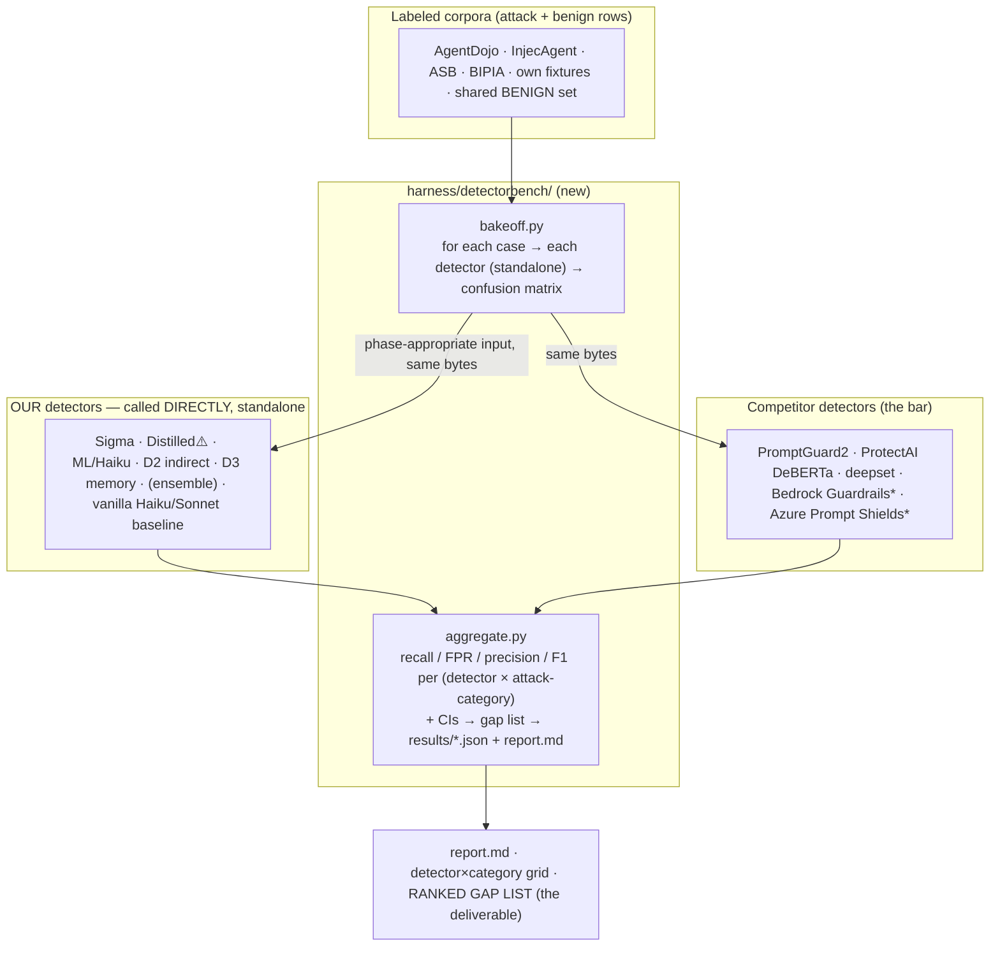

# LLD 41: Detector Diagnostic Bench (per-detector FP/FN gap-map across published attack corpora)

**Version**: 0.4 (PLAN — reframed to a per-detector diagnostic, policy out of scope, 2026-07-27; awaiting build sign-off)
**Last Updated**: 2026-07-27
**Status**: Draft / Ready for Review
**Prerequisites**: LLD 19 (ML classifier), LLD 32 (detection-depth / D1–D7 + distilled), LLD 34 (WS-0 measure-first — direct sequel), LLD 03 (controller/validate contract, for the ensemble row only)

> **Decisions locked (founder, 2026-07-27):**
> 1. **Purpose = DIAGNOSTIC gap-map.** Run every attack dataset through our **non-policy detectors** individually, find where each one MISSES per attack category → that's the improvement worklist. Not a "we beat vanilla" marketing number. See §1.1.
> 2. **SKIP the policy/Cedar layer.** We already know Cedar can allow/deny once extended; benchmarking it teaches nothing and tuning it to the benchmark = overfitting. So no policy is authored — the earlier B1/B2/B3 question is resolved as **"neither: policy is out of scope."**
> 3. **Detectors under test = the code-verified built subset** (§3.4): **Sigma** regex, **ML/Haiku** classifier, **Distilled** model, **D2** indirect-injection, **D3** memory-write. Each scored **standalone** (call the validator directly, like WS-0). NOT the aspirational D1–D7 (D1 is a keyword stub; D4–D8/multimodal are unbuilt scaffold). Session-stateful detectors (trust/abuse/sequence) are out (§3.4). Contamination caveat on the distilled model (§1.1, §6.2).
> 4. **Vanilla-model baseline (founder #1):** plain **Claude Haiku 4.5 + a Sonnet on Bedrock**, used as a detector ("is this an attack?"), scored identically → a baseline row in the grid. Answers "do our purpose-built detectors beat just asking a raw model?" (Agent-in-loop refusal/ASR is a separate deferred study — §9.4.)
> 5. **Datasets:** every labeled corpus — AgentDojo, InjecAgent, **ASB**, BIPIA, own fixtures — + a fixed benign set for the FP axis.
> 6. **Compare against other detectors** (PromptGuard 2, DeBERTa, deepset free; Bedrock Guardrails / Azure Prompt Shields / Lakera paid — §11) so each gap has a bar.
> 7. **Reuse, don't rebuild:** [detection_eval.py](../src/security-controller/app/services/detection_eval.py) already has `score_detector(detect, corpus)` + `fp_budget_gate` (TP/FP/TN/FN → precision/recall/F1/FPR). Build on it; add a confidence-threshold sweep for ROC on the score-emitting detectors.
> 8. **Held-out split** for the distilled model (founder #2) — headline recall on clean rows only (§6.2). **Internal engineering artifact first.**

---

## 1. Overview

### 1.1 Purpose — a DIAGNOSTIC gap-map, not a marketing number

Founder decision (2026-07-27): **skip the policy/Cedar layer entirely.** We already know Cedar can express allow/deny once its schema is extended (§5) — benchmarking it teaches us nothing, and tuning it to the benchmark would be overfitting. The question worth answering is diagnostic:

> *"Run every attack dataset through our NON-policy detectors — the distilled model, Sigma regex, the ML classifier, the D2 indirect-injection detector, the D3 memory-write detector — and find out, per attack category, WHICH detector catches WHAT. Where they miss is where we invest to improve them. Also compare against other published detectors so we know the bar."*

**In plain terms:** every public agent-attack dataset is a pile of labeled examples (attacks + benign). We feed each example to **each of our detectors individually** and record catch (true positive) vs miss (**false negative**), plus over-block (**false positive**) on benign traffic. The output is a **`detector × attack-category` catch-rate grid** and a **ranked gap list** — "the distilled model misses financial-exfil at only N% recall → enhance it." We run the same cases through other detectors (PromptGuard 2, ProtectAI DeBERTa, deepset; budget-permitting Bedrock Guardrails / Azure Prompt Shields / Lakera) so each gap has a bar: *"they catch this category, we don't — close it."*

This reframe changes the deliverable from *"we beat vanilla"* (a proof-point) to *"here is exactly where each of our detectors is weak"* (an engineering worklist). It also dissolves the review's blocking findings: no policy is authored, so there is no overfitting; and "detection is table-stakes" stops being a weakness because **improving detection is the whole goal.**

This is the **direct sequel to WS-0/lld/34**, which already fed harvested attack strings through our Sigma + ML detectors and scored recall by calling the validators directly ([recall_scorer.py](../harness/ws0/recall_scorer.py)). This LLD (a) evaluates **every built non-policy detector individually** (WS-0 scored Sigma+ML; add distilled, D2, D3 — the code-verified built set, §3.4), (b) adds the **false-positive axis** (WS-0 measured recall on attacks only), (c) adds **every dataset** incl. ASB, and (d) adds the **competitor + vanilla-model bars**.

> **⚠️ Contamination hazard — the distilled model was TRAINED on these benchmarks [FACT, verified 2026-07-27].** [02_build_corpus.py:79](../training/distilled-classifier/scripts/02_build_corpus.py#L79) folds the WS-0 corpora — themselves harvested from **InjecAgent + AgentDojo + BIPIA** — plus `attacks.jsonl` into the deployed distilled student as ×3-weighted positives. So a good distilled score on those datasets is partly **memorization, not detection** — which *hides the gaps we're trying to find* (makes the model look better than it is → we skip an improvement we needed). Mandatory handling: score the distilled model on a **held-out split** (ASB + fresh InjecAgent/AgentDojo cases not in the WS-0 harvest), or retrain a clean student excluding these corpora; at minimum, flag every distilled cell on a contaminated dataset as **"seen-in-training / optimistic."** Sigma/ML(Haiku)/D2 are not trained on these, so their numbers are clean. See §6.2.

### 1.2 The method — score each detector standalone, per attack category

Treat every dataset as a **labeled corpus** (attack rows + benign rows). For **each of our detectors, called directly** (not through the deny-overrides combiner — we want each detector's *own* catch rate, not the ensemble's), feed each row and record catch/miss → a confusion matrix per **(detector × attack-category)**. This is model-independent (no agent, no tool execution — "given this text/action, does *this detector* flag it?"), so it is cheap, fast, and reuses WS-0's direct-validator pattern ([recall_scorer.py](../harness/ws0/recall_scorer.py)). ASB is just another corpus.

**Why standalone, not the combiner:** the combiner ([deny_overrides.py](../src/security-controller/app/combiners/deny_overrides.py)) short-circuits — once Sigma fires, we never learn whether the distilled model *would have* caught it. For a gap-map we need each detector's independent recall, so a miss is attributed to the *specific* detector that must improve. We ALSO report the ensemble (what ships) as a final row, so we see both "where each part is weak" and "what the stack catches together."

**The confusion matrix + the numbers that matter:**

| | Ground truth: ATTACK | Ground truth: BENIGN |
|---|---|---|
| **Detector flags (DENY)** | True Positive (caught) | **False Positive** (over-block) ← FP |
| **Detector passes (ALLOW)** | **False Negative** (MISSED) ← FN — *the gap* | True Negative |

- **Recall** = TP/(TP+FN) → attacks this detector catches. **1−recall = the gap per category.**
- **FPR** = FP/(FP+TN) → benign wrongly flagged (a detector can look great on recall by flagging everything — FPR is the guard).
- **Precision, F1**, and a **ROC/PR curve** where the detector emits a score.

**The primary deliverable — the detector × attack-category grid** (one per dataset; cells = recall; a low cell = an investment target):

| Detector | injection (direct) | indirect / observation | data-exfil | financial-harm | memory-poison (ASB) | … | FPR (shared benign) |
|---|---|---|---|---|---|---|---|
| **Sigma regex** | — | — | — | — | — | | — |
| **Distilled model** ⚠️contam | — | — | — | — | — | | — |
| **ML / Haiku classifier** | — | — | — | — | — | | — |
| **D2 indirect-injection** | — | — | — | — | — | | — |
| **D3 memory-write** (ASB memory-poison) | — | — | — | — | — | | — |
| **Our ensemble (ships)** | — | — | — | — | — | | — |
| *Vanilla Haiku 4.5 (baseline)* | — | — | — | — | — | | — |
| *Vanilla Sonnet (baseline)* | — | — | — | — | — | | — |
| *PromptGuard 2 (bar)* | — | — | — | — | — | | — |
| *ProtectAI DeBERTa (bar)* | — | — | — | — | — | | — |
| *deepset / Bedrock Guardrails\* / Azure Prompt Shields\* (bar)* | — | — | — | — | — | | — |

From this grid we derive the **ranked gap list** — the actual output: *"Sigma catches direct injection 95% but indirect 20%; distilled catches indirect 80% (but contaminated — real number likely lower); D2 is the only thing seeing memory-poison at N%. → Priorities: (1) enhance Sigma/regex for indirect, (2) verify distilled on held-out, (3) …"*

**Hard requirements:**
1. **FPR needs benign rows.** InjecAgent + ASB are **attack-only** → they give recall/FN per detector but no FP. FP comes from a **fixed, representative benign set** (AgentDojo benign user-tasks + our [benign.jsonl](../src/security-controller/tests/fixtures/prompt_signatures/benign.jsonl) + deepset benign), held **constant across all detectors**. Recall without its paired FPR is banned (flag-everything = 100% recall).
2. **Byte-identical inputs + full score curve** for every detector, ours and competitors' — else apples-to-oranges. Each row of the input space maps to the phase that gives the detector a fair shot (content detectors get the poisoned *observation* via `phase="content"`; action detectors get `tool_name`+`tool_params` via `phase="request"` — §4.2).
3. **Distilled contamination** handled per §1.1 / §6.2 — held-out split or clean retrain, else labeled optimistic.

**Out of scope for this diagnostic (stated honestly):**
- **Policy/Cedar** — skipped by decision (§1.1). No allow/deny-list, no param rules.
- **Stateful/behavioral detectors** (trust, abuse, cross-agent) — these need *multi-call session* context; single-shot corpus rows can't exercise them fairly, so they're **not** in the per-detector grid. Noted, not faked.
- **Agent-in-the-loop ASR** — an *enforcement* study, not a *detection* study. Not needed for "where are our detectors weak." Optional later (§9.4) once the gap list is closed.

### 1.3 Scope

**In scope — ALL labeled corpora × ALL non-policy detectors:**
- **Datasets (attack rows):** AgentDojo injection payloads (4 suites); InjecAgent 2,108 (dh/ds × base/enhanced, sliced by `Attack Type`); **ASB** (DPI/OPI/memory-poison/PoT/mixed — un-deferred, §3.3); BIPIA + our fixtures.
- **Benign rows (for FP):** fixed shared benign set (AgentDojo benign user-tasks + our [benign.jsonl] + deepset benign) — §1.2 req 1.
- **Our detectors, scored standalone (the built set, §3.4):** Sigma regex, distilled model (⚠️contam), ML/Haiku classifier, D2 indirect-injection, D3 memory-write; plus the shipping ensemble as a final row.
- **Vanilla-model baseline (founder #1):** plain Claude Haiku 4.5 + Sonnet on Bedrock, used as a detector, scored identically.
- **Competitor detectors (the bar):** PromptGuard 2, ProtectAI DeBERTa, deepset (local, free); Bedrock Guardrails / Azure Prompt Shields / Lakera (API, budget-gated — §11).
- **Model-independent** — no agent LLM needed. The ML/Haiku + distilled tiers call Bedrock per case; everything else is local.

**Explicitly OUT:**
- **Policy/Cedar** — skipped by decision (§1.1).
- **Stateful detectors** (trust/abuse/cross-agent) — single-shot corpus can't exercise them; noted, not scored (§1.2).
- **Agent-in-the-loop ASR** — enforcement study, not detection; optional later (§9.4).
- **AgentDojo DoS attacks** — not a detection concern for us; if we later do the agent-loop, run DoS only as a neutral-secondary row (no silent truncation).
- **Generative hacker-agent swarm** — separate future LLD (§9.3).

### 1.4 Dependencies & the exact local-controller config [corrected per review]

Locally-runnable security-controller ([config.py](../src/security-controller/app/config.py); contract §4). Because we score detectors **standalone**, the harness calls each validator directly (WS-0 pattern) — but if routing through `/v1/validate`, the ML tier is **doubly gated**:
- **`ml_classifier_enabled`** — code default OFF, but **live prod = true** (task-def :63, §3.4). The bench sets it true so ML votes; else it abstains and looks like 100% miss.
- **Distilled** — for the bench, call the model server directly (§4); prod serves it live via the sidecar (§3.4).
- Bedrock creds — for the ML tier (Haiku 4.5 / Sonnet 4.6) to call the model.
- Sigma rules seeded (else the loader pulls from S3; fail-secure empty offline). Cedar irrelevant here (policy out of scope).
- **Config faithfulness [per grill K2]:** the live task-def pins tight timeouts (`ML_CLASSIFIER_TIMEOUT_SECONDS=1.7`, total budget 1.9s; `DISTILLED_TIMEOUT_MS=150`) — under real Bedrock+WAN the ML tier can time out and abstain on a non-trivial fraction of calls, so generous local timeouts *overstate* the shipped detection rate. Report ML/distilled at **two settings** — unbounded (pure capability) and prod-timeout-pinned (the live values) — and treat a big gap as a *latency* finding, not a detection one. (The exact prod abstain fraction is a measurable output of this bench, not an assumed constant.)
- Vendored benchmarks on disk but **gitignored + generator lost** — reproducibility fix is a hard gate (§7).

---

## 2. Component Architecture

**In plain terms:** one loop reads every labeled case and asks **each detector individually** — "do you flag this?" — then tallies a confusion matrix per detector per attack-category. No agent runs; nothing executes. Our detectors are invoked **directly** (each validator's own entrypoint, the WS-0 pattern) so we get each one's *independent* recall, not the ensemble's short-circuited verdict. Competitor detectors run on byte-identical inputs. The aggregator turns the grid into a ranked gap list.



**Layout (new, parallel to `harness/ws0/`):**
```
harness/detectorbench/
├── PLAN.md                      # points here
├── detectors/                   # uniform score/verdict interface per detector
│   ├── ours/                    # thin wrappers calling each validator DIRECTLY (Sigma, distilled, ML, D2, taint)
│   │   └── (import app.validators.* like recall_scorer.py does)
│   ├── promptguard2.py · deberta_protectai.py · deepset.py · bedrock_guardrails.py · azure_prompt_shields.py
├── corpora/
│   ├── loaders.py               # normalize every dataset → {id, text, action?, label, category, source, in_ws0_harvest} rows
│   ├── benign_shared.jsonl      # the FIXED benign set for FPR (constant across detectors)
│   └── heldout_split.py         # marks distilled-contaminated rows (in WS-0 harvest) vs clean (§6.2)
├── bakeoff.py                   # orchestrator (the primary deliverable)
├── aggregate.py                 # confusion-matrix + CIs + gap-ranking
├── results/                     # committed HEADLINE_SUMMARY.json + per-cell JSON
└── README.md                    # exact repro commands + pinned dataset SHAs
```
*(Directory renamed `detectorbench` — it benches detectors, not agents.)*

---

## 3. The datasets

Each dataset is used as a **labeled corpus** — attack rows for recall/FN, benign rows (where the dataset ships them) for FP. No agent is run.

### 3.1 AgentDojo

- **Attack rows** = injection payloads harvested from all 4 suites' injection tasks (`default_suites/v1/<suite>/injection_tasks.py`), tagged by category (direct injection, exfil, etc.). **Benign rows** = the 97 benign user-tasks — a rare dataset shipping *both*, so it contributes to the FP axis too.
- **The poisoned content** (what our D2/content detector must catch) lives in the attacker-controlled tool *output*; the injection-goal text is what Sigma/ML/distilled scan. Harvest both the injected observation and the goal string per case.
- **Categories** map onto the 4 suites × injection type; slice the grid on these. (AgentDojo's own agent-loop ASR machinery — `security_results` at [benchmark.py:29](../harness/ws0/corpus_src/agentdojo/src/agentdojo/benchmark.py#L29) — is *not* used here; we score detectors on the harvested strings, not agent runs.)
- **Competitor note:** AgentDojo's built-in `transformers_pi_detector` IS ProtectAI DeBERTa — so it doubles as one of our competitor bars (run it standalone on the same rows).

### 3.2 InjecAgent

- **Cases**: `test_cases_dh_{base,enhanced}.json` (510 each), `test_cases_ds_{base,enhanced}.json` (544 each) = **1,054 × 2 settings** [re-confirm row counts at build].
- **Category axis** — the `Attack Type` field: dh = `Data Security Harm` (187) / `Physical Harm` (170) / `Financial Harm` (153); ds = `Others` (255) / `Physical Data` (187) / `Financial Data` (102). We group the grid on this field.
- **What we feed the detectors:** each case's **attacker instruction** + the **injected tool-response** (`Tool Response` field carries the baked-in payload). This is the poisoned-observation text a content detector must flag — a clean fit for the standalone-detector scoring (no agent needed).
- **Attack-only** → recall/FN per detector, no FP (benign comes from the shared set). ⚠️ **Contamination:** InjecAgent strings are in the distilled model's training set (§6.2) — hold out / flag.

### 3.3 ASB (Agent Security Bench)

[FACT] MIT, ICLR 2025; attacks **DPI / OPI(=IPI in paper prose — one attack) / memory-poisoning / PoT-backdoor / mixed**; config files `config/{DPI,OPI,MP,POT,mixed}.yml`. As a labeled corpus it plugs straight into the standalone-detector scoring.

- **Why it earns its place:** DPI/OPI/mixed overlap AgentDojo+InjecAgent, but **memory-poisoning is unique** — poisoned retrieval/long-term-memory content — exercising the **memory-write-governance white-space** wedge (OWASP ASI06; [memory: memory-write-governance-whitespace]) that no other dataset here tests. This is exactly a "can any of our detectors even see this?" gap question — run its MP + mixed rows through D2/content and the distilled model.
- **Feed the detectors:** the injected instruction embedded in the observation/memory item per case (from the attack configs + task data). Attack-only → recall/FN.
- **Naming/quoting traps [FACT]:** OPI(code)==IPI(paper); cite **Table 3** (13 attacks + 11 defenses), not the abstract's "27 methods". (Its published per-model ASR numbers are agent-loop results — not directly comparable to our detector recall; use for context only.)

### 3.4 Our detectors — built + PROD-ENFORCEMENT status [VERIFIED against LIVE AWS, 2026-07-27]

Verified against the **deployed** controller task-def `sentra-security-controller:63` in acct 531109575379 (dev = prod, one stack) — NOT committed CDK, which **diverges** (see drift warning). Only detectors that produce a meaningful verdict on a single self-contained case are in the bench; session-stateful ones are noted out.

| Detector | Built | Enforcing in prod? | Live evidence | In bench grid? |
|---|---|---|---|---|
| **Sigma** regex | ✅ | ✅ tier-0 hard | always-on | ✅ (boolean) |
| **ML** Haiku→Sonnet | ✅ | ✅ | `ML_CLASSIFIER_ENABLED=true` (Haiku 4.5 / Sonnet 4.6) | ✅ (real score) |
| **Distilled** (MiniLM+LogReg sidecar) | ✅ | ✅ confident-DENY + fast-ALLOW | `DISTILLED_SERVICE_URL=http://distilled-classifier.sentra.internal:8080`; ECS svc ACTIVE 1/1 | ✅ (score) ⚠️contam §6.2 |
| **D2** indirect-injection | ✅ | ✅ | `D2_ENFORCE_ENABLED=true` (content phase) | ✅ (coarse) |
| **D3** memory-write | ✅ | ✅ | `D3_ENFORCE_ENABLED=true` (memory phase) | ✅ (boolean; needs memory payload) |
| **Cedar** policy | ✅ | ✅ authoritative | `CEDAR_ENABLED=true, SHADOW=false` | ✗ policy out of scope (§5) |
| **D1** trajectory | ⚠️ stub | ✅ *enforcing* | `D1_ENFORCE_ENABLED=true` — **but v1 `_judge` is a keyword scan, not a model** ([trajectory.py:115](../src/security-controller/app/validators/trajectory.py#L115)) | ✗ signal is multi-turn; single-shot not meaningful |
| **Trust / Abuse / Context-seq / CrossAgent** | ✅ | ✅ tier-0 hard | session/history state | ✗ NOT single-shot scoreable |
| **D4 taint · D5 output-DLP · D6 · D7 · D8 · multimodal** | ❌ | D5 = fail-secure DENY-all **stub**; rest scaffold | not built | ✗ |

So the **bench grid = Sigma · ML · Distilled · D2 · D3** (5 built, prod-enforcing, single-shot-scoreable detectors) + the vanilla Haiku/Sonnet baseline + competitor bars. (My earlier "D1–D7 depth" was aspirational; corrected here.)

> **⚠️ Deploy-drift finding [VERIFIED, worth a ticket — not this LLD's job].** The live enforcement (`DISTILLED_SERVICE_URL`, `D1/D2/D3_ENFORCE_ENABLED`) is set **only in the deployed task-def :63**, injected out-of-band — the **committed CDK never instantiates the distilled construct nor sets these env vars**, and `dev.yaml` doesn't contain the keys. A `cdk deploy --all` from committed source would **silently drop the distilled sidecar URL + the D1/D2/D3 enforce flags**, disabling live detectors. Ground truth for "what's enforcing" = the running task-def, never `dev.yaml`.

---

## 4. How the harness feeds each detector (verified against code)

For **our detectors** (the §3.4 built subset), call each validator **directly** (the WS-0 [recall_scorer.py](../harness/ws0/recall_scorer.py) pattern — `import app.validators.*`), not through `/v1/validate`/combiner, so we get each detector's independent verdict:
- **Sigma** — `SigmaEngine.match_rules(text)` ([sigma_engine.py:484](../src/security-controller/app/validators/sigma_engine.py#L484)); deterministic, local. Needs the rule-set (from S3/DynamoDB, or inject a local ruleset).
- **ML** — `MLClassifierValidator.validate(...)` ([ml_classifier.py:136](../src/security-controller/app/validators/ml_classifier.py#L136)); needs `ml_classifier_enabled=true` + Bedrock (Haiku 4.5 hot / Sonnet 4.6 escalate), else it abstains. Real score for ROC.
- **Distilled** — call the model server `_Model.classify` ([app/distilled/server.py:81](../src/security-controller/app/distilled/server.py#L81)) directly for a clean per-case score (MiniLM + LogReg → P(deny)). Prod serves it via the sidecar at `distilled-classifier.sentra.internal:8080` (§3.4), but for the bench call the model directly. Real score. ⚠️ training contamination (§6.2).
- **D2 indirect-injection** — `IndirectInjectionValidator.validate(...)` ([indirect_injection.py:93](../src/security-controller/app/validators/indirect_injection.py#L93)); feed it `content_text` = the **poisoned observation** (empty content_text → abstains). Coarse/quantized score.
- **D3 memory-write** — `MemoryWriteValidator.validate(...)` ([memory_write.py:156](../src/security-controller/app/validators/memory_write.py#L156)); feed `tool_params["memory"]` from ASB memory-poisoning cases. Boolean.
Each returns a `ValidationResult` (`should_deny`, optional `confidence`); normalize to `{flagged, score, reason}`. **Do NOT** use the SDK's `_build_request` (it Tier-1-redacts the input [guard.py:555], masking the attack text before the detector sees it). **Reuse [detection_eval.py](../src/security-controller/app/services/detection_eval.py)** `score_detector`/`fp_budget_gate` — already tallies TP/FP/TN/FN → precision/recall/F1/FPR; add a `confidence`-threshold sweep for ROC on ML + distilled.

Also record the **shipping ensemble** verdict via `/v1/validate` (no auth locally; `body["decision"]` ALLOW/DENY; DENY is HTTP 200) as the "what the stack catches together" row.

Config: `ml_classifier_enabled=true` + Bedrock creds + Sigma rules seeded; distilled scored by calling the model directly (no sidecar dependency for the bench). Report ML/distilled at **two timeout settings** — unbounded (pure capability) and prod-pinned (`ML_CLASSIFIER_TIMEOUT_SECONDS=1.7`, `DISTILLED_TIMEOUT_MS=150` — the live task-def values) — so a latency-induced abstain shows up as a finding (§1.4). Run controller-hermetic per [memory: controller-tests-moto-safe-env].

---

## 5. Policy/Cedar — OUT OF SCOPE (decided) [was the v0.2 differentiator; corrected]

The v0.2 draft made action-governance policy (`send_money.amount ≤ cap`, `recipient ∈ payees`, `update_password` needs prior-auth) the headline. **Founder decision (2026-07-27): skip it.** Two reasons, both sound:
1. **We already know Cedar can do allow/deny** — benchmarking it proves nothing new.
2. **It isn't even expressible today without controller changes, and building-to-the-benchmark would be overfitting.** [Verified] [baseline-v1.cedar](../src/security-controller/app/validators/cedar/baseline-v1.cedar) has only 3 `forbid` rules hardcoded to `process_refund`/`verify_identity` (not in any benchmark suite); the context schema is locked to `{amount, fraud_risk, cloud_region}` (no `recipient`/payee-set/sequence-state); per-agent rule emission doesn't exist ([generator.py:33](../src/security-controller/app/validators/cedar/generator.py#L33)). To benchmark it we'd have to author rules *against the benchmark's own attack taxonomy* — the textbook overfitting the review flagged.

So this LLD evaluates **only the non-policy detectors** (§1.2). If the gap-map later shows an action-level gap that *only* policy can close, that becomes a genuine LLD-28 product requirement (schema `recipient`/`sequence-state` attributes, per-tool forbids) — and **when that future work is benchmarked it MUST use a held-out anti-overfitting protocol** [grill K1]: policies frozen (git-SHA'd, dated) *before* seeing the benchmark, evaluated on an attack-family they were NOT authored against, with the transfer number led. That is a future LLD-28 concern, flagged here so it isn't forgotten — **not** part of this measurement.

---

## 6. Metrics & honest definitions

**Per detector, per attack-category (the grid, §1.2):**
- **Recall** = TP/(TP+FN) = attacks this detector catches. **1−recall = the gap** — the number that drives the worklist.
- **FPR** = FP/(FP+TN) = benign wrongly flagged, on the **fixed shared benign set**. *Recall is banned without its paired FPR* (flag-everything → 100% recall). A detector that catches an attack category only by also over-blocking benign traffic is not a win — the grid shows both.
- **Precision, F1**, and a **ROC/PR curve** where a detector emits a score (ours do — severity/trust), so a gap can be "misses at the shipped threshold but catchable at another" vs "genuinely blind."
- **Ensemble row** — the shipping stack's combined recall/FPR, so we see per-part weakness *and* what the whole catches.
- **Competitor bars** — every competitor detector on byte-identical inputs + same benign set.

**The deliverable = the ranked GAP LIST** derived from the grid: each (detector, attack-category) cell below a threshold, ordered by (impact × how-fixable), each with a one-line fix hypothesis ("Sigma misses obfuscated indirect injection → add rules / route to ML"; "distilled blind to memory-poison → needs MP examples in training"). This is the point of the whole exercise.

**Statistical rigor [per grill K5 — mandatory]:** the ML/Haiku + distilled tiers are stochastic → **≥3 seeds + Wilson/bootstrap CIs** on every recall/FPR (WS-0 already used Wilson CIs). Sigma/regex is deterministic (1 run). A gap claim inside the CI is "unproven," not a gap.

**Contamination + config faithfulness** — the two ways a detector looks better than it ships:
- **Distilled contamination** — §6.2; contaminated cells labeled, real number from the held-out split.
- **ML timeout** [grill K2] — report ML/distilled at **two settings**: unbounded (pure capability) and prod-timeout-pinned (~60% abstain — what ships). A large gap = a *latency* gap masquerading as detection, itself a finding.

**Latency** (context, not headline): per-detector inference cost, so the gap list can weigh "add this detector" against its ms. Note [FACT, WS-0/lld/34]: prod `/v1/validate` is a WAN round-trip (~0.6–1.2 s; escalated p99 ~3 s) — a local bench understates it; never quote the local number as production.

All numbers carry `[FACT]` provenance to the run JSON; no figure ships without a reproducible cell file (per research-evidence discipline).

### 6.1 Where our detectors stand vs published detectors [FACT, verified on arXiv 2026-07-26]

The competitor bars are run in-harness (PromptGuard 2, DeBERTa, deepset — standalone, same rows). We also cite published *agent-loop* defenses for context — they are not detector-recall numbers, so they inform "is there a better approach we should study," not a direct bar:

| Defense | What it is | Reported result | Why it matters to us |
|---|---|---|---|
| **Progent** (arXiv:2504.11703) | Symbolic tool-name/argument privilege rules + SMT-checked policy updates | Evaluated on **both AgentDojo AND ASB** | **Closest in kind to our PDP** (a tool-argument rule engine) and the only one reporting on both our harnesses — our primary "prior art to beat." |
| **Task Shield** (arXiv:2412.16682) | Task-alignment check on each step | GPT-4o **ASR 2.07% @ 69.79% utility** (AgentDojo) | A concrete published bar for the (ASR, utility) trade-off. |
| **MELON** (arXiv:2502.05174, ICML'25) | Masked re-execution + tool-call comparison; "provable" against indirect injection | AgentDojo | Provable-defense framing to contrast our empirical approach. |
| **LlamaFirewall** (arXiv:2505.03574, Meta) | Open-source guardrails: PromptGuard 2, Agent Alignment CoT auditor, CodeShield | AgentDojo (alignment checks) | Open-source incumbent; the "why not just use the free thing" comparison. |

These are **citations, not reruns** — paper prose/tables are under arXiv's distribution license (cite normally; do not redistribute verbatim as if MIT). The *code/data* of AgentDojo (MIT), ASB (MIT), Explorer (Apache-2.0) are reusable commercially with attribution.

### 6.2 Distilled-model contamination — the held-out protocol (mandatory)

[FACT] The deployed distilled student was trained on the WS-0 corpora (harvested from **InjecAgent + AgentDojo + BIPIA**) + `attacks.jsonl`, ×3-weighted ([02_build_corpus.py:79](../training/distilled-classifier/scripts/02_build_corpus.py#L79)). So its recall on those datasets is inflated by memorization — and since the goal is *finding gaps*, inflation is the dangerous direction (a memorized "catch" hides a real blind spot). Handling, in order of preference:
1. **Held-out split (min bar):** `corpora/heldout_split.py` marks every row that was in the WS-0 harvest (`in_ws0_harvest=true`). The distilled model's *headline* recall is computed **only on clean rows** — **ASB** (never harvested) + any AgentDojo/InjecAgent variants added after the WS-0 build. Contaminated rows reported separately, labeled "seen-in-training / optimistic."
2. **Clean retrain (better, if cheap):** retrain a student excluding these corpora; bench that. Decide at build based on retrain cost.
- **Sigma, ML/Haiku, D2 are not trained on these corpora** → their numbers are clean on all datasets. Only the distilled row carries the asterisk.
- The report states the contamination inline on every distilled cell — not a footnote.

---

## 7. Reproducibility fix (HARD GATE — must precede any published number)

Today the vendored repos (`harness/ws0/corpus_src/{agentdojo,InjecAgent,BIPIA}`) and built corpus are **gitignored**, and `build_corpus.py` is **gone from disk**. A clean checkout cannot reproduce anything. Since this spike's output is investor/customer-facing, before results ship:
- Re-vendor **AgentDojo + InjecAgent + ASB pinned to specific commits** (record each SHA), committing either the repos (all MIT) or `pip install agentdojo==<ver>` + pinned InjecAgent/ASB fork references + a `fetch.sh` that clones the exact SHAs.
- Commit the harness (`harness/agentbench/**`), the policies, the seed data, and the run commands (`README.md`).
- Commit `results/HEADLINE_SUMMARY.json` (force-add, like WS-0 did).

---

## 8. Build breakdown (workstreams → tasks)

Cheap, model-light, reuses WS-0 code. No agent loop, no policy authoring.

**WS-DB0 — Foundation (blocks all)**
- Re-vendor + pin AgentDojo, InjecAgent, **ASB** (all MIT); commit `fetch.sh` + SHAs (§7).
- `corpora/loaders.py`: normalize every dataset → uniform rows `{id, text, injected_observation?, label, category, source, in_ws0_harvest}`; assemble `benign_shared.jsonl` (§11 Q sign-off); `heldout_split.py` for distilled contamination (§6.2).
- Controller bring-up for the ML/distilled tiers: `ml_classifier_enabled=true` + distilled sidecar serving + Bedrock creds + Sigma rules seeded; smoke-test that each detector actually *returns a verdict* (esp. ML not silently abstaining). Controller-hermetic env.

**WS-DB1 — Our detectors, standalone (the core)**
- `detectors/ours/*`: thin wrappers calling each validator directly — `SigmaEngine.match_rules`, `MLClassifierValidator.validate`, distilled `_Model.classify`, D2 `IndirectInjectionValidator.validate`, D3 `MemoryWriteValidator.validate` — normalized to `{flagged, score, reason}`. Feed content detectors the poisoned-observation text; feed D3 the memory payload.
- `detectors/vanilla_bedrock.py`: plain Claude Haiku 4.5 + Sonnet on Bedrock as a yes/no attack classifier (founder #1 baseline).
- Also capture the shipping-ensemble verdict via `/v1/validate` (raw payload, **no SDK redaction** — [guard.py:555]) as the "stack together" row.
- Two timeout settings for ML/distilled (unbounded vs prod-pinned — §1.4).

**WS-DB2 — Competitor detectors (the bar)**
- `detectors/{promptguard2,deberta_protectai,deepset}.py` (local, free — DeBERTa == AgentDojo's `transformers_pi_detector`); `{bedrock_guardrails,azure_prompt_shields,lakera}.py` behind a budget flag (§11 Q).
- Uniform interface; byte-identical inputs to ours.

**WS-DB3 — Run + aggregate + gap list (the deliverable)**
- `bakeoff.py`: every corpus row × every detector → confusion matrix; ≥3 seeds + Wilson CIs on stochastic detectors.
- `aggregate.py`: the detector × attack-category grid (per dataset), recall/FPR/precision/F1 + ROC/PR; **distilled headline from clean/held-out rows only, contaminated cells labeled** (§6.2); the **ranked gap list** with fix hypotheses.
- `report.md` + `HEADLINE_SUMMARY.json` (committed, force-add). Feed gaps into the detector backlog (LLD 19/32); correct the unbacked HarmBench claim in [Technology.tsx:20](../frontend/src/components/Technology.tsx#L20).

**Tests (mandatory):** detector-wrapper unit tests (verdict/score parsing, fail-secure, no-redaction, uniform interface); confusion-matrix + Wilson-CI math on a fixture; held-out-split correctness test (a known-harvested row is excluded from the distilled clean set); golden 5-case per dataset (known attack→flagged by ≥1 detector, known benign→passed).

**Follow-on (NOT this LLD) — driven by whatever the gap list finds:**
- Detector enhancements (new Sigma rules, distilled retrain incl. missed categories, D2 tuning) — normal LLD 19/32 work, scoped by the gap list.
- Agent-in-the-loop *enforcement* study — only if we later want to prove block-before-execute end to end (§9.4).

---

## 9. Deferred / out of scope

### 9.1 (ASB is now in-scope — see §3.3)

ASB is a first-class dataset in the detector bake-off (§3.3), un-deferred by the reframe. Only its *agent-in-the-loop enforcement* arm remains deferred → folded into §9.4.

### 9.2 Invariant Explorer — self-hosted audit sink ONLY (assumption corrected) [FACT]

Explorer (Apache-2.0, self-hostable via `invariant explorer` + Docker Compose) is a trace *viewer* — useful to make our runs inspectable. But two corrections to the original proposal:
- **The hosted `explorer.invariantlabs.ai` was SHUT DOWN Jan-2026** (redirects to Snyk; Invariant Labs was absorbed). There is **no public shareable URL** and the Benchmark Registry is defunct — only a **self-hosted (localhost) instance** survives.
- **There is no AgentDojo→Explorer trace feed** (only a now-dead one-way results listing). We would emit our own traces (OpenAI-chat `Event`/`ToolCall` shape) from the PDP validate log and push them via `invariant-sdk`.
- Explorer is **inspection-only** (no ASR/NRP — we compute those) and ingests **full message content**, so per our data-boundary rule ([CLAUDE.md](../CLAUDE.md)) PII/secret scrubbing before upload is mandatory.
- **Verdict:** optional, low priority for an internal proof-point. Nice for debugging a suspicious run; not on the critical path.

### 9.3 Generative hacker-agent swarm (Q4b) — separate future LLD

Spawning N attacker LLMs, each specialized per threat class, generating *novel* attacks against our target agents and measuring block-rate. Valuable (finds bypasses fixed benchmarks miss; feeds the flywheel) but bigger build. **Separate future LLD.** A natural extension once the gap-map exists — it hunts *unknown* gaps where this LLD measures *known* ones.

### 9.4 Agent-in-the-loop enforcement study — deferred

The original v0.2 plan (drive AgentDojo/InjecAgent/ASB's own agent runners with our PDP intercepting live tool calls; measure ASR reduction + utility). This measures **enforcement** (block-before-execute in a running agent), which detector-recall doesn't. Deferred because: (a) it's not needed to answer "where are our detectors weak"; (b) it needs Bedrock-backend shims for each harness (none ship one) + the no-hard-abort adapter (return a synthetic blocked tool-observation, never `AbortAgentError` — else benign utility collapses, as AgentDojo's own `transformers_pi_detector` shows); (c) an action-governance claim there hits the Cedar limitation (§5). Revisit once the gap list is closed and we want an end-to-end enforcement proof-point.

---

## 10. Cross-references

- **Implements**: a **detector gap-map** — an engineering worklist of where each Sentra detector is weak per attack category — feeding the detector backlog (LLD 19 ML, LLD 32 detection-depth). Secondary: a defensible "we detect N% at M% FP vs competitor Y" data point for STRATEGY §2.
- **Sibling spike**: LLD 34 (WS-0 measure-first) — same direct-validator method; this adds the FP axis, every dataset, per-detector standalone scoring, and competitor bars.
- **Consumes contracts**: the validator entrypoints (`SigmaEngine.match_rules`, `MLClassifier.validate`, distilled sidecar, D2 `indirect_injection`) — LLD 19/32; `POST /v1/validate` for the ensemble row — LLD 03; SDK client shape (LLD 23, but bypass its redaction).
- **Explicitly NOT consumed**: Cedar policy/forbids (§5, out of scope) — no LLD 28 dependency for this measurement.
- **Prior art (context, cited not rerun)**: Progent (arXiv:2504.11703), Task Shield (2412.16682), MELON (2502.05174), LlamaFirewall (2505.03574) — §6.1. In-harness competitor bars: PromptGuard 2, ProtectAI DeBERTa, deepset.
- **Contamination dependency**: distilled model trained on the benchmarks ([02_build_corpus.py:79](../training/distilled-classifier/scripts/02_build_corpus.py#L79)) → held-out protocol (§6.2).
- **Fixes**: reproducibility hole from WS-0 harvest (§7); the unbacked HarmBench claim in [Technology.tsx:20](../frontend/src/components/Technology.tsx#L20).
- **Data licensing**: AgentDojo/InjecAgent/ASB MIT, Explorer Apache-2.0 (verified); papers under arXiv license (cite, don't redistribute). WASP excluded (CC-BY-NC).
- **Downstream doc sync**: on approval, pointer in [lld/ARCHITECTURE.md](ARCHITECTURE.md); gap-list items become LLD 19/32 tasks.

---

## 11. Decisions locked + remaining open questions

**Locked (founder, 2026-07-27):**
1. **Purpose = diagnostic gap-map** — per-detector recall/FP per attack category → where to improve. Not a marketing number.
2. **Skip policy/Cedar entirely** (§5) — resolves the earlier B1/B2/B3 question as "policy out of scope."
3. **Scope** — all datasets incl. ASB; all non-policy detectors scored standalone; competitor bars.

**Open — need founder call before build:**
1. **Which paid competitor detectors?** Free/local (PromptGuard 2, ProtectAI DeBERTa, deepset) are in by default. Add the paid APIs — **AWS Bedrock Guardrails, Azure Prompt Shields, Lakera** — which need keys + budget? (More competitors = a stronger "vs others," but each is setup + cost.)
2. **Distilled contamination handling** — **held-out split** (fast; headline recall from ASB + fresh cases only) or **clean retrain** (slower, cleaner)? Recommend held-out now, retrain only if a distilled gap looks contamination-masked. (§6.2)
3. **Benign corpus sign-off** — the FP axis is only as real as the benign set. Approve the proposed mix (AgentDojo benign user-tasks + our benign.jsonl + deepset benign), or specify your own so FPR reflects real traffic, not a strawman.
4. **Detector grid is settled by code-verification (§3.4):** Sigma, ML, Distilled, D2, D3 — the built, prod-enforcing, single-shot-scoreable set. D1 (keyword stub) and the session-stateful floors (trust/abuse/sequence) are excluded with reason; D4–D8 aren't built. Flag if you want D1 or a stateful detector attempted anyway (with the caveat its score won't be meaningful single-shot).
