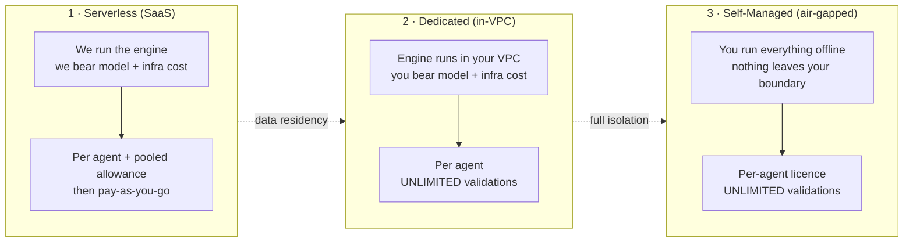

# AegionAI Guard — Pricing Model

**Version** 3.0 · **Date** 2026-08-27 · **Status** Draft for design-partner validation

> **Per governed agent, per month. Each agent brings a validation allowance. Allowances pool across the
> account. Past the pool it's pay-as-you-go — never a block.**

> ⚠️ **Appendix A is INTERNAL.** It holds our cost basis, margins and price floors. Strip it before this
> document goes to a customer. Sections 1–4 are safe to share under NDA.

---

## 0. The meter, in one page

Three rules, identical across all three products:

1. **You pay per governed agent, per month.** Not per seat, not per API call.
2. **Each agent brings an included validation allowance**, and allowances **pool across your whole account.**
   100 agents on Enterprise = 3,600,000 validations/month shared, not 36,000 each.
3. **Past the pool, pay-as-you-go: $8 per 1,000 validations.** Published rate, billed in arrears.

A **validation** is one call to the policy engine for one agent action — whatever depth of inspection that
action needs. Simple actions resolve against policy rules; ambiguous or high-risk ones escalate through the ML
detectors automatically. **You are never charged differently for the two** — one meter, one rate.

**Nothing ever gets blocked.** Exhausting an allowance is a billing event, never an enforcement event. We do
not throttle, do not return errors, do not deny the action, and never fail open. Alerts fire at 80% and 100%;
overage lands on your next invoice. A commercial limit must never become a security control.

### What "pooled" means

Like shared data on a family mobile plan. Some agents are busy, some barely run — only the total matters.

*Example — Enterprise, 100 agents, 3,600,000 validations/month pooled:*

| In one month | Validations used |
|---|---:|
| Busiest coding agent | 1,400,000 |
| Payment-approval agent | 900 |
| Other 98 agents combined | 610,000 |
| **Account total** | **2,010,900** — inside the 3,600,000 pool |

No agent has its own cap. Give each of the 100 agents a fixed 36,000 instead and the coding agent stops on day
one while 98 quiet agents leave most of theirs unused — same entitlement, far worse fit.

Two consequences worth naming:

- **Adding an agent never costs you a coverage decision.** A quiet agent costs its agent fee and almost
  nothing from the pool, so you are never trading budget against protection.
- **The two dimensions police each other.** Collapsing 40 logical agents behind one registered identity saves
  agent fees — but those 40 agents' validations still flow into a pool sized for one, and pay-as-you-go picks
  up what the agent count missed.

**One governed agent** = one distinct agent identity registered in AegionAI Guard with at least one active
policy binding at any point during the billing month. Registered-but-unbound agents are free; an agent
retired mid-month is pro-rated.

---

## 1 · Serverless (SaaS)

Multi-tenant. We run the policy engine and bear the model and infrastructure cost — which is why this is the
one product with a validation allowance.

| Plan | Agents | **$/agent/month** | **List** validations/agent/mo | **Launch** validations/agent/mo | **Pay-as-you-go** |
|---|---|---:|---:|---:|---:|
| **Developer** | up to 3 | **$0** | 2,500 | — | capped — no overage |
| **Essential** | from 1 | **$49** | 9,000 | **24,000** | **$8 / 1,000** |
| **Standard** | from 1 | **$99** | 18,000 | **49,000** | **$8 / 1,000** |
| **Enterprise** | from 1 | **$199** | 36,000 | **98,000** | **$8 / 1,000** |

- Allowances **pool across the account** and reset monthly. **Pay-as-you-go is $8 per 1,000 validations**
  ($0.008 each), billed monthly in arrears — never a block, never a throttle, never a fail-open. Alerts at 80%
  and 100% of allowance. Billable overage is capped at 50% of contract value; beyond that we absorb it and
  discuss a tier upgrade.
- **Launch Program:** 2.7× allowance for the initial 12-month term, first 10 customers, reverting to List at
  renewal. Named and dated on the order form.
- **No minimum and no maximum agent count** on any paid plan. A ceiling would tell a customer to stop
  governing agents, which is the opposite of what this product is for.
- Every paid plan gets every detector. We do not sell weaker detection at a lower price.

---

## 2 · Dedicated (in-VPC)

Single-tenant. The policy engine runs inside **your** VPC, managed by us. Only metadata leaves your boundary
— never action content. You bear the cloud and model cost directly in your own account.

| Band | Governed agents | **$/agent/month** | Example | *Annual* |
|---|---:|---:|---:|---:|
| **Entry** | 25–99 | **$320** | 50 agents → **$16,000/mo** | *$192,000* |
| **Growth** | 100–299 | **$265** | 150 agents → **$39,750/mo** | *$477,000* |
| **Scale** | 300+ | **$225** | 400 agents → **$90,000/mo** | *$1,080,000* |

- **Validations are unlimited — no allowance, no overage, no meter.** You pay your own model and infrastructure
  cost, so your volume costs us nothing. **This is the real upgrade logic:** on Serverless, 2 million extra
  validations a month costs $24,000 in overage; on Dedicated it costs nothing. A high-volume fleet is cheaper
  here despite the higher per-agent rate.
- **Minimum 25 agents — $8,000/month ($96,000/year).** Minimum 2-year term, or 1 year at a 15% uplift.
- **One-time implementation: $25,000** — deployment into your VPC, policy migration, enforcement-point
  integration, runbook handover.
- 99.9% availability SLA with credits. Quarterly upgrade cadence, scheduled with you.

**Why more per agent than Serverless (+33%):** data residency, single-tenant isolation, and a managed service
delivered into your environment on your change-control calendar — dedicated deployment, per-tenant upgrade
and patch cycles, and named support, none of which amortize across tenants the way multi-tenant SaaS does.

**Included beyond Serverless Enterprise:** single-tenant isolation · regional data residency · in-VPC key
management · your change-control calendar · named support engineer · quarterly architecture review.

---

## 3 · Self-Managed (air-gapped)

You run everything. Nothing leaves your boundary — no content, no metadata, no telemetry. Licensed per
governed agent as an **annual subscription** with an offline licence key.

| Band | Governed agents | **$/agent/month** | Example | *Annual* |
|---|---:|---:|---:|---:|
| **Entry** | 25–99 | **$480** | 50 agents → **$24,000/mo** | *$288,000* |
| **Growth** | 100–299 | **$400** | 150 agents → **$60,000/mo** | *$720,000* |
| **Scale** | 300+ | **$340** | 400 agents → **$136,000/mo** | *$1,632,000* |

- **Validations are unlimited.** No metering is possible and none is wanted — we have no visibility into your
  volume and no cost that scales with it.
- **Minimum 25 agents — $12,000/month ($144,000/year).** Annual term, billed annually in advance.
- **One-time offline deployment and hardening engagement: $50,000** — air-gapped install, offline update
  channel, licence provisioning, operator training, break-glass runbooks.
- **Offline updates:** signed policy, signature and model bundles delivered on your media cadence.

### How licensing works with no call-home

A signed licence file states your agent-count ceiling and expiry. The engine verifies it locally against its
own agent registry and **warns** — it never disables enforcement, because a licence dispute must not become a
security outage.

- **Annual self-report.** You export a signed usage report showing peak registered agent count — a count and
  a signature, no content and no action data.
- **True-up.** Agents above your ceiling are billed at list for the period. Sustained over-deployment beyond
  10% is billed at **1.5× list**.
- **Audit right.** Standard annual clause in the MSA, satisfiable entirely by the offline report.

**Why 2× Serverless per agent:** this is the product no SaaS-only vendor can deliver at all. You are buying
permanence and total isolation, plus offline release engineering, version pinning on your schedule, escorted
support, and a long backport tail. It is also the only product where we receive nothing back — no telemetry,
no signals, no feedback loop.

---

## 4 · Choosing

| If your constraint is… | Buy | Because |
|---|---|---|
| Speed to value, no residency rule | **Serverless** | No deployment; live in days |
| Small fleet, tight budget | **Serverless Essential** | From $175/month |
| Data residency, or content cannot leave | **Dedicated** | Only metadata leaves; you hold the keys |
| High and growing validation volume | **Dedicated** | Unlimited validations; you own the model spend |
| Regulator or policy forbids egress entirely | **Self-Managed** | Nothing leaves, ever |
| Classified / sovereign / offline network | **Self-Managed** | The only product that runs with no connectivity |

Products are an upgrade path, not a fork. Agent count, policies and audit history carry across and the
per-agent basis is identical — so moving up is a change of deployment, not a re-purchase.

### Value framing

Independent 2026 benchmarks for the segments we sell into:

- **Financial-sector average breach cost $6.3M**; healthcare $6.6M. Breaches involving AI cost roughly **$1M
  more** than those without. *(IBM Cost of a Data Breach 2026, with Ponemon, n=602 organisations breached
  Mar 2025 – Feb 2026, published 2026-07-29.)*
- **Mean time to identify and contain: 247 days**, reversing five consecutive years of improvement.
- **Shadow AI appeared in 43% of security incidents**, more than double the prior year. Close to **seven in
  ten** breached organisations had no AI governance policy at all.
- **EU AI Act Article 99:** breaches of high-risk obligations carry penalties up to **€15M or 3% of worldwide
  annual turnover**, whichever is higher.

A 100-agent Enterprise subscription is **2.9%** of one average financial-sector breach.

---
---

# Appendix A — Derivation *(INTERNAL — remove before external sharing)*

## A.1 Unit cost of one validation

Everything builds from the cost of a single `POST /v1/validate`. The pipeline escalates through three models,
so the unit cost is a weighted cascade. Rates are Anthropic first-party per MTok.

**There are two unit costs, 375× apart, and conflating them is what made earlier drafts unsellable.**

### A.1.1 Policy check — the cheap path

Identity/trust, Cedar policy, and Sigma signatures all run **in-process**: no model call, no external
dependency. The only marginal cost is storage and transport.

| Component | $/check | Confidence |
|---|---:|---|
| DynamoDB writes (signal rows, on-demand WRU) | 0.0000090 | measured |
| API Gateway request | 0.0000035 | measured |
| CloudWatch Logs + NAT + ALB | 0.0000055 | estimated |
| **COGS / policy check** | **$0.000018** | **= $18 per million** |
| **× 1.5 buffer → floor** | **$0.000027** | |

### A.1.2 Deep inspection — the expensive path

A cumulative model cascade. Rates are Anthropic first-party per MTok; a call reaching Opus has **already paid
for Haiku and Sonnet** — the shares multiply cost, they don't replace it.

| Model | Role | Rate in/out | Cost per call *(2,000 in / 80 out)* | Share | Weighted |
|---|---|---|---:|---:|---:|
| **Haiku 4.5** | hot tier, every inspection | $1 / $5 | $0.002400 | 100% | $0.002400 |
| **Sonnet 4.6** | escalation on low confidence | $3 / $15 | $0.007200 | **55% (measured)** | $0.003960 |
| **Opus 5** | deep escalation, hardest actions | **$5 / $25** | **$0.012000** | 3% | **$0.000360** |
| | | | | **Model total** | **$0.006720** |
| Platform (DDB + API GW + CloudWatch + NAT + ALB) | | | | measured/est. | $0.0000230 |
| | | | | **COGS / deep inspection** | **$0.006743** |
| | | | | **× 1.5 buffer → floor** | **$0.010115** |

**= $6,743 per million.** Model inference is **99.7%** of it.

**⚠️ The 55% escalation rate is measured, and it corrects a 75% error in the prior version of this document.**
WS-0 measured it: [lld/32-detection-depth.md:580](../../lld/32-detection-depth.md) — *"a1=45% local-resolve,
**a2=55% escalation**, a3=0.67 Cedar escalate-fraction"*, restated at `:233` and `:753`. v1.0 of this document
weighted Sonnet at 15%, which **no measurement supports**. Correcting it raised unit cost from $0.003863 to
$0.006743.

### A.1.3 Why we cannot price validations like tokens

The instinct that model inference costs "cents per million" is right about *tokens* and wrong about
*validations*, because one validation is thousands of tokens across up to three models:

| | |
|---|---:|
| Tokens per model call (2,000 in + 80 out) | 2,080 |
| Cascade multiplier (1 + 0.55 + 0.03) | 1.58 |
| **Tokens consumed per deep inspection** | **~3,286** |
| **Tokens per million deep inspections** | **3.29 billion** |
| **Cost per million deep inspections** | **$6,743** |

At $1/MTok for Haiku input alone, 3,286 tokens is $0.0033 before any escalation. **We are a customer of the
token meter, so a model provider's price is our floor, not our ceiling.** Any pricing that implies fractions
of a cent per validation is below cost by three to four orders of magnitude.

### A.1.4 The blended rate behind the single meter

The customer-facing sheet has **one** meter, so the two unit costs collapse into one blended figure. The blend
is the only assumption in it, and it is the single most important number to validate:

| Share of validations needing a model call | Blended COGS/validation | Per million |
|---:|---:|---:|
| 5% | $0.000354 | $354 |
| 10% | $0.000691 | $690 |
| **30% — adopted** | **$0.002035** | **$2,036** |
| 55% | $0.003717 | $3,717 |
| 100% *(today's behaviour)* | $0.006743 | $6,743 |

**We adopt 30%** — conservative relative to the design intent (the deterministic floor is meant to resolve most
traffic) and far below today's actual behaviour. Margin sensitivity at Enterprise ($199, 25,000 included):

| Actual model-call share | COGS/agent/mo | Gross margin |
|---:|---:|---:|
| 10% | $17.26 | 91.3% |
| **30%** | **$50.89** | **74.4%** |
| 55% | $92.92 | 53.3% |
| 100% | $168.57 | 15.3% |

**This is the model's main exposure.** A single meter cannot price a cheap check differently from an expensive
one, so if real traffic skews model-heavy, margin erodes without the invoice reflecting it. Two mitigations, in
order: (1) measure the real split from a design partner — it is the #1 item in A.6; (2) if it lands above ~40%,
either raise the blend assumption (smaller allowances) or reintroduce the two-class split.

**What the single meter costs us in optics.** A two-class sheet could advertise 100,000,000 policy checks plus
470,000 deep inspections at Enterprise-100 — a 3,300,000/day headline. The single meter advertises 3,600,000/mo
(120,000/day) at the *same price*, because every validation must be priced as if it might hit a frontier model.
**Simplicity costs roughly 40× on the headline number.** That is the deliberate trade: one number a buyer can
forecast, versus a bigger number they have to decompose.

**Shared fixed cloud (~$1,475/mo) sits in opex, not unit COGS.** Amortizing it per validation makes unit cost
depend on total platform volume — circular — and at $17,700/yr it is immaterial against $1,348,796 of burn.

## A.2 The 50% buffer convention

1. **COGS** = fully-loaded cost (model cascade + platform + per-tenant delivery labour).
2. **Loaded cost floor = COGS × 1.5** — the mandated 50% buffer, absorbing the estimate risk in A.6.
3. **Price** is set above that floor to hit target gross margin.

`COGS × 1.5` is *not* `price = COGS ÷ 0.5`. The first is a cost floor, the second a 50% margin; they differ by
33% and conflating them is the most common error in this kind of model.

## A.3 The SaaS ladder — derivation

**Basis: 20% margin over fully-absorbed cost**, not gross margin over marginal cost. The distinction matters
because the two readings diverge sharply:

| Reading of "20% margin" | Price/validation | Gross margin | Operating margin | Verdict |
|---|---:|---:|---:|---|
| 20% **gross** margin (on marginal $0.002035) | $0.002544 | 20.0% | **−70.8%** | **Unviable** — prices below absorbed cost |
| 20% over **fully-absorbed** ($0.004345) | **$0.005431** | 62.5% | **20.0%** | Adopted |

### List pricing

| Plan | $/agent/mo | Included/agent/mo | Absorbed COGS | Marginal COGS | **Op margin** | **Gross margin** |
|---|---:|---:|---:|---:|---:|---:|
| Developer | $0 | 2,500 | $10.86 | $5.09 | — (CAC) | — |
| Essential | $49 | 9,000 | $39.10 | $18.31 | **20.2%** | **62.6%** |
| Standard | $99 | 18,000 | $78.21 | $36.63 | **21.0%** | **63.0%** |
| Enterprise | $199 | 36,000 | $156.42 | $73.26 | **21.4%** | **63.2%** |

Worked example (Enterprise): 36,000 × $0.004345 = **$156.42** absorbed → list **$199** → operating margin
(199 − 156.42) ÷ 199 = **21.4%**. Against marginal cost of $73.26, gross margin is **63.2%**.

**Overage $8 per 1,000** ($0.008/validation) — **1.45–1.47×** every plan's effective included rate, so the
allowance is always the economical path. Overage margin: 45.7% absorbed, 74.6% gross.

**⚠️ 63% gross margin is below the 75–85% investor benchmark.** That is the deliberate cost of the larger
allowances. It recovers to ~92% once prompt caching ships (A.6 item 5). Report operating margin (20%) and
gross margin (63%) separately and never conflate them — an investor asking for "gross margin" means the 63%.

### Launch Program — the customer-acquisition concession

Priced at **zero margin on today's marginal cost** ($0.002035), 2.7× the List allowance:

| Plan | $/agent/mo | Launch allowance | Gross margin @30% util | @60% | @100% |
|---|---:|---:|---:|---:|---:|
| Essential | $49 | 24,000 | **70.1%** | 40.2% | 0.3% |
| Standard | $99 | 49,000 | **69.8%** | 39.6% | −0.7% |
| Enterprise | $199 | 98,000 | **69.9%** | 39.9% | −0.2% |

**The allowance is a ceiling, not usage** — zero margin only occurs if a customer consumes every validation.
At realistic 30% utilisation the Launch Program still runs ~70% gross margin.

**Exposure:** all 5 Y1 customers on Launch at 100% utilisation costs **$568K incremental COGS** vs List, taking
the cash trough to **$2.91M**. Bounded, affordable, self-terminating.

**Structured as an expiring discount off a published List, never as a short-lived price.** At renewal the
discount ends — nothing is raised. Three clauses make it hold: (1) named and dated on the order form;
(2) capped eligibility (first 10 customers or a stated date); (3) a renewal uplift cap, so the customer gets
budget certainty in exchange for accepting an expiring concession.

**Free-tier exposure:** 3 agents × 2,500 = 7,500 validations/mo = **$183.15/yr** marginal, **$274.73**
buffered, per tenant. At 100 signups ~$27,500/yr — acceptable CAC, and the figure to watch if signups scale.

**No minimum and no maximum agent count.** Minimums were dropped: Developer covers 3 agents free, so a
4-agent customer had nowhere to go, and a self-serve tier has no fixed serving cost to recover. Minimums are
retained only where real deployment engineering happens — Dedicated and Self-Managed.

## A.4 Dedicated (in-VPC) derivation

The cost shape inverts: **the customer bears model and infrastructure cost in their own account**, so our
variable cost per validation is zero and COGS is almost entirely human.

| Cost line | $/tenant/yr | Derivation |
|---|---:|---|
| Upgrade / patch cadence | 4,884 | 12 releases × 0.75 d + 4 emergency patches × 0.5 d = 11 d × $444 |
| On-call & incident coverage share | 6,443 | share of a 0.5-FTE standing rotation ($51,111 fleet-wide) |
| Customer success / support | 6,272 | 12 engineer-days + 4 quarterly business reviews at CTO rate |
| Fleet monitoring + per-tenant telemetry | 2,268 | 0.5 SDE2-day/month + $600/yr telemetry ingest |
| Compliance / audit support | 1,416 | 3 Security-CTO-days (evidence pack, questionnaires, re-assessment) |
| Our residual control-plane cloud share | 1,770 | authoring / signing / distribution / telemetry |
| Release engineering for the Dedicated target | 533 | 12 extra validation days ÷ 10 tenants |
| Source-code escrow + contract admin | 1,000 | *unsourced — replace with a real escrow quote* |
| **Total recurring COGS** | **24,600** | ≈ **0.24 FTE per tenant** · **× 1.5 = $36,900** |

*One-time build (Dedicated platform ~$60,000, IP-protection ~$15,100) is **R&D below the gross-margin line**,
not COGS — the same way SaaS COGS doesn't amortize the cost of writing the validator. Confidential-computing
enclaves (~$53,300 across three clouds) are a deal-specific uplift, quoted separately, never in base price.*

Loaded day rates from the cost model: SDE3 $88,889 × 1.15 = $102,222/yr ÷ 230 days = **$444/day**;
SDE2 $55,556 × 1.15 = $63,889/yr = **$278/day**.

Per-tenant COGS scales with fleet size (a 400-agent tenant carries more support load than a 50-agent one), so
$24,600 is the **entry-band** figure, not a flat rate:

| Example | Price/mo | Price/yr | COGS/yr | × 1.5 | Gross margin |
|---|---:|---:|---:|---:|---:|
| 50 agents @ $320 | $16,000 | $192,000 | $24,600 | $36,900 | **87.2%** |
| 150 agents @ $265 | $39,750 | $477,000 | $28,000 | $42,000 | **94.1%** |
| 400 agents @ $225 | $90,000 | $1,080,000 | $36,000 | $54,000 | **96.7%** |

**Dedicated is our highest-margin product, not our most dilutive.** The usual intuition that in-VPC is
margin-dilutive is wrong here because infrastructure is customer-borne by design.

- **Break-even 4.2 tenants per engineer** ($102,222 ÷ $24,600). One engineer carries ~4 — materially fewer
  than the 6.4 an earlier draft assumed, and the binding constraint on how fast Dedicated can scale.
- **Price floor — refuse below $8,000/month ($96,000/yr).** That floor is exactly the 25-agent minimum and
  lands at **74.4%** gross margin; below it the deal consumes engineering capacity better spent elsewhere.
- **Premium set at +33.3%** on the Serverless Enterprise rate ($199 → $265 at mid-band). Anchored between the
  published extremes: Azure AI Content Safety's disconnected-container tier is **10.8×** its connected rate,
  while Prompt Security and GitLab price self-managed **at parity**. In-VPC-but-managed sits between — parity
  underprices a service we still operate; 10.8× reflects full air-gap isolation we aren't delivering here.

## A.5 Self-Managed (air-gapped) derivation

Zero model cost, zero infrastructure cost to us. All cost is release engineering and human support.

| Cost line | $/tenant/yr | Derivation |
|---|---:|---|
| Escorted / on-site support | 14,216 | 2 visits × 7 d = 14 SDE3-d + $8,000 travel/visa/per-diem |
| Remote support with **no telemetry** (blind-debugging tax) | 10,656 | 24 SDE3-d — 2× the Dedicated load; every diagnosis is customer-mediated |
| Per-tenant install / upgrade coordination | 3,552 | 4 releases × 2 d walking their operators through it |
| Compliance + security questionnaire + re-assessment | 2,360 | 5 Security-CTO-days (gov/defence layer their own accreditation) |
| Offline release-bundle engineering (fleet, amortized) | 2,131 | 4 releases × 6 SDE3-d ÷ 5 tenants |
| Annual licence true-up audit | 1,804 | 3 SDE3-d verifying the signed attestation + 1 CTO-day |
| Offline Sigma / policy update channel | 1,066 | monthly signed rule bundle ÷ 5 tenants |
| Version-pinning backport tail | 1,066 | 12 SDE3-d ÷ 5 tenants — **grows superlinearly with version spread** |
| **Total recurring COGS** | **36,900** | ≈ **0.36 FTE per tenant** · **× 1.5 = $55,350** |

*The one-time offline port (~$152,300) is **R&D below the line**, recovered by the $50,000 engagement fee and
the raise — not amortized into COGS.* **Our cloud cost for this tenant is exactly $0** — no Bedrock, no
DynamoDB, no API Gateway. Every dollar here is human or release engineering.

As with Dedicated, per-tenant COGS scales with fleet size; $36,900 is the **entry-band** figure:

| Example | Price/mo | Price/yr | COGS/yr | × 1.5 | Gross margin |
|---|---:|---:|---:|---:|---:|
| 50 agents @ $480 | $24,000 | $288,000 | $36,900 | $55,350 | **87.2%** |
| 150 agents @ $400 | $60,000 | $720,000 | $40,000 | $60,000 | **94.4%** |
| 400 agents @ $340 | $136,000 | $1,632,000 | $48,000 | $72,000 | **97.1%** |

**Break-even 2.8 tenants per engineer** — the tightest delivery ratio of any product.
**Price floor — refuse below $12,000/month ($144,000/yr)**, the 25-agent minimum, at 74.4% margin.

**Uplift set at exactly 2.0×** the Serverless Enterprise rate ($199 → $400 at mid-band) — above the parity
precedents, far below Azure's 10.8×, justified by no flywheel return, escorted support, customer-schedule
version pinning, and no competitor able to deliver the product at all.

**Subscription, not perpetual.** The HashiCorp Vault Enterprise pattern (annual licence key metered on
clients, explicit offline reporting, hard expiry) is a directly applicable precedent, whereas the classic
"perpetual + 20–22% maintenance" convention is weakly sourced and would strand us on a one-time payment for a
product that ships continuously.

**Licence enforcement warns rather than blocks, deliberately.** Hard-failing on expiry converts a procurement
delay into a security outage. Commercial recovery runs through true-up and audit instead — which is also what
the Vault precedent does.

## A.6 What the numbers rest on

Ranked by how much the price moves if the answer is wrong.

1. **The 30% model-call share — the single biggest exposure.** It sets the blended unit cost behind the one
   meter (A.1.4). At 55% Enterprise margin falls to 53.3%; at 100% (today's actual behaviour) to 15.3%. WS-0
   measured **a1=45% local-resolve / a2=55% escalation**, but that is escalation *within* the model tier — the
   share of total traffic avoiding a model call entirely depends on the deterministic floor and the distilled
   short-circuit, and has never been measured. **Highest priority to validate with a design partner.**
2. **Validation volume per agent.** The 2,000–25,000/agent/month allowances come from a first-principles band
   with **no measured customer data**. Selling a *stated allowance plus PAYG* is what converts that unknown into
   a contract term rather than a bet.
3. **Opus 5 escalation share — 3%, an estimate.** Opus at $0.012/call is 5× Haiku, so each extra point of Opus
   share adds $0.00012 (1.8%) to deep unit cost. **The data already exists** — `Signal.metadata.model_used` is
   written on every call and has never been queried.
4. **Tokens per validation.** 2,000 input is an estimate over a *measured* 7,025-character prompt payload; the
   80-token output is a guess. ±50% on input moves deep unit cost ±29%.
5. **Prompt caching — pure upside, not a dependency.** 98.5% of the prompt is a static prefix; at 0.1× read /
   1.25× write this cuts model-call cost **74%** ($0.006743 → $0.001779), taking the blended rate from
   $0.002035 to ~$0.000552 and Enterprise margin from 74.4% to **93.1%**. Unlike the earlier two-meter draft,
   no price here *depends* on caching shipping — every margin above is a conservative floor.
6. **Bedrock vs first-party rates.** Rates here are Anthropic first-party; the controller calls Bedrock, which
   is partner-operated and prices separately. Reconcile against a live Bedrock invoice before committing.
7. **Delivery FTE per tenant — Dedicated 0.24, Self-Managed 0.36.** These come from an independent bottom-up
   pass and are **43% and 34% higher** than an earlier draft's estimate. They set the tenants-per-engineer
   ceiling (4.2 and 2.8), which is the real constraint on scaling the in-boundary products. Still estimates —
   nobody has delivered one of these installs yet.

## A.6a The flywheel cost of the in-boundary products — and how to price it

[ARCHITECTURE.md](../../lld/ARCHITECTURE.md) §2.9 splits the data flywheel into a **content track** (fed by
Serverless redacted content) and a **behavioural track** (fed by de-identified metadata from every edition),
and states plainly that the in-boundary products *cannot* feed the content track — Dedicated leaks only
metadata, Self-Managed nothing.

**What that costs is not compute, and not labelling.** Teacher labels are cheap: the existing 148,190-row
teacher set would cost roughly **$356** to regenerate at the Haiku hot-call rate. What money cannot buy is the
**distribution** — real benign negatives from real enterprise tool-call traffic. That is exactly the gap
[lld/32-detection-depth.md](../../lld/32-detection-depth.md) names as D2's true weakness, and exactly what
would move the weakest number in the product (0.565/0.601 indirect-injection recall).

So in-boundary tenants **receive** improved detectors through the update channel while contributing none of the
data that makes the improvement possible. That is a subsidy flowing from Serverless volume to in-boundary
accounts, and it is one of the reasons the in-boundary rates carry a premium.

**[REC] Make it a visible, tradeable line rather than a silent one.** ARCHITECTURE.md §2.9 already allows
in-boundary tenants to share **opt-in, customer-approved derived signatures** — Sigma rules, patterns,
centroids, never content. So: bake a no-data premium into the in-boundary list price and offer a **5–10% list
discount for opting into derived-signature federation.** The customer gets a discount for sharing *shapes, not
content* — something their own CISO can approve — the AE gets a concession to trade, and the subsidy stops
being invisible. Ship the discount as a *range* until the open item ARCHITECTURE.md §2.9 itself flags
(quantify content-fed vs metadata-fed detection lift) is closed.

## A.7 Bases considered and rejected

| Basis | Why rejected |
|---|---|
| **Pure per-API-call** | AWS publishes Bedrock AgentCore policy authorization at **$0.000025/decision** — a comparable operation at **~155× below our unit cost**. Naming per-call as the headline unit invites that comparison against a commodity that is actively deflating (Cloudflare AI Gateway now gives analytics, caching and rate limiting away free). Worse, per-call COGS is *flat in volume* because it is ~99% model spend, so we could not fund the discounts enterprise procurement demands. **Retained as the PAYG overage rate only** — bounded, published, and above the included rate. |
| **Rate caps + feature-depth tiers** | A calls-per-hour ceiling on a fail-secure control path is an availability risk a bank's risk team rejects outright. And gating the detection pipeline by plan means selling a knowingly weaker security product cheaper — commercially fragile, indefensible post-incident. Capacity and service tier well; protection depth does not. |
| **Flat tier prices** (e.g. "$15,000/mo for up to 100 agents") | A customer with 60 agents pays for 100. Per-agent pricing is linear, legible, and lets the same rate card serve a 12-agent team and a 400-agent fleet. |
| **Per-seat** | Not a human tool; seats have no relationship to exposure. |
| **Per-node / per-core** (Confluent, Splunk, Elastic pattern) | Measures our resource consumption, not customer value, and rewards under-provisioning an always-on control. |
| **Risk-weighted per-action** (premium on money-moving and PII-touching actions) | The most elegant value fit, and the action classes already exist in the policy layer. Deferred, not dismissed — needs per-class billing and, more importantly, a customer who has agreed the classification. Strong v2 candidate. |
| **% of the customer's model spend** | Ties our revenue to a price vendors are cutting aggressively; revenue would fall as models get cheaper, independent of value delivered. |

## A.8 Plan reconciliation

| Year | Illustrative mix | ARR | Customers | ACV | Target |
|---|---|---:|---:|---:|---|
| Y1 | 1 Ess-25, 1 Std-100, 1 Ent-100, 1 Ded-150 | $849,300 | 4 | $212,325 | $0.5–1M / 3–5 ✓ |
| Y2 | 3 Ess-25, 4 Std-100, 4 Ent-100, 3 Ded-150, 1 Ded-400, 1 SM-150 | $4,705,500 | 16 | $294,094 | $3–5M / 15–20 ✓ |
| Y3 | 10 Ess-25, 15 Std-100, 15 Ent-100, 6 Ent-400, 8 Ded-150, 3 Ded-400, 3 SM-150 | $20,458,200 | 60 | $340,970 | $12–18M / 50–75 ✓* |

*\* Y3 ARR and ACV both run **above** plan ($20.5M vs $12–18M; $341K vs $200–300K). That is favourable — it
means fewer logos are needed than planned — but it also means the mix is richer than the GTM assumed. Either
re-plan against a higher-ACV mix, or expect more Essential/Standard logos and a lower blended ACV.*

Essential at $14,700/yr sits far below the $100K–$500K ACV band **by design** — it is the self-approvable
landing motion for infra/automation teams, not a committee purchase. It should stay a minority of revenue, and
the mixes above keep it there (0.9% of Y2 ARR).

## A.9 Break-even

Against recurring burn of **$1,348,796/yr** ($112,400/mo, US AE deferred) and **$1,738,796/yr** with the AE:

| Year | ARR | COGS | Gross profit | Blended GM | vs base burn | vs burn + AE |
|---|---:|---:|---:|---:|---:|---:|
| Y1 (2026) | $849,300 | $122,040 | $727,260 | 85.6% | **−$621,536** | −$1,011,536 |
| Y2 (2027) | $4,705,500 | $532,496 | $4,173,004 | 88.7% | **+$2,824,208** | +$2,434,208 |
| Y3 (2028) | $20,458,200 | $3,309,842 | $17,148,358 | 83.8% | **+$15,799,562** | +$15,409,562 |

**Break-even ARR** = burn ÷ blended gross margin (88.7%):

| Scenario | Burn | Break-even ARR | Customers @ $294K ACV | Date |
|---|---:|---:|---:|---|
| Base — founder-led sales | $1,348,796 | **$1,520,909** | **~5** | **~March 2027** |
| With US enterprise AE | $1,738,796 | **$1,960,675** | **~7** | **~April 2027** |

Break-even arrives with roughly **three years of runway unspent** — the $5M funds 43.7 months to ~March 2030.
The raise is not sized to reach break-even; it is sized to reach it and keep investing through it.

**Break-even as deals, by product** — product mix moves the date far more than price does:

| Single-product equivalent | Gross profit / deal | Deals to break even | With AE |
|---|---:|---:|---:|
| Serverless Enterprise, 100 agents ($238,800/yr) | $177,735 | **7.6** | 9.8 |
| Dedicated, 150 agents ($477,000/yr) | $449,000 | **3.0** | 3.9 |
| Self-Managed, 150 agents ($720,000/yr) | $680,000 | **2.0** | 2.6 |

**Two Self-Managed deals break even; it takes 7.5 Serverless deals to do the same work.** That is the strongest
economic argument for prioritising the regulated ladder, and it falls straight out of the customer bearing
model and infrastructure cost in the two in-boundary products.

**Three caveats:**

1. **The binding constraint is the sales plan, not the pricing.** Break-even is ~5–7 customers; if the
   90–180-day enterprise cycle stretches, the date moves with it. Pricing sets *how many* customers are
   needed, not whether they close.
2. **Delivery headcount is not in the burn figure, and it is the real ceiling.** Per-tenant delivery labour is
   in COGS, but the people come from the same team: **Y2 needs ~1.3 FTE, Y3 ~3.7 FTE** on in-boundary delivery
   alone. At 4.2 Dedicated and 2.8 Self-Managed tenants per engineer, a Y3 mix weighted toward in-boundary
   needs hiring well beyond the 8-head plan — and none of it is in the $1,348,796.
3. **Annual prepay pulls cash break-even earlier than P&L break-even** — by roughly a quarter at these sizes.

## A.10 Cost-model correction required

The cost model's cloud line must be restated before it is used alongside this document.

- The **$65,700/yr** cloud line sums to $5,475/mo, but the account's actual run-rate is **$6–14K/mo** — the
  sheet understates today's bill by 10–61% before a single customer is served.
- The **$30,000/yr model-inference line buys 4.5M deep inspections/yr at $0.006720 = 0.14 per second.** It
  prices approximately zero customer traffic. It cannot be a unit-economics baseline and is not used here.
- **It must become two volume-driven formulas, not one fixed line:**
  `validations × $0.002035` at the adopted 30% model-call share — or, if the split is measured,
  `policy checks × $0.000018` + `model-backed × $0.006743`. At the Y2 mix that is materially larger, and larger
  again at Y3.
- Two compounding corrections the sheet does not yet carry: **the measured 55% escalation rate** (not the 15%
  an earlier draft assumed) and **Opus 5 in the cascade**. Together they raise per-deep-inspection cost
  **93%** over the old two-model, 15%-escalation figure ($0.003503 → $0.006743).

---

© 2026 AegionAI. Confidential. All costs are planning estimates — see A.6 for measured vs estimated.
Derived from AegionAI-Cost-Model.md (2026-07-23); model rates and market pricing checked 2026-08-27.
