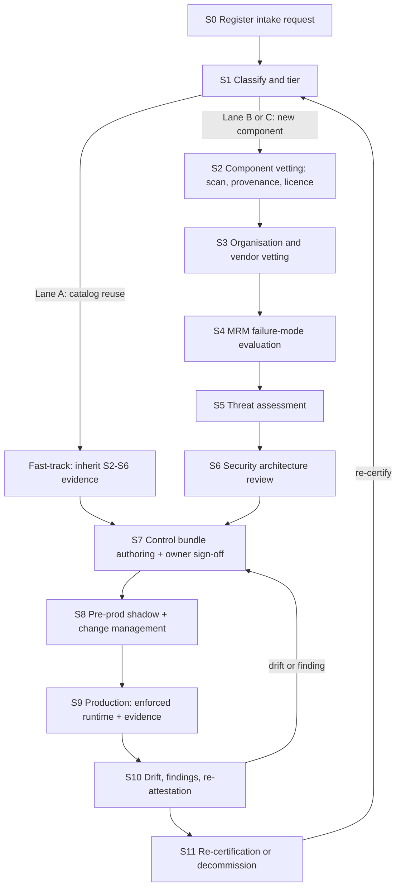
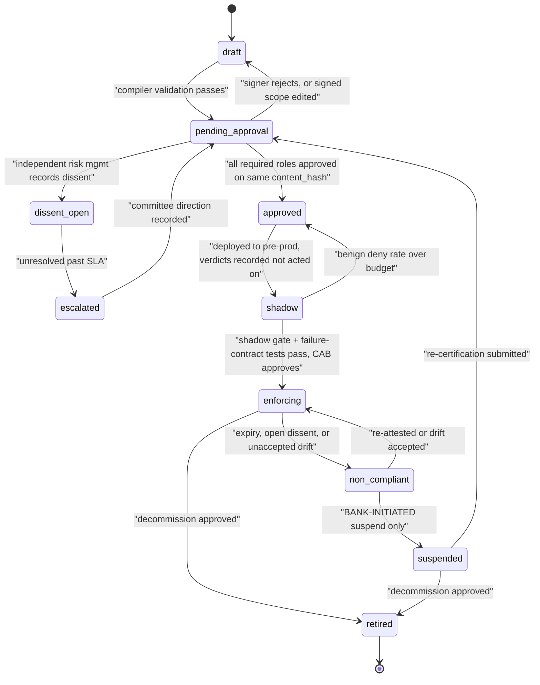
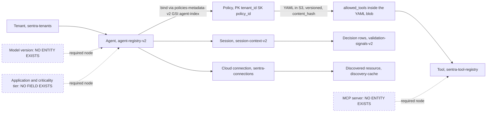

# Internal — The AI-Governance Pipeline Santosh Described, End to End

**Prepared for:** AegionAI founder (internal only — not customer-facing)
**Source:** discovery call notes, Santosh Nair (SVP Cyber Risk / AI Risk Governance, Bank of America), Aug-2026
**Date:** 2026-08-08 · **Freshness:** regulatory claims verified 2026-08-07; code claims verified against commit `db1c47d`
**Companion docs:** [santosh-bofa-1pager.md](santosh-bofa-1pager.md) (call prep — **now partly stale, see §11**) · [fintech-ai-security-landscape.md](fintech-ai-security-landscape.md) · [../share/STRATEGY.md](../share/STRATEGY.md)

---

## 1. Executive summary

He was not reacting to a pitch. He was **describing the pipeline his organisation does not have**, in the order a bank builds one. Twenty-one rough notes normalise into **29 requirements across 12 stages**: intake → component vetting → vendor vetting → model-risk evaluation → threat assessment → architecture review → control-owner sign-off → pre-prod shadow → production enforcement → drift/findings → re-certification → decommission.

**Where we sit, honestly:** of those 12 stages we own **one and a half** — runtime enforcement (S9) and much of the evidence/visibility layer. The intake half he is most excited about (scan every model and MCP server so decisions get easy) is **absent from our code**: no model registry, no MCP entity, no artifact scanning, no approval workflow. `grep -i mcp` across `src/**/*.py` returns **zero hits**. `[FACT]`

**The one strategic idea worth extracting.** The notes contain a mechanism we can own that nobody else is selling: **the approval compiles into the enforced policy.** A static intake scan is a point-in-time assertion; his sign-off (note 6) becomes a Cedar clause, and every runtime decision cites the signed version's content hash. That converts a filing cabinet into a control, and it is the only framing in which our runtime strength becomes the *spine* of his pipeline rather than one box in it. `[REC]`

**Three corrections that change our existing materials.** `[FACT]`
1. **SR 11-7 is dead.** Superseded 2026-04-17 by **SR 26-2 / OCC Bulletin 2026-13** [1][2][3]. Our 1-pager cites SR 11-7 by name — that now reads as stale to an MRM director.
2. **Generative and agentic AI are explicitly out of scope** of the replacement guidance (footnote 3), with an RFI promised and not yet published [1][4]. The governance gap we sell into is now *officially on the record* — a much stronger claim than we were making.
3. **EU AI Act high-risk dates moved.** Regulation (EU) 2026/1744 ("Digital Omnibus on AI", OJ 2026-07-24) pushed Annex III high-risk from 2026-08-02 to **2027-12-02**, Annex I to 2028-08-02 [5][6]. Any urgency argument built on "the Act bites this month" is wrong.

**The blunt strategic finding.** Three independent critics converged on the same verdict: the pipeline as first designed **assumed authority we would never be granted** (vendor-side approval expiry halting bank payment traffic), and **aimed at a lane we structurally cannot sell** (a seed-stage vendor inline on money-movement authorisation at a top-4 bank). Retargeting to internal, non-critical, read-and-internal-write agents is not a concession — it is the only lane where the speed argument is real and the third-party bar is clearable. See §10. `[REC]`

---

## 2. What he actually said → 29 requirements

Notes normalised. Control-function vocabulary follows 12 CFR 30 Appendix D (OCC Heightened Standards) [7] and the Comptroller's Handbook *Corporate and Risk Governance* [8]: **front-line unit** (app owner — note that a platform team providing technology services is *legally first line too*), **independent risk management** (InfoSec, Vendor Manager, Compliance, MRM), **internal audit** (audits the framework, does not sign individual intakes).

| ID | Requirement | Note | Owner | Stage |
|---|---|---|---|---|
| BR-1 | No model enters use without a recorded intake request; self-selection blocked by default | 1, 2 | InfoSec + App Owner | S0, S9 |
| BR-2 | Every model, MCP server, tool, agent is a registered entity with resolvable owner + lifecycle state | 1, 5, 10 | App Owner (R), InfoSec (A) | S0, S9 |
| BR-3 | Security guardrails and accuracy/hallucination controls are **separate families, separate owners, separate evidence**; neither reported as the other | 3 | InfoSec / MRM+business | S1, S4 |
| BR-4 | Named signers per governed component: InfoSec + App Owner per version; Vendor Manager at the relationship level; MRM where a model influences the action; Compliance where a consumer outcome exists | 4, 6 | Independent risk mgmt | S7 |
| BR-5 | Independent risk management can record a formal **dissent** and escalate — not merely withhold consent | 4 (+12 CFR 30 App D II.C.2(e)) | Independent risk mgmt | S7 |
| BR-6 | Control at **every step** of the action sequence, not only the entry prompt | 5 | InfoSec | S8, S9 |
| BR-7 | Per-action visibility: which tool, which parameters, which decision, **which layer decided** | 5, 17 | InfoSec (R), Audit (consumer) | S9 |
| BR-8 | A versioned policy artifact that owners sign — and **that artifact is the thing enforced** | 6 | InfoSec authors; owners sign | S7, S8 |
| BR-9 | Supplying organisation vetted separately from the artifact, against the interagency due-diligence factors | 7 | Vendor Manager | S3 |
| BR-10 | Compliance receives a defined evidence set per component: model behaviour, guardrails, **access management**, the MCP decision | 8 | Compliance | S1–S4, S7 |
| BR-11 | "Do we need MCP at all, and which servers?" is an explicit recorded architecture decision with a documented alternative | 8 | App Owner proposes; InfoSec + ARB approve | S6 |
| BR-12 | Every MCP server and model scanned before use, machine-readable result attached to the intake record | 9 | InfoSec | S2 |
| BR-13 | Intake must **reduce** time-to-production for low-risk reuse; scan + evidence work reusable across applications | 9 | InfoSec + App Owner | S0, S1, all |
| BR-14 | Production/customer-facing models deploy from a **vetted, pinned** artifact; the running artifact verifiable against what was vetted | 10, 14 | InfoSec (R), App Owner (A) | S2, S8, S9 |
| BR-15 | A system of record for audit, with integrity properties over the decision record | 11 | InfoSec (R), Audit (consumer) | S9 |
| BR-16 | AI technical evaluation produces the EU AI Act deployer artifacts: Art 12 log content, Art 26(6) retention, Art 14(4)(d)(e) override/stop, Art 27 FRIA where Annex III 5(b) | 12 | Compliance (R), InfoSec (support) | S4, S9 |
| BR-17 | AI-generated/modified code passes the same or stronger code-security gates as human code; **the assistant is itself a governed agent** | 13 | InfoSec (AppSec) | S2, S6 |
| BR-18 | Self-hosted open-weight models permitted, with artifact tracked by digest, licence terms recorded, every customisation documented and re-evaluated | 14 | Vendor Mgr / MRM / InfoSec | S2–S4 |
| BR-19 | Every issue has a remediation path, a bounded blast radius, and layered defence such that one control's failure is not the whole control | 15 | InfoSec | S6, S9, S10 |
| BR-20 | On demand: **how many applications and agents** are affected by a bad model/MCP/tool, with internal vs external prioritised differently | 16 | InfoSec (R), App Owner (data) | S9, S10 |
| BR-21 | An un-remediated issue is tracked end-to-end to a **two-step close** — implementation verified, then effectiveness validated | 17 | Independent risk mgmt (R) | S10 |
| BR-22 | Threat assessment before production, refreshed on material change | 18 | InfoSec | S5 |
| BR-23 | Any newly added software (new MCP server, model version, agent tool) passes change management with impact analysis, back-out plan, documented approver | 19 | App Owner (R), InfoSec + CAB (A) | S8 |
| BR-24 | MRM evaluates **failure modes** — behaviour outside the validated envelope — and where back-testing is impossible, sets explicit limits on use | 20 | MRM | S4 |
| BR-25 | Every failure scenario maps to a control, and **every control has a defined action for when it cannot be fulfilled** | 21 | InfoSec authors; owners sign | S6–S8 |
| BR-26 | Where a security control is externalized, the bank can validate it without source access, must not depend on the third party being reachable to operate safely, and retains independent challenge | 2 | Vendor Mgr (R), InfoSec (A) | S3, S6 |
| BR-27 | Criticality tier and internal-vs-external exposure recorded at intake, driving approval depth, control strength, remediation SLA | 16 (+5, 19) | InfoSec + App Owner | S1 |
| BR-28 | **Approvals expire.** Re-attestation on a tier-keyed period, and out-of-cycle when artifact digest, tool set or policy changes | 1, 9, 19 | InfoSec | S10, S11 |
| BR-29 | Decommissioning is a governed stage — credentials revoked, policy retired, audit retained | implied 2, 11, 17 | App Owner (R), InfoSec (A) | S11 |

**Coverage:** every note maps to ≥1 BR — 1→BR-1/2/28 · 2→BR-1/26 · 3→BR-3 · 4→BR-4/5 · 5→BR-2/6/7 · 6→BR-8 · 7→BR-9 · 8→BR-10/11 · 9→BR-12/13/28 · 10→BR-2/14 · 11→BR-15 · 12→BR-16 · 13→BR-17 · 14→BR-14/18 · 15→BR-19/28 · 16→BR-20/27 · 17→BR-7/21 · 18→BR-22 · 19→BR-23 · 20→BR-24 · 21→BR-25.

### 2.1 Note 3 is a boundary, not a capability — and it is a credibility gate

"Guardrail vs hallucination" is him telling us where the org line sits. NIST AI RMF 1.0 already splits it: §3.3 *Secure and Resilient* (adversarial robustness, CIA) is the InfoSec lane and is what an action-governance layer does; §3.1 *Valid and Reliable* (accuracy, validation) is MRM plus the business [9]. For consumer credit it is a legal obligation, not a preference — CFPB Circular 2022-03 holds a creditor may not use a black-box model when it cannot state specific and accurate adverse-action reasons. `[FACT]`

**What we can bound, and what we cannot.** A hallucinated call to a *non-existent* tool is denied by the allow-list. A malformed parameter is denied by deny-on-missing. But a hallucinated call to an **allowed** tool with an **in-bounds but wrong** parameter is invisible to a security layer — as is a plausible wrong number in a generated report. The honest partial answer is: **bound the action even when you cannot bound the output** — parameter limits, reversibility requirements, human-approval thresholds, blast-radius caps. Never imply hallucination coverage. `[REC]`

### 2.2 Note 2 — "what if security is externalized" has two readings, and we answered the wrong one first

**Reading A (the architecture question):** what if the control is pulled out of each application into a shared enforcement layer? This is a pattern banks already accept — WAF, API gateway, XACML PEP/PDP [10], service mesh, DLP, CASB. Our PEP/PDP split *is* the answer, and he raised it unprompted in his own vocabulary. Strongest signal in the notes. `[INFERENCE]`

**Reading B (the one that matters operationally, and we missed it):** *the guardrail sits outside the model — so what stops an agent from simply not going through it?* Our honest answer: the SDK decorator is **cooperative and bypassable** (don't import it); connectors cover Bedrock action groups and Azure Functions only; the non-bypassable sidecar is roadmap. His agent population also lives on EKS, in Databricks, inside SaaS (Copilot, Salesforce, ServiceNow), on vendor platforms, and on laptops — none of which we discover. **We have no coverage metric.** The single number that belongs on his AI-risk dashboard — *share of agent actions that traversed a checkpoint* — does not exist in our product. Build it; see §12. `[FACT]`

---

## 3. The pipeline — 12 stages

Ownership tags used throughout: **BUILT** (ships today, code-verified, file:line) · **ROADMAP** (designed in our LLDs, not shipped — not sellable) · **BANK** (his existing system, class named) · **NEW** (genuine new build, either side).



| Stage | Purpose (note) | Hard exit gate | Signs off | Ownership |
|---|---|---|---|---|
| **S0** Register | Turn "a team wants X" into a record with an owner (1, 2, 10) | No unregistered artifact reaches production — enforced at S9, not requested in a policy PDF | App Owner registers; InfoSec accountable | Agent + tool inventory **BUILT**; AWS/Azure discovery **BUILT**; model + MCP registry **NEW**; CMDB link **BANK** |
| **S1** Classify + tier | Assign criticality tier, exposure, action classes, control families, Annex III determination (3, 16) | Tier **derived** from CMDB criticality × action class × data classes; human role is an exception-based *override with rationale* | InfoSec + App Owner | Tier/exposure/action-class fields **NEW** (no `criticality` field exists in our schema); Annex III determination **BANK** |
| **S2** Component vetting | Scan + provenance + licence per model / MCP server / tool / dataset (9, 12, 13, 14) | Machine-readable result attached, with `stated_limitations` recorded — so "picklescan passed" cannot be read as "the model is clean" | InfoSec | Artifact scanning **BANK** (HF ClamAV/picklescan, Protect AI Guardian); provenance **BANK** (sigstore model-transparency); AI-BOM **BANK** (CycloneDX 1.6+/SPDX 3.0.1); MCP descriptor scanning **BANK** (Snyk Agent Scan); descriptor **pinning as enforced attribute** **ROADMAP (ours)** |
| **S3** Org/vendor vetting | Vet the supplier separately from the artifact (7) | All applicable due-diligence factors evidenced per interagency guidance §C.2 [11][12] | Vendor Manager | **BANK** (TPRM platform). We are a *subject* here, not a provider |
| **S4** MRM evaluation | Failure modes, and limits on use where back-testing is impossible (20) | Every `use_limit` has a `mapped_control_id` resolving to an enforceable clause type — **and the gate fails if it cannot** | MRM | **BANK** owns the judgment. We supply detector eval metrics (**BUILT**) + named-corpus benchmark (**ROADMAP**) + enforced limits as ongoing-monitoring evidence |
| **S5** Threat assessment | Pre-production threat model, refreshed on change (18) | Every threat has a mapped control or an accepted risk; SSDF PW.1.1 requires the waiver justification [13] | InfoSec | **BANK** process. Candidate-threat generation from our source taxonomy **NEW** |
| **S6** Architecture review | PEP/PDP placement, MCP necessity, externalized-control decision, failure contract (2, 8, 11, 15, 21) | Every action class has a non-null `verdict_when_control_unavailable`; MCP decision recorded with an alternative; data-boundary consequence explicit; independent risk mgmt granted read access to the policy set | InfoSec (A), ARB (R) | **BANK** owns the review. PEP/PDP split + deny-overrides + fail-secure semantics **BUILT**; local edge evaluation **ROADMAP**; in-VPC/air-gapped **ROADMAP, no code path** |
| **S7** Bundle + sign-off | **The hinge** — the artifact owners sign is the artifact enforced (4, 6) | Approval from every required role on the *same* `content_hash`; no open dissent; `expires_at` set; compile passes the Cedar semantic check | InfoSec + App Owner per version; MRM/Compliance conditional; Vendor Manager as an *in-date precondition*, not a per-version signer | Policy authoring/validation/versioning/Cedar compile **BUILT**; multi-party approval **ROADMAP**; policy signing **ROADMAP**; the bundle itself **NEW** |
| **S8** Shadow + change mgmt | Prove the bundle does what signers thought, then enter production properly (19, 21) | Benign deny rate within budget; **every failure-contract row has a passing negative test**; change record approved per FFIEC III.D.1 change type [14] | App Owner (R), InfoSec (A), CAB | Shadow-then-enforce as a mechanism **BUILT**; per-bundle shadow orchestration + failure-contract test suite **NEW**; change record **BANK** (ITSM) |
| **S9** Production | Enforced runtime + per-action evidence (5, 6, 7, 11, 16, 21) | **Continuous invariant:** no action executes without a decision citing an `approved` bundle version + hash | None per action | Our strong suit — §5 |
| **S10** Steady state | Drift, findings to closure, re-attestation (15, 16, 17) | No finding past `commitment_date` without an approved exception; closure only via verify-then-validate | Independent risk mgmt owns closure | Behavioural data **BUILT**, drift alarms **ROADMAP**; blast radius **ROADMAP (ours) + BANK (app graph)**; findings mgmt **BANK** (GRC) |
| **S11** Re-cert / decommission | Approvals expire; retirement is a governed act (28, 29) | Re-cert: fresh approval set against **current** digests. Decommission: credentials revoked, bundle retired, zero dependents, retention explicitly set | App Owner (R), InfoSec (A), Records | Credential revocation **BUILT in part**; decommission record + dependency clearance **NEW** |

### 3.1 Two gates, not one — worth being explicit about

OCC Bulletin 2017-43 governs *may we do this new activity at all* [15] and applies once per agent class (S0–S7). FFIEC III.D.1 governs *may this specific change enter production* [14] and applies once per version (S8). Conflating them is how a bank either blocks every version bump at a committee or lets a new activity in through a routine change ticket. `[FACT]`

### 3.2 Note 9's real ask — does this ship things faster?

His stated motive is **not** more security; it is removing an intake bottleneck. The honest mechanism is **control inheritance**, not tooling: NIST SP 800-37r2's *common control* concept — assessed once, inherited by every subsequent system, with the provider owing inheriting owners the plan, assessment reports and POA&M [16]. Applied here: the enforcement point is assessed once; each subsequent agent onboarding inherits it.

**Do not print a speedup multiplier.** `[REC]` We have no measured baseline at his institution, and the binding constraint is queue time, which nothing in this design shortens — MRM intake queues are measured in weeks before the days of work begin. Worse, parallel submission of S2/S3/S5 to partly-shared reviewers *lengthens* each by contention. What we can honestly offer: a count of **gates entered and artifacts produced** before vs after, plus per-stage work estimates with queue time shown as an explicit unaddressed variable — and say outright that measuring his real baseline is the first thing a pilot should produce.

**The catalog caveat we must not hide:** Lane A fast-track is collateralised by a catalog whose *first* entry requires the full Lane C path. The speedup is secured by an event that has not happened. Frame the catalog as a funded bootstrapping programme, not an available fast path. `[REC]`

**The incentive trap.** If a human must *confirm* the tier on every request and under-laning is a personal finding, every reviewer over-lanes; within a quarter everything is Lane C with more paperwork than the process it replaced. Fix: derive the tier, make the human act an **override with rationale**, and audit the override population — not the confirmation population. `[REC]`

---

## 4. The spine: the approval compiles into the enforced policy

This is the idea worth owning. The claim is narrow and testable: **what the control owners sign is the source from which the enforced rules are compiled, and every runtime decision cites the signed version's content hash.**

Why it is unavoidable rather than rhetorical — three sourced facts: `[FACT]`
1. **The approved thing changes after approval.** Invariant Labs documented the MCP "rug pull": benign tool description at approval, malicious one on a later launch, no re-approval fires [17].
2. **Approval-time review is the wrong place to look.** Trail of Bits' *line jumping*: tool descriptions land in context at connection time, before any invocation — so a malicious server shapes behaviour "without ever being invoked", and invocation-time approval becomes "human-as-the-rubber-stamp" [18].
3. **For a model, absence of harmful behaviour cannot be established at intake at all.** *Sleeper Agents* shows trigger-conditioned backdoors survive SFT, RL **and** adversarial training — and that adversarial training can teach *concealment* rather than removal [19]. Qi et al.: ten examples at under $0.20 strip GPT-3.5 Turbo's guardrails, and even benign fine-tuning degrades alignment [20].

So: **intake decides what is allowed; runtime enforcement is what makes the approval true and keeps proving it.** Every gate produces two outputs — a human-signed record and a machine-enforceable clause.

### 4.1 The artifact

One `aegion-control-bundle/v1` per governed agent, signed as a whole by content hash, with `derived_from` refs so every clause traces upstream. Key fields: `agent_id`, `application_id` (the CMDB join key), `criticality_tier`, `exposure`, `action_classes[]`, `annex_iii`, `content_hash`, `expires_at`, `bound_components[]` (model digest + MCP `pinned_descriptor_hash` with `deny_on_drift`), `clauses[]`, `failure_contract[]`, `required_signers[]`.

### 4.2 The compile table — and what each clause really compiles to

An unknown or unimplementable clause type must be a **compile error**, not a warning. A silently-dropped clause is a signed control that does not exist — the exact failure mode this whole design exists to prevent.

| Clause type | Compiles to | Status |
|---|---|---|
| `tool_allowlist` | `principal.allowed_tools` + `@id("permit_use_tool")` in `baseline-v1.cedar` | **BUILT** |
| `parameter_bound` | `principal.max_refund_amount` + `forbid_refund_over_cap` + `forbid_refund_missing_amount` | **BUILT but singular** — exactly **one** bound exists (the refund cap) |
| `sequence_requirement` | `cross_cloud_dependencies` read by `context_validator.py:26-45` — *not* Cedar | **BUILT, presence-only** — checks presence in the last 10 history entries, **not order** |
| `agent_invocation_allowlist` | `principal.allowed_agents` + `@id("permit_invoke_agent")`, AND-ed with the UseTool permit | **BUILT** |
| `trust_threshold` | trust-checker thresholds | **ROADMAP** — thresholds are hardcoded class constants in `TrustChecker.__init__` (suspend 10.0, quarantine 40.0, warning 70.0). **Not per-agent configurable.** A `trust_threshold` clause today would compile to nothing — the compiler must reject it |
| `bound_components` digest / descriptor | Cedar attribute + `forbid` on mismatch | **ROADMAP** — the highest-value new clause |
| `failure_contract` | per-action-class fail-mode config | fail-secure behaviour **BUILT**; per-action-class *configurability* **ROADMAP**. `degrade_to_local_floor` is **not a legal value today** — see §5.3 |

**Why this compiles cleanly:** the Cedar baseline set is *universal and identical for every agent*; all per-agent variance lives in a synthesized entity store as principal attributes. Compiling a bundle is mostly generating an entity, not generating policy text — which keeps the policy set small enough for a human to review (BR-8) and independently challengeable.

Three Cedar invariants the compiler must preserve, because getting them wrong **fails open**: forbid wins over permit, so every dangerous tool is a `forbid`; a `forbid` reading a *missing* attribute errors and is **dropped** (fails open), so every optional access is `has`-guarded with explicit deny-on-missing on dangerous tools; money is `Long` cents (Cedar has no float). `[FACT]`

### 4.3 The join keys — what makes it a query rather than an investigation

```
Decision.bundle_content_hash → ControlBundle{content_hash} → Approval{bundle_content_hash, decision=approve}
  → approver_id, approver_role, line_of_defence, signed_at
```

Read backwards, that is the sentence a bank needs: *this action was denied at 14:22 by clause C-2, a parameter bound derived from MRM use-limit 2, in bundle v7, whose content hash was signed by these named people on these dates.* One join.

And because an approval is void unless its `bundle_content_hash` equals the bundle's current hash, **a bundle edited after signature produces zero matching approvals — the query itself detects the tamper.**

**Current state of the last link:** `Decision` records carry `request_id`, `session_id`, `agent_id`, `tool_name`, `decision`, `reason`, `winning_source`, `matched_rule` and much more (**BUILT**, `audit_logger.py:567-685`). They do **not** carry `bundle_version`, `bundle_content_hash` or `deciding_clause_id`. Adding those three fields is the **smallest change that creates the entire spine** — and should ship before the approval workflow, so the workflow has somewhere to point. `[REC]`

### 4.4 Bundle lifecycle — with the correction that matters most



**The correction (a blocking critic finding).** The first design had `expired → suspended → deny`, plus a `dissent_open` park with no SLA, plus `drift_hold → suspended`. That is **a vendor-controlled kill switch on the bank's production revenue**, and it makes filing a dissent take down a business line — inverting BR-5's entire purpose and creating exactly the chilling effect a supervisor writes up. `[FACT]`

**Fix, now reflected above:** split **governance state** (`non_compliant` — alerting, reported, escalating) from **enforcement state** (which bundle the PDP evaluates). Expiry, open dissent and unaccepted drift move the governance state and page a human **while enforcement continues under the last approved bundle**. Only an explicit **bank-initiated** suspend denies. Then give the bank a contractual statement that **no vendor-side state transition can halt bank traffic.** `[REC]`

Two properties still load-bearing: editing the **signed scope** returns the bundle to draft (so "signed then quietly edited" is structurally impossible) — but the rule must apply to the signed scope, not to every byte, or we re-sign on whitespace. And standing approval is required for routine change: pre-authorised bounds signed once (any tool in `side_effect_class` read/internal_write, any parameter bound at or below the signed ceiling, any callee already allow-listed) so weekly tool-list changes don't need five signatures and a 5-day shadow. Otherwise this is a change freeze wearing a governance costume.

---

## 5. Note 21 — failure mode → control → fallback. Our strongest section.

*"Need failure scenario to control part and what actions should be taken if control cannot fulfill."* This is the sharpest thing he said, nobody in the market writes it down, and **fail-secure is structural in our code** — so this is the cheapest high-credibility content we have.

### 5.1 The fallback taxonomy — five values, each with a price

| Fallback | Meaning | Latency cost | Availability cost | When it is right |
|---|---|---|---|---|
| **FAIL-CLOSED** | Cannot evaluate → DENY | 0 | **Full — the business action stops.** A PDP outage becomes a flow outage | Irreversible, high-value, external-facing |
| **DEGRADE-TO-FLOOR** | Evaluate the deterministic subset locally; deny what the floor can't clear | low tens of ms | None for floor-clearable actions | The right default for most actions — **ROADMAP, §5.3** |
| **ROUTE-TO-HUMAN (HOLD)** | Hold pending named approver | seconds–hours | None (deferred, not lost) | Consequential-but-reversible, where a wrong deny is expensive |
| **QUARANTINE** | Deny this and all subsequent actions in the session | 0 | Session-scoped | Confirmed injection, trust collapse, sequence break |
| **FAIL-OPEN (ADVISORY)** | Allow, record the gap | 0 | None | **Only** read-only, low-consequence, with a named risk acceptance. Never a default |

### 5.2 The matrix (14 real failure modes, named provenance)

| # | Failure mode | Preventing control | Status | Blind spot | Fallback when the control cannot be fulfilled |
|---|---|---|---|---|---|
| 1 | **Indirect prompt injection** (payload arrives as *data*) | `sigma_engine` regex over `content_text`; `indirect_injection.py` three-pass | Sigma live; D2 live FP-gated | **Measured recall 0.5649 unmasked / 0.6007 masked (n=809)** — ~2 in 5 get through. This is why it cannot be the only layer | Content phase fails secure by construction: `_all_allow` (`validation_service.py:709`) requires the deep node to have *actually voted* ALLOW; ABSTAIN → DENY |
| 2 | **Tool poisoning / MCP rug-pull** | Descriptor pinning + deny on drift | **ROADMAP — our single biggest gap.** No MCP entity exists | *Line jumping*: payload lands at `tools/list` on connect [18]. *Shadowing*: the malicious server is never invoked and never contacts the target, so sandboxing doesn't help [17] | Once built: unknown/changed hash → FAIL-CLOSED, quarantine if on a money-moving tool. **Until built the honest answer is "we do not detect this"**, and the compensating control is the parameter bound (row 4), which holds regardless of what the description claims |
| 3 | **Excessive agency / out-of-scope action** | Cedar `permit_use_tool`, forbid-wins, default-deny | **BUILT** | Only as good as the allow-list | Policy missing → DENY `POLICY_NOT_FOUND` (`cedar/engine.py:104`); disabled → DENY `POLICY_DISABLED` (:98); eval error → DENY `POLICY_ERROR` (:136,146,150). All fail closed |
| 4 | **Parameter abuse** (amount, recipient, scope) | `forbid_refund_over_cap` (Long cents) + deny-on-missing | **BUILT but narrow** | (a) **one** bound — recipient and scope unbounded; (b) `amount` and `fraud_risk` come from the **calling agent's own `tool_params`**, marked agent-supplied/untrusted (`cedar/context.py:12-13,40`) — a compromised agent can lie; (c) **no cumulative cap** — ten $999 refunds pass ten $1,000 checks | Missing attribute → deny-on-missing → FAIL-CLOSED |
| 5 | **Sequence violation** (skipping approval/verification) | `context_validator.py` required-prior-tools; cross-cloud deps with `max_age_seconds` | **BUILT** | Checks **presence, not order** — A-then-B and B-then-A both pass. And if no `policy_engine` is injected, cross-cloud checks are **silently skipped** — a fail-open by omission worth fixing | Session store unreachable → no history → FAIL-CLOSED for sequence-gated tools. *Absence of evidence must not read as evidence of compliance* |
| 6 | **Identity confusion / confused deputy** | ES256 agent JWT, alg pinned (no `none`), tenant-tamper detection (`deps.py:127-200`) | **BUILT, enforcing for tenants in `enforce` mode — currently one** | `require_dataplane_credential` defaults **False** (`config.py:153`) and is never set in CDK, so a tokenless `/v1/validate` is refused only per-tenant, not fleet-wide | Unverifiable identity → FAIL-CLOSED. **Flipping this flag on is the cheapest hardening in this document** |
| 7 | **Data exfiltration via tool output** | D5 output DLP, D6 FQDN destination allow-list | **ROADMAP** — `sources.py:44,46` register both with the comment `NOT built` | Exfiltration *detection* is our strong number (0.9676 unmasked / 0.9730 masked, n=741) but that is detection of exfil-shaped requests, **not egress control** | Until D6: the substitute is the tool allow-list — an agent cannot call a tool it does not have, so unbounded generic-HTTP tools must not be allow-listed. When D6 lands: unresolvable destination → FAIL-CLOSED |
| 8 | **Model drift / degraded accuracy** | `detection_eval.py` score + `fp_budget_gate`; `sigma_eval_gate.py` locked thresholds | **BUILT for *our* detectors** | Governs our detector quality, **not the customer's model**. Their model drift is bounded only by §2.1 | — |
| 9 | **Hallucinated tool call** | Allow-list denies non-existent tool; deny-on-missing denies malformed param | **BUILT** | A hallucinated call to an **allowed** tool with an **in-bounds but wrong** parameter is not detectable by a security layer. See §2.1 | — |
| 10 | **Credential misuse** | Per-agent credentials, alg pinning, tenant-tamper detection | **BUILT** | We verify the agent's identity **to us**. We don't hold or rotate its downstream cloud credentials — a stolen downstream key used off-path is invisible | Credential store unreachable → FAIL-CLOSED. Revocation lever: delete the `key_id` |
| 11 | **Cross-agent privilege chaining** | `cross_agent_validator.py` `MAX_CALL_DEPTH=5` + caller-in-`allowed_callers`; Cedar `permit_invoke_agent` (two AND-ed authorizations) | **BUILT** | Only applies when `caller_agent_id` **and** `parent_request_id` are present — an agent that omits them **skips the check entirely** (`:57`). Fail-open by omission; should become deny-on-missing for `invoke_agent` | — |
| 12 | **Memory poisoning** | `memory_write.py`: provenance mandatory, `UNTRUSTED_TRUST_CAP=0.3`, memory tightens-never-loosens, KMS MAC over canonicalised birth facts | **BUILT, enforce FP-gated** | Read path is **off** (`AGENT_MEMORY_READ_ENABLED=false`) — no read-path check exists | Memory phase fails secure by construction (same `_all_allow`) → DENY on abstain |
| 13 | **Model supply-chain compromise** | Scanning + signature verification consumed **as a policy input** (sigstore DSSE digest as a Cedar attribute) | **ROADMAP** — no model entity | picklescan was defeated three ways by *nullifAI* (7z instead of ZIP, deliberately broken pickle stream, payload executes before the break) — two live reverse-shell models found on the Hub in **February 2025**, removed within 24h [21]; HF's own docs say scanning "is not 100% foolproof" [22]. Plus *Sleeper Agents* [19] and Qi et al. [20] | **No pre-deployment test can establish absence** — so the only remaining control is bounding what the model's actions may do. Digest not in approved set → FAIL-CLOSED on writes, advisory on reads. **This row is the strongest single argument for action-level governance, and it comes from Anthropic- and Princeton-authored papers, not from us** |
| 14 | **Unsafe AI-generated code committed** | SSDF PW.1.1 / PW.7 / PW.8 / PW.4.1 [13] | **Out of scope for a runtime PEP** | Pearce et al. (IEEE S&P 2022): 1,689 Copilot programs, 89 CWE scenarios, **~40% vulnerable** [23]. Perry et al. (CCS 2023): assisted participants wrote significantly *less* secure code and were *more* likely to believe it was secure [24] | Honest scoping: a runtime layer does **not** bound this. It bounds what the resulting agent may *do*. Say so; do not claim the CI lane |

### 5.3 Why the fail-secure claims are credible, not asserted — and the one we must not make

Five independent code paths, so note 21 is answered by architecture rather than promise: `[FACT]`

| Failure | Code path | Result |
|---|---|---|
| PEP cannot reach PDP (timeout/5xx/403) | `guard.py:650-657` — explicit comment guarding against a truthiness refactor | **DENY** |
| Response is not a clean ALLOW/DENY | `guard.py:673-677` — `raw if raw in ("ALLOW","DENY") else "DENY"` | **DENY** |
| Edge redaction fails before egress | `guard.py:623-634` — DENY on **any** `fail_secure` setting; `fail_secure=False` cannot override | **DENY**, raw payload never sent |
| A validator raises unexpectedly | `scheduler/run.py:352` — `return_exceptions=True` harvests peers, then **re-raises** → 5xx → PEP fail-secure | **DENY** |
| Content/memory deep check produced no verdict | `validation_service.py:709` `_all_allow` | **DENY** |

And the distinction that keeps this from being a self-DoS: a **handled** dependency outage is not a crash. `ml_classifier._invoke` returns `None` on any Bedrock/timeout failure → `abstain`, never a raise, so the abstain flows to the deterministic floor rather than 5xx-ing the flow. `distilled_classifier` escalates to Haiku on low confidence/error/timeout/unset URL rather than abstaining — because an abstain would abort the chain and skip the strong tier.

**The claim we must not make.** `degrade_to_local_floor` is **unimplementable today**: the SDK's `local_floor.py` is a name-only stub whose own docstring says *"no interpreter, no bundle evaluator, no caching, no crypto… nothing ever mints one — the seam always routes to the hosted PDP."* Putting that value in a signed bundle would be **a false attestation with named signatures on it** — precisely the failure mode §4 exists to prevent. Until local evaluation ships, the only legal values are `deny` and `allow_with_alert`, and the compiler must stamp each row with the enforcing code path (file:line) so a signer sees what they are signing. `[FACT]` `[REC]`

**The availability answer, honestly.** Today every enforcement call is a WAN round-trip; controller unreachable → PEP fail-closes → the governed action stops. Correct security posture, unacceptable availability posture, simultaneously. NIST SP 800-207 §5.2 says it in standards language: a PDP operational error "could prevent an entire enterprise from functioning" [25]. The production answer is the Istio pattern — distribute signed policy, evaluate natively in the local proxy [26] — which needs two things we don't have: **policy signing** (no signing or verification code exists; `content_hash` sits in the *same mutable row* as the pointer, so it is an integrity hash, not a trust anchor) and a **bundle interpreter**.

---

## 6. Note 16 — blast radius: the actual computation

Today the honest answer is **we cannot compute this**, and the reason is structural, not effort: the graph runs the wrong direction and two node types don't exist.



**What works:** agent → policy → `allowed_tools` (`agent_service.get_agent_tools():512`). **What doesn't:** the reverse. `allowed_tools` lives *inside* a YAML object in S3, so "which agents may call tool X" requires reading and parsing every policy object — no GSI, no query, no endpoint (`grep tools_index|by_tool|agents_using` → 0 hits). For a model or MCP server the question is not even expressible. Note the waste: the Azure scanner **already captures a model name per discovered deployment** (`azure_scanner.py:304,323`) and a tools list (:328) — the data arrives and is discarded rather than keyed. `[FACT]`

Also: the existing `visibility: internal|external` field is **not** a criticality tier — `agent_service.py:183-187` uses it to hide *our own* control-plane infra from the customer console. Never represent it as answering note 16.

### 6.1 Four schema additions that make it computable

| # | Addition | Shape | Enables |
|---|---|---|---|
| B1 | **Reverse tool index** | Materialise `allowed_tools` onto the policy metadata row (which already carries `allowed_tools_count`, `policy_service.py:438`) + GSI `tool-index` | One Query for "which policies grant tool X" |
| B2 | **Artifact registry** | `sentra-artifact-registry`, PK `tenant_id`, SK `artifact_uid` (`mcp:<server>@<ver>` / `model:<id>@<ver>`), attrs `description_hash`, `manifest_digest`, `approval_id`, `status`, `tools[]` | MCP + model cases; also drift detection (§5.2 row 2) |
| B3 | **Artifact binding edge** | `uses_artifacts: [artifact_uid]` on the agent row + GSI `artifact-index` | One-hop reverse query artifact → agents |
| B4 | **Application + criticality** | `application_id`, `criticality_tier`, `exposure`, `business_process`, `owner_sub` on the agent row, echoed into every audit row | Note 16's **counting and ranking** + the SLA matrix. **Highest value per unit of work in this document** |

Tier vocabulary must be **configurable, not hardcoded** — the interagency guidance is explicit that an activity critical for one bank may not be for another, and examiners use the entity's own terminology [11][14]. `[FACT]`

**Critical modelling correction.** Do **not** put `criticality_tier` independently on both Application and Agent — two sources of truth for the field that drives lane assignment, control strength and SLA will diverge, and the failure mode is *silent under-tiering*. Make `Agent.criticality_tier` a **derived, non-authoritative cache** with `derived_from_application_id` + `derived_at` + a staleness alarm, never independently editable, taking the **maximum** where an agent serves several applications. And treat the CMDB link as possibly-unresolvable (`cmdb_resolution_status`) routing to a reconciliation queue — a bank of this size runs more than one CMDB post-acquisition, and no bank CMDB populates `depends_on_agent_ids[]`. Build that edge from our side and offer it back as an attested feed; that is genuinely valuable. `[REC]`

### 6.2 The four queries

**(a) Compromised MCP server** (`mcp:acme-crm@2.1`) → query artifact registry for status/hash/tools → query `artifact-index` for the **affected agent set** → project `application_id`/`criticality_tier`/`exposure`/`business_process` for **affected applications** → query `agent-timestamp-index` between `first_bad_version_at` and now, filtered to `tools[]`, for **decisions actually taken through it**, split ALLOW vs DENY (the ALLOW set is the exposure; the DENY set is evidence the layered defence held) → group by `session_id` and correlate `conversation_id` for **distinct sessions touched**.
**Retention limit to disclose:** 90-day default TTL on signal rows and the CloudWatch group, so a slow-burn compromise older than the window is **not enumerable**.

**(b) Model version withdrawn/vulnerable** — same path, plus two extras: reconcile against `discovery-cache` on the captured model name to catch **unregistered deployments** (the shadow set, which is the one that matters); and if the withdrawal is a **licence/terms** change rather than a vulnerability, route to the Vendor Manager, not InfoSec. Same query, different owner. (Real triggers: Gemma reserves Google's right to restrict use "remotely or otherwise" [27]; Llama 4 has a 700M-MAU trigger and a model-name-prefix obligation [28].)

**(c) Leaked agent credential** — credential → owning agent → actions attempted since suspected leak → sessions → applications → tier. **The part people miss:** filter `tool_name = 'invoke_agent'`, take `tool_params.agent_id` as the next frontier, walk transitively bounded by `MAX_CALL_DEPTH=5`. A credential on a low-value agent that may invoke a payments agent **is a payments incident**. `call_depth` and `caller_agent_id` are already in the audit event, so this walk works today for *observed* traffic; the *potential* graph needs an `allowed_agents` index.

**(d) Bad policy push** — policy → current version/hash/S3 version-id (priors from S3 object versioning) → `agent-index` for every bound agent → exposure window = `updated_at` → now, **widened by the cache TTL** (a policy write clears an in-process TTL cache, `policy_service.py:461`, so tasks may have served old and new for a bounded skew — report `[updated_at - ttl, now]`, not a point) → roll back by writing the prior S3 version forward, preserving the trail.

### 6.3 Ranking, so the answer is actionable

| | External-facing | Internal-only |
|---|---|---|
| **Critical process** (payments, credit decisioning, KYC) | **T1** | **T2** |
| **Non-critical** | **T3** | **T4** |

Severity = `max(tier reached) × exposure count`, with two hard overrides: any **irreversible** action executed in the window escalates one level regardless of tier (a $50 wire is still a wire); any **customer data** in the exposure set escalates to at least T2. Report the count **and** the tier composition — *"41 agents, 12 applications, of which 2 are T1 and one executed 3 irreversible actions"* is decision-grade; "41 agents" is not.

**Note 16's second half is currently a stored field that changes nothing.** Exposure must *select* a gate: an externally-reachable agent floors at Lane C regardless of tier; remediation SLA and re-attestation period become functions of `(criticality_tier, exposure)`; failure-contract defaults harden for external. `[REC]`

### 6.4 Containment levers — and the one we already have without knowing it

| Lever | Scope | Mechanism | Who | Status |
|---|---|---|---|---|
| Session quarantine | one session | `POST /v1/quarantine/{session_id}`; trust checker then denies **all** ops incl. reads | `admin` + `assert_owns` | **BUILT** |
| Automatic quarantine | one session | trust-score driven, no human | — | **BUILT** |
| **Disable the policy = de facto agent kill switch** | **every agent bound to that policy** | `PATCH /v1/policies/{id}/status` → `disabled` → `PolicyDisabledError` → **DENY `POLICY_DISABLED` on every action** (`cedar/engine.py:98`) | `editor` | **BUILT — the most under-recognised lever we have** |
| Unbind the policy | one agent | delete the bind → DENY `POLICY_NOT_FOUND` (:104) | `editor` + both ownership asserts | **BUILT** |
| Revoke credential | one agent | delete `key_id` | `admin` | **BUILT** |
| Tighten the bound (compensating control) | agent or fleet | lower `max_refund_amount`, remove a tool, add a Sigma rule (propagates via the `__sigma_version__` epoch) | `editor` | **BUILT — this is what runs *while* a fix is pending** |
| Quarantine an artifact | every agent using it | artifact `status = quarantined` | — | **ROADMAP** (needs B2/B3) |
| Fleet-wide agent stop | tenant | — | — | **ROADMAP** — no per-agent status attribute, no route to disable an agent. Policy-disable is the coarser substitute |

Every lever is **single-actor** today. A bank will want fleet-wide levers under dual control, with emergency single-actor plus mandatory post-hoc review — the FFIEC emergency-change pattern [14]. `[REC]`

---

## 7. Note 17 — remediation tracked to closure

Implement the **OCC Matters Requiring Attention** shape, not a generic ticket status. The Five Cs from the Comptroller's Handbook *Bank Supervision Process* v1.1 [29]: **Concern** (the deficient practice and how it deviates from sound principles) · **Cause** (root cause — and *"When the root cause is not evident, the OCC may require bank management to determine the root cause as part of the corrective action"*) · **Consequence** · **Corrective action** · **Commitment** (*"the bank's action plan, including specific information regarding milestones, the completion date, and staff who are accountable for implementation"*). `[FACT]`

States: New · Repeat (five-year lookback) · Self-identified (surface prominently — supervisors credit it) · Past due · Pending validation · Escalated · Closed.

**The part most tools get wrong — the two-step close:** *"A concern is closed if the bank implements and the OCC verifies and validates the effectiveness and sustainability of the corrective action."* So **"past due" must be able to mean implemented but not yet effective.** `[FACT]`

**Where an enforcement layer earns its keep:** the compensating control that runs *while the fix is pending* is a real, enforced clause — tighten the bound, remove the tool, add the signature rule — not a paragraph in a risk-acceptance memo. An `Exception` whose `compensating_controls[]` are not enforced `clause_id`s is just an acceptance. Model on NIST SP 800-37r2 TASK A-6 (POA&M) [16].

**Missing link to close:** a finding past its `commitment_date` should **tighten or flag** the bundle it concerns. Today nothing connects an open past-due finding back to runtime posture. `[REC]`

**Ownership:** the findings machine is **BANK** (GRC / issues management). We are a **finding source and an evidence source** — that is the right division and we should not try to be the GRC platform.

---

## 8. Note 20 — what MRM actually needs

*"Model risk management team looks into math to figure out how the model will behave in different situations. Looks like failure mode."*

**Get the regulatory posture right, or lose the room.** `[FACT]` `[REC]` The first draft of this design argued that enforced use-limits "substitute for outcomes analysis" and give MRM "an exit." Two critics independently flagged it as the **single most damaging paragraph** — and they're right on two counts:
1. The supporting language was **SR 11-7 text**, retrieved from a web archive because the letter is withdrawn. An MRM director recognises the provenance immediately.
2. SR 26-2's actual limits-on-use language is scoped narrowly — an exception to *pre-use validation* for urgent business need — not a general substitute for outcomes analysis [1]. And footnote 3 puts generative/agentic AI out of scope entirely.

**The correct framing.** For a generative model, classical outcomes analysis is not available, and the current guidance does not say what to do instead. So MRM is operating on **bank policy under acknowledged regulatory silence** — and a bank's policy for an un-back-testable component in an authoritative path is often *"do not put it there,"* not *"bound it and proceed."* Offering MRM an "exit" reads as offering them a way not to do their job, from a vendor with a commercial interest in the answer.

What we can honestly claim, and it is sufficient: enforced limits are **(a)** evidence for the **ongoing-monitoring** leg of validation, which is a real MRM obligation, and **(b)** what lets MRM set *narrower* limits than they otherwise would, **with assurance the limits actually hold in production** rather than living in a policy document. Let MRM decide what their compensating controls are worth. Our job is to make their chosen limit machine-enforced and evidenced.

**The gate constraint we must disclose.** Our enforceable clause grammar today is: a tool allow-list, **one** parameter bound, **presence-based** sequencing (not ordering), an agent-invocation allow-list with a depth cap, and **fixed** trust thresholds. An MRM limit like *"no more than N calls/hour to tool X"*, *"never after step Y"*, or *"per-agent trust floor of 60"* **has no compile target.** The S4 gate must **fail** rather than accept a descriptive limit. `[FACT]`

**Evidence we can supply.** Named security-eval suites suitable for an intake packet: AgentDojo [30], InjecAgent [31], AgentHarm [32], HarmBench [33], garak [34], PyRIT [35], promptfoo [36], MLCommons AILuminate [37]. Our own detector-eval gates are **BUILT** (`detection_eval.py` precision/recall/F1/FPR as the D1–D3 gate; `sigma_eval_gate.py` hermetic CI with locked thresholds — FP ≤0.5% valid only at n≥200 benign, recall ≥85%, ReDoS smoke). The named-corpus harness (LLD 41) is **a v0.4 plan with no code**. `[FACT]`

**Reproducibility is a hard gate for MRM, and we currently fail it.** Our committed WS-0 numbers (exfiltration recall 0.9676; indirect-injection 0.5649; n=741/809; run 2026-07-02) **cannot be re-derived from a clean clone** — `harness/ws0/.gitignore` excludes `corpus/*.jsonl`. Decide before any MRM conversation: ship the corpus, or re-derive from a reproducible build. Also reconcile the InjecAgent n (1,054 per the paper vs 2,108 in our LLD 41 plan — likely a base-plus-enhanced doubling). `[FACT]` `[REC]`

---

## 9. What we actually have — honest capability map

Verified against code at commit `db1c47d`. Two suites run: `src/security-controller` **1,211 passed / 12 skipped**; SDK **435 passed / 2 skipped**. Repo-root CDK/integration and console vitest **not run**. All "live/enforcing" claims are **config-verified, not runtime-verified** — deploy is an ECS force-new-deployment of a built image, so committed CDK config is evidence of *intent*, not proof of the running task definition. `[FACT]`

| Capability | Status | Evidence |
|---|---|---|
| **Runtime action enforcement** — 9 request-phase nodes, deny-overrides, deciding source named | **BUILT, enforcing** | `scheduler/registry.py:402-464`; `combiners/deny_overrides.py`; priorities `sources.py:70-107` (trust 90 → policy 80 → sigma 70 → trajectory 68 → distilled 66 → ML 65 → context 60 → abuse/cross-agent 50) |
| Cedar policy clause coverage | **BUILT but thin** | `baseline-v1.cedar` has exactly **5 rules** and **one** parameter bound |
| Sequence enforcement | **BUILT, presence-only** | `context_validator.py:26-45` — last 10 history entries, not order. Cedar does not enforce sequence |
| Trusted parameter derivation | **GAP** | `amount`, `fraud_risk` are agent-supplied and marked untrusted (`cedar/context.py:12-13,40`) |
| **Per-action visibility / decision trail** (ran / abstain / error / not-run) | **BUILT — genuinely strong** | `trail_builder.py`; `GET /v1/sessions/{id}/trail`; `winning_source` + `block_point` **recomputed on read, never stored** |
| Operator console | **BUILT** | 20 real feature pages (`web/console/src/app/router.tsx:48-101`); 2 placeholders; usage page flagged off |
| Structured PII/PCI masking **inside the customer boundary** | **BUILT — on SDK/connector wires only** | Unconditional in `guard.py:555-595`; matchers `redaction.py:289-700` (PAN+Luhn, SSN with issuance validity, email, URL, IPv4/v6, phone, dates, secrets); redactor error → DENY |
| Free-text PHI redaction | **ROADMAP** | `redaction/phi_ner.py:16-30` — no live NER model; Fargate construct never instantiated |
| Append-only audit | **BUILT** | One CloudWatch event/decision (`audit_logger.py:567-685`) + per-validator DynamoDB rows |
| **Tamper-evident audit** | **ROADMAP — say append-only, never tamper-evident** | Zero hits for `hash_chain`/`prev_hash`/WORM/Object Lock across `src/` + `cdk/`. Our own **lld/33 SEC-5a** says trail rows are access-scoped, not sealed, and an actor with write access could insert/delete a ran-DENY row and **silently change a past decision's recomputed deciding source.** PRD FR-6.1 marks this "Built" — **that is an overclaim; the LLD is right** |
| Multi-year retention | **GAP** | 90-day default; CDK map hard-caps at ONE_YEAR (`storage_stack.py:75-98`); 90-day TTL on signal rows |
| Evidence export | **ABSENT** | No export route exists anywhere in the API |
| RBAC + per-resource ownership | **BUILT** | `deps.py:496` `require_role`, `:480` `require_platform`, `ownership.py:54` `assert_owns`; server-derived role parity fixture. **The previously-open policy-CRUD IDOR is CLOSED** — 30 mutating routes enumerated, all gated |
| Per-agent cryptographic identity | **BUILT, enforcing for one tenant** | ES256, alg pinned, tenant-tamper detection (`deps.py:127-200`). `require_dataplane_credential` defaults **False** and is never set in CDK |
| Agent + tool inventory with lifecycle | **BUILT** | `sentra-agent-registry`(+v2), `sentra-tool-registry`; `discovery_service.py:40-42` derives not_imported/imported/managed |
| Cloud discovery (AWS + Azure) | **BUILT — enumerates, evaluates nothing** | `POST /v1/connections/{id}/scan` → read-only probe → `discovery-cache` |
| **Model registry / MCP registry** | **ABSENT** | Zero hits for `model_registry`/`allowed_models`; `grep -i mcp` over `src/**/*.py` → **zero** |
| **Pre-deployment artifact scanning** | **ABSENT** | Everything scans runtime *requests*. The tool-manifest validator is unbuilt design (lld/20 §10.1). `sources.py:47` registers `SENTRA_PROVENANCE` as "D7 (NOT built)" |
| **Multi-party approval / sign-off** | **ABSENT** | Zero hits for approval/sign_off/maker/checker/four-eyes. lld/11:44 lists it as Phase 2. `set_policy_status` is one editor, one call, immediate |
| Policy signing | **ABSENT** | No signing/verification code. `content_hash` is in the same mutable row as the pointer. Architecture diagrams draw "signed policy" arrows the code doesn't implement |
| **Blast-radius computation** | **ABSENT** | No reverse index; no model/MCP entity to key on. The console topology page is a Sankey of *observed* decisions — a traffic picture, not a dependency graph, and cannot answer a counterfactual |
| Criticality tiering of the protected app | **ABSENT** | Zero hits for `criticality`/`business_criticality`/`env_tier`. `ValidationRequest` has no environment/tier/application field |
| Session quarantine | **BUILT** | Auto via trust score + manual routes |
| Agent-level kill switch | **ROADMAP** (but see §6.4 — policy-disable is a working coarse substitute) | No route disables an agent |
| Bounded rollback | **BUILT but narrow** | 1,113 lines, claim ledger, dependency-ordered — but **two** adapters (`_rollback_refund`, `_rollback_create_order`); reversible stamping hardcoded to `process_refund` |
| Deployment editions | **Serverless only** | Zero hits for `edition` in `src/`/`cdk/`. CDK deploys 3 ECS services into **our** account. Dedicated + Self-Managed = **no code path** |
| Latency vs target | **TARGET UNMET** | Committed: server **p99 2,850 ms**, e2e WAN **p99 3,454 ms** at concurrency 20 — against a ≤500 ms deterministic-floor target. **`non_escalated_count: 0`** — 100% of requests reached the LLM tier, so *the deterministic frontier was never exercised in the only measurement we have* |

### 9.1 Six doc-vs-code conflicts to fix before anyone external reads our material

Code wins in every case. `[FACT]`
1. **PRD FR-6.1** "Tamper-evident audit — Built" vs lld/33 SEC-5a + zero hash-chain code → accurate word is **append-only**.
2. **lld/ARCHITECTURE.md:72,172,183** draw "signed policy" arrows → **no signing code exists** (PRD:201 is the honest version, P1).
3. **CLAUDE.md** "Serverless content is unredacted-for-the-engine today" → **stale**; SDK Tier-1 edge redaction is unconditional. Real residual: server-side **free-text** redaction is a stub.
4. **CLAUDE.md** lists the rollback coordinator under "Not yet implemented" → 1,113 lines with 2 adapters exist: **built-but-narrow**.
5. **CLAUDE.md** "ML classifier shadow today" → **the shadow flag was deleted**; `compute_stack.py:1544` enables it and `config.py:329-333` says it always enforces. **ML ENFORCES.**
6. **CLAUDE.md** "~0.6–1.2 s" latency → committed measurement is **p99 2.85 s server / 3.45 s e2e** with 100% ML escalation.

---

## 10. What would kill the pilot — and what we say instead

Three critics ran independently (bank-risk lens, overclaim audit, coverage audit). Their converging blocking findings, with the decision each forces.

| # | The kill shot | Decision |
|---|---|---|
| 1 | **Wrong target lane.** A seed-stage vendor synchronously inline on money-movement authorisation at a top-4 bank is a "critical activity" under the 2023 interagency guidance [11][12] — triggering completed SOC 2 Type II (ours is *in progress*), independent pen-test, **financial-condition assessment of a company that may not exist in 24 months**, and a **tested** exit plan. We fail on the merits. | **Retarget to internal-only, non-customer-facing, read-and-internal-write agents at non-critical tier** — which is also where BR-13's speed argument is real. Stop using `process_refund` as the canonical demo; it anchors every reviewer on the one lane we cannot win. Present money movement as an explicit 18–24 month arc with named preconditions. |
| 2 | **Vendor-side state halting bank traffic** (expiry → suspend → deny; dissent parks with no SLA; drift → suspend). | Split governance state from enforcement state (§4.4). Contractual statement: **no vendor-side transition can halt bank traffic.** Enforcement state settable only from the bank side. |
| 3 | **No bank-operated break-glass.** First time a Sigma regex or the LLM denies a legitimate high-value action at 2am, their only lever is to call us. Quarantine is session-scoped; no route disables an agent; shadow mode is a deploy-time flag in **our** CDK. | Ship a **bank-operated per-agent `enforce` / `monitor` / `off`** attribute, settable by a bank admin, effective in <1 min, **cached at the PEP so it works when our control plane is unreachable.** Make "here is your break-glass, it works without us" the opening slide of any pilot. |
| 4 | **An unpinned, non-deterministic LLM blocking on the action path**, at 0.5649 indirect-injection recall, with **no FP rate on anything like their traffic** — while we demand digest-pinning of *their* models and leave our detector model unpinned in the decision record. This also contradicts our own stated principle ("deterministic floors first; ML in shadow until graduation"). | Make ML **advisory-only** (alert, never deny) by default for `money_movement` / `external_write`, promotable only after a documented shadow period on their traffic with an agreed FP budget. **Pin the detector model id + version into every Decision record.** Lead with the 0.5649 figure rather than letting them find it. |
| 5 | **Cannot serve as a system of record.** 90-day default retention, CDK caps at 1 year, **no export path at all**, and the deciding source is **recomputed on read** over mutable rows reachable by vendor ops staff. The missing hash chain isn't the finding — recompute-on-read over mutable vendor-reachable rows is. | **Reorder the roadmap:** (1) versioned **export schema + tested restore** into a neutral store — the single unblocking item; (2) **store** `winning_source`/`block_point`/deciding clause at write time; (3) retention configurable in **years**; (4) *then* hash-chaining. Publish our privileged-access model for the signal store. |
| 6 | **RACI we don't get to assign.** Vendor Manager signs the *relationship* annually in a TPRM platform — not a Cedar parameter bound on bundle v7. Making them a per-version signer deadlocks every change on a weeks-long queue. And "role: infosec" isn't a signer; delegation is per-legal-entity and per-dollar-threshold. | Two-tier it: vendor attestation **in-date** is a *precondition check*, not a signature. Per-version approval = InfoSec + App Owner, with MRM/Compliance conditional. Add `legal_entity` + `authority_limit` + a delegation policy, and make `required_signers` a **bank-configurable matrix**. |
| 7 | **Single point of failure, unmitigated.** We quote SP 800-207 §5.2 on the PDP-as-SPOF and then take no action. No RTO/RPO, no tested failover, no multi-region posture, no staged/canaried policy rollout — and the named mitigation (local evaluation) doesn't exist. | State an RTO/RPO and evidence a tested failover. Ship the cached-last-known-good local floor (policy-only, no ML) so a PDP outage **degrades rather than halts** — that single capability converts a blocking objection into a manageable one. Name Bedrock + the specific model as **fourth parties**. |
| 8 | **Lock-in, sharper than we acknowledge.** Cedar is an open format (say so louder), but approvals, assessments, findings, decisions and the bundle format are proprietary with no schema, no export, no restore — while we ask them to hold multi-year evidence. Our own strategy names audit-as-system-of-record as a **switching cost**, so they will read the lock-in as intentional. | Publish an open versioned export schema for every entity + documented restore, and offer a **tested portability exercise** as part of the pilot (their TPRM requires a tested exit — this converts our biggest objection into a differentiator). Make the Cedar set + entity store evaluable with the **open-source Cedar engine**, independent of our runtime. Drop the private-MCP-subregistry ambition from the initial engagement. |

### 10.1 The claim list, corrected

**Say (all code-verified):** we enforce the action at runtime across nine layers with deny-overrides and the deciding source named, live and blocking today · every decision produces a per-validator trail showing which layers ran, abstained, errored or never ran · audit is append-only to DynamoDB with a CloudWatch archive; **cryptographic sealing is a named roadmap deliverable** · **when instrumented with our SDK or a connector**, structured PII/PCI is masked inside your boundary before anything reaches us, with a fail-secure deny if the redactor errors — *that masking is a property of the enforcement point, so a non-SDK integration does not get it; free-text redaction is not built* · agent and tool inventory with a discovered/imported/governed lifecycle across AWS and Azure · multi-tenant RBAC with per-resource ownership and no spoofable operator field, plus per-agent cryptographic identity **enforcing for tenants in enforce mode — currently one; making it the fleet default is a config change we would complete before a pilot.**

**Never say:** tamper-evident audit · signed policy distribution · model or MCP intake/vetting/scanning · multi-party approval · blast-radius impact analysis · agent kill switch (say *policy-disable*, §6.4) · in-VPC or air-gapped deployment · sub-500 ms latency · "deterministic floor" as a measured number (we have none in isolation) · EU AI Act or model-risk evaluation as a capability we provide · that static scanning of an MCP server or model establishes absence of harm.

---

## 11. Corrections to [santosh-bofa-1pager.md](santosh-bofa-1pager.md)

That doc was written before this research and now contains three stale items: `[FACT]`
1. **"SR 11-7 = Fed rule to validate/control any model affecting decisions"** (glossary, line 19; also Move 2, line 34) → superseded 2026-04-17 by **SR 26-2 / OCC 2026-13**, and **generative/agentic AI is explicitly out of scope**. This is an *upgrade* to our argument, not just a correction — the gap is now officially acknowledged, with an RFI promised and unpublished.
2. **"excluded agentic AI from April-2026 guidance"** (line 16) → directionally right, now precisely citable: SR 26-2 attachment footnote 3.
3. The doc's honest-positioning frame (augment-not-replace, neutral + in-VPC + inline) still holds — but **"in-VPC"** must be described as an edition with **no code path today**, not a deployable option. A bank reads "in-VPC" as a shippable artifact.

Also worth noting for the follow-up: he raised the **externalized-control** question himself (note 2), which the 1-pager did not anticipate. That is our architecture in his vocabulary and the best opening for a second conversation.

---

## 12. Build-vs-skip calls

Ranked by bank-value per unit of work. Every "build" item extends an existing seam.

**BUILD — in this order.** `[REC]`
1. **`bundle_version` + `bundle_content_hash` + `deciding_clause_id` on the decision record.** Three fields in `audit_logger.py:567-685` and `signal_store_writer.py`. Smallest change, largest argumentative payoff — without it the whole spine is narrative. Ship *first* so item 2 has somewhere to point.
2. **Evidence export + store-decision-at-write-time.** `POST /v1/evidence-packages` (tenant, agent/action-class, time range, sampling rule) → signed archive with a hash manifest. **This outranks hash-chaining** because retention/completeness is what is actually mandated [5][6] and tamper-evidence is not required by any of the four core documents checked. Store `winning_source`/`block_point` at write time so a decision is a *record*, not a re-derivation.
3. **Bank-operated per-agent `enforce`/`monitor`/`off`, cached at the PEP.** The break-glass. Precondition for any pilot (§10 #3).
4. **Multi-party approval as a state machine** on the existing `status` field (`routes.py:1811`) + an approvals table keyed `(bundle_id, bundle_version, approver_role)` with `bundle_content_hash` per approval so an edit voids signatures. `dissent` is a recordable decision. The RBAC ladder and ownership asserts already exist, so the authorization half is free.
5. **Retention configurable in years** + raise the CDK cap. Currently a 90-day TTL silently destroys evidence — that is a spoliation exposure, not just a gap. Add legal-hold override.
6. **Artifact-binding enforcement** (deny on digest/descriptor drift). Deterministic rule on the existing cheap frontier — no ML, no new data path, no latency. The rug-pull answer. Position honestly: Trail of Bits shipped description pinning in July 2025 [38], so the novelty is not pinning — it is **pinning joined to the approval record and to action-parameter policy under one audit trail**. For `api_hosted` models with no digest, pin the **exact dated snapshot id** rather than a floating alias.
7. **The three blast-radius indexes** (B1, B3, B4 from §6.1). Converts an impossible question into three queries. B4 is the highest value/effort ratio in the document.
8. **`checkpoint_coverage` metric** — governed actions ÷ total observable actions, with the **denominator from a source independent of our own PEP** (cloud audit logs, egress telemetry, identity logs). This is the number that belongs on his dashboard and the honest answer to note 1.
9. **The failure-contract matrix as an exportable artifact.** Mostly documentation over behaviour we already have — cheapest high-credibility content available. One artifact answers notes 15, 16, 17, 18, 21 simultaneously.
10. **Flip `require_dataplane_credential` on fleet-wide.** Cheapest hardening in this document.
11. **`require_human_approval` as a fourth verdict** with `approval_ttl_seconds` + `on_timeout` (deny for money movement). Today our verdicts are allow/block/quarantine, and "escalate" in code means *escalate to a bigger model*, never to a human — so maker-checker, the control a bank most wants, **cannot be expressed.**
12. **Cumulative/rate bounds + spend caps** as a signed clause. Ten $999 refunds pass ten $1,000 checks today. An agent in a retry loop is a financial-loss event and we have no cost control at all.

**SKIP — deliberately.** `[REC]`
- **Model scanners and MCP scanners.** Commoditized: HF/Protect AI own model scanning [22][39], sigstore owns signing [40], CycloneDX/SPDX own the BOM [41][42], and `mcp-scan` is now published as **Snyk Agent Scan** (self-described successor; *we have not verified the corporate arrangement behind the repo redirect* [43]). **Consume their outputs as policy inputs** — accept a signed CycloneDX/SPDX AI-BOM or a sigstore manifest digest as a Cedar entity attribute, so an unapproved model or MCP server is **denied at runtime by policy**. That turns his intake register into an enforcement input and makes us the thing that makes his intake process binding — which is precisely notes 6 and 9.
- **The GRC / findings platform.** He has one. Be a finding source and an evidence source.
- **The CMDB / application graph.** His asset. Hold the foreign key; offer the agent→application edge back as an attested feed.
- **The private MCP subregistry**, at least initially — it puts us between his developers and every tool they can call, tripling the concentration question at the moment we can least afford it.

**NOT YET DESIGNED — gaps a complete pipeline needs that neither design covered.** `[FACT]` Data/privacy governance (what data may enter a model, vendor no-train/zero-retention evidence, DSAR reaching the audit store, processing region + subprocessors as an *enforced* attribute) · **agent non-human identity and entitlement lifecycle** (note 8's literal "access management" has no stage at all — no IdP, service account, OAuth scopes, JML/recert) · shadow-AI discovery beyond Bedrock/Azure (the actual answer to note 1 — egress/DNS/CASB allow-listing of model-API domains is the only mechanism that blocks it at source) · third-party agents inside SaaS where no PEP is installable (needs a `control_placement_feasibility` field and a contractual-only lane) · knowledge-source and memory-write governance (we *have* live content/memory phases and a `memory_write` validator, and govern neither at intake) · the coding assistant as its own governed agent with the IDE-hook PEP wired **fail-closed** · decommissioning triggers that actually happen (vendor sunsets a hosted model on a published date; owner departs) · the **36-hour** US Computer-Security Incident Notification clock (we modelled the EU Art 73 clocks and omitted the one that binds a US bank — and the clock runs from *determination*, not detection) · the operating model (who staffs the drift queue, on-call, committee cadence) · and a KPI set that distinguishes a working control environment from governance theatre.

---

## 13. Open questions for the next conversation

Ordered by how much they change the design. `[REC]`

1. **What is his actual retention requirement** for an AI action decision record? Ours defaults to 90 days, caps at 1 year. Art 26(6) sets a six-month floor and routes financial institutions into banking documentation retention [5]. We need a number.
2. **Tolerable added latency per action class?** A money-movement action may tolerate a second; an interactive coding assistant will not tolerate 200 ms. This determines whether local edge evaluation is a nice-to-have or the only viable architecture.
3. **Is presence-based sequencing sufficient**, or does maker-checker require strict ordering with an elapsed-time bound? AWS AgentCore Policy now documents session-aware temporal conditions including approval-before-transfer and running totals [44] — so ordered sequencing is table stakes and our presence-only check is behind.
4. **Where does the authoritative `amount` come from** — the ledger, an API gateway, or a signed request envelope? Today it is agent-supplied and untrusted. This changes the connector contract.
5. **Does his intake gate live in an existing platform?** ServiceNow's May-2026 AI Control Tower claims discovery across AWS/Azure/GCP/SAP/Oracle/Workday plus a real-time kill switch and an MCP gateway [45] — but its own announcement does **not** describe a gated intake approval workflow. If he already runs it, S0/S1/S8/S10 should be an **integration**, not a replacement.
6. **Which agent populations exist outside AWS/Azure** (EKS, Databricks, SaaS, laptops)? Determines whether `checkpoint_coverage` is a feature or the whole conversation.
7. **Is he a deployer or a provider** under the AI Act for the agents in question? Art 26(6) binds deployers; Art 19 binds providers, and reaches him only where the bank places an agent on the market or substantially modifies one. This determination belongs at S1.

**Research still owed** (not done, flagged rather than guessed): SEC 17 CFR 240.17a-4 broker-dealer electronic recordkeeping — the likeliest place a genuine **tamper-evidence mandate** exists, and it would change the hash-chaining priority for any broker-dealer entity in the group (eCFR was unavailable). The FFIEC Development/Acquisition/Maintenance booklet body (site returned 403) — note 19 maps to it directly. The OWASP Top 10 for Agentic Applications PDF (2025-12-09) — our repo cites an agentic memory-poisoning identifier and the standing internal correction says it is **T1, not "ASI06"**; fix before any customer-facing use [46]. And NIST docket NIST-2025-0035 responses (CAISI AI-agents RFI, comments closed 2026-03-09) are public on regulations.gov — reading how the hyperscalers framed agent security to the US government is free competitive intelligence.

---

## Sources

1. [SR 26-2 Attachment — Supervisory Guidance on Model Risk Management (full 12pp)](https://www.federalreserve.gov/supervisionreg/srletters/SR2602a1.pdf), Federal Reserve, 2026-04-17 · *primary*
2. [SR 26-2 — Revised Guidance on Model Risk Management (cover letter)](https://www.federalreserve.gov/supervisionreg/srletters/SR2602.htm), Federal Reserve, 2026-04-17 · *primary*
3. [OCC Bulletin 2026-13 — Model Risk Management: Revised Guidance](https://www.occ.gov/news-issuances/bulletins/2026/bulletin-2026-13.html), OCC, 2026-04-17 · *primary*
4. [Federal Register API — document searches (OCC/Fed/FDIC AI + model risk, post-2026-04-17)](https://www.federalregister.gov/api/v1/documents.json), verified 2026-08-07 · *primary* — no AI model-risk RFI published
5. [Regulation (EU) 2024/1689 (AI Act), consolidated text 02024R1689-20260727](https://eur-lex.europa.eu/legal-content/EN/TXT/?uri=CELEX%3A02024R1689-20260727), EUR-Lex · *primary*
6. [Regulation (EU) 2026/1744 of 8 July 2026 — Digital Omnibus on AI](https://eur-lex.europa.eu/legal-content/EN/TXT/?uri=CELEX%3A32026R1744), OJ L 2026/1744, 2026-07-24 · *primary*
7. [12 CFR Part 30, Appendix D — OCC Heightened Standards](https://www.govinfo.gov/content/pkg/CFR-2023-title12-vol1/pdf/CFR-2023-title12-vol1-part30-appD.pdf) · *primary*
8. [Comptroller's Handbook — Corporate and Risk Governance v2.0](https://www.occ.gov/publications-and-resources/publications/comptrollers-handbook/files/corporate-risk-governance/index-corporate-and-risk-governance.html), OCC · *primary*
9. [NIST AI 100-1 — AI Risk Management Framework 1.0](https://nvlpubs.nist.gov/nistpubs/ai/NIST.AI.100-1.pdf), 2023-01-26 · *primary* (+ [NIST AI 600-1 GenAI Profile](https://nvlpubs.nist.gov/nistpubs/ai/NIST.AI.600-1.pdf), 2024-07-26)
10. [XACML v3.0, OASIS Standard](https://docs.oasis-open.org/xacml/3.0/xacml-3.0-core-spec-os-en.html), 2013-01-22 · *primary*
11. [OCC Bulletin 2023-17 — Interagency Guidance on Third-Party Relationships](https://www.occ.gov/news-issuances/bulletins/2023/bulletin-2023-17.html), 2023-06-06 · *primary*
12. [SR 23-4 Attachment — Interagency Guidance on Third-Party Relationships](https://www.federalreserve.gov/supervisionreg/srletters/SR2304a1.pdf), 2023-06-07 · *primary*
13. [NIST SP 800-218 — Secure Software Development Framework (SSDF) v1.1](https://nvlpubs.nist.gov/nistpubs/SpecialPublications/NIST.SP.800-218.pdf), 2022-02 · *primary*
14. [FFIEC IT Examination Handbook — Architecture, Infrastructure and Operations §III.D.1](https://web.archive.org/web/20210817212841/https://ithandbook.ffiec.gov/it-booklets/architecture-infrastructure-and-operations.aspx), 2021-06 · *primary* (see also [SR 24-6](https://www.federalreserve.gov/supervisionreg/srletters/SR2406.htm))
15. [OCC Bulletin 2017-43 — New, Modified, or Expanded Bank Products and Services](https://www.occ.gov/news-issuances/bulletins/2017/bulletin-2017-43.html), 2017-10-20 · *primary*
16. [NIST SP 800-37 Rev. 2 — Risk Management Framework](https://nvlpubs.nist.gov/nistpubs/SpecialPublications/NIST.SP.800-37r2.pdf), 2018-12 · *primary*
17. [MCP Security Notification: Tool Poisoning Attacks](https://invariantlabs.ai/blog/mcp-security-notification-tool-poisoning-attacks), Invariant Labs, 2025-04 · *reputable* (+ [WhatsApp MCP Exploited](https://invariantlabs.ai/blog/whatsapp-mcp-exploited), 2025-04-07)
18. [Jumping the line: How MCP servers can attack you before you ever use them](https://blog.trailofbits.com/2025/04/21/jumping-the-line-how-mcp-servers-can-attack-you-before-you-ever-use-them/), Trail of Bits, 2025-04-21 · *reputable*
19. [Sleeper Agents: Training Deceptive LLMs that Persist Through Safety Training](https://arxiv.org/abs/2401.05566), Hubinger et al., 2024-01-17 · *reputable*
20. [Fine-tuning Aligned Language Models Compromises Safety, Even When Users Do Not Intend To](https://arxiv.org/abs/2310.03693), Qi et al., 2023-10-05 · *reputable*
21. [Malicious ML models discovered on Hugging Face (nullifAI)](https://www.reversinglabs.com/blog/rl-identifies-malware-ml-model-hosted-on-hugging-face), ReversingLabs, **2025-02-06** · *reputable* — incident Feb **2025**, removed <24h; treat the evasion as patched and the class as open
22. [Hugging Face Hub — Pickle Scanning](https://huggingface.co/docs/hub/security-pickle) · *primary* (+ [safetensors security audit](https://huggingface.co/blog/safetensors-security-audit), 2023-05-23)
23. [Asleep at the Keyboard? Assessing the Security of GitHub Copilot's Code Contributions](https://arxiv.org/abs/2108.09293), Pearce et al., IEEE S&P 2022 · *reputable*
24. [Do Users Write More Insecure Code with AI Assistants?](https://arxiv.org/abs/2211.03622), Perry et al., CCS 2023 · *reputable*
25. [NIST SP 800-207 — Zero Trust Architecture](https://nvlpubs.nist.gov/nistpubs/SpecialPublications/NIST.SP.800-207.pdf), 2020-08 · *primary*
26. [Istio — Security concepts (authorization architecture, policy precedence)](https://istio.io/latest/docs/concepts/security/) · *primary*
27. [Gemma Terms of Use](https://ai.google.dev/gemma/terms), Google · *primary*
28. [Llama 4 Community License Agreement](https://huggingface.co/meta-llama/Llama-4-Scout-17B-16E-Instruct/blob/main/LICENSE), Meta, 2025-04-05 · *primary*
29. [Comptroller's Handbook — Bank Supervision Process v1.1 (the Five Cs)](https://www.occ.gov/publications-and-resources/publications/comptrollers-handbook/files/bank-supervision-process/index-bank-supervision-process.html), OCC, 2018 · *primary*
30. [AgentDojo: A Dynamic Environment to Evaluate Prompt Injection Attacks and Defenses](https://arxiv.org/abs/2406.13352) · *reputable*
31. [InjecAgent: Benchmarking Indirect Prompt Injections in Tool-Integrated LLM Agents](https://arxiv.org/abs/2403.02691) · *reputable* — **n unreconciled: 1,054 (paper) vs 2,108 (our LLD 41)**
32. [AgentHarm: A Benchmark for Measuring Harmfulness of LLM Agents](https://arxiv.org/abs/2410.09024) · *reputable*
33. [HarmBench: A Standardized Evaluation Framework for Automated Red Teaming](https://arxiv.org/abs/2402.04249) · *reputable*
34. [NVIDIA/garak — Generative AI Red-teaming & Assessment Kit](https://github.com/NVIDIA/garak) · *primary*
35. [PyRIT](https://github.com/Azure/PyRIT) (archived; moved to microsoft/PyRIT) · *primary*
36. [promptfoo — LLM red teaming docs](https://www.promptfoo.dev/docs/red-team/) · *vendor*
37. [MLCommons AILuminate benchmark](https://mlcommons.org/ailuminate/), 2024-12 · *primary*
38. [We built the security layer MCP always needed (mcp-context-protector)](https://blog.trailofbits.com/2025/07/28/we-built-the-security-layer-mcp-always-needed/), Trail of Bits, 2025-07-28 · *reputable*
39. [Hugging Face Hub — Third-party scanner: Protect AI](https://huggingface.co/docs/hub/security-protectai) · *primary*
40. [sigstore/model-transparency](https://github.com/sigstore/model-transparency) · *primary*
41. [CycloneDX — Machine Learning BOM (ML-BOM) capability](https://cyclonedx.org/capabilities/mlbom/) · *primary*
42. [SPDX 3.0.1 — AI profile](https://spdx.github.io/spdx-spec/v3.0.1/model/AI/AI/) · *primary*
43. [snyk/agent-scan (successor to invariantlabs-ai/mcp-scan)](https://github.com/invariantlabs-ai/mcp-scan) · *vendor* — **repo redirect verified; the corporate arrangement behind it is NOT verified (the Snyk announcement URL 404'd)**
44. [Policy in Amazon Bedrock AgentCore — core concepts (Cedar, temporal conditions, running totals)](https://docs.aws.amazon.com/bedrock-agentcore/latest/devguide/policy-core-concepts.html), AWS · *primary*
45. [ServiceNow expands AI Control Tower](https://newsroom.servicenow.com/press-releases/details/2026/ServiceNow-expands-AI-Control-Tower/), 2026-05-05 · *vendor self-reported*
46. [OWASP Top 10 for Agentic Applications for 2026](https://genai.owasp.org/resource/owasp-top-10-for-agentic-applications-for-2026/), 2025-12-09 · *primary* — **PDF not read; risk IDs unverified**
47. AegionAI/Sentra repository, working tree `main` @ `db1c47d`, read 2026-08-07 — all `file:line` claims in §5, §6, §9 · *primary*
48. `harness/ws0/results/HEADLINE_SUMMARY.json`, run_started 2026-07-02 — recall + latency figures · *primary* — **corpus gitignored; not reproducible from a clean clone**

---

### Appendix — where each note landed

| Note | Landed in |
|---|---|
| 1 (teams self-picking models) | BR-1/2/28 · S0 · §12 shadow-AI gap (the real answer is egress allow-listing, not registration) |
| 2 (intake process; security externalized) | BR-1/26 · S0, S3, S6 · **§2.2 — both readings, incl. the bypass question we initially missed** |
| 3 (guardrail vs hallucination) | BR-3 · **§2.1 — a boundary, not a capability** |
| 4 (control owners) | BR-4/5 · S7 · **§10 #6 — two-tier it; Vendor Manager is a precondition, not a per-version signer** |
| 5 (control + visibility at every step) | BR-2/6/7 · S9 · §9 decision trail (**BUILT, strongest single answer**) — but "every step" is only the tool-call step today |
| 6 (policy so owners can sign off) | BR-8 · **§4 — the spine** |
| 7 (model/org/vendor vetting) | BR-9 · S3 (**BANK**) |
| 8 (what compliance looks at; do we need MCP) | BR-10/11 · S6 · **"access management" has no stage — §12 gap** |
| 9 (scan every MCP + model; ship faster) | BR-12/13 · S2 (**BANK — consume, don't build**) · §3.2 (**no multipliers**) |
| 10 (vetted customer model deployment) | BR-2/14 · S2, S8 · *ambiguous — most plausibly "production models deploy from a pinned vetted artifact"; confirm* |
| 11 (audit, tampering) | BR-15 · §9 (**append-only, NOT tamper-evident**) · §12 #2 (export outranks hash-chaining) |
| 12 (AI technical evaluation, EU Act) | BR-16 · §8 · §1 correction #3 (**dates moved to 2027-12-02**) |
| 13 (coding, code security) | BR-17 · §5.2 row 14 (**out of scope for a runtime PEP — say so**) · §12 gap (assistant as governed agent) |
| 14 (open-source self-hosted, customisation tracking) | BR-14/18 · S2–S4 · licence fields in §6.2(b) · *serving-stack governance not designed* |
| 15 (remediation, blast radius, layered defence) | BR-19/28 · §5, §6.4 |
| 16 (how many apps; internal vs external) | BR-20/27 · **§6 — cannot compute today; four schema additions fix it** · §6.3 (exposure must *select* a gate) |
| 17 (track un-remediated end to end) | BR-7/21 · **§7 — OCC Five Cs + two-step close** |
| 18 (threat assessments) | BR-22 · S5 (**BANK**) · *intel-driven re-trigger missing* |
| 19 (change management) | BR-23 · S8 · §3.1 (**two gates, not one**) |
| 20 (MRM math / failure modes) | BR-24 · **§8 — and the framing correction that saves the room** |
| 21 (failure scenario → control → fallback) | BR-25 · **§5 — our strongest section** |
