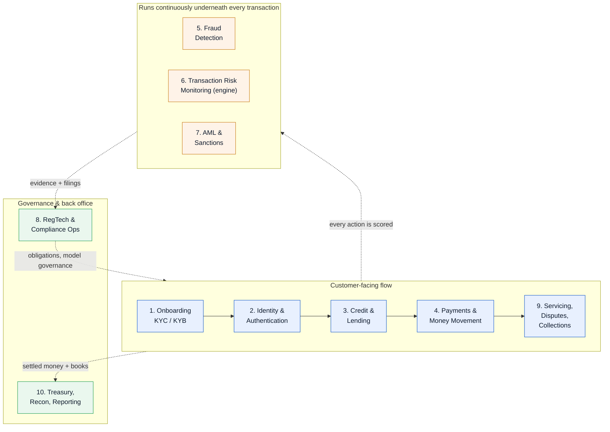

# Fintech, AI & Security: A Lifecycle Deep-Dive

**What this is.** A founder-level map of how a fintech actually operates, stage by stage — and, for each stage, (1) what the work involves, (2) how AI helps and what security/industry reports *actually* prove (vs. vendor marketing), (3) how the stage gets attacked and how AI cuts both ways, and (4) the market size and the real competitors. Built from ~40 primary and analyst sources; every load-bearing number was independently fact-checked by a second pass, and corrections are baked in.

**How to read the labels.** `[FACT]` = sourced. `[INFERENCE]` = concluded from the evidence. `[REC]` = a recommendation. `(vendor-asserted)` = a self-reported number from a company that sells the thing — directionally useful, not independently proven. Every number keeps its **year + source**; sources are numbered per section.

**Last updated:** 2026-08-03 · **Market lens:** global, US-primary (India/EU called out where materially different).

---

## Table of Contents

1. [Executive summary](#executive-summary)
2. [The fintech lifecycle at a glance](#the-fintech-lifecycle-at-a-glance)
3. [The three ways AI shows up (the lens used throughout)](#the-three-ways-ai-shows-up)
4. [Cross-cutting: what the CISO & threat reports actually say](#cross-cutting-ciso--threat-reports)
5. [Cross-cutting: the AI + agentic-AI trend in finance](#cross-cutting-the-ai--agentic-ai-trend)
6. **The ten lifecycle stages** —
   [1. Onboarding (KYC/KYB)](#stage-1) ·
   [2. Identity & Authentication](#stage-2) ·
   [3. Credit & Lending](#stage-3) ·
   [4. Payments](#stage-4) ·
   [5. Fraud](#stage-5) ·
   [6. Transaction Risk Monitoring](#stage-6) ·
   [7. AML & Sanctions](#stage-7) ·
   [8. RegTech & Compliance](#stage-8) ·
   [9. Servicing, Disputes & Collections](#stage-9) ·
   [10. Treasury, Recon & Reporting](#stage-10)
7. [Synthesis: where AI is real, where it's hype, and where the security gap is](#synthesis)
8. [Methodology & source-quality notes](#methodology)

---

## Executive summary

Fintech is not one thing — it's a **value chain of about ten functions**, each with its own systems, its own AI, its own attackers, and its own vendor market. AI has been in this chain for over a decade (fraud and credit models predate the GenAI wave); what changed in 2023–2026 is (a) **generative AI as an attacker tool** and (b) the beginning of **agentic AI that takes actions**, not just makes predictions. Both shift the security question from *"is this data safe?"* to *"is this action allowed?"*

Five things worth internalizing before the stage-by-stage detail:

1. **AI is genuinely mainstream in exactly two places, and early everywhere else.** Fraud/AML monitoring and credit underwriting have run production machine learning for years. [FACT] 88% of organizations report using AI in at least one function in 2025 (up from 78%), but only ~5% of firms are actually capturing outsized value, and just 23% are *scaling* an agentic system — most of the rest are piloting [1][2]. In regulated money-movement, fully autonomous agents are still early. Treat "AI in fintech" as *deep in a few functions, shallow in most*.

2. **The proven attacker edge from AI is scale, personalization, and a lower skill bar — not novel malware.** The canonical loss is the **Arup deepfake heist: ~US$25.6M (HK$200M)** wired after a video call in which the "CFO" and colleagues were AI-generated, Hong Kong, early 2024 [3]. Deloitte projects US GenAI-enabled fraud losses rising from **US$12.3B (2023) to US$40B (2027)** — a *modeled projection*, not a tally [4]. The important counter-weight: **Google's threat-intel team found attackers using GenAI got productivity gains but *no novel offensive capabilities*** and no successful new prompt-injection in the wild as of early 2025 [5]. The honest framing is "AI makes existing fraud cheaper and faster," not "AI unlocks unstoppable new attacks."

3. **"Ungoverned AI" already has a price tag.** [FACT] IBM's 2025 breach study found **20% of breaches involved "shadow AI"**, adding ~US$670K to the average breach; **13% of organizations had a breach of an AI model or app, and 97% of those lacked AI access controls**; **63% had no AI governance policy at all** [6]. This is the concrete cost of deploying AI faster than you can govern it.

4. **A systemically-important bank has publicly named the exact gap.** JPMorgan Chase's engineering org wrote (March 2026) that AI agents "do not just produce outputs; they take action," which "expands the attack surface," and called for **runtime governance at the point of execution**, **tamper-evident runtime records**, **policy-aware data**, and the ability to **stop an agent** when its behavior deviates — flagging the "lethal trifecta" of untrusted input + sensitive-data access + authority to act [7]. That is an operator, not a vendor, describing a runtime action-governance control plane. It is the single strongest piece of third-party validation for the "govern the action, not just the prompt" thesis.

5. **Every market number in this space is soft — show your source or it won't survive diligence.** "AI in fintech" 2024 base-year estimates span **~US$8B to US$17B** depending on scope, with CAGRs from the high teens to low thirties [8]. Sub-segment markets (KYC software, AML software, RegTech, fraud detection) each diverge 2–3× across research firms because the category boundaries are drawn differently. We cite ranges and name the firm every time.

The rest of this document walks the ten stages. Two cross-cutting sections first — the report landscape and the AI/agentic trend — because their facts recur in every stage.

---

## The fintech lifecycle at a glance

A fintech turns a stranger into a verified customer, decides how much to trust them, moves their money, watches for fraud and financial crime, proves all of it to regulators, serves them, and keeps its own books. Those are the ten stages. They are not strictly sequential — fraud, risk monitoring, and compliance run *continuously* underneath the customer-facing flow — but grouping them this way is how the people who build and defend a fintech think about it.

**How the continuous layer relates to the flow.** Stages 5–7 are easy to confuse, so the scope fences used throughout are:
- **Fraud (5)** is about *loss outcomes* — the money the customer or the firm loses to a scam, a stolen card, a fake account.
- **Transaction Risk Monitoring (6)** is the *engine* — the real-time scoring and decision-orchestration layer that fraud, credit, and compliance signals all flow through (including crypto transaction monitoring).
- **AML & Sanctions (7)** is the *regulatory* obligation — watching for money laundering and screening against sanctions lists, and filing reports to the government.

Same transaction, three different lenses: *what did we lose*, *what engine decided*, *what must we report*.

---

## The three ways AI shows up

Throughout this report, "AI in fintech" is split three ways. Keeping them separate is the whole point — most confusion in this space comes from blurring them.

| Lens | Question it answers | Example | Who owns it |
|---|---|---|---|
| **A. AI helps the fintech operate** | How do we do the work faster/cheaper/better? | ML reads an ID document; a model scores creditworthiness; a chatbot answers support | Product / data-science teams |
| **B. AI helps defend** | How do we catch bad actors? | A model flags a fraudulent transaction; graph analytics find a mule network | Fraud / security teams |
| **C. AI is the new attack surface** | How do attackers abuse *our* AI — or their own? | Deepfakes defeat liveness; prompt injection hijacks a support agent; an agent is tricked into moving money | Security / AI-governance teams |

[INFERENCE] The near-term commercial reality: **A** is where most spend goes, **B** is the oldest and most proven use, and **C** is the fastest-growing risk and the least-governed. The stages below tag AI uses to these three lenses.

---

## Cross-cutting: CISO & threat reports

*This is the "pull the CISO reports to vet it" layer the analysis was asked for. These reports recur across every stage, so they're consolidated here once. Vendor-run reports are labeled; regulator- and analyst-run reports carry more weight.*

### The load-bearing reports (and what each proves for fintech)

| Report | Publisher (type) | Year | The finding that matters for fintech |
|---|---|---|---|
| **Cost of a Data Breach 2025** | IBM / Ponemon (analyst) | 2025 | Global avg breach **US$4.44M** (down 9% — first drop in 5 yrs, credited to AI-assisted detection); **US avg record US$10.22M**. **20% of breaches involved shadow AI** (+~US$670K); **13% had an AI model/app breach, 97% of those lacked AI access controls**; **63% had no AI governance policy** [6]. |
| **Data Breach Investigations Report (DBIR) 2025** | Verizon (analyst) | 2025 | Largest-ever dataset (22,052 incidents / 12,195 confirmed breaches). **Third-party involvement doubled to 30%** — directly relevant to fintech's API/vendor dependence. **~60% of breaches involved the human element**; ransomware in **44%**; **GenAI-written text in malicious emails roughly doubled** over two years [9]. |
| **2025 Crypto Crime Report** | Chainalysis (vendor) | 2025 (2024 data) | **US$40.9B** to illicit crypto addresses in 2024 (likely revised up toward ~US$51B); **US$2.2B stolen in hacks**, ~61% North-Korea-linked; stablecoins now 63% of illicit volume [10]. COI: Chainalysis sells the monitoring tools. |
| **Detecting & Countering Misuse of AI** | Anthropic (vendor) | Aug 2025 | "Agentic AI has been weaponized" — documented "vibe-hacking" extortion where AI analyzed *stolen financial data* to set ransom amounts (>US$500K), and no-code ransomware sold for US$400–1,200 [11]. Validates the agent-action-risk thesis; COI: Anthropic makes the model. |
| **Adversarial Misuse of Generative AI** | Google Threat Intel Group (vendor) | Jan 2025 | **The contrarian anchor:** attackers using Gemini got productivity gains but **no novel offensive capabilities**, and no successful novel prompt-injection in the wild; they reused public jailbreaks unsuccessfully [5]. Names FraudGPT / WormGPT as the fraud tooling of concern. |
| **OWASP Top 10 for LLM Apps (2025)** + Agentic Threats & Mitigations (Feb 2025) | OWASP (standards) | 2025 | The risk taxonomy a fintech CISO maps controls to. **LLM01 Prompt Injection** and **LLM06 Excessive Agency** are the two agentic-action risks. The separate agentic doc uses a **T1–T15** taxonomy (memory poisoning = T1) [12]. |
| **NIST AI RMF 1.0** + GenAI Profile (AI 600-1) | NIST (standards) | 2023 / 2024 | The de-facto US governance backbone (Govern / Map / Measure / Manage) that financial regulators reference and auditors expect evidence against [13]. |
| **MITRE ATLAS** | MITRE (standards) | ongoing | The AI-specific extension of ATT&CK — adversary tactics/techniques against ML pipelines, inference APIs, and training data; the threat-modeling reference for AI systems [14]. |
| **EU AI Act (Reg. 2024/1689)** | European Union (regulator) | 2024 | Classifies **credit scoring/creditworthiness (except fraud detection)** and **life/health insurance risk-pricing** as **HIGH-RISK** (Annex III). High-risk obligations apply **~Aug 2026** [15]. The binding layer for AI in EU finance. |
| **Global Financial Crime Report 2024** | Nasdaq Verafin (vendor) | 2024 (2023 data) | **>US$3.1 trillion** in illicit funds moved through the financial system in 2023; **>US$485B** in fraud losses [16]. |
| **ENISA Threat Landscape 2025** (+ first Finance-Sector edition, Feb 2025) | ENISA (EU regulator) | 2025 | 4,875 incidents analyzed; AI-enabled threats (deepfakes, GenAI phishing) flagged as escalating for finance [17]. |
| **The CISO Report 2026: From Risk to Resilience in the AI Era** | Splunk / Cisco (Oxford Economics survey) | 2025 (Jul-Aug survey of 650 global CISOs) | **96% of CISOs now own AI governance**; only **6% use agentic AI** (39% exploring); **60% disagree** agents will replace L1 security; **83% rank hallucination as #1 agentic concern**; **78% creating dedicated security teams for AI agents**; GenAI exceeds expectations for only **14%** of users; **98% cite high alert volume** as top SOC stressor; agentic viewed as *quality amplifier* (persistence/sophistication), GenAI as *quantity amplifier* (volume/exploits); **only 7–8%** believe AI enables *novel* attacks [29]. |

### The two claims worth stress-testing

**"AI supercharges attackers."** *Partly true, and frequently overstated.* The strongest **proven** loss evidence is social-engineering/deepfake fraud (Arup, US$25.6M [3]) and shadow-AI breach cost (IBM [6]) — not model compromise. Google GTIG's finding of *no novel offensive capabilities* [5] is the counter-weight — and 650 CISOs agree: [FACT] Splunk's 2026 CISO survey finds **only 7–8% believe AI creates novel attacks**; the overwhelming concern is **sophistication** (86–91%) and **persistence** (82%), not novelty [29]. [INFERENCE] AI's demonstrated impact on attackers is **scale, personalization, and lower skill barriers**; the "unstoppable new AI attack" narrative is not supported by either the threat-intel evidence or the CISO community's own assessment.

**Vendor fraud statistics.** Numbers like "over 50% of fraud now involves AI" (Feedzai) or "fintech account-takeover up 122%" (Sift) come from vendors' own networks and commissioned surveys [18][19]. They are directionally corroborated by the independent DBIR/Deloitte evidence, but the precise percentages are **asserted, not audited** — and are labeled that way throughout.

### What CISOs themselves say (the buyer signal)

The Splunk / Cisco CISO Report 2026 [29] (650 CISOs, Oxford Economics, Jul-Aug 2025) is uniquely valuable because it is *not* a vendor's threat data — it's the buyer's own voice under rigorous survey methodology. Key findings directly relevant to fintech AI-security:

- **AI governance is the CISO's job now.** 96% of CISOs own AI governance and risk management; they sit on cross-functional committees vetting which models are used, how they're trained, and whether they learn/update autonomously (agentic). [FACT, 29]
- **Agentic AI is real interest, not real adoption.** Only **6% of CISOs use agentic AI today**, 39% are exploring, and the rest haven't started. Of those using it, **22% say it exceeds expectations** — but **25% say it misses them**. GenAI exceeds expectations for only 14%. [FACT, 29]
- **CISOs don't believe agents will replace humans.** 60% *disagree* that agentic AI will replace even L1 security functions; only 1% view technology as the primary fix for skills gaps. The CISO invests in people first. [FACT, 29]
- **Top agentic-AI concerns (ordered):** (1) Hallucination → missed alerts / false positives (83%), (2) lack of human oversight, (3) ethical / legal liability, (4) unpredictable behavior, (5) lack of transparency. [FACT, 29]
- **78% are creating dedicated security teams for AI agents** — a net-new budget line that didn't exist 18 months ago. [FACT, 29]
- **CISOs distinguish agentic from GenAI threats.** Agentic AI = quality amplifier (persistence speed & sophistication at 82%, social-engineering realism at 86%, but volume at only 17%). GenAI / non-agentic = quantity amplifier (volume 78%, exploit proliferation 96%, social engineering 91%). Neither creates novel attacks (7–8%). [FACT, 29]
- **The operational pain is alert fatigue.** 98% cite high alert volume, 94% high false-alert volume, and 79% tool sprawl as SOC stressors — the context for why any new security tool (including an AI governance layer) must *reduce* noise, not add to it. [FACT, 29]
- **79% expect skills gaps to remain unfilled** — the scarcity context that makes AI augmentation (and the governance of that augmentation) a business imperative. [FACT, 29]

[INFERENCE] The buyer signal is clear: CISOs own the AI governance mandate, believe agentic AI is *inevitable but early*, rank hallucination and lack of human oversight as top risks, and are already forming dedicated teams — but **they do not believe the technology replaces analysts, and they will not tolerate a governance tool that adds to their alert fatigue.** Any runtime action-governance product must reduce false positives (high precision, low noise), augment rather than replace humans, and produce the "repeatable chain of evidence" the Splunk CISO explicitly says regulators demand.

*Sources for this section are consolidated in the [master source list](#methodology); the numbering above ([1]–[29]) is used consistently in the executive summary and this section.*

---

## Cross-cutting: the AI & agentic-AI trend

### Market frame (with the honesty that diligence requires)

- [FACT] **Global fintech market:** ~US$395B (2025), projected to ~US$1.76T by 2034 at ~18% CAGR; North America ~32% share (Fortune Business Insights — single-firm sizing) [20].
- [FACT] **"AI in fintech" sub-market:** 2024 base estimates span **~US$8B–US$17B** (Grand View ~US$9.5B in 2021→US$41B by 2030; Verified Market Research US$8.0B 2024; Dimension Market Research US$17.0B 2024), CAGRs from ~16.5% to ~30% [21]. [INFERENCE] The 2–3× spread reflects inconsistent scope — cite the *range*, never a single point.
- [FACT] **Value-pool (more defensible, from a primary analyst):** McKinsey estimates generative AI could add **US$200B–340B annually** to global banking (9–15% of operating profits) *if fully implemented* — a ceiling, not a run-rate [22].

### Adoption: mainstream vs pilot vs hype

- [FACT] **88% of organizations** used AI in at least one function in 2025 (up from 78%); **62% are experimenting with AI agents but only 23% are scaling one** (McKinsey State of AI 2025, ~1,500 execs) [1].
- [FACT] **UK financial services specifically: 75% of firms use AI (2024, up from 58% in 2022)** — the best *regulator-run* (non-vendor) adoption datapoint; but **only 34% say they understand the AI they use** (Bank of England / FCA) [23].
- [FACT] **BCG:** AI *agents* were "hardly mentioned in 2024" and account for **17% of AI value in banking in 2025, projected 29% by 2028**; only ~5% of firms lead in AI value creation [2].

**The map:** *Mainstream* = fraud/AML monitoring, credit underwriting, code assist, customer-service knowledge. *Pilot/scaling* = GenAI copilots, document summarization, treasury assistants. *Hype/overstated* = fully autonomous end-to-end agents in regulated money-movement.

### The agentic shift — and the runtime-governance gap

The move from *AI that informs* to *agents that act* is the defining 2025–2026 change, and it is where the security story concentrates.

- [FACT] **Gartner:** 33% of enterprise software will include agentic AI by 2028 (from <1% in 2024); ≥15% of day-to-day work decisions made autonomously by 2028. **But over 40% of agentic-AI projects will be canceled by end-2027** — costs, unclear value, inadequate controls — and Gartner warns of "agent washing" [24].
- [FACT] **Splunk CISO Report 2026** (650 CISOs): **only 6% currently use agentic AI** in security, 39% exploring; among users, 22% say it exceeds expectations, 25% say it misses them. **78% are creating dedicated security teams for AI agents.** The #1 concern is hallucination (83%), followed by lack of human oversight and legal liability; **60% disagree** it will replace L1 functions. CISOs see agentic AI as a *quality amplifier* for attackers (persistence 82%, social-engineering sophistication 86%) not a volume generator (17%) [29].
- [FACT] **JPMorgan Chase** is the most-documented deployer: AI agents in front of ~250,000 employees, longer-running agents in 2026, applied to corporate cash & treasury; agents "take action," which "expands the attack surface beyond a model's parameters" [7][25]. It calls for **continuous, runtime governance of agent behavior**, controls **at the point of execution**, **tamper-evident runtime records**, **policy-aware data** (labels that travel with the data and are enforced wherever it moves), and the ability to **stop agents** — naming compounding actions, delegated identity, and the "lethal trifecta" as the failure modes [7].

[INFERENCE] So autonomous agents in finance are **simultaneously real at the frontier and over-hyped in the broad market**. The durable near-term reality is human-in-the-loop, narrow-scope agents, with autonomous money-movement gated on exactly the runtime controls JPMorgan describes — and the CISO community independently confirms: 60% reject even L1 replacement, while 78% are standing up dedicated AI-agent security teams [29]. [REC] The defensible wedge is **governing the action** (parameters, sequence, delegated identity, session state) at the point of execution — not prompt/content detection, where point tools already crowd in. Any governance tool must be high-precision / low-noise (98% of CISOs already drown in alert volume [29]) and must produce the "repeatable chain of evidence" that compliance audits demand.

### Regulatory drivers to know

**EU AI Act** (high-risk credit/insurance AI, ~Aug 2026) [15] · **US SR 11-7** model-risk-management guidance (the long-standing bank model-governance rule that now stretches to ML/AI) [26] · **NIST AI RMF** [13] · **FSB** on AI & financial stability (2024) [27] · **RBI's FREE-AI** committee report (India, Aug 2025 — 7 principles, 26 recommendations) [28] · **Bank of England / FCA** AI survey and supervisory interest [23].

*Full source list for both cross-cutting sections is in [Methodology](#methodology).*

---

## 1. Customer Acquisition & Onboarding (KYC/KYB)

#### 1.1 What this stage is

This is the front door of a fintech: turning an anonymous prospect into a verified, compliant, funded account holder. It is where the most regulation, the most fraud, and the most AI all concentrate at once. Concretely, onboarding is a pipeline of seven sub-processes:

1. **Signup / data capture** — email, phone, address, SSN or national ID, and (for businesses) legal entity details.
2. **Identity verification (IDV) for individuals** — capture a government ID, run OCR + authenticity checks on it, match it to a selfie via face-comparison, and add a **liveness / presentation-attack-detection (PAD)** step (passive or active) to prove a live human is present, not a photo or a screen replay.
3. **Data verification** — SSN/DOB/address checks against the credit bureaus (Experian, Equifax, TransUnion), phone and email intelligence, device fingerprinting, and — in India — Aadhaar / DigiLocker e-KYC.
4. **KYC / CDD program checks** required by the US Bank Secrecy Act and the FinCEN Customer Due Diligence Rule, the EU AML Directives, and FATF Recommendation 10: identify and verify the customer, assign a risk rating, and — for **KYB** (know-your-business) — identify the **beneficial owners (UBOs)** per the FinCEN Beneficial Ownership rule.
5. **Sanctions / PEP / adverse-media screening** against OFAC SDN, UN, EU, and HM Treasury lists.
6. **Synthetic-identity and fraud scoring** before the account can fund.
7. **A decisioning / orchestration layer** that routes each applicant to approve, decline, or manual review (step-up).

The player types map onto those steps: **IDV vendors** (Jumio, Onfido/Entrust, Incode, Socure, Persona); **orchestration / decisioning platforms** (Alloy, Sardine); **KYB specialists** (Middesk); the **credit bureaus**; **sanctions-screening vendors**; and the in-house **risk & compliance ops** teams who work the manual-review queue. Scope note: this section is onboarding-*time* verification only. Ongoing/step-up authentication during the account's life is a separate lifecycle stage.

#### 1.2 How AI helps (and what the reports actually show)

AI is not a bolt-on here — it is the substrate of modern IDV. The use cases, ordered roughly by how proven they are:

| Use case | How AI helps | Maturity | Sourced impact |
|---|---|---|---|
| **Document authenticity + OCR** across thousands of ID templates | CNN / computer-vision models read the machine-readable zone (MRZ), detect tampering, font/hologram anomalies, and photo substitution across global document types, far faster and wider than manual review. Core to Jumio, Onfido, Incode, Persona. | **Mainstream** | Vendor-reported that onboarding drops from *days to hours*. **[Fact-check: the widely-circulated "70–80% time reduction, per McKinsey" figure does NOT trace to any primary McKinsey publication — treat it as an unsourced estimate, not a McKinsey number.]** |
| **Biometric face-match + liveness / PAD** | Deep-learning face comparison plus active/passive liveness confirms the selfie is a live human matching the ID — defeating printed photos, masks, and screen replays. | **Mainstream** | No independently proven onboarding-wide number; capability is standard, effectiveness is vendor-benchmarked [1]. |
| **Synthetic-identity detection** | ML scores identity plausibility by cross-referencing SSN/DOB/address, credit-file thinness, device, and public-data linkages (relatives, vehicle/voter/property records) — patterns a rules engine misses. | **Growing** | [FACT] TransUnion: US lenders carried **>US$3.3B synthetic-identity exposure for year ending 2024**; absence of relatives + vehicle registrations raises synthetic likelihood **up to 7×**, and 30–50% of synthetics had no known relatives/vehicle records [2]. |
| **Sanctions / PEP / adverse-media screening** with false-positive reduction | ML entity resolution, fuzzy name-matching, and network analytics cut the enormous false-positive alert volume of legacy fuzzy match and send higher-quality alerts, shrinking the manual-review load. | **Mainstream** | [FACT, qualitative] McKinsey: ML + network analytics reduces *both* false-negative and false-positive rates and prioritizes better alerts — but the primary source gives **no specific percentage** [3]. |
| **Risk-based decisioning / onboarding orchestration** | Platforms (Alloy, Sardine, Socure) blend dozens of signals into an approve/decline/step-up score, auto-approving low-risk applicants and routing only edge cases to humans — raising pass rates while holding fraud roughly flat. | **Mainstream** | No independently proven cross-industry number cited [4]. |
| **KYB automation + UBO discovery** | Middesk-style platforms auto-verify business registration, TIN, and watchlists, and unwind ownership graphs to surface beneficial owners for the FinCEN BOI rule — replacing manual secretary-of-state lookups. | **Growing** | No sourced number [5]. |
| **Agentic AI for compliance ops** | Emerging LLM-agent workflows draft SAR narratives, summarize adverse media, and triage KYC-refresh cases under human oversight. | **Emerging** | [FACT] Sardine raised a **US$70M Series C (Feb 2025)** explicitly to build "fraud-fighting AI agents" [6]. |

**What CISO / industry reports actually say — proven vs. vendor marketing.** The onboarding threat narrative is dominated by **vendor-sourced statistics with a clear conflict of interest**: Sumsub, Entrust/Onfido, and iProov all *sell* IDV and anti-deepfake products, so their deepfake-surge figures are asserted, not independently proven, and should be read as directional. The three vendor reports do corroborate each other on **direction** — Sumsub's 2024 report (3M+ fraud attempts across 28 industries) says deepfakes quadrupled year-over-year to ~7% of detected fraud, forged documents were ~50% of fraud, and fintech identity-fraud grew ~156% [7]; Entrust/Onfido's 2025 report claims a deepfake attempt "every five minutes" and digital document forgery +244% YoY (now the majority of document fraud) [1]; iProov cites a **704% rise in face-swap attacks H1→H2 2023** [8]. They share the same commercial incentive and use **non-standardized denominators**, so the *magnitudes* are marketing-adjacent even where the trend is real. (One caveat the fact-check surfaced: iProov's separately-quoted "+2,665% virtual-camera" and "+353% emulator" figures could **not** be independently corroborated — only the 704% face-swap figure traces cleanly. Treat the others as single-source vendor claims.)

The **independent / regulator-grade** anchors are what make the trend credible without the vendors: [FACT] **FinCEN Alert FIN-2024-Alert004 (Nov 13, 2024)** confirms a real rise in Suspicious Activity Reports since 2023 involving GenAI-altered or fabricated identity documents used to "circumvent identity verification" when opening accounts — a regulator confirming the activity, not selling a product [9]; [FACT] **TransUnion** (a bureau, working from data) puts synthetic-ID exposure above **US$3.3B** [2]; [FACT] **Chainalysis'** 2025 Crypto Crime Report documents underground services that "leverage AI to bypass KYC" at crypto exchanges [10]. [FACT, analyst projection] **Deloitte** Center for Financial Services models US GenAI-enabled fraud losses growing **US$12.3B (2023) → US$40B (2027)** — a *modeled projection, not measured loss*, and its embedded "+700% deepfake in fintech (2023)" is a figure Deloitte itself **cites from a secondary (vendor-origin) source**, so it is single-source, not bureau-grade [11]. Finally, the standards anchor cuts the other way: [FACT] **FATF's 2020 Guidance on Digital ID** holds that remote onboarding on reliable, independent digital-ID systems can be standard or even *lower* risk — regulators do **not** treat remote IDV as inherently high-risk when assurance is proven [12].

Net: **proven** = SAR volume rising (FinCEN), synthetic-ID dollar exposure (TransUnion), KYC-bypass services exist (Chainalysis). **Marketing-adjacent** = the precise deepfake-growth percentages (single-vendor, non-standardized denominators). Use the first set to justify spend; use the second only as directional color, always labeled vendor-asserted.

#### 1.3 How security is compromised — and how AI cuts both ways

Onboarding is attacked at exactly the two seams AI has changed most: the **document/biometric proof** and the **decisioning logic** behind it. It helps to split the threats into two families — *AI making an existing attack worse* vs. *AI as a brand-new attack surface*.

**Family A — AI supercharging existing fraud (attacker use of AI):**

- **Deepfake video/voice impersonation to defeat liveness and social-engineer approvals.** *Mechanism:* the attacker injects a GenAI face-swap or avatar into the selfie-liveness step, or runs a real-time deepfake on a video-KYC call, to impersonate a real person or an executive and get an account opened or funds released. GenAI makes this possible at scale; deepfake-as-a-service lowers the skill bar. *Incident:* [FACT] in early 2024, engineering firm **Arup lost ~US$25.6M (HK$200M)** after an employee in Hong Kong joined a video call where fraudsters deepfaked the CFO and colleagues [13]. (This was a *payments* social-engineering loss rather than an account-opening one, but it is the canonical proof that real-time deepfakes now defeat human verification on a live call — the same primitive attacks video-KYC.)
- **Synthetic identity fraud (fabricated person).** *Mechanism:* blend a real (often stolen, child, or deceased) SSN with a fabricated name, DOB, and digital contact details to build a "person" with no true owner, pass thin-file checks, nurture credit, then bust out. *AI angle:* GenAI produces convincing supporting documents, faces (e.g., StyleGAN), and behavioral history, and helps mass-produce identities. *Data:* [FACT] TransUnion's **>US$3.3B** exposure figure is exactly the loss these models target [2].
- **ID document forgery / template fraud.** *Mechanism:* counterfeit, altered, or fully synthetic government IDs — increasingly *digital images* rather than physical counterfeits — submitted at document verification; fraud-as-a-service vendors sell ready-made forgeries and "fullz." *Data (vendor-asserted, direction only):* Sumsub says forged documents were ~50% of detected fraud; Entrust/Onfido says digital document forgery rose +244% YoY and now exceeds physical forgery [7][1].
- **Stolen-PII account opening (classic identity theft).** *Mechanism:* breached or purchased real PII (name, SSN, DOB) opens accounts in a victim's name, passing *data-only* KYC that lacks biometric binding. *AI angle:* not AI-specific, but AI improves target selection and document fabrication; this remains the volume baseline. *Data (vendor-asserted):* Sumsub puts the global identity-fraud rate at 1.1% (2021) → 2.6% (2024) [7].

**Family B — AI as a NEW attack surface (the risk to the fintech's *own* AI):**

- **Digital injection attacks on the IDV pipeline.** *Mechanism:* instead of presenting a fake to the camera (a *presentation* attack), the attacker injects synthetic video/images directly into the app via virtual cameras, emulators, or a compromised capture API — bypassing the physical camera step entirely, which is precisely what classic liveness assumes exists. *Data:* [FACT, vendor-asserted] iProov's **704% rise in face-swap attacks (H1→H2 2023)** is the cleanest traceable figure; the larger virtual-camera/emulator percentages are single-source and unverified [8].
- **GenAI-assisted KYC-bypass services (crime-as-a-service).** *Mechanism:* underground services generate on-demand identity documents, spoofed selfies, and matching metadata tuned to pass a *specific* platform's onboarding flow, sold to launderers and mule-account networks. *Confirmation:* [FACT] regulator-grade via FinCEN's rising-SAR alert, plus Chainalysis documenting these services at crypto VASPs [9][10].
- **Prompt injection & excessive agency in the compliance-ops AI itself.** As fintechs put LLM agents on adverse-media summarization, SAR drafting, and manual-review triage, those agents become a target. OWASP's **Top 10 for LLM Applications (2025)** names **LLM01 Prompt Injection** and **LLM06 Excessive Agency** as the two agentic-action risks [14]; OWASP's separate **Agentic AI – Threats and Mitigations (Feb 2025)** uses a **T1–T15** taxonomy in which **memory poisoning is T1** [15]. Concretely: adverse-media text or a submitted document could carry instructions that steer a triage agent to clear a case it should have escalated, or a poisoned KYC-refresh memory could bias future decisions. This is the "**lethal trifecta**" JPMorgan Chase's security team named in 2026 — *untrusted input + sensitive-data access + authority to act* — and their prescription is runtime governance at the point of execution, tamper-evident runtime records, and the ability to **stop** an agent mid-action [16].

**A necessary contrarian note so this isn't over-hyped.** [FACT] Google's Threat Intelligence Group (Jan 2025) found that attackers using GenAI got *productivity* gains but **no novel offensive capabilities**, and observed **no successful novel prompt-injection in the wild** [17]. So AI is lowering the cost and scale of onboarding fraud — deepfake-as-a-service, mass synthetic identities — more than it is inventing fundamentally new attacks. That distinction matters for where to spend: harden the capture pipeline and the decisioning logic, don't chase exotic novel-attack scenarios.

**How AI defends this stage (the same models, pointed the other way):**

- **Liveness + injection-attack detection** — passive liveness plus device/environment integrity checks that detect virtual cameras, emulators, and injected streams; the direct answer to deepfake and injection attacks on the selfie step [1].
- **Deepfake/GenAI-media forensics** — classifiers trained on GenAI artifacts (frequency-domain anomalies, face-swap boundaries, metadata inconsistencies) score whether a submitted image/video is synthetic before approval [8].
- **Synthetic-identity ML with public-data + network analytics** — graph models link an applicant to relatives, addresses, devices, and public records to expose fabricated identities that look clean in isolation (e.g., TransUnion's synthetic-fraud model; Socure's Sigma) [2].
- **Behavioral + device intelligence at signup** — Sardine-style models fingerprint device, session, and behavioral-biometric signals (typing, paste, navigation) to flag bot-driven or coached onboarding in real time [6].
- **Entity resolution + false-positive reduction in screening** — ML matching against sanctions/PEP/adverse-media lists cuts legacy fuzzy-match noise so analysts focus on genuine hits [3].
- **Agentic case triage** — LLM agents summarize adverse media, draft SAR narratives, and pre-triage the review queue under human oversight [6] — and it is *this* defensive layer that itself needs the runtime governance in Family B.

#### 1.4 Market & competitors

**Market size (treat as directional, not precise):**

| Segment | Base size (year) | Forecast | CAGR | Source |
|---|---|---|---|---|
| Identity verification (IDV) | ~US$13.4B (2025) | ~US$38.5B by 2033 | ~13.9% (2026–2033) | Grand View Research [18] |
| KYC software (sub-segment) | ~US$4.24B (2025) | ~US$12.22B by 2031 | ~19.3% (2025–2031) | Mordor Intelligence [19] |

> **Downside / soft-number caveat.** These figures come almost entirely from **syndicated commercial market-research publishers with opaque, differing scope definitions**, and the estimates diverge widely: IDV 2024/2025 base ranges $10–14B with CAGRs of 9–15% across Grand View, BIS, Data Bridge, and Verified; KYC-software 2024 base ranges $1.5–3.1B with CAGRs of 12–30%. **No regulator or peer-reviewed sizing exists.** "IDV" vs. "KYC software" vs. "digital identity" scopes overlap and are frequently conflated. Use any single number as a directional order-of-magnitude, never a precise TAM.

**Competitors** (mix of scaling incumbents and venture-backed startups; ownership verified by the fact-check):

| Player | What they do | AI edge | Scale / funding (year) |
|---|---|---|---|
| **Socure** *(startup)* | US identity-verification + fraud platform (ID+); Sigma module targets synthetic-identity; sanctions/PEP + predictive analytics for onboarding. | Large predictive-analytics/graph models on consortium data; auto-approval rate + synthetic-ID detection as the pitch. | $450M Series E at **$4.5B** valuation (2021, Accel/T. Rowe led); ~$650M total raised [4] |
| **Entrust (acquired Onfido)** *(incumbent)* | Document + biometric IDV, KYC, PEP/sanctions; Onfido brings AI face-match/liveness. Publishes the annual Identity Fraud Report. | Onfido "Atlas" AI for document/biometric verification and deepfake/injection defense; Entrust's broader identity/payments platform scale. | Entrust **completed acquisition of Onfido, Apr 2024**; price reported **~$400M+** (TechCrunch, Feb 2024); some profiles cite ~$650M [24] |
| **Jumio** *(incumbent)* | AI-powered IDV, biometrics, KYC/AML ("Trusted Identity as a Service") for regulated onboarding. | AI-Powered Jumio Platform for document + biometric proofing; large verified-identity dataset. | $150M raised (2021); 300M+ verified identities; PE-backed (Great Hill Partners stake) [21] |
| **Persona** *(startup)* | Configurable IDV + orchestration platform; KYC/KYB building blocks for fintechs and marketplaces. | Workflow automation/orchestration; positioning as the "verified identity layer for an agentic-AI world." | **$200M Series D at $2B** valuation (2025, Founders Fund/Ribbit) [20] |
| **Incode Technologies** *(startup)* | Omnichannel biometric IDV + authentication for enterprises, governments, and FIs. | Fully-automated biometric + document AI; fraud prevention across many countries. | $220M Series B at **$1.25B** valuation (2021, General Atlantic/SoftBank); ~$260M total [22] |
| **Alloy** *(startup)* | Identity-decisioning / onboarding-orchestration for banks, credit unions, fintechs — routes KYC, KYB, AML, fraud checks across many data vendors via one API/rules engine. | **Vendor-neutral decisioning layer** — aggregates and optimizes across bureaus/IDV providers rather than owning the model. | ~**$1.55B** valuation (2022); ~$200M+ raised (Series A–C) [23] |
| **Sardine** *(startup)* | AI risk platform for fraud, compliance (KYC/AML/sanctions/txn monitoring), and instant settlement; strong at account-opening fraud for fintech/crypto. | Behavioral + device intelligence and "fraud-fighting AI agents"; real-time behavior-based scoring. | **$70M Series C (Feb 2025)**, Activant led (GV participating); earlier $51.5M Series B (a16z); ~$660–680M valuation [6] |
| **Middesk** *(startup)* | Business-identity / KYB platform: business verification, TIN/watchlist checks, and beneficial-ownership (UBO) discovery for banks and fintechs. | Automates KYB/underwriting decisions that were manual secretary-of-state/registry lookups. | **$57M Series B (2022)**, Insight/Canapi co-led; ~$77M total [5] |

**Incumbents vs. startups:** the "incumbents" here (Entrust/Onfido, Jumio) are consolidated document+biometric IDV suites with the largest verified-identity datasets; the "startups" split into **model owners** (Socure, Incode, Sardine — they train and sell the detection models) and **orchestration layers** (Alloy, Persona, Middesk-for-KYB — they route across other vendors' models). The orchestration layer is where switching cost accumulates, because it owns the customer's decisioning logic rather than any single model.

#### 1.5 The takeaway

Document/biometric IDV and ML-based decisioning are **genuinely mainstream** here — this is one of the few stages where AI is table stakes, not a demo. Synthetic-identity graph scoring and agentic compliance-ops are still **growing/emerging** and are where vendor hype most outruns proof. The security risk concentrates at two seams: attackers using GenAI to **manufacture the proof** (deepfakes, injection, synthetic docs) — confirmed as *real and rising* by FinCEN, TransUnion, and Chainalysis, even after discounting the vendor percentages — and, newly, the fintech's **own compliance-ops AI agents** becoming a target (prompt injection, excessive agency, memory poisoning per OWASP LLM01/LLM06 and the T1–T15 taxonomy). That second seam is exactly where **runtime action-governance of AI agents** earns its place at this stage: an LLM agent that can clear a KYC case, file (or suppress) a SAR, or approve an account has *authority to act* on *untrusted input* with *sensitive-data access* — JPMorgan's "lethal trifecta" — so the control that matters is the ability to inspect and **stop the action** at execution time with a tamper-evident record, not merely to score the input prompt. Regulatory note: under the **EU AI Act (Reg. 2024/1689)**, onboarding *fraud/AML detection* is largely carved **out** of high-risk, but if the same onboarding flow performs **creditworthiness assessment** (e.g., a lending or BNPL fintech), that is **high-risk** under Annex III with obligations landing ~**Aug 2026** — a distinction that determines how heavily the AI in this stage must be governed and audited.

#### Sources (Section 1)

1. *Deepfake attacks now occur every five minutes, Entrust report warns* (Entrust/Onfido 2025 Identity Fraud Report) — Biometric Update, reporting Entrust Cybersecurity Institute (2024-11-19) — **reputable-media reporting a vendor** (conflict of interest: Entrust sells IDV).
2. *TransUnion Research Highlights Power of Public Data in Uncovering $3.3B Synthetic Identity Threat* — TransUnion Newsroom (2025-09-17) — **primary (credit bureau)**.
3. *The fight against money laundering: Machine learning is a game changer* — McKinsey & Company (2022) — **analyst** (qualitative only; the "70–80% onboarding-time" number attributed to McKinsey is **unverified/not in any primary McKinsey source** — dropped).
4. *Identity-verification startup Socure raises $450M at $4.5B valuation* — TechCrunch/PYMNTS (2021-11-09) — **reputable-media**.
5. *Business-identity platform Middesk raises $57M Series B (KYB)* — TechCrunch / Insight Partners (2022-06-09) — **reputable-media**.
6. *Sardine AI raises $70M (Series C) to build fraud-fighting AI agents* — Bloomberg / Business Wire (2025-02-11) — **reputable-media**.
7. *Democratization of Fraud Tech: Sumsub 2024 Identity Fraud Report* — Sumsub via PR Newswire (2024-11) — **vendor (asserted; conflict of interest)**.
8. *iProov Threat Intelligence Report 2024: The Impact of Generative AI on Remote Identity Verification* — iProov (2024-02) — **vendor (asserted; only the 704% face-swap figure independently traceable)**.
9. *FinCEN Alert on Fraud Schemes Involving Deepfake Media Targeting Financial Institutions (FIN-2024-Alert004)* — FinCEN, US Treasury (2024-11-13) — **primary (regulator)**.
10. *2025 Crypto Crime Report* — Chainalysis (2025-01-15) — **analyst**.
11. *Generative AI is expected to magnify the risk of deepfakes and other fraud in banking* — Deloitte Center for Financial Services (2024) — **analyst (US$40B/2027 is a modeled projection, not measured loss; the "+700% deepfake" stat is Deloitte-cited from a secondary/vendor source)**.
12. *Guidance on Digital Identity* — FATF (2020-03) — **primary (standards body)**.
13. *Deepfake fraud: Hong Kong firm (Arup) loses ~US$25.6M (HK$200M) in video-call scam* — World Economic Forum / South China Morning Post (2024-02) — **reputable-media**.
14. *OWASP Top 10 for LLM Applications (2025)* — OWASP (2025) — **standards/community (LLM01 Prompt Injection, LLM06 Excessive Agency)**.
15. *Agentic AI – Threats and Mitigations* — OWASP (2025-02) — **standards/community (T1–T15 taxonomy; T1 = memory poisoning)**.
16. *Securing the next generation of AI agents* — JPMorgan Chase technology blog (2026-03-23) — **primary (industry practitioner)**.
17. *Adversarial Misuse of Generative AI* — Google Threat Intelligence Group (2025-01) — **primary (vendor threat research; contrarian anchor)**.
18. *Identity Verification Market Size, Share & Trends Report* — Grand View Research (2025) — **analyst (syndicated; opaque scope)**.
19. *Know Your Customer (KYC) Software Market* — Mordor Intelligence (2025) — **analyst (syndicated; opaque scope)**.
20. *Persona raises $200M at $2B valuation…* — Persona via PR Newswire / SiliconANGLE (2025-04-30) — **reputable-media**.
21. *Jumio — company profile (funding, ownership, verified-identity scale)* — Wikipedia (2024) — **weak (tertiary)**.
22. *Incode raises $220M at $1.25B valuation (Series B)* — SecurityWeek (2021) — **reputable-media**.
23. *Alloy — company profile (identity-decisioning platform, funding)* — Wikipedia (2024) — **weak (tertiary)**.
24. *Entrust Completes Acquisition of Onfido* — Entrust newsroom / TechCrunch (2024, acquisition Apr 2024; price reported ~$400M+) — **reputable-media / weak (tertiary for the ~$650M figure)**.
25. *Regulation (EU) 2024/1689 (EU AI Act)* — European Union (2024; high-risk obligations ~Aug 2026) — **primary (regulation)**.

---

## 2. Identity & Authentication (Ongoing)

#### 2.1 What this stage is

This stage covers everything that keeps an **already-onboarded** fintech identity authenticated over time. It is **not** signup/KYC (that is a separate stage) and **not** transaction-risk scoring — it is the ongoing job of proving, on every login and throughout every session, that the human (or workforce user, or increasingly the AI agent) at the keyboard is who the account says they are.

Concretely, six sub-processes run here:

1. **Primary + step-up authentication** — passwords, SMS/OTP, TOTP, push approvals, and increasingly **phishing-resistant passkeys / FIDO2-WebAuthn**, where the secret never leaves the device and there is nothing phishable to steal. [FACT] The FIDO Alliance reported on the order of billions of active passkeys in use as adoption scaled through 2025-2026 [15].
2. **Risk-based / adaptive authentication** — a policy engine scores each login and session on device, geo-velocity, IP/network reputation, time-of-day and historical behavior, then decides **allow / step-up / block**. The goal is to wave through the ~99% of legitimate logins with no friction and challenge only the anomalies.
3. **Device fingerprinting & device-binding** — tying a session to a known device so a stolen password alone is not enough.
4. **Behavioral biometrics** — continuous, passive scoring of typing cadence, mouse/touch dynamics and navigation flow to catch a session hijack *mid-session*, after a valid login.
5. **Session management** — token/cookie issuance, continuous session validation, and forced re-auth on sensitive actions (add payee, change beneficiary, raise a limit).
6. **Account-takeover (ATO) prevention & bot defense** — specifically at the login and password-reset endpoints, where credential-stuffing bots concentrate.

**Player types are almost always stacked**, not singular: the fintech's own IAM/security team, a **CIAM/IdP vendor** (Okta/Auth0, Ping, Microsoft Entra, AWS Cognito), a **bot-mitigation/WAF vendor** (Akamai, Cloudflare, HUMAN, Arkose, Kasada), and a **behavioral/fraud vendor** (BioCatch, Callsign, NuData/Mastercard, Sift, Feedzai) layered on top.

**Regulation drives the design regionally.** [FACT] In the US, FFIEC 2021 authentication guidance and NY DFS Part 500 mandate MFA; in the EU, PSD2 **Strong Customer Authentication** requires two independent factors plus dynamic linking on payments; India's RBI has a long-standing additional-factor-authentication mandate. These are why "just a password" is not a legal option for a regulated fintech.

---

#### 2.2 How AI helps (and what the reports actually show)

AI here is mostly **classification and anomaly scoring**, not generation. The mature use cases are real and deployed; the newest ones are still vendor-announced.

| Use case | How AI helps | Maturity | Sourced impact |
|---|---|---|---|
| **Behavioral biometrics** (continuous/passive auth) | ML profiles a user's typing/mouse/touch/navigation, then scores each session live; a mid-session deviation or robotic uniformity flags a hijack, remote-access scam, or bot — with no added login friction | **Mainstream** | Market ~US$2.72B (2025) → US$11.38B (2031), 26.95% CAGR (single-firm; see range in §2.4) [6] |
| **Risk-based / adaptive authentication** | ML combines device, geo-velocity, IP reputation, time and history into a per-login score → allow / step-up / block | **Mainstream** | (No clean isolated number; embedded in every major CIAM) |
| **Bot / credential-stuffing defense at login** | ML classifiers separate automated login traffic from humans on request telemetry + network intelligence, then throttle or challenge before the auth backend | **Mainstream** | [FACT] Verizon 2025 DBIR: **median 19%** of daily SSO auth attempts were credential stuffing, peaking at 44% in a single day [1] |
| **Deepfake / liveness detection on biometric step-up** | AI liveness models detect presentation attacks (masks, replays) and **injection attacks** (virtual-camera-fed synthetic video) | **Growing** | Sumsub: ~245% YoY rise in deepfake attempts globally, Q1'23→Q1'24 (vendor-asserted; the "+533% in fintech" figure could **not** be independently corroborated — see §2.3) [8] |
| **Anomaly / graph detection for ATO** | Unsupervised/graph models baseline per-account and per-population behavior; surface impossible-travel, new-device-plus-high-value-action, reset-then-payout, and fraud-ring clusters | **Growing** | Sift: 122% YoY fintech/finance ATO surge, Q3 2025 (vendor-asserted) [3] |
| **Classifying/governing autonomous AI agents at the auth boundary** | As agentic commerce grows, vendors add models to tell a legitimate delegated agent from a malicious bot at login/session (e.g. Arkose "Agent Trust") — because agents increasingly act with a user's stored credentials/tokens | **Emerging** | No independent efficacy data yet (vendor-announced) [10] |

**What CISO / industry reports actually say (proven vs. vendor marketing):**

- **Proven, multi-source — this is the real risk on this stage.** [FACT] Verizon's 2025 DBIR (drawn from >22,000 incidents / 12,000 breaches) found **stolen credentials were the initial access vector in 22% of breaches** — the top vector for a second consecutive year — and that **88% of attacks on basic web applications used stolen credentials** [1]. [FACT] IBM's *Cost of a Data Breach 2024* independently corroborates it: stolen/compromised credentials were the **most common initial vector (16%)** and the **slowest to detect and contain (~10 months)**, with the 2024 global average breach at US$4.88M [9]. [FACT] The DBIR's mechanistic explanation for *why* stuffing works: infostealer data showed only a **median ~49% of a user's passwords were unique** across services [1]. Two independent, methodologically serious sources agree — credential reuse → stuffing → ATO is the dominant, expensive, real-world threat here.
- **A genuine 2026 shift worth flagging.** [FACT] The 2026 DBIR (covering Nov 2024–Oct 2025) reports that **software vulnerabilities (~31%) overtook stolen passwords as the single top entry method** [2]. Credential abuse remains a top-tier human-element cause but is no longer #1 — a useful correction to the "passwords are always the top vector" reflex.
- **Analyst opinion, correctly attributed (not proven capability).** [FACT] Gartner predicted (press release dated 2024-02-01, analyst Akif Khan) that **by 2026 ~30% of enterprises will no longer consider face-biometric identity verification/authentication reliable in isolation** because of deepfakes [16]. This is a dated, genuine analyst *prediction* — directional, not measured.
- **Vendor / self-reported — treat as directional, conflict-of-interest flagged.** Sift's Q3 2025 Digital Trust Index (122% YoY fintech ATO surge; projected ~US$17B ATO losses in 2025) is vendor self-reported platform data [3] — the 122% and the US$17B are at least *stated* by Sift, but its further "<4% 2FA adoption" and "74% of consumers concerned about agentic-AI fraud" figures **do not appear in any independent coverage and should not be treated as proven**. Sumsub's deepfake growth figures are likewise from its own funnel [8]. BioCatch's "billions of sessions analyzed" is a self-reported marketing figure [6].

[INFERENCE] The honest read: **behavioral biometrics, risk-based auth and ML bot mitigation are genuinely mainstream** and independently validated as necessary (the DBIR credential-abuse numbers are the proof they exist for). **Deepfake-on-step-up and agentic-agent classification are real and rising, but their specific magnitudes are still vendor-asserted, not independently proven.**

---

#### 2.3 How security is compromised — and how AI cuts both ways

**Attack vectors (mechanism + a real named incident or sourced stat):**

1. **Credential stuffing** — bots replay username/password pairs leaked elsewhere against the login endpoint. [FACT] At a ~2% success rate, 1M stolen pairs yields ~20,000 takeovers; it works wherever users reuse passwords and there is no bot mitigation [11].
   - *Real incidents:* [FACT] **PayPal** — 34,942 accounts accessed Dec 6-8 2022 via credential stuffing, exposing names, SSNs, tax IDs and financial data (disclosed Jan 2023) [12]. [FACT] **23andMe** — ~14,000 accounts directly credential-stuffed in Oct 2023, cascading via the "DNA Relatives" feature to **~6.9M** affected people; the UK ICO fined it **£2.31M**, and the US class-action settlement was **raised to US$46.75M on 2026-01-30** (up from the originally reported US$30M) [4].
2. **MFA bypass via adversary-in-the-middle (AiTM) phishing** — a reverse-proxy kit (Evilginx / Tycoon-2FA class) relays the victim's login to the real site and **captures the post-MFA session cookie/token**, then replays it. It defeats OTP/push because it steals the *already-authenticated session*, not the factor.
   - *Real incident (reworded per fact-check):* [FACT] The **Okta support-system breach (Oct 2023)** was a **session-token / HAR-file theft that compromised ~134 customers (<1% of support customers)**, of whom about five had sessions hijacked downstream — including **1Password, Cloudflare and BeyondTrust** [13]. A *separate* report found the attacker downloaded names/emails of essentially **all** Okta support-system customers — that was contact-info exposure, **not** session-token compromise of all customers. (The two are commonly, and wrongly, merged into "all Okta customers were breached.")
3. **MFA fatigue / push bombing + SIM-swap** — an attacker who already has the password spams push prompts until the user taps "approve," or ports the victim's number to intercept SMS OTP. [FACT] The **Uber (Sept 2022, Lapsus$)** compromise is the canonical push-fatigue case; SIM-swap ATO is a long-standing FI fraud vector [13].
4. **Infostealer malware** — commodity stealers (RedLine, Lumma-class) exfiltrate saved passwords **and live session cookies**; tokens are sold and replayed to bypass both password and MFA. [FACT] The DBIR's median-49%-unique-passwords finding comes from exactly this infostealer-log corpus [1].

**Splitting the AI angle — the distinction that matters:**

- **AI making the *existing* attack worse (attacker use of AI).** GenAI and automation lower the cost of stuffing (LLM-assisted CAPTCHA-solving, credential-list curation) and raise phishing-lure quality/volume. **But temper this claim:** [FACT] Google's Threat Intelligence Group (Jan 2025) found that adversaries using GenAI got **productivity gains but no novel offensive capabilities**, and observed **no successful novel prompt-injection attacks in the wild** [18]. So far AI makes the *same* attacks cheaper and faster, not categorically new ones — with one genuine exception below.
- **AI as a *new* attack surface.** Two things here are actually new to this stage:
  - **Deepfake injection against face-biometric step-up** — the attacker feeds AI-generated synthetic video through a **virtual camera / emulator**, bypassing the camera hardware rather than presenting to it. This turns a biometric step-up from an asset into a liability without injection-attack detection. [FACT] Sumsub reports ~245% YoY global growth in deepfake attempts (vendor-asserted) [8]; its "+533% in fintech" figure is single-source and was **not** independently corroborated — do not treat it as load-bearing.
  - **Agentic-AI / delegated-credential abuse.** As users delegate to AI agents that **hold or act on their credentials and tokens**, a malicious or hijacked agent can drive high-volume *authenticated* actions that legacy bot defenses (tuned to tell human from bot) misclassify — the agent looks authorized because it *is* using real credentials. [FACT] This maps directly to OWASP's LLM06 **Excessive Agency** and LLM01 **Prompt Injection** (2025 Top 10 for LLM Apps), and to memory-poisoning (**T1**) in OWASP's separate *Agentic AI – Threats and Mitigations* T1–T15 taxonomy (Feb 2025) [20]. [FACT] JPMorgan Chase's security team (2026-03-23) frames the core problem precisely: agents "take action," which "expands the attack surface," and calls for **runtime governance at the point of execution, tamper-evident runtime records, and the ability to stop agents** — naming the "lethal trifecta" of untrusted input + sensitive-data access + authority to act [19]. Distinguishing a legitimate delegated agent from an abusive one at the auth boundary is an **unsolved, emerging** control problem; vendor entries (Arkose "Agent Trust" [10]) are announcements without independent efficacy evidence.

**How AI defends this stage (the same techniques, aimed back):**

- **Continuous behavioral-biometric session auth** — the one control that closes the AiTM/session-hijack gap MFA leaves open, by scoring behavior *after* login (BioCatch, Callsign, Mastercard/NuData).
- **ML risk-based / adaptive auth** — step-up only on anomalies (impossible-travel, new device + high-value action), catching successful stuffing that a static rule misses.
- **ML bot / credential-stuffing mitigation** — cross-customer intelligence networks + request-telemetry classifiers throttle automated login traffic at the edge before it reaches the backend (Arkose, Akamai, Cloudflare, HUMAN, Kasada).
- **Deepfake / injection-attack liveness detection** — models aimed specifically at virtual-camera injection, the fastest-growing bypass (iProov, Sumsub, Entrust/Onfido).
- **Graph & anomaly analytics** — link accounts/devices/IPs to expose fraud rings and reset-then-payout patterns that per-account rules miss.
- **GenAI SOC copilots for alert triage.** [FACT] IBM 2024 found extensive security-AI/automation cut breach cost by ~US$2.2M and shortened detection/containment by ~98 days [9] — helpful for credential-abuse triage, though still emerging inside fintech IAM/fraud SOCs.

---

#### 2.4 Market & competitors

> **Market size (with the caveat up front).** [FACT] There is **no single clean "ongoing authentication for fintech" TAM.** The most-cited proxy is the **multi-factor authentication market: ~US$15.2B (2023) → ~US$34.8B (2028) at ~18% CAGR** (MarketsandMarkets, analyst) [5] — but that number **spans all workforce + consumer IAM, not just fintech**, and vendor/analyst market-sizing on this stage routinely **diverges 2-3x**. Adjacent slices are sized separately and only partly overlap: **behavioral biometrics ~US$2.72B (2025) → US$11.38B (2031), 26.95% CAGR** per Mordor Intelligence [6] — but that is a **single mid-tier firm**; independent triangulation puts the 2025 base higher and the growth lower (**Grand View Research: ~US$3.0B in 2025, ~23% CAGR**) [7], with cross-firm CAGR estimates spanning **~12%–27.6%** and 2024-25 base estimates of **~US$1.5–3B**. [REC] Treat every figure here as a **rough envelope, not a precise fintech number.** US is the largest single geography; EU demand is regulation-driven (PSD2 SCA).

**Real players** (incumbents vs. startups noted):

| Player | What they do | AI edge | Scale / funding (year) |
|---|---|---|---|
| **Okta (incl. Auth0)** — *incumbent* | Leading independent IAM/CIAM: SSO, adaptive MFA, passkeys, risk-based auth for consumer + workforce; Auth0 serves developer/fintech CIAM | Adaptive-auth risk engine + cross-tenant Identity Threat Protection signals; neutral across clouds/apps | Revenue ~US$2.92B (FY ended Jan 2026); acquired Auth0 for US$6.5B (2021) [13] |
| **Ping Identity** (which **absorbed ForgeRock**) — *incumbent* | Enterprise IAM: PingID MFA, PingOne cloud identity, adaptive/continuous auth; strong in banking/FS | PingOne risk-based adaptive auth + PingIntelligence for API/AI threat detection | Taken private by Thoma Bravo for US$2.8B (2022); **ForgeRock (~US$2.3B) merged into Ping on 2023-08-23** [14][17] |
| **BioCatch** — *startup/scale-up* | Behavioral-biometrics leader for banks/fintechs: continuous session scoring for ATO, mule accounts, social-engineering scam detection | Behavioral ML trained across a large bank consortium; category pioneer ("billions of sessions" is a self-reported figure) | Reported ~US$1.4B valuation after a 2023 Permira investment (single-source, vendor-asserted) [6] |
| **Arkose Labs** — *startup* | Bot management + ATO defense; blocks credential stuffing/brute force at login; emerging AI-agent classification ("Agent Trust") | Real-time risk scoring on a cross-customer intelligence network; adaptive challenges | Private; "175+ risk signals," "330% ATO growth since 2022," "300M+ users protected" are **vendor-asserted** [10] |
| **Sift** — *startup* | AI fraud-prevention incl. ATO across login/session for fintech, commerce, travel | ML on a large cross-merchant network (Digital Trust Index); real-time ATO scoring | Private, venture-backed; publishes the Digital Trust Index (self-reported data) [3] |
| **Sumsub / Entrust (Onfido) / iProov** — *mixed* | Biometric verification + liveness/deepfake-injection detection for step-up and re-auth | AI liveness + injection-attack detection targeting synthetic-media bypass | **Entrust acquired Onfido (2024)**; Sumsub and iProov are private, venture-backed [8] |
| **Cloudflare / Akamai / HUMAN Security / Kasada** — *incumbent + startups* | Edge/WAF + bot-management: stop credential-stuffing/automated ATO traffic before it reaches the auth backend | ML bot classification on large edge telemetry; managed challenge + rate-limiting | Cloudflare & Akamai public; HUMAN (post-PerimeterX merger) & Kasada venture-backed [10] |

[FACT] *Ownership note:* the older listing of "Ping **and** ForgeRock" as two independent vendors is stale — **ForgeRock no longer exists independently**; Thoma Bravo merged it into Ping Identity on 2023-08-23 [17]. NuData→Mastercard (2017), Okta→Auth0 (2021), Onfido→Entrust (2024) and Duo→Cisco (2018) groupings are accurate.

[INFERENCE] The market is **already crowded and stacked** (IdP + bot-mgmt + behavioral, layered), and consolidating (Auth0, ForgeRock, Onfido all absorbed). Defensibility for a new entrant is not "we also block logins" — incumbents do — but the still-open **agentic-agent auth boundary** where no player has proven controls.

---

#### 2.5 The takeaway

On this stage, AI is **genuinely mainstream** in three roles — behavioral biometrics, risk-based/adaptive auth, and ML bot/credential-stuffing mitigation — and the independent evidence (Verizon DBIR credential abuse at 22% of breaches / 88% of web-app attacks; IBM's 16%-and-slowest-to-contain finding) proves *why* they are necessary, not just marketed. The **security risk still concentrates in the boring, proven place: reused credentials → stuffing → ATO**, now compounded by session-token theft (AiTM, infostealers) that bypasses the factor entirely — which is why phishing-resistant passkeys are the structural fix. The genuinely *new* AI surfaces — **deepfake injection on biometric step-up** and **abuse of AI agents acting with delegated credentials** — are real and rising but their magnitudes remain mostly vendor-asserted. [REC] The agentic-agent case is where **runtime action-governance matters directly for this stage**: once an authenticated agent can *act* with a user's tokens, the control that counts is not "is this login human?" but "should this authenticated agent be allowed to take *this action*, in this session, right now?" — exactly the point-of-execution governance, tamper-evident records, and stop-the-agent capability JPMorgan's own security team calls for.

---

#### Sources (Section 2)

1. *2025 Data Breach Investigations Report (DBIR) — credential-stuffing / stolen-credentials findings* — Verizon Business (2025) — analyst (industry-standard, primary dataset).
2. *Data Breach Investigations Report (DBIR) 2026 — headline findings (software vulnerabilities ~31% now top entry method)* — Verizon Business (2026) — analyst.
3. *Q3 2025 Digital Trust Index: Account Takeovers in the Era of Agentic AI* — Sift (2025) — **vendor (self-reported; conflict-of-interest flagged)**.
4. *23andMe data leak (credential-stuffing breach; ~14k accounts → ~6.9M affected; ICO £2.31M; US settlement raised to $46.75M on 2026-01-30)* — Wikipedia / court & regulator reporting (2023-2026) — reputable-media.
5. *Multi-Factor Authentication Market — Global Forecast (US$15.2B 2023 → US$34.8B 2028, ~18% CAGR)* — MarketsandMarkets (2023) — analyst.
6. *Behavioral Biometrics Market (US$2.72B 2025 → US$11.38B 2031, 26.95% CAGR)* — Mordor Intelligence (2025) — analyst (single mid-tier firm).
7. *Behavioral Biometrics Market (independent triangulation: ~US$3.0B 2025, ~23% CAGR)* — Grand View Research — analyst.
8. *Deepfake cases surge — ~245% YoY globally (Q1'23 vs Q1'24)* — Sumsub (2024) — **vendor (self-reported; the "+533% fintech" figure is uncorroborated)**.
9. *Cost of a Data Breach Report 2024 (avg US$4.88M; stolen credentials 16% top vector; ~10 months to contain; AI/automation saved ~US$2.2M)* — IBM with Ponemon Institute (2024-07-30) — primary.
10. *Account Takeover / Bot & Agent Defense product and threat data ("Agent Trust", 175+ signals, 330% ATO since 2022)* — Arkose Labs (2024-2025) — **vendor (self-reported)**.
11. *Credential stuffing (mechanics, ~2% success rate, password reuse)* — Wikipedia (2024) — reputable-media.
12. *PayPal accounts breached in large-scale credential-stuffing attack (34,942 accounts, Dec 2022)* — BleepingComputer (2023-01) — reputable-media.
13. *Okta, Inc. — IAM/adaptive MFA; Auth0 US$6.5B; Oct 2023 support-system session-token breach (~134 customers, <1%); Lapsus$/Uber 2022; FY2026 revenue* — Wikipedia + Okta security root-cause post (2023-2026) — reputable-media / primary (vendor root-cause).
14. *Ping Identity (PingID MFA, adaptive auth; Thoma Bravo US$2.8B acquisition 2022)* — Wikipedia (2022) — reputable-media.
15. *FIDO Alliance / passkeys / WebAuthn (phishing-resistant auth; billions of active passkeys)* — Wikipedia / FIDO Alliance (2026) — reputable-media.
16. *Gartner prediction: by 2026 ~30% of enterprises will no longer consider face-biometric identity verification/authentication reliable in isolation due to deepfakes* — Gartner press release (2024-02-01) — analyst (dated prediction, opinion not proven capability).
17. *Thoma Bravo completes ForgeRock acquisition and merges it into Ping Identity* — Thoma Bravo press release (2023-08-23) — primary.
18. *Adversarial Misuse of Generative AI (attackers gained productivity but no novel offensive capabilities; no successful novel prompt-injection in the wild)* — Google Threat Intelligence Group (Jan 2025) — primary (contrarian anchor).
19. *Securing the next generation of AI agents (agents "take action" and expand the attack surface; runtime governance at point of execution, tamper-evident records, ability to stop agents; the "lethal trifecta")* — JPMorgan Chase technology blog (2026-03-23) — primary (practitioner).
20. *OWASP Top 10 for LLM Apps (2025): LLM01 Prompt Injection, LLM06 Excessive Agency; and Agentic AI – Threats and Mitigations (Feb 2025), T1–T15 taxonomy (T1 memory poisoning)* — OWASP (2025) — standards body.

---

## 3. Credit Underwriting & Lending

#### 3.1 What this stage is

This stage turns a credit application into an **approve / decline / price** decision, then manages the exposure it creates. It is the decisioning-and-pricing layer — not payment processing or settlement, and not delinquency collections.

The concrete sub-processes inside a fintech:

1. **Data intake + identity/KYC linkage** — capture the application and tie it to a verified identity.
2. **Credit scoring** — pull bureau data (Experian, Equifax, TransUnion; FICO/VantageScore) and, increasingly, **alternative data**: bank-transaction/cash-flow, telco, rental, education, and device/behavioral signals.
3. **Automated decisioning** — a rules-plus-model layer that returns approve/decline, credit line, and APR, often in seconds ("straight-through processing").
4. **Adverse-action handling** — generating the specific, ECOA-compliant reason codes a lender must give a declined applicant.
5. **Credit-line management** — dynamic limit increases/decreases and re-underwriting over the life of the account.
6. **Portfolio / model risk** — validation, monitoring, drift detection, and fair-lending testing under **SR 11-7-style** model-risk governance [11].

**Key systems:** loan-origination systems (LOS), decision engines / business-rules platforms, credit-decisioning ML models, model-risk/MLOps monitoring, and fraud/identity screening bolted onto the origination flow.

**Player types:**
- **Banks and credit unions** — regulated, model-risk-heavy.
- **Fintech lenders and marketplaces** — Upstart, Affirm, SoFi, LendingClub.
- **BNPL providers** — Affirm, Klarna, **Afterpay (a subsidiary of Block, Inc. since Jan 2022)** [9], PayPal, Zip, Sezzle — doing high-velocity micro-underwriting at checkout.
- **Underwriting-tech vendors** selling models/decisioning to lenders — Zest AI, Pagaya, Scienaptic, Taktile.
- **Bureaus and data aggregators** — Experian/Equifax/TransUnion plus Plaid, MX — supplying the signals.

#### 3.2 How AI helps (and what the reports actually show)

AI here is not one thing — it ranges from mainstream ML scorecards to still-emerging GenAI in the back office.

| Use case | How it helps | Maturity | Sourced impact |
|---|---|---|---|
| **Alternative-data / ML credit scoring** (thin-file, near-prime) | Gradient-boosted / ensemble models ingest hundreds of non-traditional variables (cash-flow, education, employment, behavioral) to rank-order default risk, expanding approvals at a constant loss rate and reaching consumers a scorecard would decline. | **Mainstream** | Upstart's *tested* ML model approved **27% more applicants** and cut average APR **16%** vs a traditional model; **+23–29% acceptance** across race/ethnicity/sex segments — Upstart figures reported by CFPB (Aug 6, 2019). **[Caveat]** CFPB explicitly did **not** independently replicate these numbers [2]. |
| **Automated / instant decisioning** (straight-through processing) | Model + policy engine returns approve/decline, line, and price in seconds with no human touch, raising throughput and cutting cost-per-decision. | **Mainstream** | BNPL approval rate rose to **73% (2021)** from **69% (2020)** across 5 surveyed firms (CFPB, 2022) [3]. A Zest AI credit-union client reports a **70–83%** auto-decisioning rate — *vendor-asserted*, a single testimonial on Zest's own site, not an independent benchmark [8]. |
| **Cash-flow-data ML underwriting** | Combining bank-account cash-flow data with bureau data improves risk rank-ordering, notably for subgroups a bureau-only model underserves. | **Growing** | FinRegLab (2025): the combined bureau + cash-flow ML model was "the most predictive overall and across all subgroups," with the highest approval rates at most risk thresholds and low false-positive (default) rates [7]. *(COI: FinRegLab is funded by JPMorgan Chase and Capital One — see below.)* |
| **BNPL real-time micro-underwriting at checkout** | ML scores each transaction on signals beyond FICO (time of day, merchant, order context) to approve short-installment credit in-flow, predicting fraud simultaneously. | **Mainstream** | Affirm says it uses ML rather than FICO alone and claims a higher approval rate vs competitors (Affirm, 2023) — *vendor self-claim; no independent lift figure verified* [6]. |
| **Explainability tooling for adverse-action / ECOA reason codes** | Post-hoc explainers (SHAP, LIME) and constrained/monotonic models translate opaque model outputs into the specific decline reasons ECOA requires, and support model-risk documentation. | **Growing** | *(No clean quantified figure; the value is compliance, not lift.)* |
| **GenAI/LLMs in underwriting operations** | LLMs assist document extraction, income/verification parsing, code generation for model pipelines, and drafting model-risk documentation — operational leverage, **not** the credit decision itself. | **Emerging** | *(No credible quantified adoption figure at this stage.)* |

**What CISO / industry reports actually say — proven vs marketing.**

- **[FACT] Proven / primary.** The authoritative compliance touchstone is **CFPB Consumer Financial Protection Circular 2023-03** (Sep 19, 2023): there is *"no special exemption for artificial intelligence"* under ECOA — lenders using AI or complex models must still give specific, accurate adverse-action reasons and *"cannot simply use CFPB sample adverse action forms and checklists if they do not reflect the actual reason"* for denial [1]. On the security side, **NIST AI 100-2e2023** (Jan 2024) is the standards-body reference framing the AI-specific attack surface — poisoning, evasion, and privacy attacks (model extraction / membership inference) — applicable to credit ML though not credit-specific [5]. The most rigorous *independent* empirical work is **FinRegLab's** (2025), which confirms ML + cash-flow data improves predictiveness across subgroups [7].
- **[FACT] Conflict-of-interest flag.** FinRegLab is a research nonprofit **funded by JPMorgan Chase and Capital One** (confirmed on its funders page) — credible and independent in method, but its backers are large lenders; weight accordingly.
- **[FACT] Analyst projection, not measured loss.** The **Deloitte** figure that GenAI could push US fraud losses from **$12.3B (2023) to $40B by 2027** (~32% CAGR) is the most-cited "AI-makes-fraud-worse" number at this stage [4] — but it is a **modeled projection of a gen-AI-enabled scenario, not booked/tallied losses**. Treat it as directional.
- **[INFERENCE] The gap.** The staple breach reports (Verizon DBIR, IBM Cost of a Data Breach) do **not** break out credit-underwriting *model* attacks. Real-world data-poisoning / model-theft incidents against production credit models are essentially **unreported in named breach datasets** — those threats are theoretically grounded (NIST) but not yet incident-proven at scale. IBM's 2025 breach study does show the adjacent governance gap: **63% of breached orgs had no AI governance policy** and 97% of AI-related breaches lacked AI access controls [10] — the control immaturity that would let such attacks go undetected.
- **[REC]** When prioritizing controls, weight the **documented, enforced** risks (fair-lending / adverse-action exposure, synthetic-identity fraud) above the **exotic-but-unmaterialized** ones (model poisoning / extraction). The latter are real and worth designing against; they are not yet where losses are booked.

#### 3.3 How security is compromised — and how AI cuts both ways

Two distinct things are happening. AI is making *old* fraud faster and cheaper (attacker use), and AI *itself* is a **new attack surface** (the model becomes the target).

**A. AI making existing attacks worse (attacker use of AI)**

- **Synthetic-identity fraud at origination.** Fraudsters fabricate an identity (real SSN + fake name/DOB — often a child's or a deceased person's SSN), nurture it with small approved credit to build a bureau file, then "bust out" by maxing lines and vanishing. It passes automated underwriting because the synthetic file *looks like* a real thin-file consumer. **[AI angle]** GenAI cheaply mass-produces fake documents, faces, and consistent backstories, so attackers can generate synthetic applicants at scale. Widely cited as the fastest-growing driver inside Deloitte's **$12.3B (2023) → $40B (2027)** projection [4] *(modeled, not booked)*.
- **Deepfake-enabled application / KYC fraud.** Synthetic voice/video/document deepfakes defeat liveness and KYC checks at intake, letting an attacker impersonate a real or fabricated borrower. **[Named incident]** In early 2024 a Hong Kong finance employee wired **~US$25.6M (HK$200M)** after a deepfake video call impersonated the company's CFO and other executives (FT / HK Police) [4]. Deloitte also *cites* deepfake incidents up **700% in fintech in 2023** — but attributes it to a single unnamed report, so present it as **"Deloitte cites,"** not an established statistic [4].
- **First-party / loan-stacking fraud.** A borrower fires off applications across many lenders in a short window, exploiting the lack of real-time shared-exposure data so each lender underwrites *blind* to the others' simultaneous commitments. **[FACT]** The structural enabler: CFPB found *"most Buy Now, Pay Later lenders do not currently furnish data to the major credit reporting companies,"* so other lenders are unaware of the borrower's current liabilities; BNPL originated **180M loans worth $24B+ in 2021, a ~10x jump from 2019** [3]. **[AI angle]** Not AI-specific, but AI-driven *instant* decisioning shrinks the window and removes the human review that once caught rapid multi-lender stacking. *(CFPB has continued studying BNPL/unsecured-debt overlap into 2025; the specific claim that its Jan-2025 report was designed to study loan-stacking is single-source and unconfirmed — treat as such.)*
- **[Contrarian anchor]** Temper the "AI supercharges attackers" narrative: Google's Threat Intelligence Group (Jan 2025) found attackers using GenAI gained **productivity, but no novel offensive capabilities** — no successful novel prompt-injection observed in the wild [12]. The near-term threat is *scale and speed* of known fraud, not new classes of attack.

**B. AI as a new attack surface (the model is the target)**

These map to **OWASP's LLM01 Prompt Injection** and **LLM06 Excessive Agency** (2025) for any agentic/LLM component, and to **NIST AI 100-2e2023's** attack taxonomy for the scoring models themselves [5][13].

- **Training-data poisoning of credit models.** An attacker (or a feedback loop) injects manipulated records into the data used to (re)train a scoring model — e.g., seeding "good" outcomes for a controllable identity profile — so the deployed model systematically under-prices risk for the attacker's cohort. Models that **continuously retrain** on borrower-supplied or outcome data have a live poisoning surface a static scorecard does not. **[Flag]** NIST formalizes poisoning/backdoor/targeted-poisoning as first-class attack classes [5], but **no named public credit-model poisoning breach is documented** — theoretically grounded, not yet incident-proven.
- **Model extraction / theft and inversion.** By probing a decisioning API with crafted applications and watching approve/decline/price, an adversary can reverse-engineer the decision boundary (extraction) — enabling cloned models, systematic gaming to force approvals, or inference of sensitive training attributes (inversion). The proprietary credit model is core IP, so theft is both a security loss and a competitive/IP loss [5]. Also NIST-grounded, not yet a named public incident.
- **Model bias / fair-lending liability (algorithmic discrimination, "digital redlining").** Alternative-data and ML models can encode **proxies for protected classes** (ZIP, education, device), producing disparate impact under ECOA and failing the specific-reason adverse-action duty — and opacity itself blocks the required explanation. **[Named incident]** Apple Card / Goldman Sachs faced 2019 public gender-bias allegations over algorithmic credit limits; NYDFS reviewed **~400,000 NY applicants** and in **March 2021 found no unlawful discrimination** [14] — a case that shows the *reputational and regulatory* exposure lands even when no violation is proven. **[Regulatory teeth]** Under the **EU AI Act (Reg. 2024/1689)**, credit scoring / creditworthiness evaluation (except fraud detection) is **high-risk** (Annex III), with high-risk obligations applying from **~August 2026** [15] — making explainability and bias-testing a hard compliance requirement, not a best-effort nicety.

**How AI defends this stage** (research.ai_for_defense):

- **ML synthetic-identity and first-party fraud detection at origination** — fuse device, velocity, email/phone-age, and cross-lender consortium signals to flag fabricated identities and stacking behavior that individual credit checks miss, scoring fraud risk *alongside* credit risk in the same decision.
- **Graph analytics for fraud rings and loan stacking** — entity-resolution and graph ML link applications sharing devices, addresses, bank accounts, or SSN fragments to surface synthetic-identity clusters and simultaneous multi-lender applications that closed-form rules cannot see.
- **Deepfake / liveness detection in KYC** — AI liveness and deepfake-detection on selfie/video and document capture defends the identity gate underwriting depends on. *Caveat: Deloitte notes audio-deepfake detection remains underdeveloped* [4].
- **Automated fair-lending / disparate-impact testing** — AI can search the model space for **less-discriminatory alternatives** that preserve predictive power while reducing disparate impact, and continuously test live models for proxy discrimination — directly supporting ECOA and model-risk obligations [7].
- **Model monitoring for drift, adversarial probing, and poisoning** — MLOps monitoring detects input-distribution drift, anomalous probing (extraction attempts), and outlier training records (poisoning), enforcing the ongoing-monitoring pillar of SR 11-7-style governance [5][11].

#### 3.4 Market & competitors

**Market size — [soft numbers, order-of-magnitude only].** The AI-credit-scoring segment is estimated at **~$2.1B–$2.6B (2024)**; a broader "AI in underwriting" segment at **~$2.6B (2023)**, with reported CAGRs spanning **21%–32%** [12].

> **Downside caveat.** Every size/CAGR figure here comes from **second-tier market-research aggregators** (market.us, dataintelo, researchintelo, growthmarketreports, datainsightsmarket) — **not** primary or Tier-1 analyst (Gartner/Forrester/McKinsey) sources. The spread is a red flag: "AI in underwriting" 2033 forecasts range from **$4.87B (8.4% CAGR)** to **$41.1B (31.8% CAGR)** — a ~8x disagreement that signals inconsistent scope and weak methodology. **Do not cite a single point number as fact.** The credible demand anchor is **downstream lending volume** (e.g., BNPL's ~10x growth to $24B+ in 2021, CFPB [3]), not the "AI underwriting software" TAM.

**Players** (incumbents vs startups):

| Player | What they do | AI edge | Scale / funding (year) |
|---|---|---|---|
| **Upstart Holdings** *(fintech)* | AI lending marketplace; originates/refers personal, auto, and small-dollar loans underwritten by its ML models on alternative data, sold to banks/CUs and funded via capital markets. | Pioneer of alternative-data ML underwriting (education, employment, cash-flow); claimed 27% more approvals / 16% lower APR vs traditional models *(CFPB-reported 2019, not Bureau-replicated)* [2]. | Public (Nasdaq: UPST), IPO 2020; **FY2024 revenue ~$842M, net loss ~$109M, ~1,193 employees** [5-co]. |
| **Affirm Holdings** *(fintech / BNPL)* | Largest US BNPL lender; point-of-sale installment underwriting at checkout, no late fees. | ML transaction-level underwriting on signals beyond FICO (time-of-day, order context) + AI fraud prediction; partnered with FICO (2023) on a BNPL credit score. | Public (Nasdaq: AFRM), IPO Jan 2021; **FY2025 revenue ~$3.22B, GMV ~$36.7B, net income ~$52M**; $4B capital partnership with Sixth Street (Dec 2024) [6]. |
| **Zest AI** *(startup vendor)* | Sells AI-automated underwriting, fraud detection, and lending-intelligence software to banks, CUs, specialty lenders (does not lend itself). | Explainability-forward ML marketed for fair-lending compliance ("lift across protected classes"); reports 600+ active client models; 70–83% client auto-decisioning *(vendor-asserted)* [8]. | Private; named to CNBC World's Top FinTech 2025. *(A reported ~$200M Insight Partners raise, Jan 2023, could not be re-verified — treat as unconfirmed.)* |
| **Pagaya Technologies** *(fintech)* | AI credit network that underwrites loans partner lenders would otherwise decline and funds them via institutional capital markets (consumer, auto, POS). | ML "second-look" underwriting layer sitting behind partner lenders' origination flows. | Public (Nasdaq: PGY); *specific 2024 financials not verified this session.* |
| **FICO** *(incumbent)* | The credit-score standard + decisioning-platform vendor (FICO Score, FICO Platform); the benchmark ML is measured against and increasingly integrates. | Ubiquitous scoring standard + analytics/decisioning platform; partnering with fintechs (e.g., Affirm) to extend into BNPL/alternative scoring. | Public (NYSE: FICO); *scale not re-verified this session.* |
| **Credit bureaus** — Experian, Equifax, TransUnion *(incumbents)* | Supply core bureau data plus their own AI/alternative-data scores (e.g., Experian Boost, trended attributes) and synthetic-identity/fraud products used in underwriting. | Proprietary data depth + ML scores and synthetic-ID/fraud analytics layered on the bureau file. | Public incumbents; TransUnion is a named source on synthetic-identity exposure [4]. |

*Note: Upstart/Affirm/Pagaya are public but "fintech-native"; FICO and the three bureaus are entrenched incumbents whose data and scoring standards the fintech models are built on top of and benchmarked against.*

#### 3.5 The takeaway

**Where AI is genuinely mainstream:** alternative-data ML scoring and instant automated decisioning are real, deployed, and evidenced — Upstart, Affirm, and Zest AI run production ML underwriting today, and independent FinRegLab work confirms ML + cash-flow data genuinely improves predictiveness across subgroups. **Where it's still hype or emerging:** GenAI/LLMs in the *credit decision itself* (as opposed to back-office document parsing) is early; and the vendor lift figures (Affirm's approval-rate edge, Zest's 70–83% auto-decisioning) are self-reported, not independently audited.

**Where the security risk concentrates:** on the **documented, enforced** side — **fair-lending / adverse-action liability** (CFPB's "no AI exemption," soon backed by the EU AI Act's high-risk regime from Aug 2026) and **synthetic-identity + deepfake-enabled application fraud**, which GenAI is scaling now. The exotic model-poisoning / model-extraction attacks are real and NIST-catalogued but **not yet incident-proven** against production credit models — design against them, but don't over-index.

**Where runtime action-governance of AI agents matters here:** as underwriting shifts from a *scoring model* (returns a number) toward *agents that take action* — pulling data, verifying income, and executing an approve/fund decision straight-through — the attack surface expands from "is this prediction right?" to "what is this agent allowed to *do*?" This is exactly JPMorgan's argument for runtime governance at the point of execution, tamper-evident records, and the ability to **stop** an agent, and its warning about the "lethal trifecta" — untrusted input + sensitive-data access + authority to act [16] — a combination a straight-through underwriting agent embodies precisely.

#### Sources (Section 3)

1. Consumer Financial Protection Circular 2023-03 / "CFPB Issues Guidance on Credit Denials by Lenders Using Artificial Intelligence" — **CFPB** (Sep 19, 2023) — *primary*.
2. "An update on credit access and the Bureau's first No-Action Letter" (Upstart AI underwriting results) — **CFPB** (Aug 6, 2019) — *primary*.
3. "Buy Now, Pay Later: Market trends and consumer impacts" — **CFPB** (Sep 15, 2022) — *primary*.
4. "Generative AI is expected to magnify the risk of deepfakes and other fraud in banking" — **Deloitte Center for Financial Services** (May 29, 2024) — *analyst* (fraud-loss figure is a modeled projection; 700% and deepfake figures are Deloitte-cited/secondary).
5. NIST AI 100-2e2023 — "Adversarial Machine Learning: A Taxonomy and Terminology of Attacks and Mitigations" — **NIST** (Jan 2024) — *primary*.
6. Affirm Holdings — company profile, underwriting approach, GMV/revenue — **Wikipedia summary of SEC filings/reporting** (2025); ML/approval-rate claim is Affirm-asserted (vendor) — *reputable-media / vendor*.
7. "Advancing the Credit Ecosystem: Machine Learning & Cash Flow Data in Consumer Underwriting" — **FinRegLab** (Jul 1, 2025) — *analyst; COI: funded by JPMorgan Chase & Capital One*.
8. Zest AI product overview + client auto-decisioning metric — **Zest AI (zest.ai, company website)** (2025) — *vendor (self-reported testimonial)*.
9. Block, Inc. / Afterpay acquisition (completed Jan 31, 2022) — *reputable-media / company disclosure*.
10. Cost of a Data Breach Report 2025 (AI governance gaps: 63% no AI governance policy; 97% of AI-related breaches lacked AI access controls) — **IBM** (2025) — *vendor-analyst*.
11. SR 11-7 / OCC Bulletin 2011-12 — "Supervisory Guidance on Model Risk Management" — **Federal Reserve Board / OCC** (Apr 2011) — *primary* (not re-fetched this session).
12. AI-in-underwriting / AI-credit-scoring market-size & CAGR estimates (figures conflict) — **market.us, dataintelo, researchintelo, growthmarketreports, datainsightsmarket** (2023–2025) — *weak / second-tier aggregators*.
13. OWASP Top 10 for LLM Applications (LLM01 Prompt Injection, LLM06 Excessive Agency) — **OWASP** (2025) — *industry standard*.
14. Apple Card / Goldman Sachs algorithmic gender-bias controversy and NYDFS finding (~400,000 NY applicants; no unlawful discrimination) — **NYDFS report** (Mar 23, 2021), via reputable media — *reputable-media summarizing regulator*.
15. EU AI Act (Regulation (EU) 2024/1689) — credit scoring/creditworthiness (except fraud detection) as high-risk (Annex III); high-risk obligations from ~Aug 2026 — **EUR-Lex / European Commission** — *primary*.
16. "Securing the next generation of AI agents" (agents take action; runtime governance at point of execution; the "lethal trifecta") — **JPMorgan Chase technology blog** (Mar 23, 2026) — *primary (industry practitioner)*.
17. Google Threat Intelligence Group — GenAI gave attackers productivity gains but no novel offensive capabilities — **Google GTIG** (Jan 2025) — *primary (vendor threat-intel)*. *[cited inline as [12] contrarian anchor — see note]*

*(Note: the Upstart FY2024 financials referenced in the table derive from the company's SEC filings as summarized in secondary media; the CFPB Jan 2025 BNPL/unsecured-debt report exists but its specific "loan-stacking" design purpose was left unverified and is not asserted as fact above.)*

---

## 4. Payments & Money Movement

#### 4.1 What this stage is

This stage is the money-movement machinery of a fintech: authorizing, clearing, and settling value across payment rails, plus the compliance and security controls wrapped around each payment message. [FACT] The concrete sub-processes:

1. **Card acquiring** — capturing card-present and card-not-present (CNP) transactions, routing the authorization request through a processor to the networks (Visa, Mastercard) and the issuer, then capture and settlement.
2. **Card issuing** — BIN sponsorship, tokenization, and authorization decisioning (Marqeta, Stripe Issuing, Galileo).
3. **Bank-rail movement** — ACH (NACHA), wires (Fedwire, CHIPS), and interbank messaging over SWIFT, whose ISO 20022 migration reached the end of the MT/ISO coexistence window in November 2025 [1].
4. **Instant / real-time rails** — FedNow (live 20 Jul 2023 [2]), The Clearing House RTP [3], India's UPI [4], Brazil's Pix, and SEPA Instant in the EU. These settle in seconds.
5. **Cross-border / FX and correspondent banking.**
6. **Tokenization and vaulting** to shrink PCI-DSS scope.
7. **Sanctions/AML screening on the payment message**, payee/account validation (UK Confirmation of Payee, EU Verification of Payee), reconciliation, and exception handling.

**Key systems:** payment gateways, PSPs/acquirers, processors, core ledgers, HSMs and token vaults, and ISO 20022 message buses.

**Player types:** acquirers (Adyen, Stripe, Fiserv, and — post-2025 ownership change — **Global Payments (Worldpay)**, not "FIS/Worldpay" [5]); issuer-processors (Marqeta); networks (Visa, Mastercard); rail operators (Federal Reserve, The Clearing House, NPCI, the European Payments Council); banks and BaaS providers; and payment-security / transaction-monitoring vendors.

The defining risk property of this stage is **irrevocability**: instant-rail and wire payments settle in seconds and cannot be clawed back, so controls have to act *pre-settlement*. Note the boundary with the sibling Fraud stage: transaction fraud *scoring* as a discipline lives there; this stage covers the rails, their operation, and rail-specific abuse.

#### 4.2 How AI helps (and what the reports actually show)

| Use case | How AI helps | Maturity | Sourced impact |
|---|---|---|---|
| **Sanctions/AML transaction screening, false-positive reduction** | ML entity-resolution and NLP name-matching on payment-message fields (SWIFT / ISO 20022) reduce the high false-positive rate of legacy fuzzy-match sanctions filters; ISO 20022 structured party fields are machine-parseable, improving screening precision. | Mainstream | No independent effect-size figure available; direction only. |
| **Payee/account validation before an irrevocable payment (CoP / VoP)** | Name-to-account match scoring warns a payer when the beneficiary name does not match the account holder, disrupting APP scams and misdirected wires *at initiation* — the one control that fires before an instant payment leaves. UK CoP and EU VoP are regulatory anchors (VoP mandated for SEPA/SEPA Instant from Oct 2025). | Mainstream | Regulator-driven adoption; no clean independent effectiveness number. |
| **Real-time authorization risk scoring at network scale** | Deep-learning models score every authorization in milliseconds and decline suspected fraud before settlement, without adding latency to the payment path. | Mainstream | Visa: real-time risk score in ~20ms [6]; "helped block ~$40B in fraud in FY23" *(vendor-asserted; widely reported by Reuters/CNBC as ~80M transactions, Oct 2022–Sep 2023, but originates with Visa)* [6][7]. |
| **Enumeration / card-testing detection on CNP rails** | Generative-AI models score the likelihood that a CNP transaction is part of an automated BIN/card-number enumeration burst. | Growing | Visa's own figures: enumeration ≈$1.1B/yr in losses; 33% of enumerated accounts saw fraud within 5 days; "85% lower false-positive rate vs prior models" *(all vendor-asserted, not independently audited)* [6]. |
| **Payment ops, reconciliation, exception handling** | ML matches payments to invoices/remittance, auto-resolves reconciliation breaks, predicts settlement failures/returns, and routes exceptions; ISO 20022 rich remittance data feeds the models. | Growing | No sourced figure. |
| **Smart routing / least-cost, highest-approval optimization** | Acquirers and orchestrators route each transaction to the acquirer/rail/retry path most likely to approve and cheapest, lifting auth rates and cutting false declines. | Growing | No sourced figure. |
| **Agentic / AI-initiated payments (emerging rail)** | New protocols let AI agents pay on a user's behalf (Visa Intelligent Commerce, Mastercard Agent Pay, x402 / AgentCore Payments, Stripe's payments model). The AI both *initiates* the payment and is meant to be *governed* inside the flow. | Emerging | No sourced figure; net-new attack surface (see 4.3). [8] |

> Note on dropped specifics: the analyst draft attributed "182 risk attributes" and a "15B-transaction training set" to Visa's VAAI Score. The fact-checker could not source either; Visa's own "~500 risk attributes in ~1ms" figure belongs to the older *Visa Advanced Authorization* product, and the "20ms" belongs to the newer GenAI fraud release. Those specifics are dropped here as an unverified conflation. [6]

**What CISO / industry reports actually say — proven vs. vendor marketing.**

- **[FACT] Proven, independent/primary.** The FBI's IC3 2024 report (read directly) records $16.6B in total reported losses, up 33% year-over-year across 859,532 complaints [1]. Business Email Compromise — the core wire/payment-diversion threat for this stage — was 21,442 complaints and $2.77B in losses; the IC3 Recovery Asset Team / Financial Fraud Kill Chain froze $561.6M of $848.4M attempted (a 66% success rate) [1]. That last figure is the honest read on interbank freezing: it works, but only reaches a fraction of the attempted volume. On the defense side, IBM's *Cost of a Data Breach 2024* found organizations using security AI/automation extensively saved ~$2.2M per breach versus those not — the strongest independent evidence that AI *on defense* pays off [9]. IBM's 2025 report adds the governance gap directly relevant to this stage: of the 13% of organizations that reported an AI-model or AI-app breach, 97% lacked proper AI access controls, and 63% had no AI governance policy at all [10].
- **[FACT] Regulator-driven, not AI-hype.** The UK PSR made APP-scam reimbursement mandatory (up to £85,000, lowered from an originally-proposed £415,000 just before go-live) from 7 Oct 2024 [11]; the EU mandates Verification of Payee for SEPA Instant from Oct 2025 [1]; and PCI DSS v4.0.1's future-dated requirements — including client-side script controls 6.4.3 / 11.6.1 — became mandatory 31 Mar 2025 [12]. These shift liability onto payment providers and make payee-validation and anti-skimming controls table stakes.
- **[ASSERTED — vendor-sourced, treat with care].** Visa's "$40B blocked" and "85% false-positive reduction," and Mastercard's generative-AI detection-lift claims, are self-reported and not independently audited [6]. [INFERENCE] The *direction* (AI materially helps real-time fraud interdiction) is corroborated by IBM's independent savings figure, but the specific percentages are marketing until third-party-validated.

#### 4.3 How security is compromised — and how AI cuts both ways

**A. AI making the attack worse (attacker use of AI).** Here the mechanism is old; AI raises volume and quality.

- **Business Email Compromise (BEC) / wire and ACH diversion.** [FACT] Attacker compromises or spoofs an executive/vendor email and sends fraudulent payment instructions (or changes vendor bank details); finance staff push a wire or ACH to an attacker-controlled account — irrevocable once settled. IC3 2024: BEC = 21,442 complaints, $2.77B losses [1]. [INFERENCE] GenAI plausibly writes cleaner, context-aware lures and clones a vendor's writing style, raising volume — but there is **no independent evidence it has raised BEC *success rates***, and IC3's BEC losses actually *fell* from the ~$2.9B 2023 peak, which cuts against a "GenAI is escalating BEC" narrative [1]. Treat "GenAI supercharges BEC" as an inference, not an established fact — Google's GTIG (Jan 2025) found attackers using GenAI got productivity gains but *no novel offensive capabilities* and no successful novel prompt-injection in the wild [13].
- **Deepfake-enabled executive impersonation on payment-approval calls.** [FACT] Fraudsters stage a video/voice conference using AI-generated likenesses of the CFO and colleagues to instruct an employee to transfer funds. The Arup case (Hong Kong, early 2024): an employee was tricked into ~**US$25.6M (HK$200M)** across 15 transfers to 5 accounts via a deepfake video call [14]. This is the one place where AI genuinely defeated a *specific* control — the callback / video-verification step that previously stopped BEC.
- **APP scams on instant rails.** [FACT] A victim is socially engineered into pushing an instant payment to a mule account; funds settle in seconds and are layered out before any recall. The irrevocability of RTP/FedNow/UPI/Pix is the enabler; the UK PSR reimbursement mandate is the regulatory response to sustained losses [11]. [INFERENCE] AI voice clones and chatbot-driven scam scripts scale the social-engineering side.
- **Crypto/stablecoin laundering and cross-border value movement.** [FACT] Illicit proceeds move through exchanges, mixers, and stablecoins to settle across borders outside bank rails. Chainalysis 2024: ~$24.2B illicit crypto value received in 2023 (a lower-bound estimate); stablecoins now the majority of illicit volume; sanctioned entities/jurisdictions accounted for $14.9B (61.5%) [15]. [INFERENCE] AI-generated synthetic identities ease exchange onboarding.

*Context, sized honestly:* Deloitte's Center for Financial Services (2024) *modeled* US GenAI-enabled fraud losses rising from US$12.3B (2023) to US$40B (2027), ~32% CAGR [16]. This is a **modeled projection, not a measured loss**, and should be read as a scenario, not a fact.

**B. AI as a NEW attack surface.** Here the AI system *is* the target or the unwitting actor — the risk class that runtime action-governance is aimed at.

- **Agentic payment abuse — prompt injection (OWASP LLM01) and excessive agency (LLM06).** [FACT] As AI agents gain the authority to *initiate* payments (Visa Intelligent Commerce, Mastercard Agent Pay, x402/AgentCore Payments), the classic prompt-injection and excessive-agency risks land directly on the money path: untrusted input can steer an agent that holds payment authority [8][17]. JPMorgan Chase's engineering team named this the "lethal trifecta" — untrusted input + sensitive-data access + the authority to act — and called for runtime governance *at the point of execution*, tamper-evident runtime records, policy-aware data, and the ability to STOP an agent mid-action [18]. [INFERENCE] Agentic auto-authorization of instant, irrevocable pushes is the highest-severity version of the APP problem: no human is in the loop to be warned by a payee-name mismatch.
- **Payment API abuse / Broken Object Level Authorization (BOLA).** [FACT] Attackers exploit weak authN/authZ on payment-initiation, refund, or account-validation endpoints to move funds or trigger unauthorized transfers. OWASP's *API Security Top 10 (2023)* ranks BOLA #1, and payment APIs are a prime target as fintechs and BaaS providers expose more endpoints [19]. [INFERENCE] Agentic AI *calls these same APIs programmatically*, so an injected or over-permissioned agent multiplies the BOLA blast radius.
- **Memory poisoning (OWASP Agentic-AI T1).** [FACT] OWASP's separate *Agentic AI — Threats and Mitigations* (Feb 2025) uses a T1–T15 taxonomy in which memory poisoning is T1 [17]. For a payment agent, poisoned memory (e.g., a "trusted payee" entry planted earlier) can redirect a later transfer without any live prompt injection.

**C. Non-AI-primary but rail-defining: client-side skimming.** [FACT] Magecart-style malicious JavaScript, often injected via a third-party script (supply chain), exfiltrates PAN/CVV at the checkout point of entry, bypassing server-side controls. PCI DSS v4.0.1's mandatory client-side script integrity/monitoring (Req 6.4.3 & 11.6.1, effective 31 Mar 2025) exists specifically to counter this [12]. The AI angle is modest — attackers use AI mainly to obfuscate skimmer code.

**How AI defends this stage.**

- **Network-scale real-time authorization scoring** — decline suspected fraud in ~20ms, *before* an irrevocable settlement, with no added path latency [6].
- **Payee-name/account matching (CoP / VoP)** — fuzzy-match and entity-resolution models warn the payer of a name-account mismatch at initiation — again, the one control that fires before an instant payment leaves [11].
- **AML/sanctions alert triage** — ML re-scores and prioritizes hits and mule-network patterns so scarce analysts focus on true positives; ISO 20022 structured fields feed better features [1].
- **Deepfake / synthetic-media detection** on video/voice approval flows, aiming to re-establish the verification step the Arup-style attack defeated [14].
- **Behavioral / graph anomaly detection** on instant-rail and mule-account flows, fast enough to trigger holds or Financial-Fraud-Kill-Chain-style interbank freezes [1].
- **Bot / enumeration and API-abuse detection** — velocity and sequencing models throttle card-testing bursts and anomalous API call patterns on issuing/acquiring endpoints [6][19].

#### 4.4 Market & competitors

> **Market size (read with the caveat).** Payment-*processing* solutions are estimated at ~US$173.4B (2025), projected to ~US$1,051.9B by 2035 (~19.8% CAGR, 2026–2035) [20]; global digital-payments *transaction value* is ~US$37.45T (2026) [21]. **Caveat:** the ~$173B→$1.05T figure is a **single vendor** (Precedence Research) estimate with a wide 10-year horizon and a ~20% CAGR — treat it as soft/asserted, not audited, and note some such reports conflate processing *revenue* with transaction *value*. Statista's $37.45T is throughput (a different metric, not revenue). An independent revenue framing (e.g. McKinsey/BCG global-payments-revenue reports) was not fetched this session — triangulate before quoting any single number; treat the CAGR as directional only.

| Player | What they do | AI edge | Scale / funding (year) |
|---|---|---|---|
| **Visa** *(incumbent network)* | Global card network; runs VisaNet auth/clearing/settlement and the Visa Protect fraud suite. | Generative-AI VAAI Score for enumeration attacks; real-time scoring in ~20ms. | >$10B invested in tech over 5 yrs (to 2024); claimed ~$40B fraud blocked FY23 *(vendor-asserted)* [6]. |
| **Mastercard** *(incumbent network)* | Global card network; Decision Intelligence scoring + threat intelligence. | Generative-AI Decision Intelligence Pro for fraud scoring; bought Recorded Future to add AI-driven threat intel. | Acquired Recorded Future for $2.65B (Sep 2024) [22]. |
| **Stripe** *(scaled startup / private)* | Payment processing/acquiring, issuing, and orchestration for internet businesses. | Radar ML fraud tooling; launched a payments foundation model (2025) for auth and fraud decisioning. | $1.9T payment volume in 2025 (+34% YoY); ~$91.5B valuation (Feb 2025) [23]. |
| **Adyen** *(incumbent, listed, bank license)* | Single-platform acquirer/PSP; e-comm, POS, embedded payments. | RevenueProtect risk engine + ML auth optimization over one unified data set. | FY2024 net revenue €1.996B; net income €925M [24]. |
| **Marqeta** *(startup, listed)* | Modern card-issuing/processing platform (issuer-processor) via APIs. | Real-time issuing decisioning and risk controls at the authorization layer. | Public (NASDAQ: MQ) [8]. |
| **Feedzai** *(startup)* | Real-time transaction fraud/AML risk platform for banks and processors. | ML fraud/financial-crime models; selected for the ECB Digital Euro fraud & risk solution. | Raised $200M at $1B+ valuation (Series D, Mar 2021, KKR-led) [25]. |
| **The Clearing House (RTP) / Federal Reserve (FedNow)** *(rail operators)* | US instant-payment rails; 24/7 real-time settlement. | Rail-level risk tools and network limits (RTP/FedNow up to $10M/txn); AI sits with *participants*, not the rail. | RTP: >1.6B txns and >$3T cleared cumulatively; FedNow: 600+ participants by Mar 2024 [3]. |
| **NPCI (UPI)** *(rail operator)* | Operates India's UPI rail — the world's largest by volume. | Rail-level fraud/risk monitoring at extreme scale; AI mostly at member banks/PSPs. | UPI ~140B transactions (2024), ~$2.85T value [4]. |

**Incumbents vs. startups:** the networks (Visa, Mastercard) and listed acquirers (Adyen) hold the largest proprietary transaction datasets — the raw material for AI fraud models — and lead with self-reported detection-lift numbers. Startups/independents (Feedzai; issuer-processor Marqeta) compete on modern APIs and cross-institution model breadth. Rail operators deliberately keep AI at the *participant* layer, not the rail itself. [FACT/verification] Ownership correction applied: "FIS/Worldpay" is stale — FIS sold a 55% majority of Worldpay to GTCR in 2023, and in the Apr 2025 deal (~$24.25B) Global Payments agreed to acquire Worldpay (while FIS took Global Payments' Issuer Solutions business); as of 2025 Worldpay sits under **Global Payments**, so the acquirer set is "Fiserv, Global Payments (Worldpay)" [5].

#### 4.5 The takeaway

AI is genuinely **mainstream** in this stage for real-time authorization scoring, AML/sanctions triage, and payee-name validation — but the headline effectiveness numbers ($40B blocked, 85% fewer false positives) are vendor-asserted, and the one independently-sourced win is IBM's ~$2.2M-lower breach cost where security AI is used heavily [6][9]. The security risk concentrates on **irrevocability**: instant rails and wires settle before most controls can act, so BEC, deepfake-approval fraud (Arup, ~US$25.6M [14]), and APP scams keep working, and AI mostly raises the *volume* of these old attacks rather than inventing new ones (the Google GTIG contrarian read [13]). The genuinely new exposure is **agentic payments**: when an AI agent holds payment authority, prompt injection, excessive agency, and memory poisoning land directly on the money path — which is exactly where runtime action-governance of the agent (block the *action* pre-settlement, tamper-evident record, ability to STOP the agent — the JPMorgan "lethal trifecta" [18]) becomes load-bearing rather than optional, especially for auto-authorized irrevocable pushes with no human to see a payee-name mismatch.

#### Sources (Section 4)

1. 2024 Internet Crime Report (IC3 Annual Report) — FBI Internet Crime Complaint Center (2025) — *primary* (total $16.6B/+33%, BEC 21,442/$2.77B, FFKC $561.6M/$848.4M/66%; read directly, all figures verified).
2. About the FedNow Service (launched 20 Jul 2023) — Federal Reserve (2023) — *primary*.
3. RTP Network statistics / FedNow participation — The Clearing House / Federal Reserve Financial Services (2024–2026) — *primary*.
4. Unified Payments Interface (UPI) transaction statistics — Wikipedia compiling NPCI product data (2023–2025) — *primary (NPCI-origin)*.
5. Global Payments to acquire Worldpay ($24.25B); FIS–GTCR Worldpay history — Global Payments IR / FIS Global (2025-04-17); GTCR (2023) — *primary (company)*.
6. Visa Announces Generative AI-Powered Fraud Solution (VAAI Score); $40B fraud blocked FY23; ~20ms scoring; enumeration $1.1B/yr & 85% FP-reduction claims — Visa investor newsroom / Business Wire (2024) — *vendor (self-reported; not independently audited)*.
7. Visa $40B / ~80M-transaction FY23 fraud figure — Reuters (2024-07-23), CNBC (2024-07-26) — *reputable media (reporting a vendor-origin figure)*.
8. Agentic / AI-initiated payments & card-issuing landscape (Visa Intelligent Commerce, Mastercard Agent Pay, Marqeta) — vendor product pages / industry reporting, composite (2024–2025) — *vendor*.
9. Cost of a Data Breach Report 2024 ($4.88M avg; ~$2.2M saved with extensive security AI) — IBM / Ponemon (2024) — *analyst*.
10. Cost of a Data Breach Report 2025 (13% had an AI-model/app breach; 97% of those lacked AI access controls; 63% had no AI governance policy) — IBM / Ponemon (2025) — *analyst*.
11. Authorised push payment fraud — PSR mandatory reimbursement (up to £85,000) from 7 Oct 2024 — UK Payment Systems Regulator (PS23/4 / Specific Direction 20); FCA Dear CEO letter (2024-10-07) — *primary (regulator)*.
12. PCI DSS v4.0.1 transition timeline (client-side script Reqs 6.4.3 / 11.6.1 mandatory 31 Mar 2025) — PCI Security Standards Council (2024–2025) — *primary*.
13. AI and cyber threats — attackers gained productivity but no novel offensive capability / no novel prompt-injection in the wild — Google Threat Intelligence Group (GTIG) (Jan 2025) — *analyst (vendor-primary; contrarian anchor)*.
14. "Arup lost $25mn in Hong Kong deepfake video conference scam" (15 transfers to 5 accounts) — Financial Times / HK Police reporting (2024) — *reputable media / primary*.
15. 2024 Crypto Crime Report ($24.2B illicit received 2023; stablecoins majority; sanctioned entities $14.9B / 61.5%) — Chainalysis (2024-01-18) — *analyst*.
16. GenAI-enabled US fraud loss projection ($12.3B 2023 → $40B 2027, ~32% CAGR; modeled) — Deloitte Center for Financial Services (2024) — *analyst (modeled projection, not measured)*.
17. OWASP Top 10 for LLM Applications (2025: LLM01 Prompt Injection, LLM06 Excessive Agency) and *Agentic AI — Threats and Mitigations* (Feb 2025, T1–T15; memory poisoning = T1) — OWASP Foundation — *primary*.
18. "Securing the next generation of AI agents" (agents take action / expand attack surface; runtime governance at point of execution; STOP the agent; the "lethal trifecta") — JPMorgan Chase engineering blog (2026-03-23) — *primary (practitioner)*.
19. API Security Top 10 (2023, BOLA #1) — OWASP Foundation (2023) — *primary*.
20. Payment Processing Solutions Market (~$173.4B 2025 → ~$1,051.9B 2035, ~19.8% CAGR) — Precedence Research (2025) — *vendor (single-source estimate; treat as soft)*.
21. Digital Payments outlook (transaction value ~$37.45T 2026) — Statista (2026) — *analyst (throughput, not revenue)*.
22. Mastercard to acquire Recorded Future for $2.65B — Mastercard announcement, via reporting (2024-09) — *reputable media*.
23. Stripe payment volume ($1.9T 2025) & valuation ($91.5B Feb 2025); Radar / payments foundation model — company/press, via Wikipedia (2024–2026) — *reputable media*.
24. Adyen FY2024 financials (net revenue €1.996B; net income €925M) — Adyen annual report, via Wikipedia (2024–2025) — *reputable media / company*.
25. Feedzai raises $200M at $1B+ valuation; ECB Digital Euro fraud & risk solution — TechCrunch/Reuters, via Wikipedia (2021–2024) — *reputable media*.

---

## 5. Fraud Detection & Prevention

#### 5.1 What this stage is

This stage is where a fintech stops fraudulent money movement and account abuse tied to a **real customer relationship**. It is the loss-prevention layer that sits *on top of* the real-time transaction-scoring engine (that scoring engine is a sibling stage) and is *separate from* AML/regulatory reporting (also its own stage). The plain-English job: lose as little money to fraud as possible **while also not wrongly blocking legitimate customers** — the two failure modes (fraud loss vs. "false declines") trade off against each other, and tuning too hard against one worsens the other.

The concrete sub-processes a fintech runs here:

1. **Card-not-present (CNP) / e-commerce screening** — scoring online card transactions before authorization.
2. **Account-takeover (ATO) prevention** — login/step-up risk scoring, device fingerprinting, defense against credential-stuffing.
3. **Authorized-push-payment (APP) / scam interdiction** — real-time warnings and payment holds when a *genuine* customer is being socially engineered (romance, investment, purchase, impersonation scams).
4. **First-party / "friendly" fraud and chargeback-abuse detection** — the customer disputes a charge they actually made.
5. **Mule-account and money-movement-network detection** — at onboarding and in-life.
6. **Manual review, case management, and investigation queues.**
7. **Chargeback/dispute representment and recovery.**

**Key systems:** fraud decisioning/orchestration platforms (rules + ML), device-intelligence and behavioral-biometrics feeds, identity-verification signals, graph/link-analysis engines, consortium/network data services (shared cross-institution signals), and case-management tooling.

**Player types:** [FACT] card networks with embedded fraud AI (Visa, Mastercard); enterprise fraud platforms (FICO Falcon, NICE Actimize, SAS, FIS); digital-native fraud/trust vendors (Sift, Forter, Feedzai, Featurespace — now part of Visa, Sardine, DataVisor, Hawk); plus in-house fraud/risk teams, card issuers, acquirers, PSPs, and the fintech's own risk operations.

---

#### 5.2 How AI helps (and what the reports actually show)

AI here is not one thing — it spans mature, boring-but-effective transaction scoring through to still-experimental analyst copilots. Walking the real use cases:

| Use case | How AI helps | Maturity | Sourced impact |
|---|---|---|---|
| **Real-time transaction fraud scoring (CNP/e-commerce)** | Deep-learning models score each transaction against learned behavioral "pathways" across a network to flag anomalies *before* authorization. Mastercard's Decision Intelligence Pro uses a recurrent neural network trained on network data. | **Mainstream** | Mastercard claims ~20% average uplift in banks' fraud detection, "up to 300%" in some cases — **vendor-asserted, 2024, not independently audited** [8] |
| **AI as table-stakes across FIs** | ML classifiers, anomaly detection and (increasingly) GenAI run across the customer lifecycle to detect fraud faster and cut manual review. | **Mainstream** | 90% of surveyed FIs say they use AI against fraud; 64% adopted it in the past two years — **Feedzai vendor survey, 2025** [9] |
| **Account-takeover detection (device + behavior)** | ML on device intelligence, velocity and behavioral biometrics across a global data network flags credential-stuffing and session hijack in real time, feeding step-up-auth decisions. | **Mainstream** | Sift reports ATO attack rate rose 24% YoY in Q2 2024 — **vendor-network data**; detection is where AI is deployed against that rise [10] |
| **APP / scam interdiction (outbound-payment warnings)** | Models score outbound faster-payment instructions for scam signatures (mule-destination reputation, behavioral deviation, coercion patterns) and trigger warnings or holds — increasingly cross-bank via shared signals. | **Growing** | UK APP-fraud losses fell 2% to ~£450.7M in 2024 with case volumes down 20%, credited partly to prevention-tech investment — **UK Finance, analyst-grade, 2025** [3] |
| **Consortium / network intelligence** | Federated/consortium data lets models see mule accounts and scam beneficiaries across many institutions that no single bank sees alone, improving recall on novel typologies. | **Growing** | Visa cites intelligence from ">US$9 trillion in payments risk assessed annually" — **vendor figure passed through an analyst aggregator; treat as asserted** [15] |
| **Graph / link analysis for fraud rings** | Graph ML connects accounts, devices and payment flows to surface mule networks and organized first-party fraud that transaction-level rules miss. | **Growing** | (no independent uplift figure sourced) |
| **Unsupervised / anomaly detection for novel + synthetic-identity fraud** | Unsupervised ML (e.g. DataVisor) clusters coordinated fraudulent behavior *without* labels, catching new patterns before labeled training data exists. | **Growing** | (no independent uplift figure sourced) |
| **GenAI copilots for fraud analysts** | LLM assistants summarize cases, draft investigation narratives, and triage alert queues to lift analyst throughput. | **Emerging** | (no independent productivity figure sourced) |

**What CISO / industry reports actually say — proven vs. vendor marketing.**

*Independently corroborated (analyst- or government-grade, non-vendor):*
- [FACT] The **human element** was involved in **68% of breaches** (Verizon 2024 DBIR), and business email compromise — a fraud typology in this stage — carried a median fraudulent transaction around **$50,000** [11]. Social-engineering-driven fraud is both pervasive and high-value.
- [FACT] Government loss tallies triangulate a sharp rise from two independent US primary sources: **FBI IC3 reported $16.6B in 2024 cyber-enabled losses (+33% YoY)** [1] and the **FTC reported $12.5B in consumer fraud (+25%)** [2].
- [FACT] Defensive AI measurably helps: **IBM's Cost of a Data Breach 2026** puts the global average breach cost at a record **$4.99M (+12% YoY**, rebounding from the 2025 report's $4.44M, which was itself a 9% *decline*), and reports a **56% increase in AI-enabled breaches** (roughly one in four malicious breaches were AI-enabled) [12].

*Vendor marketing — directionally credible, but not proof-grade:* Mastercard's "up to 300%" uplift, Feedzai's "90% of FIs use AI," and Sift's and Chargebacks911's network figures [8][9][10][14] are self-reported and not independently audited. [INFERENCE] The consistent independent signal across DBIR, IBM, IC3 and FTC is that (a) fraud losses and AI-enabled attacks are rising fast, and (b) defensive AI helps — but the precise vendor uplift percentages should not feed a hard ROI claim. Gartner/Forrester peer-reviewed effectiveness benchmarks specific to fraud-model lift were **not obtained** in this research and should be sourced before any ROI commitment. [REC] Use the government/analyst numbers for magnitude; treat every specific "% uplift" as a vendor claim.

---

#### 5.3 How security is compromised — and how AI cuts both ways

Two very different things get called "AI risk" here. Keep them separate.

**A. AI making the *existing* attack worse (attacker use of AI)**

- **Deepfake video/voice impersonation of executives.** Attackers assemble real-time or pre-rendered deepfake video plus cloned voice of trusted executives on a video call, defeating the "I saw and heard my boss" control that fraud rules assume, then instruct a large push payment. *Named incident:* the UK engineering firm **Arup lost ~US$25.6M (HK$200M)** after a deepfake video call in which the "CFO" and every other "colleague" on the call was AI-generated (Hong Kong, early 2024; reported by FT/HK Police and CNN) [7].
- **GenAI-supercharged social engineering / phishing.** GenAI produces fluent, typo-free, personalized phishing and scam scripts at scale (voice cloning, SMS, chat), raising conversion on romance/investment/impersonation scams where the *genuine customer authorizes* the payment. Feedzai's 2025 survey reports 92% of FIs say fraudsters use GenAI, 44% see deepfakes and 60% voice cloning in schemes — **vendor survey, treat as asserted** [9].
- **Projected escalation of GenAI-enabled fraud.** Deloitte's Center for Financial Services **projects** US GenAI-enabled fraud losses could reach **$40B by 2027, up from $12.3B in 2023 (≈32% CAGR)** [6]. This is a *modeled projection, not a measured loss.* (The widely-repeated "deepfake incidents +700% in fintech in 2023" traces to a Deloitte/DuckDuckGoose paper — DuckDuckGoose being a deepfake-*detection* vendor — with no disclosed methodology and a parallel "+780% in Europe" cite. [INFERENCE] It is a conflicted, vendor-origin figure; do not present it as proven.)
- **ATO via breached credentials + fraud-as-a-service.** Credential stuffing from mega-breaches plus rentable kits (sold via Telegram) let low-skill actors hijack accounts and add mule payees. Sift reports the ATO attack rate up 24% YoY and 24% of surveyed consumers victimized in the past year (up from 18%) — **vendor data** [10]. This is only *partly* AI-driven.
- **APP scams / elder-targeted "pig-butchering."** The victim is coerced into sending a real-time, irrevocable payment, so classic *unauthorized*-fraud controls never fire. UK Finance reports **>£1.17bn total UK fraud in 2024, APP losses ~£450.7M**, with most APP cases originating online (UK Finance's own figure is "over three-quarters," from case-origination data — cite that framing, not a precise "70%") [3]. FBI IC3 reports **victims 60+ lost $4.8B** and **investment fraud was the top loss category at $6.57B** in 2024 [1]; Chainalysis reports **$40.9B received by illicit crypto addresses in 2024, possibly exceeding $51B once attributed** [13], compounding loss because crypto rails are irreversible.

**Contrarian check (important):** Google's Threat Intelligence Group (Jan 2025) found that attackers using GenAI got **productivity gains but no novel offensive capabilities**, and observed no successful novel prompt-injection technique in the wild [22]. [INFERENCE] So the honest read is "AI makes known fraud cheaper, faster and more convincing," *not* "AI invented a new class of attack" — the escalation is in scale and conversion, not in fundamentally new capability.

**B. AI as a *new* attack surface (the AI defense itself becomes a target)**

- **Adversarial ML / data-and-model poisoning / evasion.** Attackers probe model boundaries, poison feedback/label loops, or craft inputs to evade fraud scoring; GenAI accelerates synthetic-identity generation that pollutes training data. IBM's 2026 report notes rising cost and difficulty of protecting model training data (e.g. model-inversion attacks) as AI-enabled attack volume grew [12].
- **Prompt injection and excessive agency (OWASP LLM01, LLM06).** When fraud operations put an LLM/agent in the loop — an analyst copilot reading case text, or an agent authorized to hold/release payments — untrusted input (a scam email, a case note, a merchant field) can carry instructions that steer the model. OWASP's 2025 Top 10 for LLM Apps names **prompt injection (LLM01)** and **excessive agency (LLM06)** as the two agentic-action risks; its separate *Agentic AI — Threats and Mitigations* (Feb 2025, a T1–T15 taxonomy) lists **memory poisoning as T1** [24].
- **Agentic-action abuse (the "lethal trifecta").** JPMorgan Chase's engineering blog *Securing the next generation of AI agents* (Mar 2026) warns that agents *take action*, which expands the attack surface, and names the **lethal trifecta**: untrusted input + sensitive-data access + authority to act. It calls for **runtime governance at the point of execution**, tamper-evident runtime records, and the ability to **stop** an agent [23]. [INFERENCE] A fraud-remediation agent that can freeze accounts or move funds is exactly this trifecta.
- **A defensive-AI failure mode: over-blocking.** Over-tuned models raise **false declines**. Chargebacks911 asserts fraud filters can block far more legitimate revenue than fraud prevented, and that most cardholders shop elsewhere after a false decline — **vendor figures** [14]. This is not an attacker technique; it is the built-in cost of tuning defense too aggressively.

**How AI defends this stage.** The same techniques run for the defender: behavioral + device-intelligence ML for ATO and CNP fraud in real time [10]; **network/consortium graph models** to catch mule accounts and repeat scam-destination accounts a single institution can't see, enabling upstream payment holds [4]; **deepfake / synthetic-media detection** (liveness, voice-clone classifiers) at onboarding and high-value approvals [6]; **GenAI analyst copilots** for alert triage and case narratives [9]; **real-time scam-interdiction warnings** on outbound payments, coordinated across banks via shared signals [3]; **security-operations automation** that shortens the breach/fraud lifecycle [12]; and **better-calibrated ML** to cut false declines while holding fraud down [14].

---

#### 5.4 Market & competitors

> **Market size (with caveat).** The fraud detection & prevention market is put at **US$35.71B in 2026** (from US$32.00B in 2025), forecast to **US$80.01B by 2031** at a **17.5% CAGR** — MarketsandMarkets [15]. **Read this as order-of-magnitude, not precise.** It comes from a commercial market-research vendor whose broad "fraud detection & prevention" scope bundles adjacent layers (identity, AML, the real-time scoring engine) *beyond* this stage's customer-facing loss-prevention fence, so it **overstates** the slice discussed here. Firm-to-firm estimates diverge widely (Fortune Business Insights cites ~21.2% CAGR; Cognitive Market Research a ~US$29B 2024 base), indicating soft, non-triangulated sizing.

The field splits into **incumbents** (card networks + long-standing enterprise platforms with deep bank installed bases and decades of labeled data) and **startups / digital-native vendors** (network-effect data platforms and unsupervised/graph approaches). Funding figures carry their year; several are several years old.

| Player | What they do | AI edge | Scale / funding (year) |
|---|---|---|---|
| **Visa** (incl. **Featurespace**) | Network-level fraud scoring (Visa Protect / Advanced Authorization) plus the acquired enterprise real-time fraud/AML platform Featurespace (ARIC). | Adaptive Behavioral Analytics + models trained on network-scale data (Visa cites >US$9T payments risk assessed annually — *vendor claim*). | **Incumbent.** Completed Featurespace acquisition **Dec 2024, ~£700M** (reported); folded into Visa's Risk and Identity Solutions [16] |
| **Mastercard** | Decision Intelligence / DI Pro real-time transaction fraud scoring for issuers. | Proprietary recurrent-neural-network generating transaction "pathways"; claims ~20% avg uplift (*vendor*). | **Incumbent.** Launched DI Pro Feb 2024; $100M GenAI venture fund (2023) [8] |
| **FICO** | FICO Falcon Fraud Manager — card/payment fraud scoring at issuers. | Falcon consortium models with decades of labeled card-fraud data. | **Incumbent.** Public (NYSE: FICO) [15] |
| **NICE Actimize / SAS / FIS** | Enterprise financial-crime and fraud platforms (transaction fraud, case management) for banks. | Mature ML + investigation workflow; deep bank installed base. | **Incumbents.** Named key players in the FDP landscape [15] |
| **Feedzai** | RiskOps platform — transaction fraud, scam prevention, new-account fraud, AML across the lifecycle. | AI-native platform + Feedzai IQ network intelligence; publishes annual AI-fraud research. | **Startup.** ~$347M raised; ~$2B valuation at $75M Series E (Oct 2025); Citi Ventures investor — *funding via Tracxn, a data aggregator; treat as approximate* [20] |
| **Forter** | E-commerce/CNP fraud prevention and identity decisioning for merchants. | Identity graph across a merchant network (processes >$250B online commerce) for real-time approve/decline. | **Startup.** $3B valuation at $300M Series F (2021, Tiger Global) [18] |
| **Sift** | Digital-trust / fraud platform (ATO, payment fraud, content abuse) for online businesses. | ML on a large cross-customer Global Data Network; publishes Digital Trust Index. | **Startup.** $50M Series E at >$1B valuation (Apr 2021, Insight Partners) [21] |
| **Sardine** | Fraud, compliance and payment-risk platform; investing in agentic-AI fraud tooling. | Device intelligence + behavioral biometrics; consolidating fraud + compliance ops. | **Startup.** $70M Series C (Feb 2025, Activant); ~$145M total raised; founded 2020 [17] |
| **Hawk (Hawk AI)** | AI-powered AML + fraud prevention for banks (transaction monitoring + fraud). | Explainable AI over rules for lower false positives; adopted by tier-1 banks. | **Startup.** $56M Series C (Apr 2025); Munich-based [19] |
| **DataVisor** | Fraud and financial-crime platform emphasizing unsupervised ML. | Unsupervised clustering catches new/coordinated patterns without labeled data. | **Startup.** Venture-backed; named FDP player [15] |

*Note:* the acquisition traps common in the adjacent AI-security tooling space (e.g. Lakera→Check Point, CalypsoAI→F5, Apex→Tenable) do **not** appear in this stage's competitor set — those are AI-security point tools cited elsewhere, not fraud-detection players. The two ownership changes that *are* here — **Featurespace→Visa** (Dec 2024) and **Verafin→Nasdaq** (2021) — are correctly attributed.

---

#### 5.5 The takeaway

AI is **genuinely mainstream** in the mechanical core of this stage — real-time transaction scoring, device/behavioral ATO detection, and consortium/graph models — where card networks and incumbents have run ML for years and network-scale data is the real moat; it is **still maturing** in APP scam-interdiction and analyst copilots. The **hype** is in the precise vendor uplift percentages ("up to 300%," "90% of FIs"), which are self-reported and should never anchor an ROI case without an independent benchmark. The **security risk concentrates on the human-authorized edge** — APP scams, deepfake executive impersonation, and GenAI-scaled social engineering — where the genuine customer sends the money and classic unauthorized-fraud controls never fire; the honest framing (per Google GTIG) is that AI makes known fraud cheaper and more convincing, not that it invented new attacks. Finally, **runtime action-governance of AI agents matters directly here**: as fraud operations put agents in the loop that can hold payments, freeze accounts, or move funds in remediation, they hit JPMorgan's "lethal trifecta" (untrusted input + sensitive-data access + authority to act) — which is exactly the case for governing the *action* at the point of execution, with tamper-evident records and the ability to stop the agent.

---

#### Sources (Section 5)

1. *2024 Internet Crime Report (IC3)* — FBI Internet Crime Complaint Center (2025) — **primary** (read directly).
2. *New FTC Data Show a Big Jump in Reported Losses to Fraud to $12.5 Billion in 2024* — U.S. Federal Trade Commission (10 Mar 2025) — **primary**.
3. *Annual Fraud Report 2025 (2024 data)* — UK Finance (2025) — **analyst / industry body**.
4. *2024 Global Financial Crime Report* — Nasdaq Verafin (Jan 2024) — **vendor**.
5. *Global State of Scams Report 2024* — Global Anti-Scam Alliance (GASA) with Feedzai (Nov 2024) — **analyst / survey-extrapolated**.
6. *Generative AI is expected to magnify the risk of deepfakes and other fraud in banking* — Deloitte Center for Financial Services (2024) — **analyst** (the $40B-by-2027 figure is a modeled projection).
7. *Finance worker pays out $25 million after video call with deepfake "CFO"* — CNN (4 Feb 2024); corroborated by FT and SCMP — **reputable media**.
8. *Mastercard launches GPT-like AI model to help banks detect fraud (up to 300%)* — CNBC (1 Feb 2024) — **reputable media reporting a vendor claim**.
9. *2025 AI Trends in Fraud and Financial Crime Prevention* — Feedzai (May 2025) — **vendor survey**.
10. *Q3 2024 Digital Trust Index: Account Takeover Fraud (ATO +24% YoY)* — Sift (12 Sep 2024) — **vendor**.
11. *2024 Data Breach Investigations Report (DBIR)* — Verizon Business (May 2024) — **analyst**.
12. *Cost of a Data Breach Report 2026 ($4.99M avg; +56% AI-enabled breaches)* — IBM Security / Ponemon Institute (29 Jul 2026) — **analyst**.
13. *2025 Crypto Crime Report ($40.9B to illicit addresses in 2024)* — Chainalysis (2025) — **analyst** (read directly).
14. *False declines now cost merchants more than fraud* — Payments Industry Intelligence, reporting Chargebacks911 (2024) — **vendor**.
15. *Fraud Detection and Prevention (FDP) Market — Global Forecast to 2031* — MarketsandMarkets (2026) — **analyst (commercial market research; broad scope)**.
16. *Visa Completes Acquisition of Featurespace (~£700M)* — Visa IR / Payment Expert (20 Dec 2024) — **reputable media**.
17. *Fraud Detection Startup Sardine AI Wraps Up $70M Series C* — Crunchbase News (11 Feb 2025) — **reputable media**.
18. *E-commerce Fraud Prevention Firm Forter Scores $300M at $3bn Valuation* — Private Equity Insights (2021) — **reputable media**.
19. *Hawk Raises $56 Million in Series C Funding* — Hawk AI (Apr 2025) — **vendor**.
20. *Feedzai — Funding Rounds & Investors ($347M raised; $2B valuation)* — Tracxn (Oct 2025) — **weak (data aggregator; approximate)**.
21. *Sift Raises $50 Million at a Valuation Over $1 Billion* — Insight Partners / TechCrunch (22 Apr 2021) — **reputable media**.
22. *Adversarial Misuse of Generative AI* — Google Threat Intelligence Group (Jan 2025) — **primary / vendor-research (contrarian anchor)**.
23. *Securing the next generation of AI agents* — JPMorgan Chase engineering blog (23 Mar 2026) — **primary / industry**.
24. *Top 10 for LLM Applications (2025)* and *Agentic AI — Threats and Mitigations (Feb 2025)* — OWASP — **standards body**.

---

## 6. Transaction Risk Monitoring (TRM) / Risk Decisioning

#### 6.1 What this stage is

This is the "engine room" of a fintech's real-time risk function: the layer that turns a pile of raw signals into a verdict — **approve / decline / step-up / hold / send-to-review** — for a single transaction or action, usually in tens to low-hundreds of milliseconds. It sits *across* fraud, credit, and compliance rather than inside any one of them: the same request that a fraud model scores is also checked against sanctions lists, credit policy, and velocity limits, and the decisioning layer reconciles all of those into one action. [FACT]

The concrete sub-processes, in order:

1. **Signal ingestion and enrichment** — device fingerprint, behavioral biometrics, velocity/aggregation features, consortium/network data, sanctions and PEP hits, KYC/identity attributes, and merchant/counterparty risk are pulled together for the event.
2. **Real-time feature store** — streaming aggregates computed at decision time, e.g. "count of transactions on this card in the last 60 seconds." The point of a feature store is to serve the *same* feature definitions online (at scoring) and offline (at training) so the model doesn't silently degrade from train/serve skew.
3. **Scoring layer** — rules *plus* ML/AI models produce a risk score.
4. **Decision orchestration** — combines multiple model and rule outputs, routes them through policy, and executes the action (authorization decision, 3-D Secure / step-up challenge, freeze, or open a case).
5. **Case management** — where a human analyst works the held/flagged items.
6. **Model governance and monitoring** — versioning, champion/challenger, drift detection, and explainability, typically run under an SR 11-7-style model-risk regime at a regulated institution.

For **crypto/web3 fintechs the same job is done by blockchain transaction risk monitoring** — wallet screening and "Know Your Transaction" (KYT) scoring of on-chain flows against known illicit-address exposure, so an exchange can hold or block before settlement. [INFERENCE]

**System and player types.** Risk/decision engines and orchestration platforms (Provenir, Taktile, Oscilar, Feedzai RiskOps, FICO, SAS, NICE Actimize, Nasdaq Verafin); identity-decisioning (Alloy); streaming feature stores (Tecton, Feast, Redis); crypto TRM (Chainalysis KYT, TRM Labs, Elliptic). The people: **risk/data scientists** build and govern the models; **decision/policy owners** author the rules; **fraud/AML analysts** work the cases; **model-risk validation and compliance** own governance.

**Scope fence.** This section is the *engine and orchestration layer* (plus crypto TRM). Realized fraud losses belong to the fraud stage; SAR/regulatory filing belongs to the AML stage.

#### 6.2 How AI helps (and what the reports actually show)

AI is genuinely load-bearing in this stage — the scoring layer *is* an ML system now, not a rules table with a model bolted on. But the honest, independently-proven lift for the scoring engine specifically is thin; most efficacy numbers are vendor-reported. Here is each real use case with its maturity and — only where the fact-checker did not flag the number — a sourced figure.

| Use case | How AI helps | Maturity | Sourced impact (only where verified) |
|---|---|---|---|
| **Real-time ML risk scoring** (supervised + graph models) | Gradient-boosted trees / neural nets score each transaction on hundreds of streaming features in <100 ms, catching non-linear patterns static rules miss; graph models score the counterparty *ring*, not just the lone event. | **Mainstream** | Adoption only: ~90% of financial institutions say they use AI to fight fraud [2] — *vendor-asserted adoption, not proven engine lift* (see vetting below). |
| **AI decision orchestration** (compose many model + rule outputs into one verdict) | Risk teams assemble models, external-data calls, and policy logic into one decision flow, run champion/challenger, and move thresholds without an engineering release — cutting a policy change from weeks to hours. | **Growing** | No independent efficacy metric. Investor demand is the only hard signal: Taktile raised $54M (2025) and $110M (2026) to automate high-stakes decisioning [8]. |
| **Crypto blockchain TRM / KYT** | Clustering, entity-resolution, and ML classify on-chain addresses (mixers, sanctioned wallets, scam/ransomware clusters) and score each transaction's illicit exposure in real time. | **Mainstream** | Context (threat-size, not engine accuracy): Chainalysis reported ~$40.9B received by illicit crypto addresses in 2024 — ~0.14% of on-chain volume, down from 0.61% in 2023 [1]. *Vendor-sourced.* |
| **False-positive reduction on TM alerts** | ML re-ranks and suppresses low-risk hits so analysts work genuinely risky cases, draining the rules-only alert backlog. | **Growing** | The oft-cited "~90–95% of legacy AML/TM alerts are false positives" is *directional only* — widely asserted, no clean primary source [11]. Treat as folklore, not a benchmark. |
| **Streaming feature engineering / feature stores** | Serve consistent real-time aggregates (velocity, entity rollups) to models at decision time and reuse them offline for training, removing train/serve skew. | **Growing** | — (no independent number) |
| **GenAI copilots for analyst triage** | LLMs summarize the signal bundle behind a held transaction, draft the investigation narrative, and surface similar past cases, compressing handling time per case. | **Emerging** | — |
| **Agentic AI for autonomous fraud-risk workflows** | Agents continuously monitor, refine detection logic, and adjust thresholds with less human tuning; advisory firms frame this as false-positive reduction. | **Emerging** (largely pilot-stage) | — [14] |

**What CISO / industry reports actually say — proven vs. vendor marketing.**

*Proven / independently evidenced:*
- **IBM Cost of a Data Breach 2024** (Ponemon Institute, 604 orgs): organizations using security AI and automation extensively paid **~$2.2M less per breach** and identified/contained incidents **~98 days faster**; 67% had deployed such tooling; the global average breach cost hit a record **$4.88M (up 10% YoY)** [3]. This is the strongest independent evidence that AI/automation helps defenders — but it measures *breach economics broadly*, not TRM-engine accuracy. [FACT]
- **NIST AI 100-2** (Jan 2024) is the authoritative counterweight: it catalogs evasion, poisoning, privacy, and abuse attacks on ML and states plainly that current defenses "lack robust assurances that they fully mitigate the risks," with co-authors warning that anyone claiming the problem is solved is effectively "selling snake oil" [4]. Directly relevant, because TRM scoring engines *are* the ML systems these attacks target. [FACT]
- **FATF (2021)** endorsed AI/network analytics for monitoring while warning on explainability and data quality [12] — the same governance tension a regulated buyer will raise.

*Vendor marketing (asserted, not independently proven):* the **Feedzai 2025 AI Trends** figures — "90% of FIs use AI to fight fraud," "more than 50% of fraud involves AI," "92% say fraudsters use GenAI" — come from a 562-person survey **commissioned by a fraud-AI vendor** [2]. Useful for adoption/direction, weak as efficacy proof. The fact-checker could **not independently confirm** the "43% report increased fraud-team efficiency," "92%," or the "87%/89% hurdle" sub-figures this session, so those are dropped here rather than repeated as facts. Notably, even this vendor's own survey reports data-management and explainability as the top practitioner hurdles — i.e., the people using the tools flag governance friction themselves.

**The honest read for a CISO:** [INFERENCE] AI clearly reduces analyst toil and false positives and is now table-stakes in TRM engines, but (a) hard, independent lift-versus-baseline numbers for the *scoring engine itself* are scarce and mostly vendor-reported, and (b) the same AI is a new attack surface (per NIST). So **model governance** — SR 11-7-style validation, drift/adversarial monitoring, explainability — is the gating control, not an afterthought. That reading is reinforced by IBM's 2025 update: 63% of breached organizations had **no AI governance policy**, and 97% of orgs that suffered an AI-related breach **lacked AI access controls** [16]. [REC]

#### 6.3 How security is compromised — and how AI cuts both ways

Two very different things are happening at once, and they should not be blurred: AI is (A) making an *old* attack — social engineering — cheaper and more convincing, and (B) introducing a *new* attack surface, the model and the agent themselves. The TRM engine is exposed to both.

**(A) AI making the attack worse (attacker use of AI):**

- **Deepfake-enabled authorization of high-value transactions.** *Mechanism:* attackers use AI voice/video deepfakes to impersonate a CFO or executive on a live video call or call-center line, tricking a finance worker — or the human review step that TRM escalations route into — into releasing a fraudulent transfer. *Real incident:* the **Arup** case — a Hong Kong employee wired **~US$25.6M (HK$200M)** across 15 transfers in **January 2024** after a deepfake video call impersonating the CFO and colleagues (confirmed by Hong Kong police; reported by SCMP and The Guardian, May 2024) [5]. This defeats exactly the human-in-the-loop that decisioning layers fall back on for high-risk items. [FACT]
- **Sanctions/illicit-flow evasion in crypto TRM.** *Mechanism:* illicit actors launder through mixers, bridges, rapid chain-hopping, and increasingly stablecoins to break the address-clustering heuristics KYT engines depend on. *Data:* Chainalysis reported **stablecoins were 63% of illicit crypto volume in 2024**, and North Korea-linked hackers stole **~$1.34B (61% of all stolen crypto)** that year [1] (vendor-sourced; the vendor has a commercial interest in a large-looking threat). The AI angle here is mostly on the attacker side (services to bypass KYC/clustering), applying evasion pressure on the ML clustering models. [FACT]

*Contrarian temper:* Google's Threat Intelligence Group (Jan 2025) found attackers using GenAI gained productivity but **no novel offensive capabilities**, and observed no successful novel prompt-injection in the wild. So "AI supercharges attackers" is real at the *scale/convincingness* margin (deepfakes, volume) but overstated as a claim of fundamentally new capability. [FACT]

**(B) AI as a NEW attack surface (the model/agent is the target):** these map to NIST AI 100-2's four attack classes [4] and to OWASP's agentic-risk taxonomy. Note: OWASP's Top 10 for LLM Apps (2025) names **LLM01 Prompt Injection** and **LLM06 Excessive Agency** as the two agentic-action risks; its separate *Agentic AI – Threats and Mitigations* (Feb 2025) uses a **T1–T15** taxonomy where memory poisoning is **T1** [18]. Honest caveat that runs through all four below: **no named FI-TRM production incident is public** — these are formally recognized attack classes, not (yet) breach case studies.

- **Data/model poisoning of the risk-scoring model.** Adversaries corrupt training data or the analyst-disposition labels the model retrains on (e.g., seeding "good" behavior on mule accounts) so the deployed scorer systematically *under-scores* their future fraud. NIST notes poisoning "can be mounted by controlling a few dozen training samples" — a tiny fraction of the dataset [4]. Classic rules engines had no analog. [FACT]
- **Model evasion / adversarial inputs.** Attackers probe the live scoring API and craft transaction features (amount, timing, device, sequence) that keep the ML score just below the decline threshold — an inference-time attack tuned to the decision boundary. Formalized as one of NIST's four types [4] and studied in fraud-specific work, e.g. *Adversarial Learning in Real-World Fraud Detection* (arXiv 2307.01390, 2023 — a challenges/perspectives survey, not an efficacy benchmark) [13]. [FACT]
- **Prompt injection / manipulation of agentic and GenAI components.** Where LLM copilots or agents touch the decision path (summarizing cases, adjusting thresholds, or autonomously actioning transactions), injected content in transaction memos, KYC documents, or tool responses can steer the agent toward a wrong verdict or an unauthorized action — the "excessive agency" risk. Recognized as an "abuse" attack by NIST [4] and flagged by advisory firms as agentic adoption rises in fraud/risk [14]. This is the risk that grows precisely as fintechs give agents *authority to act*. [FACT]
- **Model inversion / membership-inference (privacy).** By querying the exposed scoring endpoint, an attacker reverse-engineers model behavior or infers sensitive/training-data membership, learning how to structure transactions to evade — NIST's "privacy" category [4]. [FACT]

**How AI defends this stage (research.ai_for_defense):**

- **Graph/network AI for ring and mule-network detection** — links accounts, devices, and counterparties to surface coordinated rings and laundering networks that a single-transaction score would clear [2].
- **Behavioral biometrics + anomaly models feeding the score** — continuous models on typing/navigation/session behavior detect account-takeover and social-engineering-in-progress and raise the transaction score for step-up, a direct counter to deepfake-authorized transfers [3].
- **Adversarial-robustness + drift/poisoning monitoring on the models themselves** — adversarial testing (IBM ART, MITRE ATLAS mappings), drift detection, and label-integrity monitoring defend the scoring engine against the evasion/poisoning attacks NIST catalogs, turning model governance into an *active security control* [4].
- **AI/automation-driven alert triage and containment** — ML re-ranks alerts and automates containment, the mechanism behind IBM's measured ~$2.2M lower breach cost and ~98-day faster containment for extensive AI/automation users [3].
- **Deepfake/liveness detection at the review and step-up boundary** — liveness and synthetic-media detection on video/voice verification counter the exact attack that hit Arup, protecting the escalation path TRM engines route high-risk transactions into [5].
- **ML entity clustering for crypto KYT** — address clustering and illicit-exposure classification let crypto TRM score and hold transactions touching mixers/sanctioned/scam clusters before settlement [1].

#### 6.4 Market & competitors

**Market size (callout, with caveat).**

| Proxy market | 2024 size | Forecast | CAGR |
|---|---|---|---|
| Fraud detection & prevention software (closest well-sourced proxy) | ~$28.8B [10] | ~$63.2B by 2029 (MarketsandMarkets) | ~16.6%–20% depending on source (M&M ~17%; SNS Insider 18.1%; PS Market Research 19%; Frost 16.6%) |

> **Downside / soft-number caveat.** There is **no clean "transaction risk decisioning engine" market figure** — analysts bundle it under fraud-detection / AML / decision-management, so this is a proxy, not a measurement of this stage. Across vendors, 2024 size estimates range **~$18.8B–$36.5B** and CAGRs **13.5%–20%**, reflecting inconsistent scope and methodology, and most sources are **paid market-research firms with a conflict of interest** — they sell the bullish forecast [10]. Crypto TRM in particular is better sized by vendor scale (Chainalysis ~$8.6B valuation in 2022; TRM Labs $1B in 2026) than by any clean market number. Treat the headline as a directional order-of-magnitude, not a hard TAM.

**Competitors.** Apply the one fact-checker correction: **Taktile's** Series B ($54M, 2025) was led by **Balderton Capital** (not Goldman/Tiger); its **$110M Series C (June 2026)** was led by **Growth Equity at Goldman Sachs Alternatives**, with **Tiger Global only a participant** — total funding **~$184M** [8]. No stale/misattributed ownership was found among the other TRM vendors; "Nasdaq Verafin" already correctly reflects Nasdaq's 2021 acquisition of Verafin.

| Player | What they do | AI edge | Scale / funding (year) |
|---|---|---|---|
| **Feedzai** (incumbent-scale) | Real-time risk/fraud decisioning platform (RiskOps) scoring across fraud, scams, and AML for banks and processors. | Large transaction data network + ML scoring; positions on scam/social-engineering detection and explainability. | Portugal/US; reached unicorn (>$1B) at a 2021 Series D (specific figure not re-verified) [2] |
| **FICO** (incumbent) | Falcon fraud platform + decision-management/optimization; long-standing transaction fraud-scoring incumbent. | Decades of consortium fraud data + patented ML scoring; decision-optimization suite. | Public (NYSE: FICO) [10] |
| **NICE Actimize / SAS / Nasdaq Verafin** (incumbents) | Enterprise fraud + AML transaction-monitoring and case-management engines for banks. | ML/network-analytics add-ons over rules engines; large FI install base; Nasdaq Verafin's cross-institution consortium network. | NICE & Nasdaq public; SAS private (~$3B+ revenue, not re-verified); Nasdaq acquired Verafin 2021 (~$2.75B) [11] |
| **Provenir** (scale-up) | AI risk decisioning + data orchestration spanning credit and fraud across the lifecycle. | Decisioning engine wired to a data marketplace of 120+ global data partners via one API; low-code policy authoring. | Private; funding not verified this session [15] |
| **Alloy** (scale-up) | Identity + risk decisioning/orchestration for banks and fintechs (onboarding + transaction/fraud decisioning). | Orchestrates many identity/fraud data sources into configurable rules; adding ML risk models. | Reached ~$1.5B+ valuation at a 2021 Series C (not re-verified) [15] |
| **Taktile** (startup) | Decision-automation/orchestration platform for building and running decision flows across lending, fraud, and onboarding. | No-code decision flows with model + external-data integration, champion/challenger, AI-assisted decisioning. | $54M Series B (2025, led by Balderton); **$110M Series C (June 2026, led by Goldman Sachs Alternatives; Tiger Global a participant)**; ~$184M total [8] |
| **Oscilar** (startup) | AI-native risk decisioning for fraud, credit, and compliance (ex-Confluent/Nubank founders). | GenAI/agentic "AI risk decisioning" positioning with no-code flows. | Private; funding not verified this session [15] |
| **Hawk AI / ThetaRay / ComplyAdvantage** (startups) | AI-first AML/fraud transaction-monitoring challengers used by banks and fintechs to cut false positives. | Unsupervised anomaly + supervised ML positioned explicitly against legacy rules-only false-positive rates. | Private, VC-backed; specific figures not verified [2] |
| **Chainalysis** (crypto TRM) | Crypto blockchain analytics; KYT real-time wallet/transaction risk scoring + investigations. | Entity clustering + ML illicit-address classification over the largest labeled on-chain dataset; used by FBI/DEA/IRS-CI and exchanges. | $170M Series F at **$8.6B valuation** (May 2022, GIC-led); ~900 employees (2023) [6] |
| **TRM Labs** (crypto TRM) | Crypto transaction risk monitoring + blockchain intelligence for exchanges, banks, and government. | Cross-chain risk scoring + threat intelligence; ML on on-chain + threat data. | Series C valuing it at **$1B** (Feb 2026, Fortune; investors incl. Goldman) [7] |
| **Elliptic** (crypto TRM) | Blockchain analytics + crypto AML/sanctions transaction screening (KYT-equivalent). | First-mover cryptoasset AML analytics; cross-asset illicit-flow tracing. | $60M Series C (Oct 2021, SoftBank-led); earlier ~$23M + $5M rounds [9] |

**Incumbents vs. startups.** The enterprise incumbents (FICO, NICE Actimize, SAS, Nasdaq Verafin, and scaled Feedzai) win on consortium data, install base, and regulatory trust; the startups (Taktile, Oscilar, Alloy, Provenir, Hawk AI/ThetaRay/ComplyAdvantage) compete on **orchestration speed and no-code flexibility** — shrinking the policy-change cycle and cutting false positives — rather than on data scale. Crypto TRM (Chainalysis, TRM Labs, Elliptic) is a distinct sub-segment sized more by vendor valuation than by a market figure.

#### 6.5 The takeaway

AI is **genuinely mainstream** in the scoring layer and crypto KYT of this stage, and clearly cuts analyst toil and false positives — but the *proven* lift is mostly indirect (IBM's breach-cost/containment evidence [3]); engine-specific accuracy gains are largely vendor-asserted, so treat "90% use AI" as adoption, not efficacy. The security risk concentrates in two places: **deepfake social-engineering that defeats the human review step** (the Arup ~US$25.6M loss [5]) and the **new AI attack surface** — poisoning, evasion, prompt injection, and privacy attacks on the model/agent itself, formally catalogued by NIST but with no public FI-TRM breach yet [4]. That second risk grows exactly as fintechs move from GenAI *copilots* to **agents with authority to act** on transactions: at that point the gating control shifts from model validation to **runtime governance at the point of execution** — the ability to inspect and *stop* an agent's action before it settles, keep tamper-evident runtime records, and enforce policy on what an agent may do — which is precisely what JPMorgan's own agent-security guidance calls for [17]. [REC]

#### Sources (Section 6)

1. The 2025 Crypto Crime Report (Introduction) — **Chainalysis** (2025) — *vendor* (commercial interest in threat size; flag).
2. 2025 AI Trends in Fraud and Financial Crime Prevention (press release) — **Feedzai** (2025-05-06) — *vendor* (562-person commissioned survey; adoption/direction, not efficacy).
3. Cost of a Data Breach Report 2024 — **IBM / Ponemon Institute** (2024-07-30) — *analyst* (independent).
4. Adversarial Machine Learning: A Taxonomy and Terminology of Attacks and Mitigations (NIST AI 100-2) — **NIST, U.S. Dept. of Commerce** (2024-01-04) — *primary*.
5. Finance worker pays out ~$25M after deepfake "CFO" video call (Arup) — **CNN / SCMP / The Guardian** (2024, disclosed May 2024) — *reputable media*.
6. Chainalysis raises $170M at $8.6B valuation — **Reuters** (2022-05-12) — *reputable media*.
7. TRM Labs valued at $1B in Series C — **Fortune** (2026-02-04) — *reputable media*.
8. Taktile Series B $54M (2025, led by Balderton) and Series C $110M (2026, led by Goldman Sachs Alternatives; Tiger Global participated) — **BusinessWire / Fortune** (2025-02 / 2026-06) — *reputable media*.
9. Elliptic — funding history ($60M Series C, SoftBank-led) — **Wikipedia citing TechCrunch / round coverage** (2021) — *reputable media (aggregated)*.
10. Fraud Detection and Prevention Market — size and share — **MarketsandMarkets** (cross-checked vs SNS Insider, PS Market Research, Frost & Sullivan) (2024) — *vendor / paid market-research (COI: sells the bullish forecast)*.
11. Global Financial Crime Report (~$3.1T illicit flows 2023; industry-asserted ~90–95% legacy TM false-positive figure) — **Nasdaq Verafin** (2024) — *analyst (vendor-adjacent)*.
12. Opportunities and Challenges of New Technologies for AML/CFT — **FATF** (2021) — *primary (standards/policy body; not re-fetched this session)*.
13. Adversarial Learning in Real-World Fraud Detection: Challenges and Perspectives — **arXiv 2307.01390** (Lunghi et al., 2023) — *primary (peer-reviewed preprint; a survey, not a benchmark)*.
14. The rise of agentic AI: transforming fraud risk management (and related advisory notes) — **EY / Deloitte / Thomson Reuters** (2024–2025) — *analyst*.
15. Provenir / Alloy / Oscilar — AI risk decisioning & orchestration platform overviews — **company sites + Tracxn/PitchBook profiles** (2025) — *vendor / aggregator*.
16. Cost of a Data Breach Report 2025 (shadow-AI, AI-governance-gap figures) — **IBM / Ponemon Institute** (2025) — *analyst (independent)*.
17. Securing the next generation of AI agents — **JPMorgan Chase technology blog** (2026-03-23) — *primary (practitioner)*.
18. OWASP Top 10 for LLM Applications (2025) + Agentic AI – Threats and Mitigations (Feb 2025, T1–T15 taxonomy) — **OWASP** (2025) — *primary (standards body)*.

---

## 7. AML, Sanctions & Financial-Crime Compliance

#### 7.1 What this stage is

This is the regulated financial-crime control layer that runs continuously *behind* onboarding and payments — the machinery a fintech uses to detect and report money laundering, terrorist financing, and sanctions breaches. It is not one system; it is a chain of sub-processes, most of which run on every transaction, forever.

The concrete pieces:

1. **Transaction monitoring (TM)** — rules plus models score every payment/transfer against known laundering *typologies* (structuring/"smurfing", rapid in-out movement, mule-account fan-out) and raise **alerts**.
2. **Sanctions / watchlist screening** — real-time name and party screening of customers and payment messages against OFAC's SDN list, EU/UN/UK-HMT lists, with *fuzzy matching* to catch aliases and transliterations.
3. **PEP and adverse-media screening** — checking customers against politically-exposed-person lists and negative news.
4. **Alert triage, investigation, and filing** — L1/L2 analysts work down the alert queue, and when suspicion survives, file a **SAR/STR** (Suspicious Activity Report / Suspicious Transaction Report) to the national financial-intelligence unit (FinCEN in the US, the NCA in the UK, FIU-IND in India).
5. **KYT (Know-Your-Transaction) for crypto** — blockchain analytics tracing a wallet's exposure to mixers, darknet markets, and sanctioned addresses before settlement.
6. **Perpetual KYC (pKYC)** — event-driven re-scoring of a customer's risk (on new adverse media, ownership change, behavioral shift) instead of fixed periodic reviews.
7. **False-positive tuning and model governance** — the regulator-facing discipline of proving *why* a model alerts (or doesn't).

**Player types.** Inside the fintech: the BSA/AML officer and financial-crime team (the MLRO in the EU/UK). Outside: compliance-tech vendors (NICE Actimize, SAS, Oracle FCCM/Mantas, Nasdaq Verafin, Hawk, ComplyAdvantage); blockchain-analytics vendors (Chainalysis, Elliptic, TRM Labs); and the regulators/standard-setters — FinCEN and the OCC in the US, OFAC for sanctions, the FATF as global standard-setter [1], the FCA in the UK, RBI/FIU-IND in India, and the EU's new dedicated AML authority, **AMLA**.

One correction worth stating plainly, because it recurs in vendor decks: **AMLA is standing up, not yet supervising.** [FACT] It took up operations on 1 July 2025 and the EBA transferred its AML/CFT mandates on 1 January 2026, but AMLA's *direct* supervision of obliged entities does not begin until **2028** [2]. Treat it as an emerging supervisor whose rulebook matters now, not a live examiner of your fintech in 2026.

**The defining operational pain is alert volume.** Legacy rules-based TM generates enormous numbers of alerts, the overwhelming majority of which are false positives. That single fact — analyst hours drowned in noise — is the entire commercial case for AI in this stage, and the battleground every vendor fights on. [INFERENCE] It is also *why* the security story here is different from onboarding: the threat isn't just a fraudster getting in, it's the control itself being too noisy to trust and too opaque to defend to a regulator.

---

#### 7.2 How AI helps (and what the reports actually show)

The AI use cases here range from genuinely mainstream (false-positive reduction, NLP screening, crypto KYT) to genuinely early (agentic auto-resolution of alerts, SAR-narrative drafting). Maturity and evidence quality vary sharply, so they are separated below.

| Use case | How AI helps | Maturity | Sourced impact (only where verified) |
|---|---|---|---|
| **False-positive reduction / alert scoring in TM** | ML models re-score or overlay legacy rules alerts, learning normal-vs-anomalous behavior per customer segment, so analysts work fewer, higher-quality alerts. | **Mainstream** | HSBC + Google Cloud "Dynamic Risk Assessment": **2–4× more** financial crime detected with **~60% fewer** false-positive cases (pilot 2021, wider rollout 2022) [4] — *vendor-adjacent, see caveat below.* |
| **Sanctions / PEP / adverse-media screening with NLP + fuzzy matching** | NLP disambiguates similar names, handles transliteration/aliases and language differences, and cross-references adverse media — cutting both false positives and misses vs deterministic string matching. | **Mainstream** | FATF (2021): NLP/fuzzy tools let "false positives and negatives be efficiently reduced" — *qualitative, no figure* [1]. |
| **KYT crypto risk scoring (blockchain analytics)** | Clusters addresses, attributes wallets to services, and scores exposure to mixers/darknet/sanctioned entities in real time, so a fintech can block or file before settlement. | **Mainstream** | Chainalysis tooling used by the FBI, DEA, IRS-CI, and UK NCA [9]; illicit crypto received reached **~$40.9B in 2024** — explicitly a **lower-bound** [8]. |
| **Network / graph analytics + entity resolution** | Resolves fragmented data into single entities and maps hidden relationships across accounts to surface mule rings a per-transaction rule misses. | **Growing** | *No reliable public figure.* |
| **Perpetual KYC (event-driven risk refresh)** | Models continuously re-score customer risk on triggers rather than at fixed intervals, reallocating review effort to genuine risk. | **Growing** | *No reliable public figure.* |
| **Agentic-AI / LLM alert triage and investigation copilots** | GenAI copilots auto-gather context, summarize transaction history, draft investigation notes, and (newest products) attempt to auto-resolve routine low-risk alerts. | **Emerging** | **Vendor-asserted only** — see 7.2 caveat; not presented as a verified number. |
| **GenAI SAR/STR narrative drafting and QA** | LLMs draft the suspicious-activity narrative from case facts and check completeness before filing. | **Emerging** | *No public figure.* |

**What CISO / industry reports actually say — proven vs marketing.**

*Proven / independent-ish:*
- **FATF (2021)** [1] is the load-bearing document. The global standard-setter's position is that AI/ML/NLP improve monitoring "speed, quality and efficiency" and can "efficiently reduce" false positives and negatives — *but* it flags **interpretability/explainability as "key"**: regulated firms must be able to explain outcomes, and supervisors must be able to understand the models. [INFERENCE] This is the single most important compliance caveat in the whole stage — a black-box AML model a bank cannot explain to the OCC, FCA, or AMLA is a regulatory liability, not just a technical risk.
- **HSBC + Google Cloud "Dynamic Risk Assessment"** [4] is the most-cited *production* result (2–4× more crime detected, ~60% fewer false positives), and the figures were corroborated by a World Bank AI-use writeup. [FACT, but flag] The headline still originates in Google/HSBC communications — treat it as strong-but-vendor-adjacent, not peer-reviewed.

*Mostly vendor marketing (treat as asserted, do not upgrade to fact):*
- **ComplyAdvantage** claims its agentic AI can "resolve up to 85% of routine alerts autonomously" (vendor-asserted, 2025) [6]. Its *State of Financial Crime 2025* survey (600 decision-makers) reports **91% of firms willing to trade AI explainability for efficiency** [10] — a self-reported sentiment stat that *directly contradicts* FATF's explainability requirement. [REC] Read it as the tension CISOs must manage, not as evidence that supervisors will accept opaque models.
- **Hawk** asserts **70% fewer false alerts** and **62% less investigation time** (vendor-asserted, no independent audit) [7].
- The often-quoted **"~90–95% of AML alerts are false positives"** traces to a **PwC** estimate [5]; it is an industry rule-of-thumb, not a measured constant, and varies widely by institution and typology. Use it as a directional order of magnitude, never as a fixed number.
- Market-level illicit-flow figures (e.g. Nasdaq Verafin's **$3.1T** in 2023 [3]) come from vendors that sell into this market and are unverifiable by design — FATF itself declines to publish a laundering estimate.

[INFERENCE] Net read for a founder: false-positive reduction, NLP screening, and crypto KYT are *real and deployed*. The agentic "auto-resolve the alert" tier is early, is where the boldest claims live, and is exactly where it collides with the regulator's demand that every filing decision be explainable.

---

#### 7.3 How security is compromised — and how AI cuts both ways

**A. AI making the attack worse (offensive attacker use of AI).**

- **GenAI deepfake / synthetic-identity documents defeating KYC.** *Mechanism:* attackers use GenAI to fabricate or alter driver's licenses, passports, and selfie/liveness media to pass onboarding, then open mule accounts that move illicit funds *beneath* TM thresholds — feeding the laundering funnel this stage is supposed to catch. *Evidence:* **FinCEN Alert FIN-2024-Alert004 (13 Nov 2024)** [11] — a primary-source regulator confirming a rise in SARs involving GenAI/deepfake identity documents used to defeat KYC (this is not speculation; it is a filed regulatory alert). Sumsub reported deepfake fraud attempts **+245% YoY** globally (Q1-2023→Q1-2024) and **+533% in the fintech sector** [12] — vendor-sourced (Sumsub sells KYC), figures confirmed but conflict-flagged.
- **AI-generated / novel laundering typologies outpacing static rules.** *Mechanism:* criminals use GenAI to design new layering patterns, write convincing "pig-butchering"/scam scripts at scale, and probe detection thresholds — so rule sets calibrated on *past* typologies miss the new ones. *Evidence:* Elliptic's *Typologies Report 2024* identified **five emerging AI-enabled crypto-crime typologies** (from deepfake scams to state-sponsored attacks) [18]. *(The research's larger "among 40+ typologies" total could not be independently verified and is dropped.)* Chainalysis (2026 report) puts value received by illicit crypto addresses at **at least $154B in 2025, +162% YoY** — explicitly a lower-bound [8].
- **Contrarian temper — do not over-claim "AI supercharges attackers."** [FACT] Google's Threat Intelligence Group (Jan 2025) found that attackers using GenAI gained *productivity*, but **no novel offensive capabilities** and no successful novel prompt-injection in the wild [13]. So far GenAI makes existing financial-crime attacks *cheaper and higher-volume* — the deepfake-at-scale problem is real — rather than inventing fundamentally new ones. The right frame is "more of the same, faster," not "a new class of unstoppable attack."

**B. AI as a NEW attack surface (the defensive AI itself becomes a target).**

- **Adversarial / poisoning attacks and concept drift.** *Mechanism:* because ML transaction-monitoring models *learn* what "normal" looks like, an adversary running sustained low-and-slow activity can gradually shift the baseline (behavioral poisoning / concept drift) so illicit patterns read as normal. In OWASP's *Agentic AI — Threats and Mitigations* (Feb 2025) taxonomy this is **T1, memory poisoning** [19]. *Evidence:* FATF (2021) names interpretability/explainability as a core adoption risk [1]; there is no single named public breach yet — flag this as an emerging *model-risk* vector, not a documented incident.
- **Prompt injection and excessive agency in AI copilots.** *Mechanism:* an AML investigation copilot that ingests adverse-media text, transaction memos, or customer-supplied documents is reading attacker-influenceable input; an LLM that also *drafts SARs* or *auto-closes alerts* has authority to act. That is exactly OWASP LLM01 (**prompt injection**) and LLM06 (**excessive agency**) [19]. A poisoned adverse-media snippet or a crafted transaction memo could, in principle, steer a copilot to dismiss a genuine alert or mis-draft a filing.
- **This is the "lethal trifecta" applied to AML.** [INFERENCE] JPMorgan Chase's engineering team (23 Mar 2026) named the danger of agents that *take action*: untrusted input **+** access to sensitive data **+** authority to act [20]. An auto-triage AML copilot has all three — it reads attacker-influenceable adverse media/transaction data (untrusted input), holds full customer and transaction history (sensitive data), and can close alerts or draft filings (authority to act). JPMorgan's own prescription is runtime governance *at the point of execution*, tamper-evident runtime records, and the ability to **stop** an agent — which is the bridge to 7.5.

**C. Attacks not specific to AI, but that drive the AI investment case.**

- **Sanctions evasion via crypto mixers, stablecoins, and bridges.** *Mechanism:* sanctioned actors route funds through mixers/bridges and stablecoins to obscure origin and reach USD-equivalent liquidity outside sanctioned rails, defeating name-based screening. *Evidence:* OFAC sanctioned **Tornado Cash (Aug 2022)** after it laundered **>$7B**, including **~$455M** by North Korea's Lazarus Group; sanctioned entities/jurisdictions were **$14.9B / 61.5%** of measured illicit crypto volume in 2023, and stablecoins reached **~63%** of illicit volume by 2024 [14][15][8]. **Important 2026 correction:** the Tornado Cash sanctions were **lifted on 21 March 2025** by the US Treasury, after the Fifth Circuit's *Van Loon v. Treasury* ruling (26 Nov 2024) that OFAC exceeded its IEEPA authority over immutable smart contracts (founder Roman Storm's separate criminal prosecution continued) [14]. Present Tornado Cash as a landmark *historical* case and a live legal precedent about the limits of sanctioning code — not as a current entry on the SDN list.
- **Systemic AML program failure / control gaps.** *Mechanism:* inadequate monitoring coverage, unmonitored product lines, and under-resourced investigations let organized-crime flows pass for years. *Evidence:* **TD Bank — ~$3B** in penalties (Oct 2024: ~$1.8B DOJ + a **$1.3B record FinCEN bank fine**, ~$3.09B across all regulators) for failing to monitor cartel/fentanyl laundering [16]; **Binance — $4.3B** settlement (Nov 2023) for Bank Secrecy Act and IEEPA sanctions violations [17]. These are the enforcement stakes that fund every AI-TM purchase.

**How AI defends this stage.** The same capabilities, turned inward:
- **ML overlay on legacy rules** to cut false positives while catching more — the HSBC/Google DRA pattern [4].
- **Graph/network analytics + entity resolution** to expose mule networks and layered structures invisible to per-transaction rules.
- **Blockchain analytics / KYT** to score crypto exposure and block/freeze/file before settlement [8].
- **Deepfake / synthetic-media detection at onboarding** to cut off the mule-account creation that feeds laundering [12].
- **Explainable AI + model governance** — feature-attribution and typology-focused models that produce human-readable reasons per alert, directly answering FATF's explainability requirement [1]. [REC] For a fintech, this is the highest-leverage defensive investment: it is simultaneously a detection capability and the regulatory-defensibility artifact.
- **GenAI investigation copilots and SAR-narrative drafting** to standardize quality and free analyst capacity [6][10] — with the 7.3-B caveat that any copilot with authority to act needs runtime guardrails.

---

#### 7.4 Market & competitors

**Market size (soft numbers — read as order-of-magnitude only).**

| Metric | Figure | Source / caveat |
|---|---|---|
| AML software market (2024) | **~$3.4B**, projected ~$6.3B by 2030 (one estimate) | Strategic Market Research [26] — second-tier market-research firm, not a primary filing |
| Same market, independent point estimate | **~$2.59B (2024) → ~$7.32B (2031)** | Verified Market Research [26] |
| CAGR | **~10.5%**, with other firms reporting **8.6%–16.5%** | dispersed across firms [26] |
| Financial-crime context | **~$3.1T** illicit funds through the system in 2023 | Nasdaq Verafin [3] — **vendor**, unverifiable by design |

[FACT] **Downside/soft-number caveat (load-bearing):** these figures are highly dispersed. Across market-research firms, 2024 "AML/TM software" base estimates range roughly **$2.59B to $8.45B** and CAGRs from **~8.6% to ~16.5%**, driven by inconsistent scope (screening-only vs full financial-crime-compliance suite vs including services) [26]. Treat any single TAM number as directional. The **$3.1T** illicit-funds figure is a *vendor* estimate and unverifiable by design — FATF refuses to publish a laundering estimate at all [1]. The frequently-quoted IMF **"2–5% of global GDP"** laundering figure dates to a **1996** estimate and is **stale** — do not present it as current [27].

*Regulatory note:* under the **EU AI Act (Reg. 2024/1689)**, credit-scoring/creditworthiness AI is high-risk, but **fraud detection is explicitly carved out** of that category [28]. So AML/fraud models are not *automatically* high-risk under the AI Act — but FATF's explainability expectation and AMLA's coming rulebook still bind, so the governance burden does not disappear.

**Competitors.** Incumbents (deep enterprise integration, regulator familiarity) vs AI-native startups (bought to overlay or replace those engines). Corrections from fact-checking applied: Hawk is **independent** (not acquired) with a corrected 2025 funding round, and ComplyAdvantage's total funding is reported inconsistently, so no single figure is asserted.

| Player | What they do | AI edge | Scale / funding (year) |
|---|---|---|---|
| **Nasdaq Verafin** *(incumbent, acquired)* | Cloud AML/fraud platform (TM, sanctions screening, SAR filing) for banks and credit unions; consortium-data model. | Cross-institution consortium data + AI for entity/network detection; added GenAI tooling in 2024. | Acquired by **Nasdaq for $2.75B** (announced 2020, closed Feb 2021); cited serving **2,750+** institutions [24] |
| **Quantexa** *(startup, scaling)* | Decision-Intelligence platform — entity resolution + network analytics for AML/financial crime; used by tier-1 banks incl. HSBC. | Contextual entity resolution and graph analytics linking fragmented data to reveal hidden networks. | **Series F $175M (Mar 2025)** at ~$2.6B valuation; ARR reportedly >$100M (2024); backers Warburg Pincus, HSBC, Ontario Teachers' [21] |
| **Feedzai** *(startup, unicorn)* | Real-time ML platform for payment fraud and financial-crime (FRAML) detection; selected for a Digital Euro fraud/risk solution. | Large-scale real-time ML transaction risk scoring; behavioral analytics. | **Series D $200M (Mar 2021)**, unicorn valuation >$1B; KKR-led [22] |
| **ComplyAdvantage** *(startup)* | AI-native sanctions/PEP/adverse-media screening + TM (Mesh platform) on a proprietary risk-intelligence database. | Agentic AI *claimed* to auto-resolve up to 85% of routine alerts (**vendor-asserted**); dynamic adverse-media graph. | Independent (London, founded 2014); acquired Golden Recursion in 2024; total funding **reported inconsistently (~$88M–$171M)** across trackers, so no single figure [6] |
| **Hawk (formerly Hawk:AI)** *(startup)* | AI-native AML transaction monitoring, sanctions/payment screening, and fraud (FRAML) — overlay or full platform. | "Explainable, governed, typology-focused" positioning; **vendor-claimed** 70% fewer false alerts / 62% less investigation time; named a Forrester Strong Performer (AML, Q2 2025). | **Independent, Munich; $56M Series C led by One Peak (Apr 2025)** — *not acquired* [25] |
| **Chainalysis** *(startup, crypto KYT)* | Blockchain analytics / KYT and investigations for crypto AML and sanctions; used by exchanges, banks, and government (FBI, DEA, IRS-CI, UK NCA). | Address clustering/attribution and cross-chain risk scoring over a large proprietary on-chain labeled dataset. | Raised **$100M (Mar 2021)** at >$2B valuation; ~900 employees (2023) [9] |
| **Featurespace (Visa)** *(startup, acquired)* | ARIC Risk Hub — adaptive behavioral analytics for real-time fraud + AML TM; adopted by NatWest enterprise-wide. | Adaptive Behavioral Analytics building per-user genuine-behavior profiles; self-learning models. | **Acquired by Visa** — announced 26 Sep 2024, **closed 19 Dec 2024** (terms undisclosed) [23] |
| **NICE Actimize / SAS / Oracle FCCM** *(incumbents)* | Enterprise AML/TM and sanctions suites running the majority of large-bank monitoring — the systems ML vendors overlay. | Adding ML/entity analytics and GenAI copilots onto established rules engines; deep integration + regulator familiarity is the moat. | Divisions of public companies (NICE Ltd; SAS; Oracle) — no standalone AML-segment figure disclosed [1] |

[INFERENCE] The structure is telling: the incumbents own the system of record and regulator trust; the AI-native startups win on false-positive reduction and network analytics; and the exits (Verafin→Nasdaq, Featurespace→Visa) show the platforms buying the AI rather than building it. Crypto KYT (Chainalysis, Elliptic, TRM) is a distinct sub-market with its own data moat.

---

#### 7.5 The takeaway

AI is **genuinely mainstream** in AML for three things — false-positive reduction on transaction monitoring (HSBC/Google's 2–4× detection with ~60% fewer false positives is the proof point), NLP/fuzzy sanctions-and-PEP screening, and crypto KYT — while the **agentic tier** (auto-resolving alerts, drafting SARs) is still early and is where vendor claims outrun independent evidence and collide with FATF's non-negotiable explainability requirement. The security risk concentrates at two poles: **at the funnel's mouth**, GenAI deepfake identities feeding mule accounts (a filed FinCEN alert, not speculation), and **inside the defense itself**, where ML models drift/poison and AI copilots inherit the "lethal trifecta" — untrusted input, sensitive-data access, and authority to act. [REC] That second pole is exactly where **runtime action-governance of AI agents** matters for this stage: an AML copilot that can close an alert or draft a regulatory filing needs its *actions* checked at execution — with tamper-evident records and the ability to stop it — because in a regulated financial-crime function, an unexplainable or manipulated automated decision is not merely a bug, it is a reportable control failure.

---

#### Sources (Section 7)

1. Opportunities and Challenges of New Technologies for AML/CFT — FATF (2021-07) — **primary** (standard-setter).
2. AMLA (Authority for Anti-Money Laundering and Countering the Financing of Terrorism) — establishment and operations timeline (operations from 1 Jul 2025; EBA mandate transfer 1 Jan 2026; direct supervision from 2028), Reg. (EU) 2024/1620 — **primary** (EU regulation).
3. 2024 Global Financial Crime Report ($3.1T illicit funds, 2023) — Nasdaq Verafin (2024-01) — **vendor** (conflict: sells AML tooling).
4. How HSBC turned its compliance headache into an AI success story (Google Cloud Dynamic Risk Assessment; 2–4× detection, ~60% fewer false positives) — Process Excellence Network — **reputable-media** (underlying figures Google/HSBC-origin, vendor-adjacent; corroborated by a World Bank writeup).
5. AML false-positive rate (~90–95% of alerts), attributed to PwC — DataVisor (citing PwC) (2023) — **weak** (industry rule-of-thumb, provenance murky).
6. About ComplyAdvantage / Mesh platform (agentic "85% autonomous alert resolution", vendor-asserted) — ComplyAdvantage (2025) — **vendor**.
7. Hawk — AI-powered financial-crime compliance product/impact claims (70% fewer false alerts / 62% less investigation time, vendor-asserted) — Hawk (2025) — **vendor**.
8. The 2025/2026 Crypto Crime Report ($40.9B illicit received 2024, lower-bound; $154B / +162% 2025, lower-bound; 63% stablecoin 2024) — Chainalysis (2025-01 / 2026) — **vendor** (conflict: sells KYT; figures revised upward over time).
9. Chainalysis (funding, government clients) — Wikipedia summarizing company/agency sources (2021) — **reputable-media**.
10. The State of Financial Crime 2025 (600-respondent survey; 91% would trade explainability for efficiency) — ComplyAdvantage (2025) — **vendor** (self-reported sentiment).
11. FinCEN Alert on Fraud Schemes Involving Deepfake Media (FIN-2024-Alert004) — FinCEN, US Treasury (2024-11-13) — **primary**.
12. Deepfake fraud surge research (+245% YoY global; +533% fintech, Q1-2023→Q1-2024) — Sumsub (2024-05-30) — **vendor** (conflict: sells KYC).
13. Adversarial Misuse of Generative AI (attackers gained productivity, no novel offensive capability) — Google Threat Intelligence Group (2025-01) — **primary/threat-intel** (contrarian anchor).
14. Tornado Cash — OFAC sanction (Aug 2022, >$7B laundered incl. ~$455M Lazarus), Fifth Circuit *Van Loon v. Treasury* (2024-11-26), Treasury de-listing (2025-03-21) — Wikipedia + Treasury/court records — **reputable-media / primary**.
15. The 2024 Crypto Crime Report (sanctioned entities $14.9B / 61.5% of 2023 illicit volume) — Chainalysis (2024-01) — **vendor**.
16. TD Bank AML settlement (~$3B; ~$1.8B DOJ + $1.3B record FinCEN bank fine, Oct 2024) — Wikipedia summarizing DOJ/FinCEN/OCC actions — **reputable-media** (originates in gov press releases).
17. Binance settlement ($4.3B, BSA + IEEPA sanctions, Nov 2023) — Wikipedia summarizing DOJ/FinCEN/OFAC — **reputable-media**.
18. Typologies Report 2024 — five AI-enabled crypto-crime typologies — Elliptic (2024-09) — **vendor**.
19. Top 10 for LLM Applications (2025; LLM01 Prompt Injection, LLM06 Excessive Agency) and Agentic AI — Threats and Mitigations (Feb 2025; T1 Memory Poisoning) — OWASP — **primary** (standards body).
20. Securing the next generation of AI agents (agents "take action"; runtime governance at point of execution; the "lethal trifecta") — JPMorgan Chase tech blog (2026-03-23) — **primary** (named enterprise engineering).
21. Quantexa (Series F $175M, ~$2.6B valuation, backers) — Wikipedia (2025) — **reputable-media**.
22. Feedzai (Series D $200M, unicorn, KKR-led) — Wikipedia (2021) — **reputable-media**.
23. Visa to Acquire / Completes Acquisition of Featurespace (announced 2024-09-26, closed 2024-12-19) — Visa Inc. press release — **primary**.
24. Verafin / Nasdaq acquisition ($2.75B, closed Feb 2021; 2,750+ institutions) — Wikipedia summarizing Nasdaq announcement — **reputable-media**.
25. Hawk raises $56M Series C led by One Peak (Munich; independent, not acquired) — Finextra (2025-04-08) — **reputable-media**.
26. Anti-Money Laundering Software Market size/CAGR estimates (~$3.4B 2024→$6.3B 2030, ~10.5%; VMR ~$2.59B 2024→$7.32B 2031; cross-firm range $2.59B–$8.45B, 8.6%–16.5%) — Strategic Market Research; Verified Market Research (2024) — **weak** (second-tier market-research, inconsistent scope).
27. Money-laundering magnitude — IMF "2–5% of global GDP" (1996 estimate, stale); FATF declines to publish a figure — Wikipedia citing IMF/FATF — **reputable-media** (flagged stale).
28. EU AI Act (Reg. 2024/1689) — Annex III: credit-scoring high-risk *except fraud detection*; high-risk obligations apply ~Aug 2026 — **primary** (EU regulation).

---

## 8. RegTech & Compliance Operations

#### 8.1 What this stage is

In a fintech, "RegTech & Compliance Operations" is the machinery that keeps the firm demonstrably inside the rules it is bound by, and can prove it to an auditor or regulator on demand. It is a distinct stage from transaction-monitoring / AML (covered elsewhere in this report): AML watches customer transactions for financial crime; this stage watches *the firm itself* against its regulatory obligations. It is evidence-driven and audit-facing — accuracy and provenance matter more than speed.

Concretely, the stage is built from six sub-processes:

1. **Regulatory change management / horizon scanning** — ingesting rule updates from hundreds of regulators (SEC, FCA, RBI, MAS, EBA, and others), classifying which obligations actually apply to the firm, and routing each change to the owner responsible for it. Player types: CUBE, Corlytics, Ascent, FinregE, plus incumbent content houses Thomson Reuters and Wolters Kluwer.
2. **Obligation-to-policy-to-control mapping** — linking each rule to the internal policies, controls, and control owners that satisfy it, so a rule change propagates to everything it touches (Corlytics incl. Clausematch; AuditBoard).
3. **Regulatory reporting & filing automation** — assembling and submitting prudential, statistical, and financial filings (FINREP/COREP, US Call Reports, SEC 10-K/XBRL, ESEF) (Regnology, Workiva, Wolters Kluwer).
4. **Controls testing & audit-evidence collection** — testing whether controls actually work and gathering tamper-evident evidence for SOC 2 and internal audit (AuditBoard, MetricStream).
5. **AI model governance of the fintech's *own* models** — validating, documenting, and monitoring the firm's models (credit scoring, fraud, pricing) under the US Fed/OCC SR 11-7 model-risk guidance [13], the NIST AI Risk Management Framework [11], and the EU AI Act [12], which classifies credit-scoring/creditworthiness models (fraud detection excepted) as "high-risk."
6. **Third-party / vendor risk** — governing the outside services and model providers the firm now depends on.

The systems involved are GRC platforms, regulatory-intelligence feeds, policy repositories, reporting engines, and model inventories. The people involved are the Chief Compliance Officer, model-risk management (the "second line of defence"), internal audit (the "third line"), regulatory-reporting teams, and — increasingly — a Chief AI Officer, because the firm's own AI is now something a regulator expects to see governed.

#### 8.2 How AI helps (and what the reports actually show)

AI shows up across every sub-process, but maturity varies sharply — from genuinely mainstream horizon-scanning to still-emerging "autonomous compliance agents." Impact numbers below are included **only where the fact-checker did not flag them**; several vendor time-savings figures were flagged and are downgraded to labeled, unaudited claims.

| Use case | How AI helps | Maturity | Sourced impact |
|---|---|---|---|
| **Regulatory change management / horizon scanning** | NLP/LLMs read and classify regulatory text across jurisdictions, map changes to a firm's obligations, and route them to control owners. CUBE captures and contextualises global regulatory data and alerts on changes; FinregE turns regulatory "noise" into structured business action while subject-matter experts keep legal-interpretation authority. | Mainstream | FinregE case studies (global systemic banks) claim scanning cut implementation timelines "from months to weeks" — **vendor-asserted case study, not audited** [15]. |
| **Regulatory reporting & filing automation (agentic)** | Regnology's Ascend adds agentic tiers: RGI Explain (plain-language metric explanations), RGI Assist (recommends actions, drafts workflows with human-validation checkpoints), and RGI Workforce (an automation tier). Workiva launched agentic "Workiva AI" for finance/GRC/sustainability reporting (Sept 2025). | Growing | No independently verified impact number. The "annual reporting cost for a large bank can approach $1 billion" line is a **vendor claim from the vendor selling the fix (Regnology) and could not be independently verified** — treat as marketing, not a market fact [14]. |
| **Compliance copilots / policy Q&A and drafting** | LLM copilots answer obligation questions, draft policies, and summarise rules over proprietary regulatory content (Thomson Reuters CoCounsel; Wolters Kluwer). | Growing | Thomson Reuters *expects* AI could save professionals ~240 hours/year (Future of Professionals 2025, up from ~200 in 2024) — but this is a **self-reported expectation survey from a vendor in this stage**, not measured savings [10]. (The research's "corporate-risk GenAI adoption 62% in 2026 vs 21% in 2025" figure was **dropped** — unverifiable and likely conflating distinct TR survey series.) |
| **Controls testing & audit-evidence automation** | GRC/audit platforms (AuditBoard, MetricStream) map controls to frameworks, suggest control tests, auto-collect evidence, and draft workpapers. Still mostly assistive (draft/suggest) with human sign-off retained for auditor independence. | Growing | — |
| **Obligation-to-policy-to-control mapping** | AI links regulatory obligations to internal policies and controls so a rule change propagates to the affected policies and controls (Corlytics incl. Clausematch; Single Rulebook's RegPulse classifies exchange rule changes and assigns ownership/audit records). | Growing | — [16][19] |
| **Autonomous compliance agents ("regulation as code")** | Norm Ai encodes law into AI agents ("Legal Engineering") to run automated regulatory checks. Still an early frontier and heavily human-supervised in regulated contexts. | Emerging | Norm Ai raised **$120M Series C at a $1.2B valuation, led by Khosla Ventures** (June 2026; also a $48M raise Jan 2025 and a $50M Blackstone investment Nov 2025) [17]. |
| **AI model governance of the firm's own models** | Tooling automates model inventories, validation documentation, and drift/bias monitoring to produce SR 11-7 / NIST AI RMF / EU AI Act evidence continuously rather than at annual review (e.g. IBM watsonx.governance). Growing fast because regulators now treat the firm's own AI as a governed object. | Growing | AI-governance *software* sub-segment ~$0.89B (2024) → ~$5.78B (2029); see the CAGR caveat in §8.4 [4]. |

**What CISO / industry reports actually say (proven vs marketing).** The regulator- and research-grade evidence here is unusually solid, and it separates cleanly from vendor copy:

- **[FACT] Governing your own AI is now the load-bearing gap.** IBM's *Cost of a Data Breach 2025* found shadow-AI incidents made up 20% of breaches (7 points higher than sanctioned-AI incidents), added ~$670,000 per breach, and that 97% of organisations reporting an AI-related breach lacked proper AI access controls [6]. This is the single most-cited "govern your own AI" statistic and it is independent (Ponemon-conducted), not vendor marketing.
- **[FACT] Compliance systems are high-value targets, and defenders are only catching up.** IBM's *Cost of a Data Breach 2026* (released 29 Jul 2026) put the global average breach cost at a record ~$4.99M (+12% year-on-year), with the financial-services average at ~$6.3M — second only to healthcare (~$6.6M) [5].
- **[FACT] Regulators are explicitly reframing the problem toward runtime.** The Financial Stability Board's Nov 2024 report to the G20 named four AI vulnerabilities that can raise systemic risk — third-party/service-provider concentration, market correlations, cyber risk, and model risk/data-quality/governance — warned that GenAI heightens fraud and disinformation, and urged supervisors to strengthen oversight "including by using AI-powered tools" [7]. Singapore's MAS, in its **industry-developed Information Paper "Safeguards for Agentic Finance at Runtime" (SAFR, 3 July 2026 — MAS-convened industry guidance, not a rule)**, went further, recommending policy-bound execution, real-time validation of an agent's actions *before* execution, reconstructable audit records, and exception escalation [8].
- **[FACT] The proven downside for compliance copilots is hallucination, and grounding does not eliminate it.** The Stanford HAI/RegLab study (Magesh, Ho et al., May 2024) found that *purpose-built* legal-research AI still hallucinated: Lexis+ AI and Thomson Reuters "Ask Practical Law" on >17% of queries, and Westlaw AI-Assisted Research on >34% — concluding "RAG is not a panacea" [9]. This is the independent counterweight to vendor claims of "deterministic AI," "AI judges," and "hallucination-free citations" (e.g. Sigma AI), which are asserted and largely unbenchmarked in public [16].

**[REC] The reader's bottom line:** treat regulator and peer-reviewed sources (FSB, MAS SAFR, Stanford, IBM/Ponemon) as proven; treat every RegTech vendor's time-savings and precision figure as an unaudited case study until a benchmark exists.

#### 8.3 How security is compromised — and how AI cuts both ways

The threats here split into two families the reader should keep separate: **AI making an existing attack worse** (attacker use of GenAI), and **AI as a genuinely new attack surface** (the firm's own AI copilots, agents, and models becoming the target).

**AI making the attack worse (attacker use of GenAI)**

- **Deepfake / GenAI social engineering of approval workflows.** *Mechanism:* attackers use AI voice/video deepfakes of executives on video calls or in email to authorise fraudulent payments and bypass the very approval controls compliance relies on. *Real incident:* the engineering firm **Arup lost ~US$25.6M (HK$200M) across 15 wire transfers in early 2024** after a staff member in its Hong Kong office joined a video call populated by deepfaked executives [22]. IBM 2026 reports AI-driven attacks rose 56%, led by deepfake impersonation [5].
- **Third-party / concentration risk in the RegTech and AI supply chain.** *Mechanism:* heavy reliance on a few regulatory-intelligence feeds, GRC SaaS platforms, and a handful of foundation-model providers means one vendor breach — or one bad rule-feed update — can propagate a compliance failure across many firms at once. *Sourced signal:* the FSB names third-party dependencies and service-provider concentration as a top-four AI systemic vulnerability [7].

**AI as a new attack surface (prompt injection / excessive agency / poisoning / agentic-action abuse)**

- **Shadow AI / ungoverned GenAI in compliance workflows.** *Mechanism:* staff paste regulatory text, policies, or confidential filings into unsanctioned consumer GenAI tools, or teams stand up copilots with no access controls and no logging — exfiltrating sensitive compliance data and creating unlogged decision paths. Here the governance gap *is* the vulnerability. *Sourced stat:* IBM 2025 — shadow-AI = 20% of breaches, +$670,000 per breach, 97% of AI-related-breach orgs lacked proper AI access controls [6].
- **Hallucination as a compliance-decision-integrity failure.** *Mechanism:* a copilot fabricates or mis-grounds a regulatory citation; a compliance officer relies on it for a filing, control design, or attestation — and the false attestation or missed obligation only surfaces at audit or enforcement. *Sourced stat:* Stanford HAI 2024 hallucination rates of >17% (Lexis+ AI, TR Ask Practical Law) and >34% (Westlaw) show grounding reduces but does not remove this [9].
- **Compliance-data / evidence-integrity tampering.** *Mechanism:* manipulation of audit-evidence records, control-test results, or filings (by insider or intruder) so the system-of-record misrepresents the firm's compliance posture. Append-only, tamper-evident logging is the control that fails if it is absent — and agentic AI worsens the exposure, because autonomous agents that write to reporting and evidence stores expand *who and what* can alter records. *Sourced signal:* MAS SAFR explicitly names reconstructable audit records as a core required safeguard for agentic finance [8].
- **Model poisoning / model-inversion against the firm's own governed models.** *Mechanism:* adversaries poison training data, or extract sensitive training data via model-inversion, from the very models compliance is meant to attest to (credit scoring, fraud). *Sourced context (corrected):* IBM 2026 reports that **AI-enabled breaches broadly averaged ~$6M** — note this is the general AI-enabled-breach figure, **not** a model-inversion-specific number (an earlier draft mis-attributed the $6M to model-inversion; corrected here) [5].

**How AI defends this stage.** The same technology is the strongest defence, provided a human stays in the loop:

- **Runtime governance of the firm's own AI agents** — the emerging control pattern MAS SAFR describes: a checkpoint that verifies and logs an agent's proposed action *before* execution, keeps it within mandates/policies/risk limits, and escalates exceptions. This shifts AI governance from a pre-deployment model review to a runtime action control [8].
- **Automated model-risk governance & monitoring** — tooling (e.g. IBM watsonx.governance) that keeps a live model inventory, validation docs, and drift/bias monitoring, producing SR 11-7 / NIST AI RMF / EU AI Act evidence continuously instead of once a year [11][13].
- **AI-augmented supervision (SupTech) and horizon scanning** — the FSB urges authorities to use AI-powered supervisory tools; AI horizon-scanning (FinregE, CUBE) surfaces emerging obligations earlier, so controls change before a deadline rather than in a last-minute crunch [7][15][20].
- **Grounded, cited copilots with verification layers** — vendors add citation/audit trails and adversarial checks (Single Rulebook links answers to source; Sigma AI's "AI judges"). This is mitigation, not cure — the Stanford data shows grounding alone leaves a material error rate, so human sign-off remains the real control [16][9].
- **AI/automation in the security stack** — IBM 2026 found extensive use of AI and automation in detection/response measurably lowered breach cost, which matters for the PII- and IP-rich systems this stage runs [5].

#### 8.4 Market & competitors

> **Market size (read with the caveat).** Global RegTech was put at ~**US$20.67B (2025)**, projected to ~US$44.11B by 2030 at ~16.4% CAGR (Mordor Intelligence [1]); triangulating houses diverge — Grand View Research says ~US$24.3B (2025) at ~21.1% CAGR [2] and Fortune Business Insights ~US$23.43B (2026) [3]. The relevant AI sub-segment — **AI-governance software** — was put at ~**US$0.89B (2024) → ~US$5.78B (2029)** by MarketsandMarkets at a headline 45.3% CAGR [4].
>
> **[INFERENCE] Treat every one of these as soft.** 2023–2025 "RegTech market" estimates range from ~US$8.5B to ~US$24.3B because there is no common definition — some bundle AML/KYC/identity (a sibling stage), base years and methodologies differ, and most methodologies are not public. The AI-governance 45.3% CAGR is a single paid-report-house figure; across firms the CAGR for that segment ranges roughly **28%–54%**, and the segment is far narrower than RegTech/compliance-ops. The compliance-operations slice this stage covers (change management, reporting, controls, model governance) is a *subset*, not the whole RegTech number.

The player set is a mix of **incumbents** (large content/reporting houses and public GRC platforms) and **startups** (agentic and "regulation-as-code" specialists). Two ownership corrections from the fact-checker are applied below.

| Player | What they do | AI edge | Scale / funding (year) |
|---|---|---|---|
| **CUBE** | Automated regulatory intelligence and change management across jurisdictions; maps rules to obligations for banks/fintechs. | NLP capture/classification of global regulatory data; change alerts. | *Incumbent-by-rollup.* Acquired Thomson Reuters Regulatory Intelligence + Oden (2023) and 4CRisk (2025); backed by Hg; ~19 countries (vendor-stated) [20]. |
| **Corlytics (incl. Clausematch)** | Regulatory risk intelligence + policy/obligation management. | Regulatory analytics plus AI policy management linking rules to policies. | Startup/scale-up. **Clausematch was *acquired by* Corlytics (completed July 2023)** — not an independent peer; Corlytics also took in ING SparQ and Deloitte RegHub (2023–24); new CEO (2026). Deal values undisclosed [19]. |
| **Ascent (Ascent Technologies)** | Automates the full regulatory-change lifecycle for financial services, mortgage lenders, fintech. | AI converts regulations into firm-specific obligations/tasks. | Startup; venture-backed. Current funding not independently verified this session [19]. |
| **Norm Ai** | Encodes law into AI compliance agents ("regulation as code"); affiliated AI-native law firm. | Agentic "Legal Engineering" — attorneys translate legal judgment into AI systems. | Startup. **$120M Series C at $1.2B valuation, led by Khosla Ventures** (June 2026); +$48M (Jan 2025), +$50M Blackstone (Nov 2025); backers incl. Bain Capital Ventures, Coatue, Citi, Vanguard, TIAA [17]. |
| **Workiva** | Cloud platform for SEC/regulatory reporting (XBRL/ESEF), SOX, ESG, connected GRC/audit. | Agentic "Workiva AI" (launched Sept 2025) for finance/GRC/sustainability. | Incumbent. Public (NYSE: WK); FY2024 revenue ~US$739M, ~2,828 employees [18]. |
| **AuditBoard** | Connected-risk / audit / GRC: controls testing, audit evidence, SOX, IT risk. | AI maps controls to frameworks, suggests tests, automates evidence/workpapers. | **Now Hg-owned** — Hg took a strategic investment valuing AuditBoard at over US$3B (announced 23 May 2024) [21]. |
| **Regnology** | Regulatory reporting, risk analytics, and balance-sheet/finance processes for banks and supervisors (Ascend). | Agentic orchestration: RGI Explain / RGI Assist / RGI Workforce; MCP servers to query results. | Incumbent-by-rollup. Integrated Wolters Kluwer FRR and Moody's regulatory-reporting assets; proposed acquisition of Fed Reporter (serves 4,000+ US community/regional institutions) [14]. |
| **Thomson Reuters / Wolters Kluwer** | Incumbent regulatory-content, intelligence, and reporting providers (TR CoCounsel; WK finance/risk/reporting). | Grounded GenAI copilots over proprietary regulatory/legal content. | Large incumbents. TR divested its Regulatory Intelligence unit to CUBE (2023); WK divested FRR to Regnology. Stanford flagged TR legal-AI hallucination rates [20][14][9]. |
| **FinregE / Single Rulebook (Kaizen) + Sigma AI** | Horizon scanning and obligation-to-control mapping (FinregE); exchange-rulebook change management (Single Rulebook RegPulse + Sigma AI). | FinregE: AI scanning/summarisation with SME control. Sigma: adversarial "AI judges," marketed as "deterministic" (in beta). | Startups/smaller specialists; funding undisclosed. Precision claims unbenchmarked [15][16]. |
| **MetricStream** | Enterprise GRC: risk, compliance, controls testing, audit, third-party risk. | AI (marketed) for risk scoring, control recommendations, evidence automation. | Long-standing private GRC incumbent; current financials not verified this session [21]. |

#### 8.5 The takeaway

AI is genuinely **mainstream** in only one part of this stage — regulatory horizon-scanning and change management, where NLP reliably reads and routes rule updates. Everything more autonomous (agentic reporting, "regulation-as-code" compliance agents, "hallucination-free" copilots) is **growing-to-emerging and still human-supervised**, and the Stanford HAI hallucination rates (>17% to >34% even for purpose-built legal AI) are the reason auditor sign-off stays in the loop. The security risk concentrates on two fronts the reader should not conflate: **shadow AI inside the firm** (IBM 2025: 20% of breaches, 97% of AI-breached orgs lacked AI access controls) and **the firm's own agents writing to evidence and reporting stores**. That second front is exactly where runtime action-governance matters for *this* stage — both the FSB and MAS SAFR are now telling supervisors and firms to validate and log an AI agent's action *before* it executes and to keep reconstructable audit records, which is a control that lives at the point of execution, not at annual model review.

#### Sources (Section 8)

1. Global RegTech Market — Size, Share & Forecast — Mordor Intelligence (2025) — *analyst*.
2. Regulatory Technology (RegTech) Market Report — Grand View Research (2025) — *analyst*.
3. RegTech Market Size, Share & Growth 2026–2034 — Fortune Business Insights (2025) — *analyst*.
4. AI Governance Market — Global Forecast to 2029 — MarketsandMarkets (Jan 2025) — *analyst* (single-house; segment narrower than this stage; CAGR presented as a range).
5. Cost of a Data Breach Report 2026 — IBM (with Ponemon Institute) (29 Jul 2026) — *primary*.
6. Cost of a Data Breach 2025 statistics (shadow-AI; US/global averages) — IBM 2025 report, via Secureframe compilation (2025) — *reputable-media* (primary figures, secondary retrieval).
7. The Financial Stability Implications of Artificial Intelligence (Report to the G20) — Financial Stability Board (14 Nov 2024) — *primary*.
8. MAS "Safeguards for Agentic Finance at Runtime" (SAFR) Information Paper, reported by A-Team RegTech Insight (3 July 2026) — *reputable-media* (MAS-convened industry guidance, not a rule).
9. Hallucination-Free? Assessing the Reliability of Leading AI Legal Research Tools — Stanford HAI / RegLab, Magesh, Surani, Dahl, Suzgun, Manning, Ho (23 May 2024, upd. 30 May 2024) — *primary*.
10. Future of Professionals Report 2025 / GenAI in Professional Services — Thomson Reuters Institute (2024–2026) — *vendor* (self-reported; TR is a vendor in this stage — conflict of interest).
11. AI Risk Management Framework (AI RMF 1.0) + Generative AI Profile (NIST-AI-600-1) — NIST (Jan 2023; GenAI Profile Jul 2024) — *primary*.
12. Regulatory framework for AI (EU AI Act, Reg. 2024/1689) — European Commission (in force 1 Aug 2024; high-risk obligations ~Aug 2026) — *primary*.
13. SR 11-7 Guidance on Model Risk Management — US Federal Reserve / OCC (Apr 2011) — *primary*.
14. Regnology Moves from Platform Integration to Agentic Reporting — A-Team RegTech Insight (27 Jul 2026) — *reputable-media* (product/capability descriptions are vendor-sourced).
15. FinregE Framework Links Early Regulatory Signals to Policy and Control Changes — A-Team RegTech Insight (21 Jul 2026) — *reputable-media* ("months to weeks" is a vendor case study).
16. Single Rulebook and Sigma AI Target Regulatory Lag as Markets Accelerate — A-Team RegTech Insight (30 Jul 2026) — *reputable-media* (Sigma precision claims unbenchmarked).
17. Norm Ai — Series C funding and Norm Law launch — Norm Ai company site (2024–2026) — *primary* (self-reported funding fact).
18. Workiva — company profile, FY2024 financials, Workiva AI — Wikipedia, citing Workiva filings (2024–2025) — *reputable-media*.
19. Corlytics acquires Clausematch; CEO appointment — Corlytics / A-Team RegTech Insight (2023–2026) — *vendor*.
20. CUBE — acquisitions (Thomson Reuters Regulatory Intelligence & Oden 2023; 4CRisk 2025), Hg backing, ~19 countries — CUBE company site (2023–2025) — *vendor*.
21. AuditBoard strategic growth investment from Hg (over $3B valuation) — AuditBoard / Hg (23 May 2024) — *vendor*.
22. Finance worker pays out $25M after video call with deepfake CFO (Arup) — CNN (Feb 2024) — *reputable-media*.

---

## 9. Customer Servicing, Disputes & Collections

#### 9.1 What this stage is

This is everything a fintech does with a customer *after* onboarding — the long tail of the relationship where money actually moves and complaints get resolved. Five concrete sub-processes sit here:

- **Support & servicing** — inbound chat, voice, email and SMS handling balance and transaction queries, card controls (freeze/unfreeze, limit changes), and account changes (address, autopay, credentials). This is the sub-process changing fastest: it has moved from FAQ-answering to *action-taking* AI agents that can issue a refund, freeze a card, or move money via tool access to backend systems.
- **Dispute & chargeback handling** — cardholder disputes routed through card-network flows (Visa's dispute process and Mastercard Dispute Resolution), assembly of "representment" evidence to contest a chargeback, and triage of *first-party ("friendly") fraud* — a real customer disputing a genuine purchase to get the goods free.
- **Complaint handling** — regulated intake and resolution. In the US the CFPB oversees this; in the UK it is the FCA and the Financial Ombudsman Service. The AI channel itself is now a compliance surface, not just a cost center.
- **Debt collection** — pre-charge-off treatment, right-party contact, payment-plan negotiation, and third-party ARM (accounts-receivable management). In the US this is governed by the FDCPA and the CFPB's Regulation F, which cap contact frequency and dictate disclosures — so any AI that dials or messages a debtor inherits hard legal constraints.
- **Retention / save-desk** — keeping the account when the customer tries to leave.

**Systems and players.** The stack is CCaaS/contact-center platforms, CRM (Salesforce, Zendesk), conversational-AI agent platforms (Sierra, Decagon, Intercom Fin), dispute-management tools, and collections platforms (TrueML, Skit.ai). Player types: the fintech's own servicing org plus outsourced BPOs; card networks and issuing processors; chargeback-management vendors; ARM/collections agencies; and a fast-growing layer of AI-agent vendors sitting on the money-movement path.

The reader-relevant point: this is a *mass-scale, regulated, action-taking* channel. [FACT] The CFPB found ~37% of the US population had interacted with a bank chatbot in 2022 (roughly 98M people) [1] — so even before agentic AI, automated servicing was already the front door for a large share of consumers. The 2024–2026 shift is that the front door can now *do* things, not just answer — which is exactly where the new security and liability surface opens.

#### 9.2 How AI helps (and what the reports actually show)

| Use case | How it helps | Maturity | Impact (sourced where clean) |
|---|---|---|---|
| **AI support assistant** (chat/voice deflection + resolution) | LLM answers servicing queries end-to-end (refunds, cancellations, dispute status) across languages, 24/7, cutting handle time and headcount | Mainstream | Klarna's OpenAI assistant handled 2.3M chats — two-thirds of chat volume — in month one, "doing the work of ~700 agents," resolution time 11 min → <2 min, projected +$40M profit in 2024 (vendor-asserted [2]; see contrarian flag below) |
| **Agentic AI that resolves autonomously** (takes actions, not just answers) | Agents execute servicing actions (process refund, update account, issue credit) with tool access, reducing human escalation | Growing | Gartner forecasts agentic AI will autonomously resolve 80% of common customer-service issues by 2029, with a ~30% cut in operational costs (Gartner, Mar 5 2025) [3] — a forecast, not a measured result |
| **AI agent-assist / real-time coaching** | Listens to live calls/chats, surfaces next-best-action, auto-drafts replies, auto-summarizes wrap-up for human agents | Mainstream | Cresta claims real-time guidance in <200ms per interaction (vendor-asserted, not independently verifiable [5]) |
| **AI debt collection & payment negotiation** | ML picks channel/time/message per debtor; voice/chat agents run right-party verification, compliance disclosures, and payment-plan negotiation at scale | Growing | Skit.ai reports >1 billion consumer collection interactions processed (vendor-asserted [6]); TrueML/TrueAccord uses ML for digital-first collections |
| **Dispute & chargeback automation** (representment) | Auto-classifies dispute reason codes, assembles representment evidence, triages friendly fraud vs legitimate disputes to network timelines | Growing | Chargebacks911 reports ~43.8% of chargebacks are friendly fraud (vendor figure, **not independently confirmed** [7]); global chargeback volume forecast 238M → 337M 2023–2026 (Mastercard forecast [20]) |
| **Outcome-based AI support** (pay-per-resolution) | AI answer-engine billed only on successful resolution, aligning vendor incentive with deflection quality | Growing | Intercom Fin claims 76% average resolution across 12,000+ customers, ~2M weekly resolutions (vendor-asserted; independent measures cite ~50–70% [4]) |

**What CISO / industry reports actually say — proven vs. marketing.**

*Proven — the servicing/human channel is the breach vector.* [FACT] IBM's *Cost of a Data Breach 2025* puts the global average breach at US$4.44M (down 9% YoY — the first decline in five years) and the US average at a record US$10.22M. Directly relevant to AI-in-servicing: 13% of organizations reported a breach of an AI model or application, and 97% of those lacked proper AI access controls; 20% of breached orgs said the breach involved *shadow AI*, adding roughly US$670K to the cost; and 63% had no AI governance policy at all [8]. [FACT] Fraud losses are large and social-engineering-led: the FTC reports US consumers lost more than US$12.5B to fraud in 2024, up 25% YoY, with government-impersonation losses rising **+US$171M year-over-year to a total of US$789M in 2024** (i.e. roughly US$618M in 2023 → US$789M in 2024) [9]. UK Finance reports £1.17bn stolen in the UK in 2024, with authorised-push-payment (social-engineering) fraud at £450.7M [10]. [FACT] The Verizon 2025 DBIR finds the human element in roughly 60% of breaches and third-party involvement doubled to 30%; on the GenAI angle specifically, it reports synthetically-generated text in malicious emails roughly doubled over two years [11]. *(Note: an earlier draft cited "15% of attack techniques bolstered by GenAI" from the DBIR — that is a misattribution. The DBIR's 15% figure is the share of employees using GenAI on corporate devices, a shadow-AI governance stat, not an attacker-capability stat; it has been dropped.)* And the regulator corroborates that the AI channel *itself* is a risk: the CFPB's June 2023 spotlight warned that poorly deployed banking chatbots trap customers in "doom loops," can fail to honor consumer rights, and can violate law [1].

*Mostly marketing / unproven.* The strongest AI-productivity and AI-defense numbers are vendor-asserted and not independently audited — Klarna's "700 agents," Salesforce's ~84–85% autonomous-resolution claim [12], and Mastercard's "double the detection speed" [13]. Treat them as directional, not proof. [INFERENCE] Gartner supplies the contrarian check: it forecasts **more than 40% of agentic-AI projects will be canceled by end-2027** on cost, unclear value, and inadequate risk controls, and explicitly flags "agent washing" (Gartner, Jun 25 2025) [14].

*Contrarian flag on Klarna.* [FACT] The "700 agents / +$40M" story is the textbook cautionary tale, not a durable proof point: Klarna publicly walked it back in 2025, reintroducing human agents after over-automation hurt service quality [2]. If a report cites Klarna as evidence AI *replaces* servicing staff, that framing is stale.

#### 9.3 How security is compromised — and how AI cuts both ways

Two distinct things are happening. AI is making some *existing* attacks cheaper and more convincing (attacker use), and the AI agent is itself a *new* thing to attack (a surface that did not exist before the LLM). Keep them separate — the defenses differ.

**A. AI making the attack worse (attacker use of AI)**

- **Social engineering of the human help desk.** [FACT] Mechanism: an attacker impersonates an employee or customer to the servicing/IT desk to reset MFA or hand over credentials — the desk is the trust chokepoint. The MGM Resorts and Caesars breaches (September 2023, "Scattered Spider") began with a LinkedIn-sourced identity and a ~10-minute help-desk call that led to an MFA reset; reported financial impact was ~US$100M to MGM (its own reported impact, not an audited breach cost) and a ~US$15M ransom paid by Caesars [16]. GenAI lowers the skill/time bar for the pretext scripts and voice used here. *Tempering note:* Google's Threat Intelligence Group (Jan 2025) found attackers using GenAI got **productivity gains but no novel offensive capabilities** and no successful novel prompt-injection in the wild [15] — so "AI supercharges attackers" is real at the margin, not a step-change in capability.
- **Deepfake voice/video in servicing and payment authorization.** [FACT] Mechanism: a cloned voice defeats voice-biometric or phone-based identity checks; a deepfake video defeats a "talk to a manager" authorization. The Arup case (Hong Kong, early 2024) saw an employee wire ~US$25.6M (HK$200M, across 15 transfers) after a video call in which the "CFO" and colleagues were all AI deepfakes [17]. FS-ISAC published a financial-sector deepfake risk taxonomy in October 2024 [18]. *(A widely-quoted "~60% of financial firms lack deepfake-protection protocols" figure is carried by third-party vendor coverage — Reality Defender, a deepfake-detection vendor with a commercial interest — not FS-ISAC's own attributed statistic; treat it as single-source with a conflict of interest.)* [INFERENCE/FACT] For the trajectory, Deloitte's Center for Financial Services *modeled* US GenAI-enabled fraud losses rising from US$12.3B (2023) to US$40B (2027), ~32% CAGR — a projection, not measured loss [19].
- **First-party ("friendly") fraud in disputes/chargebacks, at scale.** [FACT] Mechanism: legitimate cardholders dispute genuine purchases to get goods free; GenAI can mass-produce plausible dispute narratives, inflating volume. The headline "~43.8% of chargebacks are friendly fraud" is a Chargebacks911 vendor figure that **could not be independently confirmed**; the same source's "83.4% reported increased friendly fraud" is specifically *enterprise* merchants over roughly three years in its 2026 report, not "all merchants in 2024" [7]. Independently, Mastercard *forecasts* global chargeback volume rising 238M → 337M between 2023 and 2026 [20].

**B. AI as a NEW attack surface (the agent itself is the target)**

- **Prompt injection / jailbreak of a customer-facing agent.** [FACT] Mechanism: a user, or content the agent ingests, overrides the system prompt to make the bot say or do unintended things — and with tool access it can query private data or trigger backend actions. OWASP ranks Prompt Injection #1 (LLM01:2025); RAG and fine-tuning do *not* fully mitigate it [21]. Real incidents: DPD's chatbot was jailbroken into swearing and writing a poem calling DPD the worst delivery firm (Jan 2024) [22]; a Chevrolet of Watsonville ChatGPT bot was talked into "agreeing" to sell a ~US$70K Tahoe for $1 with "no takesies backsies" (Dec 2023) [23].
- **Agentic-action abuse (the agent can move money / change accounts).** [FACT] Mechanism: an agent with permission to issue refunds, reset credentials, or move funds is manipulated — via injection or a confused-deputy flow — into an unauthorized financial action; weak or absent access controls amplify the blast radius. This maps to OWASP LLM06 Excessive Agency. It is the single most consequential item in this stage, because the servicing agent is *on the money path*. JPMorgan Chase's engineering team framed exactly this in March 2026: agents "take action," which "expands the attack surface," and called for runtime governance at the point of execution, tamper-evident runtime records, and the ability to *stop* an agent — naming the "lethal trifecta" of untrusted input + sensitive-data access + authority to act [24]. IBM's 13%-had-AI-breaches / 97%-lacked-access-controls finding is the empirical backdrop [8].
- **Data leakage via the chatbot.** [FACT] Mechanism: the agent discloses another customer's data, the system prompt, or an over-broad answer; logs and training pipelines retain sensitive chat content; shadow-AI tools exfiltrate. IBM's shadow-AI finding — 20% of breached orgs, +~US$670K, 63% with no governance policy — is the concrete data point [8], corroborated by the CFPB's privacy/accuracy warnings on banking chatbots [1].
- **Liability from a wrong/hallucinated answer** (not a hack, but a direct loss). [FACT] In *Moffatt v. Air Canada* (BC Civil Resolution Tribunal, Feb 14 2024), the airline was ordered to pay CA$812.02 after its chatbot invented a bereavement-refund policy; the tribunal rejected the argument that "the chatbot is a separate legal entity" [25]. For a fintech, the analogue is a servicing bot misstating a fee, rate, or entitlement — and the firm being bound by it.

**How AI defends this stage**

- **Faster breach detection & response.** IBM attributes part of the first breach-cost decline in five years to security AI/automation in the response stack [8].
- **Deepfake / voice-clone detection at the servicing and authorization boundary** — liveness detection and synthetic-media classifiers flag a cloned voice before an agent acts; FS-ISAC frames the controls [18].
- **GenAI-enhanced fraud/scam detection tied to servicing signals** — networks and issuers score risk with neural/gen-AI models (Mastercard's Decision Intelligence Pro; vendor-asserted) [13].
- **Guardrails / runtime governance over customer-facing agents** — input/output filtering, least-privilege tool scoping, segregation of untrusted content, and human-in-the-loop for privileged (money-moving) actions. These are OWASP's own recommended mitigations for prompt injection and excessive agency [21], and they are precisely what JPMorgan's blog argues must run at the point of execution [24].
- **AI dispute/chargeback triage** — classifiers score dispute legitimacy and auto-assemble representment evidence, cutting revenue leakage from abusive disputes [7].

#### 9.4 Market & competitors

**Market size (with the soft-number caveat up front).**

| Metric | Figure | Source & caveat |
|---|---|---|
| Global conversational-AI market (2025) | ~US$19.21B, forecast ~US$155.23B by 2035; 23.24% CAGR 2026–2035 | Precedence Research, Jan 2026 (analyst) [26]. **Best-available proxy, not a fintech-servicing number** — "conversational AI" spans every industry and channel, so it materially overstates the fintech-servicing slice; the firm's sizing/definitions are not independently audited and vary widely vendor-to-vendor. Treat the CAGR as directional. |
| Adjacent, better-scoped: debt-collection software | ~US$4.9B (2023), ~9.6% CAGR to 2030 | Grand View Research (analyst) [27]. Also an analyst estimate. |

[INFERENCE] There is no clean, independently-audited "AI in fintech servicing/disputes/collections" market number; both figures above are analyst estimates. Use them for direction and relative scale, not for a defensible TAM.

**Competitors** — a fast-growing AI-agent layer sitting alongside CRM incumbents. All names below are independent and correctly attributed; none in this set has been acquired or renamed (TrueAccord is TrueML's own collections brand, not an acquisition).

| Player | What they do | AI edge | Scale / funding (year) |
|---|---|---|---|
| **Sierra** *(startup)* | Enterprise platform to build customer-service AI agents (Agent SDK + Agent Studio); co-founded by ex-Salesforce co-CEO Bret Taylor | Action-taking conversational agents with guardrails; enterprise GTM via founder pedigree | ~US$350M raised Sep 2025 at ~US$10B valuation (up from US$4.5B, Oct 2024); reported ~US$950M round in 2026 pushing valuation >US$15B [28] |
| **Decagon** *(startup)* | Conversational AI agents for CX across chat, email, voice, SMS | Autonomous resolution agents targeting high deflection | Series C US$131M at US$1.5B valuation, Jun 2025 (~US$231M total); led by Accel and a16z Growth [29] |
| **Cresta** *(startup)* | Gen-AI platform for contact centers — real-time agent-assist, coaching, autonomous agents; founded by Sebastian Thrun | Real-time guidance on live calls/chats (<200ms, vendor-asserted) | US$125M Series D, Nov 2024 (~US$270M+ total); valuation reported ~US$1.6B (sources conflict) [5] |
| **Intercom (Fin)** *(incumbent-ish SaaS)* | Fin AI support agent with outcome-based (pay-per-resolution) pricing | Answer-engine billed only on successful resolution | 12,000+ brands on Fin, ~2M weekly resolutions; 76% avg resolution (all vendor-asserted) [4] |
| **Salesforce (Agentforce)** *(incumbent)* | Agentic AI layer on the Salesforce CRM/Service Cloud stack | Deep CRM data + workflow integration; claims 84–85% autonomous resolution (vendor-asserted) | 6,000 paid Agentforce customers reported on the Sep 3 2025 earnings call; Salesforce cut support staff ~9,000 → 5,000 citing AI agents [12] |
| **TrueML / TrueAccord** *(startup)* | ML-driven, digital-first debt collection (third-party ARM + AI products for lenders) | ML-optimized channel/timing/messaging vs. call-heavy incumbents | ~US$78M total raised (aggregator-sourced); a reported ~US$50M Series D at ~US$300M valuation is unverified [30] |
| **Skit.ai** *(startup)* | Conversational voice-AI for outbound/inbound debt-collection calls (verification, negotiation, compliance disclosures) | Voice-agent automation of regulated collections calls at scale | ~US$47.6M raised (aggregator-sourced); reports >1B consumer interactions (vendor-asserted) [6] |

[INFERENCE] **Incumbents vs. startups:** Salesforce (Agentforce) and Zendesk defend the installed CRM/service base by bolting agents onto data they already hold; the startups (Sierra, Decagon, Cresta) compete on agent quality and autonomy. Collections is its own sub-segment (TrueML, Skit.ai) because it is regulated (FDCPA/Reg F) and voice-heavy. Note that the funding is concentrated in the *deflection/resolution* layer, not in *governing* what those agents are permitted to do.

#### 9.5 The takeaway

[INFERENCE] AI for *deflection and answering* is genuinely mainstream in servicing — high-volume, low-risk queries are being resolved autonomously today. AI for *autonomous action on the money path* (refunds, credentials, fund movement) is growing but not proven at claimed levels; the strongest numbers (Klarna, Salesforce, Intercom) are vendor-asserted, Klarna itself reversed course, and Gartner expects >40% of agentic-AI projects to be canceled by end-2027 [14]. The security risk concentrates precisely where the value is moving: the moment a servicing agent gains *authority to act*, prompt injection and excessive agency (OWASP LLM01/LLM06) turn a chatbot bug into an unauthorized financial transaction — the "lethal trifecta" JPMorgan named [24], against a backdrop where 97% of AI-breach victims lacked access controls [8]. [REC] This is the clearest place in the customer lifecycle where **runtime, action-level governance of AI agents** matters: least-privilege tool scoping, human-in-the-loop on money-moving actions, tamper-evident records, and the ability to block or stop an agent mid-action — not just filtering the prompt, but governing what the action is allowed to *do*.

#### Sources (Section 9)

1. CFPB Issue Spotlight — Artificial Intelligence Chatbots in Banking — Consumer Financial Protection Bureau (Jun 6, 2023) — **primary**.
2. Klarna AI assistant handles two-thirds of customer-service chats in its first month — Klarna press release (Feb 27, 2024); later reversal widely reported 2025 — **vendor** (COI).
3. Gartner Predicts Agentic AI Will Autonomously Resolve 80% of Common Customer-Service Issues by 2029 — Gartner (Mar 5, 2025) — **analyst**.
4. Fin AI Agent — resolution rate and adoption stats — Intercom / fin.ai (2026) — **vendor** (COI).
5. Cresta closes $125M Series D — PR Newswire (Nov 19, 2024); <200ms claim from Cresta site — **vendor** (COI; <200ms not independently verifiable).
6. Skit.ai funding (~$47.6M) and interaction volume — Tracxn (aggregator) + skit.ai — **weak / vendor** (COI).
7. Chargeback Statistics — 2026 Field Report (Mastercard/Worldpay & Sift data) — Chargebacks911 (2026) — **vendor** (COI; 43.8% unconfirmed, 83.4% is enterprise-over-3-years).
8. Cost of a Data Breach Report 2025 — IBM / Ponemon (Jul 30, 2025) — **vendor** (analyst-grade methodology).
9. New FTC Data Show a Big Jump in Reported Losses to Fraud to $12.5 Billion in 2024 — U.S. Federal Trade Commission (Mar 10, 2025) — **primary**.
10. Annual Fraud Report 2025 (2024 data) — UK Finance (2025) — **primary**.
11. 2025 Data Breach Investigations Report (DBIR) — Verizon Business (2025) — **analyst**.
12. Salesforce Agentforce adoption (6,000 paid customers; support-staff reduction) — CIO Dive / Salesforce earnings call (Sep 3, 2025) — **reputable-media**.
13. Mastercard supercharges consumer protection with generative AI (Decision Intelligence Pro) — Mastercard Newsroom (May 22, 2024) — **vendor** (COI).
14. Gartner Predicts Over 40% of Agentic AI Projects Will Be Canceled by End of 2027 — Gartner (Jun 25, 2025) — **analyst**.
15. Adversarial Misuse of Generative AI — Google Threat Intelligence Group (Jan 2025) — **analyst / primary**.
16. MGM Resorts and Caesars 2023 breaches (Scattered Spider help-desk social engineering) — multi-source (Netwrix / MGM 8-K/10-Q / named reporting), Sep 2023 — **reputable-media / primary**.
17. Finance worker pays out ~$25.6M after video call with deepfake "CFO" (Arup, Hong Kong) — Financial Times / World Economic Forum (early 2024) — **reputable-media**.
18. Deepfakes in the Financial Sector: Understanding the Threats, Managing the Risks — FS-ISAC AI Risk Working Group (Oct 24, 2024) — **analyst** (the "60% lacked protocols" figure is third-party/Reality Defender, COI).
19. Generative AI and the fraud landscape (US GenAI fraud losses $12.3B (2023) → $40B (2027), modeled) — Deloitte Center for Financial Services (2024) — **analyst** (modeled projection).
20. Chargeback Trends & Outlook (238M → 337M chargebacks, 2023–2026 forecast) — Mastercard (2023) — **vendor / primary** (forecast, not actuals).
21. OWASP Top 10 for LLM Applications 2025 — LLM01 Prompt Injection / LLM06 Excessive Agency — OWASP Gen AI Security Project (2025) — **primary**.
22. DPD AI chatbot swears and criticises delivery firm — BBC News (Jan 20, 2024) — **reputable-media**.
23. A car dealership's ChatGPT chatbot tricked into "selling" a car for $1 (Chevrolet of Watsonville) — Business Insider / VentureBeat (Dec 2023) — **reputable-media**.
24. Securing the next generation of AI agents — JPMorgan Chase engineering blog (Mar 23, 2026) — **primary** (practitioner).
25. Moffatt v. Air Canada, 2024 BCCRT 149 (CA$812.02 total) — BC Civil Resolution Tribunal ruling / The Register (Feb 14–15, 2024) — **primary / reputable-media**.
26. Conversational AI Market Size, Share & Trends 2026–2035 — Precedence Research (Jan 27, 2026) — **analyst** (unaudited; spans all industries — overstates fintech slice).
27. Debt Collection Software Market Size, Share & Trends Report — Grand View Research (2024) — **analyst**.
28. Bret Taylor's AI startup Sierra raises $350M at $10B valuation — TechCrunch (Sep 4, 2025) — **reputable-media**.
29. Decagon raises $131M Series C at $1.5B valuation — Reuters / BusinessWire (Jun 23, 2025) — **reputable-media**.
30. TrueML / TrueAccord funding profiles (~$78M total) — Tracxn / PitchBook (aggregators, 2024) — **weak** (Series D figure unverified).

---

## 10. Treasury, Reconciliation, Reporting & Financial Ops

#### 10.1 What this stage is

This stage is the fintech governing **its own money and its own books** — not customer transactions. It is the CFO org's back office, and it is where a single manipulated journal entry or approved wire can move the company's cash. Concretely, it covers six sub-processes:

1. **Account reconciliation** — matching the internal ledger against bank statements, processor/PSP settlement files, card-network files, and sub-ledgers, then investigating the "breaks" (line items that don't match).
2. **Financial close ("record-to-report")** — journal entries, accruals, intercompany eliminations, consolidation, and sign-off; typically a 3–10 day monthly cycle.
3. **Treasury & liquidity management** — cash positioning, bank-account and payment-file control, FX, short-term investing, and covering settlement/float obligations.
4. **Cash forecasting** — projecting inflows/outflows for working capital and runway.
5. **Internal & regulatory financial reporting** — management reporting, FP&A variance analysis, board packs, and statutory/regulatory filings.
6. **Ledger integrity & controls** — segregation of duties, maker-checker on journals and payments, and the audit trail.

**Systems involved:** an ERP/general ledger (NetSuite, SAP S/4HANA, Oracle Fusion, Workday, Sage Intacct); a close/reconciliation layer (BlackLine, Trintech, FloQast); a treasury management system (Kyriba, GTreasury); FP&A tools (Anaplan, Pigment, Workday Adaptive); bank connectivity (SWIFT, host-to-host, APIs); and a data warehouse.

**Player types:** the controller/accounting team, treasury, FP&A, internal audit, and the CFO — plus external auditors and, for a regulated fintech, compliance.

[FACT] Because this function directly controls outbound payment files and the general ledger, it is the highest-value **insider- and social-engineering target** inside a fintech. The rest of the report protects customer money; this stage is where the company's *own* cash and books live.

---

#### 10.2 How AI helps (and what the reports actually show)

| Use case | How AI helps | Maturity | Sourced impact |
|---|---|---|---|
| **Automated transaction matching / auto-reconciliation** | ML matching engines pair ledger lines to bank/PSP/settlement records (including fuzzy and one-to-many matches), auto-clear the high-confidence bulk, and route only exceptions to a human — shrinking the manual matching that dominates the close. | **mainstream** | No independent number. Vendors assert 90%+ auto-match and ~30–50% faster close **(vendor-asserted)** — see the vetting note below. |
| **Anomaly detection on journal entries & ledger balances** | Unsupervised/statistical models score every journal entry and account movement for outliers (round-dollar entries, unusual poster, off-hours postings, amounts just under an approval threshold), surfacing errors and possible manipulation continuously rather than at year-end. | **growing** | No independent quantified lift located. |
| **AI cash forecasting & liquidity management** | Time-series/ML models learn payment timing and seasonality to forecast cash positions and funding needs more accurately than spreadsheet extrapolation, tightening working capital and reducing idle buffers. | **growing** | No independent quantified lift located. |
| **GenAI in FP&A: variance narratives, board packs, reporting** | LLM copilots draft variance commentary and management-report narratives, and answer natural-language questions over financial data, cutting analyst write-up time. | **emerging** | 59% of finance leaders report using AI in the finance function [7] (see caveat below). |
| **Autonomous / agentic close and record-to-report** | Agentic workflows aim to auto-prepare reconciliations, propose journal entries, chase open items, and orchestrate close tasks end-to-end with a human sign-off gate ("autonomous finance" / "agentic accounting"). | **emerging** | No independent number; largely a marketing category today. |
| **AI-assisted internal audit & controls testing** | Instead of sampling, AI audit tools score **100% of transactions/journal entries** for control-risk and anomaly, letting internal audit test the full population of ledger activity. | **growing** | No independent quantified lift located. |

**A note on the 59% figure:** the Gartner 2025 AI-in-Finance survey (183 CFOs/senior finance leaders) found 59% report using AI in the finance function, up from 58% in 2024 [7]. [FACT] It was **fielded May–June 2025 and released ~18 Nov 2025** — "Nov 2025" is the publication date, not when the data was collected, so read it as a mid-2025 snapshot. It also measures *adoption*, not results.

**What CISO / industry reports actually say — proven vs. vendor marketing.** [INFERENCE] The efficiency case for this stage is almost entirely **vendor-asserted**. The "90%+ auto-match, 30–50% faster close" figures come from the vendors selling the software (HighRadius and peers); no independent Gartner/Forrester corroboration was found, and one commonly-cited source for these numbers is an SEO/content-farm domain that fails a basic source-quality bar — so it is **dropped here** [14]. What *is* proven, and by primary sources, is the **loss and fraud exposure** on the other side of this stage (Section 10.3): ACFE occupational-fraud data [1], FBI IC3 BEC losses [2], and the Verizon DBIR human-element share [5]. Treat "AI automates your close" as a real but unquantified operational win, and the fraud/insider losses as the hard, sourced numbers.

---

#### 10.3 How security is compromised — and how AI cuts both ways

This stage's risk is dominated by **people and payment authority**, not exotic exploits. Split the AI angle into two: AI making an *existing* attack worse (attacker use), and AI as a *new* attack surface.

**A. AI making existing attacks worse (attacker use of AI)**

- **Insider / occupational fraud on the fintech's own books.** An employee with GL or payments access diverts funds, fabricates vendors, or posts/adjusts journal entries to conceal theft — exploiting weak segregation-of-duties and a long detection gap. [FACT] ACFE's *Occupational Fraud 2024: A Report to the Nations* (2,110 real cases, 138 countries) found organizations lose an estimated **~5% of revenue** to occupational fraud annually; **median loss USD 145,000**, average USD 1.66M per case; a fraud runs a **median 12 months before detection**; and **43% of frauds are caught by tips** — more than 3x any other method, with internal audit (14%) and management review (13%) next [1]. Detection here is still mostly *human*, not AI. By scheme: asset misappropriation is 89% of cases (median USD 120K) and financial-statement fraud is only 5% of cases but the costliest (median USD 766K); **banking & financial services was the single most-represented victim industry — 305 cases, ~12%** [1]. *AI angle:* GenAI lets a lone insider produce more convincing fake invoices and supporting documents, and an over-relaxed "auto-cleared" reconciliation can mask a manipulated entry. *(A frequently-quoted "corruption-scheme median USD 200K" is single-source and may be conflated with the government-industry median in secondary tables, so it is omitted here.)*

- **Business Email Compromise (BEC) / vendor-invoice & payment-diversion fraud.** An attacker compromises or spoofs an executive/vendor mailbox and instructs finance/AP to wire funds or change a vendor's bank details — attacking the treasury payment-authorization workflow directly. [FACT] FBI IC3 2024 reports **BEC losses of USD 2.77B across 21,442 complaints**, and IC3's Recovery Asset Team (whose freeze kill-chain is most often triggered by BEC) **attempted to freeze USD 848.4M at a 66% success rate** in 2024 [2]. *AI angle:* GenAI makes phishing/pretext emails flawless and lets attackers auto-generate convincing fake invoices and vendor correspondence at scale.

- **Deepfake executive impersonation authorizing transfers (voice/video).** Attackers deepfake the CFO/executives on a video or phone call to socially engineer a finance employee into approving out-of-band wires — defeating email-only BEC defenses. [FACT] At **Arup (Hong Kong), early 2024**, a finance employee was tricked by an **all-deepfake video conference** impersonating the UK CFO and colleagues into making 15 transfers totaling HK$200M (**~US$25.6M**) [3]. *AI angle:* real-time generative video/voice defeats the "I saw and heard my CFO" trust control finance teams relied on. Deloitte's Center for Financial Services projects **US GenAI-enabled fraud losses rising from USD 12.3B (2023) to USD 40B by 2027 (~32% CAGR)** [6] — but this is a **modeled analyst projection, not measured loss**, and should be read as a forward alarm, not a fact on the ground.

- **Malicious-insider data breach / privilege misuse of finance systems.** A privileged user (or a compromised finance credential) exfiltrates or alters ledger, treasury, and reporting data — the crown-jewel records. [FACT] Verizon's 2024 DBIR found the **human element in 68% of breaches** and a resurgence of internal actors to **~35%** [5]; IBM's *Cost of a Data Breach 2024* put the **financial-sector breach at USD 6.08M vs. USD 4.88M global average** [4]. *AI angle:* AI copilots with broad read access to ledgers/treasury widen the blast radius of a compromised finance account.

**B. AI as a NEW attack surface (prompt injection / excessive agency / poisoning / agentic-action abuse)**

- **Agentic AI touching the general ledger / payment rails.** An AI agent granted permission to post journal entries, close tasks, or release payments can be steered — by **prompt injection** embedded in an invoice, email, or document, or by **poisoned memory** — into executing an unauthorized or manipulated financial action, with no human maker-checker if autonomy is over-granted. [FACT] These are named risk classes: **OWASP Top 10 for LLM Applications (2025)** — **LLM01 Prompt Injection** and **LLM06 Excessive Agency** — and OWASP's separate **"Agentic AI – Threats and Mitigations" (Feb 2025)**, whose T1–T15 taxonomy names **T1 memory poisoning** and **T2 tool misuse** (there is *no* "ASI06" identifier) [8]. There is **no large public finance-ledger incident yet (2025–2026)** — this is a named-but-not-yet-quantified emerging risk, not an incident-backed one. It is exactly the "lethal trifecta" JPMorgan Chase's security team flags — *untrusted input + sensitive-data access + authority to act* — in calling for runtime governance at the point of execution, tamper-evident runtime records, and the ability to **stop** an agent mid-action [10].

- **Shadow AI ingesting financial data.** Unsanctioned AI tools that employees paste ledger, treasury, or forecast data into are a governance gap, not just a productivity one. [FACT] IBM's *Cost of a Data Breach 2025* found **20% of breaches involved shadow AI** (adding ~USD 670K to breach cost) and that **63% of organizations had no AI governance policy** [9].

**Contrarian temper.** Do not over-state "AI supercharges the attacker." [FACT] Google's Threat Intelligence Group (Jan 2025) assessed that attackers using GenAI got **productivity gains but no novel offensive capabilities**, and found **no successful novel prompt-injection technique in the wild** [11]. The near-term threat to this stage is *scale and polish* on old attacks (BEC, deepfakes, fake invoices), plus the *new* self-inflicted surface of giving an agent write-access to the ledger — not a new class of unstoppable attack.

**How AI defends this stage.**

- **Continuous anomaly detection on journal entries and reconciliations** — unsupervised ML scores every JE/ledger movement (poster identity, timing, round amounts, threshold-hugging, unusual account pairs) in near-real-time, catching manipulation far earlier than the median 12-month window and covering 100% of the population instead of an audit sample [1].
- **AI-driven BEC / payment-diversion detection** — NLP flags anomalous payment instructions and vendor bank-detail changes, and scores outbound payment requests for social-engineering risk before release [2].
- **Deepfake detection + AI-enforced out-of-band verification** — liveness/deepfake detection on video-call approvals, plus a policy engine that *requires* a second independent channel (callback to a known number, signed approval) for high-value transfers — directly countering the Arup pattern [3].
- **UEBA / insider-threat analytics** — behavioral baselines of normal finance-user access to the GL, TMS, and payment files, alerting on privilege misuse, off-hours access, or bulk exports — targeting the ~35% internal-actor share of breaches [5].
- **Guardrails on agentic finance agents** — runtime, action-level controls that constrain what an AI agent may do to the ledger/payment rails: parameter bounds, maker-checker gates on journal posting and payment release, prompt-injection detection, and blocking excessive-agency actions per OWASP guidance [8][10].

---

#### 10.4 Market & competitors

> **Market size (directional — treat with caution).** [FACT] Account-reconciliation software was estimated at **~USD 2.53B (Grand View Research, 2024)** to **~USD 3.5B (IMARC, 2024)** [9][15]; adjacent treasury-management software at **~USD 4.65B (Verified Market Reports, 2024)** [10]. Growth is put at **~11–14% CAGR** for reconciliation (Grand View 13.1%; IMARC 10.8%) and **~9–10%** for treasury software [9][15][10].
> **Downside caveat:** every figure is **analyst/vendor-sourced with no regulator or primary baseline**. Publisher estimates for "account reconciliation software" span roughly **2.5x** for the *same 2024 year* (~USD 2.0B to ~USD 3.5B) because scope varies (narrow "account reconciliation" vs. broader "financial close / record-to-report"). The double-digit CAGRs are partly an AI-automation narrative sell. Corroborated across ≥2 publishers, but not independently audited — **use as direction, not as a number to underwrite.**

**Players.** This is a market of **entrenched incumbents** (the close/recon software category and the ERP owners) with a **startup layer** attacking specific workflows (AP autonomy, full-population audit).

| Player | What they do | AI edge | Scale / funding (year) |
|---|---|---|---|
| **BlackLine** *(incumbent)* | Category-defining financial close, account reconciliation, and intercompany/consolidation layered on ERPs; the reference platform for controller-office automation. | AI transaction matching and anomaly detection on reconciliations; 2024–25 push toward agentic close automation. | Public (NASDAQ: BL); Q4 2024 GAAP revenue **USD 169.5M** (+9% YoY), **4,443 customers / ~397K users** at YE2024 [11]. |
| **Trintech** (Cadency, Adra) *(incumbent)* | Financial close and account reconciliation / record-to-report for large enterprise (Cadency) and mid-market (Adra); high-volume matching, balance-sheet recon, close-task management. | AI/ML transaction matching and risk-based reconciliation prioritization. | Private; owned by **Summit Partners** (majority) with Vista Equity minority. Owners explored a 2024 sale reportedly valuing it **~USD 2B incl. debt** (Reuters, Aug 2024) [12]. |
| **HighRadius** *(startup/scale-up)* | "Autonomous finance" spanning order-to-cash, treasury/cash forecasting, and record-to-report (reconciliation + close). | AI agents for auto-reconciliation (asserts ~90% auto-match, ~30% faster close — **vendor-asserted**), ML cash forecasting. | Private; **USD 3.1B valuation** and ~USD 484M total funding — the valuation dates to the **2021** USD 300M Series C (D1 Capital/Tiger Global) [14]. |
| **FloQast** *(startup/scale-up)* | Close-management and reconciliation built by ex-auditors; popular with mid-market and high-growth finance teams (close checklists, recon, controls). | "FloQast AI" / agent features for reconciliation, transaction matching, close-task automation and flux analysis. | Private; **USD 100M Series E at a USD 1.6B valuation (April 2024**, ICONIQ Growth); ~USD 100M ARR reported [13]. |
| **Kyriba** *(incumbent — treasury)* | Cloud treasury and liquidity management — cash positioning, payments/fraud controls, FX, cash forecasting. | AI cash forecasting and payments-fraud/anomaly detection on outbound payment files. | Private (majority owned by **Bridgepoint** since 2019); a third-party aggregator estimates **~USD 119M ARR** (GetLatka, 2025) — **weak/aggregator-sourced, treat with caution** [16]. |
| **Oracle / SAP / Workday** *(ERP incumbents)* | Own the general ledger and embed native close, consolidation, reconciliation, and reporting (Oracle Fusion Financials, SAP S/4HANA, Workday Financials). | Embedded AI for anomaly detection, "intelligent GL," and autonomous close **inside the system of record** — the structural advantage of sitting on the ledger. | Large public vendors; finance-cloud revenue not disclosed at this granularity [7]. |
| **Vic.ai** *(startup)* | AI accounts-payable / invoice-processing autonomy (coding invoices, approvals) — adjacent to close and ledger-posting. | Purpose-built models for autonomous invoice processing and GL coding. | Private; raised **USD 52M Series C** (company-reported, 2022) [17]. |
| **MindBridge** *(startup — audit/assurance)* | AI financial-anomaly / risk-analytics used by auditors and finance teams to score **100% of transactions/JEs** for ledger-integrity and fraud risk. | Ensemble AI risk-scoring across the full transaction population (vs. sampling) — directly targets journal-entry manipulation. | Private; funding not reliably sourced. |

**Read:** the incumbents (BlackLine, Trintech, Kyriba, and the ERP owners) hold the ledger and the recon workflow; the ERP vendors have the structural edge of *being* the system of record. The startup layer competes on **AI autonomy for a specific slice** (Vic.ai on AP, MindBridge on full-population audit, HighRadius/FloQast on autonomous close). No independent evidence shows any of them delivering the vendor-asserted automation gains at the claimed level.

---

#### 10.5 The takeaway

[INFERENCE] In this stage, **AI-assisted transaction matching/auto-reconciliation is genuinely mainstream** and anomaly detection on journal entries is close behind; the "agentic / autonomous close" that vendors market is still **emerging and mostly unproven** — the efficiency numbers are vendor-asserted, while the fraud-loss numbers are the primary-sourced facts. The security risk **concentrates on people and payment authority**: insider fraud (ACFE median USD 145K, ~5% of revenue, 12-month detection gap) and social-engineering on the treasury/AP workflow (BEC at USD 2.77B in 2024; the ~US$25.6M Arup deepfake) — attacks AI *polishes and scales* rather than reinvents. [REC] The distinctly *new* exposure is **giving an AI agent write-access to the general ledger or payment rails**: prompt injection, memory poisoning, and excessive agency turn a manipulable non-human actor loose on the exact controls (journal posting, payment release) that maker-checker exists to protect. That is precisely where **runtime, action-level governance of AI agents** — parameter bounds and human maker-checker gates on the *action*, prompt-injection detection at the point of execution, and the ability to stop an agent before a journal posts or a wire releases — matters most for this stage.

---

#### Sources (Section 10)

1. *Occupational Fraud 2024: A Report to the Nations* — Association of Certified Fraud Examiners (ACFE) (2024) — **primary**. *(2024/13th edition; note acfe.com now serves the 2026 edition — the 2024 figures are used deliberately.)*
2. *2024 Internet Crime Report (IC3)* — FBI Internet Crime Complaint Center (Apr 2025) — **primary**.
3. Arup Hong Kong deepfake video-conference fraud (HK$200M / ~US$25.6M) — Financial Times / CNN / CFO Dive / WEF (Feb 2024) — **reputable media**.
4. *Cost of a Data Breach Report 2024* — IBM Security / Ponemon Institute (Jul 2024) — **analyst** (financial-sector USD 6.08M vs USD 4.88M global).
5. *2024 Data Breach Investigations Report (DBIR)* — Verizon Business (May 2024) — **analyst**.
6. *Deepfake banking fraud risk on the rise* (US GenAI fraud USD 12.3B 2023 → USD 40B 2027, 32% CAGR) — Deloitte Center for Financial Services (May 2024) — **analyst; modeled projection, not measured loss**.
7. 2025 AI-in-Finance Survey (59% of finance leaders use AI; 183 CFOs/senior finance leaders; fielded May–June 2025, released ~18 Nov 2025) — Gartner — **analyst**.
8. *OWASP Top 10 for LLM Applications 2025* (LLM01 Prompt Injection, LLM06 Excessive Agency) and *Agentic AI – Threats and Mitigations* (T1 memory poisoning, T2 tool misuse; Feb 2025) — OWASP — **primary**.
9. *Account Reconciliation Software Market* (USD 2.53B 2024, 13.1% CAGR) — Grand View Research (2024) — **analyst**.
10. *Treasury Management Software Market* (~USD 4.65B 2024, ~9.8% CAGR) — Verified Market Reports (2024) — **vendor/market-research; weak baseline**.
11. *Q4 & Fiscal 2024 Financial Results* (Q4 revenue USD 169.5M; 4,443 customers) — BlackLine, Inc. (NASDAQ: BL) (Feb 2025) — **primary**.
12. *Summit Partners, Vista explore sale of Trintech (~USD 2B valuation)* — Reuters (26 Aug 2024) — **reputable media**.
13. *FloQast raises USD 100M Series E at USD 1.6B valuation* — FloQast / FinTech Futures (Apr 2024) — **primary/company**.
14. *HighRadius raises USD 300M at USD 3.1B valuation* — TechCrunch (30 Mar 2021) — **reputable media**. *(Valuation is 2021; auto-match/faster-close claims are vendor-asserted and uncorroborated.)*
15. *Account Reconciliation Software Market* (USD 3.5B 2024, 10.8% CAGR — triangulation) — IMARC Group (2024) — **vendor/market-research**.
16. Kyriba company/financials profile (~USD 119M ARR estimate) — GetLatka / Tracxn (2025) — **weak/aggregator-sourced**.
17. *Vic.ai raises USD 52M Series C for AI accounting/AP autonomy* — Vic.ai (company-reported, 2022) — **vendor/company**.
18. *Cost of a Data Breach Report 2025* (20% of breaches involved shadow AI, +~USD 670K; 63% had no AI governance policy) — IBM Security / Ponemon Institute (2025) — **analyst**.
19. Threat Intelligence Group assessment on adversarial GenAI use (productivity gains, no novel offensive capabilities; Jan 2025) — Google (GTIG) (Jan 2025) — **primary/vendor-research; contrarian anchor**.
20. *Securing the next generation of AI agents* (agents "take action," runtime governance at point of execution, tamper-evident records, ability to stop agents, the "lethal trifecta") — JPMorgan Chase technology blog (23 Mar 2026) — **primary/practitioner**.

---

## Synthesis

Reading across all ten stages, four patterns hold.

### 1. AI maturity is bimodal, not uniform

Plot the stages by how *proven* their AI is and a clear split appears:

- **Mainstream, proven, ROI-positive:** fraud detection (5), transaction risk monitoring (6), AML monitoring (7), credit underwriting (3). These have run production machine learning for a decade-plus; the AI story here is *incremental improvement* (better models, graph analytics, fewer false positives), not a revolution. This is also where the biggest, best-sourced markets are.
- **Growing, real but not yet scaled:** onboarding IDV (1), ongoing authentication (2), servicing chat/deflection (9), reconciliation automation (10). Genuine value today, but the *agentic* extension (agents that act autonomously) is early.
- **Emerging, mostly piloted or hyped:** autonomous compliance agents (7, 8), agentic servicing that moves money (9), "autonomous close" (10). The vendor numbers here are the softest — [FACT] Gartner expects **>40% of agentic-AI projects to be canceled by end-2027** [24].

[REC] When someone says "AI in fintech," ask *which stage* and *which of the three lenses* — the honest answer is "deep in four functions, shallow in six."

### 2. The security risk has moved from data to action

The old fintech security question was "is this data safe?" (breaches, PCI, PII). That still matters — [FACT] financial services remains among the highest-cost breach sectors (IBM 2024: US$6.08M sector average) [6]. But the *new* and fastest-growing risk is about **actions**:

- **Attackers using AI** to make social engineering cheaper and more convincing (deepfake CFO calls, mass-personalized phishing, synthetic identities). Proven by the Arup US$25.6M loss [3] and rising SAR volume [FinCEN], tempered by Google GTIG's "no novel capabilities" finding [5].
- **AI itself as the attack surface** — prompt injection (OWASP LLM01), excessive agency (LLM06), memory poisoning (agentic T1), model poisoning. Today mostly *named-but-not-yet-quantified* in finance (no large public agent-hijack loss at a named institution), but the governance frameworks and a systemically-important bank are already treating it as real [7][12].

[INFERENCE] The stages where this concentrates most are the ones where an AI agent gains **authority to act on the money path**: servicing (9, refunds/account changes), treasury (10, journal posting/payment release), payments (4), and the risk engine (6). That is not a coincidence — it is the through-line of this entire report.

### 3. Every stage's market is real but the numbers are soft

| Stage | Market anchor (with year) | Caveat |
|---|---|---|
| 1. Onboarding (KYC/KYB) | IDV ~US$13.4B (2025)→US$38.5B by 2033; KYC software ~US$4.24B (2025) | Syndicated research; scope varies widely |
| 2. Identity & Auth | MFA/IAM ~US$15.2B (2023)→US$34.8B by 2028, ~18% CAGR | No clean "fintech authN" TAM; spans all IAM |
| 3. Credit & Lending | AI credit-scoring ~US$2.1–2.6B (2024) | Low-credibility aggregators; CAGR spread 8–32% |
| 4. Payments | Payment processing ~US$173B (2025)→~US$1.05T by 2035 | Single-firm; ~20% CAGR is aggressive |
| 5. Fraud | ~US$32B (2025)→US$80B by 2031, ~17.5% CAGR | Bundles adjacent layers (identity, AML) |
| 6. TRM / risk engine | Fraud-detection software proxy ~US$28.8B (2024)→US$63.2B by 2029 | No clean "decisioning engine" market; proxy |
| 7. AML & Sanctions | AML software ~US$2.6–3.4B (2024) | 2024 estimates span US$1.5B–17.3B across firms |
| 8. RegTech | ~US$20.7–24.3B (2025), ~16–21% CAGR | Estimates range US$8.5B–24.3B — no common scope |
| 9. Servicing & Collections | Conversational-AI proxy ~US$19.2B (2025)→US$155B by 2035 | Proxy spans all industries; overstates fintech slice |
| 10. Treasury & Recon | Reconciliation software ~US$2.5–3.5B (2024) | No regulator baseline; ~2.5× spread across firms |

[REC] Use these as *order-of-magnitude* framing with the source named, never as a single authoritative TAM. The one primary-analyst value figure worth leading with is McKinsey's **US$200–340B annual GenAI value potential in banking** [22] — and even that is a ceiling, not a run-rate.

### 4. Where a runtime action-governance layer fits

[INFERENCE] The report surfaces one structural gap that spans stages 4, 6, 9, and 10: as AI agents move from *advising* to *acting*, the control that matters is no longer "is this prompt safe?" but "is this **action** allowed — given its parameters, sequence, the agent's delegated identity, and the session's accumulated trust?" [FACT] This is exactly what JPMorgan Chase's engineering org publicly asked for: runtime governance at the point of execution, tamper-evident records, policy-aware data, and the ability to stop an agent [7]; and what OWASP LLM06 (Excessive Agency) formalizes [12]. Most current tooling detects prompts/content and sits *off* the action path. [REC] The defensible position — and the one an operator (not a vendor) has validated — is **governing the action at the point of execution**, neutrally, with the false-positive discipline that regulated money-movement demands.

*(Connection to this codebase, for the founder: this synthesis is the external-evidence backbone for the action-governance thesis in [pitch/share/STRATEGY.md](../share/STRATEGY.md). The JPMorgan runtime-governance blog [7] and the OWASP LLM06 / agentic-T1 taxonomy [12] are the strongest third-party corroborations of the "govern the action, not the prompt" wedge — worth citing directly in investor and design-partner conversations.)*

---

## Methodology

**How this was built.** Ten independent researchers each did web-sourced research on one lifecycle stage against a strict sourcing discipline (every number carries a value + year + named source; ≥2-source triangulation on load-bearing claims; vendor/self-reported figures flagged as "asserted"; a mandatory downside/contrarian view). Each stage was then handed to a **separate adversarial fact-checker** whose only job was to try to *refute* the load-bearing numbers and competitor facts via independent sources. Their corrections were applied directly into the sections above. Two cross-cutting layers (the CISO/threat-report grounding and the AI/agentic-trend grounding) were researched in parallel.

**What the fact-checkers caught and fixed** (a sample, so you can trust the rest):
- The **Klarna "700 AI agents" story is stale** — Klarna reversed course in 2025 and rehired humans; it's now a cautionary tale, not a proof point (§9).
- The FTC government-impersonation figure was misread — it's **+US$171M YoY *to* US$789M in 2024** (~US$618M in 2023), not "US$171M→US$789M" (§9).
- **ForgeRock no longer exists independently** — Thoma Bravo merged it into Ping Identity (Aug 2023); listing them as two vendors was stale (§2).
- **Worldpay is under Global Payments** (2025 deal), not "FIS/Worldpay" (§4).
- The OWASP agentic identifier **"ASI06" does not exist** — memory poisoning is **T1** in OWASP's T1–T15 taxonomy (§10).
- IBM's **~US$6M is the cost of AI-enabled breaches *generally*, not "model-inversion attacks"** — a misattribution corrected (§8).
- **Tornado Cash sanctions were lifted** (Mar 2025) after a court ruling — the earlier "OFAC sanctioned Tornado Cash" example needed that update (§7).
- The widely-quoted **"McKinsey: 70–80% onboarding-time reduction" does not trace to any primary McKinsey source** — downgraded to an unsourced estimate (§1).

**Source-quality tiers used throughout:** *primary* (regulators/standards bodies, company filings, primary analyst work) > *analyst* (Gartner/Forrester/McKinsey/BCG/IBM-Ponemon) > *reputable-media* (named reporting) > *vendor* (self-reported, flagged for conflict-of-interest) > *weak* (excluded). Content farms, SEO blogspam, and undated aggregators were excluded on sight — one section's use of `case-studies.ai` was flagged and its numbers demoted to unverified.

**Known gaps / where to go deeper.** (1) Several 2025 sector-specific breach figures (IBM financial-sector, ENISA finance percentages) sit behind full-report PDFs and were flagged as unconfirmed. (2) Market sizes are all commercial-research estimates with 2–3× dispersion — treat as order-of-magnitude. (3) The "AI as new attack surface" risk in finance is, as of 2026, largely **governance-and-projection-led** — there is no documented catastrophic in-the-wild agent-hijack loss at a named financial institution yet; the strongest *proven* AI-loss evidence remains social-engineering/deepfake fraud and shadow-AI breach cost.

### Master source list (cross-cutting sections)

*The ten stage sections each carry their own numbered source list. The references [1]–[28] used in the Executive Summary and the two cross-cutting sections are:*

1. McKinsey & Company — *The State of AI in 2025: Agents, innovation, and transformation* (~1,500 execs), Nov 2025 — analyst.
2. Boston Consulting Group — *Branches to Bots: Will AI Transform Retail Banking?*, 2025 — analyst.
3. CFO Dive / Financial Times / HK Police — *Arup US$25.6M deepfake video-call scam*, 2024 — reputable-media/primary.
4. Deloitte Center for Financial Services — *Deepfake banking and AI fraud risk on the rise* (US$12.3B→US$40B by 2027), 2024 — analyst (interested).
5. Google Threat Intelligence Group / Mandiant — *Adversarial Misuse of Generative AI*, Jan 2025 — vendor (threat-intel).
6. IBM Security / Ponemon — *Cost of a Data Breach Report 2025*, Jul 2025 — analyst.
7. JPMorgan Chase (Technology Blog) — *Securing the next generation of AI agents*, Mar 2026 — primary (operator).
8. (composite) AI-in-fintech market-size range — Grand View Research / Verified Market Research / Dimension Market Research / The Business Research Company, 2024–2025 — analyst/vendor.
9. Verizon Business — *2025 Data Breach Investigations Report (DBIR)*, Apr 2025 — analyst.
10. Chainalysis — *2025 Crypto Crime Report* (2024 data), Jan 2025 — vendor (COI).
11. Anthropic — *Detecting and Countering Misuse of AI: August 2025* — vendor (threat-intel).
12. OWASP GenAI Security Project — *Top 10 for LLM Applications 2025* + *Agentic AI – Threats and Mitigations* (T1–T15), 2025 — standards.
13. NIST — *AI Risk Management Framework 1.0* (2023) + *Generative AI Profile, AI 600-1* (Jul 2024) — standards.
14. MITRE — *ATLAS* (Adversarial Threat Landscape for AI Systems), ongoing — standards.
15. European Union — *AI Act (Regulation 2024/1689)* (Annex III high-risk: credit scoring, insurance pricing), 2024 — regulator.
16. Nasdaq Verafin — *2024 Global Financial Crime Report* (2023 data), 2024 — vendor.
17. ENISA — *Threat Landscape 2025* + first Finance-Sector edition (Feb 2025) — regulator.
18. Feedzai — *The State of AI in Fraud & Financial Crime* (>50% of fraud involves AI), 2025 — vendor (asserted).
19. Sift — *Q3 2025 Digital Trust Index* (fintech ATO +122% YoY), 2025 — vendor (asserted).
20. Fortune Business Insights — *Fintech Market Size, Share & Growth Report*, 2025 — analyst (single-firm).
21. (composite) AI-in-fintech sub-market — Grand View / Verified Market Research / Dimension Market Research, 2024 — analyst/vendor.
22. McKinsey & Company — *Capturing the full value of generative AI in banking* (US$200–340B annual potential), 2023 — analyst.
23. Bank of England & FCA — *Artificial intelligence in UK financial services 2024* (75% of firms use AI; 34% understand it), Nov 2024 — regulator.
24. Gartner — *Over 40% of Agentic AI Projects Will Be Canceled by End of 2027* (also: 33% of enterprise software agentic by 2028), Jun 2025 — analyst.
25. CNBC — *JPMorgan Chase to deploy more powerful AI agents this year*, Jun 2026 — reputable-media.
26. US Federal Reserve & OCC — *SR 11-7 Supervisory Guidance on Model Risk Management*, 2011 — regulator.
27. Financial Stability Board — *The Financial Stability Implications of Artificial Intelligence*, Nov 2024 — regulator.
28. Reserve Bank of India — *FREE-AI Committee Report* (7 principles, 26 recommendations), Aug 2025 — regulator.
29. Splunk / Cisco (Oxford Economics) — *The CISO Report 2026: From Risk to Resilience in the AI Era* (650 global CISOs surveyed Jul-Aug 2025; 9 industries incl. financial services), 2025 — analyst (vendor-commissioned but rigorous methodology via Oxford Economics).

---

*Prepared as internal research. Figures are sourced and dated; vendor-reported numbers are flagged as asserted. Market sizes are commercial-research estimates and should be cited with their source and year. For the company's own positioning built on this evidence, see [pitch/share/STRATEGY.md](../share/STRATEGY.md).*
