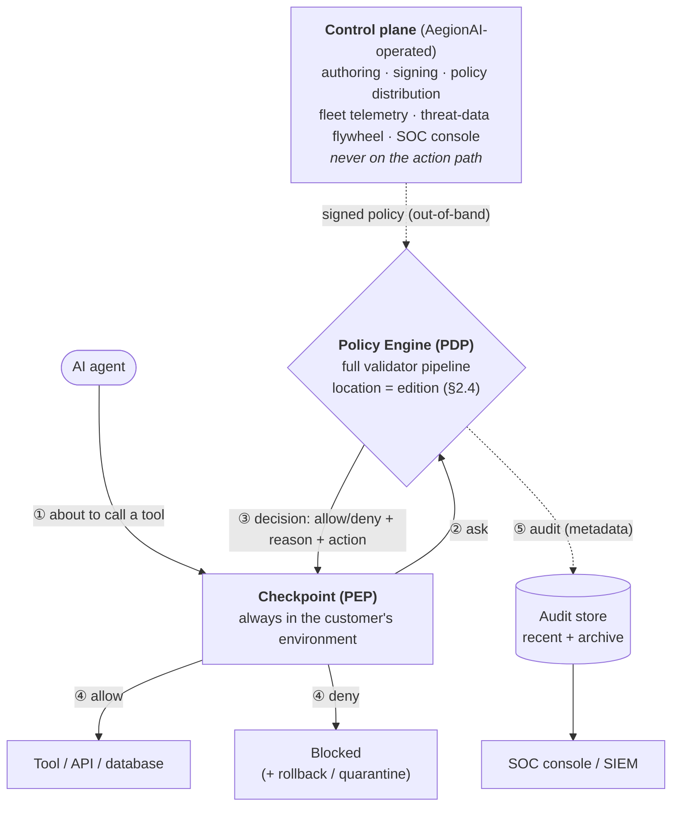
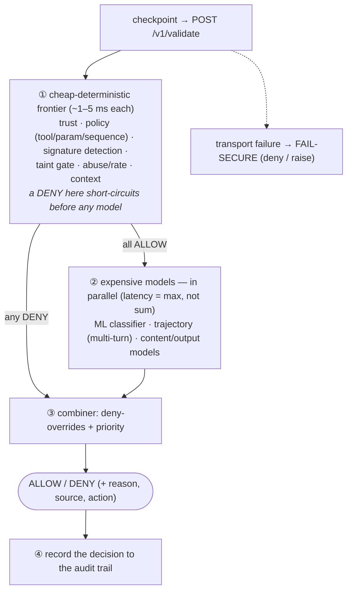
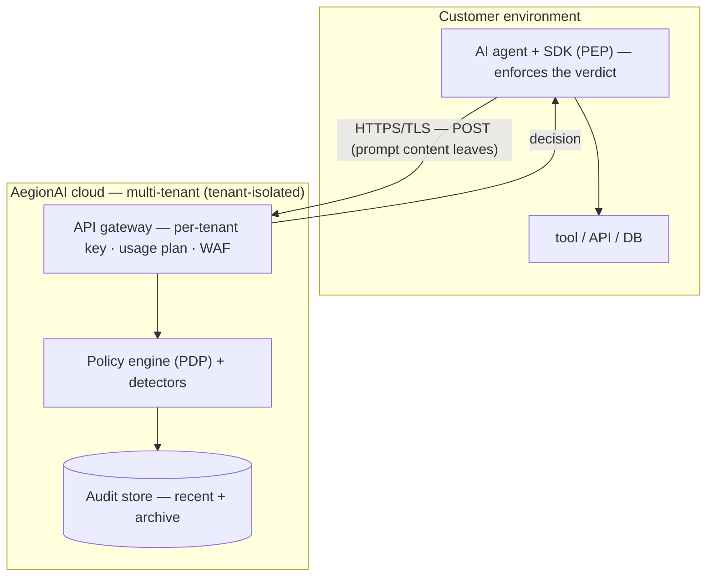
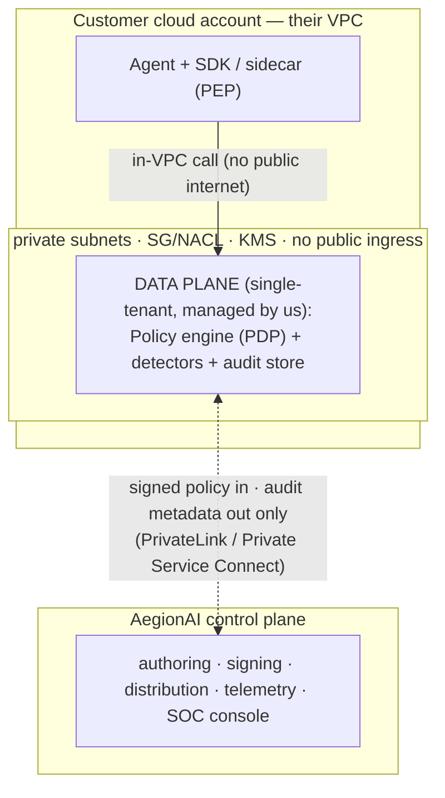
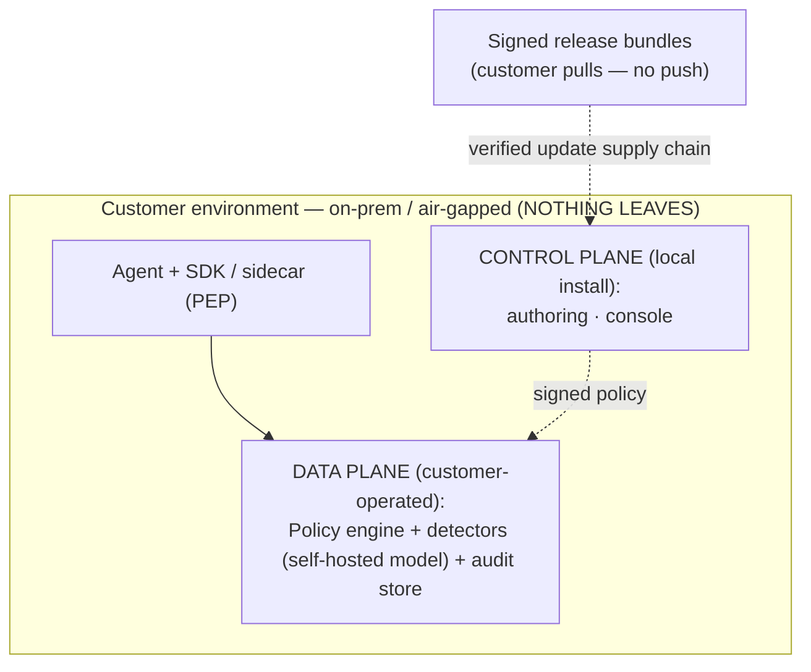

# AegionAI Guard — Architecture Brief (Investor / Technical Review)

> **CONFIDENTIAL — Do not distribute.** Shared in confidence for investor / technical evaluation. Please do not forward, copy, or share outside your firm without the founder's consent. © 2026 AegionAI. All rights reserved.

*A standalone technical overview for engineering reviewers: where we sit, how a decision is made, how we deploy (multi-tenant cloud, inside your VPC, or air-gapped), our threat model, and how we handle security, scale, and reliability. It is honest about what's built today versus on the roadmap.*

---

## 1. Context

### 1.1 Background

AI agents have moved from generating text to **taking actions** — calling tools, APIs, and databases that move money, change records, delete infrastructure, and send messages. Enterprises increasingly run these agents across more than one cloud (AWS Bedrock and Azure OpenAI/Foundry today; GCP Vertex on the roadmap) and want them to run with little human supervision. The operational reality:

- Agents act at machine speed; a wrong or manipulated action causes real damage before a human notices.
- Existing tooling **detects and warns** at the per-call level; nothing **enforces** at the action level across a fleet and across clouds.
- The team that must approve this (the CISO) cannot accept a design that adds unacceptable latency, becomes a single point of failure, or exfiltrates sensitive data.

### 1.2 Problem statement

**AI agents now take consequential actions on their own — across more than one cloud — and nothing stops a harmful action in the moment.** Today the only real safeguard is a human re-validating each action, which doesn't scale and defeats the purpose of autonomy. Existing tools detect and warn; none *enforce* at the action level, contain a compromised agent before it cascades, or do so across clouds and on-prem. **The job is to replace that human checkpoint with an automated one that's safe enough to trust.**

The hard part is doing this within three constraints the buyer won't compromise — **sub-500ms latency, no new single point of failure, and a customer-controlled data boundary** (what leaves, if anything, is the customer's choice). Most decisions below trace back to these. (Today's latency reality and the path to the sub-500ms target are in §2.6 — it is a target, not yet met.)

### 1.3 Tenets (design principles that break ties)

1. **Enforcement is local; the control plane is never on the action path.** The decision authority may be remote, but the *enforcement point* lives in the customer's environment.
2. **Fail secure, never fail open.** Any failure denies (or degrades to the cached hard-rule floor) — it never silently permits.
3. **Deny-by-default, explainable.** Every verdict names its deciding source and is auditable.
4. **Defense in depth.** Independent layers; evading one is caught by another; no single point of detection failure.
5. **Latency scales with risk, not volume.** Cheap deterministic checks first; expensive models only on borderline cases.
6. **The data boundary is the customer's to set.** What leaves is a deployment choice; sensitive values are redacted or never leave.
7. **Multi-tenant and multi-cloud from the foundation**, not retrofitted.
8. **Honest staging.** Ship deterministic floors first; layer ML and deeper detection behind shadow-then-enforce gates.

---

## 2. Architecture

### 2.1 System context (logical view)

This is the **logical** architecture — the components and the action flow, independent of *where* each piece physically runs. Physical placement per deployment edition is in §2.4.

**Where each piece runs = the deployment edition (§2.4):** the **checkpoint (PEP)** is always in the customer's environment; the **policy engine (PDP) + audit store** run in AegionAI cloud (Serverless), the customer's VPC (Dedicated), or on-prem / air-gapped (Self-Managed); the **control plane** is always AegionAI-operated and off the action path.

- **Checkpoint (PEP)** — intercepts the action, asks the engine, and **enforces the returned verdict**. SDK decorator today; connector interceptor; network sidecar on the roadmap.
- **Policy engine (PDP)** — runs the **full validator pipeline** and returns a **decision + reason + deciding source + action**: trust → policy (tool/parameter/sequence) → signature detection → ML classifier → deeper detection layers (multi-turn trajectory, indirect/multimodal content, output/DLP, taint, memory, network/egress, provenance) → cross-agent trust → abuse/rate, combined by a deny-overrides combiner. A DENY can carry an **action** the checkpoint enforces: block, compensating rollback, or quarantine.
- **Control plane** — policy authoring, signing, distribution, fleet telemetry, SOC console, and the cross-cloud threat-data flywheel. **Never on the action path.**
- **Audit store** *(a role, not a fixed product)* — a low-latency recent-decision store + an append-only long-term compliance archive (today DynamoDB + CloudWatch on AWS; pluggable per cloud / on-prem). Feeds the SOC console, SIEM export, and the threat-data flywheel.

### 2.2 The decision flow (one action)

One endpoint, `POST /v1/validate`, branches on a `phase` field (`request` | `content` | `output` | `memory`). `content` is multimodal — text **and images** (e.g., a fraudulent photo in an insurance/claims submission). The common `request` phase:

- A **signature DENY short-circuits before any model is invoked** — preserving "cheap-deny skips the model cost."
- The combiner is **deny-overrides with explainable priority** — it names the deciding source.
- **Every decision is recorded to the tamper-evident audit trail** — a recent-decision store plus a long-term archive — with **at-least-once delivery** (durable local buffer + retry), so no decision is lost off the response path.
- **Today the pipeline runs sequentially**; the parallel-gather scheduler is a prerequisite before more detection layers are added (see the critical-path note in §2.6).

### 2.3 Components

| Component | Role |
|---|---|
| **Checkpoint / SDK** | Enforcement point — intercepts the action, calls the engine, enforces the verdict (fail-secure) |
| **Policy decision engine** | Cedar evaluation of tool / parameter / single-session sequence |
| **Detectors** | Signature (live), ML classifier, deeper layers across phases, multimodal/image threats |
| **Trust & containment** | Per-agent/session trust, quarantine, cross-agent filtering, abuse/rate |
| **Rollback coordinator** | Per-action compensating adapters keyed by the captured effect handle; dependency-ordered; reversibility checks |
| **Audit store** | Recent-decision store + append-only compliance archive; request-id correlation |
| **Connectors / Import** | AWS Bedrock, Azure (GCP roadmap); connect an account, discover agents, auto-seed a starter policy |
| **Management plane** | Agent registry, policy authoring/CRUD, structured YAML/JSON → Cedar, monitor-mode seeding |
| **Control plane / console** | Policy signing/distribution, fleet telemetry, SOC console |

**Effect capture (how rollback knows what to reverse).** Rollback is *compensation for already-committed writes*, so it needs two things the pre-execution checkpoint doesn't have: confirmation the action ran, and the **side-effect handle** to reverse (e.g., the transaction / refund id). The **SDK checkpoint captures the tool's result on the ALLOW path** (it wraps the call) and reports the handle back, keyed to the action; the rollback coordinator stores it and dispatches the matching per-action reverser. This is **natural in SDK mode and limited at the network-sidecar layer** (which sees bytes, not app-level handles), so rollback is scoped to SDK-integrated, reversible, handle-returning actions. Compensation is **ordered by recorded dependency, not naive LIFO**, so concurrent tool calls reverse correctly.

### 2.4 Deployment models (where the policy engine runs)

The control plane is always remote and off the path; the **policy engine (PDP)** location is the edition. This is the central lever for the latency / availability / data-boundary constraints.

| Edition | Where the engine runs | What leaves the customer boundary | Interception | Status |
|---|---|---|---|---|
| **Serverless** (multi-tenant) | AegionAI cloud | Prompt content (redaction roadmap) + metadata | SDK decorator / connector (+ in-process local tier, roadmap) | **Today** |
| **Dedicated** (single-tenant) | In the customer's VPC (managed by us) | Only metadata (audit + trust) | SDK + network sidecar | Roadmap |
| **Self-Managed** (air-gapped) | In the customer's environment, customer-operated | Nothing | SDK + sidecar | Roadmap |

In Serverless today, every guarded call is a network round-trip to the controller, and content leaves the boundary (policy + signature detection run server-side). The **in-process local tier** — signed cached policy evaluated locally with no round-trip — is the roadmap that delivers the latency and "keep running on outage" story. The **in-VPC editions** move the whole engine into the customer's boundary.

#### Per-edition topology (network & security boundary)

**Serverless (multi-tenant — today).** *Security: TLS in transit, per-tenant API key + usage plan + WAF, encryption at rest, strict multi-tenant isolation. Trade-off: request content crosses to AegionAI cloud (redaction is roadmap).*

**Dedicated (single-tenant — managed by us, inside the customer's cloud).** *Security: the whole engine runs in the customer's VPC — private subnets, security groups/NACLs, KMS-encrypted store, no public ingress, egress only to the control plane. Only audit metadata + trust signals leave; prompt content never leaves the VPC.*

**Self-Managed (air-gapped — customer-operated).** *Security: fully isolated — no outbound to AegionAI; signed/verified update supply chain. Everything (enforcement, detection, control plane) runs inside the customer's boundary.*

#### Ownership, billing & IP — Dedicated and Self-Managed

Both editions run the data plane **in the customer's own cloud account and VPC** (the BYOC — *bring-your-own-cloud* — model), ideally the same VPC where their agents already run.

| Concern | Customer | AegionAI |
|---|---|---|
| Cloud account, VPC, compute/storage | **Owns & pays the cloud bill directly** | — |
| Data (prompts, actions, audit content) | **Owns; stays in their account** | — |
| Data-plane software, deploy automation, model weights | — | **Owns (licensed)** |
| Operations, updates, SLA | **Self-Managed: customer** | **Dedicated: AegionAI (managed)** |

**Why BYOC:** (1) **data residency** — content never leaves the customer's account; only audit metadata leaves (Dedicated), or nothing (Self-Managed); (2) **their cloud, their cost control** — they pay their own provider for compute, applying committed-spend discounts; (3) **co-located with the agents** — the agent→engine call is an in-VPC hop (low latency, no public internet); (4) **a clean trust boundary** regulated buyers can accept.

**Provisioning & access.** Lead with **pull-based** deploy — the customer's cluster pulls signed images/config (Helm + GitOps) and a management agent reports health — so we hold **no standing push-access** into their account. This also draws the line: **Dedicated = AegionAI operates it (connected); Self-Managed = the customer operates it (air-gappable).**

**IP protection (software runs in the customer's environment).** The moat is **cross-cloud + in-boundary deployment + the threat-data flywheel + patent — not binary secrecy** (a copied snapshot is stale plumbing with no updates, no data, and a license/patent breach). We still raise the bar: **compiled** (non-interpretable) artifacts, **encrypted model weights**, optional **confidential-computing enclaves** (AWS Nitro Enclaves · Azure Confidential VMs · GCP Confidential VMs) so even the customer's own admins can't read the running model, **signed + licensed** releases, and crown-jewel models kept cloud-side for connected editions.

### 2.5 Threat Model & Security

We are a high-value target; security is designed **adversary-first**.

**Adversaries → primary control:**

| Adversary | What they attempt | Primary control |
|---|---|---|
| **Malicious / manipulated agent** | exceed policy; run a destructive or money-moving action | deterministic policy (tool / param / sequence) + detection, enforced *before* execution |
| **Hijacked / compromised agent** | pivot, attack other agents, cascade | trust scoring + quarantine; cross-agent message filtering; blast-radius containment (roadmap) |
| **Attacker on the detection layer itself** | evade the classifier (adversarial prompts, obfuscation); flood `/v1/validate` (DoS) | **defense in depth** — independent layers, so evading one is caught by another; rate-limit + backpressure + fail-secure on overload |
| **Malicious tenant** (multi-tenant Serverless) | reach another tenant's data or policies | tenant context enforced at the data layer; isolation tests; single-tenant boundary (Dedicated/Self-Managed) removes the surface |
| **Network attacker** | intercept or tamper with the decision path | TLS; private subnets / PrivateLink for in-VPC editions; signed policy + tamper-evident audit |
| **Compromised control plane / malicious insider** (integrity) | push a malicious "allow-all" policy | signing key in a **separate trust domain** (below); fail-secure floor; transparency log of policy pushes |
| **Curious / malicious AegionAI operator** (confidentiality) | read unredacted Serverless request content (live exposure today — content leaves; redaction is roadmap) | least-privilege operator access + access auditing; input-side redaction (roadmap); **in-VPC / air-gapped editions remove the exposure entirely** |
| **Supply chain** | tamper with our software or updates | signed, versioned releases; customers verify signatures (air-gapped pulls) |
| **Spoofed caller** | impersonate another agent to inherit its policy | verified per-agent credential — authoritative identity from the credential, not a self-asserted field |

**Critical aspects → how we address each:**

| Critical aspect | How we address it |
|---|---|
| **No-bypass / interception integrity** | *(roadmap-gated)* today's SDK interception is **cooperative** — an unwrapped tool or a raw call escapes it (CI tooling flags unwrapped tools as a weak compensating control). The **network sidecar (roadmap)** makes coverage **non-bypassable** for in-boundary editions — that's the property that truly closes this; it is **not enforceable today.** |
| **Agent identity / anti-spoofing** | every managed agent presents a credential (issued at import); the controller derives the authoritative `(tenant_id, agent_id)` from the **verified credential**, never a self-asserted field |
| **Tenant isolation** | tenant context **enforced at the data layer, not just in app code**, with cross-tenant isolation tests and per-tenant encryption (Serverless — the only shipping edition, so this is where it matters most); single-tenant **deployment** isolation removes the surface entirely for Dedicated/Self-Managed |
| **Data boundary / confidentiality** | redaction before egress; in-VPC / air-gapped editions keep content in-boundary; action content not persisted by default |
| **Policy & supply-chain integrity** | signed + versioned policy bundles; signed, licensed software releases; tamper-evident audit log |
| **Fail-secure** | any validation failure denies (or degrades to the cached deterministic floor); never fails open |
| **Denial-of-service / self-protection** | per-agent rate/abuse limits; controller backpressure and bounded queues; under overload the latency target degrades gracefully and the system fail-secures — it never opens |
| **Key & secret management** | the **policy-signing key lives in a separate trust domain** (HSM / offline root, dual-control to publish), so a compromised control plane cannot mint a valid malicious policy; KMS-encrypted stores; no long-lived secrets in plaintext |
| **Network security** | private subnets, PrivateLink / Private Service Connect, no public ingress (per edition) |
| **IP / model protection** | compiled artifacts, encrypted weights, confidential-computing enclaves |

**Interception modes — how every action is captured:**

| Mode | What it is | Fits |
|---|---|---|
| **SDK decorator** | one wrapper per tool; calls `/v1/validate` before the tool body runs | fast pilots; Python agents |
| **Connector interceptor** | hooks the cloud's own tool-execution point — the **Bedrock action-group Lambda** or **Azure Function** that backs a tool — so the agent's own code is unchanged | Bedrock / Azure agents |
| **Network sidecar** | intercepts tool calls at the network layer; zero-code, framework-agnostic, **non-bypassable**, on-by-default and customer-controllable | in-boundary editions (Dedicated / Self-Managed) |

**On control-plane compromise.** Because (a) enforcement is local and fail-secure and (b) the **policy-signing key is held outside the control plane** (HSM / dual-control), a compromised control plane cannot make the checkpoint permit a malicious action — it can't produce a validly-signed policy, and every policy push is recorded in a **customer-visible transparency log** so an unexpected change is detectable. The residual risk is the signing key itself — hence the separate trust domain and rotation.

### 2.6 Scalability

We scale along several independent dimensions:

| Scale dimension | How we plan to achieve it |
|---|---|
| **Per-decision latency under concurrency** | stateless workers; async / non-blocking model calls; in-process policy + signature cache; the **in-process local tier** removes the network round-trip for the deterministic floor |
| **Throughput (actions / sec)** | horizontally-scaled, stateless controller; cheap deterministic checks short-circuit before any model |
| **More detection layers over time (without latency blow-up)** | a **parallel-gather scheduler over a cost-annotated DAG** — cheap-deterministic frontier first (a DENY short-circuits before models), then expensive models in parallel → latency = `max(models)`, not `sum` |
| **Model inference** | distilled CPU model on the hot path (scales cheaply, horizontally); heavier model only on the borderline subset (cascade); GPU autoscaling for escalation / offline re-scoring |
| **Fleet size (# agents)** | indexed per-agent policy lookup + caching; agent registry |
| **Tenants (# customers)** | tenant-scoped data and quotas (Serverless); single-tenant-per-deployment scaling (Dedicated / Self-Managed) |
| **Audit / telemetry volume** | writes are off the response path with **at-least-once delivery** (durable buffer + retry); hot recent-store + long-term archive; pluggable shipper |
| **Multi-region / multi-cloud** | data planes co-located with agents per region/cloud; control plane aggregates fleet-wide |
| **Policy propagation at scale** | signed, cached bundles + version-row invalidation → a change takes effect fleet-wide in **seconds**, not "up to the TTL" |

**Latency — targets vs today (be precise).** These are *targets*, not current measurements: deterministic path **≤ 500 ms p99** at load · fast-ML hot path **≤ 900 ms** · deep-model escalation bounded **≤ 2.5 s** · distilled local model **< 100 ms**. **Today (Serverless) it is ~0.6–1.2 s deterministic / ~0.9 s with ML**, because every call is a network round-trip and the pipeline runs sequentially. **Meeting the money-movement bar is gated on two roadmap items — the in-process local tier (removes the round-trip) and the parallel-gather scheduler** — which is the central technical risk to the synchronous-on-money-movement use case.

**Critical-path note.** Defense-in-depth is *double-gated*: each new detection layer needs (a) its phase wired (only `request` is live; `content` / `output` / `memory` are roadmap) **and** (b) the parallel-gather scheduler so layers run in parallel rather than stacking latency — plus, for non-`request` phases, the sidecar. The scheduler therefore ships **before** new layers go active.

### 2.7 Reliability & Resiliency

Fail secure, never fail open. The failure matrix:

| Failure | What breaks | What still holds | Agent impact |
|---|---|---|---|
| **Control plane unreachable** | Policy updates, dashboards, fleet telemetry pause | Engine keeps deciding; cached signed policy | None (control plane is off-path) |
| **Engine unreachable (Serverless, today)** | The decision call fails | SDK **fail-secure**: DENY by default, or raise if configured | Guarded actions **blocked** (secure, but not "keep running") |
| **Engine unreachable (with in-process local tier, roadmap)** | Advanced detection pauses | Local deterministic floor keeps enforcing | Agents **keep running** on the hard rules |
| **ML / deep models unavailable** | Semantic detection degrades | Deterministic floor + signatures unaffected | Decisions on hard rules; flagged for re-scan |
| **Stale policy** | Running on an older bundle | Versioned + signed; invalidation propagates in seconds; max-staleness can fail-closed for money-movement | Bounded, configurable |

Per-agent fail mode (fail-closed vs degrade-to-floor) is configurable; money-movement defaults to fail-closed.

### 2.8 Data, Privacy & Compliance

**What crosses the boundary (Serverless, today):** every guarded call sends the action — agent, tool, parameters, the user's prompt, session id — to the engine, because policy and signature detection run server-side. Content leaves, unredacted today. Mitigations by edition and roadmap:

- **Input-side redaction** — redact PII/secrets before content leaves; the engine sees the shape, not the secrets.
- **Output-side data-loss checks** — detect and REDACT/HOLD sensitive data the agent is about to emit.
- **In-VPC / air-gapped editions** — content never leaves the customer boundary.
- **Storage & audit:** action content is **not persisted by default**; only audit metadata is retained — a recent-decision store plus a long-term archive (the compliance system of record), encrypted in transit and at rest, with configurable retention. Every decision is recorded to this tamper-evident trail with **at-least-once delivery** (durable buffer + retry).
- **Subprocessor:** the canonical detector is an **owned, self-hostable model** (§3, decision 10); a hosted model is an **optional extra signal in Serverless only** (a subprocessor a CISO must vet). In-VPC / air-gapped editions self-host the model — **no external subprocessor on the detection path.**
- **Compliance & certifications:** **SOC 2 Type II (in progress)** is table-stakes, then ISO 27001 and (per vertical) HIPAA / PCI-DSS; the tamper-evident audit trail supports GDPR / EU AI Act evidence. **Certifications + redaction + a DPA make Serverless acceptable for most customers and many bank workloads** (only redacted, ephemeral content is processed, none retained by default); **residency-bound workloads use the in-VPC / air-gapped editions** — a certification does not override a data-residency mandate.
- **Moat vs. residency (the honest tension).** The cross-cloud threat-data flywheel is strongest in Serverless and weakest exactly where customers are most sensitive (Dedicated leaks only metadata; Self-Managed nothing). We resolve it by sharing **detections / signatures and opt-in model-gradient updates — never content — from in-boundary editions**, and those editions still *receive* improved models through the update channel. The flywheel runs on Serverless volume + a public-data base + opt-in federation; strict editions trade central learning for total residency, by design.

### 2.9 Operations

- **Infrastructure as code**, per-concern stacks (network / storage / compute / api / monitoring).
- **Deploys:** scripted, immutable, versioned releases; rollback by re-pointing to a previous version.
- **Safe rollout:** every new detector ships in **shadow** (records signals, no verdict effect) until its precision/recall is signed off, then is promoted to enforce.
- **Observability:** per-validator metrics, decision-source attribution, latency timing; the audit store powers the SOC console (per-session timeline, decision sources) and SIEM export.
- **SLOs:** enforcement availability ≥ 99.99% — meaning we always return a *safe* decision (today: **deny** when the controller is unreachable; once the in-process local tier ships: **keep enforcing the cached floor**), not "the agent keeps working." Control-plane availability 99.9% → 99.99%; latency budgets per §2.6.

### 2.10 Metering & Billing

**We charge per *governed agent* (tiered), not per action.** Metering per validation would tax coverage — customers would wrap fewer tools to cut cost, which is the wrong incentive for a safety product. Per-agent pricing rewards full coverage and gives clean land-and-expand. What differs by edition is **who bears the infrastructure cost**:

| Edition | AegionAI charges | Who pays infrastructure |
|---|---|---|
| **Serverless** | per-agent subscription (tiered); infra bundled in | **AegionAI** (we host the multi-tenant cloud) |
| **Dedicated** | per-agent / per-fleet subscription + managed-service premium | **Customer** — the data plane runs in their account |
| **Self-Managed** | annual license (per-agent / per-fleet / site) + support | **Customer** — their infrastructure and operations |

The revenue basis is consistent (per governed agent) across editions; only infra ownership shifts. For **air-gapped Self-Managed** (nothing leaves), agent count for licensing is established by **periodic signed attestation** the customer exports, not live telemetry.

---

## 3. Key architecture decisions

| # | Decision | Why |
|---|---|---|
| 1 | **Control plane off the action path; enforcement point local** | Latency, availability, no single point of failure |
| 2 | **Cedar** as the policy engine | Fast, formally-grounded, embeddable (enables the in-process local tier) |
| 3 | **One `/v1/validate` endpoint with a `phase` field** | Three moments (action / content / output) = three round-trips regardless of URL count; keeps the surface small |
| 4 | **Deterministic-first, models in parallel** (DAG scheduler) | Latency scales with risk; a cheap DENY skips model cost |
| 5 | **Signature floor (live) + ML escalation** | Explainable, version-controlled deterministic floor; ML added behind an eval gate |
| 6 | **Edition = where the engine runs** | The data-boundary lever; lets regulated buyers keep content in-boundary |
| 7 | **Verified per-agent identity over self-asserted id** | A shared key can't prove *which* agent is calling |
| 8 | **Multi-tenant from the foundation** | Onboarding customer #2 is a data operation, not a re-architecture |
| 9 | **Fail-secure, signed policy, tamper-evident audit** | Never fail open; complete, tamper-evident decision trail |
| 10 | **Self-hostable owned model as the canonical detector** | Proprietary API models can't run in a customer VPC / air-gapped env and aren't uniform across clouds; an owned, self-hostable model (off-the-shelf → fine-tuned) gives identical behavior in every edition. Proprietary models are an optional extra signal in Serverless only |

---

## 4. Built today vs roadmap (honest)

**Built today**
- SDK checkpoint (cooperative), fail-secure on outage, tamper-evident audit trail
- Serverless (multi-tenant) edition
- Signature-rule detection (injection / jailbreak) — the live, always-on floor
- Tool + parameter policy, single-session sequence, trust & quarantine (single-cloud)
- Abuse / rate detection (live)
- Compensating rollback (per-action adapters; single-cloud)
- AWS Bedrock + Azure connectors; live cross-cloud demo

**Roadmap**
- ML classifier promoted from shadow to enforce (pending precision-recall sign-off)
- Distilled local classifier (in-process, CPU, < 100 ms) and self-hostable owned model for in-VPC / air-gapped
- In-process local enforcement (no round-trip) + degrade-to-cached-floor on outage
- Input-side redaction + output-side data-loss checks
- Multi-phase detection layers (content / output / memory): multi-turn trajectory, indirect/multimodal injection, taint tracking, memory integrity, network/egress, provenance
- Parallel-gather scheduler (prerequisite to adding layers); no-bypass network sidecar
- Dedicated (in-VPC, managed) and Self-Managed (air-gapped) editions; verified agent identity
- GCP connector; cross-cloud blast-radius containment
- Compliance reports; SOC 2 Type II (in progress)

---
*Technical architecture brief. The system is deliberately staged — a deterministic enforcement floor that ships today, with ML and deeper detection layered behind shadow-then-enforce gates, and the in-boundary editions that take it cross-cloud and air-gapped.*
