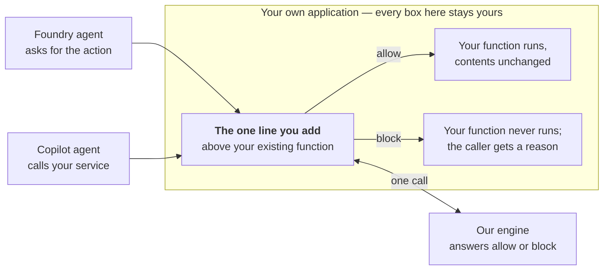
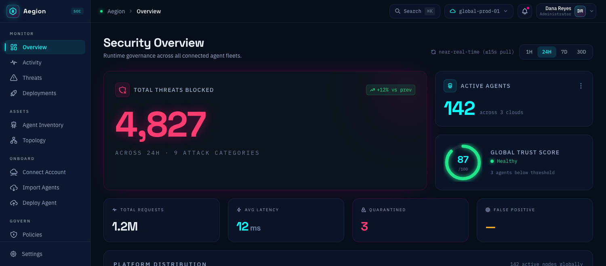

# AegionAI Guard — how we work with your Microsoft Foundry and Copilot agents

*For Azure and platform teams · 11 September 2026 · Everything below is marked **today** or **not built yet**.*

Just before your agent does something — moves money, sends a file, changes a record — we check that action and answer **allow** or **block**, with a reason. We weigh what it is doing, the values it filled in, who is asking, and what already happened in the same conversation. No answer means block.

**Example:** your rule caps refunds at $500 and requires identity verified first. A poisoned support ticket asks for $5,000 and claims identity was confirmed by phone. Blocked before any money moves.

## 1. Where does the check sit?

**Inside your own function, on the way in.** You add one line above a function you already have. When the agent calls it, that line asks us first, and your code then runs untouched only if the answer is allow. We do not rewrite your function, host it, or route your traffic through us.

**With Foundry:** your application asks the agent what to do next; the agent answers *"call process_refund with these values"* but carries nothing out. **Your** application does that — and the function it calls is the one you annotated. On a block, your application hands the refusal back to the agent as the result of that step, and the agent explains it.

**With Copilot:** the agent picks one of the actions its builder gave it — a connector, a flow step or a tool server pointing at **your** service. Microsoft calls your service, and the function handling that call is the one you annotated. On a block, Copilot shows the person the reason.

**What we cannot check at this stage.** Some tools run entirely on Microsoft's servers — file search, web grounding, code execution, SharePoint and search connectors — and your code is never called, so there is no function to annotate. Copilot's own chat window is the same. That is where Microsoft's platform stands today, not a limit of ours, and it is identical in all three options below. Two ways it improves: bring the action into your own code or behind your own gateway and it is covered today; and a gateway option that covers all of an agent's tool calls at once is on our roadmap (**not built yet**).

## 2. How much has to change on your side?

**A few lines per action, in the function that carries it out.** Nothing about how your agent is built, prompted or hosted changes — your model, framework and deployment stay as they are. You install a small library into your existing application, set it up once at start-up, then mark each action you want governed.

**Effort, as an estimate:** about a day for the first action including agreeing the rule and testing it; minutes for each one after. We have no third-party rollout to quote from yet, so treat that as an estimate.

## 3. What has to change in your setup?

**Three small things, and nothing structural.**

- Let your application reach our address over the internet — one outbound, encrypted connection.
- Store two secrets in your existing Azure Key Vault: our key, and the agent's signing key you create.
- Allow a little more time per guarded action, because the answer comes from outside.

No new servers, no network redesign, no change to how your agents are deployed, and no downtime beyond your normal release.

## 4. Do we install anything inside your account?

**Today, no.** Nothing of ours runs as infrastructure in your Azure subscription — only a small library inside your own application, plus the two secrets in your own vault. If you build a service for the check to sit in, that service is yours. That changes only if you later bring the whole engine inside your own network, which does need infrastructure there and is **not built yet**.

| | **Hosted by us** | **Inside your network** | **Fully disconnected** |
|---|---|---|---|
| Available | **Today** | **Not built yet** | **Not built yet** |
| Ours in your account | A library in your app | The engine itself | Engine and controls |
| What leaves you | The action's values, identifiers hidden first | Counts and status only | Nothing |

Which actions can be checked is **the same in all three** — any action your own code carries out. If the values inside an action may not leave your environment, the option you need is on our roadmap; ask us about timing, because no certificate replaces a residency rule.

## What you get

A console showing every action your agents attempted, what we answered and why — per agent, per conversation, in near-real time.

*Illustrative view with sample figures.*

**Overview** of what was blocked, which agents are live and their trust scores · **Activity and threats**, every decision searchable with the reason and the rule that decided it · **Agents and topology** across any cloud · **Policies** — the limits, the required order of steps, who may call what · **Quarantine** for agents whose behaviour has drifted · **Audit trail** for your reviewers.

## Onboarding

| When | What happens | Who |
|---|---|---|
| Kick-off, 30 min | Pick one agent and one action worth protecting | You and us |
| Day 1 | We hand over an address, a key and a console login; you install the library, create the agent's key, register the public half, and make one test call | Your engineer, about half a day, with us on the call |
| Weeks 1–2 | Run with blocking off and watch; we go through what your agents actually attempted | Together |
| Week 3, then on | Agree the rule, switch blocking on, test with a deliberate violation — then add the next actions, minutes each | Your security owner approves; your engineer switches on |

**What we need from you:** one engineer who owns the agent's code, one person who can approve the rule, and outbound access from your application to us.

## Data protection

- **What we receive.** What the agent is doing, the values it filled in, the user's message for that turn, and labels for agent, conversation and time.
- **Hidden inside your environment, before anything is sent.** Card numbers (only first six and last four kept), card security codes (removed completely), emails, web links, network addresses, US social security numbers, North American phone numbers, dates, anything labelled account, record or licence, and long secret-looking strings. If the hiding step fails, we block the action and send nothing.
- **Checked again on our side.** Before we store anything we re-scan the whole record; if we find an identifier that should have been hidden, that content is thrown away instead of stored, and an alert is raised.
- **What the hiding does not catch.** We find identifiers by their pattern or their label, so personal details written into ordinary sentences — a name or address inside a note — are not caught, and nor are identifiers used outside the US or numbers sent as numbers rather than text. Catching names inside sentences needs a language model on our side and is **not built yet**, so keep narrative notes out of the values you send if that matters.
- **Only your agents can speak for you.** Each agent has its own private key: you create it, you keep it, and we hold only the matching public half. Every call is signed with it, so we know the call genuinely came from your agent, nobody can impersonate you, and your records are filed under the identity in the signature rather than whatever the message claims.
- **Encrypted** in transit and in storage; you cannot hold your own keys yet. **Kept** 90 days by default, one year at most, with no download button yet.
- **Decision record.** Every action, the answer and why — we only ever add records, never edit them. They are not sealed, so we will not call it tamper-proof and please don't tell your auditors we did; sealing, longer retention and export are roadmap. Nor will we claim full anonymity: hidden values can in principle be recovered, and our software reads a value in order to hide it.

## Failure, speed, accuracy

- **We fail safe.** A slow answer, an unreachable engine or a failed hiding step all mean block. Right for money movement, a real trade-off elsewhere — choose differently for read-only actions. **No offline mode today.**
- **Speed: we design for a verdict in under 500 milliseconds**, and that is the number to hold us to. A check crossing the public internet to our hosted engine is slower than that today; running the engine inside your own network is what brings it inside the target. Ask us for current measurements before you commit to a number in your own design.
- **Accuracy: about 97 in 100** attempts to smuggle data out are caught, and about **56 in 100** attempts to hide malicious instructions inside content the agent reads. So **your own rules are the floor** — the amount cap, the required order of steps — and our analysis is depth behind them.
