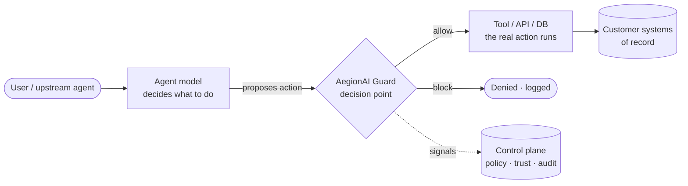
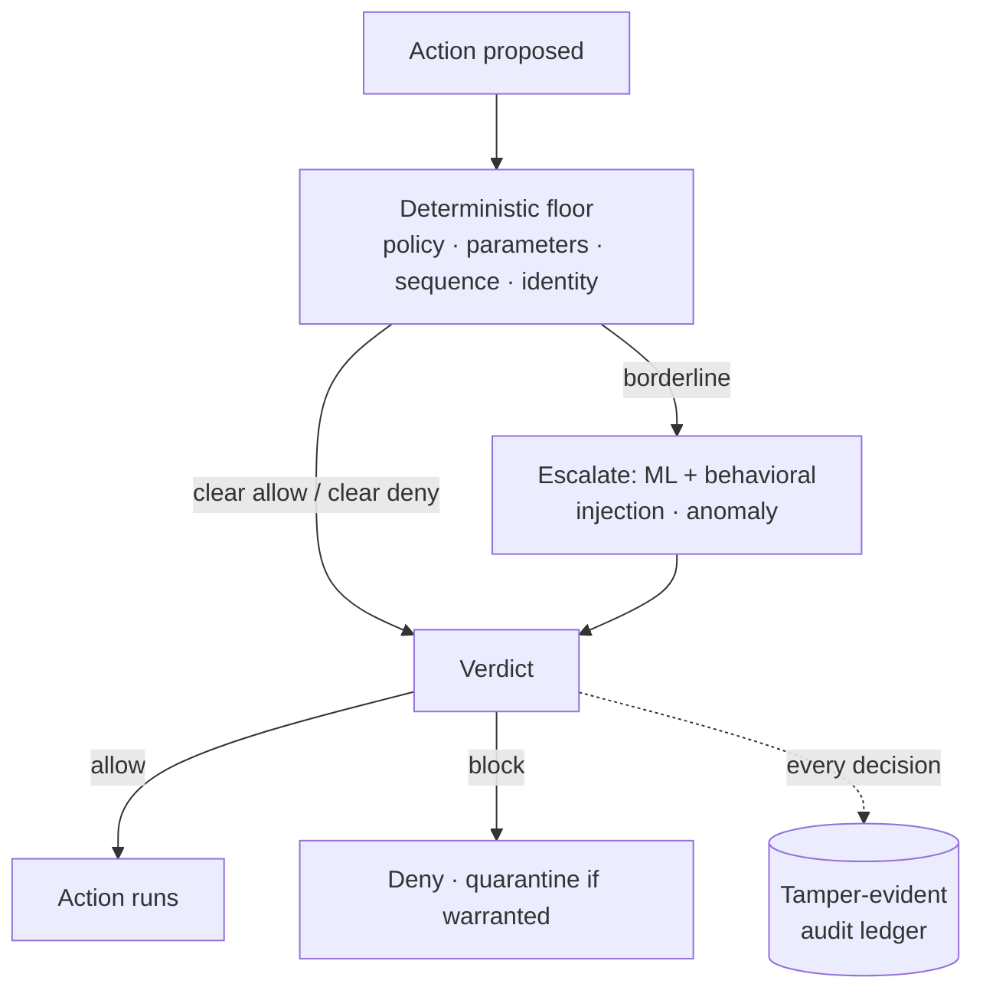
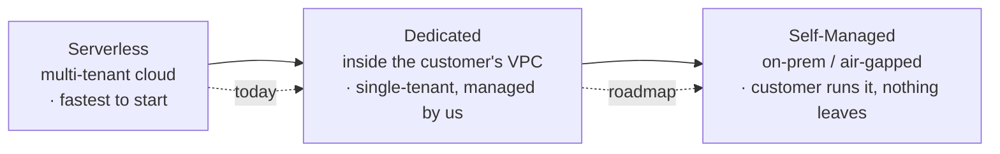

# AegionAI Guard — Architecture Brief for Investors

> **CONFIDENTIAL — Do not distribute.** Shared in confidence for investor evaluation. Please do not forward, copy, or share outside your firm without the founder's consent. © 2026 AegionAI. All rights reserved.

*A one-read overview of how AegionAI Guard works, why the architecture is the moat, and what is built today versus on the roadmap. Written for a technical investor — concrete enough to believe, high enough to read in ten minutes. Deeper engineering design is available under NDA.*

---

## 1. The thesis in one paragraph

AI agents have moved from *generating text* to *taking actions* — calling tools and APIs that move money, change records, delete infrastructure, and message customers, increasingly across more than one cloud. Each cloud now governs its **own** agents (AWS Bedrock AgentCore, Azure AI Foundry), but no one governs an enterprise's agents **across every vendor**. AegionAI Guard sits at the point where an agent's intent becomes a real action, and — neutrally, across AWS, Azure, GCP, and on-prem — decides whether that action should proceed, with full runtime context. It is the control plane the clouds structurally cannot be, because none of them will ever be neutral across its rivals.

---

## 2. Where we sit

The agent's model proposes an action; the **action itself runs in code the customer controls**. We insert a decision point between the two. A jailbroken model can be talked into *asking* for a $5,000 refund to an attacker's account — but it cannot move the money itself; the code that moves money is deterministic, and our gate sits on that code and fails closed.

**Three ways we sit in the path — the customer picks per workload:**

| Mode | What it is | Code change | Status |
|---|---|---|---|
| **SDK wrapper** | One line around each tool the agent can call. | Minimal | **Live** |
| **Cloud connector** | Hooks the agent's execution path natively (e.g. the function the cloud invokes to run the tool). | None to the agent | **Live** |
| **Network sidecar** | A proxy in the agent's outbound path; zero code, non-bypassable. | None | Roadmap |

This is the answer to *"what exactly is the integration point?"* — it always exists, it's always in code the customer controls, and it's the only place an action can actually be **stopped** rather than merely flagged.

---

## 3. How a decision is made

Static "may this agent call this tool?" is table stakes — it's the floor, and it's never where the damage is. The breach is an *allowed* agent calling an *allowed* tool with **attacker-controlled parameters** under an **injected prompt**. So we evaluate the action, not just the prompt.

What the decision actually considers, beyond "is the tool allowed":

- **Parameters** — amount ceilings, target account, data scope ("refund $5,000 to *this* account").
- **Sequence integrity** — were the required steps (KYC, approval, limit check) actually performed first, in order.
- **Identity & authorization** — is this action on behalf of a user authorized for *this* resource.
- **Prompt-injection / jailbreak** signals on the input.
- **Behavioral & trust state** — this agent's accumulated behavior this session (trust decays; a compromised agent gets quarantined and future calls auto-deny regardless of content).

**Two-speed by design.** The common case is a deterministic decision that runs locally — no network round-trip — and returns in **single-digit milliseconds**. Only genuinely ambiguous actions escalate to the heavier ML/behavioral layer. This is what makes in-path enforcement affordable.

---

## 4. Why it's fast and safe to adopt

In-path enforcement raises three questions any serious buyer (especially a bank) asks. The architecture answers each:

- **Latency.** The deterministic floor runs **locally, single-digit ms**, with no control-plane hop; only borderline actions escalate. The in-VPC enforcement hot path **targets well under 100 ms** — a roadmap figure: in-VPC isn't deployed yet, and today's Serverless path is ~0.6–1.2 s because every call is a network round-trip to us. (The ~500 ms figure sometimes compared against is the *network-inclusive, cloud-managed* path — not in-boundary enforcement.)
- **Reliability.** You deploy in **observe-only mode first** — we sit in-path but change nothing, logging every verdict we *would* have returned. Enforcement is turned on per workload only when trusted. If the control plane is ever unreachable, a **cached, signed policy keeps enforcing** — agents don't stop. Fail-open vs. fail-closed is a **per-tool decision the customer owns**.
- **Data exposure.** For regulated customers we run the *same* enforcement **inside their own cloud network**, or **on-premises / air-gapped**. Sensitive payloads never leave their boundary; only de-identified signals leave in cloud editions, and nothing leaves in air-gapped.

**On rollback — stated precisely.** The primary model is **block *before* execution**. Where an action has already run and is *reversible* (a compensating operation exists and the action returned a handle), we can compensate, in dependency order. We never claim the irreversible can be undone — once a wire settles, it's settled. Rollback is a bounded, opt-in capability, not a promise to un-ring every bell.

---

## 5. How we deploy — the ladder

The deployment model *is* the go-to-market ladder: land where adoption is frictionless, climb to where the ACV and the moat are.

The same enforcement logic runs in all three; what changes is *where the data lives* and *who operates it*. Banks and regulated buyers — who structurally cannot use a single-cloud or pure-SaaS competitor — are reachable precisely because the in-VPC and air-gapped editions exist.

---

## 6. Why the architecture is the moat

The intercept mechanism itself is not novel — WAFs and service meshes have intercepted calls for a decade. And neutral cross-vendor *visibility/detection* is no longer open ground — Zenity and CrowdStrike already span vendors, which validates the category but means "we're the only neutral one" isn't the moat. The defensibility is the *combination* of three legs none of them hold together — and *what that position accumulates*:

- **The stateful-action triad (the differentiator).** **(1)** action-level enforcement with session state (parameters + sequence + identity + trust decay/quarantine, not stateless prompt/content scoring); **(2)** bounded rollback + cross-agent cascade containment; **(3)** in-VPC / air-gapped action-gating for code-built agents. Each named player holds one or two legs; the moat is holding all three together.
- **Neutral by construction (now table-stakes-plus-position, not the moat alone).** Because we sit above any one vendor's execution path, we govern an enterprise's whole agent estate from one place. A cloud provider cannot occupy this position — it will never guard agents on a rival's cloud. This is the opening Wiz and Datadog used to build multi-billion-dollar companies *on top of* the clouds.
- **A cross-vendor threat-data flywheel.** Because we see agent behavior across AWS, Azure, GCP, and on-prem — for many customers — we assemble an attack-pattern dataset no single-stack player can. De-identified signals flow up; protection flows back down to every customer ("seen at one bank → all customers protected in minutes"). This is the CrowdStrike pattern, and it only exists for a neutral player.
- **Switching cost compounds.** As enterprises express their agent rules in our format and we become the cross-vendor audit system-of-record, leaving gets more expensive every month — the Kubernetes / Stripe path.

---

## 7. Built today vs. roadmap (honest)

We are deliberate about not overstating. What ships today is real; the differentiators that widen the moat are sequenced behind it.

| Area | Built today | Roadmap |
|---|---|---|
| **Deployment** | Serverless multi-tenant cloud | Dedicated (in-VPC), Self-Managed (air-gapped) |
| **Integration** | SDK wrapper, cloud connector | Zero-code network sidecar |
| **Decision** | Deterministic policy floor (live, shadow→enforce) | ML / behavioral layer promotion (runs in shadow today) |
| **Enforcement** | Block-before-execute, quarantine, fail-secure | Bounded rollback coordinator; cross-agent cascade containment |
| **Vendors** | AWS Bedrock + Azure (two-cloud enforcement demo runs today) | GCP Vertex; verified per-agent identity |
| **Latency** | Serverless cloud path (~0.6–1.2 s, network round-trip) | **Sub-100 ms in-VPC deterministic floor** (target; needs in-VPC + local in-process tier) |
| **Audit** | Tamper-evident audit ledger / system-of-record | Forensic chain-of-thought, deeper compliance reporting |

A working demonstration enforcing across two clouds (AWS and Azure) runs today — the proof that the neutral position is buildable, not just describable.

---

*Companion docs (shared in confidence): [STRATEGY.md](STRATEGY.md) (market / GTM / moat) · [AegionAI-pitch.md](AegionAI-pitch.md) (the why).*
