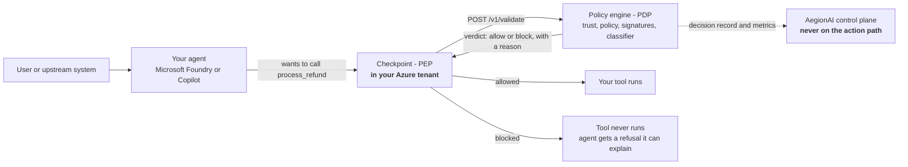
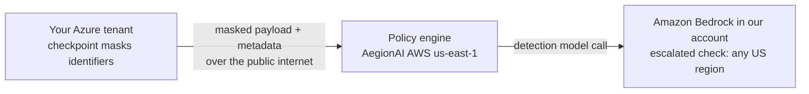

# AegionAI Guard — Microsoft integration guide

**For:** Azure developers and enterprise platform teams building agents on Microsoft Foundry Agent Service and Microsoft Copilot.
**Last updated:** 2026-09-11. **Capability status:** every claim below is marked *Available today*, *Limited*, or *Not built yet*.
**Companion document:** [AegionAI Guard — product overview](AegionAI-Guard-product-overview.md) covers what Guard defends against and how the layers of defence work. This guide does not repeat it.

AegionAI Guard checks each action your AI agent is about to take, and answers allow or block. It looks at four things: which tool the agent wants to call, the values the model filled in, who is asking, and what already happened earlier in the conversation. Your code enforces the answer before the action runs.

This guide covers:

- where to put the check in a Microsoft agent;
- what exists today on each Microsoft surface;
- the three places our policy engine can run, only one of which you can use today;
- exactly what data leaves your Azure tenant.

Three words we use throughout, defined once. A **checkpoint** is the small piece of code inside your environment that pauses the action and asks for a verdict — in industry language, a Policy Enforcement Point (**PEP**). The **policy engine** is what answers — a Policy Decision Point (**PDP**). A **verdict** is the answer: `ALLOW` or `DENY`, plus a reason.

**Contents.** 1 How it works · 2 Quickstart — what you need and the eight steps · 3 Microsoft Foundry Agent Service (3.1 which tools you can guard · 3.2 your tool loop · writing your first policy · 3.3 Azure Functions tool · 3.4 HTTP/OpenAPI tool · 3.5 MCP · 3.6 what no checkpoint can reach · 3.7 our reference interceptor) · 4 Microsoft Copilot agents · 5 Option 1: SaaS, available today · 6 Option 2: private VNet, not built · 7 Option 3: air-gapped, not built · 8 Comparing the three · 9 Data security · 10 When something fails · 11 Latency and cost · 12 FAQ · 13 Appendix.

---

## 1. How it works in 60 seconds

Three pieces — two on the path of every action, and one off it.

1. **The checkpoint runs inside your environment, always.** It sits in your agent's tool-calling code, your Azure Function, or your API. It intercepts the action, asks for a verdict, and enforces it. If it cannot get a verdict, it denies.
2. **The policy engine answers.** It runs four checks. Two are fast rules: your written policy, and a list of known attack patterns. Two are slower: a trust score for the session, and a machine-learning classifier. We run the fast ones first; only if they do not settle the answer do we run the slow ones — we call that **escalating**. One verdict comes back, with a reason and which check decided.
3. **Our control plane** — policy authoring, the console, fleet reporting — is architecturally off the action path; it publishes policy and collects reporting, nothing else. Note the limit: in the SaaS option the *decision* still comes from our cloud, so if we are unreachable your guarded actions are denied (§10). A local decision that survives our outage arrives with the in-VNet option (§6).



The worked example we use everywhere: `process_refund` is capped at $500 and is only allowed after `verify_customer_identity` in the same session. A poisoned support ticket asks the agent for a $5,000 refund and claims "identity already confirmed by phone". That single action breaks two policy rules and trips injection detection, so it is denied before any money moves.

---

## 2. Quickstart — what you need, and the eight steps

**What you need**

- An agent whose tool-calling code, tool endpoint, or tool host **you control**. This is the single hard requirement. If Microsoft executes the tool inside its own plane, there is nothing for a checkpoint to sit in front of (§3.6).
- **Four things from us:** an API base URL, an API key, your tenant id, and an agent id. You generate the agent's signing keypair yourself (§9.4) and register only the public key, which we acknowledge with a key id (`kid`); the private key never leaves your environment. Put the API key and the private key in Azure Key Vault and reference them from app settings — never in source.
- **A console login.** We create it for you (§9.5 explains how console accounts work). You use it to see every decision and to confirm your policy is live. We send you the URL with your credentials.
- Python 3.9 or later on the checkpoint side if you use our SDK. The SDK has no third-party runtime dependencies, so it drops into an Azure Functions zip unchanged.
- Outbound HTTPS from your agent's compute to our API endpoint. Today the engine is reachable over the public internet only (§5).
- One tool worth guarding first. Pick the action that would hurt most if it ran wrongly.

**The eight steps**

1. Pick **one** agent and **one** action that would hurt if it ran wrongly, and confirm that action's code path is yours (§3.1 or §4.1).
2. Read §9 and decide, in writing, whether the values that action carries may leave your Azure tenant today.
3. Prove your credentials work with one `curl` before you write any code (§3.2, step 0).
4. Generate the agent keypair locally, register the public key, and set the identity variables (§9.4). Do this **before** your first traffic, not after — until an agent presents a verified token its decisions are not attributed to your tenant and will not show up in your console.
5. Install the SDK, construct one guard at module scope, set `timeout_s=30` (§3.2).
6. Run in **log-only** mode: call `validate()`, record `decision.allowed`, do not enforce. Two weeks of real traffic tells you what your agents actually attempt.
7. Agree the policy for that action — the caps, the required order of steps, who may call it ("Writing your first policy", after §3.2).
8. Turn on enforcement for that one action and run the four tests in §3.2. Then add the next tool.

> **Note on variable names.** The SDK's environment variables still use an older `SENTRA_` prefix. That is what the current release reads, so it is printed here exactly. We plan to rename them to an `AEGION_` prefix before launch and to keep the old names working. Do not guess the new names — use what is written here.

---

## 3. Microsoft Foundry Agent Service

**Naming first.** What used to be called Azure AI Foundry is now **Microsoft Foundry**, and the agent product is **Microsoft Foundry Agent Service**. The docs live under `learn.microsoft.com/en-us/azure/foundry/`. There is also a **classic** generation: `foundry-classic` agents are deprecated and retire on **31 March 2027**. This matters because the two generations expose different interception points.

### 3.1 Which Foundry tools you can guard, and which you cannot

| Foundry tool type | Where the tool code runs | Can a checkpoint sit in front of it? |
|---|---|---|
| Function calling | **Your** process | Yes — best path (§3.2) |
| Azure Functions tool | **Your** Function App, queue-triggered | Yes (§3.3) |
| OpenAPI tool | **Your** HTTP endpoint | Yes (§3.4) |
| Agent-to-agent (A2A) | **Your** endpoint, reached through your VNet subnet — same class as OpenAPI | Yes (§3.4) |
| MCP tool | **Your** MCP server, or via the approval gate, or through an API Management gateway | Yes (§3.5) |
| Hosted agents | **Your** container image | Yes — you own the loop inside it |
| Code Interpreter, Web Search, Grounding with Bing, File Search, SharePoint, Azure AI Search, Fabric data agent, Fabric IQ, Work IQ, Tool search, Skills, Reminder, Browser automation, Computer use, Image generation | Microsoft's plane | **No.** See §3.6 |

**One thing that weakens any tool inventory: the Toolbox.** Microsoft's Toolbox fronts tools behind a single Microsoft-managed, MCP-compatible endpoint, applies its own Responsible AI guardrails at the toolbox level, and lets an agent find and call tools at run time through `tool_search` and `call_tool`. So the set of tools an agent invokes is not necessarily the set declared in its definition. If you plan to reconcile decisions against a tool inventory (§3.6), pin a fixed tool set rather than relying on a toolbox.

### 3.2 Path A — guard your tool-execution loop (recommended)

**What it intercepts:** every function-calling tool your own code executes, with the full set of values the model filled in.
**What it cannot intercept:** anything Microsoft executes server-side (§3.6), and any tool your code calls without going through the checkpoint.
**Status:** *Available today.* We run this integration path ourselves in our own live demo environment (Azure Functions, Python 3.11, Linux App Service Plan B1). No third-party production deployment yet.

Microsoft's model does not run your functions. In Microsoft's words: "Your app executes the function and returns the output." That execute-and-return step is your interception point.

In the current generally available shape, the agent returns an output item like:

```json
{ "type": "function_call", "call_id": "call_xyz", "name": "process_refund",
  "arguments": "{\"customer_id\":\"C-1042\",\"amount\":5000,\"currency\":\"USD\"}" }
```

and your code posts back a `function_call_output` item with the same `call_id` to `POST {project_endpoint}/openai/v1/responses`. Put the check between those two.

**One Microsoft constraint to design against.** A run expires **10 minutes after it is created**, and Microsoft is explicit that this is total elapsed time, not per-function time: "Submit your tool outputs before they expire." The 30-second timeout we recommend below is a per-check budget inside that 10-minute whole-run ceiling, so a few cold verdicts in one turn can eat it. For a genuinely slow tool, Microsoft's own guidance is to return a status immediately and poll for the result.

**Steps**

0. **Prove your credentials work before you write any code.** One call, no SDK:

   ```bash
   curl -sS -X POST "$SENTRA_API_BASE/v1/validate" \
     -H "x-api-key: $SENTRA_API_KEY" \
     -H "Content-Type: application/json" \
     -d '{"request_id":"req-smoke-1","session_id":"sess-smoke-1",
          "agent_id":"acme-azure-payments-agent-7f3a","tool_name":"process_refund",
          "tool_params":{"customer_id":"C-1042","amount":150,"currency":"USD"},
          "user_input":"please refund my order","operation_type":"WRITE",
          "timestamp":"2026-09-11T10:00:00.000Z"}'
   ```

   Expect one of three answers: **`200`** with `"decision": "ALLOW"` — credentials good; **`403`** — wrong or missing API key; **`422`** — malformed body, check the required fields in §13.1. If your tenant is already set to enforce identity (§9.4), a call with no agent token comes back as `200` with `"decision": "DENY"` and an `IDENTITY_` reason — that also proves the gateway and the key work. `curl` bypasses the SDK's masking, so use fake values here.

1. Install the SDK into your agent's environment.

   ```bash
   pip install ./aegion-guard-python          # source archive we provide
   pip install "./aegion-guard-python[identity]"   # adds agent signing (needed, see §9.4)
   ```

   A public package-index install is not confirmed yet — install from the archive.

2. Create one guard per agent, at module scope.

   ```python
   from aegion_guard import AegionGuard, ToolDenied

   guard = AegionGuard(
       "acme-azure-payments-agent-7f3a",   # must start with "<your-tenant-id>-"
       platform="azure_foundry",
       cloud_region="centralus",
       timeout_s=30,                        # 30s for an Azure-to-AWS hop; SDK default is 10s
   )
   ```

3. Wrap each tool. **Always use parentheses**, and **always pass `operation_type` explicitly.**

   ```python
   @guard.tool(operation_type="WRITE")
   def process_refund(customer_id: str, amount: float, currency: str = "USD") -> dict:
       return payments.refund(customer_id, amount, currency)
   ```

   Two footguns, both real.

   **Always use the parentheses.** Bare `@guard.tool` replaces your function with the decorator itself. Nothing complains when your code loads; the first call fails with a confusing `TypeError: ... decorator() got an unexpected keyword argument ...` — or, for a tool with exactly one positional argument, quietly returns a function object instead of your result. Your tool body never runs, so nothing unvalidated executes, but the error will not point you here.

   **Always pass `operation_type` yourself.** `operation_type="auto"` guesses from the tool name by substring, and gets these wrong:

   | Tool name | `auto` guesses | Should be |
   |---|---|---|
   | `generate_report` | WRITE | READ |
   | `export_transactions` | WRITE | READ |
   | `list_supported_currencies` | WRITE | READ |
   | `send_email` | READ | WRITE |
   | `post_payment` | READ | WRITE |

4. Open a session around the turn, so trust and sequence state accumulate. Reuse **one** `session_id` per conversation.

   ```python
   import json

   TOOLS = {"process_refund": process_refund}   # your decorated tools, by name

   with guard.session(conversation_id, user_message):
       for item in response.output:            # `response` is the agent turn you just got
           if item["type"] != "function_call":
               continue
           try:
               result = TOOLS[item["name"]](**json.loads(item["arguments"]))
               output = json.dumps(result)
           except ToolDenied as denied:
               output = json.dumps({"error": "blocked_by_policy", "reason": denied.reason})
           # You write this one: POST a `function_call_output` item carrying the same
           # call_id back to {project_endpoint}/openai/v1/responses.
           submit_function_call_output(item["call_id"], output)
   ```

   Returning the denial as the tool output is deliberate: the agent can then tell the user why it stopped, instead of hanging.

5. **Alternative to steps 3 and 4 — call the check directly.** `validate()` never raises on a denial; you inspect the result. This is also how you run **log-only** for a first rollout: call it, record `decision.allowed`, and do not enforce yet.

   ```python
   decision = guard.validate(
       tool_name=item["name"],
       tool_params=json.loads(item["arguments"]),
       session_id=conversation_id,
       user_input=user_message,
       operation_type="WRITE",
   )
   if not decision.allowed:
       ...   # refuse, log decision.reason
   ```

**Legacy note.** If you are still on classic Foundry agents, put the check where the run status becomes `requires_action`: read `required_action.submit_tool_outputs.tool_calls`, check each one, then `POST .../runs/{run_id}/submit-tool-outputs`. That path is deprecated and retires 31 March 2027 — build on §3.2 instead.

**How to test it worked**

1. Call your tool with a safe value (`amount=150`). Expect it to run.
2. Call it with a value your policy forbids (`amount=5000`). Expect `ToolDenied`, and expect your payment code never to be reached — put a log line inside the tool body and confirm it does not appear.
3. Point the base URL at a hostname that does not exist, for example `https://does-not-exist.invalid/prod`. Expect a denial with reason `validation_unavailable`, not a successful call. That proves fail-secure is on.
4. Open the console, filter by your `session_id`, and confirm both decisions are listed — the allow and the deny.

### Writing your first policy

The policy is the thing that actually decides. What you hand us is a short plain-English specification: the caps, the required order of steps, and who may call what. We compile it into Cedar, the policy language our engine runs.

For the worked example in §1 that is three lines:

- `process_refund` — `amount` at most 500, `currency` must be `USD`.
- `process_refund` is allowed only after `verify_customer_identity` has succeeded in the same session.
- Only agents whose id starts `acme-azure-payments-agent` may call `process_refund`.

**Who writes it today: we do.** Send us that specification, we publish it, and it is live the same day. You confirm it in the console: the policy is listed as active, and the next denied action names the rule that decided. Self-service authoring in the console is roadmap — do not plan around it today.

Two things to know before you write one:

- A cap is checked against the value the model filled in, not against the user's words. "Refund $5,000" in a prompt is not a violation; `amount: 5000` arriving at the checkpoint is.
- Disabling a policy denies every action of every agent bound to it. That makes it a usable stop button, but do not reach for it casually.

### 3.3 Path B — the Azure Functions tool

**What it intercepts:** every invocation of that Azure Functions tool, with its arguments.
**What it cannot intercept:** other tools on the same agent.
**Status:** *Available today* (the SDK part). The Microsoft side is queue-based, which changes the plumbing.

The Foundry Azure Functions tool is **not** an HTTP webhook. The agent enqueues a message containing `function_args` and a `CorrelationId` onto an input queue; your queue-triggered function runs and must echo the same `CorrelationId` onto the output queue. It requires the Standard agent setup — Basic is not supported.

**Steps**

1. Declare the tool with input and output storage-queue bindings, per Microsoft's Azure Functions tool documentation.
2. In your queue-triggered function, check before you act:

   ```python
   import json, azure.functions as func
   from aegion_guard import AegionGuard, AegionGuardError, ToolDenied

   guard = AegionGuard("acme-azure-ops-agent-1b90", platform="azure_foundry", timeout_s=30)

   @guard.tool(operation_type="WRITE")          # this is what makes the check happen
   def do_the_work(**args) -> dict:
       ...                                      # your real tool body

   def main(msg: func.QueueMessage, outputQueue: func.Out[str]) -> None:
       body = json.loads(msg.get_body())
       args = body["function_args"]
       corr = body["CorrelationId"]
       payload = {"Value": json.dumps({"error": "internal_error"}), "CorrelationId": corr}
       try:
           # A Foundry queue message carries only the tool's declared arguments, and
           # session() rejects an empty user message — so supply a fallback.
           with guard.session(args.get("session_id") or corr,
                              args.get("user_input") or "(no user message supplied)"):
               payload = {"Value": json.dumps(do_the_work(**args)), "CorrelationId": corr}
       except ToolDenied as denied:
           payload = {"Value": json.dumps({"error": "blocked_by_policy",
                                           "reason": denied.reason}),
                      "CorrelationId": corr}
       except AegionGuardError as err:          # bad config, transport, masking failure
           payload = {"Value": json.dumps({"error": "check_failed", "detail": str(err)}),
                      "CorrelationId": corr}
       finally:
           outputQueue.set(json.dumps(payload))
   ```

3. Note the two things that snippet gets right, because both are easy to lose. The tool is **decorated** — `guard.session(...)` only carries the session context, it validates nothing on its own, so an undecorated worker inside the block is unguarded. And the output message is written in a `finally`, so the agent gets an answer on every path; if you swallow it, the agent waits until the run expires.

**How to test it worked:** drop a message on the input queue by hand with a forbidden argument value, and confirm the output queue carries the `blocked_by_policy` payload and your work function never ran.

### 3.4 Path C — the OpenAPI tool, or any HTTP tool endpoint you host

**What it intercepts:** every call to that endpoint, including calls from things other than the agent.
**What it cannot intercept:** tools pointed at a different endpoint.
**Status:** *Available today.*

**Steps**

1. Host the endpoint the Foundry tool points at, and register it as an OpenAPI tool.
2. Put the check as the first thing your handler does, before you touch the downstream system.
3. Pass the conversation identifier through as `session_id`, so sequence and trust state accumulate across turns.

```python
from fastapi import FastAPI
from fastapi.responses import JSONResponse
from aegion_guard import AegionGuard

app = FastAPI()
guard = AegionGuard("acme-azure-payments-agent-7f3a", platform="azure_foundry", timeout_s=30)
WRITE_TOOLS = {"process_refund": "WRITE"}      # everything else defaults to READ

@app.post("/v1/tools/{tool_name}")
def tool(tool_name: str, body: dict):
    decision = guard.validate(
        tool_name=tool_name,
        tool_params=body.get("params", {}),
        session_id=body["session_id"],
        user_input=body.get("user_input", ""),
        operation_type=WRITE_TOOLS.get(tool_name, "READ"),
    )
    if not decision.allowed:
        return JSONResponse(status_code=403,
                            content={"error": "blocked_by_policy",
                                     "reason": decision.reason,
                                     "request_id": decision.request_id})
    return run(tool_name, body["params"])
```

Return an honest **403** to your caller on a denial. Do not return `200` with an error in the body — your agent, your gateway and your monitoring all need to see the failure. Note the asymmetry, explained in §9.2: *our* engine answers `200` even when the verdict is DENY, because the verdict is the payload. The `403` here is what *your* endpoint returns to *its* caller.

Two Microsoft-side notes: custom-connector and Copilot Studio REST tooling accepts **OpenAPI 2.0 only** — a v3 document is converted down to 2.0, which can quietly drop parts of your schema — and a network-isolated Foundry deployment routes OpenAPI tool traffic through your VNet subnet.

**How to test it worked:** `curl` your endpoint directly with a forbidden argument and confirm a 403 plus a reason, then check the same denial in the console.

### 3.5 Path D — MCP: your own server, and the approval gate

**Status:** *Available today* for the "your MCP server" pattern (it is just Path C behind an MCP handler). *Available today on the Microsoft side, untested by us* for the approval gate — we have no shipped reference for it yet.

Two shapes:

**D1 — your MCP server, guarded.** Run your own MCP server, wrap each tool handler with `@guard.tool(operation_type=...)`, and register the server with the agent. If you also front third-party tools through your server, the checkpoint covers those calls too. In a network-isolated Foundry deployment, a private MCP server runs on Azure Container Apps with internal-only ingress on a dedicated subnet delegated to `Microsoft.App/environments`.

**D2 — the approval gate.** Foundry's MCP tool has `require_approval`, and its **default value is `always`** — so the gate is on unless someone turns it off. It also takes per-tool forms, `{"always": [<tool>, ...]}` and `{"never": [<tool>, ...]}`, which is the shape to use: gate the writes, exempt the fast reads. When the gate fires, the service emits an item carrying the server label, the tool name **and the values the model filled in**, and waits for your answer:

```json
{ "type": "mcp_approval_request", "id": "appr_1",
  "server_label": "payments", "name": "process_refund",
  "arguments": "{\"amount\":5000}" }
```

Your code answers programmatically. Microsoft's REST flow needs the run's `previous_response_id` alongside the approval, or you cannot continue the run:

```python
import json
from aegion_guard import AegionGuard

guard = AegionGuard("acme-azure-payments-agent-7f3a", platform="azure_foundry", timeout_s=30)

decision = guard.validate(tool_name=req["name"],                    # the approval-request item
                          tool_params=json.loads(req["arguments"]),
                          session_id=conversation_id,
                          user_input=user_message,
                          operation_type="WRITE")
approval = {"type": "mcp_approval_response",
            "approval_request_id": req["id"],
            "approve": decision.allowed}
# submit with the run's previous_response_id, per Microsoft's MCP tool documentation
```

This is a genuine programmatic pre-execution hook, and it is worth using. Pair it with `allowed_tools` as an allow-list. Note the .NET SDK for this flow is documented as preview; check with your Microsoft account team before you commit to it in .NET.

**How to test it worked:** configure one tool with `require_approval: "always"`, send a prompt that triggers it with a forbidden argument, and confirm the run continues with the tool not executed.

**D3 — MCP tools through an API Management gateway.** *Available on the Microsoft side (preview); not built or tested by us.* Foundry can route MCP tool traffic to an Azure API Management URL (`https://<apim>.azure-api.net/mcp/...`) where **you** apply inbound policies before the call reaches the MCP server, and Microsoft documents policy-blocked outcomes in the gateway's own response codes (403 for IP filters, 429 for rate limits). An APIM `send-request` plus `return-response` policy is exactly a checkpoint — it could call our check and block on a DENY. We have not built or tested that, so treat it as a design option, not a shipped path. Microsoft's stated limits, verbatim: "AI gateways support only MCP tools. Foundry-based tools such as SharePoint, code-first MCP tools, tools with managed OAuth, or OpenAPI tools aren't supported"; "Gateway routing is applied only at tool creation. Existing tools aren't automatically mediated"; "Only new MCP tools created in the Foundry portal that don't use managed OAuth are routed through an AI gateway". The APIM policies themselves are applied in the Azure portal, not the Foundry portal.

### 3.6 What no checkpoint can reach

The tools in the last row of §3.1 run inside Microsoft's plane. There is no customer-controlled code in the path, so Guard cannot see or stop those calls. Three consequences worth writing into your own design docs:

- Even in a network-isolated Foundry deployment, Bing Grounding, Web Search and SharePoint Grounding traverse public endpoints.
- Guard sees the action **after** the model has chosen the tool and filled in the values. That is fine for block-before-execute. It cannot influence which tool the model picks. Use `tool_choice: "none"` if you need to disable tool use deterministically.
- **The check only runs where you put it.** An undecorated tool, or a tool pointed at an endpoint that is not yours, escapes it — so we do not call any of today's paths non-bypassable. The control you can evidence to an auditor is reconciliation: compare the decision record against your agent's tool inventory and show every declared tool has decisions.

### 3.7 About our reference Azure Function interceptor

**Status:** *Limited — demo-shaped. Do not deploy as-is.*

We ship an Azure Function that receives `POST /api/tool/{tool_name}`, checks the action, and executes the tool. What it is: a hardcoded two-tool dispatch table with mock implementations, a hardcoded agent id, an anonymous HTTP trigger with no inbound authentication, and **no agent identity at all** — it sends only the API key, and its agent id is not prefixed with a tenant id. Against a tenant set to enforce identity (§9.4) every call from it is denied, so the three fixes below are not enough on their own. It is a demonstration of the integration path, not a product you point at your own tools.

**Start somewhere better.** The reference worth copying is the signing SDK-on-Azure-Functions agent behind §3.2's status line (Python 3.11, Linux B1, `timeout_s=30`, real agent identity). Ask us for that source instead.

If you still want the interceptor as a starting point, we will hand you the source. You must then: parameterise the tool table and the agent id, add inbound authentication (App Service access restrictions, Easy Auth, or API Management in front), and give it agent identity — tenant id, key id and a signing key. On older Functions runtime and tooling versions the Python v2 programming model required `AzureWebJobsFeatureFlags=EnableWorkerIndexing`; it is no longer listed in the current app-settings reference, so check your runtime version before adding it. For most teams, §3.2 is less work.

**How to test it worked:** call `POST /api/tool/{tool_name}` with `curl` using a forbidden argument value and confirm the denial; then make the same call from outside your network and confirm the inbound authentication you added refuses it.

---

## 4. Microsoft Copilot agents

**Status of our side: not built yet.** There is no AegionAI Guard connector, template, or tested reference for Copilot Studio, Microsoft 365 Copilot, or Power Platform. Nothing in this section is a shipped integration. What follows is what the Microsoft platform makes possible, so you and we can judge a pilot on facts.

To be exact about what is and is not built: **the check itself works today.** What we have not built is anything Copilot-specific — no connector, no template, no tested example we can hand you. If you put the check inside your own API, connector target or MCP server (§3.4), Copilot traffic that reaches it is governed today. The steps below are the shape we would use with you; we have not run them end to end on Copilot ourselves.

**Status of the Microsoft side: there is no policy-callout hook.** No Copilot surface lets a third party register to be consulted before a tool runs. The only built-in pre-execution gate in Copilot Studio is the human toggle "Ask the end user before running", which is off by default. Every genuine interception point below is *an endpoint you host that the agent must call*.

### 4.1 Where a check can go

| Copilot surface | Is there customer-controlled code in the path? | What Guard can do |
|---|---|---|
| Copilot Studio custom connector | Yes — your REST API | Check inside your API, before the action (§4.2) |
| Copilot Studio REST API tool (preview) | Yes — your OpenAPI target | Same as above |
| Copilot Studio MCP tool | Yes — your MCP server URL | Check in your MCP handler; or proxy third-party tools through it |
| Copilot Studio agent flow with an HTTP action | Yes — the endpoint it calls | Check in that endpoint |
| Copilot Studio client tools | Yes — your client app | Check in the client before you return the result |
| Computer use | Yes — the Windows machine is yours | Microsoft already gives you a per-URL and per-app **Access control** allow-list (action-layer, but it only blocks interaction, not opening), **Enforce HTTPS**, and an email **Human supervision** gate. Guard adds parameter and sequence policy at whatever API the automated app ultimately calls. |
| M365 Copilot declarative agent, API or MCP plugin | Yes — your endpoint, called outbound from Microsoft's cloud | Check inside your endpoint (§4.3) |
| Custom engine agent (M365 Agents SDK, Teams SDK, Foundry) | Yes — you own the whole loop | Full §3.2 treatment |
| **Microsoft 365 Copilot chat itself** | **No** | **No inline block. See §4.4** |
| Prebuilt connectors, prompts, Graph/Copilot connectors | No (Graph connectors are read-only knowledge) | Nothing to intercept |

### 4.2 Copilot Studio — put the check in your connector target

**Steps**

1. Build the action you want governed as a REST API **you own**, and expose it as a custom connector. A custom connector is a wrapper over your API, defined by an OpenAPI 2.0 document, with Entra ID, generic OAuth 2.0, Basic or API-key auth.
2. Inside that API, do the §3.4 check first. Deny with a 403 and a reason.
3. Pass the conversation identifier through as `session_id` so sequence and trust state accumulate across turns. Without it every action is judged in isolation.
4. If your API must stay private, Power Platform VNet support is generally available for custom connectors — outbound calls then execute inside your delegated Azure subnet. One caveat straight from Microsoft: "OAuth and token requests do not transit the linked Virtual Network. Only requests to API endpoints do." Custom root certificate authorities are not supported; the endpoint needs a full chain from a well-known CA.

**How to test it worked:** ask the agent, in chat, to do the thing your policy forbids. You should see the agent report a refusal, your API log should show the 403, and the console should show the denial.

### 4.3 Microsoft 365 Copilot declarative agents — same shape, one hard limit

Plugins are supported as actions **only** inside declarative agents. Microsoft states plainly: "Plugins are only supported as actions within declarative agents. They are not enabled in Microsoft 365 Copilot." The call goes outbound from Microsoft's cloud to your MCP server or API hosted outside Microsoft 365 — so your endpoint is the checkpoint, and §3.4 applies unchanged.

Three governance facts to plan around, all Microsoft's own behaviour:

- Built-in confirmation is human and coarse. First connection asks for consent; after that, write tools confirm and read tools do not, and the developer can override both.
- At most 5 plugins are always injected into the prompt; beyond that, selection is semantic on the plugin description, and quality degrades past roughly 10 tools.
- MCP plugins resolve tools **dynamically at runtime by default**. An approved server can expose new tools without the agent being republished. Pin a fixed tool set if you need a stable inventory to reconcile against.

**How to test it worked:** ask the agent, in Copilot chat, to do the thing your policy forbids; your endpoint log should show the 403 and the console should show the denial.

### 4.4 Microsoft 365 Copilot chat — no hook, and what you get instead

We cannot block an action inline in the first-party Microsoft 365 Copilot chat experience, and neither can any other third party. We will not pretend otherwise.

What is still available to you:

- **Guard the tool side, not the chat side.** Anything Copilot ultimately does to your systems goes through an API, a connector or an MCP server. Put the checkpoint there. The chat stays ungoverned; the consequential action does not.
- **A decision record for the actions that did reach your systems.** Append-only, queryable per decision and per session (§9.6). Useful evidence that a given action was evaluated, and why it was allowed.
- **Microsoft's own controls, used properly.** Purview discovers, labels, audits and applies DLP to prompt content — it does not block a tool call. Power Platform data policies classify connectors Business / Non-business / Blocked and are enforced **in real time**, but they enforce against the builder at authoring and publish time: the **Publish** button is disabled and a violation report is downloadable. Enforcement applies to all tenants since early 2025, and exemptions are no longer supported. It is connector-granular, not per-action parameter policy. **Microsoft Entra Agent ID** gives agent identities, Conditional Access, identity governance, network controls via Global Secure Access, and sign-in and audit logs; Agent ID is available to all Entra customers, but extending Entra's security features to agents requires a **Microsoft Agent 365** licence (generally available 1 May 2026, per user). Agent 365 adds the agent registry and map plus Purview and Defender coverage. None of these is per-action parameter policy, which is exactly the gap a checkpoint at your endpoint fills.

### 4.5 Stopping a maker from routing around you

A checkpoint at your endpoint governs traffic that reaches your endpoint. A **maker** — Microsoft's word for anyone building an agent in Copilot Studio — can add a different connector, a different MCP server, an HTTP node or computer use, and never touch it. Pairing helps, but know the limits before you promise coverage:

- **Advanced connector policies** give default-deny allow-listing at connector *and action* level — but for **certified connectors only**. Custom connectors and HTTP connectors are not yet supported, and virtual connectors never will be. General availability is rolling out per maker portal; until design-time enforcement lands in a portal, it is runtime-only there.
- **Classic data policies** do cover custom and HTTP connectors, at connector granularity, with Business / Non-business / Blocked classification.
- **MCP is blockable at server level only.** Microsoft states granular control over individual MCP tools within a server is not available.
- **Connector endpoint filtering** is preview, covers 8 connectors, matches static URL patterns, and is bypassed by environment variables and runtime-bound endpoints. Do not treat it as a chokepoint.
- **Power Platform VNet support** gives you a real network chokepoint — NSG, firewall, NAT — for connector and Dataverse-plugin egress. That is host-level, not parameter-level.

In short: a customer-hosted guarded endpoint pinned by an admin allow-list is the strongest arrangement available on Copilot today, and a maker can still route around it.

---

## 5. Where the policy engine runs — option 1: SaaS

**Status: available today. This is the only option you can run right now.**

The engine runs in AegionAI's own AWS account in `us-east-1`, as a single-purpose service behind an API gateway. Your side deploys nothing of ours server-side — you deploy a checkpoint. Each guarded action makes one HTTPS call from your Azure compute to that endpoint and waits for the verdict.

**What you configure**

| Setting | Value |
|---|---|
| `SENTRA_API_BASE` | The API base URL we issue you, including the stage. The SDK appends `/v1/validate`. |
| `SENTRA_API_KEY` | Your key. Put it in Key Vault; reference it from Function App settings. |
| `SENTRA_VALIDATE_TIMEOUT_S` | `30` for Azure-to-AWS. The SDK default is `10`. |
| `SENTRA_FAIL_SECURE` | Leave at `true` unless you have consciously chosen availability over safety (§10). |
| `SENTRA_TENANT_ID`, `SENTRA_AGENT_KID`, `SENTRA_AGENT_PRIVATE_KEY_FILE` | Agent identity. Required in practice (§9.4). |

**What leaves your tenant.** The action payload — tool name, the values the model filled in, the user's message, session and agent identifiers. See §9.2 and §9.3 for the field-by-field detail and for what masking does and does not cover. Read §9 before you decide this option is acceptable; for many regulated teams it will not be.

**Latency reality.** Every guarded action is a WAN round trip from Azure to `us-east-1`. Our deployed pairing is Azure `centralus` to AWS `us-east-1`. Our only measured numbers (§11) were taken from a host outside AWS, **not** from Azure, so we have no Azure-origin measurement yet. Set the timeout to 30 seconds; cold cross-cloud paths have been observed at 10 to 15 seconds.

**Sub-processors.** AWS (`us-east-1`) hosts the engine. Amazon Bedrock, in our account, serves the machine-learning detection tier. One detail a residency reviewer will ask for: when a check escalates, detection runs on Bedrock through an AWS **US cross-region** inference profile (`us.anthropic.claude-sonnet-4-6`), so content on an escalated check may be processed in **any US AWS region**, not solely `us-east-1`. The first, cheaper detection model is pinned to the region.

---

## 6. Option 2: private VNet, inside your Azure subscription

**Status: not built yet. There is no artifact you can deploy, pilot or proof-of-concept today.**

There is no Helm chart, no container bundle, and no Azure-native storage, telemetry or model backend. The engine as built uses AWS services for its data and detection tiers; to run it in your Azure subscription we would have to rewrite those parts against Azure equivalents, and that work has not started. The design is still in draft, with more than one candidate compute landing zone and none of them final.

What the design intends, so you can evaluate the direction: the engine runs inside your Azure subscription — same VNet, a peered VNet, or an AegionAI-managed subscription in your tenant reached over Private Link. Your checkpoint reaches it privately, with no public egress for the check itself. Only de-identified operational metadata leaves for fleet reporting; action content stays with you. You pay your own Azure bill for the data plane and we charge subscription plus a management fee, with pull-based provisioning so we hold no standing push access into your subscription. Candidate landing zones under evaluation are AKS, Container Apps and App Service — note that a sidecar deployment is not possible on Azure Functions at all, so Functions-hosted agents stay on the SDK or connector path regardless. Azure Confidential VM is the intended answer for protecting our detection models inside your boundary.

Do not build a plan around a date. Ask us for the current state before you commit.

---

## 7. Option 3: air-gapped, self-managed

**Status: not built yet, and further out than option 2.** It needs everything option 2 needs, plus a locally installed control plane and an offline release channel. The intent: nothing leaves your network at all — policy and detector updates arrive as an offline bundle you import on your own schedule, and reporting stays local. We have no signing or signature-verification code today, so the trusted-update mechanism an air-gapped option requires is itself unbuilt; we will not describe our policy distribution as cryptographically verified, because it is not.

**On Microsoft's side of the same question,** so you are not surprised: there is **no on-premises or disconnected Microsoft Foundry *Agent Service***. What exists on Azure Local is **Foundry Local on Azure Local** — preview, access-gated, and inference only, with `Model` and `ModelDeployment` custom resources, ONNX-GenAI or vLLM. On-cluster model evaluation is included and its evaluation data never leaves the environment; agentic retrieval is documented only as Foundry IQ in the cloud, not in Foundry Local. The disconnected variant authenticates against local Active Directory rather than public Entra. Azure Local disconnected operations requires an eligibility form, Premier hardware and version 2602 or later, and its supported-services list does not include Foundry or Agent Service. Whether Foundry Agent Service is available in Azure Government is **unverified** — the comparison documentation is stale and never mentions agents, and the hosted-agent region list contains no US Gov regions. Check with your Microsoft account team.

---

## 8. Comparing the three, and choosing

| | **SaaS** | **Private VNet** | **Air-gapped** |
|---|---|---|---|
| Availability | **Available today** | **Not built yet** | **Not built yet** |
| Where the engine runs | AegionAI's AWS account, `us-east-1` | Your Azure subscription | Your hardware or Azure Local |
| Where the checkpoint runs | Your Azure tenant | Your Azure tenant | Your network |
| What leaves your boundary | Action payload: masked structured identifiers plus otherwise-raw text, plus metadata | De-identified operational metadata only | Nothing |
| Who operates the engine | AegionAI | AegionAI, in your subscription | You |
| Policy and detector updates | Continuous, from us | Pull-based from your cluster | Offline bundle import |
| Sub-processors on the path | AWS `us-east-1`; Amazon Bedrock — an escalated check uses a **US cross-region** profile, so any US region | Intended: none for content | None |
| Network path per check | Public internet, WAN round trip | Private, in-region | Local |

**Which one should I pick?** Four questions, in order.

1. **Can the values of an action leave your Azure tenant, given masking is limited to structured identifiers?** If no, stop — today's answer is that we are not deployable for you yet, and the option you need is roadmap. Do not let anyone tell you a certification substitutes for a residency mandate.
2. **Can they leave your tenant but not your control?** Private VNet. Not built yet. Talk to us about timing before you plan.
3. **Must nothing leave at all — sovereign, classified, or genuinely disconnected?** Air-gapped. Not built yet, and the furthest out.
4. **Is your first goal to find out what your agents are actually trying to do, with a non-critical agent?** SaaS, in log-only mode (§3.2 step 5), on one agent, with tool arguments that carry identifiers rather than narrative. That is a real, useful two weeks, and it is available today.

---

## 9. Data security

The summary a compliance reader can act on, before the detail:

- **What leaves your tenant.** The action payload: the tool name, the values the model filled in, the user's message for that turn, and the session and agent identifiers.
- **What we mask before it leaves.** Ten classes of structured identifier, masked inside your tenant by the checkpoint. The raw value never leaves (§9.3).
- **What we do not mask.** Free text and narrative, non-US identifiers, values that are not strings, and unlabelled identifiers (§9.3).
- **Who else touches it.** AWS hosts the engine in `us-east-1`. Amazon Bedrock, in our AWS account, runs the detection models — and an escalated check uses a US cross-region profile, so it may be processed in any US AWS region.
- **How long we keep it.** 90 days by default, one year maximum, and there is no export route (§9.6).
- **Two claims we do not make.** We do not claim the data is anonymised — masking is reversible, which makes it pseudonymisation, and pseudonymised data is still personal data. We do not claim we cannot read the content: our code reads a value in order to scrub it.

### 9.1 The boundary in the SaaS option (the only one available today)



The other two options are compared in §8.

### 9.2 Exactly what is sent on a check

| What we send | Field name | Masked before it leaves? |
|---|---|---|
| The action being attempted | `tool_name` | No — it is the policy signal |
| The values the model filled in | `tool_params` | **Yes**, structured identifiers only |
| The user's message for this turn | `user_input` | **Yes**, structured identifiers only |
| Anything extra you choose to supply | `context` | **Yes**, same rules |
| Whether it reads or writes | `operation_type` | No |
| Your conversation identifier | `session_id` | **No** — never put personal data in it |
| Which agent, which call, when | `agent_id`, `request_id`, `timestamp` | No |
| Optional labels, e.g. `azure_foundry`, `centralus` | `platform`, `cloud_region` | No |
| An assertion that masking ran, and the per-call token key | `redacted`, `redaction_nonce` | Not applicable |

**What comes back.** Always present: `decision`, `reason`, `session_id`, `trust_score`, `latency_ms`. On an allow you also get `action_id` (non-null only for a reversible write). On a denial you also get `violation_type`, plus `threat_type`, `matched_rule` and `severity` where a detector decided. To correlate with your own logs, use the `request_id` **you sent** together with `session_id`, which the engine echoes back — the response does not contain a `request_id` field.

**One contract detail that will otherwise break your error handling:** a denial comes back as **HTTP 200** with `decision: "DENY"` in the body. Any non-2xx from us is a transport or availability problem, never a denial. The 403 in the examples above is what *your* endpoint returns to *its* caller.

### 9.3 What is masked, and what is not

Masking happens **at the checkpoint, before the request is built** — the raw value never leaves your tenant. If the masker throws, the call is denied and nothing is sent, on any setting.

**Masked — ten classes.** Before we look for anything, we convert look-alike characters to plain letters and digits — a wide `４`, a Cyrillic `а` — so a value cannot dodge masking by being disguised.

| What we look for | How we recognise it | What we actually send |
|---|---|---|
| Payment card number | 12 to 19 digits that pass the standard card checksum and start with a real issuer prefix | The first six and last four digits only |
| Card security data — CVV, CVC, CID, PIN, track data | By its label | Nothing at all; the value is dropped, with no note that it existed |
| URL | The URL shape, including secrets sitting in the query string | A placeholder |
| Email address | The address shape | A placeholder |
| Labelled identifier — `mrn`, `account`, `acct`, `license`, `device` | By its label | A placeholder |
| US Social Security number | By its label, and only if the number falls in a real issued range | A placeholder |
| IP address, v4 and v6 | The address shape | A placeholder |
| North-American phone number | The common formats | A placeholder |
| Date — ISO, or month/day/year | The date shape | A placeholder |
| Long random-looking strings that look like keys or tokens | Common API-key prefixes, long hex strings, high randomness | A placeholder |

A whole value that is a base64 blob or a data URI is tagged as an image rather than sent.

**Not masked — read this list carefully.**

- **Free text and narrative.** Names in prose, prose addresses, clinical or case detail. Server-side model-based redaction of free text **is a stub and is not deployed**. There is no name-entity model on the live path. If narrative personal data flows through the values your agent fills in, it leaves your tenant as written.
- **Non-US identifiers.** No Aadhaar, no IBAN, no NHS number, no other national identifier. They leave in cleartext.
- **Values that are not strings.** A numeric account id or amount passes through untouched.
- **Unlabelled identifiers.** Social Security numbers, card security data and labelled ids are found by their label. A bare nine-digit number with no label is not masked.
- **Non-US phone formats.** The matcher is deliberately conservative; other formats are a known miss.

Masking is a property of the **checkpoint**, not of the service. The SDK masks. Our Azure Function interceptor masks, using a byte-identical copy of the same code. **A hand-rolled HTTP integration masks nothing** — if you call the endpoint directly from a runtime we have no SDK for, you are sending raw values.

**What happens to the content after we receive it, stated checkably.** On each check we persist a decision record: the masked values in full, the user's message truncated to 200 characters, the caller IP address as received, and the decision metadata. It goes to a database record that expires after 90 days and to an audit log group retained for 90 days. It is readable by us through the tenant-scoped decisions API and the console. So masking — not deletion — is what limits your exposure; retention is 90 days, not zero. What we do commit to: no onward sale or sharing, access scoped to your tenant, and contractual limits on use, retention and disclosure. Those limits will be in the pilot agreement and data-protection exhibit — ask us for the current draft; there is no executed data-processing agreement to hand you yet.

### 9.4 Tenant isolation and agent identity

- The API key is a **platform** key on a rate-limited plan. It is not the tenant boundary. Do not treat it as one.
- The boundary is a **per-agent ES256 token**, short-lived (capped at 15 minutes), carrying a tenant claim. Where identity is enforced, our engine derives tenant and agent from the **verified token**, never from the request body, and a mismatch is denied. A forged token is rejected whatever the setting.
- **Identity enforcement is a per-tenant setting.** The fleet-wide ceiling is `enforce`, your tenant's own mode is named on the order form, and we set it to `enforce` at onboarding. Two consequences. Until an agent presents a verified token its decisions are not attributed to your tenant, so **they will not appear in your console** — credential the agent before your first log-only traffic, not after. And the separate always-require-a-token latch is not on by default yet, so plan on signing rather than assuming an unsigned call is refused for you.
- Storage is partitioned by a composite `tenant#session` key. A spoof attempt is recorded under a reserved unverified tenant, never the claimed one.
- Your `agent_id` must start with your tenant id followed by a hyphen, and the optional `[identity]` install is required in practice, not optional.
- **You generate the keypair; we never see the private half.** One command per agent writes a private key at mode 0600, a public key, and an environment file, then prints the exact registration request:

  ```bash
  python -m aegion_guard.provision --agent-id acme-azure-payments-agent-7f3a \
      --tenant-id acme
  ```

  Register the **public** key from the console and we return its key id (`kid`). If you would rather register from the command line, add `--register` — but that route needs a tenant-admin operator session, not the agent's API key, and without it you get `registration failed: HTTP 403`:

  ```bash
  python -m aegion_guard.provision --agent-id acme-azure-payments-agent-7f3a \
      --tenant-id acme --register --api-base "https://<host>/prod" \
      --header "x-api-key: <key>" --header "x-amzn-oidc-data: <operator session>"
  ```

  Keep the private key in Key Vault and mount it, or pass its path via `SENTRA_AGENT_PRIVATE_KEY_FILE`. A signing failure becomes a denial; an unsigned request is never sent.

**How to test it worked:** change one character of your key id, make one call, and confirm you get a denial rather than an allow. Change it back and confirm the allow returns.

### 9.5 Encryption

- **In transit, your side to ours:** HTTPS. The SDK verifies certificate and hostname. Note that its configuration validation will accept a plain `http://` base URL, so TLS is a deployment convention we ask you to hold, not something the SDK refuses to violate.
- **Inside our network:** the hop from our gateway to the service runs over plain HTTP within our private network. This is not end-to-end encryption, and we will not describe it as such.
- **At rest:** object storage uses provider-managed server-side encryption with versioning and public access blocked. Tables and log groups use provider-default keys. **There are no customer-managed keys today** — no BYOK, no customer KMS key on any table, bucket or log group.
- **Console access:** administrator-created users only, 12-character minimum password, short-lived tokens. **Multi-factor authentication is not enabled in the current configuration**, and federation to your identity provider is roadmap. If console multi-factor is a control you must have before a pilot, say so and we will sequence it.

### 9.6 Retention and the decision record

| Thing | Default today | Ceiling today |
|---|---|---|
| Audit log stream | 90 days | One year. We cannot configure longer today. |
| Per-decision signal rows | 90-day expiry | Same |
| Session context | 24 hours | Same |
| Evidence export endpoint | **None** | — |

The decision record is **append-only** in the sense that the service only ever adds rows, which are access-scoped and queryable per decision and per session. That is the whole claim, and here is what it is not: the rows are **not** write-protected, so an actor with write access to the table could alter or delete one. There is no hash chain, no write-once-read-many storage, no object lock, and no seal — so we do not describe the record as verifiable or sealed, and you should not repeat such a claim to your auditor on our behalf. Some fields are deliberately reduced: the user's message is stored truncated, and the caller IP address is stored as received, without hashing. We write the record after we have sent your verdict — so if that write fails you still got the verdict, but the record for that one action can be missing.

**Roadmap for this section:** hash-chaining of the decision record, multi-year retention, a packaged evidence export, model-based free-text redaction, customer-managed keys, and console multi-factor and single sign-on. All are unbuilt today.

### 9.7 If your requirement is X

| Your requirement | Honest answer today |
|---|---|
| Action data must stay in our Azure tenant or region | Not available. Today the engine is in AWS `us-east-1` and an escalated check may be processed in any US AWS region. The option that satisfies a residency mandate is roadmap, and a certification does not substitute. |
| No third-party processing of our data at all | Not available. Air-gapped is roadmap. |
| PHI under a business associate agreement | **We do not sign a business associate agreement today.** Structured identifiers are masked at your edge, narrative PHI is not, console multi-factor and customer-managed keys are not available, and retention is capped at 90 days with no export. Those are the gaps that must close before it is discussable. |
| Cardholder data scope reduction | Card numbers are reduced to first six and last four; card security data is dropped at your edge and never sent. That reduces what crosses the boundary. It is not a compliance certification. |
| EU AI Act deployer evidence | You get an append-only, queryable decision record per action: what was attempted, the verdict, the reason, which layer decided. Default retention is 90 days and there is no export endpoint, so plan your own extraction, or wait for export. |
| Customer-managed encryption keys | Not available today. |
| SOC 2 report | No report exists. Type II is planned; no audit firm is engaged and no observation window has started. HIPAA, PCI DSS and ISO 27001 are targets, not attainments. |

---

## 10. What happens when something fails

Failing secure means **denying the action**. That is the default, and it is a trade: you are choosing safety over availability.

| If this happens | What the checkpoint does |
|---|---|
| Timeout waiting for a verdict | **Deny**, reason `validation_unavailable` |
| Engine unreachable (DNS, refused, network) | **Deny**, reason `validation_unavailable` |
| Engine returns a 5xx, or a non-JSON body | **Deny**, reason `validation_unavailable` |
| Wrong or missing API key (403) | **Deny** — treated as unavailable, so no action runs |
| Malformed request from your side (422) | Raises a `BadRequest` before your tool runs. Fix your call; it is not a policy result. |
| A verdict arrives that is neither ALLOW nor DENY | **Deny** |
| The masker fails on your payload | **Deny**, reason `redaction_failed`. The payload is never sent. This happens on any setting. |
| Config missing or invalid at start-up | The guard refuses to construct. Fail at deploy, not at the first refund. |

**The operational implication, stated plainly: if our engine is unreachable, 100% of your guarded actions are denied.** For a payment agent that is usually correct. For a read-only assistant it may not be. Two levers:

- `SENTRA_FAIL_SECURE=false` flips the trade — a transport failure then raises an unavailability error instead of a denial, and your code decides. Use this only on read-only tools, and only deliberately.
- Split your guards: fail-secure on write tools, fail-open on read tools, in the same agent.

Retries are narrow on purpose. Only failures to establish a connection are retried, once by default. Read timeouts, error responses and denials are never retried. A denial must never be retried as a raw action.

**There is no offline or degraded local mode today.** Every check is a live round trip. An in-process local evaluation tier that would keep enforcing during an outage is **not built** — there is no local policy interpreter, no cached bundle evaluation, and no local verdict. There is a configuration flag whose name suggests otherwise; it currently does nothing except log a warning. Do not design an availability story around it.

---

## 11. Latency and cost of the check

**Measured on 2026-07-02**, from a local developer host over the public internet to the engine in AWS `us-east-1`, with the real detection model in the path. This was **not** an Azure-origin run — we have no Azure `centralus` to `us-east-1` measurement yet, so treat these figures as a floor for the Azure-to-AWS path, not a measurement of it.

| | Concurrency 5 | Concurrency 20 |
|---|---|---|
| Engine-side p99 | 2,529 ms | 2,850 ms |
| End-to-end p99, including the WAN leg | 2,992 ms | 3,454 ms |

**Our targets are 500 ms p99 for the fast rules and 900 ms p99 when the classifier is warm.** The measured figure is roughly **5.7 times over** the 500 ms target. That is a gap, not a rounding error.

Three caveats for reading the numbers:

- Two different runs on the same day sit behind this section: a latency run of 150 calls per concurrency band, and a detection run of 809 indirect-injection cases and 741 data-exfiltration cases.
- In the latency run, **every one of the 150 requests escalated to the machine-learning tier**. The fast rules never settled an answer on their own, so there is **no isolated measurement of the fast layer** — the two-speed design is real, but its latency benefit is unmeasured. We will not quote a target as though it were a measurement.
- Most of the total is engine-side evaluation, including a model call: 2,850 ms of the 3,454 ms end-to-end p99 at concurrency 20. From that split we **infer** that the network leg is the smaller part — but the run did not start in Azure, so that is an inference, not an Azure measurement.

**What closes the gap:** running the engine inside your Azure boundary (§6) removes the WAN round trip, and an in-process local layer for the fast rules removes the network hop entirely for the common case. Both are unbuilt.

**Detection quality, measured the same day,** because latency without recall is meaningless. Indirect prompt injection: we catch about **56%** of attempts (0.5649), or **60%** with masking applied (n=809). Data exfiltration: about **97%** (0.9676, or 0.9730 masked; n=741). Read the injection number carefully. We miss roughly four in ten indirect injections, and the classifier is switched on and blocking today rather than just watching. On an action path that moves money, your own rules — the amount cap and the required order of steps — are what you should rely on. The classifier is depth behind them, not the floor.

**Cost of the check.** Per guarded action you pay one HTTPS round trip of your Azure compute time (a Function on an always-on plan waiting on the call), and on our side one detection-model call when the check escalates. Practical advice: guard the actions that matter rather than every read, and reuse one session per conversation so state accumulates instead of being rebuilt. Commercial terms are per agreement and are not published in this document.

---

## 12. FAQ

**What does the agent get back when an action is denied?**
The tool never runs. Your code receives a denial with a reason and, where relevant, a threat type and the rule that matched. In the examples above we hand that reason back as the tool output so the agent can explain itself to the user rather than stalling.

**Can you run inside our Azure subscription today?**
No. SaaS is the only option available today (§6).

**What actually leaves our tenant?**
The action payload and its metadata (§9.2). Structured identifiers are masked at your edge before anything is sent; free text is not. If that is unacceptable, we are not the right fit yet.

**Is the audit record something we can hand an auditor as evidence it was not altered?**
No — see §9.6. There is no hash chain, no write-protection on the rows and no export endpoint.

**What happens if your service is down?**
Guarded actions are denied. That is the default and it is deliberate (§10).

**How much latency does the check add?**
See §11. We do not meet our 500 ms target today, and we publish the measurement rather than the target.

**Can a developer bypass the check?**
Yes, today — the check only runs where you put it (§3.6). A network-level integration path that would close this is roadmap, and it cannot be deployed alongside Azure Functions at all.

**Do you support Microsoft 365 Copilot?**
Not the first-party chat experience — no third party can block an action there. Microsoft's plugin model is limited to declarative agents. We can guard the API, connector or MCP server that Copilot ultimately calls. See §4.4.

**Does this conflict with Foundry guardrails, Prompt Shields, or Entra Agent ID?**
No, and it is worth being precise about the overlap. Foundry guardrails now scan at tool-call and tool-response intervention points (preview, agents only, block-and-annotate), and hosted agents get preview network egress controls with fail-closed FQDN rules. Microsoft's own not-yet-available list includes MCP tool policies, data-loss inspection and custom webhook hooks. Microsoft also states its guardrails apply only to agents developed in Foundry Agent Service, not to other registered agents. Entra Agent ID handles identity, Conditional Access, governance and logs — extending it to agents needs a Microsoft Agent 365 licence — and its documented scope does not include per-tool-call parameter authorisation. Our contribution is parameter, sequence and session-state policy across whichever clouds you run, in one place.

**Which runtimes do you support?**
Python 3.9 or later, via the SDK. Other runtimes can call the HTTPS endpoint directly, but masking lives in the checkpoint (§9.3), so a hand-rolled client sends raw values. If you need another language, tell us — the contract is one JSON POST, and we would rather ship a masking client than have you write one.

**Can you undo an action that was already allowed?**
Only in a narrow, opt-in case, and it is not available on any Microsoft path today. Bounded compensation exists for a small number of reversible operations that return a handle. We will never claim to undo an irreversible action. Block-before-execute is the mechanism to rely on.

**Are you available in Azure Government or a sovereign cloud?**
Our engine runs in AWS `us-east-1` today, so no. On Microsoft's side, whether Foundry Agent Service is available in Azure Government is unverified in the public documentation — check with your Microsoft account team. The disconnected Azure Local story covers inference, not Agent Service.

**Can we try it without blocking anything?**
Yes, and we recommend it. Call `validate()` and log the result without enforcing (§3.2 step 5). Two weeks of your real traffic tells you what your agents are actually attempting. If the would-have-denied list is empty, that is worth knowing too.

**How do we know masking actually ran on a given call?**
The payload carries a flag and a per-call token key, and masked values arrive as typed placeholders rather than raw strings. Be precise about what that is: the flag is set by the checkpoint running in your own tenant, so it *asserts* masking rather than proving it. The independent control on our side runs before we store anything — we re-scan the record and drop content that is unflagged or still carries an identifier. That protects the stored record; it does not verify masking at the moment we receive the call. If masking cannot complete, the call is denied and nothing is sent. Ask us for the decision record for a specific request id and you can see what we received.

---

## 13. Appendix

### 13.1 The check contract

**Request** — `POST {SENTRA_API_BASE}/v1/validate`, headers `x-api-key` and `Authorization: Bearer <agent token>`.

| Field | Type | Required | Notes |
|---|---|---|---|
| `request_id` | string | **yes** | The SDK mints one for you; a direct HTTP caller must send one or the gateway returns 400. |
| `session_id` | string | yes | One per conversation. Reuse it. |
| `agent_id` | string | yes | Must start with `<tenant-id>-` |
| `tool_name` | string | yes | The action name |
| `tool_params` | object | no | Defaults to `{}`. Masked at the checkpoint. |
| `user_input` | string | yes | Masked at the checkpoint |
| `context` | object | no | Masked at the checkpoint |
| `operation_type` | string | yes | `READ` or `WRITE`. Set it explicitly. |
| `timestamp` | string | yes | ISO 8601 |
| `platform`, `cloud_region` | string | no | e.g. `azure_foundry`, `centralus` |
| `redacted`, `redaction_nonce` | bool, string | set by the SDK | Asserts that masking ran (§12, last question) |
| `phase` | string | no | Which moment you are checking. Leave it out and you get `request`, the action check this guide describes. |
| `content_text` | string | required for `content` and `memory` | The ingested or memory-write payload. Maximum 1 MiB; over that you get a 422. Absent on the `request` phase. |

A minimal request body — the same one used in §3.2 step 0:

```json
{ "request_id": "req-smoke-1", "session_id": "sess-smoke-1",
  "agent_id": "acme-azure-payments-agent-7f3a", "tool_name": "process_refund",
  "tool_params": {"customer_id": "C-1042", "amount": 150, "currency": "USD"},
  "user_input": "please refund my order", "operation_type": "WRITE",
  "timestamp": "2026-09-11T10:00:00.000Z" }
```

**Response** — always HTTP 200 when the engine answered, including for a denial.

| Field | Notes |
|---|---|
| `decision` | `ALLOW` or `DENY`. Anything else is treated as a denial. |
| `reason` | Customer-safe explanation |
| `session_id` | Echoed back — correlate on this plus the `request_id` you sent |
| `trust_score` | Session trust, 0 to 100 |
| `latency_ms` | Engine-side time |
| `action_id` | On an allow only, and non-null only for a reversible write |
| `violation_type` | On a denial only |
| `threat_type`, `matched_rule`, `severity` | On a denial, where a detector decided |

We also keep a customer OpenAPI file, and we will send it to you. One warning while you read it: its latency note and its remark about a possible 403 on a denial are stale. Where it disagrees with §9.2 and §11, this guide is correct.

### 13.2 Environment variables

| Variable | Default | What it does |
|---|---|---|
| `SENTRA_API_BASE` | — | Required. Absolute base URL including the stage. The SDK appends `/v1/validate`. |
| `SENTRA_API_KEY` | — | Required. Sent as `x-api-key`. |
| `SENTRA_VALIDATE_TIMEOUT_S` | `10.0` | Set `30` for Azure to AWS. |
| `SENTRA_FAIL_SECURE` | `true` | `true` denies on transport failure. `false` raises instead. |
| `SENTRA_CONNECT_RETRIES` | `1` | Connection-establishment retries only. |
| `SENTRA_TENANT_ID` | — | Your tenant. Part of the identity trio. |
| `SENTRA_AGENT_KID` | — | Key id returned at provisioning. |
| `SENTRA_AGENT_PRIVATE_KEY` / `_FILE` | — | The agent signing key, or a path to it. |
| `SENTRA_TOKEN_TTL_S` | `600` | Token lifetime in seconds. Maximum 900. |
| `SENTRA_LOCAL_FLOOR_ENABLED` | `false` | Reserved. **Does nothing today** — see §10. |

An unparseable value fails at construction rather than at the first action. Note the naming caveat in §2.

If you configure our Azure Function interceptor instead of the SDK, its app settings are named differently — it takes the **full** endpoint URL including `/v1/validate`, not a base URL. Mixing the two produces a transport error, which fails secure as a denial.

### 13.3 Glossary

| Term | Meaning |
|---|---|
| **Checkpoint / PEP** | The code in your environment that pauses the action, asks for a verdict, and enforces it. Policy Enforcement Point. |
| **Policy engine / PDP** | What answers with a verdict. Policy Decision Point. |
| **Verdict** | `ALLOW` or `DENY`, plus a reason and which check decided. |
| **Control plane** | Policy authoring, console, fleet reporting. Off the action path. |
| **Session** | One conversation. Trust and sequence state accumulate against its id. |
| **Sequence** | The required order of actions within one conversation — for example, identity verified before a refund. |
| **Trust score** | A running 0-to-100 score for the session. Denials and detected threats lower it; clean activity lets it recover. Low enough, and the agent is quarantined. |
| **Escalating** | Running the two slower checks (trust and the classifier) because the fast rules did not settle the answer. |
| **Operation type** | `READ` or `WRITE`. Declare it; do not let it be inferred. |
| **Fail-secure** | On any failure to obtain a verdict, deny the action. |
| **Option** | Where the policy engine runs: SaaS, private VNet, or air-gapped. Our contracts call these editions. |
| **Append-only record** | The service only adds decision rows; they are access-scoped and queryable. The rows are not write-protected. No chain, no seal, no export today. |

---

Start with one agent, one action, and log-only mode. If you want the source archive for the SDK, the customer OpenAPI file, or the current state of the in-VNet option, ask.

— Shashank Gupta, Founder, AegionAI
