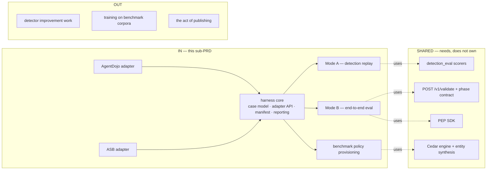

# AegionAI Guard — Security-Efficacy Benchmark Harness (Sub-PRD)

**Product:** AegionAI Guard — benchmark & efficacy-measurement capability (internal tooling; produces external results)
**Version:** 0.1
**Last Updated:** 2026-07-27
**Status:** Draft for Review
**Owner:** Founder
**Master PRD:** [PRD.md](../PRD.md) — **§7.14 / FR-14.x** — *this is a scoped subset; the master governs anything not restated here*
**Companion docs:** [lld/32](../lld/32-detection-depth.md) §14 (the eval-harness contract) · [lld/34](../lld/34-measure-first-spike-methodology.md) (measurement methodology) · [research/wsl-detection-corpus-assessment-2026-07-05.md](../research/wsl-detection-corpus-assessment-2026-07-05.md) (corpus licensing)

> **What this is.** A focused, traceable subset of the master PRD for **one slice**: the capability that measures AegionAI Guard's security efficacy against **public agent-security benchmarks**, with and without the Guard in the path, as a **continuous regression loop** — score, improve the product, re-score. Every requirement cites its master origin (master **§7.14**, added 2026-07-27 to own a mechanism §3.2 already demanded).
>
> **Boundary in one line:** build the **measurement capability** and produce the first numbers — the corpus/adapter layer, the two measurement rigs, benchmark policy provisioning, session isolation, and the run manifest. **Improving a detector in response to those numbers is out of scope** and belongs to that detector's own requirement (§7).
>
> **External publication is deferred** (decision 2026-07-27) — the product improves first. This lowers FR-14.6 to P2 but *raises* the importance of FR-14.5: a regression loop is exactly the thing that cannot function without pinned, run-over-run-comparable results.
>
> **Initial benchmarks:** **AgentDojo** (ethz-spylab) and **Agent Security Bench / ASB** (agiresearch), cloned locally at `/Users/ruchikkachaudhary/closed-source/{agentdojo,ASB}`. Both verified **MIT** by reading their LICENSE files on 2026-07-27 (per the read-the-actual-LICENSE discipline in the corpus assessment, not the GitHub tag). Benchmarks #3+ enter **after** these two are working, and are additive by construction (FR-14.1).

---

## 1. Overview

**Scope statement.** *A benchmark capability that measures what fraction of public agent-security attacks AegionAI Guard stops, and at what cost to legitimate agent task completion — reproducibly, across multiple third-party benchmarks, with and without the Guard in the path.*

Two rigs over one shared corpus/adapter layer:

| Rig | What it measures | Cost | Is it the headline number? |
|---|---|---|---|
| **Mode A — detection replay** | per-detector precision / recall / F1 / FP-rate against labeled corpora, in-process | seconds, ~free | no — it measures detector quality, not defense effectiveness |
| **Mode B — end-to-end evaluation** | attack-success rate **and** task-utility retention, running each benchmark's own agent loop with/without the checkpoint | hours, real LLM spend | **yes — the benchmark's own metric, and the one that moves run over run** |

Mode A is the fast inner loop and the mechanism behind master §3.2's release-blocking accuracy metric. Mode B is the benchmark's own metric and the number the improvement loop is steering.

**The paired without-Guard arm is required even with publication deferred** — without it, a run-over-run change cannot be separated from model drift or benchmark variance, so the improvement loop would be steering on noise.

---

## 2. Personas (subset of master §4)

| Persona | Relevance to this slice |
|---|---|
| **CISO / Head of AI Governance** (master: economic buyer) | **Future** consumer — publication is deferred, so this persona is not served by the first build. Retained because it is what the capability is ultimately for, and what keeps FR-14.5's manifest discipline worth paying for now. |
| **AI/ML Engineer / Agent Developer** (master: integrator) | Consumes the utility-retention number — "what does turning this on cost my agent's task success?" |
*No internal-operator persona is defined (OBQ-4, resolved 2026-07-27).* Master §4 is a **customer** persona table — buyer, champion, integrator, auditor. The people who run this harness are the engineering team building the product; that is not a persona in that taxonomy, and inventing one would add organizational structure the company does not have. The harness's day-to-day consumer is simply "us."

---

## 3. Problem & goals

**Problem.** Master §3.2 commits to per-detector precision/recall/F1 "measured automatically before every release; a regression blocks the release," and to knowing "how little gets through **all** of them." Neither number is produced today by any mechanism, and the deepest detectors have never been measured at all:

Per [ADR-036](../adr.md) / [lld/32](../lld/32-detection-depth.md) §15.1 — **D1, D2, and D3 are enforce-enabled in production and dormant.** 100% of prod traffic is `phase=request`, so D2 and D3 have decided **0 requests**, D1 has decided **0 of 14,640** DENYs, and **D3's recall is recorded as unmeasured**. D2 enforces at a measured 1.25% FP, past its 1% budget, on a founder override.

Public benchmarks generate precisely the traffic those detectors are starved of — AgentDojo's injections arrive as ingested tool output (`phase=content` → D2); ASB spans direct injection, observation injection (`content` → D2), memory poisoning (`memory` → D3), and plan-of-thought backdoors (trajectory → D1).

**Goals**

| # | Goal | Success measure |
|---|---|---|
| G1 | A steering signal for product improvement | ASR reduction **at** retained utility, against a self-measured without-Guard arm, moving in the right direction run over run (master §3.2, FR-14.3) |
| G2 | First real recall measurement for D1/D2/D3 | a number exists where ADR-036 records "unmeasured" (FR-14.2) |
| G3 | A regression gate that blocks a release | Mode A wired to CI on the `eval-ml-classifier.yml` pattern (master §3.2, FR-14.2) |
| G4 | Extensibility proven, not asserted | benchmark #2 (ASB) costs one adapter and **zero** core changes (FR-14.1) |
| G5 | Run-over-run comparability | any run regenerable and diffable against its predecessor from the manifest alone (FR-14.5) |
| G6 | Honest attribution | every result separates trust-attributed denials from detector-attributed ones (FR-14.8) |

**Non-goal.** Raising the score. That work is real and expected, but it belongs to the detectors' own requirements — see §7.

---

## 4. In scope

All requirements trace to master **§7.14**, added 2026-07-27 to own the mechanism master §3.2 already required.

| ID | Requirement | Pri | Master origin |
|---|---|---|---|
| FR-14.1 | Harness core — normalized case model + adapter interface; a new benchmark = one adapter, no core change | P1 | master §7.14 |
| FR-14.2 | Mode A detection replay → P/R/F1/FP-rate per detector per corpus version; CI-gateable | P1 | master §7.14 (← §3.2 accuracy metric) |
| FR-14.3 | Mode B end-to-end eval → ASR + utility retention + refusal rate, paired with/without arms | P1 | master §7.14 (← §3.2 efficacy) |
| FR-14.4 | Benchmark policy provisioning — synthesize policy + agent binding from a suite's tool manifest | P1 | master §7.14 |
| FR-14.5 | Reproducible run manifest — pinned benchmark/model/engine commits, thresholds, seeds, transcripts; run-over-run diffable | P1 | master §7.14 |
| FR-14.6 | Configuration disclosure where benchmarked config ≠ as-deployed default (ADR-036) — manifest half stands now, external-statement half deferred | P2 | master §7.14 |
| FR-14.7 | Corpus licensing discipline — evaluation only; training needs separate determination | P1 | master §7.14 |
| FR-14.8 | Benchmark session isolation & decision attribution — session/trust state scoped to the episode boundary, run-unique session IDs, results broken down by deciding source | P1 | master §7.14 |
| FR-14.9 | Benchmark execution isolation — never target the production engine; reserved benchmark tenant; engine deployment recorded in the manifest | P1 | master §7.14 |

### 4.1 Delivery order (decided 2026-07-27)

**First build = Mode A + Mode B on AgentDojo only.** This exercises core, adapter API, policy provisioning, session isolation, and both rigs against one benchmark, producing a real number. The **ASB adapter lands second, against a proven core** — and is the actual test of FR-14.1's extensibility claim (G4).

**Then the loop runs continuously**: score → improve the product → re-score. **Benchmarks #3, #4 … enter only after #1 and #2 are working** (decision 2026-07-27) and feed the same loop. Each new benchmark is also a fresh, un-tuned-against read on the product, which is the closest thing the loop gets to a generalization check — see §8 OBQ-1.

### 4.2 Implementation-status table (per `scope-prd` Phase 1.5)

Grounded by grep against the real code. **NOT-FOUND means "not located," not "definitely absent."**

| Req | Status | Evidence | Confidence |
|---|---|---|---|
| FR-14.1 | **NOT-DONE** | No `benchmarks/` package. Nearest is `demo-agents/eval/` — single-corpus, single-purpose, no case model or adapter seam | high |
| FR-14.2 | **PARTIAL** | Scorers exist and are reusable as-is: `src/security-controller/app/services/detection_eval.py:58` (`score_detector`), `:84` (`fp_budget_gate`). One corpus wired in-process at `scripts/meas_d2_d3_fp_budget.py`; over-the-wire variant at `demo-agents/eval/measure.py`. CI-gate precedent at `scripts/eval_ml_classifier.py` + `scripts/eval_thresholds.yaml` + `.github/workflows/eval-ml-classifier.yml`. **Missing:** benchmark corpora, normalized cases, per-benchmark gate | high |
| FR-14.3 | **NOT-DONE** | No agent-loop runner of any kind; no ASR or utility measurement anywhere in-repo. `src/*/app/claude_processor.py` and `src/common/llm_response_generator.py` are domain-specific, not general | high |
| FR-14.4 | **PARTIAL** | Entity synthesis from a policy's `allowed_tools` exists: `src/security-controller/app/validators/cedar/entities.py:79`. Seeding path + required policy shape (`allowed_tools`, `allowed_agents`, `max_calls_per_minute`) at `scripts/seed_policies.py:97`. **Missing:** generating that policy *from a benchmark tool manifest* | high |
| FR-14.5 | **PARTIAL** | Output-shape precedent — `scripts/eval_ml_classifier.py` emits `{run_id}.json` + `.md` with metrics and per-row predictions. **Missing:** all pinning (benchmark SHA, model snapshot dates, engine SHA, seeds) and transcript retention | high |
| FR-14.6 | **NOT-DONE** | Process/reporting requirement; no artifact exists | high |
| FR-14.7 | **DONE** | Train-vs-eval discipline and per-dataset verdicts in `research/wsl-detection-corpus-assessment-2026-07-05.md`. **Both licenses read from source LICENSE files 2026-07-27** — AgentDojo MIT (Debenedetti et al., 2024), ASB MIT (AGI Research, 2024). No open determination remains for benchmarks #1–2 | high |
| FR-14.8 | **NOT-DONE** | Trust is session-scoped and stateful: `app/utils/session_manager.py:145` (24h TTL), `:218` (penalty applied on DENY); bands at `app/validators/trust_checker.py:25-28` (10–40 ⇒ DENY ALL). Nothing scopes session state to a benchmark episode, and no result surface breaks decisions down by deciding source. `demo-agents/eval/measure.py` mints a per-*call* session id — a precedent, but the wrong granularity for Mode B | high |
| FR-14.9 | **PARTIAL** | The isolation primitive exists — `app/utils/tenancy.py:67` `RESERVED_TENANT_IDS` + `:103` `is_reserved_tenant()` (customer tenants are barred from these), with contextvar scoping at `:140`/`:145`. In-process execution precedent at `scripts/meas_d2_d3_fp_budget.py`. **Missing:** a reserved benchmark tenant, a non-prod target for hosted runs, and any enforcement that a run cannot be pointed at prod | high |

**Downstream contract:** `plan-workstreams` must not task the DONE/PARTIAL portions above as new build — scope PARTIAL tasks to the stated gap only.

---

## 5. Shared & assumed (needed, not owned)

| Item | Owner | What this slice constrains |
|---|---|---|
| `POST /v1/validate` + `phase` contract | [lld/30] · `src/security-controller/app/api/models.py:57` | Consumed unchanged. The harness must not require a new phase or field; if it does, that is a change request against the owner, not a local edit |
| Detection scorers | [lld/32](../lld/32-detection-depth.md) §14 · `app/services/detection_eval.py` | Mode A reuses `score_detector` / `fp_budget_gate` **as-is**. LLD 32 §14.2(1) already names this the authoritative pre-rollout gate — this slice implements that named role |
| Cedar policy engine + entity synthesis | `app/validators/cedar/` | FR-14.4 emits policy in the existing shape; it does not extend the schema |
| PEP SDK | [lld/23], [lld/36] · `demo-agents/sdk/aegion-guard-python/` | Mode B inserts the SDK as the benchmark's defense. Must use non-raising `guard.validate(...)` (`guard.py:356`) — see §8 OBQ-3 |
| Audit / metrics | [lld/17] | Benchmark runs must be distinguishable from real traffic in audit and metrics streams |

---

## 6. Dependencies (external; not re-specified here)

| Dependency | Owner | Assumed contract | Impact if unmet |
|---|---|---|---|
| Connectors emitting `content` / `memory` phases | connectors WS | Not required for the benchmark (the harness calls `/v1/validate` directly) | None for measurement — but until it lands, benchmarked config ≠ shipped config, which is exactly what FR-14.6 must disclose |
| `phase=output` handler | [lld/32](../lld/32-detection-depth.md) §6.4 | Absent — `api/routes.py:218` fail-secure DENYs `output` | Any benchmark case scored on agent *output* is **excluded from measurement** and stated as excluded, never reported as a 100% block |
| WS-E feedback store / §8 retrain loop | WS-E / WS-L | Not consumed by this slice | None |
| LLM API access + budget for Mode B | founder | Paired arms ⇒ 2× spend | Mode B cannot run; Mode A unaffected |
| A dedicated **non-production** engine deployment | infra / CDK | Only needed for *hosted* Mode B runs (real-latency measurement); in-process is the default for both rigs | Hosted runs cannot happen. **Not a workaround-by-using-prod** — FR-14.9 bars that outright; the fallback is in-process only, which loses the latency number and nothing else |

---

## 7. Out of scope

| Excluded | Why / where it belongs |
|---|---|
| **Improving any detector to raise the score** | Boundary decision 2026-07-27: this slice *measures*. Improvements belong to FR-3.x and become separate workstreams consuming this harness |
| **Training on benchmark corpora** | FR-14.7 — evaluation only; training requires a separate license determination |
| The §8 offline reclassify/retrain loop | [lld/32](../lld/32-detection-depth.md) §8, WS-E-gated |
| **External publication of results** | **Deferred** (2026-07-27) — the product improves first. A business decision, not a build requirement. The run manifest (FR-14.5) captures what a future publication would need, so deferring costs nothing later |
| Building a general-purpose agent runtime | Each benchmark's own agent loop is adopted; rebuilding forfeits comparability with published baselines |
| Benchmarks beyond AgentDojo and ASB | Additive by construction (FR-14.1); they enter **after** #1 and #2 work (§4.1), so none is in this build |

---

## 8. Open boundary questions

*Resolved questions are kept here with their resolution rather than deleted, so the reasoning survives.*

**OBQ-1 — When does benchmark #3 enter, and which? — RESOLVED 2026-07-27.**
AgentDojo + ASB are used as a **development target** (tuned against), and benchmarks #3+ enter **after** those two are working, feeding the same continuous loop. *Residual, carried knowingly:* because #1 and #2 are tuned against, they stop being a generalization check once the loop has run a few cycles — a rising score may reflect fitting rather than real robustness. Each newly-added benchmark gives one clean, un-tuned-against read before it too becomes a target. **This is an accepted trade for development speed, not an oversight**, and it becomes live again if results are ever published externally.

**OBQ-2 — Benchmark licensing — RESOLVED 2026-07-27.** Both LICENSE files read from the local clones: **AgentDojo = MIT** (Debenedetti, Zhang, Balunović, Beurer-Kellner, Fischer, Tramèr; 2024) and **ASB = MIT** (AGI Research, 2024). Evaluation use is unambiguously permitted. FR-14.7's train-vs-eval discipline still governs any later attempt to fold either corpus into detector training.

**OBQ-3 — Denial semantics inside a benchmark agent loop — RESOLVED 2026-07-27.**

**Decision: a DENY surfaces to the agent as a tool error through the benchmark's own error channel; the agent continues and may adapt, bounded by the benchmark's native step cap.** The harness uses non-raising `guard.validate(...)` (`guard.py:356`) rather than the `@guard.tool` decorator, whose `ToolDenied` would kill the loop and make utility unmeasurable.

This is not a bolt-on: AgentDojo already treats tool errors as a **first-class non-fatal path** — `runtime.run_function` returns `(result, error)` and `ToolsExecutor` appends a `ChatToolResultMessage` carrying that error (`agentdojo/src/agentdojo/agent_pipeline/tool_execution.py:11,:77`). A DENY maps onto the existing channel with no fork of the benchmark.

Three reasons this is the right model: it is the **only** way to obtain a utility signal at all; it is the **harder** setting for us, since a persistent attacker-controlled agent gets to retry and we must prevent the attack anyway; and it matches how AgentDojo's own defenses behave, keeping numbers comparable. Retry-inflation is bounded natively by `ToolsExecutionLoop(max_iters=15)` (`tool_execution.py:130`) — no custom cap needed, but the manifest records it (FR-14.5) since changing it changes ASR.

**Sub-decision: pass through the product's real `reason` string**, not a generic denial — that is what a real integrator's agent receives. *Known residual:* a detailed reason gives an attacker-controlled agent an adaptation signal. Measuring ASR with reason-detail on vs off is a worthwhile later experiment; it is **not** a first-build variable.

**Fidelity caveat, stated rather than hidden:** in the real product `ToolDenied` is raised into the integrator's code, and what happens next is the integrator's choice — some agents would crash, some catch and continue. The benchmark deliberately models the catch-and-continue case. That is a modeling decision, not a claim about all deployments.

**OBQ-4 — Internal-operator persona — RESOLVED 2026-07-27: none needed.** Master §4 is a **customer** persona table (buyer / champion / integrator / auditor). The people who run this harness are the engineering team building the product — not a persona in that taxonomy. Adding one would invent organizational structure the company does not have. §2 now says so explicitly; **no master §4 change.**

**OBQ-5 — Benchmark traffic in production telemetry — RESOLVED 2026-07-27 → FR-14.9.**

**Decision: benchmark runs never target the production engine.**
- **Mode A** — in-process, against no deployment at all.
- **Mode B** — in-process by default; a **hosted** run (only when the point is measuring real network latency) targets a **dedicated non-production deployment**.
- **Either way**, runs execute under a **reserved benchmark tenant** — following the existing reserved-pseudo-tenant pattern at `app/utils/tenancy.py:67` (`RESERVED_TENANT_IDS`), which already bars customer tenants from holding such ids — and the manifest records which engine deployment was used (FR-14.5), since that materially changes results.

Four reasons, in descending order of how bad it would be: synthetic attack traffic would **corrupt the §3.2 release-gating metrics** this capability exists to produce (circular contamination — the benchmark poisoning the numbers it reports); it would inject fabricated attacks into a **tamper-evident audit trail** relied on as SOC 2 evidence; it would **pollute live session/trust state** (24h TTL, `session_manager.py:145`); and it would distort exactly the kind of production statistic ADR-036 rests on ("14,640 DENYs, all `sentra.trust`").

*Note:* this is a hard constraint, not a default — "point it at prod just this once to see" is the failure mode it exists to prevent.

**OBQ-6 — Trust-score contamination across cases — RESOLVED 2026-07-27 → FR-14.8.**

The mechanism: trust is session-scoped and stateful. Sessions start at 100 with a 24h TTL (`session_manager.py:145`); every DENY decrements the score (`:218`, e.g. `POLICY_NOT_FOUND` = −15); at **10–40 the session is quarantined and ALL operations are denied** (`trust_checker.py:25-28`). Roughly four caught attacks in one session therefore deny everything thereafter, regardless of content.

Three consequences for a benchmark: **(a) contamination** — shared session ⇒ ~100% block at ~0% utility, a vacuous result; **(b) order dependence** — path-dependent state means shuffling case order changes the score, breaking the run-over-run comparability the loop depends on; **(c) attribution collapse** — the decisive one, and already visible in production, where ADR-036 records all 14,640 DENYs attributed to `sentra.trust` with D1 deciding none. If trust dominates the benchmark too, G2 (first D1/D2/D3 recall) is defeated.

**Resolution — the boundary differs by rig, because trust accumulation is a real defense, not an artifact.** Blanket per-case reset would delete a genuine layer and understate the product.
- **Mode A** — reset per case. Its purpose is per-detector attribution, and these are not a session in any meaningful sense.
- **Mode B** — **`session_id` = one benchmark episode**: reset at the task boundary, preserve within it. AgentDojo user tasks and ASB attack tasks are independent episodes; no real deployment carries one user's task history into an unrelated one, while multi-step accumulation *inside* a task is legitimate product behavior that should count as a win.

Two corollaries, both in FR-14.8: session IDs must be **run-unique** or the 24h TTL silently inherits a prior run's trust state; and results must report **trust-attributed denials as their own line**, so "the Guard blocked it" never conceals "trust blocked it and the detector under measurement never fired."

---

## 9. Cross-references

- Master: [PRD.md](../PRD.md) §3.2 (efficacy metrics), §7.14 (FR-14.x), §7.3 (FR-3.5/3.6/3.9 — the detectors measured here)
- [lld/32](../lld/32-detection-depth.md) §14.2 (the eval-harness the master names as authoritative), §15.1 + [ADR-036](../adr.md) (the dormancy record this slice resolves)
- [lld/34](../lld/34-measure-first-spike-methodology.md) §6–7 (metric definitions, corpus sourcing, minimum-size rules)
- [research/wsl-detection-corpus-assessment-2026-07-05.md](../research/wsl-detection-corpus-assessment-2026-07-05.md) (ASB = MIT, the only clean trainable D3 artifact; per-dataset train/eval verdicts)
