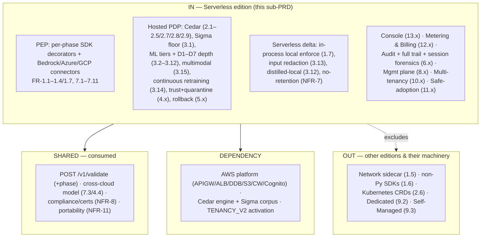

# AegionAI Guard — Serverless Edition (Sub-PRD)

**Product:** AegionAI Guard — Serverless edition (multi-tenant SaaS, controller in the AegionAI cloud)
**Version:** 1.2
**Last Updated:** 2026-06-28
**Status:** Draft for Review
**Owner:** Shashank Gupta (Founder/CEO)
**Master PRD:** [PRD.md](../PRD.md) (v1.3) — *this is a scoped subset; the master governs anything not restated here*
**Companion docs:** [ARCHITECTURE.md](../lld/ARCHITECTURE.md) (the "how") · [STRATEGY.md](../pitch/share/STRATEGY.md) (market / GTM / roadmap)

> **What this is.** A focused, traceable subset of the master PRD for **one slice**: the **Serverless deployment edition** (master **FR-9.1**) — AegionAI Guard delivered as multi-tenant SaaS with the policy engine (PDP) hosted in the AegionAI cloud, reached by an in-customer checkpoint (SDK decorator / cloud connector). Every requirement below cites its master origin and **never contradicts the master**; where the master is vague *for this slice*, it is surfaced in §11 (Open Boundary Questions).
>
> **Boundary in one line:** a **full, production-ready Serverless product** — the entire P0 enforcement engine as it runs multi-tenant, **plus its phased depth** (deeper detection D1–D7, distilled+heavy ML, multimodal, continuous retraining), **plus** the Serverless-specific delta that makes it fast and safe (in-process local enforcement, input redaction, no-content-retention), **plus** the operational surface a real SaaS needs (a **multi-tenant console**, **metering & billing**, simple onboarding). Only the *other editions and their machinery* are out: network sidecar, non-Python SDKs, Kubernetes CRDs, Dedicated, Self-Managed (§8).
>
> **Net-new vs. master (going back into master via propagation):** **§7.12 Metering & Billing (FR-12.x)** and **§7.13 Console Experience (FR-13.x)** are net-new requirement families this slice surfaces; the master has neither. They are tagged **NET-NEW → master** and are being added to the master PRD (the reconciliation list is in §12).

---

## 1. Overview

The **Serverless edition** is how AegionAI Guard lands today and how most customers will first adopt it: the customer drops a one-line-per-tool Python SDK decorator (or a cloud connector) into their agent, and every guarded action is validated **synchronously** by the AegionAI-hosted policy engine (PDP) before it executes. It is **multi-tenant SaaS** — onboarding a customer is a data operation, not a re-architecture — and it is the edition where the **content-fed data flywheel** compounds (master STRATEGY moat 1: injection/DLP signal + retrospective re-scoring).

This is the **lowest-friction, fastest-to-value** entry point in the editions ladder (Serverless → Dedicated/in-VPC → Self-Managed/air-gapped). It must be a *complete* product, not a stub — hence this slice owns the full engine, its phased detection depth, the console, and the commercial surface. Its two defining tensions, both owned here:

1. **Latency.** Every validation is a network round-trip to our cloud (~0.6–1.2 s today vs. the ≤500 ms deterministic target) — closed by **in-process local enforcement against a signed cached bundle** (FR-1.7) and the **distilled local classifier** (FR-3.12).
2. **The data boundary.** Serverless is the *only* edition where customer content leaves their boundary — so it is made acceptable by the **Serverless trust model** (NFR-7): **input-side redaction** (FR-3.13) before egress **and** ephemeral, no-retention processing.

Enforcement is **mechanical, not advisory**: on a deny, the checkpoint blocks the tool from running. Containment (quarantine) and **bounded, customer-declared** rollback of reversible writes are in scope.

### 1.1 Positioning (this slice)
The neutral, cross-vendor runtime action-governance layer — delivered as managed SaaS so a team can put an agent under real enforcement in an afternoon, with the data-boundary controls (redaction + no-retention), the multi-tenant console, and the depth-of-detection roadmap a security buyer expects. The in-VPC and air-gapped editions exist for residency-bound workloads (master FR-9.2/9.3) and are the out-of-scope siblings.

### 1.2 How to read the status tags
Every in-scope requirement carries a **Status** grounded in the code (§5 has the evidence table with `file:line`): **DONE** · **PARTIAL** (built + named gap) · **NOT-DONE** (absent, looked) · **NOT-FOUND** (not located ≠ absent). `plan-workstreams` will **skip DONE and scope PARTIAL to the gap** — so this is the build-vs-built ledger, not a wish list.

---

## 2. Users / Personas (subset of master §4)

| Persona | Role in this slice | What they need from Serverless |
|---|---|---|
| **AI/ML Engineer / Agent Developer** | **Primary integrator** (the Serverless self-serve user) | One wrapper per tool, clear deny reasons, shadow mode for safe rollout, minimal latency, **dead-simple onboarding**. |
| **Fraud / Risk Lead** (= the **fintech / payments beachhead** buyer — master Stage 1) | Buyer for financial-action agents | Stop wrong refunds/transfers instantly; loss prevention + regulator-ready logs; **customer-defined compensation** for reversible actions — without standing up infra. |
| **CISO / Head of AI Governance** | Economic buyer | Real-time enforcement + audit + compliance mapping, **and the assurance that hosted processing redacts sensitive values and retains no content** (NFR-7) — the question that decides whether Serverless is acceptable at all. **Multi-tenant console** with sane login. |
| **Compliance / Auditor** | Consumer of output | Forensic, queryable, immutable decision records with the **full decision trail** (who called, which detectors ran, why blocked) and **session-level sequence reconstruction**. |

*Note:* "Fraud / Risk Lead" **is** the fintech beachhead persona (master Stage 1 / payments) — they are the same buyer, named for the financial-action agent use case. The master's **Platform / DevOps Lead** persona is championed around the K8s-native experience (CRDs/Helm), which is a P2 / in-boundary concern (master FR-2.6, FR-9.2/9.3) — not load-bearing for Serverless SaaS, so it is not a primary persona of this slice.

---

## 3. Problem & Goals

### 3.1 Problem (this slice)
AI agents take real actions at machine speed and nothing stops the harmful one in the moment (master §2). The Serverless edition answers the **adoption** half of that problem: a team needs enforcement **today**, without a deployment project — but a hosted control plane raises the **data-boundary** objection. Serverless wins only if it is *fast enough to leave on synchronously*, *safe enough to send content to*, *deep enough to catch real attacks* (not just signatures), and *operable* (a real console, real billing).

### 3.2 Success Metrics (carried/narrowed from master §3.2)

**Security efficacy** (master §3.2) — tracked **per detector** as depth grows:

| Metric | Target |
|---|---|
| Detection rate (all layers combined) | high; tracked over time |
| Missed-attack rate (past *every* layer) | near zero on known attack types |
| **False-positive rate** (legitimate actions wrongly blocked) — **per detector and combined** | **< 2%**; a per-detector regression blocks the release |
| Detector precision / recall / F1 — **per detector, measured every release** | gate; regression blocks release |
| Time-to-quarantine a compromised agent/session | < 5 s |
| **Continuous-improvement loop** — % of past traffic retrospectively re-scored after a model/signature update; red-team coverage | tracked (FR-3.14) |

**Performance** — the slice's headline tension:

| Path | Target (p99) | Serverless reality |
|---|---|---|
| Deterministic only (policy/signature, no ML) | ≤ 500 ms at load | **≈ 0.6–1.2 s today** (round-trip to us) — the gap FR-1.7 closes |
| With fast ML model (hot path) | ≤ 900 ms | hosted classifier latency (FR-3.12 distilled-local removes it) |
| With deep-model escalation (rare) | ≤ 2.5 s | heavy model on edge cases only |
| Roadmap — in-process local enforcement | **low tens of ms** (deterministic path) | the Serverless latency end-state (FR-1.7) |

### 3.3 Priority classification (how P0/P1/P2 were assigned)

P0/P1/P2 are **inherited from the master** (which tracks the GTM ladder: P0 = Stage-0 land, P1 = fintech + first regulated, P2 = banks/healthcare/government). On top of that inheritance, this slice applies one **override rule** (owner direction): **any requirement whose late addition would force a re-architecture is promoted to P0**, even if the master tiers it P1 — because designing the architecture to accommodate it from the start is cheaper than retrofitting.

**Promoted to P0 on the architecture-bender rule** (each tagged "(arch)" or "(contract)" in §4, with rationale inline):

| Req | Master pri | Why it bends the architecture |
|---|---|---|
| **FR-1.7** in-process local enforcement | P1 | Splits the PDP into a hosted engine **+** an in-process SDK evaluator with a signed-bundle distribution/refresh path — a fundamentally different deployment topology to retrofit. |
| **FR-3.4** multi-phase contract | P1 | Adds a `phase` field to the core `/v1/validate` contract; changing the central contract late ripples through SDK, connectors, combiner, audit. The **contract shape** is P0 (handlers can follow). |
| **FR-2.8** parallel-gather scheduler | P1 | The in-scope D1–D7 depth can't sit on a fixed sequential pipeline without rework; the scheduler is the execution model depth requires. |
| **FR-6.8** full decision-trail | P1 | Today's combiner short-circuits on first DENY; full-trail changes the combiner execution model (run-and-record vs. short-circuit) — must be designed in, not bolted on. |
| **FR-10.5** prod TENANCY_V2 activation | (net-new) | The first predecessor: multi-tenant Serverless can't onboard a 2nd customer in prod until this lands. |

*The remaining P1/P2 items were cross-checked and judged **additive** (build later without re-architecture): metering (FR-12.x), console (FR-13.x), GCP connector (FR-7.4), the individual D1–D7 detectors once the FR-2.8 scheduler + FR-3.4 contract exist, compliance reports (FR-6.5), SIEM push (FR-6.7), learned-policy (FR-8.7). FR-3.13 redaction is a P1 input-path transform — moderate bend, not promoted, but flagged as a security GA-gate question (§11.3).*

**Enforcement, reliability & operations:**

| Metric | Target |
|---|---|
| Enforcement coverage (guarded actions validated pre-execution) | 100% |
| Enforcement availability (fail-secure) | ≥ 99.99% |
| Rollback success (reversible, customer-declared ops) | > 95% |
| **Billable-event accounting accuracy** (metered vs. actual) — NET-NEW | ≥ 99.9%, per-tenant, off the hot path |
| **Time-to-first-value** (install → first enforcement) — the onboarding metric | minimize (self-serve) |

---

## 4. In Scope

IN requirements, each traced to the master by **stable ID** (IDs unchanged from master — the join key) with a code-grounded **Status**. Priorities (P0/P1/P2) preserved from master; phased items keep their master phase. **NET-NEW → master** marks requirements added to the master via §12.

### 4.1 Interception & Enforcement — the checkpoint / PEP (← master §7.1)
| ID | Requirement | Pri | Status |
|---|---|---|---|
| FR-1.1 | Intercept every guarded agent action before execution | P0 | DONE |
| FR-1.2 | One-line-per-tool SDK integration (Python) | P0 | DONE |
| FR-1.3 | Fail-secure on validation failure (deny by default) | P0 | DONE |
| FR-1.4 | Per-agent fail mode (fail-closed vs degrade) | P1 | NOT-DONE |
| **FR-1.7** | **In-process local enforcement (Serverless).** *Why it matters:* today every `@guard.tool` call makes a blocking network POST to the hosted PDP — so the deterministic floor pays a full WAN round-trip (~0.6–1.2 s). FR-1.7 ships a **signed, cached policy bundle** that the SDK evaluates **in the agent's own process** for the deterministic tier (tool allow/deny, parameter bounds, sequence, egress) — **no network call on the common path**, dropping it to low-tens-of-ms — and **keeps enforcing the floor if the hosted controller is unreachable** (resilience). The hosted PDP is still called for the ML/deep tiers and to refresh the signed bundle. **HLD must resolve the bundle-refresh mechanism** (how/when the cached signed bundle is refreshed, staleness bound, revocation). | **P0** (arch) | NOT-DONE |

### 4.2 Policy Decision Engine — runtime (PDP) (← master §7.2)
| ID | Requirement | Pri | Status |
|---|---|---|---|
| FR-2.1 | Tool allow/deny per agent | P0 | DONE |
| FR-2.2 | Parameter-bound policy (e.g., refund ≤ limit) | P0 | DONE |
| FR-2.3 | Single-session sequence enforcement (required prior steps) | P0 | DONE |
| FR-2.4 | Cedar as the authoritative policy engine | P0 | DONE (cutover wired) |
| FR-2.5 | Evaluate versioned, signed policy bundles (signing P1) | P0/P1 | PARTIAL (versioned; **signing** P1) |
| FR-2.7 | Deny-by-default combiner with explainable, prioritized sources | P0 | DONE |
| **FR-2.8** | **Parallel-gather scheduler over a cost-annotated dependency graph.** *What it is:* as detection layers grow (D1–D7), running them strictly in sequence blows the latency budget. FR-2.8 schedules checks by cost — cheap deterministic checks short-circuit first; the expensive models run **in parallel** rather than serially — so adding depth doesn't linearly add latency. Replaces today's fixed sequential 6-step deterministic pipeline (trust → policy → cross-agent → sigma → context → abuse). *Promoted: the in-scope D1–D7 depth (FR-3.5–3.11) cannot be bolted onto a fixed sequential pipeline without rework — the scheduler is the execution model that depth requires, so it's designed P0.* | **P0** (arch) | NOT-DONE |
| **FR-2.9** | **Endpoint/destination-level egress policy.** *What it is:* allow/deny an agent's **outbound calls by destination** (host / path / port / protocol), independent of any tool→endpoint binding — the deterministic exfiltration/SSRF floor for generic HTTP tools, dynamic URLs, and non-SDK agents where a logical tool name can't be resolved. Complements tool-level FR-2.1. | P1 | NOT-FOUND |

*FR-2.4 / authoring note (corrected per code re-verify):* `cedar_enabled` does **not** gate Cedar's *existence* — it selects **shadow-compare vs. authoritative** ([validation_service.py:300](../src/security-controller/app/services/validation_service.py#L300)). Customers **never hand-write Cedar** (by design, master FR-8.3): they author **structured YAML/JSON**, which the system validates (`AgentPolicyDocument`) and **compiles to a generated `.cedar` artifact**. "Cedar authoritative" = the runtime evaluates that compiled artifact. See §4.8 for the authoring side and §11.5 for the production default-mode question.

### 4.3 Threat Detection — the floor, the depth, and the Serverless-delta detectors (← master §7.3)
*The deterministic Sigma floor is live; the deeper layers and the ML tiers are **in-scope, phased** — Serverless is where the data flywheel and retraining live, so detection depth belongs here, not in a separate track. **Validation surfaces are multiple, not one:** the SDK exposes a **decorator per phase** of the agent loop (today `@guard.tool` = `request`; `content`/`output`/`memory` are the FR-3.4 build), and the API carries a `phase` field on the validate contract.*

| ID | Requirement | Pri | Status |
|---|---|---|---|
| FR-3.1 | Signature (Sigma-rule) detection — live deterministic floor | P0 | DONE |
| FR-3.2 | ML threat classifier as the escalation tier (shadow / off by default) | P1 | PARTIAL (built, off-by-default) |
| FR-3.3 | Shadow mode for any detector or policy | P0 | PARTIAL (ML+Cedar only) |
| FR-3.4 | **Multi-phase validation surface** (`request` / `content` / `output` / `memory`) — ship an SDK **decorator per phase** so signal flows from day one. *Promoted: adds a `phase` field to the core `/v1/validate` contract; changing the central contract late ripples through SDK, connectors, combiner, and audit, so the **contract shape is designed P0** even if `content`/`output`/`memory` handlers land later.* | **P0** (contract) | PARTIAL (`request` live) |
| FR-3.5 | Conversation-trajectory detection — multi-turn manipulation, stateful (D1) | P1 | NOT-DONE |
| FR-3.6 | Indirect / second-order injection on ingested content (retrieval, tool output, web) incl. spotlighting + taint tagging (D2) | P1 | NOT-DONE |
| FR-3.7 | Output & effect validation — DLP / PII, exfil-channel + volume anomaly; ALLOW / DENY / **REDACT** / HOLD-for-human (D5) | P1 | NOT-DONE |
| FR-3.8 | Taint tracking / information-flow control (D4) | P2 | NOT-DONE |
| FR-3.9 | Long-term memory-integrity / anti-poisoning on memory writes (D3) | P2 | NOT-DONE |
| FR-3.10 | Network / egress validation + provenance (D6 / D7) | P2 | NOT-DONE |
| FR-3.11 | Behavioural anomaly detection (per-deployment baseline, metadata-only) | P2 | NOT-DONE (design complete) |
| **FR-3.12** | **Distilled local classifier (in-process, CPU; < 100 ms)** — the lightweight model that classifies the common case locally; the **heavier hosted model** handles edge cases. Removes the hosted classifier's network/model latency. *(Serverless latency delta; pairs with FR-1.7.)* | P1 | NOT-DONE |
| **FR-3.13** | **Input-side PII / credential redaction — redact sensitive values before request content leaves the customer boundary.** *The Serverless data-boundary maker (NFR-7); today content is sent un-redacted (see §11.3).* | P1 | NOT-DONE |
| FR-3.14 | **Continuous improvement** — automated red-teaming, model **retraining**, and **retrospective re-scoring of past traffic** when signatures/models update (the compounding moat) | P2 | NOT-DONE |
| FR-3.15 | Multimodal / image threat detection (manipulated refund/claim images, adversarial images, image-borne injection) | P1/P2 | NOT-DONE |

### 4.4 Cross-Agent Trust & Containment (← master §7.4)
| ID | Requirement | Pri | Status |
|---|---|---|---|
| FR-4.1 | Per-agent trust scoring from violations | P0 | DONE |
| FR-4.2 | Automatic quarantine of an agent **or session** | P0 | DONE |
| FR-4.3 | Inter-agent message filtering / privilege-escalation block | P1 | PARTIAL (depth+authz; blast-radius roadmap) |
| FR-4.6 | Rate-limit / abuse detection | P0 | DONE |

### 4.5 Rollback / Compensation — customer-declared, intent-driven (← master §7.5)
*Reframed per owner feedback: **rollback of arbitrary actions is not possible**, and we don't hardcode a fixed adapter set. What we support is the **customer declaring, in policy, the compensating intent for a reversible action** — "when action X is undone, call API Y / do Z" — and the coordinator executing that declared compensation in LIFO order for the session. Block-before-execute remains primary; compensation applies only where the customer has declared a reversible action.*

| ID | Requirement | Pri | Status |
|---|---|---|---|
| FR-5.1 | Per-action compensating adapters (e.g., refund reverser) — *built for refund/order; generalizing to customer-declared is the gap* | P0 | PARTIAL |
| FR-5.2 | LIFO multi-step rollback within a session/conversation | P0 | DONE |
| FR-5.3 | Reversibility checks (never imply the irreversible can be undone) | P0 | DONE |
| FR-5.4 | Expanded adapter library (more action types) | P1 | NOT-DONE |
| **FR-5.5** | **Customer-declared compensation in policy** — the customer expresses, per reversible action, the **compensating intent** (the API/operation to invoke, the parameters to carry, the order) so the coordinator can undo it; the engine derives reversibility and the undo step **from the policy**, not a hardcoded adapter. **NET-NEW → master** (generalizes FR-5.1). | P1 | NOT-DONE |

### 4.6 Audit, Observability & Compliance — exhaustive decision trail (← master §7.6)
*Expanded per owner feedback. The audit/observability surface must answer, for any decision: **(1) who called** (caller/agent/tenant identity), **(2) why it was blocked — the full trail of which detectors/classifiers ran and each verdict** (not only the deciding source), **(3) the session-global reference** that ties every message/action in a multi-step attack to one session so the **sequence can be reconstructed**, and **(4) an exhaustive, named set of dashboards**.*

| ID | Requirement | Pri | Status |
|---|---|---|---|
| FR-6.1 | Tamper-evident audit trail of every decision, written off the response path | P0 | DONE |
| FR-6.2 | Fast per-session / recent decision reads (DDB) | P0 | DONE |
| FR-6.3 | Long-term compliance archive (CloudWatch) | P0 | DONE |
| FR-6.4 | SOC console / dashboard: inventory, activity, violations, decision sources | P0 | DONE (see §4.10 for the multi-tenant + exhaustive-view gap) |
| FR-6.5 | Compliance reports (SOC 2 / HIPAA / GDPR / EU AI Act) generated < 5 min | P1 | NOT-DONE |
| FR-6.7 | Push decisions / alerts to SIEM / SOAR / ITSM (Splunk, Sentinel, Chronicle, PagerDuty, Jira) | P1 | NOT-DONE |
| **FR-6.8** | **Full decision-trail audit** — record **every** detector/classifier that ran and its verdict (caller identity, each layer's pass/flag, why the deciding layer denied), not just the prioritized deciding source. *Promoted: today the combiner **short-circuits on first DENY** so later layers don't run — full-trail changes the combiner's execution model (run-and-record vs. short-circuit), which the HLD must design from the start rather than retrofit. The HLD must reconcile this with the FR-2.8 scheduler (both touch how/which layers run).* **NET-NEW → master** (extends FR-6.1). | **P0** (arch) | PARTIAL (deciding source only) |
| **FR-6.9** | **Session-correlated forensic view** — a session-global reference correlating every message/action across a multi-step attack, so the **sequence is reconstructable** end-to-end (builds on request-id correlation FR-7.5). **NET-NEW → master.** | P1 | PARTIAL (request-id exists; view roadmap) |

### 4.7 Integration & Connectors — the PEP "wires" + onboarding config (← master §7.7)
*AWS Bedrock + Azure connectors and SDK packaging are the live on-ramps; **GCP is in scope** (no longer a dependency). Each connector must document the **customer-side setup** (sample IAM policy / role ARN for AWS, Service-Principal allowlist for Azure, equivalent for GCP) and the **connect → discover → import/register** flow.*

| ID | Requirement | Pri | Status |
|---|---|---|---|
| FR-7.1 | AWS Bedrock connector | P0 | DONE |
| FR-7.2 | Azure (OpenAI / Foundry) connector | P0 | DONE |
| FR-7.3 | One policy / trust / audit model across clouds | P0 | DONE |
| FR-7.4 | **GCP Vertex connector** *(moved IN — a first-class Serverless on-ramp)* | P1 | NOT-DONE |
| FR-7.5 | Request-id correlation across connectors | P0 | DONE |
| FR-7.6 | SDK packaging (AWS Lambda layer, Azure Functions, generic Python) | P0 | DONE |
| FR-7.7 | Connect a cloud account (read-only) and **discover** agents | P1 | PARTIAL |
| FR-7.8 | Tool introspection on import → auto-seed a starter policy | P1 | NOT-FOUND |
| FR-7.9 | Import lifecycle tracking (`discovered → policy-seeded → intercepting`) | P1 | NOT-DONE |
| FR-7.10 | Framework integrations (LangChain / CrewAI / MCP) | P1 | NOT-DONE |
| **FR-7.11** | **Connector onboarding config** — per cloud, the exact customer-side grant to enable discovery/interception: AWS IAM policy + role ARN, Azure Service-Principal allowlist, GCP service-account/role; surfaced in-console at connect time. **NET-NEW → master.** | P1 | NOT-DONE |

*Agent-identity-on-the-wire question:* for discovered/imported agents, does the SDK need to pass an **identity token** so the controller can verify `(tenant_id, agent_id)` rather than trust a self-asserted field? Today `agent_id` is self-asserted under a shared API key. This is the FR-10.3 verified-identity mechanism — **flagged as an HLD design-fit item (§11.4)**.

### 4.8 Management Plane (← master §7.8)
| ID | Requirement | Pri | Status |
|---|---|---|---|
| FR-8.1 | Agent registry / inventory & lifecycle | P0 | DONE |
| FR-8.2 | Policy authoring & CRUD; bind policies to agents | P0 | DONE |
| FR-8.3 | Multi-format authoring — **structured YAML / JSON normalized to Cedar** (customers don't hand-write Cedar) | P0/P1 | PARTIAL (YAML live; JSON first-class P1) |
| FR-8.5 | OIDC authN/Z for the console and APIs | P0 | DONE |
| FR-8.4 | Default starter policy seeded in **Monitor mode** on import | P1 | NOT-DONE |
| FR-8.6 | Self-service onboarding *(master-P2; load-bearing for Serverless self-serve — keep visible)* | P2 | NOT-DONE |
| FR-8.7 | Learned policy proposals from observed traffic | P1 | NOT-DONE |

*FR-8.3 note (corrected):* authoring is **structured YAML and JSON** → validated → **compiled to Cedar**. There is **no raw-Cedar authoring path, by design** — the master's intent is that customers never hand-write Cedar. JSON-first-class is the P1 gap; YAML is live.

### 4.9 Deployment, Tenancy & Identity (← master §7.9, §7.10)
| ID | Requirement | Pri | Status |
|---|---|---|---|
| **FR-9.1** | **Serverless — multi-tenant SaaS, controller in the AegionAI cloud** *(the edition this slice defines)* | P0 | DONE |
| FR-10.1 | Multi-tenant isolation — every connection, agent, policy, credential, signal scoped to `tenant_id` | P0 | **DONE & enforcing on dev**; prod/staging activation founder-gated (see FR-10.5) |
| FR-10.2 | Tenant-scoped APIs, data stores, and dashboards | P0/P1 | PARTIAL (APIs scoped; **console UI not** — §4.10) |
| FR-10.3 | Verified agent identity — controller resolves `(tenant_id, agent_id)` from a verified credential, never a self-asserted field | P1 | **DONE on dev** (signed-JWT verify path, tenant `acme` enforcing); prod-gated |
| FR-10.4 | Per-tenant configuration (policies, detectors, fail modes, retention) | P1 | PARTIAL |
| **FR-10.5** | **Activate TENANCY_V2 in prod/staging — the first predecessor.** Flip `tenancy_v2_enabled` + `tenant_identity_mode=enforce` in prod/staging (today founder-gated off) and finish the tail: B3 S3 `--delete-old` prefix migration, `default` brownfield purge, RPS-quota ceiling raise. **Multi-tenant Serverless cannot onboard a second customer until this lands — it gates everything else in the slice.** **NET-NEW → master** (activation of FR-10.1). | **P0** | NOT-DONE in prod (DONE on dev) |

*FR-10.1/10.3 note (re-verified — owner was right):* multi-tenancy is **enabled and enforcing on dev** — go-live executed **2026-06-24** (commit `8902b4e`; [tasks/26-multi-tenancy/99-go-live-runbook.md](../tasks/26-multi-tenancy/99-go-live-runbook.md)): tenant `acme` in `enforce`, 3 agents verify+route under `acme`, **0 `_unverified`**. The code default is conservative-off ([config.py:61,128](../src/security-controller/app/config.py#L61)) but **dev deployment overrides it on** via [cdk/config/dev.yaml](../cdk/config/dev.yaml) (`tenancy_v2_enabled: true`, `tenant_identity_mode: enforce`); **prod/staging deliberately leave it off** ([cdk/config/prod.yaml](../cdk/config/prod.yaml)) — a founder-gated rollout decision, not unfinished work. The remaining act is **prod/staging activation (FR-10.5)**.

### 4.10 Console Experience (NET-NEW → master §7.13 / FR-13.x)
*The owner flag: "the console PRD is missing altogether." This section defines the Serverless console as a first-class product surface. Backend tenant-resolution exists; the **console UI is not yet tenant-scoped** (verified: zero tenant filtering in [src/dashboard/](../src/dashboard/), no tenant claim in `auth.py`, React frontend has no tenant logic) — so this is a real build, not a polish.*

| ID | Requirement | Pri | Status |
|---|---|---|---|
| **FR-13.1** | **Multi-tenant console** — every console view scoped to the operator's tenant; no cross-tenant leakage; tenant context resolved from login. **NET-NEW.** | P0 | NOT-DONE (UI layer) |
| **FR-13.2** | **Exhaustive dashboard set** — at minimum: **Overview** (fleet health, decision volume, ALLOW/DENY split), **Agent inventory & lifecycle**, **Activity / live decision feed**, **Violations & threats** (per detector), **Decision detail** (the full FR-6.8 trail: caller, every layer's verdict, why-blocked), **Session forensics** (FR-6.9 sequence reconstruction), **Policies** (author/bind/version), **Connectors & import** (FR-7.x onboarding + status), **Audit & compliance** (FR-6.5 reports), **Usage & billing** (FR-12.x). **NET-NEW.** | P0/P1 | PARTIAL |
| **FR-13.3** | **Console authentication & tenancy model — revisit.** Re-evaluate the current login against how comparable security consoles do it (e.g., Zenity, Splunk: SSO/SAML, org→workspace/tenant mapping, RBAC roles). Define the login method, tenant-membership model, and role model. **NET-NEW.** *Competitive login research deferred to HLD design-fit (§11.6).* | P0/P1 | PARTIAL (Cognito OIDC; no tenant mapping/RBAC) |

### 4.11 Safe Enforcement Adoption — monitor → enforce (← master §7.11)
| ID | Requirement | Pri | Status |
|---|---|---|---|
| FR-11.1 | Confidence-to-enforce counterfactual (what would have been blocked; FP rate) | P1 | NOT-DONE |
| FR-11.2 | Graduated enforcement rollout (canary 1%→10%→100%; auto-rollback on FP spike) | P1 | NOT-DONE |
| FR-11.3 | First-class denial explanation + human override / appeal | P1 | NOT-DONE |

### 4.12 Metering & Billing (NET-NEW → master §7.12 / FR-12.x)
*The master defines no metering/billing requirement, yet multi-tenant SaaS cannot bill or rate-limit fairly without it. Counters exist ([metrics_publisher.py:111](../src/security-controller/app/utils/metrics_publisher.py#L111)) but there is no usage record, billing ledger, or API-Gateway usage plan.*

| ID | Requirement | Pri | Status |
|---|---|---|---|
| **FR-12.1** | **Usage metering** — count billable validation events per tenant, emitted **off the response path** (like audit; zero added hot-path latency), aggregated to a per-tenant usage record. **NET-NEW.** | P1 | PARTIAL (raw counters only) |
| **FR-12.2** | **Usage-based limits / quota** — enforce per-tenant request budgets / plan tiers (e.g., API-Gateway usage plans), with graceful quota-exceeded handling. **NET-NEW.** | P1 | PARTIAL |
| **FR-12.3** | **Billing / usage records** — periodic usage record per tenant suitable for invoicing/chargeback (the *pricing dimension* — per-decision / per-agent / per-seat / tiered — is an open question, §11.1). **NET-NEW.** | P1 | NOT-DONE |

---

## 5. Implementation-status table (code-grounded, with `file:line`)

*Per the scope-prd contract: `write-lld` carries this forward; `plan-workstreams` **skips DONE and scopes PARTIAL to the gap**. Best-effort grep/map; every row has evidence or "not located." Three rows were re-verified against the owner's corrections (marked ⟳).*

| Req ID | Status | Evidence (`file:line`) | Confidence |
|---|---|---|---|
| FR-1.1 | DONE | decorator intercepts pre-body — [guard.py:212](../demo-agents/sdk/aegion-guard-python/src/aegion_guard/guard.py#L212) (call at :247) | High |
| FR-1.2 | DONE | `@guard.tool(...)` — [guard.py:212](../demo-agents/sdk/aegion-guard-python/src/aegion_guard/guard.py#L212); usage [lambda_handler.py:40](../demo-agents/aws-payments-agent/tools/lambda_handler.py#L40) | High |
| FR-1.3 | DONE | unknown→DENY [guard.py:416](../demo-agents/sdk/aegion-guard-python/src/aegion_guard/guard.py#L416); error→DENY [validation_service.py:667](../src/security-controller/app/services/validation_service.py#L667) | High |
| FR-1.7 | NOT-DONE | every call is a network POST — [guard.py:391](../demo-agents/sdk/aegion-guard-python/src/aegion_guard/guard.py#L391); no local/cached eval path | High |
| FR-2.1 | DONE | per-agent resolve [policy_engine.py:100](../src/security-controller/app/validators/policy_engine.py#L100); Cedar `UseTool` [cedar/engine.py:88](../src/security-controller/app/validators/cedar/engine.py#L88) | High |
| FR-2.2 | DONE | `forbid_refund_over_cap` — [cedar/baseline-v1.cedar](../src/security-controller/app/validators/cedar/baseline-v1.cedar) | High |
| FR-2.3 | DONE | sequence Step 4 — [context_validator.py:92](../src/security-controller/app/validators/context_validator.py#L92) | High |
| FR-2.4 ⟳ | DONE | flag selects shadow-vs-authoritative, not existence — [validation_service.py:300](../src/security-controller/app/services/validation_service.py#L300); cutover commits `605db63` (06-14), `8902b4e` (06-24). Production default-mode → §11.5 | Med |
| FR-2.5 | PARTIAL | versioned artifacts [cedar/policy_artifact.py](../src/security-controller/app/validators/cedar/policy_artifact.py); **no signature verify** on load | High |
| FR-2.7 | DONE | deny-overrides + prioritized `source` — [combiners/deny_overrides.py](../src/security-controller/app/combiners/deny_overrides.py) (class `DenyOverrides`, `combine()`, `metadata['winning_source']`) | High |
| FR-2.8 | NOT-DONE | fixed sequential 6-step deterministic pipeline (trust → policy → cross-agent → sigma → context → abuse); no cost-graph scheduler — [validation_service.py:253](../src/security-controller/app/services/validation_service.py#L253) | Med |
| FR-2.9 | NOT-FOUND | no destination/egress primitive located (searched validators/) | Low |
| FR-3.1 | DONE | SigmaEngine + S3 rules — [sigma_engine.py:58](../src/security-controller/app/validators/sigma_engine.py#L58) | High |
| FR-3.2 | PARTIAL | built [ml_classifier.py:68](../src/security-controller/app/validators/ml_classifier.py#L68); disabled by default [config.py:229](../src/security-controller/app/config.py#L229) | High |
| FR-3.3 | PARTIAL | shadow on ML+Cedar only — [validation_service.py:318](../src/security-controller/app/services/validation_service.py#L318) | Med |
| FR-3.4 | PARTIAL | `request` live; **no `phase` field** on `ValidationRequest` — [models.py:17](../src/security-controller/app/api/models.py#L17) | High |
| FR-3.5–3.11 | NOT-DONE | D1–D7 deeper layers absent; FR-3.11 design complete only | Med |
| FR-3.12 | NOT-DONE | no in-process/distilled classifier; classifier is hosted | Med |
| FR-3.13 | NOT-DONE | no input redaction (searched connectors/validators/routes); content sent unmodified — [guard.py:325](../demo-agents/sdk/aegion-guard-python/src/aegion_guard/guard.py#L325) | High |
| FR-3.14 | NOT-DONE | no red-team/retrain/re-score loop found | Med |
| FR-3.15 | NOT-DONE | no multimodal/image detection found | Med |
| FR-4.1 | DONE | trust thresholds — [trust_checker.py:1](../src/security-controller/app/validators/trust_checker.py#L1) | High |
| FR-4.2 | DONE | quarantine blocks all ops [trust_checker.py:82](../src/security-controller/app/validators/trust_checker.py#L82); API [routes.py:1527](../src/security-controller/app/api/routes.py#L1527) | High |
| FR-4.3 | PARTIAL | call-depth + caller-authz — [cross_agent_validator.py:1](../src/security-controller/app/validators/cross_agent_validator.py#L1); blast-radius roadmap | High |
| FR-4.6 | DONE | per-session rate limit — [abuse_detector.py:39](../src/security-controller/app/validators/abuse_detector.py#L39) | High |
| FR-5.1 | PARTIAL | refund/order adapters only — [rollback_coordinator.py:46](../src/security-controller/app/utils/rollback_coordinator.py#L46); customer-declared = gap (FR-5.5) | High |
| FR-5.2 | DONE | LIFO conversation rollback — [rollback_coordinator.py:368](../src/security-controller/app/utils/rollback_coordinator.py#L368) | High |
| FR-5.3 | DONE | reversibility whitelist + guard — [rollback_coordinator.py:100](../src/security-controller/app/utils/rollback_coordinator.py#L100) | High |
| FR-5.5 | NOT-DONE | compensation is hardcoded adapters, not policy-declared intent | High |
| FR-6.1 | DONE | CloudWatch append-only + DDB dual-write, off-path — [audit_logger.py:1](../src/security-controller/app/utils/audit_logger.py#L1) | High |
| FR-6.2 | DONE | `GET /v1/sessions/{id}/decisions` — [routes.py:266](../src/security-controller/app/api/routes.py#L266) | High |
| FR-6.3 | DONE | CloudWatch `/sentra/audit-logs` — [audit_logger.py:40](../src/security-controller/app/utils/audit_logger.py#L40) | High |
| FR-6.4 | DONE | dashboard [src/dashboard/app.py](../src/dashboard/app.py) + [Dashboard.tsx](../frontend/src/components/Dashboard.tsx) | High |
| FR-6.5 | NOT-DONE | no <5min compliance report generator found | Med |
| FR-6.7 | NOT-DONE | no SIEM/SOAR push found | Med |
| FR-6.8 | PARTIAL | combiner records deciding source; short-circuits on first DENY so later layers don't run — no full-trail | High |
| FR-6.9 | PARTIAL | request-id correlation exists [bedrock_connector.py:86](../src/connectors/bedrock/bedrock_connector.py#L86); session forensic view roadmap | Med |
| FR-7.1 | DONE | Bedrock connector — [bedrock_connector.py:1](../src/connectors/bedrock/bedrock_connector.py#L1) | High |
| FR-7.2 | DONE | Azure connector — [azure_connector.py:1](../src/connectors/azure_foundry/azure_connector.py#L1) | High |
| FR-7.3 | DONE | unified pipeline + audit — [validation_service.py](../src/security-controller/app/services/validation_service.py) | High |
| FR-7.4 | NOT-DONE | no GCP Vertex connector found | High |
| FR-7.5 | DONE | request-id via `sessionAttributes` — [bedrock_connector.py:86](../src/connectors/bedrock/bedrock_connector.py#L86) | High |
| FR-7.6 | DONE | stdlib-only SDK — [pyproject.toml](../demo-agents/sdk/aegion-guard-python/pyproject.toml) | High |
| FR-7.7 | PARTIAL | discovery service — [discovery_service.py](../src/security-controller/app/services/discovery_service.py); full flow roadmap | Low |
| FR-7.8 | NOT-FOUND | auto-seed-on-introspection not located | Low |
| FR-7.9 | NOT-DONE | no import lifecycle state machine found | Med |
| FR-7.10 | NOT-DONE | no LangChain/CrewAI/MCP integration found | Med |
| FR-7.11 | NOT-DONE | no in-console connector-grant config found | Med |
| FR-8.1 | DONE | registry CRUD — [agent_service.py:60](../src/security-controller/app/services/agent_service.py#L60) | High |
| FR-8.2 | DONE | policy CRUD + bind — [routes.py:850](../src/security-controller/app/api/routes.py#L850), bind [routes.py:679](../src/security-controller/app/api/routes.py#L679) | High |
| FR-8.3 ⟳ | PARTIAL | YAML→Cedar compile live — [cedar/generator.py](../src/security-controller/app/validators/cedar/generator.py); JSON first-class P1; **no raw-Cedar authoring by design** | High |
| FR-8.5 | DONE | Cognito — [cognito_stack.py:1](../cdk/stacks/cognito_stack.py#L1) | High |
| FR-8.4 | NOT-DONE | no monitor-mode seed-on-import | Med |
| FR-8.6 | NOT-DONE | no self-service onboarding flow | Med |
| FR-8.7 | NOT-DONE | no learned-policy proposals | Med |
| FR-9.1 | DONE | multi-tenant SaaS controller deployed — [cdk/app.py](../cdk/app.py) | High |
| FR-10.1 ⟳ | DONE on dev | enabled+enforcing on dev ([dev.yaml](../cdk/config/dev.yaml) `tenancy_v2_enabled: true`/`tenant_identity_mode: enforce`); go-live 06-24 (`8902b4e`); prod/staging off ([prod.yaml](../cdk/config/prod.yaml)) by gate | High |
| FR-10.2 | PARTIAL | APIs tenant-scoped; console UI not — [routes.py](../src/security-controller/app/api/routes.py) | Med |
| FR-10.3 ⟳ | DONE on dev | signed-JWT verify path live; tenant `acme` enforcing, 0 `_unverified` ([99-go-live-runbook.md](../tasks/26-multi-tenancy/99-go-live-runbook.md)); prod-gated | High |
| FR-10.4 | PARTIAL | per-tenant tables partial; full per-tenant config roadmap | Low |
| FR-10.5 | NOT-DONE (prod) | prod/staging flags off by gate ([prod.yaml](../cdk/config/prod.yaml)); tail items B3/purge/RPS unexecuted per [tasks/26](../tasks/26-multi-tenancy/00-index.md) | High |
| FR-13.1 ⟳ | NOT-DONE | console UI not tenant-scoped (no tenant filter in [src/dashboard/](../src/dashboard/), no tenant claim in `auth.py`) | High |
| FR-13.2 | PARTIAL | dashboard tabs exist (overview/agents/audit/security); session-forensics + usage views missing | Med |
| FR-13.3 | PARTIAL | Cognito OIDC login; no tenant-membership mapping or RBAC roles | Med |
| FR-11.1–11.3 | NOT-DONE | no counterfactual / canary-rollout / override-appeal found | Med |
| FR-12.1 | PARTIAL | per-tenant CloudWatch counters — [metrics_publisher.py:111](../src/security-controller/app/utils/metrics_publisher.py#L111); no usage record | High |
| FR-12.2 | PARTIAL | quota-exceeded metric exists; no API-GW usage plans | Med |
| FR-12.3 | NOT-DONE | no billing/usage-record generation | High |

---

## 6. Shared & Assumed (consumed, not owned)

- **The runtime contract `POST /v1/validate`** (+ the `phase` field, FR-3.4) — owned by the PDP spec (master glossary `PRD.md:23`); this slice consumes it and constrains the phases + redaction applied before the call.
- **One policy / trust / audit model across clouds** (FR-7.3) + **cross-cloud trust propagation** (FR-4.4, `PRD.md:234`) — multi-cloud behavior spanning all editions.
- **Compliance & certifications** (NFR-8, `PRD.md:326`) — the slice depends on SOC 2 Type II + HIPAA + a DPA + redaction (FR-3.13) to be sellable beyond design partners; it does not own the certification program.
- **Portability** (NFR-11) — no single-cloud lock-in.

---

## 7. Dependencies (external; needed, not re-spec'd)

- **AWS platform primitives** the hosted controller runs on — API Gateway + ALB, DynamoDB, S3, CloudWatch, Cognito (CDK [cdk/stacks/](../cdk/stacks/)).
- **Cedar policy engine** + the **Sigma rule corpus** — upstream artifacts the PDP loads.
- **`TENANCY_V2` activation** — the multi-tenant guarantee (FR-10.1) depends on flipping the deployed-but-off flag (§11.2).

---

## 8. Out of Scope (explicit)

Out-of-scope shrank to **only the other editions and their machinery** (per owner: detection-depth, retraining, multimodal, compliance, SIEM are now IN-phased in §4):

- **FR-1.5 Network sidecar interception** — the in-boundary editions' interception model (Dedicated / Self-Managed); preventive-only, no rollback. *Why out:* it's the zero-code interception path for customers who won't add an SDK line and run everything in-boundary — a different edition's mechanism.
- **FR-1.6 Non-Python SDKs** (Node/Java/Go) — P2.
- **FR-2.6 `AgentPolicy` / `AgentTrust` CRDs (Kubernetes-native)** — P2. *Why it mentions Kubernetes:* the master's far-future vision packages policy/trust as Kubernetes Custom Resource Definitions so platform teams manage agent governance with `kubectl`/GitOps like any other K8s object. That's a Year-3 standardization play tied to the DevOps persona — **not** how the Serverless SaaS authors policy (that's the YAML/JSON→Cedar path, FR-8.3). Out of this slice.
- **FR-9.2 Dedicated** and **FR-9.3 Self-Managed** — the other two editions.

*Everything previously parked here that you flagged — D1–D7 (FR-3.5–3.11), continuous improvement (FR-3.14), multimodal (FR-3.15), compliance reports (FR-6.5), SIEM push (FR-6.7) — has moved INTO §4 as in-scope, phased.*

---

## 9. Non-Functional Requirements (this slice)

| ID | Requirement | Target (this slice) |
|---|---|---|
| NFR-1 | **Latency — deterministic path** | ≤ 500 ms p99 at load (≈ 0.6–1.2 s today); FR-1.7 in-process targets **low tens of ms** |
| NFR-2 | **Latency — detection path** | fast ML ≤ 900 ms; deep ≤ 2.5 s; FR-3.12 distilled-local removes hosted-classifier latency |
| NFR-3 | **Availability** | enforcement (fail-secure) ≥ 99.99%; control plane 99.9% → 99.99% |
| NFR-4 | **Resilience — fail-secure** | failure denies by default; **degrade-to-cached-floor (FR-1.7) keeps agents enforcing if the hosted controller is unreachable** |
| NFR-5 | **Scalability** | horizontal, multi-tenant; stateless decision path where possible |
| NFR-6 | **Security — tenant isolation** | **strict multi-tenant isolation** (Serverless clause of master NFR-6); every record/lookup scoped to `tenant_id` |
| NFR-7 | **Data boundary (defining NFR)** | **Serverless trust model:** redact before egress (FR-3.13) **and** process content ephemerally — **no content retention by default** |
| NFR-9 | **Integrity** | signed/versioned policies (signing P1, FR-2.5); tamper-evident audit; key rotation |
| NFR-10 | **Observability** | metrics, traces, decision-source attribution; **full decision trail (FR-6.8)**; SLO dashboards |
| **NFR-12** | **Metering integrity (NET-NEW)** | billable-event accounting ≥ 99.9% per tenant; emitted off the response path (zero added hot-path latency) |

---

## 10. Scope Boundary (diagram)

---

## 11. Open Boundary Questions

1. **Metering pricing dimension (FR-12.3).** Per-decision? per-agent? per-seat? tiered RPS? The mechanism is scoped; the **dimension** must be decided (a STRATEGY call that constrains the metering data model). **Resolve before LLD data-model design.**
2. **`TENANCY_V2` prod activation (FR-10.5) — resolved as the first predecessor.** *Was an open question; now answered:* multi-tenancy is enabled+enforcing on **dev** but founder-gated **off in prod/staging**. Onboarding a second tenant in prod **requires** flipping `tenancy_v2_enabled` + `tenant_identity_mode=enforce` there and finishing the tail (S3 migration, brownfield purge, RPS ceiling). Per owner direction this is the **first thing to land before any other Serverless work** — captured as **FR-10.5 (P0)**. Remaining sub-question: does prod activation need a brief shadow/canary window first, or is the dev soak (since 06-24) sufficient to flip prod directly?
3. **Interim data boundary before redaction (NFR-7 vs FR-3.13).** Today Serverless sends **un-redacted** content to the hosted controller (FR-3.13 NOT-DONE). Is the un-redacted interim acceptable for design partners (DPA + no-retention), or is redaction a **hard GA gate** for any customer with sensitive data? — *the owner flagged this "serious… we need redaction."* **This must be covered in the HLD.**
4. **Verified agent identity in a multi-tenant boundary (FR-10.3).** `agent_id` is self-asserted under a shared API key. In multi-tenant Serverless, a caller asserting another tenant's `agent_id` is an isolation risk. Is verified identity a **GA gate**, or mitigated by tenant-scoped API keys interim? Ties to the §4.7 SDK-identity-token question and master Open Q #1.
5. **Cedar production default-mode (FR-2.4).** The cutover is wired and the flag selects shadow-vs-authoritative; what does the **Serverless production** deployment run — Cedar authoritative (cutover complete) or legacy/shadow? The PDP design must assume one.
6. **Console login & tenancy model (FR-13.3).** Revisit login vs. comparable consoles (Zenity, Splunk: SSO/SAML, org→tenant mapping, RBAC). **Competitive login-pattern research is an HLD design-fit task** (not resolved here).

---

## 12. Master-PRD reconciliation (the propagation list)

*Per owner decision: add the net-new items back to the master PRD. This is the **deliberate, listed** set to propagate via `propagate-change` (sub-PRD → master) — shown for confirmation before the master is edited:*

| Add to master | As | Rationale |
|---|---|---|
| **§7.12 Metering & Billing** — FR-12.1 usage metering, FR-12.2 usage limits/quota, FR-12.3 billing/usage records | new section | Master has no metering/billing FR; multi-tenant SaaS requires it. |
| **§7.13 Console Experience** — FR-13.1 multi-tenant console, FR-13.2 exhaustive dashboard set, FR-13.3 console auth/tenancy model | new section | Owner: "console PRD is missing altogether." |
| **FR-5.5** Customer-declared compensation in policy | extend §7.5 | Rollback is intent-declared, not hardcoded adapters. |
| **FR-6.8** Full decision-trail audit; **FR-6.9** session-correlated forensic view | extend §7.6 | Audit must show who-called + every detector's verdict + session sequence. |
| **FR-7.11** Connector onboarding config (IAM/SP/SA grants) | extend §7.7 | Each connector needs documented customer-side setup. |
| **FR-10.5** Prod/staging TENANCY_V2 activation + tail | extend §7.10 | Activation of FR-10.1; the first prod predecessor for multi-tenant Serverless. |
| **NFR-12** Metering integrity | extend §8 | Supports the metering FRs. |

---

## Cross-references

- **Implements (master requirements realized):** FR-1.1–1.4, FR-1.7, FR-2.1–2.5, FR-2.7–2.9, FR-3.1–3.15, FR-4.1–4.3, FR-4.6, FR-5.1–5.4, FR-6.1–6.5, FR-6.7, FR-7.1–7.11, FR-8.1–8.7, FR-9.1, FR-10.1–10.4, FR-11.1–11.3; NFR-1–7, NFR-9, NFR-10. **Net-new (→ master §12):** FR-5.5, FR-6.8, FR-6.9, FR-7.11, FR-10.5, FR-12.1–12.3, FR-13.1–13.3, NFR-12.
- **P0 architecture-benders (promoted from master P1 — design from the start):** FR-1.7, FR-3.4 (contract shape), FR-2.8, FR-6.8; plus FR-10.5 as the first prod predecessor. Rationale in §3.3.
- **Master origin:** [PRD.md](../PRD.md) v1.3 — §7.1–7.11 (`PRD.md:181–311`), §8 (`PRD.md:315–329`), §9 (`PRD.md:333–341`). Descends from **master FR-9.1**.
- **Shared contracts:** `POST /v1/validate` (+ `phase`), deny-overrides combiner (`source` attribution), versioned/signed policy bundle, `tenant_id` scoping (`TENANCY_V2` composite keys), request-id correlation.
- **Decisions:** Cedar as policy engine (master FR-2.4 / [adr.md](../adr.md)); structured YAML/JSON→Cedar, no raw-Cedar authoring.
- **Upstream:** master PRD §7.9 (Deployment Models) — elaborates the Serverless edition only.
- **Sibling refs:** Dedicated / Self-Managed (FR-9.2/9.3) and the network-sidecar data plane ([lld/25](../lld/25-network-sidecar-data-plane.md)) are the out-of-scope siblings.
- **Downstream:** this sub-PRD is the PRD the Serverless **HLD → LLD** designs against; §5 status table is carried forward by `write-lld` and honored by `plan-workstreams` (DONE not re-planned; PARTIAL scoped to the gap).

---

*Scoped subset of [PRD.md](../PRD.md) v1.3. The master governs anything not restated here; net-new items (§12) are being propagated back to the master deliberately, not silently.*
