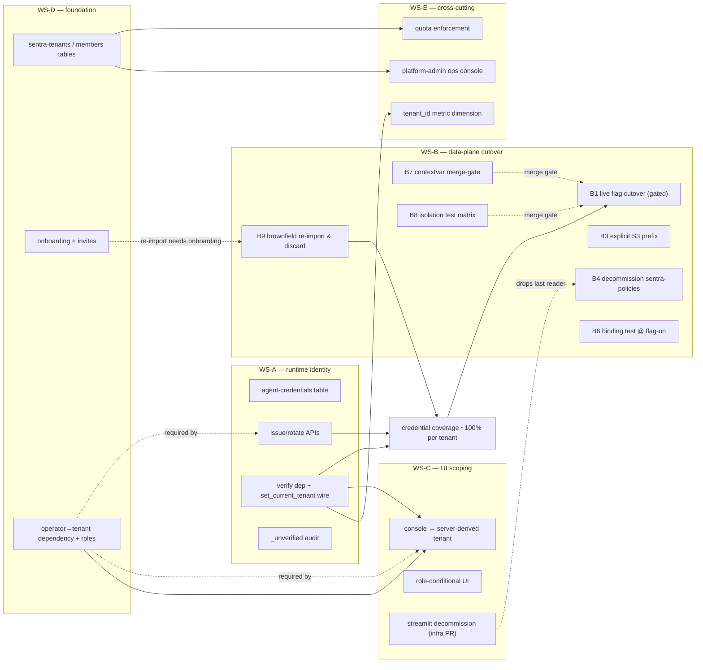

# Multi-Tenancy Workstreams — Index & Sequencing

**Parent LLD**: [lld/26-multi-tenancy.md](../../lld/26-multi-tenancy.md) (v1.3, Approved)
**Last Updated**: 2026-06-24
**Status**: ✅ WS-A & WS-D complete · 🟢 WS-B code-complete (B1 fallback window, B3 explicit S3 prefix, B4 table-drop, B5 docs, B9 inventory/purge tooling all built + tested; acme re-imported under tenant `acme` with live credentials) · 🟢 WS-C code-complete except C3 (C1 server-derived tenant + switcher, C2 role-conditional UI **+ residual-agent list now wired**; **C3 Streamlit decommission DEFERRED 2026-06-24 — dashboard kept as-is**) · 🟢 WS-E code-complete (E1 tenant_id metrics + new `QuotaExceeded` metric/alarm; E2 quota service; **E3 §10 Q2 consent gate now ENFORCED** — deny-by-default cross-tenant reads + immutable `sentra-platform-audit-records`). **LIVE-GATED, not executed:** per-tenant enforce flip + dev ceiling raise, B3 `--delete-old` cutover, `default` brownfield purge (human sign-off), E2 RPS-quota soak + ceiling raise, per-tenant `platform_read_consent` grants. **Still gated by the deferred C3:** WS-B B4 `sentra-policies` table drop (Streamlit remains the last potential reader). See each WS doc's Status line.

This folder breaks LLD-26 into five independently-ownable workstreams. Each doc is a **build task list** — concrete enough to code from without re-reading the whole LLD. Read this index first for the dependency graph and the one rule that gates the whole rollout (credential-coverage before enforce).

| WS | Doc | Scope (one line) | Owner | Blocking? |
|---|---|---|---|---|
| **WS-D** | [ws-d-lifecycle-rbac.md](ws-d-lifecycle-rbac.md) | `sentra-tenants` + `sentra-tenant-members`, onboarding/invites, operator→tenant dependency, RBAC roles | TBD | **Foundation — build first** |
| **WS-A** | [ws-a-runtime-identity.md](ws-a-runtime-identity.md) | `sentra-agent-credentials`, issue/rotate APIs, JWT verify dependency + `set_current_tenant` wire, `_unverified` audit | TBD | Gates the enforce flip |
| **WS-B** | [ws-b-data-plane-scoping.md](ws-b-data-plane-scoping.md) | Live `TENANCY_V2` flag cutover, explicit S3 prefix, binding test @ flag-on, decommission legacy `sentra-policies`, isolation test matrix | TBD | Storage copy done; enforce flip gated by WS-A |
| **WS-C** | [ws-c-ui-scoping.md](ws-c-ui-scoping.md) | `web/console` server-derived tenant + tenant switcher, role-conditional UI, Streamlit decommission (infra PR) | TBD | Last — depends on A+D |
| **WS-E** | [ws-e-metrics-quotas.md](ws-e-metrics-quotas.md) | Tenant-dimensioned CloudWatch metrics, quota enforcement, platform-admin (internal ops) console | TBD | Cross-cutting; not on critical path |

---

## Dependency Graph

## The one rule that gates everything (from LLD §7.1.2)

The `TENANCY_V2` **storage copy is already done** and is dual-readable, so the bulk copy can run any time. But **an agent's data is only flipped to its real `tid` once that agent has a registered credential.** Therefore:

1. **WS-D ships first** — tenants/members tables + the operator→tenant membership lookup. WS-A credential issuance must check the operator owns the agent, and WS-C scoping reads the same membership.
2. **WS-A ships issuance + runs in shadow** — verify the JWT and log the resolved `tid`, but do not yet route onto it. Uncredentialed agents stay on the legacy flat/`default` path (no brick, no cross-tenant exposure).
3. **WS-B flips enforce per-tenant** only when that tenant's credential coverage ≈100%. Rollout state is the `identity_mode` field on the `sentra-tenants` row (`off|shadow|enforce`); env `TENANT_IDENTITY_MODE` is only a fleet-wide ceiling. **Effective mode = min(env ceiling, tenant.identity_mode)**.
4. **WS-C is last** — UI scoping needs both server-side tenant resolution (WS-D) and real data-plane identity (WS-A).
5. **WS-E is cross-cutting** — the `tenant_id` metric dimension lands once WS-A is in; quotas + the platform console need WS-D's registry. Not on the A→B→C critical path.

## Brownfield decision (resolved 2026-06-23)

Every existing agent is `default-…` (imports ran under the hardwired `default` tenant) and `agent_id` is immutable, so there is no in-place path into a real tenant. **Decision: the `default` population is disposable dev/demo data → re-import under real tenants & purge `default` (WS-B B9).** No cascade re-key migration is built. This must be handled at cutover or all current data is silently stranded. The purge is irreversible, so it runs **only behind an explicit human sign-off** re-confirming no real customer data is under `default` (the "dev data" claim is a design-time assumption, not an execution-time fact).

## Build order (recommended)

`WS-D` → `WS-A` (shadow) → `WS-B` (per-tenant enforce flip) → `WS-C` → `WS-E` (can start in parallel with WS-C once WS-A/D land).

## Shared conventions (all workstreams)

- **AWS**: Account `531109575379`, profile `sentra`, region `us-east-1`. Refresh creds with `ada cred update --once`.
- **Tenancy switchboard**: all DDB/S3 access goes through [src/security-controller/app/utils/tenancy.py](../../src/security-controller/app/utils/tenancy.py). Never compose a tenant key by hand.
- **Fail-secure**: any ambiguity in tenant resolution on the data plane resolves to DENY, never to `"default"` (LLD §8).
- **Reserved tenant ids** (rejected at creation): `default`, `_unverified`, `_platform`.
- **Merge gate**: the tenant-isolation negative-test matrix (WS-B §, LLD §4.7) must pass before any flag-on merge.
