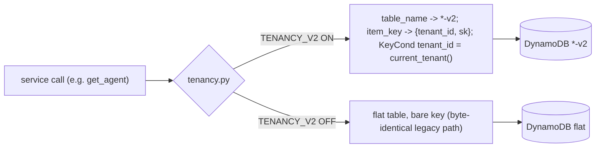

# WS-B: Data-Plane Tenant Scoping (cutover + loose ends)

**Parent LLD**: [lld/26-multi-tenancy.md](../../lld/26-multi-tenancy.md) §4
**Status**: 🟡 Partial (2026-06-24) — DONE: TENANCY_V2 storage copy, B6 binding-under-v2 test, B7 contextvar rule, B8 isolation matrix (green). PENDING (gated): B1 per-tenant enforce flip, B3 explicit S3 prefix, B4 `sentra-policies` decommission, B9 brownfield re-import + `default` purge (human sign-off).
**Owner**: TBD

> The `TENANCY_V2` storage copy (4 tables, switchboard, tests) is already built and dual-readable. WS-B is the **live cutover** + the remaining loose ends — it adds **no new call-site rewrites** for the four migrated tables; it flips the flag, per-tenant.

## Dependencies

- **Depends on**: **WS-A** credential coverage for the per-tenant **enforce** flip (LLD §7.1.2 — an agent's data only flips to its real `tid` once it has a credential). The bulk copy / write-freeze is independent and can run any time.
- **Blocks**: WS-C (UI scoping needs the data plane to be really tenant-scoped).
- **Founder-gated**: the enforce flip is a deliberate, gated action.

---

## Tasks

### B1 — Live flag cutover (per-tenant, gated)

- **Rollout state is per-tenant**: authoritative control is the `identity_mode` field on the `sentra-tenants` row (`off|shadow|enforce`, WS-D). Env `TENANT_IDENTITY_MODE` is **only a fleet-wide ceiling** (global `off` kill-switch, or cap at `shadow` during an incident). **Effective mode = min(env ceiling, tenant.identity_mode)**, evaluated in `resolve_tenant_from_jwt` (WS-A §3.4). This is what makes "flip per-tenant" expressible.
- **Gate**: flip a tenant to `enforce` only when its credential coverage ≈100% (WS-A). Watch resolved-`tid` correctness in shadow first.
- **Residual tail** (deliberate, not left to chance): enforce flips per-*tenant* but coverage is per-*agent*, so a flipped tenant can contain a not-yet-credentialed agent. Each such agent enters a **time-boxed, alarmed per-agent legacy-fallback window** (self-asserted id, "no worse than today") that **expires to hard fail-secure DENY** — it never silently rides on `default`. Operators see the residual list in the console (WS-C) and must onboard or retire those agents before the window closes.
- Use the write-freeze runbook: [cutover-runbook.md](../../features/multicloud-agent-import/cutover-runbook.md).

### B2 — Store-by-store end state

| Store | Tenant key | State | Action |
|---|---|---|---|
| `agent-registry-v2` | PK `tenant_id` / SK `agent_id` | built (flag off) | **cutover** |
| `policies-metadata-v2` | PK `tenant_id` / SK `policy_id`; GSI `agent-index` PK `tenant_agent_id` | built | **cutover** |
| `session-context-v2` | PK `tenant_id` / SK `session_id` | built | **cutover** |
| `validation-signals-v2` | PK `tenant_session_id` (composite `{tenant}#{session_id}`) / SK `request_id#ts#source` | built | **cutover** |
| `sentra-cloud-connections` | PK `tenant_id` / SK `id` | born-scoped | none |
| `sentra-discovery-cache` | PK `tenant_id` / SK `native_resource_id` | born-scoped | none |
| `sentra-sigma-rules-metadata`, `sentra-tool-registry` | none (global) | — | **document as global** (B5) |
| legacy `sentra-policies` | none | dead on validate path | **decommission** (B4) |

> The `validation-signals-v2` composite PK is deliberate: `sk` already holds `request_id#ts#source` so `session_id` can't be the SK, and a bare `tenant_id` PK would create a tenant-wide hot partition. See [tenancy.py:27-31](../../src/security-controller/app/utils/tenancy.py).

The read path is a switchboard (no per-call rewrite needed):

### B3 — Explicit S3 prefix

**Decision: adopt `tenants/{tenant_id}/policies/agents/{agent_id}/v{n}.{yaml|cedar}`.**

- This is **not** a correctness fix (canonical id already makes `agent_id`-only keys collision-safe). It is **application-layer defense-in-depth + future IAM scopability**.
- **Honest scope**: a static bucket policy `s3:prefix = tenants/${tenant_id}/*` does NOT by itself enforce isolation — the controller is a single shared IAM role, so there's no per-request `${tenant_id}` to bind. A real storage guarantee needs **request-scoped session tags** (`aws:PrincipalTag/tenant_id` via `sts:AssumeRole`/`TagSession`) or per-tenant assumed-role sessions — real cost (STS round-trip / session cache on the hot path). That is a **future** upgrade for Dedicated/regulated plans (LLD §10), not claimed today.
- **Current-state (accurate):** today policy keys are `policies/agents/{agent_id}/{policy_id}.yaml` ([s3_policy_store.py:29](../../src/security-controller/app/utils/s3_policy_store.py#L29); the `s3_key` is stored in DDB metadata, [policy_engine.py:176](../../src/security-controller/app/validators/policy_engine.py#L176)). The key is composed from **`agent_id`, not `current_tenant()`**. Isolation is therefore **implicit** (the LLD §4.3 wording — "implicit only"): it holds *only because* `agent_id` happens to carry the tenant prefix. The explicit `tenants/{tenant_id}/…` prefix moves this from implicit to explicit (and makes the future IAM session-tag upgrade a config change, not a re-key).
- **Migration is a real re-key, not just new writes:** enumerate every existing `policies/agents/{agent_id}/…` object and copy it under `tenants/{tenant_id}/policies/agents/{agent_id}/…`, updating the `s3_key` in the policy metadata row. Use dual-read (new prefix, fall back to old) during the copy window, then cut writes to the new prefix and delete the old objects.
- ⚠️ **Brownfield intersection (see migration task below):** existing objects belong to `default-…` agents, so they land under `tenants/default/…`. Whether they get re-keyed to a real tenant depends on the brownfield decision — coordinate with that task.

### B4 — Decommission legacy `sentra-policies`

It is dead on the validate path; its **last reader is the Streamlit dashboard** (WS-C removes it). Sequence: WS-C drops the reader → confirm no other reader → delete the table. Coordinate with WS-C C2/C3.

### B5 — Platform-global tables (document, intentional)

`sentra-sigma-rules-metadata` and `sentra-tool-registry` are Sentra-authored reference data, identical for every tenant, read-only on the validate path → **stay unscoped**. **Contract: no tenant-specific data may ever be written to a global table.** A future tenant-custom Sigma need becomes a *new* tenant-scoped `sentra-tenant-sigma-rules` table layered over the global set — not a mutation of the global one. (Recorded as a decision, not built now.)

### B6 — Policy-binding under v2 (loose end)

The agent↔policy binding (`attached_policy_id`, from `features/agent-policy-management`) is **correct as-is under v2** — the binding lives on the `agent-registry` item which v2 partitions by `tenant_id`, and attach/detach go through tenancy-aware `agent_service`. **Required task**: add a regression test running the binding suite with `TENANCY_V2_ENABLED=true` (today those tests implicitly assume flat tables) so cutover can't silently break binding.

### B7 — Contextvar propagation across sync/async boundary (the leak most likely to ship green)

The entire isolation guarantee rests on **one** `contextvars.ContextVar` ([tenancy.py:62](../../src/security-controller/app/utils/tenancy.py)) set per request. boto3 is **synchronous** and blocking DB work is offloaded to worker threads — **`contextvars` do not cross a thread boundary unless the context is carried.** A bare `loop.run_in_executor(...)` runs in the executor thread's default context, silently reverting `current_tenant()` to `"default"` → **reads/writes the wrong tenant's partition**, passing every happy-path test.

**Merge-gate rule:**
- All blocking, tenancy-dependent offload MUST use **`asyncio.to_thread(...)`** (copies context by construction) or `loop.run_in_executor(ctx.run, ...)` with `ctx = contextvars.copy_context()`. **Never** a bare `run_in_executor`. (Codebase already does this in [policy_engine.py:230-232](../../src/security-controller/app/validators/policy_engine.py) — this promotes it to a hard rule.)
- `asyncio.create_task(...)` is safe. Raw threads, `ProcessPoolExecutor`, cross-thread `call_soon` are NOT and must not touch a tenant-scoped store without explicit context propagation.

### B8 — Tenant-isolation test matrix (MERGE GATE)

Isolation is a security boundary → explicit **negative**-test suite that blocks merge:

| Test | Asserts |
|---|---|
| Cross-tenant read | With `current_tenant()=A`, every reader (agents, policies, sessions, signals, connections, discovery, credentials, S3) returns **zero** of B's rows. |
| Cross-tenant write | A write under A never mutates a B-keyed item; key composition asserted on the persisted item. |
| Key-composition property test | Random `(tenant, id)` pairs: `item_key`/`signal_pk`/GSI keys round-trip, never collide across tenants (covers composite `tenant_session_id`). |
| Contextvar-survives-executor | `current_tenant()` observed **inside** an `asyncio.to_thread` DB call equals the request's tenant (the B7 leak). |
| Unverified → `_unverified` | No-credential / bad-sig requests audit under `_unverified`, never the claimed tenant or `default` (WS-A A4). |
| Binding under v2 | Binding suite passes with `TENANCY_V2_ENABLED=true` (B6). |
| Tenant delete | Post-purge, no row keyed to the deleted tenant remains in any v2 store or S3 prefix (WS-D D5). |

### B9 — Brownfield: re-import & discard the `default` population (DECISION: dev data)

**Context (blocking until handled):** every existing agent has `agent_id = default-{cloud}-{slug}-{hash}` (imports ran under the hardwired `default` tenant — [discovery_service.py:361](../../src/security-controller/app/services/discovery_service.py#L361)). `agent_id` is immutable (registry PK, binding key, S3 path, signal partition), so there is **no in-place path** to move a `default-…` agent into a real tenant. Without an explicit decision the rollout silently strands all current data.

**Decision (2026-06-23): the `default` population is disposable dev/demo data — re-import & discard.** No cascade-migration code is built. Mechanism:

1. After a tenant onboards (WS-D) and connects its cloud, **re-import its agents under the real `tenant_id`** — this mints new tenant-prefixed canonical ids (`{t_real}-{cloud}-{slug}-{hash}`) and fresh registry/policy/binding rows via the normal import path.
2. **Freeze `default` read-only** once net-new traffic flows to real tenants (no new writes accrue under `default`).
3. **Purge the old `default-*` records** — registry, policies-metadata + bindings, validation-signals partitions, and S3 `policies/agents/default-*` objects — reusing the WS-D D5 per-tenant purge against the `default` tenant.

**Caveats to honor:** this **destroys default-tenant history by design** and is **irreversible**. The "default = dev data" premise is an assumption made at design time — it MUST be re-confirmed at execution time:
- **Hard gate (sign-off required before purge runs):** an explicit human sign-off that nothing under `default` is real customer data. The purge step must be guarded behind this gate (a flag/approval), not run automatically on the assumption. Inventory the `default` population first and attach the list to the sign-off.
- The demo orchestrator may still emit `default` traffic (LLD §10 Q3) — retire or re-point it **before** the freeze.
- Do **not** build the 5-store cascade re-key (the rejected heavy option).

## Acceptance criteria

- [ ] **Brownfield (B9):** existing `default-*` agents re-imported under real tenants; `default` frozen read-only; **purge runs only after explicit human sign-off (gate) confirming no real customer data**, with the inventoried `default` list attached; demo orchestrator re-pointed/retired before freeze.
- [ ] Per-tenant flip via `identity_mode`; env ceiling honored (`min(...)`); shadow→enforce validated on at least one tenant.
- [ ] Residual uncredentialed-agent fallback window is time-boxed + alarmed + expires to DENY.
- [ ] Explicit S3 prefix live with dual-read migration; writes cut to new prefix.
- [ ] Legacy `sentra-policies` deleted after WS-C drops its reader.
- [ ] Global tables documented; contract enforced (no tenant data in global tables).
- [ ] B8 isolation matrix green and wired as a merge gate; B7 rule enforced.

## Cross-references

- LLD §4 (design), §7 (sequencing/safety), §8 (fail-secure). [cutover-runbook.md](../../features/multicloud-agent-import/cutover-runbook.md).
- Pairs with WS-A (enforce-flip gate) and WS-C (legacy reader removal).
