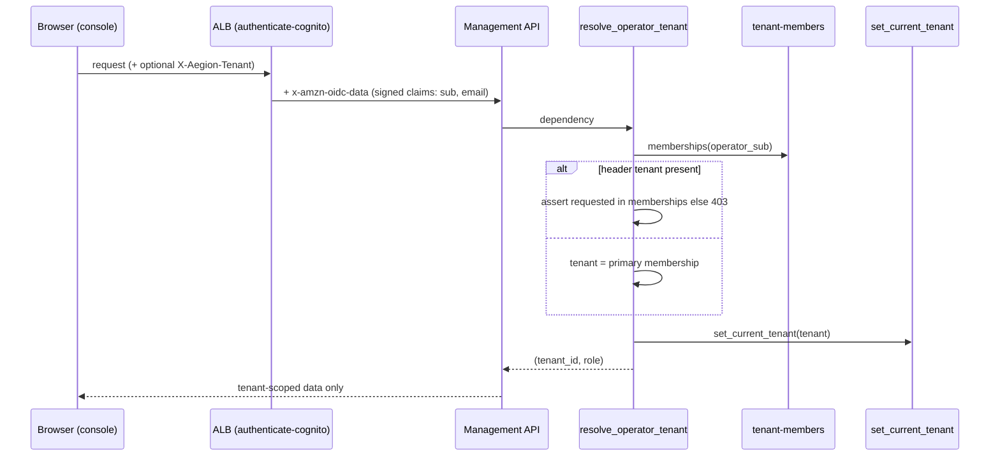

# WS-C: Dashboard & Web-Console Scoping

**Parent LLD**: [lld/26-multi-tenancy.md](../../lld/26-multi-tenancy.md) §5
**Status**: 🟡 Partial (2026-06-24) — DONE: C1 server-derived tenant (`useMe`, `tenantOf()` display-only), tenant switcher (`X-Aegion-Tenant`), C2 role-conditional UI (`rbac.ts`); **residual uncredentialed-agent list — backend ready** (`GET /v1/identity/residual-agents`, tenant-scoped, from WS-B B1). PENDING: console wiring of the residual list to that endpoint; C3 Streamlit decommission (separate infra PR).
**Owner**: TBD

## Dependencies

- **Depends on**: **WS-D** (`resolve_operator_tenant`, `require_role`, `GET /v1/me`) and **WS-A** (real data-plane identity, so scoped reads return real tenant data). Both must be live before the console is anything but cosmetic.
- **Blocks / pairs with**: WS-B B4 (console must drop the Streamlit `sentra-policies` reader before that table is deleted).

## Surface map (three UIs — only one is the product)

| Surface | Code | Role here |
|---|---|---|
| **SOC Console** | [web/console/src](../../web/console/src) | **The product UI.** React 19 + Vite + react-router v7 + react-query + chart.js, API-backed (`/v1/*`), behind ALB Cognito. All scoping work happens here. |
| Marketing site | [frontend/src](../../frontend/src) | Out of scope — GoDaddy static landing page, no tenant data path. |
| Streamlit | [src/dashboard](../../src/dashboard) | Legacy internal/demo — **decommissioned** (C3). |

---

## Tasks

### C1 — Console → server-derived tenant

Today the console is tenant-blind: `tenantOf()` only derives a **cosmetic** label from the email domain ([web/console/src/lib/auth.ts:53-58](../../web/console/src/lib/auth.ts)).

- **No UI reads DynamoDB directly.** The console calls the management APIs, which are tenant-scoped server-side via the WS-D operator dependency.
- **Tenant is never a client parameter.** The console sends its Cognito session (ALB OIDC headers); the server resolves `operator_sub → membership → tenant_id → set_current_tenant()`.
- Downgrade `tenantOf()` to **display-only**, explicitly annotated non-authoritative.
- **Multi-tenant operators** (Sentra admin, or a partner managing several customers) get a **tenant switcher**: the API accepts an `X-Aegion-Tenant` header that the server validates against the operator's membership set before honoring (deny if not a member). Default = the operator's sole/primary tenant. Render the switcher only when `memberships.length > 1` (from `GET /v1/me`).

### C2 — Role-conditional UI (the part added in LLD v1.3 §5.4)

`require_role` (WS-D) is the **authority**, but the console must also **render to the operator's role** so viewers never see actions they can't take.

- Fetch the membership `role` from `GET /v1/me` on session bootstrap; hold it in app context.
- Gate UI by role (mirror the RBAC matrix):
  - `viewer` → read-only views; no create/edit/delete/rotate controls; members screen hidden.
  - `editor` → import + policy CRUD; **no** member management; **no** tenant delete.
  - `admin` / `owner` → member management visible.
  - `owner` only → **Delete tenant** action visible.
- **Client gating is UX only, never the boundary** — every mutation is still authorized server-side by `require_role`, so a tampered client gains nothing.
- Show the **residual uncredentialed-agent list** (WS-B B1 fallback window) so operators can onboard/retire agents before the window expires.

### C3 — Streamlit decommission

**Decision (LLD v1.3 §5.3):** Streamlit (`src/dashboard`) is retired — `web/console` covers every Streamlit tab (`overview, agents, threats, audit, policies, quarantine, topology, connect, discovery, import`) and is API-backed + tenant-scopable. No tenancy work is invested in Streamlit.

**This is a deploy-affecting infra change → its own follow-up PR, not this docs change.** What it entails:
- Delete `src/dashboard/` + its `docker/` build + `requirements.txt`.
- Drop CDK: dashboard ECR repo, `DashboardTaskRole`, `dashboard_tg` target group, Cognito callback entries, monitoring widgets.
- **Load-bearing**: the public ALB's **default listener action currently routes to Streamlit**, with `web/console` layered as a host-based rule on top ([cdk/stacks/compute_stack.py:859-896](../../cdk/stacks/compute_stack.py#L859-L896)). Removal requires **rewiring the ALB default action to `web/console`**.
- This also removes the **last reader of legacy `sentra-policies`** → unblocks WS-B B4 (table deletion).
- Until that PR lands, Streamlit stays deployed behind Cognito as-is (no new tenancy features); `web/console` is the surface customers use.

## Acceptance criteria

- [ ] Console makes no direct DDB calls; all data via tenant-scoped APIs.
- [ ] `tenantOf()` is display-only; tenant never sent as a client param except the validated `X-Aegion-Tenant` switcher.
- [ ] Switcher appears only for multi-membership operators; foreign tenant → `403`.
- [ ] Role-conditional rendering matches the RBAC matrix; server still enforces (tampered client gains nothing).
- [ ] Residual uncredentialed-agent list surfaced.
- [ ] (Follow-up infra PR) Streamlit code + CDK removed; ALB default action rewired to `web/console`; `sentra-policies` reader gone (hands off to WS-B B4).

## Cross-references

- LLD §5 (design, incl. §5.4 role-conditional UI, §5.5 platform console → see WS-E), §7.1 (WS-C is last).
- Sibling: LLD-08 (console role bootstrap via ALB OIDC). Pairs with WS-B B4.
