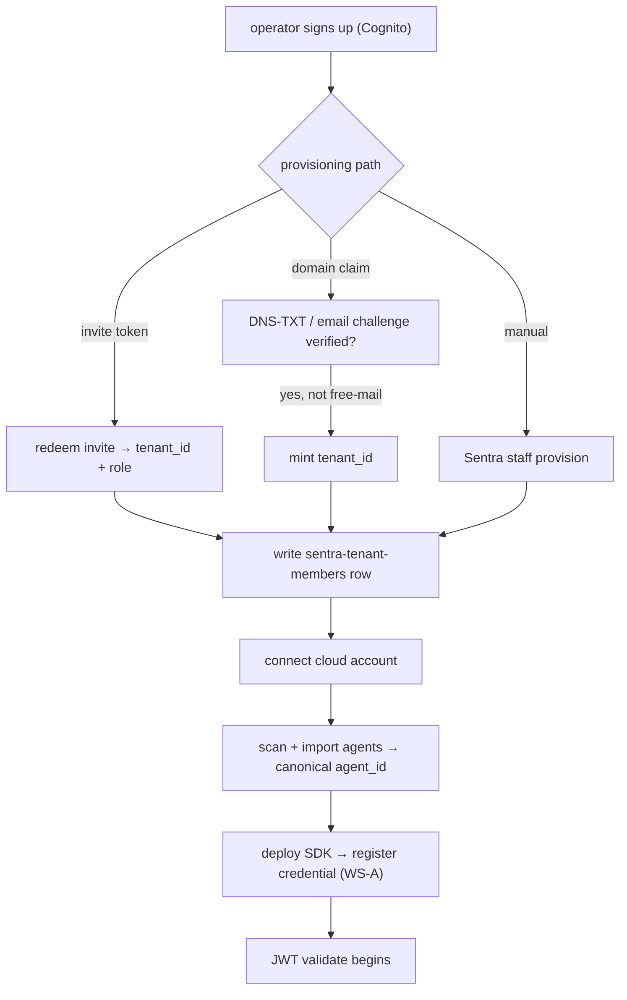

# WS-D: Tenant Lifecycle, Onboarding & RBAC

**Parent LLD**: [lld/26-multi-tenancy.md](../../lld/26-multi-tenancy.md) §6
**Status**: Ready for build — **build first (foundation)**
**Owner**: TBD

## Dependencies

- **Depends on**: nothing (foundation). Cognito/ALB auth already exists (LLD-08).
- **Blocks**: WS-A credential issuance (must verify operator owns the agent), WS-C console scoping (reads the membership), WS-E quota + platform console (read the registry).
- **Shared**: [tenancy.py](../../src/security-controller/app/utils/tenancy.py) switchboard.

---

## Goal

Stand up the tenant registry and the operator↔tenant mapping that the rest of the system depends on, plus the onboarding paths that create tenants safely (no domain takeover) and the RBAC roles that gate control-plane actions.

## Tasks

### D1 — New tables

Create two DynamoDB tables (CDK, storage stack). Both partitioned for clean per-tenant ops.

**`sentra-tenants`** — PK `tenant_id` (S)

| Attribute | Type | Notes |
|---|---|---|
| `tenant_id` (PK) | S | Immutable slug; reserved values rejected (`default`, `_unverified`, `_platform`) |
| `display_name` | S | Customer name (mutable; the human-readable handle) |
| `status` | S | `active` \| `suspended` \| `deleting` \| `purged` (terminal tombstone — never re-mint the id) |
| `plan` | S | `trial` \| `dedicated` \| `enterprise` (informs quotas) |
| `identity_mode` | S | `off` \| `shadow` \| `enforce` — **authoritative per-tenant rollout control** (WS-A/B read this) |
| `quota` | M | `{max_agents, max_validate_rps}` (enforced in WS-E) |
| `deletion_cursor` | M | Per-store purge checkpoint (resumable deletion, D5) |
| `created_at` / `created_by` | N / S | Audit |

**`status` semantics (define, don't leave dangling):**
- `active` — normal.
- `suspended` — non-payment / policy hold. **Behavior:** control-plane is **read-only** (operators can view, not mutate); on the **data plane**, `/v1/validate` **fail-secure DENYs** with a distinct reason (`TENANT_SUSPENDED`) so a suspended tenant's agents stop acting but the suspension is reversible (unlike `deleting`). Reinstating sets `active`. *(If product decides suspended should keep agents running and only freeze the console, flip the data-plane line — but pick one; today it is undefined.)*
- `deleting` / `purged` — see D5.

**`sentra-tenant-members`** — PK `operator_sub` (S), SK `tenant_id` (S)

| Attribute | Type | Notes |
|---|---|---|
| `operator_sub` (PK) | S | Cognito `sub` |
| `tenant_id` (SK) | S | Membership = (sub, tenant) pair |
| `role` | S | `owner` \| `admin` \| `editor` \| `viewer` |
| `is_primary` | BOOL | Default tenant when no `X-Aegion-Tenant` header |
| `invited_by` / `created_at` | S / N | |

- **GSI `tenant-members-index`**: PK `tenant_id` → list all operators in a tenant (members admin screen, WS-C).
- Add both tables to the deletion purge list (D5) and to LLD-06 data model doc.
- **IAM grant + env wiring (required):** grant the controller task role **read/write on `sentra-tenants` and `sentra-tenant-members`** and **query on `tenant-members-index`**, and inject both table names into the task-role env ([compute_stack.py](../../cdk/stacks/compute_stack.py)), mirroring the existing table wiring. Missing grants deploy clean and 500 at runtime.

### D2 — Onboarding & org identity (anti-takeover)

**Org identity is never inferred from a raw email domain.** Tenant creation requires exactly one of three paths:

1. **Invite token** (default for additional operators): an `owner`/`admin` invites by email; the invite carries `tenant_id` + role and is **single-use, time-boxed**. Implement invite issue + redeem endpoints; store pending invites (TTL'd).
2. **Verified domain claim**: first operator may create a tenant for a corporate domain only after **DNS-TXT or email-challenge** verification. **Free-mail domains (gmail, etc.) are blocklisted** from domain-claim — they may only join via invite or manual provisioning.
3. **Manual / sales-assisted provisioning**: design-partner / enterprise tenants are provisioned by Sentra staff; no self-serve mint.

**`tenant_id` minting**: Sentra-**derived**, immutable slug — `t_<short-ulid>` or a normalized verified-domain label. **Not customer-chosen free text.** Reserved values rejected. Once minted it is immutable for the tenant's life (it is baked into every `agent_id` and store key); a rename touches `display_name` only.

Onboarding flow to implement (mermaid in LLD §6.2):



### D3a — Control-plane authentication: verify the ALB OIDC token (NET-NEW, security milestone)

> **This is not plumbing — it is the controller's first app-layer authentication.** A grep of the controller for `x-amzn-oidc`, `cognito`, `verify_alb`, `require_role`, `oidc` returns **zero** matches: today the management endpoints (`/v1/agents`, `/v1/policies`, `/v1/connections`, …) have **no app-layer authz** — they trust ALB Cognito at the edge only. WS-D introduces in-app identity for the control plane. It sits on the critical path (D blocks WS-A A2 and WS-C C1), so scope it as its own task.

Implement `verify_alb_oidc(request) -> claims` (**does not exist yet**):
- ALB injects `x-amzn-oidc-data` — a signed JWT of the Cognito claims (`sub`, `email`, …). The header also names the signing `kid` and the regional key endpoint.
- **Verify it** (do not trust it blind): fetch ALB's **regional public signing key** (`https://public-keys.auth.elb.{region}.amazonaws.com/{kid}`), **cache** it, handle **key rotation** (kid changes), validate **signature + `exp`**. Reject → `401`.
- This is the gate for *every* control-plane call. Performance: cache keys (they rotate slowly); do not fetch per request.

**Acceptance (own criteria):** unsigned/forged/expired `x-amzn-oidc-data` → `401`; valid token resolves `sub`; key cache survives rotation; verified on a representative management route and the credential APIs (WS-A A2).

### D3b — Operator→tenant dependency + roles (the part other WS consume)

This is what WS-A and WS-C wire against; it runs **after** D3a has authenticated the caller.

- **`resolve_operator_tenant`** FastAPI dependency: takes the **verified** claims from `verify_alb_oidc` (D3a) → `sub`, looks up memberships, resolves the active tenant, calls `set_current_tenant`.
  - If `X-Aegion-Tenant` header present → assert it ∈ memberships else `403`.
  - Else → tenant = the `is_primary` membership.
  - Returns `(tenant_id, role)`.

```python
# app/api/deps.py (new) — conceptual
async def resolve_operator_tenant(request) -> OperatorContext:
    claims = verify_alb_oidc(request)          # D3a — verified, NOT trust-blind
    subject = claims["sub"]
    memberships = members.by_operator(subject) # PK query on sentra-tenant-members
    requested = request.headers.get("X-Aegion-Tenant")
    if requested:
        m = next((x for x in memberships if x.tenant_id == requested), None)
        if m is None:
            raise HTTPException(403)            # not a member
    else:
        m = next(x for x in memberships if x.is_primary)
    tenancy.set_current_tenant(m.tenant_id)     # rest of request is tenant-scoped
    return OperatorContext(tenant_id=m.tenant_id, role=m.role)
```

- **`require_role(min_role)`**: a second dependency layered after `resolve_operator_tenant`, reading `role` from the already-loaded membership. RBAC matrix:

| Role | Agents/connections | Policies | Members | Credentials |
|---|---|---|---|---|
| `owner` | CRUD | CRUD | CRUD + delete tenant | CRUD |
| `admin` | CRUD | CRUD | CRUD | CRUD |
| `editor` | read + import | CRUD | read | rotate |
| `viewer` | read | read | — | read |

- Roles are **control-plane only** (the data plane is governed by policy, not operator roles).
- **`_platform` capability**: a reserved membership granting Sentra staff cross-tenant support access. Every `_platform` access is audited under **both** `_platform` and the target tenant. (Consumed by WS-E platform console; see LLD §10 Q2 — confirm audit/consent model for SOC2.)
- Expose `GET /v1/me` returning `{tenant_id, role, memberships[]}` so WS-C can render role-conditional UI and the tenant switcher. **Net-new endpoint — not yet in the LLD API surface; add it to the §11.2 sibling-doc sync (LLD-08).**

### D4 — Tenant-create validation

Reject reserved ids (`default`, `_unverified`, `_platform`) at creation → `400`. Enforce the minting rule (derived slug, not free text).

### D5 — Tenant deletion & data erasure (staged, resumable)

Deletion is a compliance surface (GDPR/CCPA), so it is staged — not a single destructive call:

1. **`status=deleting`** first — control-plane writes refused; data plane fail-secure DENYs.
2. **Credential revoke** — all `agent-credentials` rows for the tenant → `revoked` (WS-A table).
3. **Live-store purge** — per-tenant scan-and-delete across the four v2 tables, `cloud-connections`, `discovery-cache`, `agent-credentials`, and S3 prefix `tenants/{tenant_id}/` (recursive). **Idempotent + resumable** via `deletion_cursor` checkpoint on the `sentra-tenants` row.
4. **Audit archive retained, NOT purged** — tamper-evident long-term audit (LLD-17) kept under a **legal-hold** tag for the contractual window, then released by a lifecycle job. Erasure requests conflicting with an active legal hold are **queued, not executed**. The customer agreement must state this exception.
5. **Completion** — row flips to `purged` (tombstone), signed deletion certificate emitted.

**Failure model**: any step failing leaves `status=deleting` with the checkpoint intact, fires an alarm, resumes on re-run. Tenant is never partially usable.

## Acceptance criteria

- [ ] Both tables + GSI deployed via CDK; **task role granted RW + GSI query, table names in task env**; added to LLD-06.
- [ ] Three onboarding paths implemented; free-mail domain-claim blocked; reserved ids rejected (`400`).
- [ ] `tenant_id` minting produces immutable derived slugs only.
- [ ] **D3a `verify_alb_oidc` live** — forged/expired `x-amzn-oidc-data` → `401`; ALB regional key fetched, cached, survives rotation. (Own acceptance, above.)
- [ ] `resolve_operator_tenant` + `require_role` dependencies live (consume verified claims); `403` on non-member tenant and insufficient role.
- [ ] `suspended` behavior implemented per defined semantics (control-plane read-only; data-plane `TENANT_SUSPENDED` DENY) and reversible.
- [ ] `GET /v1/me` returns role + memberships.
- [ ] `_platform` cross-tenant access dual-audited.
- [ ] Deletion is resumable (kill mid-purge → resume completes); post-purge no tenant-keyed row remains except the `purged` tombstone + legal-held audit (covered by WS-B "Tenant delete" isolation test).

## Cross-references

- LLD §6 (this workstream's design), §5.2 (membership lookup consumed by console), §8 (error/403 table).
- Sibling docs to sync: LLD-08 (operator↔tenant resolution), LLD-06 (new tables), PRD FR-10.
